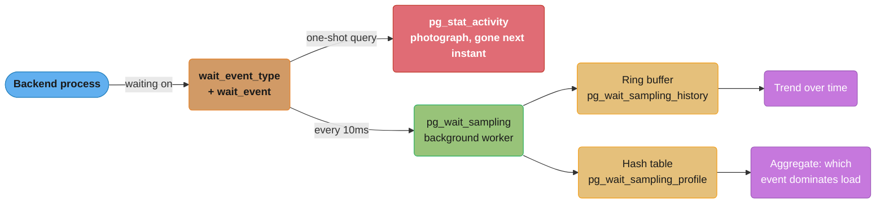

# Wait Events and Benchmarking

## 1. Concept Overview

The parent module's lock-monitoring query joins `pg_stat_activity` against
`pg_blocking_pids()` to find one specific problem: a session waiting on `Lock`. That is one
of eight distinct classes of "waiting" PostgreSQL tracks, and treating all waiting as lock
waiting is the single most common misdiagnosis in a live performance incident. This module
covers the other seven — what each one means diagnostically, why `pg_stat_activity` alone
only shows you a single instant and not a trend, and how a background sampler turns a
snapshot into a picture you can actually reason about.

The second half covers the discipline the parent module assumes but never teaches: how to
prove a tuning change actually worked. A number from a 10-second `pgbench` run against a
database you just created is not evidence — it is noise dressed as a result. This module
covers `pgbench`, `sysbench`, and `HammerDB` methodology precisely enough to tell a real
result from a self-deceiving one, and closes with PostgreSQL 18's asynchronous I/O
subsystem, which changes what those benchmarks measure.

---

## 2. Intuition

`pg_stat_activity` is a photograph — accurate the instant it is taken, and useless for
seeing a trend, because the query that took the photo is itself gone a millisecond later. A
wait-event *sampler* is a movie made of thousands of those photographs, taken automatically
and cheaply, and a movie is what lets you say "this session spent 80% of the last five
minutes waiting on `WALWriteLock`," a sentence a single snapshot can never support.

A benchmark is a race, and the entire discipline in §4 and §10 is the difference between a
timed hundred-meter dash — over before the runner's body has settled into its real pace —
and a timed marathon, which is the only distance that reveals whether the runner can
actually sustain the effort.

---

## 3. Core Principles

**A wait event tells you *what* the backend is waiting for, not *why*.** `Lock` on a
`transactionid` means one specific thing; `LWLock` on `WALWriteLock` means something
completely different, and the fix for one does nothing for the other. Reading the type
before the specific event name is the discipline — the type tells you which subsystem to
investigate.

**`pg_stat_activity` shows only backends waiting *right now*.** A backend that waited on
`IO` for 200ms and then finished is invisible the instant you query it — sampling is what
recovers that history, and it is why production systems run a sampler continuously rather
than polling by hand during an incident.

**A benchmark result without a stated methodology is not a result.** Client count, thread
count, run duration, warmup period, and whether the run spanned a full checkpoint cycle all
change the number by multiples — quoting a TPS figure without them is not reproducible and
should not be trusted, including your own past numbers if you did not record them.

**Never benchmark against a fresh cluster.** A newly created database has no bloat, no
fragmented indexes, a cold cache that will warm to an unrealistically clean state, and
autovacuum with nothing to do — every one of those differs from production, and every one
of them makes the fresh-cluster number too good.

---

## 4. Types / Architectures / Strategies

### The Eight Wait Event Types

Verified against the current PostgreSQL documentation
([postgresql.org/docs/current/monitoring-stats.html](https://www.postgresql.org/docs/current/monitoring-stats.html)),
`pg_stat_activity.wait_event_type` takes one of these values whenever `wait_event` is
non-null (a ninth, `Activity`, covers background processes idling in their own main loop —
not a query wait, and not covered further here):

| Type | Means the backend is waiting on… | Example `wait_event` | What it usually points to |
|---|---|---|---|
| `Lock` | A heavyweight lock protecting a SQL-visible object | `relation`, `tuple`, `transactionid` | A blocking transaction — the parent module's blocking query (§6 there) targets exactly this class |
| `LWLock` | A lightweight lock protecting an in-memory shared-memory structure | `BufferContent`, `WALWriteLock`, `LockManager` | Internal contention: too many backends hammering the same buffer, WAL insert point, or lock table |
| `IO` | A physical I/O operation to complete | `DataFileRead`, `WalWrite`, `DataFileSync` | The storage layer itself — disk latency, not contention |
| `IPC` | Coordination with another PostgreSQL process | `SyncRep`, `BufferIo`, `CheckpointDone` | Cross-process handoffs — a synchronous replica acknowledging, or waiting on another backend's I/O |
| `Client` | Activity on the socket to the client application | `ClientRead`, `ClientWrite` | Usually **not a database problem** — the server is waiting on the application or the network, not the other way around |
| `BufferPin` | Exclusive access to a buffer another session has pinned | `BufferPin` | An open cursor or a long-held reference holding a page pinned, blocking a `VACUUM` or an index operation |
| `Timeout` | A timeout expiring on purpose | `VacuumDelay`, `PgSleep` | Usually benign — throttling, not contention |
| `Extension` | A condition defined by a loaded extension module | (extension-specific) | Investigate the specific extension; PostgreSQL core has no visibility into what it means |

The two traps worth naming up front: a high `Client` proportion is frequently reported as a
"database is slow" incident when the database is in fact idle, waiting on an application
that is slow to read its results or a network link adding latency — the fix is nowhere near
the database. And `LWLock` is not `Lock`: the parent module's blocking-session query only
ever surfaces `Lock` waits, so a session stuck on `LWLock` contention (too many backends
racing for the same buffer or WAL insert lock) is invisible to it and needs the wider
taxonomy here.

### Sampling: From Snapshot to History

| Approach | What it captures | Cost |
|---|---|---|
| Poll `pg_stat_activity` by hand | Only whatever is waiting at the instant of each poll — misses anything shorter than your poll interval | Zero setup, but structurally blind to short waits and to history once the poll ends |
| `pg_wait_sampling` (extension) | A background worker samples every process's current wait event on a fixed interval (default 10ms) into a ring-buffer history and a hash-table profile | Low, continuous, and — unlike hand-polling — captures a wait even if it lasts only one sample tick |
| Vendor ASH-style sampler (e.g., AWS RDS/Aurora Performance Insights) | Same idea at the platform level: sessions sampled once per second, aggregated into "DB load" measured in average active sessions, sliceable by wait event, SQL, user, host | Managed, off-instance storage, no extension to install — see §7 |

The name **ASH** (Active Session History) comes from Oracle, but the technique —
periodically sample which sessions are active and what they are waiting on, then aggregate
— is now the standard cross-vendor approach to exactly the blind spot a single
`pg_stat_activity` query has.

### Benchmark Tool Taxonomy

| Tool | Workload shape | What it is good at proving |
|---|---|---|
| `pgbench` | Built-in TPC-B-like OLTP (five statements: two updates, one select, one insert, in a transaction), or a fully custom `-f` script | The quickest, most PostgreSQL-native way to answer "did this config or index change move the number," with full control over the transaction shape via custom scripts |
| `sysbench` | Lua-scripted OLTP workloads (`oltp_read_write`, `oltp_read_only`, and others), cross-engine (MySQL, PostgreSQL) | Cross-engine comparisons and CPU/thread-scaling studies, since the same script runs unmodified against either database |
| `HammerDB` | `TPROC-C` (derived from TPC-C, an order-entry OLTP workload) and `TPROC-H` (derived from TPC-H, a decision-support/analytics workload), driven through virtual users | The workload shape closest to a real transactional or analytical application, and the only one of the three with a first-class analytics-style benchmark (`TPROC-H`) |

---

## 5. Architecture Diagrams

**Snapshot vs. Sampled History**



A single query against `pg_stat_activity` only ever sees whichever backends happen to be
waiting at that exact instant; `pg_wait_sampling`'s background worker takes that same
snapshot every 10 milliseconds and accumulates it into two structures — a short ring-buffer
history for "what happened, in order" and a hash-table profile for "what dominated,
overall" — which is what turns an instant into a diagnosis.

**Benchmark Client/Server Path**

```mermaid
flowchart LR
    classDef io      fill:#61afef,stroke:#2e86c1,color:#1a1a1a,font-weight:bold
    classDef frozen  fill:#c678dd,stroke:#9b59b6,color:#fff
    classDef train   fill:#98c379,stroke:#27ae60,color:#1a1a1a
    classDef mathOp  fill:#d19a66,stroke:#e67e22,color:#1a1a1a,font-weight:bold
    classDef lossN   fill:#e06c75,stroke:#c0392b,color:#fff,font-weight:bold
    classDef req     fill:#56b6c2,stroke:#0097a7,color:#1a1a1a
    classDef base    fill:#e5c07b,stroke:#f39c12,color:#1a1a1a

    Script(["-f script.sql<br/>or built-in workload"]) --> Threads("-j worker threads")
    Threads --> Clients("-c simulated clients<br/>distributed across threads")
    Clients -->|"transactions"| Server[("PostgreSQL<br/>under test")]
    Server -->|"results"| Collector("Latency + TPS<br/>collector")
    Collector --> Report("-T duration report<br/>not -t transaction count")

    class Script io
    class Threads mathOp
    class Clients mathOp
    class Server train
    class Collector frozen
    class Report base
```



`-j` threads distribute `-c` clients across the benchmark driver's own CPU cores before a
single transaction reaches the server — which is exactly why a client bottleneck (§10) can
masquerade as a server bottleneck if `-j` is left too low for the client machine's core
count.

---

## 6. How It Works — Detailed Mechanics

### Reading the Wait Event Taxonomy Directly

```sql
-- One-shot snapshot: everything currently waiting, grouped by type
SELECT wait_event_type, wait_event, count(*)
FROM pg_stat_activity
WHERE wait_event IS NOT NULL
GROUP BY 1, 2
ORDER BY count(*) DESC;

-- Join against pg_wait_events for a human-readable description of each event
SELECT a.pid, a.wait_event_type, a.wait_event, w.description
FROM pg_stat_activity a
JOIN pg_wait_events w
  ON a.wait_event_type = w.type AND a.wait_event = w.name
WHERE a.wait_event IS NOT NULL
  AND a.state = 'active';
```

### Installing and Querying `pg_wait_sampling`

```sql
-- postgresql.conf (requires a restart -- shared_preload_libraries, like pg_stat_statements)
-- shared_preload_libraries = 'pg_wait_sampling'

CREATE EXTENSION pg_wait_sampling;

-- Current wait event for every process, including background workers
SELECT * FROM pg_wait_sampling_current;

-- Recent timestamped samples from the ring buffer (default: last 5,000 samples)
SELECT * FROM pg_wait_sampling_history ORDER BY ts DESC LIMIT 100;

-- Aggregated profile: which wait event has dominated since the profile was last reset
SELECT event_type, event, count
FROM pg_wait_sampling_profile
ORDER BY count DESC
LIMIT 10;
```

The profile view is the one to reach for first during an incident: it answers "what has
this system spent the most cumulative time waiting on" in one query, without having to
eyeball a scrolling history.

### `pgbench` — Init, Run, Custom Script

```bash
# Initialize the built-in TPC-B-like schema (scale factor 100 -> ~10M rows in pgbench_accounts)
pgbench -i -s 100 orders_bench

# Run: 20 clients, 4 threads, 5-MINUTE duration -- never -t for a benchmark that matters
pgbench -c 20 -j 4 -T 300 orders_bench

# A custom script targeting the real orders table instead of pgbench's own tables
# (requires -n: skip pgbench's own vacuum/init, since this script owns no pgbench tables)
cat <<'SQL' > order_lookup.sql
\set uid random(1, 5000000)
SELECT id, amount, created_at
FROM orders
WHERE user_id = :uid
ORDER BY created_at DESC
LIMIT 20;
SQL

pgbench -f order_lookup.sql -c 50 -j 8 -T 600 -n orders_bench
```

### `sysbench` — Prepare, Run, Cleanup

```bash
# Prepare: loads the sysbench schema and data (separate from pgbench's own schema)
sysbench oltp_read_write \
  --db-driver=pgsql --pgsql-host=... --pgsql-db=orders_bench \
  --tables=16 --table-size=10000000 prepare

# Run: 32 threads, 10-minute duration, with a report every 10 seconds
sysbench oltp_read_write \
  --db-driver=pgsql --pgsql-host=... --pgsql-db=orders_bench \
  --threads=32 --time=600 --report-interval=10 run

sysbench oltp_read_write --db-driver=pgsql --pgsql-db=orders_bench cleanup
```

### HammerDB — TPROC-C Build/Load/Run

HammerDB is driven through a Tcl-based CLI or GUI rather than a single flag-based command;
the shape of a run is build (create schema), load (populate warehouses/data), then a
timed run against a chosen virtual-user count:

```tcl
# Representative HammerDB CLI script (hammerdb-cli, PostgreSQL TPROC-C)
dbset db pg
diset connection pg_host localhost
diset tpcc pg_count_ware 200        # 200 warehouses -- HammerDB's scale unit
diset tpcc pg_num_vu 32              # 32 virtual users
buildschema
loadscript
vurun
```

### PostgreSQL 18 `io_method` and Asynchronous I/O

Verified against the current PostgreSQL documentation
([postgresql.org/docs/current/runtime-config-resource.html](https://www.postgresql.org/docs/current/runtime-config-resource.html))
and the PostgreSQL 18 release notes
([postgresql.org/docs/release/18.0/](https://www.postgresql.org/docs/release/18.0/)):
PostgreSQL 18 (released September 25, 2025) added an asynchronous I/O subsystem that lets a
backend queue multiple page-read requests instead of blocking on each one individually,
speeding up sequential scans, bitmap heap scans, and `VACUUM`. It is controlled by a
server-start-only GUC:

```
# postgresql.conf -- requires a restart, not reloadable
io_method = worker      # default: dedicated background I/O worker processes
# io_method = sync       # pre-PG18 blocking behavior; safe fallback on any platform
# io_method = io_uring   # Linux 5.1+, PostgreSQL built --with-liburing; fails to
                          # start (not silently falls back) if the platform can't support it

io_workers = 3           # only effective under io_method = worker; worker process count
```

```sql
-- New in PG18: file handles currently in flight under the async I/O subsystem
SELECT * FROM pg_aios;

-- pg_stat_io gained byte-level columns in PG18: read_bytes, write_bytes, extend_bytes
SELECT backend_type, io_object, io_context, reads, read_bytes, writes, write_bytes
FROM pg_stat_io
WHERE reads > 0
ORDER BY read_bytes DESC;
```

`io_method` changes what a benchmark measures, not just what it produces: an I/O-bound
`pgbench` run comparing `sync` against `worker` or `io_uring` is measuring exactly the
asynchronous-read overlap this feature adds, and a before/after comparison that does not
hold `io_method` constant across both runs has changed two variables at once.

---

## 7. Real-World Examples

**AWS RDS and Aurora Performance Insights** samples active database sessions once per
second and aggregates them into "DB load," measured in average active sessions and
sliceable by wait event, SQL statement, user, or host — the same ASH-style sampling
approach as `pg_wait_sampling`, run as a managed service rather than an in-database
extension. Source:
["Monitoring DB load with Performance Insights,"](https://docs.aws.amazon.com/AmazonRDS/latest/UserGuide/USER_PerfInsights.html)
Amazon RDS User Guide.

**Percona** has published cross-engine `sysbench` benchmark reports comparing InnoDB-
compatible engines (MySQL, MariaDB, Percona Server) across buffer-pool sizes and
concurrency levels using `oltp_read_write` and `oltp_read_only`, the exact methodology
this module documents — multiple buffer-pool tiers, multiple concurrency levels, both
read-write and read-only scenarios run separately rather than assumed to scale together.

**HammerDB**, maintained under the TPC-Council organization, renamed its workloads from
`TPC-C`/`TPC-H` to `TPROC-C`/`TPROC-H` in version 4.0 specifically to make explicit that
results are a Fair Use derivation, not compliant with the full TPC-C/TPC-H Benchmark
Standard and therefore not comparable to official, audited TPC results — a naming decision
worth knowing before quoting a HammerDB number as if it were an official TPC score.

---

## 8. Tradeoffs

| Choice | Benefit | Cost |
|---|---|---|
| Polling `pg_stat_activity` by hand | Zero setup, works on any PostgreSQL version | Structurally blind to any wait shorter than the polling interval; no history once the query moment passes |
| `pg_wait_sampling` | Continuous, low-overhead, captures short waits other approaches miss | Requires `shared_preload_libraries` and a restart to install; PostgreSQL 14+ only |
| `pgbench` | PostgreSQL-native, ships in the box, fully scriptable | Its built-in TPC-B-like workload is a coarse OLTP approximation, not a validated industry-standard benchmark |
| `sysbench` | Cross-engine, well-understood Lua scripting, strong for CPU/thread scaling studies | Its OLTP workloads are also synthetic approximations, not a certified benchmark |
| `HammerDB` | Closest to an industry-standard workload shape (TPC-C/TPC-H derived), includes an analytics benchmark | Heavier to set up (schema build + data load phases) than a single `pgbench` command; results are Fair Use, not TPC-audited |
| `io_method = io_uring` | Fewer syscalls, generally the best measured throughput on supported Linux kernels | Linux-only, requires a `liburing` build; fails to start rather than silently falling back on an unsupported platform |

---

## 9. When to Use / When NOT to Use

**Wait event sampling**: install `pg_wait_sampling` in any production system where a
config change, a version upgrade, or an unexplained latency shift needs a real diagnosis —
not just during an active incident, since the profile view is most useful with a long
baseline behind it. Do not treat wait-event data as a substitute for `pg_stat_statements`
or `EXPLAIN ANALYZE`; it tells you *what class* of resource a backend is waiting on, not
*which query* or *which plan node* caused it — combine the two, as noted in §4.

**Benchmarking**: run before any change with an uncertain blast radius — a major-version
upgrade, a storage-tier change, a significant configuration change, or evaluating
`io_method`. Do not benchmark against a freshly created cluster and extrapolate to
production (§10); do not trust any run shorter than several minutes; and do not run a
benchmark against a production system without a clear isolation plan, since the benchmark
itself will show up in the same wait-event and lock telemetry you are trying to read
cleanly.

---

## 10. Common Pitfalls

**Benchmarking against a fresh cluster.** A newly created, newly loaded database has zero
bloat, freshly built indexes at their most compact, a cold cache about to warm to an
artificially clean working set, and nothing for autovacuum to do — every one of those
differs from a production system that has run for months, and every one of them inflates
the number. The fix is benchmarking against a restored, production-sized snapshot, not a
synthetic load into an empty schema.

**Trusting a run shorter than one checkpoint cycle.** A checkpoint changes the I/O profile
of everything running alongside it — see the checkpoint-smoothing math in
[`database_performance_tuning`](database_performance_tuning.md) §10 for exactly how much a
checkpoint's dirty-page flush can spike I/O. A benchmark run shorter than
`checkpoint_timeout` (or the WAL-volume-driven interval, whichever is smaller) only ever
samples one phase of that cycle and reports a number that is either too good (missed the
checkpoint entirely) or too pessimistic (ran entirely during one) — the fix is a run length
of several checkpoint intervals, not one.

**The `pgbench` client-side bottleneck.** With `-j` (worker threads) set too low for the
client machine's core count, the `pgbench` process itself saturates before the server does
— the reported TPS plateaus, but `top` on the client shows 100% CPU on a handful of cores
while the server has idle headroom. The fix is raising `-j` to match the client's core
count (or running the driver from a separate, more powerful machine), not concluding the
database has hit its ceiling.

**Using `-t` instead of `-T`.** A fixed transaction count (`-t`) means a *slower* system
finishes faster — fewer total transactions executed, run terminates sooner — which is the
opposite of what a benchmark should reward. `-T` runs for a fixed wall-clock duration
instead, so a slower system runs *longer* and the throughput number it produces is
comparable to a faster system's over the same clock time. Never quote a `-t`-based result
as a throughput comparison between two configurations.

**Confusing `LWLock` contention with `Lock` contention.** The parent module's blocking
query (`database_performance_tuning` §6) filters specifically for
`wait_event_type = 'Lock'` — a session stuck on `LWLock` (say, `WALWriteLock` contention
from too many concurrent commits) never shows up in that query at all, and an engineer who
only knows the `Lock`-filtered query will conclude, incorrectly, that nothing is blocking
anything. The full taxonomy in §4 is what closes that gap.

**Setting `io_method = io_uring` in a config templated onto multiple platforms.** Per §6,
this GUC has a hard platform dependency and PostgreSQL refuses to start rather than
silently falling back to `worker` — a config management template that sets it globally
without a platform check turns a routine deploy into an outage on any host that lacks a
`liburing` build or a new-enough Linux kernel.

---

## 11. Technologies & Tools

| Tool | Purpose |
|---|---|
| `pg_wait_sampling` | Background-worker wait-event sampler; ring-buffer history + hash-table profile |
| `pg_wait_events` (system view) | Human-readable description for every `(wait_event_type, wait_event)` pair |
| `pg_stat_activity` | Point-in-time wait-event snapshot; foundation the parent module's lock query builds on |
| `pgbench` | Built-in PostgreSQL benchmark driver — TPC-B-like default, or a fully custom `-f` script |
| `sysbench` | Cross-engine, Lua-scripted OLTP benchmark driver |
| `HammerDB` | `TPROC-C` (TPC-C-derived OLTP) and `TPROC-H` (TPC-H-derived analytics) workload driver |
| AWS RDS/Aurora Performance Insights | Managed ASH-style session sampler; DB load by wait event, SQL, user, host |
| `pg_stat_io` / `pg_aios` | PostgreSQL 18 I/O statistics and in-flight async I/O handles |

---

## 12. Interview Questions with Answers

**Q: Why is `pg_stat_activity` alone insufficient for diagnosing an intermittent
performance problem?**
**Short:** It is a point-in-time snapshot, so any wait shorter than your query interval is invisible.

`pg_stat_activity` reports only what is happening at the instant it is queried — a session
that waited on `IO` for 300ms a second before your query ran has already moved on and
leaves no trace. Diagnosing an intermittent or short-lived problem requires continuous
sampling, not repeated point-in-time queries; `pg_wait_sampling` fills this gap with a
background worker that samples every 10ms by default, cheap enough to run continuously and
fine-grained enough to catch waits a human polling by hand would always miss.

**Q: What is the practical difference between the `Lock` and `LWLock` wait event types,
and why does confusing them lead to the wrong fix?**
**Short:** Lock waits are for SQL-visible objects like rows and tables; LWLock waits are internal shared-memory contention.

`Lock` covers heavyweight locks on SQL-visible objects — a row, a table, a transaction ID —
and is what a blocking-session query built on `pg_blocking_pids()` finds. `LWLock` covers
lightweight locks protecting internal shared-memory structures — a buffer's content, the
WAL insert point, the lock manager's own tables — and no blocking-session query written
against `Lock` will ever surface it. A backend spending most of its time on `LWLock:
WALWriteLock` has a WAL-throughput contention problem, not a blocking-transaction problem,
and the fix (batching commits, faster storage, `synchronous_commit` tuning) is entirely
different from anything that resolves a `Lock` wait.

**Q: Why should a `pgbench` run always use `-T` rather than `-t`?**
**Short:** -T runs for a fixed duration so a slower configuration takes visibly longer, which -t cannot show.

`-t` fixes the transaction *count* per client, so a slower system simply finishes sooner
with fewer total transactions completed in less wall-clock time — the opposite of what a
throughput comparison needs. `-T` fixes the *duration* instead: every configuration under
test runs for the same wall-clock window, so a slower system visibly completes fewer
transactions in that window, which is the actual comparison a benchmark exists to make.
Never quote a `-t`-based number as a cross-configuration throughput comparison.

**Q: Why is benchmarking against a freshly created database misleading, even with the
same schema and row count as production?**
**Short:** A fresh database has no bloat, no fragmented indexes, and a cold cache warming to an unrealistically clean state.

Row count and schema are only two of the variables that determine performance. A fresh
load has zero table or index bloat, indexes built at their most compact and best-ordered,
a buffer cache about to warm to a working set with none of production's fragmentation, and
no backlog for autovacuum to work through — every one of those differs from a system that
has run for months of real writes, updates, and deletes, and every one of them makes the
fresh number better than production will ever see. Benchmark against a restored,
production-sized snapshot instead.

**Q: What is the `pgbench` client-side bottleneck, and how do you recognize it?**
**Short:** The benchmark driver itself saturates its own CPU cores before the database does, capping reported throughput artificially.

With `-j` (worker threads) set too low for the client machine's core count, `pgbench`'s own
process becomes the bottleneck — the reported TPS plateaus while `top` on the client shows
a handful of cores pinned at 100% and the server has visible CPU and I/O headroom left. The
fix is raising `-j` to match the client's core count, or moving the driver to a separate,
more powerful machine — not concluding the database itself has hit a ceiling.

**Q: Why must a benchmark run span more than one checkpoint interval to be trustworthy?**
**Short:** A checkpoint spikes I/O for part of its cycle, so a shorter run only samples one phase of that cycle.

A checkpoint's dirty-page flush changes the I/O profile of everything running concurrently
— [`database_performance_tuning`](database_performance_tuning.md) §10 quantifies how large
that spike can be. A run shorter than one full checkpoint interval either misses the spike
entirely (an artificially good number) or runs entirely inside one (an artificially
pessimistic number); only a run spanning several checkpoint cycles averages both phases
into a number that reflects steady state.

**Q: What happens if `io_method = io_uring` is set on a platform that does not support
it?**
**Short:** PostgreSQL refuses to start rather than silently falling back to a different method.

`io_uring` has a hard platform dependency — a Linux kernel 5.1 or newer and a PostgreSQL
build compiled `--with-liburing` — and it is the only one of the three `io_method` values
with that dependency. If either requirement is missing, the server fails at startup rather
than silently falling back to `worker`, which means a configuration template that sets
`io_method = io_uring` globally without a platform check turns a routine deploy into an
outage on any host lacking the requirement, rather than a quiet performance regression.

**Q: What does the `BufferPin` wait event type mean, and what typically causes it?**
**Short:** A session is waiting for exclusive access to a buffer another session has pinned open, often via a long-held cursor.

`BufferPin` means a backend needs exclusive access to a data buffer that another session
currently has pinned — commonly caused by a long-open cursor or a reference held across
multiple statements without releasing it. It is a common, easy-to-miss cause of a stalled
`VACUUM` or index operation: the vacuum or reindex needs the buffer released to proceed, and
a session that pinned it and then went idle (rather than crashing or erroring visibly) can
block it indefinitely with no obvious error anywhere.

**Q: What does the `Client` wait event type mean, and why is a high proportion of it
usually not a database problem?**
**Short:** Client waits mean the server is waiting on the application or network, not the other way around.

`Client` (`ClientRead`, `ClientWrite`) means the backend is idle waiting on activity from
the connected application — the server has nothing left to do until the client sends the
next statement or finishes reading the current result set. A high proportion of `Client`
waits in a sampled profile usually means the *application* is slow to issue queries or
consume results, or the network link is adding latency, not that the database itself is
under load — tuning the database in response to a `Client`-dominated profile fixes nothing.

**Q: What is the `IPC` wait event type, and give a concrete example.**
**Short:** IPC covers a backend waiting on another PostgreSQL process, such as a synchronous replica's acknowledgment.

`IPC` covers coordination between PostgreSQL's own processes rather than an external
client or a physical I/O device — the clearest example is `SyncRep`, which a backend enters
while waiting for a synchronous replica to confirm it has received (and, depending on
`synchronous_commit`, applied) the transaction's WAL before the commit can return to the
client. A profile dominated by `IPC: SyncRep` points at replica lag or network latency to
the synchronous standby, not at the primary's own storage or CPU.

**Q: What does `pg_wait_sampling_profile` aggregate, and why is it usually the first view
to query during an incident?**
**Short:** It's a running count of samples per process and wait event, answering what dominated load without scrolling history.

`pg_wait_sampling_profile` accumulates a count of how many times each `(pid, wait_event_type,
wait_event)` combination was observed since the profile was last reset, effectively
answering "what has this system spent the most cumulative time waiting on" in a single
aggregate query. `pg_wait_sampling_history`, by contrast, is a raw timestamped log useful
for reconstructing a sequence of events — for a first-pass "what's actually wrong right
now" during an incident, the profile's aggregate is almost always the faster path to an
answer.

**Q: What is the difference between `pgbench`'s default workload and a custom `-f`
script, and when do you need the latter?**
**Short:** The default is a fixed TPC-B-like transaction against pgbench's own tables; a custom script targets your real schema.

The default (no `-f` given) runs a fixed five-statement TPC-B-like transaction against
`pgbench`'s own generated tables (`pgbench_accounts`, `pgbench_tellers`,
`pgbench_branches`, `pgbench_history`) — useful as a quick, standardized sanity check, but
it says nothing about how your actual application's queries perform. A custom `-f` script
targeting your real tables and query shapes (run with `-n` to skip `pgbench`'s own
table-specific setup) is required whenever the question is "did this index or config
change help *my* workload," which is the common case in production tuning.

**Q: What does `sysbench`'s `oltp_read_write` test measure, and how does it differ from
`pgbench`'s built-in workload?**
**Short:** Both approximate OLTP, but sysbench's Lua scripts run unmodified across multiple database engines.

`oltp_read_write` runs a mixed read/write transaction against a `sysbench`-generated
schema, similar in spirit to `pgbench`'s default TPC-B-like workload, but written in Lua
rather than SQL and designed to run identically against MySQL, PostgreSQL, and other
engines without modification. This makes `sysbench` the better choice specifically when the
question is a cross-engine comparison or a controlled thread/concurrency-scaling study —
`pgbench` has no cross-engine story at all, since it only targets PostgreSQL.

**Q: What is the difference between HammerDB's `TPROC-C` and `TPROC-H` workloads?**
**Short:** TPROC-C is an OLTP order-entry workload derived from TPC-C; TPROC-H is an analytics workload derived from TPC-H.

`TPROC-C` simulates an online order-entry system — the OLTP workload derived from the
TPC-C Benchmark Standard, scaled by a warehouse count and driven by virtual users.
`TPROC-H` represents a retailer's analytical query workload — the decision-support
workload derived from TPC-H, scaled by a scale factor rather than warehouses. Neither is
compliant with the full, audited TPC standard (HammerDB renamed both from `TPC-C`/`TPC-H`
to `TPROC-C`/`TPROC-H` specifically to make that distinction explicit), so pick `TPROC-C`
to validate OLTP changes and `TPROC-H` to validate analytical/reporting changes — they are
not interchangeable, and a config tuned against one can regress the other.

**Q: What changed in PostgreSQL 18's I/O subsystem, and what does `io_workers` control?**
**Short:** PG18 lets a backend queue multiple page reads at once instead of blocking on each one, chosen via io_method.

PostgreSQL 18 added an asynchronous I/O subsystem letting a backend queue several page-read
requests instead of blocking on each individually, speeding up sequential scans, bitmap
heap scans, and `VACUUM`. `io_method` selects the mechanism — `sync` keeps the pre-PG18
blocking behavior, `worker` (the default) dispatches reads to a pool of background I/O
worker processes, and `io_uring` submits them directly to the Linux kernel's `io_uring`
interface on a supported build. `io_workers` (default 3) sets the size of that worker pool
and only takes effect when `io_method = worker`.

**Q: Why does comparing `io_method` values in a benchmark require holding every other
variable constant?**
**Short:** io_method changes the exact overlap of I/O and CPU a benchmark measures, so any other changed variable confounds the comparison.

`io_method` directly changes how much I/O-wait time a backend overlaps with useful CPU
work, which is precisely the kind of effect a benchmark is built to detect — so it is also
precisely the kind of effect a second, uncontrolled variable (a different `work_mem`, a
warmer cache from a prior run, a different checkpoint phase per §10) can hide or exaggerate.
Change `io_method` alone, rerun the identical workload for an identical duration against an
identically warmed cache, and only then trust the delta.

**Q: A wait-event profile shows `Timeout: VacuumDelay` dominating a table's autovacuum
worker — is that a problem?**
**Short:** Usually not — VacuumDelay is autovacuum deliberately throttling itself, not contention.

`Timeout` wait events are, by definition, waits the system entered on purpose, and
`VacuumDelay` specifically is autovacuum's own cost-based throttle pausing between I/O
bursts to avoid starving concurrent queries — a profile dominated by it usually means
autovacuum is behaving exactly as configured, not that something is stuck. The one caveat:
if a table's dead-tuple ratio is climbing despite this (the bloat-ceiling check in
[`database_performance_tuning`](database_performance_tuning.md) §10), the delay may be
throttling autovacuum below the rate dead tuples are arriving, which is a tuning problem —
but the wait event alone does not tell you that; the dead-tuple trend does.

---

## 13. Best Practices

- **Run `pg_wait_sampling` continuously in production**, not just during incidents — a
  profile built from a long baseline is what makes an incident's profile recognizable as
  abnormal in the first place.
- **Read `wait_event_type` before `wait_event`** — the type tells you which subsystem to
  investigate; jumping straight to the specific event name without it risks missing that a
  `Lock` fix and an `LWLock` fix are entirely different remedies.
- **Never quote a benchmark number without its methodology** — client/thread count, run
  duration, warmup period, and whether the run spanned a full checkpoint cycle all belong
  next to the number, not left implicit.
- **Always use `-T`, never `-t`,** for any `pgbench` run whose result will be compared
  across configurations.
- **Benchmark against a production-sized, production-aged snapshot**, never a freshly
  created schema — bloat, fragmentation, and cache warmth are all part of the real number.
- **Hold `io_method` and every other GUC constant** across a before/after comparison; change
  one variable per run.
- **Match the benchmark tool to the question**: `pgbench` for a fast PostgreSQL-native
  check, `sysbench` for a cross-engine or thread-scaling study, `HammerDB` for the workload
  shape closest to a real OLTP or analytical application.

---

## 14. Case Study

**Scenario.** A team upgrades a PostgreSQL 17 primary to PostgreSQL 18 and, separately,
switches storage from a network-attached SSD to local NVMe. Two weeks later, P99 write
latency has quietly grown 30%, and nobody can say which change caused it.

**Step 1 — Sample, don't guess.** `pg_wait_sampling_profile`, queried over the two weeks
since the change, shows `LWLock: WALWriteLock` at 41% of all sampled waits — previously
under 5% in the pre-upgrade baseline the team had been running continuously (§13's "run it
continuously" advice paying off here: without a baseline, 41% has no comparison point).

**Step 2 — Isolate the variable.** Two changes happened at once — the version upgrade and
the storage swap — so a wait-event profile alone cannot say which one moved WAL-write
contention. The team stands up a staging replica: PostgreSQL 18, old network-attached
storage, and runs the identical workload.

**Step 3 — Benchmark each variable independently.**

```bash
# Same workload, same duration, same warm cache, io_method held constant across
# every run -- only one variable changes at a time
pgbench -f order_lookup.sql -c 50 -j 8 -T 900 orders_bench
```

Four runs: (a) PG17 + network storage (the old baseline, rerun for a fair comparison), (b)
PG18 + network storage, (c) PG17 + local NVMe, (d) PG18 + local NVMe (production's current
state). Each run spans multiple checkpoint intervals per §10's rule, and `io_method` is
pinned to `worker` in every run so the new PG18 async-I/O subsystem is not itself a hidden
fifth variable.

**Step 4 — Read the result.** Runs (a) and (b) show near-identical `WALWriteLock`
proportions; runs (c) and (d) both show the elevated 40%+ figure. The storage swap, not the
version upgrade, is the cause — the network-attached SSD's write latency was masking a
WAL-write contention pattern that local NVMe's much lower latency exposed by removing the
bottleneck that used to sit in front of it.

**Step 5 — Fix and confirm.** The team increases `wal_buffers` and revisits
`commit_delay`/`commit_siblings` (both covered in
[`database_performance_tuning`](database_performance_tuning.md) §6's write-heavy OLTP
tuning) rather than reverting the storage upgrade, then reruns the same `pgbench` script
for the same duration to confirm `WALWriteLock`'s share of the profile has returned toward
baseline before calling the incident closed.

**Result.** The wait-event profile identified *what* was contended
(`WALWriteLock`); the controlled, single-variable benchmark identified *which* of two
simultaneous changes actually caused it. Neither tool alone would have gotten there —
the profile cannot distinguish two confounded causes, and a benchmark run without a
wait-event hypothesis to test has no idea which of dozens of possible configuration
changes to try first.
