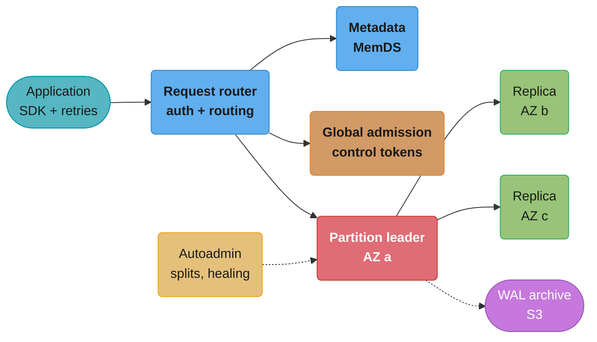
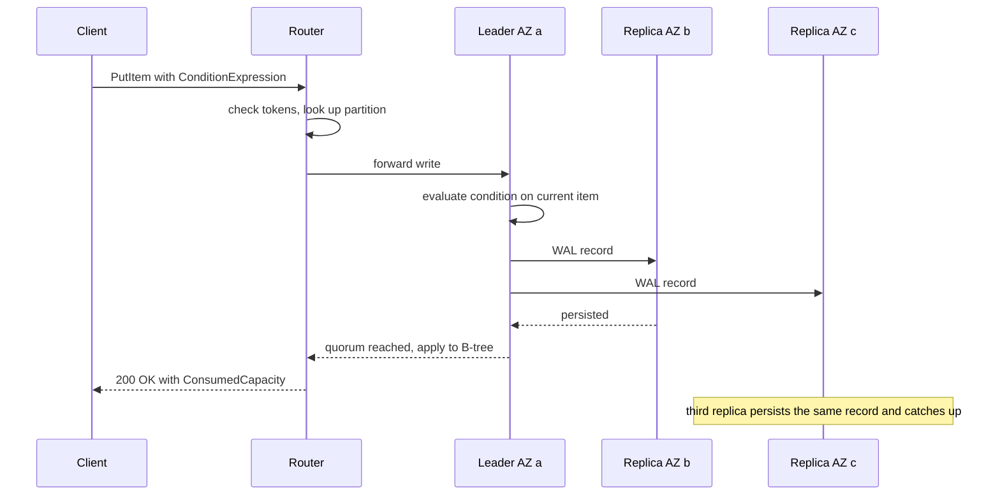
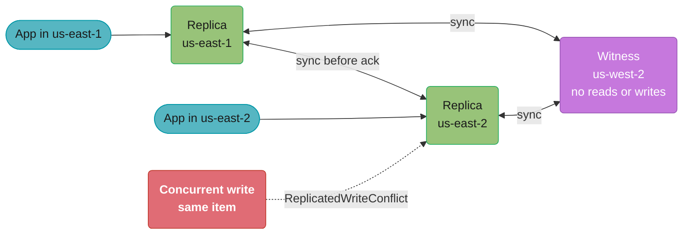
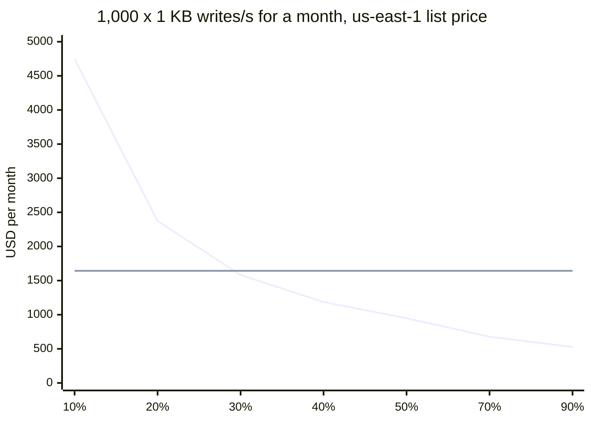

# DynamoDB Deep Dive

> **Version anchor (checked 2026-11-25).** Amazon DynamoDB is a managed service with no version
> number, so this page pins its facts to the AWS documentation as read on 2026-11-25 and to the
> AWS Price List file for US East (N. Virginia) published 2026-11-11. Prices on this page are
> us-east-1 list prices on that date: on-demand **$0.625 per million write request units** and
> **$0.125 per million read request units**; provisioned **$0.00065 per WCU-hour** and
> **$0.00013 per RCU-hour**; Standard storage **$0.25 per GB-month**, Standard-IA storage
> **$0.10 per GB-month**. Quotas change; "default" below means "adjustable through Service
> Quotas" unless the row says otherwise.

> **See also:** [Design a DynamoDB Single-Table Order Service](../case_studies/design_dynamodb_single_table_order_service/design_dynamodb_single_table_order_service.md) (case study: access-pattern-first keys, hot partition keys, idempotent order placement).

## 1. Concept Overview

### What this page is, and what it is not

[Key-Value Stores](../key_value_stores/key_value_stores.md) teaches the **category** and gives
DynamoDB one section: partition and sort keys, the RCU/WCU table, a first single-table layout,
GSI vs LSI, burst and adaptive capacity, transactions and Global Tables in a paragraph each.
[Wide-Column Databases](../wide_column_databases/wide_column_databases.md) owns the
**Dynamo-paper techniques** that Cassandra inherited: the consistent-hash ring, gossip,
sloppy quorums, hinted handoff and vector clocks.
[Document Databases](../document_databases/document_databases.md) owns the document model that
DynamoDB's map and list attributes imitate.

This page teaches **the service itself**: how a request reaches a partition, how a partition
replicates, what each quota is and why it exists, how capacity is admitted and billed, how to
design keys for a known list of access patterns, how Streams, TTL, transactions and Global
Tables actually behave, and the failure modes that page you at 3am. If a paragraph names
`TransactionCanceledException`, `ReplicatedWriteConflictException`, `LastEvaluatedKey` or a
dollar figure, it is a fact about DynamoDB and it lives here.

### DynamoDB is not Dynamo

The most common lineage mistake in interviews is to describe DynamoDB with the 2007 paper.

| Property | Dynamo (SOSP 2007 paper, internal Amazon system) | Amazon DynamoDB (service, launched 2012) |
|---|---|---|
| Placement | Consistent-hash ring with virtual nodes | Table split into partitions, each a contiguous range of the hashed key space |
| Replication | Sloppy quorum `N, R, W`, any replica takes writes | One replication group per partition, **Multi-Paxos** leader election, only the leader takes writes |
| Conflict handling | Vector clocks, siblings returned to the client | Single leader per partition, so no siblings inside a Region; last writer wins across Regions in MREC Global Tables |
| Consistency choice | Tune `R` and `W` per call | Eventually consistent or strongly consistent read per call; writes always go through the leader |
| Operations | Each team ran its own installation | Fully managed, multi-tenant fleet |

The DynamoDB paper (Elhemali et al., USENIX ATC 2022) says Amazon engineers preferred managed
services such as S3 and SimpleDB over running their own Dynamo installations, and that this
operational burden is why DynamoDB exists. It kept the name and the goal (predictable
key-value access at any scale) and replaced most of the mechanism.

### The one-sentence thesis

**DynamoDB is a fleet of three-way replicated B-tree partitions behind a request router that
charges you per 1 KB written and per 4 KB read, and almost every design rule on this page is a
consequence of the per-partition ceiling (3,000 read units, 1,000 write units, 10 GB) and the
fact that there are no joins.**

- **Per-partition ceiling.** One partition key value can never exceed 1,000 writes/s of 1 KB
  items unless DynamoDB can split its item collection, whatever the table total is. Hot keys are
  a key-design problem, not a capacity problem (§6.2).
- **Billing by size.** A 4.1 KB item costs two read units, a filter that discards 99% of a page
  costs the full page, and an `UpdateItem` that changes one byte of a 300 KB item costs 300
  write units (§6.1).
- **No joins.** Data that is read together is stored together under one partition key, which is
  what single-table design means (§6.4).

---

## 2. Intuition

> **One-line analogy:** DynamoDB is a warehouse of numbered lockers. You can open any locker
> instantly if you know its number, you can sweep along one shelf in order, and you cannot ask
> the warehouse "which lockers contain red boxes" without walking every aisle at your own cost.

**Mental model.** The partition key picks the shelf (the hash decides which partition holds
it). The sort key orders the boxes on that shelf. `GetItem` opens one locker. `Query` sweeps a
contiguous run of one shelf. `Scan` walks the whole warehouse and bills you for every box it
touches, including the ones it throws away. A GSI is a second warehouse that a background
process keeps loosely in sync with the first, arranged by a different number.

**Why it matters.** Teams fail with DynamoDB in two opposite ways. Relational teams model
entities first and discover that every screen needs a `Scan` or five round trips. Teams that
over-learn single-table design pack unrelated entities under one partition key and discover the
1,000 WCU per-partition wall during the first sale. Both failures come from skipping the same
step: writing down the access patterns, with rates, before choosing keys.

**Key insight.** *You design DynamoDB tables from the queries backwards and from the hottest key
upwards.* The list of access patterns fixes the keys. The hottest partition key fixes whether
those keys survive production. Everything else, including the choice between on-demand and
provisioned billing, is tuning.

---

## 3. Core Principles

- **Access patterns first.** Every query the application will run is listed with its rate,
  item size and consistency need before a key is chosen. A pattern that is not on the list
  later means a new GSI, a backfill, or a `Scan`.
- **The partition is the unit of limits.** About 3,000 read units/s, 1,000 write units/s and
  10 GB per partition. Table-level capacity is shared out across partitions; a single partition
  key value can only grow past one partition's throughput if DynamoDB can split its item
  collection by sort key, which it will not do for monotonic sort keys or for tables with an LSI.
- **Size is cost.** Reads round up to 4 KB per item (per `GetItem`) or per total result (per
  `Query`). Writes round up to 1 KB. Attribute names count toward item size.
- **Writes go through one leader.** Each partition has a replication group across Availability
  Zones; the leader takes every write and every strongly consistent read, and acknowledges a
  write once a quorum has persisted the log record.
- **Secondary indexes are separate tables.** A GSI is its own set of partitions with its own
  capacity, updated asynchronously. It can throttle the base table.
- **Conditions are the concurrency control.** There are no row locks. `ConditionExpression`
  on a single item, or `TransactWriteItems` across up to 100 items, is how you prevent lost
  updates.
- **Everything asynchronous is eventually consistent.** GSIs, Streams, MREC Global Tables
  replication, TTL deletion, export and the visibility of a transaction's writes outside
  `TransactGetItems`.

---

## 4. Types / Architectures / Strategies

### 4.1 The request path, from the DynamoDB paper

The 2022 paper names four core services:

| Component | Job |
|---|---|
| Request routers | Authenticate, authorize and route each data-plane call to the storage nodes for the key |
| Metadata service (backed by MemDS) | Holds routing information for tables, indexes and replication groups. MemDS is an in-memory, horizontally scaled store built so routers do not depend on a small metadata fleet |
| Storage nodes | Host partition replicas: a write-ahead log plus a B-tree of the key-value data |
| Autoadmin | Control plane: table creation, partition splits, healing, placement |

Admission control is not done on the storage node any more. The paper describes the original
design, where each partition had an allocated and a burst token bucket, and its replacement,
**global admission control (GAC)**: request routers hold local token buckets that they refill
from a GAC service every few seconds, so the table's capacity is tracked centrally rather than
divided evenly between partitions.

### 4.2 The partition and its replication group

- Each partition holds a disjoint, contiguous part of the table's hashed key range.
- Its replicas sit in different Availability Zones and form a **replication group** that uses
  **Multi-Paxos** for leader election. The leader renews a lease. A new leader serves no writes
  or strongly consistent reads until the old leader's lease expires.
- A write is acknowledged when a **quorum** of replicas has persisted the log record. The paper
  describes write-ahead logs stored on all three replicas of a partition.
- A replication group can include **log replicas** that store only recent write-ahead log
  entries and no B-tree. When a storage replica fails, the leader adds a log replica in
  seconds rather than waiting minutes to copy a B-tree, so durability is restored fast.
- Write-ahead logs are archived to S3; the paper says the unarchived tail on each replica is
  typically a few hundred megabytes. Point-in-time recovery is built on this archive.

### 4.3 Capacity modes and table classes

| Option | How you pay | Who should use it |
|---|---|---|
| On-demand (default) | Per read and write request unit | New tables, spiky or unknown traffic, low average utilization |
| Provisioned | Per RCU-hour and WCU-hour provisioned, used or not | Steady traffic above about 29% average utilization (§6.10) |
| Provisioned + reserved capacity | 1- or 3-year commitment; AWS quotes up to 54% and 77% savings | Steady, single-Region, Standard-class tables |
| Standard table class | $0.25/GB-month storage | Most tables |
| Standard-IA table class | $0.10/GB-month storage, higher request prices ($0.78/M writes, $0.155/M reads on demand) | Tables where storage dominates the bill |

You can switch a table from provisioned to on-demand four times in a rolling 24 hours, and from
on-demand to provisioned at any time.

### 4.4 Index types

| Index | Key | Consistency | Capacity | Hard limits |
|---|---|---|---|---|
| Global secondary index (GSI) | Any attributes; multi-attribute keys allow up to 4 partition-key and 4 sort-key attributes | Eventually consistent only | Its own; under-provisioning throttles base-table writes | 20 per table (default, adjustable) |
| Local secondary index (LSI) | Same partition key, different sort key | Strong reads available | Shares the table's | 5 per table, fixed; only at `CreateTable`; item collection 10 GB |
| Vector index | One partition key attribute plus a vector up to 4,096 dimensions | Search via `SearchVectors`, TopK at most 100 | On-demand mode only | 5 per table by default, counts toward the 20 GSI quota |

### 4.5 Read and write flavours

| Operation | Units per size step | Size step |
|---|---|---|
| Eventually consistent read | 0.5 | 4 KB |
| Strongly consistent read | 1 | 4 KB |
| Transactional read | 2 | 4 KB |
| Standard write | 1 | 1 KB |
| Transactional write | 2 | 1 KB |

### 4.6 Global Tables consistency modes

| | MREC (default) | MRSC |
|---|---|---|
| Replication | Asynchronous, typically within a second | Synchronous to at least one other Region before success |
| Regions | Any number, add or remove replicas later | Exactly 3: three replicas, or two replicas plus a witness |
| Conflict | Last writer wins per item by internal timestamp | Concurrent writes to the same item fail with `ReplicatedWriteConflictException` |
| Strong read | Latest only if the item was last written in this Region | Always the latest version |
| RPO | Replication delay, usually seconds | Zero |
| Restrictions | None of note | No TTL, no LSIs, table must be empty when converted, cannot add or remove a single replica |

Global Tables carry a 99.999% availability SLA against 99.99% for a single-Region table.

---

## 5. Architecture Diagrams

### 5.1 The request path



Only the red box accepts writes for its key range. Admission is decided at the router from
tokens before the request reaches storage.

### 5.2 One strongly consistent write



A quorum of persisted log records is enough to acknowledge. The condition is evaluated by the
leader against the item it holds, which is what makes conditional writes linearizable per item
inside one Region.

### 5.3 Where the 1,000 WCU wall sits

```
 table: 12,000 WCU provisioned, 12 partitions          partition ceiling = 1,000 WCU
 ------------------------------------------------------------------------------------
 key SELLER#77 (flash sale)   |#####################################|  3,000 w/s wanted
                              |############|                           1,000 w/s served
                                           ^ throttled from here, table is 75% idle
 key SELLER#12                |####|                                      300 w/s
 key SELLER#03                |###|                                       200 w/s

 after write sharding SELLER#77#0..#3 (4 shards, hashed suffix):
 SELLER#77#0                  |#########|                                 750 w/s
 SELLER#77#1                  |#########|                                 750 w/s
 SELLER#77#2                  |#########|                                 750 w/s
 SELLER#77#3                  |#########|                                 750 w/s
```

*A single partition key value cannot exceed 1,000 write units/s no matter how much the table
has. Four suffixed shards spread 3,000 writes/s over four partitions at 750 each, at the cost of
four parallel `Query` calls to read the seller back.*

### 5.4 A single-table layout with an overloaded GSI

```
 PK              SK                         type     attrs              GSI1PK        GSI1SK
 --------------  -------------------------  -------  -----------------  ------------  ----------
 CUST#42         PROFILE                    cust     name, tier
 CUST#42         ORD#2026-11-02#9001        order    total, status      SELLER#77     2026-11-02
 CUST#42         ORD#2026-11-20#9017        order    total, status      SELLER#12     2026-11-20
 ORD#9017        LINE#001                   line     sku, qty
 ORD#9017        LINE#002                   line     sku, qty
 ORD#9017        SHIP#UPS#1Z99              ship     carrier, eta
 SELLER#77       PROFILE                    seller   name, rating

 AP1 customer page        Query PK=CUST#42
 AP2 order detail         Query PK=ORD#9017
 AP3 seller order inbox   Query GSI1 PK=SELLER#77 SK between dates
 AP4 open orders only     sparse GSI2: only open orders carry GSI2PK
```

*Each item type stores the keys for the access patterns that need it. GSI1 is overloaded: its
attributes mean "seller and order date" on order items and are absent on everything else, so
profiles and lines never consume GSI1 storage or write capacity.*

### 5.5 MRSC Global Table with a witness



Any write is durable in two Regions before it returns, so losing one Region loses no
acknowledged data. The price is a cross-Region round trip on every write and strong read.

### 5.6 On-demand vs provisioned, monthly cost of 1,000 writes/s



The falling line is provisioned capacity at the given average utilization (WCUs = 1,000 /
utilization, at $0.4745 per WCU-month). The flat line is on-demand at $0.625 per million write
units. They cross at about 29% utilization (§6.10).

---

## 6. How It Works — Detailed Mechanics

### 6.1 Capacity arithmetic, exactly

Every rule in this subsection is from the DynamoDB developer guide's read/write operations,
filter expression and constraints pages.

- **Item size** includes attribute names and values in UTF-8 bytes. An item with
  `shirt-color = "R"` and `shirt-size = "M"` is 23 bytes. Long attribute names on a billion
  items are a real storage and write-unit cost; `customer_shipping_address_line_one` costs 34
  bytes per item before the value.
- **`GetItem`** rounds the item up to the next 4 KB: a 3,500-byte item costs one strongly
  consistent read unit; a 10 KB item costs 3.
- **`BatchGetItem`** rounds each item up to 4 KB separately, then sums. Fetching 100 items of
  500 bytes costs 100 read units (strong), not 13.
- **`Query`** sums the sizes of all items it reads and rounds the total once: 1,500 items of 64
  bytes are 96 KB, so 24 strong read units, or 12 eventually consistent.
- **`Scan`** and **`Query` with a filter** are charged for every item *evaluated*, not
  returned. The 1 MB page limit applies before the filter, so a filter that keeps 1% of items
  returns a few KB per page while consuming 1 MB worth of read units per page.
- **Reading a missing item** still consumes read capacity.
- **`PutItem`** that replaces an item is charged on the larger of the old and new item.
  **`UpdateItem`** is charged on the larger of the before and after item, even if one attribute
  changed. Incrementing a counter on a 300 KB item costs 300 write units.
- **GSI writes** are charged to the GSI: one write to add an item to the index, one to remove
  it, and **two** when an update changes an indexed key value (delete the old entry, put the
  new one). A table with 4 GSIs that all project the item turns one 1 KB write into five.

```python
# Capacity estimator for one access pattern. Pure arithmetic, no AWS calls.
import math

def read_units(item_bytes: list[int], op: str, consistency: str) -> float:
    per_step = {"eventual": 0.5, "strong": 1.0, "transactional": 2.0}[consistency]
    if op in ("GetItem", "BatchGetItem"):
        steps = sum(math.ceil(b / 4096) for b in item_bytes)   # per-item rounding
    elif op == "Query":
        steps = math.ceil(sum(item_bytes) / 4096)              # one rounding per page
    else:
        raise ValueError(op)
    return steps * per_step

def write_units(before: int, after: int, gsi_key_changes: int, gsi_puts: int) -> int:
    base = math.ceil(max(before, after) / 1024)
    per_index = math.ceil(after / 1024)
    return base + per_index * (2 * gsi_key_changes + gsi_puts)

print(read_units([500] * 100, "BatchGetItem", "strong"))     # 100.0
print(read_units([500] * 100, "Query", "strong"))            # 13.0
print(write_units(before=900, after=950, gsi_key_changes=1, gsi_puts=2))  # 1 + 1*(2+2) = 5
```

### 6.2 Partitions: the three ceilings and how they move

A partition serves at most about **3,000 read units/s and 1,000 write units/s** (burst and
adaptive capacity page) and holds at most **10 GB** (constraints page, which calls 10 GB "the
maximum size of a partition"). DynamoDB adds partitions when you raise provisioned throughput
beyond what the existing ones can serve or when a partition fills.

The arithmetic you do at design time:

```
partitions_for_throughput = max(RCU / 3000, WCU / 1000)
partitions_for_size       = table_GB / 10
partitions                ~ ceil(max(both))   # DynamoDB may hold more than this
```

*A lower bound, not a prediction: a table that was once scaled up keeps its partitions, and
DynamoDB may split further for heat. Use it to check whether a design is plausible, then trust
Contributor Insights over the formula.*

The paper explains the old failure mode, **throughput dilution**: splitting a partition for size
used to divide its throughput between the children, so a large table's per-partition throughput
fell as it grew. Adaptive capacity, and then GAC, removed the even split. What remains is the
hard per-partition ceiling, which no setting raises.

### 6.3 Burst, adaptive capacity, split for heat, warm throughput

Four mechanisms absorb uneven traffic, in the order they act:

1. **Burst capacity.** Up to 300 seconds of unused read and write capacity is retained for
   spikes. AWS says it may also spend burst capacity on background maintenance, so do not
   design to depend on it.
2. **Adaptive capacity.** Enabled on every table, free, instant: a hot partition may consume
   more than its even share as long as the table total and the partition maximum are not
   exceeded. AWS's example: 400 WCU over 4 partitions gives 100 each; a partition taking 150
   WCU/s keeps serving.
3. **Isolating frequently accessed items.** DynamoDB rebalances so hot items do not share a
   partition, down to one item per partition, and can split an item collection by sort key.
   It will **not** split by sort key when the traffic follows a monotonically increasing or
   decreasing sort key, and it will **not** split item collections on a table with an LSI.
4. **Warm throughput and on-demand scaling.** A new on-demand table can sustain 4,000 writes/s
   and 12,000 reads/s. On-demand instantly serves up to **double the previous peak**; beyond
   that it adds capacity, but traffic that exceeds double the previous peak **within 30
   minutes** can throttle. Every table and GSI exposes warm-throughput values; raising them
   (pre-warming) costs a one-time charge of one WCU or RCU price per unit increased, and the
   values cannot be lowered afterwards.

The table-level default quota applies in both modes: 40,000 read and 40,000 write units per
table and per GSI. An on-demand table that reaches 40,000 writes/s throttles until the quota is
raised. You can also set a maximum throughput on an on-demand table or GSI as a cost guard.

### 6.4 Single-table design, step by step

Single-table design is a technique, not a goal. Use it when the access patterns are known,
latency-critical and mostly "fetch this entity and its children". The steps:

1. **List access patterns with numbers.** For each: the question, the key you have, the rate,
   the result size, and the consistency needed.
2. **Pick the partition key that serves the most patterns without becoming hot.** For an
   order service, `CUST#<id>` serves the customer page; `ORD#<id>` serves the order detail.
3. **Encode type and order in the sort key.** `ORD#<ISO date>#<id>` sorts orders by date inside
   the customer collection, and `begins_with(SK, "ORD#2026-11")` selects a month.
4. **Add a GSI per remaining pattern, and overload it.** `GSI1PK = SELLER#77`, `GSI1SK = date`
   on order items only.
5. **Use sparse indexes for filters.** Only items that carry the GSI key attribute appear in the
   index. Write `GSI2PK = "OPEN"` while an order is open and `REMOVE GSI2PK` when it ships; the
   "open orders" index then holds only open orders, and costs nothing for shipped ones.
6. **Check every partition key against the 1,000 WCU / 3,000 RCU ceiling at peak.** A
   `STATUS#OPEN` GSI partition key is a single hot partition: every new order in the company
   writes to it. Shard it (`OPEN#0..#9`) or use a less selective attribute.
7. **Prefer multi-attribute GSI keys over string concatenation when the index is new.** A GSI
   partition key can be composed from up to four attributes and the sort key from up to four.
   Queries must give every partition-key attribute by equality and use sort-key attributes left
   to right, with any range condition last. This replaces synthetic keys such as
   `TOURNAMENT#WINTER2024#REGION#NA-EAST` and avoids backfilling them on existing items.

Write sharding for a hot partition key, and the read that goes with it:

```python
import hashlib
import boto3
from boto3.dynamodb.conditions import Key
from concurrent.futures import ThreadPoolExecutor

SHARDS = 4
table = boto3.resource("dynamodb").Table("orders")

def shard_for(order_id: str) -> int:
    # deterministic: a retry of the same order lands on the same shard
    return int(hashlib.sha256(order_id.encode()).hexdigest(), 16) % SHARDS

def put_seller_order(seller_id: str, order_id: str, day: str, item: dict) -> None:
    item["GSI1PK"] = f"SELLER#{seller_id}#{shard_for(order_id)}"
    item["GSI1SK"] = f"{day}#{order_id}"
    table.put_item(Item=item)

def seller_orders(seller_id: str, day: str) -> list[dict]:
    def one(shard: int) -> list[dict]:
        out, kwargs = [], {
            "IndexName": "GSI1",
            "KeyConditionExpression": Key("GSI1PK").eq(f"SELLER#{seller_id}#{shard}")
            & Key("GSI1SK").begins_with(day),
        }
        while True:
            page = table.query(**kwargs)
            out.extend(page["Items"])
            if "LastEvaluatedKey" not in page:
                return out
            kwargs["ExclusiveStartKey"] = page["LastEvaluatedKey"]
    with ThreadPoolExecutor(SHARDS) as pool:
        merged = [i for part in pool.map(one, range(SHARDS)) for i in part]
    return sorted(merged, key=lambda i: i["GSI1SK"])
```

Use a deterministic suffix (hash of a stable id) when you also need to find one item again; use
a random suffix only when every read fans out anyway.

### 6.5 Conditional writes, optimistic locking and idempotency

DynamoDB has no locks. Lost updates are prevented with a version attribute and a condition:

```python
from botocore.exceptions import ClientError

class StaleVersion(Exception):
    pass

def reserve_stock(sku: str, qty: int, expected_version: int) -> None:
    try:
        table.update_item(
            Key={"PK": f"SKU#{sku}", "SK": "STOCK"},
            UpdateExpression="SET available = available - :q, version = version + :one",
            ConditionExpression="version = :v AND available >= :q",
            ExpressionAttributeValues={":q": qty, ":v": expected_version, ":one": 1},
            ReturnValuesOnConditionCheckFailure="ALL_OLD",
        )
    except ClientError as e:
        if e.response["Error"]["Code"] == "ConditionalCheckFailedException":
            # someone else won: the current item comes back with the failure
            raise StaleVersion(e.response.get("Item"))
        raise
```

`ReturnValuesOnConditionCheckFailure=ALL_OLD` returns the current item with the failure, which
saves the reread round trip. For "create if absent", the condition is
`attribute_not_exists(PK)`.

Idempotency for multi-item writes comes from `ClientRequestToken` on `TransactWriteItems`: a
repeat with the same token inside **10 minutes** after the first request finishes returns
success without re-applying; changing any other parameter with the same token returns
`IdempotentParameterMismatch`. After 10 minutes the token is forgotten, so a retry queue that
can hold a message longer than that needs its own dedupe item
(`PK = IDEMP#<key>` written with `attribute_not_exists`).

### 6.6 Transactions

| Property | Value |
|---|---|
| Size | Up to 100 actions on 100 distinct items, 4 MB aggregate, one account and one Region |
| Actions | `Put`, `Update`, `Delete`, `ConditionCheck`; no two actions on the same item |
| Cost | Two units per item size step: prepare and commit |
| Conflict | `TransactionCanceledException` with a per-action `CancellationReasons` list |
| Indexes | Transactions cannot target indexes |
| Global Tables | ACID only in the Region where written; other Regions may see a partial transaction while it replicates |

Isolation is not uniform, and interviewers check this:

| Between a transaction and... | Isolation |
|---|---|
| `GetItem`, `PutItem`, `UpdateItem`, `DeleteItem` | Serializable |
| Another `TransactWriteItems` or `TransactGetItems` | Serializable |
| Each item inside `BatchGetItem` / `BatchWriteItem` | Serializable per item |
| `BatchGetItem` as a unit, `Query`, `Scan` | Read-committed |

So a `Query` that runs during a transaction can return some of its writes and not others, and
GSIs, Streams, backups and exports see the transaction's writes **gradually**: stream records
from one transaction can arrive at different times, interleaved with other transactions. A
consumer that needs the whole transaction must read with `TransactGetItems` or carry a
transaction id in each item and reassemble.

### 6.7 Streams and Kinesis Data Streams

DynamoDB Streams keeps a time-ordered log of item-level changes for **24 hours**. Each stream
record appears exactly once, and records for one item appear in the order of its modifications.
There is no ordering across items. View types: `KEYS_ONLY`, `NEW_IMAGE`, `OLD_IMAGE`,
`NEW_AND_OLD_IMAGES`.

- Design for at most **two concurrent readers per shard** on a single-Region table, and **one**
  on a Global Table; more readers throttle. Fan-out beyond that goes through one Lambda or
  consumer that republishes (to EventBridge, SNS or Kinesis).
- `GetRecords` is billed per streams read request unit (up to 1 MB per call), except when
  invoked by a Lambda trigger (not on Lambda Managed Instances) or by Global Tables replication.
- **Kinesis Data Streams for DynamoDB** is the alternative when you need more consumers or
  longer retention: DynamoDB charges one CDC unit per write up to 1 KB, and Kinesis charges for
  the stream separately.
- A 24-hour retention means a consumer outage longer than a day loses events. That is the
  reason to pair Streams with a periodic incremental export to S3 for anything that must be
  rebuilt.

### 6.8 TTL

TTL deletes items whose TTL attribute (a Number in epoch **seconds**) is in the past, without
consuming write throughput, **typically within a few days** of expiry, not at the second. Until
deletion, expired items are still returned by reads and still count in `Query`; filter them with
`ttl > :now`. TTL deletions appear in Streams as service deletions rather than user deletions,
so a consumer can tell "user cancelled" from "expired". On an MREC Global Table the TTL delete is
free in its own Region and replicated deletes cost replicated write units in the others. MRSC
tables do not support TTL. Enabling or disabling TTL is allowed once per hour per table.

### 6.9 Global Tables mechanics

- **MREC** resolves concurrent writes to one item by last writer wins on an internal timestamp,
  per item, not per attribute. Two Regions that each `ADD` 1 to a counter at the same moment can
  end with one increment. A condition expression in Region A is evaluated against A's copy only,
  so `attribute_not_exists` does not stop the same key being created in Region B.
- Safe MREC designs pin each item's writes to a home Region (store `home_region` and route by
  it), or use MRSC.
- **MRSC** fails a write to an item already being modified in another Region with
  `ReplicatedWriteConflictException`, which is retryable. Strong reads anywhere are current.
  Latency depends on the Region trio; AWS publishes no figure and tells you to measure.
- Replicated writes are billed as replicated write units ($0.625 per million in us-east-1 on
  demand, $0.00065 per replicated WCU-hour provisioned) in each replica Region.
- Adding a replica backfills data, capped by default at 10 TB per destination Region per day.
- MREC publishes a `ReplicationLatency` metric per Region pair; MRSC does not.

### 6.10 The cost model, with numbers

A month is 730 hours = 2,628,000 seconds.

| Item | Unit price (us-east-1, 2026-11-11) | Monthly cost of 1 unit/s sustained |
|---|---|---|
| On-demand write | $0.625 per million WRU | 2.628M x $0.625/M = **$1.6425** |
| Provisioned WCU | $0.00065 per hour | 730 x $0.00065 = **$0.4745** |
| On-demand read | $0.125 per million RRU | 2.628M x $0.125/M = **$0.3285** |
| Provisioned RCU | $0.00013 per hour | 730 x $0.00013 = **$0.0949** |

The ratio is the same for reads and writes: $0.4745 / $1.6425 = **0.289**. A provisioned unit
costs what on-demand charges for 28.9% of a unit used every second. So provisioned capacity is
cheaper whenever your **average consumed / provisioned** ratio stays above about 29%, before
reserved capacity or Database Savings Plans. Autoscaling at a 70% target keeps you well above
that line; a provisioned table sized for a peak that occurs one hour a day often sits below it.

Worked example, an order service:

| Pattern | Rate | Size | Units/s |
|---|---|---|---|
| Writes | 2,000/s | 0.9 KB | 2,000 WRU |
| Customer page reads, eventual | 10,000/s | 3.8 KB | 5,000 RRU |
| One GSI projecting all attributes | 2,000/s | 0.9 KB | 2,000 WRU |

- On-demand: 4,000 WRU/s x $1.6425 = $6,570; 5,000 RRU/s x $0.3285 = $1,642.50; total
  **$8,212.50/month**.
- Provisioned with autoscaling holding 70% utilization: 4,000 / 0.7 = 5,715 WCU x $0.4745 =
  $2,711.77; 5,000 / 0.7 = 7,143 RCU x $0.0949 = $677.87; total **$3,389.64/month**.
- Storage: 500 GB x $0.25 = $125 (Standard) or $50 (Standard-IA, but the IA request prices are
  25% higher for writes and 24% higher for reads, which costs far more than the $75 saved here).

The GSI doubled the write bill. Projecting `KEYS_ONLY` or `INCLUDE` a few attributes cuts the
index's write units only when it shrinks the projected item below a 1 KB boundary; for 0.9 KB
items it saves storage, not writes.

### 6.11 Backups, export and import

- **PITR** keeps continuous backups for a configurable 1 to 35 days, priced on table plus LSI
  size; shortening the window does not reduce the price. Deleting a PITR table keeps a system
  backup for up to 35 days.
- **Export to S3** (DynamoDB JSON or Ion) is billed on table size (full) or on the PITR data
  processed (incremental); incremental export windows run from 15 minutes to 24 hours.
- **Import from S3** creates a new table from CSV, DynamoDB JSON or Ion.
- **Restore** always creates a new table, and AWS lists what you must set up again on it: auto
  scaling policies, IAM policies, CloudWatch metrics and alarms, tags, Stream settings, TTL
  settings, deletion protection and PITR. A restore runbook that forgets TTL silently stops
  expiring data.

### 6.12 DAX

DAX is a write-through cache cluster (one primary and up to ten read replica nodes) with an item
cache and a query cache, both subject to a TTL and LRU. It serves eventually consistent reads
only: strongly consistent reads and `TransactGetItems` are passed through to DynamoDB and not
cached. It caches negative results, so an item created directly in DynamoDB (not through DAX)
after a miss can stay invisible until the negative entry expires. Use DAX for read-heavy
eventually consistent hot items; do not use it to fix a hot write key.

### 6.13 Pagination and batch limits

| API | Limit |
|---|---|
| `Query`, `Scan` | 1 MB per call before filtering; continue with `LastEvaluatedKey` |
| `BatchGetItem` | 100 items, 16 MB; returns `UnprocessedKeys` |
| `BatchWriteItem` | 25 put or delete requests, 16 MB; returns `UnprocessedItems`; no conditions |
| Expressions | 4 KB per expression string, 300 operators, 100 operands for `IN` |
| Item | 400 KB including LSI projections, 32 levels of nesting |
| Keys | Partition key 1 to 2,048 bytes, sort key 1 to 1,024 bytes |
| Numbers | 38 digits of precision |
| Tables | 2,500 per Region default, up to 10,000 by request |

`Scan` accepts `Segment` and `TotalSegments` for parallel scans; each worker owns a disjoint
slice of the key space. A full-table `Scan` on a hot path is almost always a missing GSI.

---

## 7. Real-World Examples

- **Amazon Prime Day 2021.** The DynamoDB paper reports that during the 66-hour event Amazon
  systems, including Alexa, the Amazon.com sites and fulfilment centres, made trillions of API
  calls, peaking at **89.2 million requests per second**, with single-digit millisecond
  performance.
- **The us-east-1 DNS incident, 19 to 20 October 2025.** AWS's post-incident summary: from 11:48
  PM PDT on 19 October to 2:40 AM on 20 October, a latent race condition between two instances
  of DynamoDB's DNS Enactor left an empty DNS record for `dynamodb.us-east-1.amazonaws.com`, so
  new connections to the regional endpoint failed. AWS services that depend on DynamoDB failed
  with it, and later EC2 and Network Load Balancer impact lasted until 2:20 PM. AWS states that
  customers with Global Tables could connect to and use their replicas in other Regions. The
  lesson for designers is not "DynamoDB is fragile" but that a single-Region table inherits that
  Region's endpoint and dependencies; multi-Region designs need the replica and the routing.
- **Uber LedgerStore.** Uber's engineering blog (April 2024) describes building over 2 trillion
  unique indexes for its immutable ledger store and moving them from DynamoDB to its in-house
  Docstore. See the fintech
  [double-entry ledger](../../fintech/double_entry_ledger_design/double_entry_ledger_design.md)
  page for the accounting side.

---

## 8. Tradeoffs

### 8.1 On-demand vs provisioned

| | On-demand | Provisioned (+ autoscaling) |
|---|---|---|
| Price per unit used | 3.46x provisioned at 100% use | Lowest when utilization is high |
| Throttle risk | Above 2x previous peak within 30 minutes; at the 40,000 table quota | When autoscaling lags a spike |
| Idle cost | Zero throughput cost | Full provisioned cost |
| Commitments | Database Savings Plans (AWS quotes up to 18%) | Reserved capacity (up to 54% for 1 year, 77% for 3 years) |
| Best for | New, spiky, or under 29% average utilization | Steady traffic, known peaks |

### 8.2 Single-table vs table-per-entity

| | Single table | Table per entity |
|---|---|---|
| Round trips for "entity plus children" | 1 `Query` | One per entity type |
| Adding an access pattern later | New GSI or backfill, often hard | Usually a new GSI, simpler to reason about |
| Operational settings (PITR, TTL, Streams, capacity mode, class) | One setting for all entity types | Per entity |
| Stream consumers | Must filter by item type | One stream per entity |
| Analytics and ad hoc queries | Painful; export to S3 | Still painful; export to S3 |
| Team understanding | Needs the access-pattern sheet beside the schema | Readable without it |

### 8.3 GSI vs LSI vs a second table

| Need | Choose | Why |
|---|---|---|
| Alternate key, any time, at any scale | GSI | Added online, own capacity |
| Strongly consistent read in an alternate sort order | LSI | Only option, but fixed at creation, 10 GB per item collection, stops item-collection splits |
| Different capacity mode, TTL or retention for the derived data | Second table fed by Streams | GSIs inherit the table's settings |

### 8.4 DynamoDB against its neighbours

| | DynamoDB | Cassandra / ScyllaDB | MongoDB | PostgreSQL |
|---|---|---|---|---|
| Operations | None, managed | You run it, or a managed offering | Atlas or self-managed | Managed instance or self-managed |
| Query flexibility | Key and range only, plus GSIs | Partition and clustering key, SAI | Rich queries, aggregation | Full SQL |
| Per-key write ceiling | 1,000 WCU per partition | Bound by the replicas' hardware | Bound by the shard primary | Bound by the primary |
| Multi-Region | MREC or MRSC built in | Multi-DC replication built in | Zones and multi-region replica sets | Logical replication, extensions |
| Pricing shape | Per request and GB | Per node | Per node or tier | Per instance |

See [MongoDB Internals](../mongodb_internals/mongodb_internals.md) for the document-store
contrast and [Database Selection Framework](../database_selection_framework/database_selection_framework.md)
for the full matrix.

---

## 9. When to Use / When NOT to Use

**Use DynamoDB when:**

- Every hot query can be expressed as "this key" or "this key plus a sort-key range", and you
  can list them up front.
- Traffic is large, spiky or both, and you want no servers, no patching and no failover drills
  inside a Region.
- You need multi-Region active-active with a built-in RPO-zero option (MRSC) or an RPO of
  seconds (MREC).
- Item sizes stay small (well under 400 KB) and per-key write rates stay under 1,000/s or can
  be sharded.

**Do not use DynamoDB when:**

- The product needs ad hoc filtering, sorting by arbitrary columns, joins or aggregations on the
  live path. That is a relational database or a search engine, possibly fed from Streams.
- One logical key needs more than 1,000 strictly ordered writes per second (a global sequence,
  a single hot counter) and cannot be sharded.
- Items routinely exceed tens of KB and are updated field by field; every update pays for the
  whole item.
- The team cannot commit to a written access-pattern list, or the patterns change weekly.
- You need a multi-item transaction across Regions; DynamoDB transactions are Region-local.

---

## 10. Common Pitfalls

**Pitfall 1: the monotonic partition key.** A team uses `PK = DATE#2026-11-25` for an event log.
Every write of the day lands on one partition key; the table has 40,000 WCU and serves 1,000.
Adaptive capacity cannot help because there is one key.

```python
# BROKEN: all of today's events share one partition key value
table.put_item(Item={"PK": f"DATE#{day}", "SK": f"{ts}#{event_id}", **body})

# FIX: spread the day across 16 shards by a stable hash; reads fan out 16 ways
shard = int(hashlib.sha256(event_id.encode()).hexdigest(), 16) % 16
table.put_item(Item={"PK": f"DATE#{day}#{shard:02d}", "SK": f"{ts}#{event_id}", **body})
```

**Pitfall 2: the under-provisioned GSI.** A provisioned table at 5,000 WCU gets a GSI at 500
WCU "because a dashboard reads it". A bulk status update drives 3,000 index writes/s and the
**base table** writes throttle, because DynamoDB throttles table writes when an index cannot
keep up. Fix: provision each GSI's write capacity at least equal to the table's write rate for
the items it projects, or run the table on demand.

**Pitfall 3: "the filter makes it cheap".** A `Query` on `CUST#42` with
`FilterExpression: status = "OPEN"` reads 1,000 items of 2 KB to return 5. That is two 1 MB
pages and about 250 eventually consistent read units for 10 KB of results. Fix: a sparse GSI
keyed only on open orders, or a sort-key prefix `OPEN#...` so the key condition does the
filtering.

**Pitfall 4: the counter on the big item.** A 120 KB product item carries `view_count`.
Each `ADD view_count :1` costs 120 write units. At 500 views/s that is 60,000 write units/s,
above the default table quota. Fix: move the counter to its own small item (`PK = SKU#..., SK =
COUNTER`), or aggregate in a stream consumer and write once a minute.

**Pitfall 5: trusting TTL as a scheduler.** A coupon service sets TTL to the expiry time and
relies on deletion to stop redemptions. Expired coupons stay readable for hours to days. Fix:
always check `expires_at > :now` in the read path or condition expression; treat TTL as
garbage collection only.

**Pitfall 6: the 24-hour Stream window.** A search-indexing consumer fails on a malformed
record, retries forever on the same shard, and after 24 hours the records behind it expire.
Fix: send poison records to a dead-letter destination after a bounded number of attempts (the
Lambda event source mapping's `MaximumRetryAttempts`, `BisectBatchOnFunctionError` and an
on-failure destination), alarm on iterator age, and keep a periodic incremental export to
rebuild from.

**Pitfall 7: MREC counters and uniqueness.** A two-Region MREC table holds account balances
updated in both Regions. Concurrent updates to one item resolve by last writer wins and money
disappears. Fix: route each account's writes to its home Region, or move to MRSC and handle
`ReplicatedWriteConflictException`, or keep the ledger as append-only items rather than a
mutable balance.

**Pitfall 8: the LSI added for "consistent reads someday".** An LSI caps every item collection
at 10 GB and prevents DynamoDB from splitting hot item collections. A tenant grows past 10 GB
and writes fail with `ItemCollectionSizeLimitExceededException`. An LSI cannot be removed
without recreating the table. Fix: use GSIs unless a strongly consistent alternate sort order
is a stated requirement.

**Pitfall 9: retry storms on transactions.** `TransactionCanceledException` from a conflict is
not retried by the SDK. A service that retries immediately in a tight loop on a hot item pays the
transactional price on every attempt and extends the conflict. Fix: exponential backoff with
jitter, a retry cap, and a design that does not put a hot item in every transaction.

**Pitfall 10: ignoring `UnprocessedItems`.** `BatchWriteItem` returns success with
`UnprocessedItems` when some writes were throttled. Code that ignores the field silently drops
writes. Fix: loop on `UnprocessedItems` with backoff, or use the SDK's batch writer helper,
which does this.

---

## 11. Technologies & Tools

| Tool | What it is for |
|---|---|
| Amazon DynamoDB | The managed key-value and document store this page describes |
| DynamoDB Accelerator (DAX) | Write-through cache cluster for eventually consistent reads |
| DynamoDB Streams | 24-hour item-level change log, Lambda trigger source |
| Amazon Kinesis Data Streams | Longer-retention CDC destination with more consumers |
| AWS Lambda | Stream consumer for projections, fan-out and aggregates |
| AWS Backup | Centralized and cross-Region copies of DynamoDB backups |
| AWS Fault Injection Service | Pauses Global Table replication to rehearse Region isolation |
| CloudWatch Contributor Insights | Ranks the most-accessed and most-throttled partition keys |
| NoSQL Workbench | Desktop modeler for single-table layouts and access patterns |
| Amazon Athena | Queries DynamoDB exports in S3 for analytics |

---

## 12. Interview Questions with Answers

**Q: The table has 40,000 WCU provisioned, so why is one customer's write path throttling at about 1,000 writes per second?**
**Short:** One partition serves at most about 1,000 write units per second, and one partition key value lives on one partition unless DynamoDB can split it by sort key.

Table capacity is shared among partitions, and each partition is capped at about 1,000 write units and 3,000 read units per second regardless of the table total. Adaptive capacity lets a hot partition borrow unused table capacity up to that cap and DynamoDB can isolate hot items, but it cannot split a single item, will not split an item collection whose traffic follows a monotonic sort key, and never splits item collections on a table with an LSI. CloudWatch Contributor Insights shows the throttled keys. The fix is in the key design: shard the partition key with a stable suffix and fan reads out, move a counter to its own item, or aggregate writes before they reach DynamoDB.

**Q: Does a FilterExpression reduce the read capacity a Query consumes?**
**Short:** No, filters run after the read, so you pay for every item the key condition read, and the 1 MB page limit also applies before filtering.

A `Query` reads every item matching the key condition, sums their sizes, rounds up to 4 KB, and charges that. Only then does the filter discard items. A filter that keeps 1% of a 1 MB page returns a few KB and still costs 128 eventually consistent read units for that page, and the 1 MB limit means sparse matches need many pages. Filtering belongs in the key: a sort-key prefix such as `OPEN#`, or a sparse GSI that only contains matching items. Use filters for small trims of results the key already narrowed.

**Q: What is single-table design and when should you not use it?**
**Short:** It stores related entity types under shared partition keys so one Query returns an entity and its children, and it is wrong when access patterns are unknown or ad hoc.

DynamoDB has no joins, so data read together is stored together: customer, orders and order lines share a partition key or are reachable through an overloaded GSI, distinguished by typed sort-key prefixes. It pays off when the access patterns are known, few and latency-critical. It hurts when the product needs ad hoc queries, when entity types need different settings (TTL, PITR, capacity mode, Streams consumers), or when the team cannot keep the access-pattern sheet current. Multiple tables with a few GSIs are a legitimate design, and multi-attribute GSI keys remove much of the string-concatenation work that made single-table layouts hard to read.

**Q: Why can a GSI with too little capacity throttle writes to the base table?**
**Short:** GSI maintenance consumes the index's own write capacity, and DynamoDB throttles table writes that the index cannot absorb.

A GSI is a separate set of partitions updated asynchronously, and every table write that adds, removes or changes an indexed item consumes the index's write units: one to add or remove, two when an indexed key value changes. If the index cannot keep up, DynamoDB throttles the base-table writes rather than let the index fall unboundedly behind. The classic mistake is giving a dashboard GSI a tenth of the table's WCU. Provision each GSI's write capacity at least as high as the write rate of the items it projects, use sparse indexes so unrelated items do not touch it, or use on-demand mode.

**Q: Can an on-demand table throttle?**
**Short:** Yes: above double its previous peak within 30 minutes, at the 40,000 unit per-table default quota, at a configured maximum, or on a hot partition.

A new on-demand table sustains 4,000 writes and 12,000 reads per second. It instantly serves up to twice its previous peak; growth beyond that is allocated automatically, but exceeding double the previous peak within 30 minutes can throttle. The per-table default quota of 40,000 read and write request units applies to on-demand tables too, and an optional per-table maximum throttles by design. On-demand also does nothing for one hot partition key. Before a launch, raise the table's warm throughput (a one-time charge per unit, irreversible) and request quota increases.

**Q: Can you do a strongly consistent read on a GSI?**
**Short:** No, GSI reads are always eventually consistent because the index is updated asynchronously from the base table.

Applications never write to a GSI; DynamoDB propagates base-table changes to it in the background. A read immediately after a write can miss the item or see an old version. If a flow needs read-your-write on an alternate key, either read the base item by primary key afterwards, design an LSI (strong reads allowed, but fixed at creation and capped at 10 GB per item collection), or return the written data from the write path itself. On an MRSC Global Table, GSI reads are still eventually consistent.

**Q: How do DynamoDB transactions work, and what isolation does a Query get against them?**
**Short:** TransactWriteItems is an all-or-nothing group of up to 100 items and 4 MB that costs double, and Query and Scan get only read-committed isolation against it.

Each transactional item is charged twice, for a prepare and a commit phase. Transactions are serializable against single-item reads and writes and against other transactions, but `Query`, `Scan` and `BatchGetItem` as a unit are read-committed, so a `Query` during a transaction can see some of its writes. GSIs, Streams, backups and exports receive the writes gradually, possibly interleaved with other transactions. Conflicts raise `TransactionCanceledException`, which the SDK does not retry. Use `ClientRequestToken` for idempotent retries within 10 minutes, and `TransactGetItems` when you need an atomic snapshot.

**Q: In an MREC Global Table, two Regions update the same item at the same time. What happens?**
**Short:** The write with the later internal timestamp wins for the whole item and the other is silently lost, because MREC uses last writer wins per item.

MREC replicates asynchronously, typically within a second, and resolves concurrent modifications by keeping the version with the latest internal timestamp. Conditions are evaluated against the local Region's copy, so `attribute_not_exists` or a version check in one Region does not protect against a concurrent write in another. Counters lose increments and balances lose updates. Safe patterns: give each item a home Region and route its writes there, keep data append-only so items never conflict, or create the table as MRSC, where conflicting writes fail with a retryable `ReplicatedWriteConflictException`.

**Q: What does multi-Region strong consistency buy, and what does it cost?**
**Short:** MRSC gives RPO zero and current strong reads in every Region, at the price of cross-Region latency on writes and exactly three Regions.

An MRSC write is replicated synchronously to at least one other Region before it succeeds, so a Region failure loses no acknowledged data and a strongly consistent read anywhere returns the latest version. It must span exactly three Regions, as three replicas or two replicas plus a DynamoDB-managed witness that serves no reads or writes. It is created from an empty table, cannot gain or lose a single replica, and does not support TTL or LSIs. Write and strong-read latency include a cross-Region round trip that depends on the Region trio, so measure it before committing.

**Q: How is DynamoDB different from the Dynamo paper?**
**Short:** Dynamo used a hash ring, sloppy quorums and vector clocks, while DynamoDB uses leader-based Multi-Paxos replication groups per partition with no client-side conflict resolution.

The 2007 Dynamo paper describes an internal store that any replica could write, with tunable `N, R, W` quorums, hinted handoff and vector clocks that returned conflicting siblings to the client. DynamoDB, launched in 2012, splits tables into partitions that each own a contiguous part of the hashed key range, replicates each across Availability Zones with Multi-Paxos, and routes every write and strongly consistent read to the leader. So inside a Region there are no siblings and conditional writes are linearizable per item. Cassandra is the system that kept the Dynamo mechanics; DynamoDB kept the goals.

**Q: What does DynamoDB Streams guarantee, and what does it not?**
**Short:** Each record appears exactly once and per-item order is preserved for 24 hours, but there is no cross-item order, no transaction atomicity and a small reader limit per shard.

Records are retained for 24 hours, appear exactly once, and the records for one item follow its modification order. Records from one transaction can arrive at different times and interleave with others, and there is no order across items. Design for two concurrent readers per shard on a single-Region table and one on a Global Table. A consumer stuck longer than 24 hours loses data, so alarm on iterator age, use a dead-letter destination for poison records, and keep a way to rebuild projections from an export. Kinesis Data Streams for DynamoDB adds retention and consumers at a per-write CDC charge.

**Q: You set TTL on session items. Why do expired sessions still come back from reads?**
**Short:** TTL deletes expired items in the background, typically within a few days of expiry, so reads must filter on the expiry time themselves.

TTL is free garbage collection, not a timer. Items with a past TTL timestamp remain readable until the background process deletes them, and you can still update them in that window, which un-expires them if the TTL moves into the future. Add `ttl > :now` to every read path or condition, store the TTL in epoch seconds as a Number (other types are ignored), and expect TTL deletions to appear in Streams as service deletions. TTL is not available on MRSC Global Tables.

**Q: How do you implement optimistic locking in DynamoDB?**
**Short:** Store a version attribute and make every update conditional on the version you read, incrementing it in the same UpdateItem.

Read the item with its `version`, then `UpdateItem` with `ConditionExpression: version = :v` and `SET version = version + 1`. A concurrent writer makes the condition fail with `ConditionalCheckFailedException`, and `ReturnValuesOnConditionCheckFailure=ALL_OLD` returns the current item so you can retry without another read. The condition is evaluated by the partition leader, so it is linearizable for that item within a Region. Across items, use `TransactWriteItems` with `ConditionCheck` actions; across MREC Regions it does not protect you at all.

**Q: When is provisioned capacity cheaper than on-demand?**
**Short:** When average consumed capacity is above about 29% of what you provision, because a provisioned unit costs what on-demand charges for 28.9% of a unit used every second.

In us-east-1 a WCU costs $0.00065 per hour, $0.4745 per month, while one write per second for a month on demand is 2.628 million write units at $0.625 per million, $1.6425. The ratio is 0.289, and reads give the same ratio. Autoscaling at a 70% target sits well above break-even; a table provisioned for a short daily peak often sits below it. Reserved capacity and Database Savings Plans move the line further. Recompute with current regional prices before deciding, and remember that on-demand also removes the autoscaling lag risk.

**Q: You shard a hot partition key into N suffixes. How do you read it back, and how do you pick N?**
**Short:** Query all N shard keys in parallel and merge, and choose N so that peak writes divided by N stays well under 1,000 write units per partition.

Writes go to `KEY#0` to `KEY#N-1` using a hash of a stable id (so a retry and a point lookup find the same shard) or a random suffix (if every read fans out anyway). A read issues N `Query` calls concurrently, follows `LastEvaluatedKey` on each, and merges by sort key. Size N from the peak: 3,000 writes/s needs at least 4 shards at 750 each, and leaving headroom for growth suggests 8. Larger N raises read cost and tail latency, so shard only keys that need it, and keep N in configuration with a migration plan for changing it.

**Q: How does DynamoDB make a write durable inside one Region?**
**Short:** The partition leader writes a log record, sends it to replicas in other Availability Zones, and acknowledges once a quorum has persisted it.

Each partition is a replication group of replicas in different Availability Zones. Multi-Paxos elects a leader that holds a renewable lease; only the leader serves writes and strongly consistent reads. The leader generates a write-ahead log record and acknowledges the client once a quorum of replicas has persisted it, then applies it to its B-tree. If a storage replica fails, the leader adds a log replica, which stores only recent log entries, in seconds instead of copying a B-tree for minutes. Write-ahead logs are also archived to S3, which is what point-in-time recovery reads.

**Q: A Query returned fewer items than expected and no error. What happened?**
**Short:** The result was paginated at 1 MB, and the response carried LastEvaluatedKey, which the code ignored.

`Query` and `Scan` stop after reading 1 MB of data (before any filter) and return `LastEvaluatedKey`; the caller must pass it back as `ExclusiveStartKey` until it is absent. With a filter, a page can even return zero items and still have a `LastEvaluatedKey`. `Limit` caps items evaluated, not items returned. Similar silent truncation happens in `BatchGetItem` (`UnprocessedKeys`) and `BatchWriteItem` (`UnprocessedItems`), which return success with leftovers when throttled. Every DynamoDB read loop needs a pagination loop and every batch loop needs a retry loop.

**Q: Will DAX fix strongly consistent read latency or a hot write key?**
**Short:** No, DAX passes strongly consistent and transactional reads through uncached, and it does nothing for write throughput on a hot partition.

DAX is a write-through cache with an item cache and a query cache for eventually consistent reads. Because it is not coupled to DynamoDB's replication, it cannot serve strongly consistent reads, so it forwards them and does not cache the result. It also caches negative lookups, so an item written directly to DynamoDB after a miss can be invisible through DAX until the entry expires. It helps read-heavy, eventually consistent hot items. Hot writes need key design, not a cache.

**Q: Your items have grown to 250 KB. What goes wrong and how do you fix it?**
**Short:** Every read and every partial update is billed on the whole item and you approach the hard 400 KB limit, so split the item or move the large part to S3.

Reads round the whole item up to 4 KB steps and updates are charged on the larger of the before and after size, so updating one status field on a 250 KB item costs 250 write units. The 400 KB limit includes attribute names and LSI projections and cannot be raised. Split the item vertically into a small hot item and larger cold items under the same partition key, store blobs in S3 with a pointer, compress large text attributes, and shorten attribute names on very large tables.

**Q: When would you use multi-attribute GSI keys instead of synthetic composite keys?**
**Short:** When building a new GSI over attributes that already exist, because the index composes up to four partition and four sort attributes without string concatenation or backfill.

Synthetic keys such as `TENANT#7#REGION#EU` must be written on every item, kept in sync when the parts change, and backfilled before a new index is useful. A multi-attribute GSI key takes up to four attributes for the partition key and four for the sort key, hashes the partition attributes together and keeps the sort attributes in hierarchical order. Queries must supply all partition attributes by equality and use sort attributes left to right with any range condition last. Synthetic keys remain useful on the base table's primary key and when one attribute must mean different things for different item types, as in an overloaded GSI.

**Q: What should a designer learn from the October 2025 us-east-1 DynamoDB outage?**
**Short:** A single-Region table shares its Region's endpoint and dependencies, so availability targets above one Region need replicas and the routing to use them.

AWS's summary attributes the event to a race condition in DynamoDB's DNS automation that left the us-east-1 regional endpoint with an empty DNS record from 11:48 PM to 2:40 AM PDT, so new connections failed. Services built on DynamoDB failed with it. AWS states that Global Tables customers could use their replicas in other Regions. The design lesson is to decide explicitly whether a workload needs multi-Region, and if it does, to run Global Tables with clients that can switch endpoints, health checks that do not themselves depend on the failed Region, and rehearsals using Fault Injection Service.

---

## 13. Best Practices

- Write the access-pattern sheet first: pattern, key, rate at peak, item size, consistency.
  Keep it in the repository next to the table definition.
- Compute the peak write rate per partition key value, not per table. Any key above about 500
  writes/s at peak gets sharding or aggregation before launch.
- Keep items small. Split hot, frequently updated attributes from large, rarely changed ones.
- Use short attribute names on tables with billions of items; they are stored and billed per
  item.
- Prefer GSIs over LSIs. Add an LSI only for a stated strongly consistent alternate sort.
- Make indexes sparse wherever a pattern is "items in state X".
- Provision GSI write capacity at least equal to the table's projected write rate, or use
  on-demand.
- Use condition expressions for every update that depends on prior state. Return the old item
  on failure.
- Give `TransactWriteItems` a `ClientRequestToken`; keep your own dedupe item for retries that
  can arrive after 10 minutes.
- Always loop on `LastEvaluatedKey`, `UnprocessedKeys` and `UnprocessedItems`.
- Turn on PITR for every table that holds non-reproducible data. Rehearse a restore and the
  reapplication of TTL, Streams, alarms and autoscaling on the new table.
- Alarm on `ThrottledRequests`, `ReplicationLatency` (MREC) and stream iterator age; enable
  Contributor Insights on tables with skew.
- Before a known peak, raise warm throughput and quotas, and load test at the target rate.
- For multi-Region, decide MREC vs MRSC per table at creation; it cannot be changed later.
- Export to S3 for analytics; do not run analytical scans against the live table.

---

## 14. Case Study

### A marketplace order service that throttled on its biggest seller

**Situation.** A marketplace stores orders in one provisioned table, `orders`, at 6,000 WCU and
9,000 RCU with autoscaling. Items average 0.8 KB. GSI1 (`GSI1PK = SELLER#id`, `GSI1SK =
date#order`) serves the seller order inbox, provisioned at 1,500 WCU. Normal peak: 2,400 order
writes/s across 40,000 sellers. (Illustrative figures.)

**Incident.** A flash sale by one seller sends 2,800 orders/s for 20 minutes. Symptoms: order
creation p99 jumps from 12 ms to 2.4 s, `ThrottledRequests` spikes on the table, and checkout
error rate reaches 31%. The table was at 47% of its provisioned WCU.

**Diagnosis.**

1. Contributor Insights on GSI1 shows `SELLER#77` as the top throttled key: 2,800 index writes/s
   against a 1,000 write units/s partition ceiling.
2. Base-table writes throttle because GSI1 cannot absorb them; the table's own partitions are
   not hot.
3. GSI1 was also under-provisioned: 1,500 WCU for a table writing 2,400 projected items/s at
   normal peak.

The original write path:

```python
# BROKEN: one GSI partition key per seller; a hot seller exceeds 1,000 WCU on GSI1,
# and the throttled index throttles the base-table write that feeds it
def create_order(order: dict) -> None:
    table.put_item(
        Item={
            "PK": f"CUST#{order['customer_id']}",
            "SK": f"ORD#{order['created']}#{order['order_id']}",
            "GSI1PK": f"SELLER#{order['seller_id']}",
            "GSI1SK": f"{order['created']}#{order['order_id']}",
            **order,
        },
        ConditionExpression="attribute_not_exists(PK)",
    )
```

**The fix.** Three changes, shipped in this order:

```python
from boto3.dynamodb.types import TypeSerializer

_ser = TypeSerializer()

def to_ddb(item: dict) -> dict:
    return {k: _ser.serialize(v) for k, v in item.items()}

# FIX 1: shard the seller index key for sellers flagged as large (config, not code)
LARGE_SELLER_SHARDS = {"77": 8}          # loaded from a config item, default 1

def seller_key(seller_id: str, order_id: str) -> str:
    n = LARGE_SELLER_SHARDS.get(seller_id, 1)
    if n == 1:
        return f"SELLER#{seller_id}"
    shard = int(hashlib.sha256(order_id.encode()).hexdigest(), 16) % n
    return f"SELLER#{seller_id}#{shard}"

# FIX 2: make the create idempotent across client retries
def create_order(order: dict, request_id: str) -> None:
    client = boto3.client("dynamodb")
    client.transact_write_items(
        ClientRequestToken=request_id,          # dedupes retries for 10 minutes
        TransactItems=[{
            "Put": {
                "TableName": "orders",
                "Item": to_ddb({
                    "PK": f"CUST#{order['customer_id']}",
                    "SK": f"ORD#{order['created']}#{order['order_id']}",
                    "GSI1PK": seller_key(order["seller_id"], order["order_id"]),
                    "GSI1SK": f"{order['created']}#{order['order_id']}",
                    **order,
                }),
                "ConditionExpression": "attribute_not_exists(PK)",
            },
        }],
    )
```

FIX 3 was capacity: GSI1 write capacity set equal to the table's (autoscaling with the same
minimum), and the warm throughput of GSI1 raised before the next announced sale. The single-item
transaction costs two write units instead of one on the base table; the team accepted that for
the idempotency token on the checkout path only.

**Capacity arithmetic after the fix.**

| Quantity | Before | After |
|---|---|---|
| Peak writes on the hottest GSI1 key | 2,800/s on one key | 350/s per shard, 8 shards |
| Headroom to the 1,000 WCU partition ceiling | Negative | 65% |
| GSI1 provisioned WCU | 1,500 | 6,000 (autoscaling, matches table) |
| Seller inbox read | 1 `Query` | 8 parallel `Query` for large sellers, 1 for others |
| Inbox p99 for large sellers | 18 ms | 31 ms |
| GSI1 provisioned WCU cost per month | $711.75 | $2,847.00 |

The extra $2,135.25 a month for GSI1 capacity was the price of not throttling checkout; the
sharding was free except for the fan-out read on the few sellers flagged as large.

**What the team changed in its process.** The access-pattern sheet gained a column "peak writes
per partition key value", the design review rejects any key above 500/s without a sharding plan,
and Contributor Insights stays enabled on GSI1. The next sale, at 3,400 orders/s from one seller,
spread to 425 writes/s per shard and produced no throttles.

Related reading: [Key-Value Stores](../key_value_stores/key_value_stores.md) for the category,
[Sharding and Partitioning](../sharding_and_partitioning/sharding_and_partitioning.md) for hot-key
theory, [Distributed Transactions](../distributed_transactions/distributed_transactions.md) for
the outbox alternative to Streams, and
[Replication and High Availability](../replication_and_high_availability/replication_and_high_availability.md)
for multi-Region tradeoffs.
