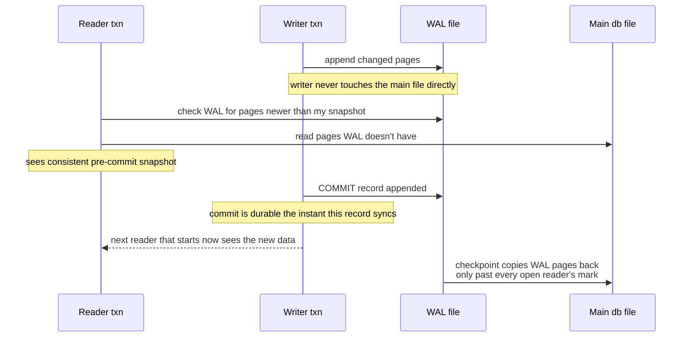

# Embedded and Edge Databases

> An embedded database has no server, no socket, no connection pool, and no network hop — it is
> a library linked into your process, and every one of its tradeoffs falls out of that one fact.
> This module covers SQLite, DuckDB, RocksDB/LevelDB, LMDB, and libSQL/Turso: what each is
> actually for, where the single-process model breaks, and the production failures that show up
> when someone forgets it is a process, not a service.

---

## 1. Concept Overview

Every database covered elsewhere in this section — PostgreSQL, Cassandra, Redis, ClickHouse —
runs as an independent server process (or cluster of them) that your application talks to over a
socket. That model gives you a connection pool, a network boundary, independent scaling, and a
process you can restart without restarting the application. An **embedded database** inverts this:
the storage engine is a library (`libsqlite3.so`, `librocksdb.a`, a Rust crate) statically or
dynamically linked into the *application's own process*. There is no client, because there is no
server — the "client" library and the storage engine are the same address space, and a query is
a function call, not a request.

This is not a smaller version of a client-server database. It is a different point in the design
space, chosen when the unit of deployment is a single process — a mobile app, a browser tab, a
CLI tool, an edge gateway, a desktop application, a single analytical job — rather than a fleet
of servers behind a load balancer. The three databases that dominate this space today do three
different jobs: **SQLite** is embedded OLTP (relational, transactional, general-purpose),
**DuckDB** is embedded OLAP (columnar, analytical, ad-hoc), and **RocksDB/LevelDB/LMDB** are
embedded key-value engines that other databases build their storage layer on top of, rather than
being queried directly by application code.

---

## 2. Intuition

- **Client-server database**: ordering food at a restaurant. You send a request across the room
  (network), the kitchen (server process) prepares it independently, and it comes back. The
  kitchen can serve many tables (clients) and can be scaled by hiring more staff, all without the
  diner knowing.
- **Embedded database**: cooking in your own kitchen. There is no order to place and no wait for
  someone else's process — you reach into the pantry (disk file) yourself. But there is exactly
  one kitchen, so if two people want to cook a full meal at once, one waits.
- **SQLite** is a filing cabinet with a SQL front end: durable, transactional, one drawer open for
  writing at a time.
- **DuckDB** is the same filing cabinet turned sideways — organized by column, not by row — built
  for someone who wants to scan every folder's third page, not open one folder fully.
- **LMDB** is a filing cabinet you never lock: readers hand out photocopies of a snapshot and walk
  away with them; nobody's copy ever changes underneath them, and nobody has to wait for a reader
  to finish looking.
- **Key insight**: remove the network hop and you remove everything that hop bought you along with
  it — independent scaling, isolation between the storage engine and application crashes, and
  someone else's process to restart. Every embedded-database tradeoff table in this module reduces
  to that one substitution.

---

## 3. Core Principles

### 3.1 A query is a function call, not a round trip

A client-server query pays, at minimum: a network round trip (RTT), connection acquisition from
a pool (or a new TCP/TLS handshake), request serialization into the wire protocol, and response
deserialization back into application types. On a well-tuned LAN that floor is commonly
0.3–1 ms; over the internet, single-digit to double-digit milliseconds; add TLS and a pool that's
momentarily exhausted and it climbs further. An embedded query pays none of that: `sqlite3_step()`
or `duckdb_query()` is an ordinary function call into code already mapped into the process, with
no serialization boundary crossed at all — the cost is the query execution itself plus, on a
cache miss, a `read()` syscall.

**Walk the arithmetic for a workload that issues 10,000 small point queries** (a mobile app
hydrating a list, a CLI tool checking 10,000 keys):

| Path | Per-query floor | 10,000 queries |
|---|---|---|
| Client-server, same-AZ RTT ~0.5 ms | 0.5 ms + serialization | ≥ 5 seconds, floor only |
| Client-server, cross-region RTT ~40 ms | 40 ms + serialization | ≥ 400 seconds — often infeasible |
| Embedded, warm page cache | ~1–10 μs (function call + B-tree lookup) | ~10–100 ms total |

The embedded path is two to five orders of magnitude faster *for this shape of workload* — many
small, latency-sensitive operations from a single process. This is the single strongest argument
for reaching for SQLite or LMDB over a client-server database when the deployment target is a
mobile app, a desktop tool, or a sidecar: the win is not "less infrastructure," it is a physically
shorter path between the code and the bytes.

### 3.2 What the model buys, and what it costs

The address-space merger cuts both ways:

- **No independent scaling.** A client-server database scales writes or reads by adding servers
  behind the same logical database. An embedded database has no "behind" — its capacity *is* the
  process's CPU, memory, and disk, and there is nothing else to add. Scaling an embedded workload
  means sharding across processes (each with its own file) at the application layer, not the
  database layer.
- **The process is the availability domain.** If the process crashes, dies out-of-memory, or gets
  OOM-killed, the database goes with it — there is no independent server to fail over to, because
  there was never an independent server. Recovery is "restart the process and let WAL/journal
  replay do its job," not "route to a replica."
- **Durability is now your `fsync` discipline, not a DBA's.** A client-server database ships with
  defaults chosen by people who operate databases for a living. An embedded database is configured
  by whichever engineer wired it into the app, and the wrong default (SQLite's `journal_mode =
  DELETE` under concurrent writers, `synchronous = OFF` anywhere) is now a production incident
  that looks like corruption rather than a slow query.
- **One writer, usually.** SQLite, DuckDB's native file format, and LMDB all serialize writes to a
  single writer at a time by design — not a bug, a direct consequence of there being one file and
  no lock manager coordinating across machines. Concurrent *readers* are the differentiator between
  these engines (see §4), but concurrent *writers* to the same file are, with narrow and recent
  exceptions, not a feature any of them have.

For deep-dive engine internals — LSM-tree compaction, write amplification, B-tree page splits,
buffer pools — this module does not re-derive them; see
[Storage Engines Internals](../storage_engines_internals/storage_engines_internals.md), which
already owns that material including RocksDB's write path. For columnar execution and vectorized
query processing, see
[Analytical Databases and OLAP](../analytical_databases_and_olap/analytical_databases_and_olap.md).
This module's job is the layer above both: the deployment model, not the storage internals.

---

## 4. Types / Architectures / Strategies

### 4.1 SQLite — the relational OLTP embedded default

SQLite (current release **3.54.1**, 16 Oct 2026, a patch to 3.54.0 of 9 Oct 2026; a C library, public domain, one `.c` file when
amalgamated) is a full relational engine — SQL, transactions, triggers, views, foreign keys — that
reads and writes a single ordinary file. It is, by the project's own accounting, the most widely
deployed database engine in existence: it ships inside every Android and iOS device, every major
browser (as the metadata store), and desktop OS components, with the project estimating over a
trillion SQLite database files in active use. Concretely: Airbus uses it in the flight software
for the A350 XWB family of aircraft, Firefox uses it as its primary metadata store, and Android
and iOS ship it as their standard on-device SQL engine.

**Journal modes — `DELETE` vs `WAL`.** SQLite's default journal mode is `DELETE`: before
modifying a page, the original is copied to a separate rollback-journal file; on commit the
journal is deleted; on crash, its presence signals an incomplete transaction to roll back. Under
this mode, **writers block readers and readers block writers** — every write briefly takes an
exclusive lock on the whole database file. `PRAGMA journal_mode = WAL` (Write-Ahead Logging)
inverts this: changes are appended to a separate `-wal` file instead of overwriting the database
in place, so readers keep reading the pre-transaction data from the WAL/database as it stood at
the start of their read, while a writer appends independently. The result, in SQLite's own words:
**"readers do not block writers and a writer does not block readers."** There is still only one
`-wal` file, so there can still only be one writer at a time — WAL buys reader/writer concurrency,
not writer/writer concurrency.

**`busy_timeout` and `SQLITE_BUSY`.** When a second writer (or, in `DELETE` mode, any reader)
cannot acquire the lock it needs, SQLite returns `SQLITE_BUSY` immediately unless a busy handler
is installed. `PRAGMA busy_timeout = 5000` (or `sqlite3_busy_timeout()`) tells SQLite to retry
with backoff for up to 5 seconds before giving up and returning `SQLITE_BUSY` to the caller — it
does not eliminate contention, it converts an immediate hard failure into a bounded wait. An
application still must handle `SQLITE_BUSY` as a real, expected outcome under load; see the
broken→fixed pair in §10.

**`synchronous` — which crash each level survives.**

| `PRAGMA synchronous` | Guarantee | Survives app crash | Survives OS crash / power loss |
|---|---|---|---|
| `OFF` (0) | No `fsync` calls by SQLite at all | Yes | **No** — recent commits can vanish, and in rare cases the file can be corrupted |
| `NORMAL` (1) | `fsync`s at critical moments; in WAL mode this is the recommended pairing | Yes | Only the most recent transaction(s) since the last WAL checkpoint can be lost — the database itself stays consistent |
| `FULL` (2) | `fsync`s before every critical write, including every commit | Yes | Yes — the default outside WAL mode, and the safest setting anywhere |
| `EXTRA` (3) | `FULL` plus an extra sync on rollback-journal-mode checkpoints | Yes | Yes — marginal extra safety, mostly irrelevant in WAL mode |

The pairing that matters in practice: **`journal_mode = WAL` + `synchronous = NORMAL`** is
SQLite's own recommended default for most applications — safe against process and OS crashes,
and only a genuine power-loss event can lose the last unflushed transactions, never corrupt the
file. `synchronous = OFF` is a durability opt-out, not a performance tuning knob; treat it as
`fsync=never`, appropriate only for scratch data you can regenerate.

**Dynamic typing and column affinity — the thing that surprises everyone.** Unlike most SQL
engines, where a column's declared type is enforced by its container, SQLite associates a type
with each *value*, not each column: `INSERT INTO t(n) VALUES ('hello')` succeeds even if `n` is
declared `INTEGER`, because the declared type only sets an **affinity** — a preference SQLite
tries to convert incoming values toward, not a constraint it rejects them for. This means a column
typed `INTEGER` can silently hold text, and sort order for a mixed column groups all numeric
values together (in numeric order) ahead of all text values (in lexicographic order) — `2, 3, 10,
'20', '100'`, not `'100', '20', 2, 3, 10`. `STRICT` tables (`CREATE TABLE t(...) STRICT`, added in
3.37.0) turn this off entirely: only `INTEGER`, `REAL`, `TEXT`, `BLOB`, and `ANY` are accepted as
column types, and a value that doesn't match the declared type is rejected outright rather than
coerced. New schemas should default to `STRICT`; the flexible-typing behavior remains the default
for backward compatibility, not because it's the better choice for new code. SQLite has also
added `RETURNING` clauses (INSERT/UPDATE/DELETE), a serializable `JSONB` internal format with
`jsonb_*` functions that avoid re-parsing JSON on every access, and generated columns — all
current, not historical, features.

### 4.2 DuckDB — embedded OLAP

DuckDB (current stable **1.5.6**, 28 Sep 2026; **2.0**, codename "Cyanoptera", is unreleased:
its `v2.0-cyanoptera` branch is feature-frozen as of the 2 Sep 2026 alpha, with a new SQL parser,
a new default storage format, and a reworked C API, and release projected for the second half of October 2026) is "the SQLite of OLAP": same deployment model (a library, one file, no
server process) but the opposite workload. Where SQLite is optimized for many small transactional
reads and writes touching a few rows, DuckDB is optimized for a few large analytical queries that
scan and aggregate millions of rows. It is columnar, vectorized, and ships a cost-based optimizer
capable of running the TPC-H benchmark suite; see
[Analytical Databases and OLAP §4.3](../analytical_databases_and_olap/analytical_databases_and_olap.md)
for the columnar-storage and vectorized-execution mechanics this module does not repeat.

What makes DuckDB specifically an *embedded* engine rather than just "small ClickHouse": it reads
Parquet, CSV, JSON, and Arrow — local or on object storage — directly, without a load step, and it
can query a `.duckdb` file that is itself a single portable file, the same shape as a `.sqlite`
file. Its concurrency model historically mirrored SQLite's most restrictive mode: one read-write
connection to the native file at a time, with additional connections read-only. That is changing
deliberately rather than being patched around — a "Quack" client-server protocol shipped in beta
on the 1.5.x line, letting one DuckDB process serve a database over the network so other DuckDB
processes can attach and route queries to it via `CONNECT`, and DuckDB 2.0 is expected to make
serving a database this way a first-class mode. Until that lands broadly, the honest planning
assumption for a `.duckdb` file is a single writer, exactly like SQLite. **MotherDuck** is the
managed/hybrid form — DuckDB as a cloud service with the option to run parts of a query locally
and parts in the cloud — for teams that want DuckDB's engine without owning the file's lifecycle
themselves. DuckDB Labs also builds **DuckLake**, a lake table format that stores its metadata in
a SQL database (which can itself be DuckDB) instead of a tree of files in object storage — an
interesting extension of the embedded philosophy into the lakehouse world, covered in full at
[Lakehouse and Table Formats §4.5](../lakehouse_and_table_formats/lakehouse_and_table_formats.md).

### 4.3 RocksDB / LevelDB — the embedded engine other databases are built on

RocksDB and its ancestor LevelDB are embeddable, ordered key-value *libraries* — the in-process,
single-machine end of the same key-value family
[Key-Value Stores](../key_value_stores/key_value_stores.md) covers as networked services (Redis
and friends): an LSM-tree storage engine with no query language, no schema, and no server
component, exposing `Get`, `Put`, `Delete`, and range `Iterator` as the entire API surface. Almost nobody calls RocksDB directly
from application code the way they call SQLite; instead, RocksDB is the storage layer *inside*
other databases, chosen because building a correct, fast LSM-tree from scratch is a multi-year
project and RocksDB already is one. Real embedders: **MyRocks** (a RocksDB-backed storage engine
for MySQL), **TiKV** (the storage layer of TiDB), **CockroachDB** originally embedded RocksDB
directly and later replaced it in-tree with Pebble, a Go reimplementation of the same design, and
**Netflix** uses RocksDB for local SSD-backed application data caching. This module does not
re-derive LSM-tree mechanics, compaction strategies, write amplification, or the memtable/SSTable
structure — see
[Storage Engines Internals §4](../storage_engines_internals/storage_engines_internals.md), which
already covers RocksDB's write path, bloom filters, and compaction in depth. What belongs here is
the deployment fact the internals module doesn't emphasize: RocksDB is consumed as an embedded
*component*, not as an end-user database, and that positioning — engine, not product — is exactly
why it belongs in this module's family rather than being confused with SQLite or DuckDB.

### 4.4 LMDB — the memory-mapped B+tree alternative

LMDB (Lightning Memory-Mapped Database, developed by Symas for the OpenLDAP project) takes a
structurally different approach from both the rollback-journal and LSM-tree models: it
memory-maps the entire database file into the process's address space and stores data as a
copy-on-write (CoW) B+tree directly in that mapping. **Reads are literal pointer dereferences**
into the mmap — no deserialization, no page-cache-to-heap copy, no separate buffer pool, because
the OS's virtual memory system *is* the buffer pool. On a write, LMDB never mutates a page in
place; it copies the modified path from the tree's root down to the changed leaf, leaving the old
path — and therefore every reader still walking it — completely untouched. This is the same
copy-on-write idea [Storage Engines Internals](../storage_engines_internals/storage_engines_internals.md)
covers for filesystem metadata in ZFS and Btrfs.

The payoff is genuine lock-free MVCC: a reader takes a pointer to the tree's root at the instant
its transaction begins and walks it with zero latches, zero shared-memory contention, and zero
garbage-collection bookkeeping — it is simply reading memory that a concurrent writer's new pages
never touch. The cost is the mirror image of SQLite/RocksDB's tradeoffs: exactly one writer at a
time (a file-level lock), and higher write amplification than an in-place B+tree because every
write copies an entire root-to-leaf path (typically 3–4 pages) rather than one page.

**Two traps that are specific to LMDB and catch people who assume it behaves like SQLite:**

1. **The map-size ceiling must be set up front.** `mdb_env_set_mapsize()` fixes the maximum size
   the memory mapping — and therefore the database — can ever grow to for that environment handle;
   there is no automatic growth. Writing past it returns `MDB_MAP_FULL` ("Environment mapsize
   limit reached"), and setting a mapsize smaller than the space already in use is silently
   clamped up to the current size rather than honored. The fix is operational, not a retry: reopen
   the environment with a larger `mapsize` (and if another process grew it concurrently, an
   in-flight transaction on an older mapping sees `MDB_MAP_RESIZED` and must restart).
2. **Long-lived read transactions pin old pages and make the file grow.** Because a reader holds
   a pointer to a specific historical root, LMDB cannot reclaim any page that transaction might
   still reach — even pages a writer has long since copy-on-written away — until that reader
   closes its transaction. A read transaction left open for hours (a debugging session, a stuck
   iterator, a connection-pool bug that never commits) silently prevents space reuse, and the file
   grows toward its mapsize even though the live data hasn't grown at all.

### 4.5 libSQL / Turso — SQLite forked, and rewritten, for the network era

This corner of the space has moved fast enough that names and status words are worth stating
precisely as of August 2026, not from general familiarity with "Turso" as a brand:

- **libSQL** is an open-source, open-contribution **fork of SQLite**, created and maintained by
  Turso. It extends SQLite's C codebase with features upstream doesn't have — **embedded
  replicas** (a local SQLite file that periodically syncs from a remote primary, so reads are
  served locally with zero network hop and writes are forwarded to the primary) and remote HTTP
  access — while still inheriting SQLite's single-writer-per-file limitation, because it is still,
  structurally, SQLite. Turso's own project documentation describes libSQL as **actively
  maintained**, but states plainly that **new feature development has moved to Turso Database**
  and that a new project should look there first.
- **Turso Database** (the project once developed under the codename **Limbo**) is a *different*
  thing from libSQL: a **from-scratch rewrite of a SQLite-compatible engine in Rust**, not a fork
  of the C codebase. Because it isn't constrained by SQLite's existing single-writer file format
  and locking code, it targets **MVCC with concurrent writes** — the one limitation neither
  SQLite nor libSQL can lift without becoming a different engine — plus async I/O and built-in
  vector search. As of August 2026 the project states it **has not yet reached a 1.0 release**,
  remains under active development with some features explicitly marked experimental, but is
  already used in production by a handful of organizations including Turso's own cloud service.
  **Do not treat it as a drop-in stable replacement for SQLite yet** — the project's own stated
  bar is "SQLite-level reliability," and its maintainers are explicit that they aren't confident
  they've cleared it.
- **Turso Cloud** is the managed service layered on top of this: hosted databases with the
  embedded-replica sync model as the headline feature — "read locally, write to a primary" — so a
  process at the edge gets local, in-process read latency while durability and cross-region
  distribution are the platform's problem, not the application's.

The practical read for a system-design answer: reach for plain **SQLite** when there's no sync
requirement at all; reach for **libSQL** (mature, SQLite-compatible) specifically for the
embedded-replica sync model today; watch **Turso Database** for concurrent in-process writes, but
don't bet a production system on its 1.0 boundary yet.

### 4.6 Honourable mentions

- **Berkeley DB** — the predecessor LMDB was written to replace; a transactional embedded KV store
  with a long history in mail servers and package managers, now largely legacy.
- **Sled / redb** — modern Rust-native embedded KV stores exploring simpler crash-safety models
  than RocksDB's LSM-tree; smaller ecosystems, worth watching rather than defaulting to.
- **RocksDB-derived engines** — Pebble (CockroachDB's Go reimplementation) and Facebook's own
  forks show the pattern of treating RocksDB's *design*, not its binary, as the reusable asset.
- **IndexedDB / OPFS and WASM SQLite in the browser** — the browser's own embedded transactional
  store (IndexedDB) and the Origin-Private File System (OPFS) that lets a WebAssembly build of
  SQLite persist a real `.sqlite` file inside a browser tab, extending the embedded model one more
  level down: no server, no OS process even, just a sandboxed page.
- **Realm / ObjectBox on mobile** — Realm's client-side embedded object database remains usable as
  an open-source project, but MongoDB ended Atlas Device Sync and the managed Realm SDK support
  path on 30 September 2025; ObjectBox is the actively developed alternative positioning itself as
  a sync-included replacement for that gap.

### 4.7 Replicating a SQLite file: Litestream and LiteFS

A single SQLite file on one disk is one disk failure away from data loss. Two tools ship its
changes elsewhere without changing the application's SQL:

- **Litestream** runs beside the application and streams the WAL to object storage (S3, GCS,
  Azure Blob, SFTP). It holds a long-running read transaction so no other process can checkpoint
  and reset the WAL before Litestream has copied it, and it runs checkpoints itself. Since v0.5
  each sync packages new WAL pages into an **LTX** file with a monotonically increasing
  transaction ID; files are compacted into coarser levels (30 seconds, 5 minutes, 1 hour by
  default) and a full snapshot is taken every 24 hours. `litestream restore` takes the newest
  snapshot before the target and applies later LTX files in order. Replication is asynchronous,
  so a disk loss can drop the last second or so of commits, and each database replicates to one
  destination. The optional `litestream-vfs` extension serves read queries straight from the
  replica in object storage without restoring the whole file.
- **LiteFS** (Fly.io) is a FUSE filesystem mounted under the SQLite file. It sees each committed
  transaction, writes it as an LTX file, and streams it to every replica node, which stay
  read-only. One node holds a lease (through Consul on Fly.io) and is the only writer; the others
  forward writes to it, on Fly.io with the `fly-replay` response header. Fly.io describes LiteFS
  as stable and in production but pre-1.0 and without vendor support, and warns that Machine
  autostop can stop a node without regard to lease ownership and lose data.

Both keep SQLite's single writer. They add durability (Litestream) or read scale-out to several
nodes (LiteFS); neither gives multi-writer.

### 4.8 Local-first sync engines and CRDT merge

A local-first app keeps the working set in an embedded database on the device (SQLite, IndexedDB,
PGlite in the browser) and syncs with a server database in the background, so reads and writes
never wait on the network. The engines differ mainly in how writes flow back:

| Engine | Server source | Read path | Write path |
|---|---|---|---|
| ElectricSQL | PostgreSQL | **Shapes**: a table plus `WHERE` clause and column list, streamed over HTTP (`GET /v1/shape` with `offset` and `handle`) from a logical replication slot; CDN-cacheable | Not synced; the app writes through its own API, and the change returns via the shape |
| PowerSync | PostgreSQL, MongoDB, MySQL and others | Service replicates the source and partitions rows per user with **Sync Streams** into client SQLite | Client queues local writes and uploads them to the app's own backend, which decides how to apply them (server reconciliation, commonly per-field last-write-wins) |
| Zero (Rocicorp) | PostgreSQL | `zero-cache` replicates Postgres into a server-side SQLite replica; clients sync the results of the queries they actually run | Mutators run optimistically on the client and again, authoritatively, on the server |
| CRDT libraries (Automerge, Yjs, cr-sqlite) | Any, or peer to peer | Each replica holds full state | Every replica accepts writes; merge is deterministic, no server arbitration |

**Server reconciliation** (Electric, PowerSync, Zero) keeps one authority: the server runs the
write with real constraints, auth and validation, and clients rebase their optimistic state on the
result. **CRDT merge** gives up the authority: each field or document is a data type whose merge
is commutative, associative and idempotent (last-writer-wins registers ordered by hybrid logical
clocks, add-wins sets, sequence CRDTs for text), so any two replicas that have seen the same
operations converge with no coordinator. The cost is that invariants spanning rows ("stock never
below zero", "username unique") cannot be enforced by merge alone. Pick a CRDT for collaborative
editing and peer-to-peer, server reconciliation for business data with constraints. See
[Consistency Models and Consensus](../consistency_models_and_consensus/consistency_models_and_consensus.md)
for CRDT internals.

```
  server reconciliation                       CRDT merge
  client A: qty 5 -> 4 (optimistic)           replica A: qty 5 -> 4
  client B: qty 5 -> 4 (optimistic)           replica B: qty 5 -> 4
  server applies A, then B: 5 -> 4 -> 3       merge as PN-counter: 5 - 1 - 1 = 3
  server rejects B if qty would go < 0        nobody can reject; qty can go negative
```

### 4.9 SQLite at the edge: Cloudflare D1, Durable Objects, and read replicas

- **Durable Objects with SQLite storage.** Each Durable Object is a single-threaded actor with
  its own embedded SQLite database (10 GB per object on the Workers Paid plan, 1 GB on Free),
  queried in-process with `ctx.storage.sql.exec()`. Each storage call runs in an implicit
  transaction, input and output gates stop concurrent requests from interleaving between an
  `await` and a write, and point-in-time recovery reaches back 30 days. The design shards by
  object: one object per chat room, document or tenant, each a single writer.
- **D1** is Cloudflare's managed SQLite database service, built on Durable Objects. Writes go to
  one primary. **Read replication** keeps asynchronous read-only copies in every region (ENAM,
  WNAM, WEUR, EEUR, APAC, OC) and is used only through the **Sessions API**: each query returns a
  **bookmark** naming a database version, and a session started from that bookmark only reads
  from a replica that has reached it. That gives sequential consistency within a session:
  monotonic reads, monotonic writes, writes-follow-reads, and read-your-writes.
- **Embedded replicas** (libSQL, section 4.5) and **edge read replicas** (D1, Turso Cloud, LiteFS)
  share one rule: reads are local, writes travel to one primary, and the client carries a
  position (bookmark, frame number, TXID) so it never reads older than its own last write.

```
  user in Sydney, primary in Virginia (RTT ~200 ms)

  read, no session          -> nearest replica (APAC), ~5 ms, may be seconds stale
  write                      -> primary (WNAM/ENAM), ~200 ms, returns bookmark B42
  read with bookmark B42     -> APAC replica, which waits until it has applied B42
```

---

## 5. Architecture Diagrams

**In-process vs client-server — what actually sits in the address space:**

```
CLIENT-SERVER MODEL                    EMBEDDED MODEL
====================                   ================

  App Process A     App Process B        App Process
  +------------+    +------------+       +--------------------+
  | app code   |    | app code   |       | app code           |
  | db driver  |    | db driver  |       | db driver (library)|
  +-----+------+    +-----+------+       | storage engine     |
        |                 |              +----------+---------+
        |   TCP/socket    |                          |
        |   + wire proto  |                          | fread/fwrite,
        |   + RTT         |                          | mmap, fsync
        v                 v                          v
  +---------------------------------+          +--------------+
  |     DB server process           |          |  data file   |
  |  storage engine + query exec    |          |  (.db, .wal) |
  +----------------+----------------+          +--------------+
                    |
                    v
              +-----------+
              | data file |
              +-----------+

  2 processes, 1 network hop each        1 process, 0 network hops
  server independently restartable       process crash == db crash
  server scales apart from clients       "scaling" == a bigger box
```

The left side has a boundary a network packet crosses; the right side has none — the storage
engine and the application share one process, one crash domain, and one set of file descriptors.

**SQLite WAL mode — reader/writer timeline:**



A reader never blocks the writer and the writer never blocks a reader because they touch
different files; the only thing that can stall is the *checkpoint*, which must wait for every
reader still pointed at old WAL content to finish before reclaiming that space.

**LMDB — memory-mapped copy-on-write B+tree:**

```
Before write (readers R1, R2 both mid-traversal of root A):

  mmap:  [ROOT A] --> [NODE B] --> [LEAF D: k=5,v="x"]
                  \--> [NODE C] --> [LEAF E: k=9,v="y"]

  R1, R2 hold pointers into ROOT A's subtree. Untouched.

Writer updates k=5 -> "z":  copies the root-to-leaf PATH only

  mmap:  [ROOT A ] --> [NODE B ] --> [LEAF D : k=5,v="x"]   <- R1, R2 still see this
         [ROOT A'] --> [NODE B'] --> [LEAF D': k=5,v="z"]   <- new path, new txn's root
                    \-> [NODE C ] --> [LEAF E : k=9,v="y"]   <- UNCHANGED, shared by both trees

  Commit publishes ROOT A' as the new root pointer.
  R1, R2's already-open transactions keep dereferencing ROOT A until they close.
  A transaction opened after commit gets ROOT A'.
```

Only the path from root to the changed leaf is copied — `NODE C`/`LEAF E` are shared, unchanged,
between the old and new trees — which is why LMDB's write amplification scales with tree height
(3–4 pages typically) rather than with total database size, and why a reader's view is frozen
solid the instant its transaction opens: it is holding a pointer to an immutable, complete tree
that nothing will ever mutate underneath it.

---

## 6. How It Works — Detailed Mechanics

### 6.1 SQLite WAL setup — the pragmas that actually matter

```sql
-- Run once per new database file (journal_mode is sticky/persistent):
PRAGMA journal_mode = WAL;      -- readers/writers stop blocking each other
PRAGMA synchronous = NORMAL;    -- safe vs crashes; power-loss can lose only the
                                 -- last unflushed txn(s), never corrupt the file
PRAGMA busy_timeout = 5000;     -- retry up to 5s on SQLITE_BUSY instead of failing instantly
PRAGMA foreign_keys = ON;       -- off by default in SQLite; almost always want it on
PRAGMA cache_size = -20000;     -- negative = KiB; ~20MB page cache instead of the tiny default
PRAGMA wal_autocheckpoint = 1000; -- checkpoint after ~1000 WAL pages (~4MB); the default
```

Each line fixes a *specific* default that surprises people coming from a client-server database:
`journal_mode` defaults to `DELETE` (blocking); `synchronous` defaults to `FULL` outside WAL mode
but should be explicitly set to `NORMAL` once WAL is on, since `FULL` under WAL forces an extra
sync `FULL` doesn't need to buy safety WAL already provides; `busy_timeout` defaults to `0` (fail
immediately); `foreign_keys` defaults to `OFF` for backward compatibility with pre-3.6.19 schemas.

### 6.2 The `SQLITE_BUSY` retry loop — broken, then fixed

**Broken** — no busy handling, default rollback-journal mode, concurrent writers:

```python
import sqlite3

conn = sqlite3.connect("app.db")          # journal_mode = DELETE (default)
                                            # busy_timeout = 0 (default)

def record_event(event):
    conn.execute("INSERT INTO events(payload) VALUES (?)", (event,))
    conn.commit()   # <-- raises sqlite3.OperationalError: database is locked
                    #     the instant a second thread/process is mid-write
```

Under any real concurrent-write load this raises intermittently and unpredictably — usually
first noticed as a spike of 500s under peak traffic that nobody can reproduce locally, because
local testing rarely has two writers racing at once.

**Fixed** — WAL mode, a busy timeout, and the application still handles the bounded failure:

```python
import sqlite3, time

conn = sqlite3.connect("app.db", timeout=5.0)   # maps to sqlite3_busy_timeout(5000)
conn.execute("PRAGMA journal_mode=WAL")
conn.execute("PRAGMA synchronous=NORMAL")

def record_event(event, retries=3):
    for attempt in range(retries):
        try:
            conn.execute("INSERT INTO events(payload) VALUES (?)", (event,))
            conn.commit()
            return
        except sqlite3.OperationalError as e:
            if "locked" in str(e) and attempt < retries - 1:
                time.sleep(0.05 * (attempt + 1))   # small extra backoff past busy_timeout
                continue
            raise
```

WAL mode removes the reader/writer blocking entirely; `busy_timeout` absorbs writer/writer
contention up to 5 seconds; the retry loop is what's left over for the tail beyond that — a
write that is still contended after 5 seconds of internal retrying is a real signal (too many
concurrent writers for one file) that should surface as an error, not be silently swallowed.

### 6.3 DuckDB — querying Parquet without loading it

```python
import duckdb

# No CREATE TABLE, no COPY, no load step — DuckDB reads the file's footer
# and pushes the filter/projection straight into the Parquet reader.
result = duckdb.sql("""
    SELECT customer_id, SUM(amount) AS total
    FROM read_parquet('s3://bucket/events/*.parquet')
    WHERE event_date >= '2026-08-01'
    GROUP BY customer_id
    ORDER BY total DESC
    LIMIT 10
""").fetchall()
```

The engine only reads the row groups whose statistics overlap `event_date >= '2026-08-01'`, and
within a row group only the `customer_id`, `amount`, and `event_date` columns — the columnar
predicate/projection pushdown mechanics behind this are
[Analytical Databases and OLAP §3.4](../analytical_databases_and_olap/analytical_databases_and_olap.md#34-pushdown--predicate-projection-aggregate).
What's specific to the embedded model here: there was no ingestion step, no server to point at
the bucket, and no schema registered anywhere — the query *is* the schema discovery.

### 6.4 LMDB — a transaction, C API

```c
MDB_env *env;
mdb_env_create(&env);
mdb_env_set_mapsize(env, 10UL * 1024 * 1024 * 1024);  /* 10 GiB ceiling, fixed up front */
mdb_env_open(env, "./data", 0, 0664);

MDB_txn *txn;
MDB_dbi dbi;
mdb_txn_begin(env, NULL, 0, &txn);          /* read-write txn */
mdb_dbi_open(txn, NULL, 0, &dbi);

MDB_val key = { .mv_size = 3, .mv_data = "abc" };
MDB_val val = { .mv_size = 3, .mv_data = "123" };
mdb_put(txn, dbi, &key, &val, 0);
mdb_txn_commit(txn);                        /* copies root-to-leaf path, publishes new root */

/* A concurrent reader needs no lock at all: */
MDB_txn *rtxn;
mdb_txn_begin(env, NULL, MDB_RDONLY, &rtxn); /* just takes a pointer to the current root */
mdb_get(rtxn, dbi, &key, &val);              /* pointer dereference into the mmap */
mdb_txn_abort(rtxn);                         /* MUST close promptly — see the pinned-pages trap */
```

The comment on the last line is the trap from §4.4 made concrete: `mdb_txn_abort`/`mdb_txn_commit`
on a read transaction is what releases the pages it was pinning — forgetting to close it (or
holding it across a slow network call, a common bug when a reader transaction is opened inside a
request handler) is what silently grows the file toward `MDB_MAP_FULL`.

### 6.5 Single-writer concurrency arithmetic

A single-writer file has a hard throughput ceiling: **max writes/sec ≈ 1 / (fsync latency +
per-write CPU work)**. On typical NVMe, an `fsync` costs roughly 0.1–1 ms; on network-attached or
cloud-network-block storage it is commonly 5–20 ms or worse. Take a SQLite WAL-mode service
committing one row per write with `synchronous = NORMAL` on local NVMe at ~0.3 ms per commit
group: the ceiling is on the order of `1 / 0.0003 ≈ 3,000` single-row commits/sec from *one*
writer, before any application logic. Two changes move that ceiling in opposite directions:
batching multiple rows into one transaction amortizes the fsync across all of them (10 rows per
commit roughly multiplies the ceiling by up to 10x, since the fsync — not the row count — is the
bottleneck); moving the same file onto network storage can cut it by 10–50x, because the fsync
latency, not CPU, dominates the equation. This is the number to check before choosing SQLite or
LMDB for a write path: if the required write rate exceeds what one file's fsync budget allows,
no amount of application-level tuning fixes it — the fix is either batching writes, relaxing
`synchronous`, or an architecture with more than one writer (which means leaving the single-file
embedded model, not tuning it).

---

## 7. Real-World Examples

- **SQLite in aircraft**: Airbus uses SQLite in the flight software for the A350 XWB family —
  cited directly on the SQLite project's own famous-users page, not a folklore claim.
- **SQLite on mobile and in browsers**: the standard on-device SQL engine bundled into both
  Android and iOS, and Firefox's primary metadata storage format — three of the highest-volume
  software deployments in existence all resting on the same embedded engine.
- **SQLite in the browser via WASM/OPFS**: a compiled-to-WebAssembly SQLite build persisting to
  the Origin-Private File System lets a web app get a real transactional SQL database inside a
  browser tab with no server round trip at all — the embedded model taken one level further than
  a desktop or mobile OS.
- **DuckDB in analytics tooling**: embedded directly into notebooks and BI/ETL tools as the local
  query engine over Parquet and CSV without a warehouse in the loop — see
  [Analytical Databases and OLAP §4.3](../analytical_databases_and_olap/analytical_databases_and_olap.md)
  for the fuller landscape, including MotherDuck as the managed form.
- **RocksDB inside other databases**: MyRocks gives MySQL an LSM-tree storage engine option, TiKV
  (TiDB's storage layer) is built on it, and Netflix uses it for local SSD-backed application data
  caching — the recurring pattern of RocksDB as a *component*, not an end-user product.
- **LMDB inside infrastructure**: OpenLDAP's `back-mdb` backend (the project LMDB was built for),
  Postfix's `lmdb:` map type for fast local lookup tables, and the Monero cryptocurrency's
  blockchain storage all rely on LMDB's crash-safe, lock-free-read model for local, single-node
  durability.
- **libSQL embedded replicas**: applications that want SQLite's in-process read latency but a
  durable, shared primary use libSQL's embedded-replica sync model — reads never leave the
  process, writes are forwarded and synced back down.

---

## 8. Tradeoffs

| Dimension | Embedded (SQLite/DuckDB/LMDB) | Client-server (PostgreSQL/MySQL/etc.) |
|---|---|---|
| Read/write latency | Function-call floor, ~1–10 μs on a warm cache | Network RTT floor, ~0.3 ms same-AZ and up |
| Concurrent writers | One, per file, by design (narrow exceptions emerging — DuckDB's Quack protocol, Turso Database) | Many, coordinated by a lock manager / MVCC across connections |
| Operational cost | None — no process to patch, monitor, or provision separately | A server (or cluster) to deploy, patch, monitor, and capacity-plan |
| Backup | Copy a file (correctly — see §10) or use the engine's backup API | Point-in-time recovery, WAL shipping, replica promotion — mature tooling |
| Scaling | Bigger box, or shard at the application layer across files/processes | Add read replicas, shard, or scale the server vertically — independent of clients |
| Multi-language access | Only processes that link the library (though many languages ship bindings) | Any client speaking the wire protocol, from any language, any host |
| Observability | Whatever the application logs itself; no separate slow-query log or `pg_stat_activity` | Rich built-in introspection: active queries, lock waits, replication lag |
| Crash isolation | None — a storage-engine bug or an OOM kill takes the application process down with it | Storage engine and application are separate processes; one can crash without the other |

---

## 9. When to Use / When NOT to Use

This module covers one axis of a much larger decision; for the full cross-family selection
process — benchmark traps, TCO, migration risk — see
[Database Selection Framework](../database_selection_framework/database_selection_framework.md).

**Use an embedded database when:**
- The deployment unit is a single process — mobile app, desktop app, browser tab, CLI tool, a
  sidecar or edge device with no network path to a central database at all.
- The workload is read-heavy from the *same process* that owns the data, and that process is the
  only writer that will ever exist for this file.
- Latency has to be single-digit microseconds to low milliseconds and a network hop is not
  affordable, not a case of "the network is annoyingly slow" but literally offline (aircraft,
  IoT, disconnected field devices).
- The data genuinely fits one machine — DuckDB for analytics, SQLite/LMDB for OLTP-shaped state —
  and there's no requirement for multiple independent processes to write it concurrently.

**Do not use an embedded database when:**
- Multiple independent server processes need to write the *same* logical dataset concurrently at
  meaningful throughput — this is the one thing the model structurally cannot do without leaving
  it (sync to a primary, shard, or switch to a client-server engine).
- **The honest boundary for SQLite specifically**: it genuinely can serve a small-to-medium
  production web service — single-process web frameworks (a Python/Node process handling modest
  request volume) run happily on SQLite in WAL mode, and it's a legitimate production choice, not
  a toy. The ceiling is the single-writer arithmetic in §6.5: once concurrent write volume from
  multiple worker processes routinely produces `SQLITE_BUSY` even with a generous `busy_timeout`,
  or once the application has scaled past one machine (SQLite's file has no multi-host story),
  that is the signal to move to a client-server database — not a symptom to tune around further.
- The database file needs to live on a network filesystem (NFS, SMB, most cloud "shared drives")
  — see the dedicated pitfall in §10; this is a hard architectural incompatibility, not a
  configuration issue.
- Independent operational lifecycle matters — restarting the database without restarting the
  application, patching it out-of-band, or giving a DBA team a system to operate separately from
  engineering — none of that exists when the database is a library inside the app.

---

## 10. Common Pitfalls

**Pitfall 1 — `SQLITE_BUSY` treated as an unhandled exception under concurrent writers.**
Default `journal_mode = DELETE`, default `busy_timeout = 0`: the moment two threads or processes
attempt a write within the same brief lock window, one gets an immediate `SQLITE_BUSY` /
"database is locked" error with zero retry. Teams that load-test with one worker never see it,
then discover it as a burst of write failures the moment traffic scales past a single process.
Fix: `journal_mode = WAL` (removes reader/writer blocking entirely) plus `busy_timeout` in the
seconds range (absorbs writer/writer contention) plus explicit retry handling for whatever
remains, exactly as walked in §6.2.

**Pitfall 2 — SQLite (or any embedded file) on NFS or another network filesystem.**
SQLite's own WAL documentation is explicit: **"All processes using a database must be on the same
host computer; WAL does not work over a network filesystem."** The reason is structural, not a
missing feature: WAL mode requires processes to share a small region of memory (the `-shm` file)
for coordination, and network filesystems do not reliably support the locking primitives SQLite
depends on even in rollback-journal mode — the classic failure mode is silent data corruption
under concurrent access, not a clean error. Even the rollback-journal mode's advisory `flock()`
locking is unreliable or entirely absent on many NFS configurations. Fix: an embedded database's
file lives on local disk, full stop; if the data must be shared across hosts, that is a
client-server database's job, not a network-mounted SQLite file's.

**Pitfall 3 — an undersized LMDB `mapsize` hit in production.**
`mdb_env_set_mapsize()` was set once, at deploy time, to "comfortably larger than today's data,"
and months later normal growth crosses it. Every write after that point returns `MDB_MAP_FULL`
("Environment mapsize limit reached") — not a graceful degradation, a hard write failure across
the whole environment until an operator reopens it with a larger mapsize. The fix is process, not
code: monitor database size against the configured mapsize with real alerting headroom (not "when
it's full"), and size the ceiling for multi-year growth rather than current usage, since raising
it later requires a restart with the environment closed.

**Pitfall 4 — `PRAGMA synchronous = OFF` silently losing committed data on power loss.**
A team disables `synchronous` for a write-throughput win, tests it locally (where power never
actually fails), ships it, and then a real power-loss or hard-crash event loses transactions that
the application already told a user were committed — potentially with database corruption, not
just data loss, since `OFF` skips the syncs that guarantee the file itself stays internally
consistent. `synchronous = NORMAL` under WAL mode gets nearly the same performance win — only the
most recent unflushed commits are at risk, and the file itself never corrupts — which is why it,
not `OFF`, is SQLite's own recommended default pairing.

**Pitfall 5 — backing up a live SQLite file with `cp` instead of the backup API.**
A plain filesystem copy of a `.sqlite` file while the database is open and being written is not a
consistent snapshot: WAL-mode writes are split across the main file and the `-wal` file, a copy
mid-write can capture the main file before a page update and the `-wal` file after it (or vice
versa), and the result is a backup that looks fine until it's restored and query results are
subtly wrong or the file fails an integrity check. Fix: use the **Online Backup API**
(`sqlite3_backup_init`/`step`/`finish`), or `VACUUM INTO 'backup.db'`, both of which take a
transactionally consistent snapshot regardless of concurrent activity — never `cp`/`rsync` a
database file that any process might have open.

**Pitfall 6 — the embedded file was the only copy, and the process became unrestartable.**
A service stored its only durable state as a SQLite/LMDB file on local, non-replicated disk with
no backup schedule at all — "it's just a cache," until it wasn't. A bad deploy, a full disk, or an
instance replacement destroyed the file, and the service came back up with an empty (or corrupt)
database and no way to recover it, because nothing outside that one disk had ever seen the data.
Embedded does not mean disposable: if the data has to survive the process's death, it needs the
same backup discipline — off-box copies, on a schedule, taken with the correct tool from Pitfall
5 — that any client-server database would get by default from its operators.

---

## 11. Technologies & Tools

| Tool | Category | Notes |
|---|---|---|
| SQLite | Embedded relational (OLTP) | 3.54.1 (Oct 2026); public domain, single amalgamated `.c` file; `.diskused` replaces `sqlite3_analyzer`; Windows Vista or later |
| DuckDB | Embedded analytical (OLAP) | 1.5.6 stable (Sep 2026); 2.0 feature-frozen, unreleased, adds server mode |
| MotherDuck | Managed/hybrid DuckDB | Cloud service layered on the DuckDB engine |
| RocksDB | Embeddable LSM-tree KV library | Facebook-originated; storage layer inside MyRocks, TiKV, others |
| LevelDB | Embeddable LSM-tree KV library | RocksDB's Google-originated predecessor; simpler, less actively evolved |
| LMDB | Embeddable memory-mapped CoW B+tree KV library | Symas/OpenLDAP-originated; also used by Postfix, Monero |
| libSQL | SQLite fork with embedded replicas + sync | Maintained by Turso; new feature work has moved to Turso Database |
| Turso Database (fka Limbo) | SQLite-compatible engine, ground-up Rust rewrite | Pre-1.0 as of Aug 2026; targets MVCC concurrent writes |
| Turso Cloud | Managed service around libSQL/Turso Database | Embedded-replica sync as the primary offering |
| Berkeley DB | Legacy embeddable transactional KV store | Predecessor LMDB was designed to replace |
| sled / redb | Modern Rust-native embedded KV stores | Smaller ecosystems; simpler crash-safety designs than LSM-trees |
| SQLite WASM + OPFS | SQLite compiled to WebAssembly, persisted via the browser's Origin-Private File System | Embedded database *inside a browser tab* |
| Realm | Embedded object database for mobile | Client SDK remains OSS; MongoDB's managed sync path ended 30 Sep 2025 |
| ObjectBox | Embedded object database for mobile/edge | Actively developed; positions as a sync-included Realm-sync alternative |
| Litestream | Streams SQLite WAL as LTX files to object storage | Async backup and point-in-time restore; `litestream-vfs` reads from the replica |
| LiteFS | FUSE filesystem replicating SQLite across nodes | One leased writer, read-only replicas; pre-1.0, no Fly.io support |
| ElectricSQL | Postgres-to-client read-path sync over HTTP (Shapes) | Writes go through the app's own API |
| PowerSync | Backend database to client SQLite sync | Upload queue to your backend; server reconciliation |
| Zero | Query-driven sync from Postgres via `zero-cache` | Optimistic client mutators, authoritative server mutators |
| Automerge / Yjs / cr-sqlite | CRDT libraries (documents, text, SQLite tables) | Coordinator-free merge; no cross-row invariants |
| Cloudflare Durable Objects (SQLite) | Per-object embedded SQLite in an actor | 10 GB per object, 30-day PITR |
| Cloudflare D1 | Managed SQLite on Durable Objects | Read replicas through Sessions API bookmarks |

---

## 12. Interview Questions with Answers

**Q: Why does an SQLite-backed service that worked fine in testing suddenly throw "database is locked" errors in production?**
**Short:** Default rollback-journal mode blocks writers on writers with zero retry, so concurrent write load that testing never exercised trips SQLITE_BUSY immediately.
SQLite's default `journal_mode = DELETE` takes an exclusive lock on the whole file for the
duration of a write, and the default `busy_timeout` is `0` — a second writer that arrives during
that window gets `SQLITE_BUSY` instantly rather than waiting. Single-worker local testing never
produces two simultaneous writers, so the failure only appears once real concurrent traffic hits
multiple processes or threads. Fix: `PRAGMA journal_mode = WAL` to stop readers and writers from
blocking each other, a `busy_timeout` in the seconds range to absorb writer/writer contention with
backoff instead of an instant failure, and application-level retry handling for whatever
contention remains past that timeout.

**Q: You mounted a SQLite database on an NFS share for "shared access from two servers." What goes wrong?**
**Short:** SQLite's own documentation says WAL does not work over a network filesystem at all, and even journal-mode locking is unreliable there.
WAL mode requires processes to share a small memory-mapped region (the `-shm` file) for
coordination, which network filesystems do not support the way a local filesystem does; SQLite's
own WAL documentation states plainly that all processes using a database must be on the same host.
Rollback-journal mode's `flock()`-based locking fares no better — many NFS configurations
implement advisory locking unreliably or not at all, so two hosts can both believe they hold an
exclusive lock simultaneously. The failure mode is silent corruption under concurrent writes, not
a clean rejected connection. The fix is architectural: an embedded database's file belongs on
local disk; data that must be shared across hosts needs a client-server database or an
explicit sync layer (libSQL's embedded replicas, for example), not a shared file mount.

**Q: What actually breaks when you set `PRAGMA synchronous = OFF` for a performance win?**
**Short:** SQLite skips the fsyncs guaranteeing durability, so a real crash or power loss can lose already-committed data or corrupt the file.
`synchronous = OFF` means SQLite issues no `fsync()` calls at all, so the OS is free to reorder
and delay writes to disk however it likes. An application crash alone is still survivable because
the OS page cache normally flushes eventually, but an OS crash or power-loss event can lose
recently committed transactions outright, and in rare cases corrupt the database file itself,
because SQLite made no guarantee about write ordering to protect it. The safer setting that gets
most of the same performance win under WAL mode is `synchronous = NORMAL`, where at most the very
last unflushed commits are lost on power failure and the file itself never becomes inconsistent —
that pairing, not `OFF`, is SQLite's own recommended default.

**Q: An LMDB-backed service starts returning MDB_MAP_FULL even though the actual dataset barely grew. Why?**
**Short:** A long-lived open read transaction pins the pages it can still reach, blocking reclamation even after a writer copy-on-writes them away.
LMDB is copy-on-write: a writer never mutates a page in place, it copies the root-to-leaf path and
leaves the old path intact for any reader still pointed at it. A reader that opens a transaction
and never closes it — a stuck iterator, a connection-pool bug, a debugging session left running —
keeps LMDB from reclaiming every page that transaction's old root can still reach, even long after
a writer has replaced them. The file keeps growing toward its fixed `mapsize` ceiling even though
live data isn't growing, because "growth" here is accumulated unreclaimed old versions, not new
rows. Fix: audit for read transactions that outlive their scope, and treat "close every
transaction promptly" as a hard rule, not an optimization.

**Q: Someone backed up a live SQLite database with `cp app.db backup.db` while the app kept running. What's wrong with that backup?**
**Short:** A live filesystem copy can capture the main file and its WAL file at inconsistent points, producing a backup that silently fails to restore correctly.
In WAL mode, committed changes live partly in the main database file and partly in the separate
`-wal` file until a checkpoint merges them; a plain file copy taken mid-write can grab the main
file before a page update lands and the WAL file after it (or the reverse), producing a file that
looks structurally valid but has an inconsistent internal state. The failure shows up later,
often only on restore, as subtly wrong query results or a failed integrity check — not as an
error at backup time. The fix is to use SQLite's Online Backup API or `VACUUM INTO 'file.db'`,
both of which take a transactionally consistent snapshot regardless of what else is happening to
the database concurrently.

**Q: What is column affinity in SQLite, and why can an INTEGER column hold the string 'hello'?**
**Short:** SQLite types values, not columns; a declared column type is only a conversion preference unless the table is STRICT.
Unlike most SQL databases, where a column's declared type is enforced on every stored value,
SQLite associates a storage type with each individual value and treats the column's declared
type as an *affinity* — a preference it tries to convert incoming data toward, not a constraint
it rejects mismatches for. So `INSERT INTO t(n) VALUES ('hello')` succeeds into an `INTEGER`
column because 'hello' can't be converted to a number and SQLite just stores it as text instead
of erroring. `CREATE TABLE ... STRICT` (added in 3.37.0) turns this off: only `INTEGER`, `REAL`,
`TEXT`, `BLOB`, and `ANY` are accepted, and a genuinely mismatched value is rejected rather than
coerced. New schemas should default to `STRICT` rather than relying on the historical flexible
typing.

**Q: What is the practical difference in concurrency model between SQLite and DuckDB's native file format?**
**Short:** Both allow one read-write connection to the file at a time with additional read-only connections, but DuckDB is actively adding a server mode.
SQLite in WAL mode allows exactly one writer plus unlimited concurrent readers that never block
it. DuckDB's native `.duckdb` file historically enforces the same shape at the file level: one
read-write connection, with any additional connections restricted to read-only. The difference is
in trajectory, not current mechanics — DuckDB shipped a beta "Quack" client-server protocol on the
1.5.x line that lets one DuckDB process serve a database over the network so other processes can
attach and query it via `CONNECT`, with DuckDB 2.0 (feature-frozen, unreleased) expected to make a proper
server mode first-class. Until that lands as the default deployment shape, plan a `.duckdb` file
around a single writer exactly as you would a SQLite file.

**Q: When does it make sense to run SQLite as the database behind a real production web service, and when does that stop being true?**
**Short:** SQLite can back a real single-machine service in WAL mode; the boundary is once concurrent write load from multiple processes outruns one file's fsync ceiling.
A single-process (or single-machine, multi-threaded) web service in WAL mode with a sane
`busy_timeout` is a legitimate production architecture, not a toy — it removes an entire server
and connection pool from the deployment. The boundary is the single-writer arithmetic: throughput
is bounded by roughly one commit per fsync-latency-plus-CPU-work interval, so once the service
scales past one machine, or concurrent writers from multiple worker processes routinely produce
`SQLITE_BUSY` even with a generous timeout, that's the signal to move to a client-server database
— not a symptom to keep tuning pragmas around.

**Q: Why is RocksDB rarely called directly from application code, unlike SQLite?**
**Short:** RocksDB exposes only Get/Put/Delete/Iterator with no schema or query language, so applications almost always consume it through a database built on top.
RocksDB is a key-value *library*, not a database product — there's no SQL, no schema enforcement,
no query planner, just an ordered byte-key/byte-value API and iterators. That makes it an
excellent foundation for someone building a database (MyRocks adding it as a MySQL storage
engine, TiKV using it as TiDB's storage layer) but a poor fit for an application team that wants
to model rows and run queries directly — they'd be re-implementing the schema and query layer
SQLite or DuckDB already provide. LSM-tree mechanics, compaction, and write amplification for
RocksDB specifically are covered in Storage Engines Internals, not repeated here.

**Q: What is an "embedded replica" in libSQL, and what problem does it solve that plain SQLite can't?**
**Short:** A local SQLite file that syncs from a remote primary, giving in-process read latency with writes forwarded to a durable, shared primary.
Plain SQLite has no concept of a remote primary — every writer is local to the file, full stop.
libSQL's embedded replica keeps a local `.db` file that periodically syncs down from a remote
primary database, so reads are served with pure in-process, zero-network latency exactly like
ordinary SQLite, while writes are transparently forwarded to the primary and the result synced
back. It's the "read locally, write to a primary" pattern — a middle ground between a fully local
SQLite file (no sharing at all) and a full client-server database (every read pays a network hop).

**Q: How does Litestream back up a live SQLite database without stopping writes, and what can it still lose?**
**Short:** It holds a read transaction so the WAL cannot be checkpointed away, ships new WAL pages to object storage as LTX files, and checkpoints itself; being asynchronous, a disk loss drops the last second or so of commits.

Litestream runs beside the application and opens a long-lived read transaction on the database, which stops any other connection from checkpointing and resetting the WAL before Litestream has read it. It then copies newly committed WAL pages into LTX files, each with the next transaction ID, uploads them to S3, GCS, Azure Blob or SFTP, and performs the checkpoint itself once the pages are safe. Files are compacted into coarser levels and a snapshot is written every 24 hours by default, so `litestream restore` replays the newest snapshot plus later LTX files to any point. Because replication is asynchronous, commits made since the last sync are lost with the disk, and each database replicates to one destination. It gives you backup and PITR for a single-writer file; for read scale-out across nodes use LiteFS or an embedded-replica service instead.

**Q: When should a local-first app use CRDT merge rather than server reconciliation for sync?**
**Short:** Use CRDTs when replicas must accept writes with no authority, as in collaborative text or peer-to-peer, and server reconciliation when business invariants like uniqueness or non-negative stock must hold.

A CRDT makes each value a data type whose merge is commutative, associative and idempotent, so any replicas that have seen the same operations converge without a coordinator; that suits shared documents (Yjs, Automerge), offline editing and peer-to-peer. The cost is that merge can only enforce what the type encodes: two offline clients each decrementing stock from 1 merge to -1, and two clients claiming the same username both succeed. Server reconciliation, used by ElectricSQL, PowerSync and Zero, keeps the server as the authority: clients apply writes optimistically to local SQLite, the server runs them with real constraints and auth, and clients rebase on the result, so the second decrement is rejected. Choose by the invariants: cross-row constraints need an authority; free-form collaborative state does not.

**Q: How does Cloudflare D1 give read-your-writes when reads go to asynchronous replicas?**
**Short:** Through the Sessions API: every query returns a bookmark naming a database version, and a session carrying that bookmark only reads from a replica that has applied it, giving sequential consistency per session.

D1 sends writes to one primary and keeps asynchronous read-only replicas in each region, so a plain read after a write could hit a replica that is behind. With `withSession()`, each response carries a bookmark for the version it saw or wrote; the client stores it (for example in an HTTP header) and starts the next session from it, and a replica that has not yet applied that version waits until it has before answering. Within a session this gives monotonic reads, monotonic writes, writes-follow-reads and read-your-writes, while unrelated users read the nearest replica freely. The same pattern, a client-held log position, is how libSQL embedded replicas and PostgreSQL 19 `WAIT FOR LSN` handle it; without the bookmark, replica reads are only eventually consistent.

**Q: What does "the process is the availability domain" mean for an embedded database, concretely?**
**Short:** If the process crashes or is OOM-killed, the database goes down with it, because there was never an independent server to fail over to.
A client-server database's server process can crash and restart, or fail over to a replica,
independently of any client — the client just reconnects. An embedded database has no
independent process: the storage engine's code executes inside the application's own process, so
whatever kills the application (an OOM kill, a segfault in unrelated application code sharing the
same process, a bad deploy) takes the database down at the exact same moment, and recovery is
"the process restarts and WAL/journal replay runs," not "traffic routes to a healthy replica."
This is why embedded databases fit single-process deployment targets and fit client-server-shaped
high-availability requirements poorly.

**Q: How does LMDB achieve lock-free reads without any read-side latching at all?**
**Short:** Every reader holds a pointer to an immutable, complete snapshot tree that a writer's copy-on-write never mutates in place.
LMDB's writer never modifies an existing page; it copies the root-to-leaf path being changed into
new pages and, on commit, atomically swaps in a new root pointer. A reader that began its
transaction before that commit is still holding the *old* root pointer, and every page reachable
from that old root is guaranteed untouched forever, because nothing ever mutates a published page
in place. That means a reader needs no lock, no latch, and no coordination with the writer at
all — it's simply dereferencing memory that structurally cannot change out from under it. The
tradeoff is that those old, no-longer-current pages can't be reclaimed until every reader that
might still reach them closes its transaction, which is exactly the mechanism behind the
long-read-transaction pitfall.

**Q: Why is a `.duckdb` file a reasonable choice for a dashboard, but a bad choice for a multi-writer ingestion pipeline?**
**Short:** DuckDB's native format allows one read-write connection at a time, so concurrent writers from an ingestion pipeline serialize or fail.
A dashboard's access pattern — one process running large analytical scans, few or no concurrent
writers — fits DuckDB's single-read-write-connection model perfectly: the file is opened, queried
heavily, and closed, with no writer contention to speak of. A multi-writer ingestion pipeline is
the opposite shape: many independent producers each wanting to write, and DuckDB's native file
format has no mechanism for that beyond serializing them onto one writer, exactly like SQLite.
DuckDB reading Parquet files directly off object storage sidesteps this for many pipelines
entirely — files are written independently by producers and DuckDB just queries the resulting
Parquet, no shared `.duckdb` file in the write path at all.

**Q: What's the difference between libSQL and Turso Database, and why does it matter which one a new project picks?**
**Short:** libSQL is a mature SQLite fork with sync features; Turso Database is a pre-1.0 ground-up Rust rewrite targeting concurrent writes.
libSQL is an open-source fork of SQLite's actual C codebase, extended with embedded replicas and
remote access, and it inherits SQLite's single-writer-per-file limitation because it is
structurally still SQLite under the hood; Turso's own documentation calls it actively maintained
but says new feature work has moved elsewhere. Turso Database (developed under the codename
Limbo) is a from-scratch SQLite-compatible engine written in Rust, unconstrained by SQLite's
existing locking and file-format code, aiming for genuine concurrent writes via MVCC — but as of
August 2026 it has not reached 1.0 and its own maintainers say they aren't yet confident it clears
SQLite-level reliability. A project needing sync today reaches for libSQL; a project willing to
track a pre-1.0 engine for the promise of concurrent in-process writes watches Turso Database.

**Q: Why does DuckDB call itself "the SQLite of OLAP," and where does that analogy break down?**
**Short:** Both are single-file, server-free embedded libraries, but DuckDB is columnar and vectorized for scans while SQLite is row-oriented for point lookups.
The analogy holds at the deployment-model level: both are a library linked into a process,
reading and writing one portable file, with no server to run or connection pool to manage. It
breaks down at the storage-and-execution level, which is the whole reason both exist: SQLite is
row-oriented and optimized for many small transactional operations touching a few rows each,
while DuckDB is columnar and vectorized, optimized for a few large analytical scans touching
millions of rows and few columns — the same row-vs-column split covered for server-based engines
in Analytical Databases and OLAP, just relocated into a single-process deployment.

**Q: What's the actual arithmetic behind "an embedded query is faster than a client-server query"?**
**Short:** An embedded query pays only execution cost; a client-server query adds a network round trip on top, commonly two to five orders of magnitude more for small queries.
A client-server query's floor is at least one network round trip plus wire-protocol
serialization — often 0.3–1 ms same-availability-zone, tens of milliseconds cross-region — before
any query execution happens. An embedded query is a function call into code already mapped into
the process; on a warm cache it's on the order of 1–10 microseconds, because there is no
serialization boundary to cross at all. For 10,000 small point queries, that difference is the
gap between roughly 10–100 milliseconds total (embedded) and several seconds to several minutes
total (client-server, same-AZ to cross-region) — which is why the embedded model wins decisively
for latency-sensitive, many-small-query workloads from a single process, independent of any
operational-simplicity argument.

**Q: Your embedded LMDB or SQLite service has no backup and treats the local file as "just a cache" — what's the actual risk?**
**Short:** A disk loss or bad deploy destroys the only copy of data that was never actually disposable, with no independent server having ever protected it.
A client-server database gets backup, replication, and disaster-recovery discipline by default
from whoever operates it — an embedded database gets none of that automatically, because there is
no separate operational layer to provide it. If a team never explicitly designs backup for the
embedded file — off-box copies on a schedule, taken with a transactionally consistent method like
SQLite's Online Backup API rather than a plain file copy — then an instance replacement, a full
disk, or a bad deploy destroys the only copy of whatever data was actually load-bearing, discovered
only when it's gone. "It's embedded" is a deployment-model decision, not a statement about
whether the data matters.

---

## 13. Best Practices

1. **Default a new SQLite database to `journal_mode = WAL` and `synchronous = NORMAL`** — this is
   the pairing SQLite's own project recommends, and it fixes the single most common production
   surprise (readers and writers blocking each other) before it happens.
2. **Set `busy_timeout` explicitly, in seconds, on every SQLite connection** — the default is `0`,
   which means the very first moment of contention is a hard failure rather than a bounded wait.
3. **Never point an embedded database file at a network filesystem.** If data genuinely needs to
   be shared across hosts, that's a signal to use a client-server database, a sync layer like
   libSQL's embedded replicas, or application-level sharding — not a shared mount.
4. **Use the engine's own backup mechanism, never a raw file copy, for a database that might be
   open.** SQLite's Online Backup API or `VACUUM INTO`; for LMDB, `mdb_copy`/`mdb_env_copy` rather
   than copying the mmap'd file directly.
5. **Size an LMDB `mapsize` for multi-year growth, and alert on headroom, not on full.** Raising
   it later requires reopening the environment; discovering the ceiling via a production
   `MDB_MAP_FULL` is the expensive way to learn the number.
6. **Close every LMDB (and any MVCC-based) read transaction as soon as the read is done.** A
   transaction left open — deliberately or via a bug — silently blocks page reclamation and grows
   the file even when the live dataset hasn't.
7. **Prefer `STRICT` tables for new SQLite schemas.** Flexible typing remains the default for
   backward compatibility, not because it's the safer choice going forward.
8. **Batch writes into fewer, larger transactions when the write rate approaches the single-writer
   ceiling** — the fsync, not the row, is the bottleneck, so ten rows in one commit costs close to
   what one row costs, not ten times as much.
9. **Reach for DuckDB reading Parquet/Arrow directly, not a loaded `.duckdb` file, for
   multi-producer ingestion.** It sidesteps the single-writer file constraint entirely by keeping
   independent producers writing independent files.
10. **Treat "embedded" as a deployment-model decision, not a durability downgrade.** Data that
    outlives the process needs the same off-box backup discipline a client-server database's
    operators would provide by default — nobody provides it for free here.
11. **Verify version-and-status claims for this specific corner before repeating them.** Turso's
    naming and maturity (libSQL vs. Turso Database vs. Turso Cloud) and DuckDB's concurrency
    model have both moved meaningfully within a single year — check the primary source rather than
    relying on last year's blog post.

---

## 14. Case Study

**Scenario**: a fleet of 40,000 field devices for a logistics company (delivery scanners) —
each an ARM single-board computer with intermittent cellular connectivity, running a local
service that must keep working fully offline for hours at a time, then reconcile with a central
system when connectivity returns.

**Why embedded is the right call here.** Each device is exactly the single-process deployment
target this module is built around: no other process on the device will ever write this data,
the device must function with zero network path for extended periods, and pulling in a
client-server database would mean shipping and operating a database server on 40,000 ARM boards
with no operator behind any of them. SQLite in WAL mode is the natural fit — relational enough to
model scan events, packages, and routes with real constraints, and its single-writer model is not
a limitation here because there was only ever going to be one writer (this device) per file.

**Sizing arithmetic.** Each device logs roughly one scan event every 4 seconds during an active
shift (900 scans/hour), 10 active hours/day, each event ~200 bytes of structured data:
`900 × 10 × 200 bytes ≈ 1.8 MB/day` per device. A device holds up to 14 days of unsynced data as a
buffer against connectivity gaps: `1.8 MB × 14 ≈ 25 MB` — trivially small for the SBO's onboard
storage, and small enough that even `synchronous = FULL` (maximum safety, since these are
battery-powered devices where an unclean power loss is a real, frequent event, not an edge case)
costs nothing at this write rate — the single-writer fsync ceiling from §6.5 is nowhere close to
being tested at one write every 4 seconds. Reconciliation batches all buffered rows into one sync
transaction against the central system rather than a per-row commit, which is what actually keeps
sync fast once connectivity returns: 3,600 rows batched into one round trip, not 3,600 round trips.

**Where this stops being right.** If the requirement changed to multiple independent processes on
the *same* device needing to write scan data concurrently (say, a second app process added later
for a different workflow), SQLite's single-writer model would start producing `SQLITE_BUSY`
contention between two processes on one box — the fix there is still SQLite (route both processes'
writes through one local service that owns the file), not abandoning the embedded model, because
the device is still the deployment unit. It would stop being right if the devices needed to
coordinate with *each other* in real time (not just with a central system) — at that point the
problem is genuinely distributed and no single embedded file, however well-tuned, can be the
answer, because there would be no single process left to embed it in.
