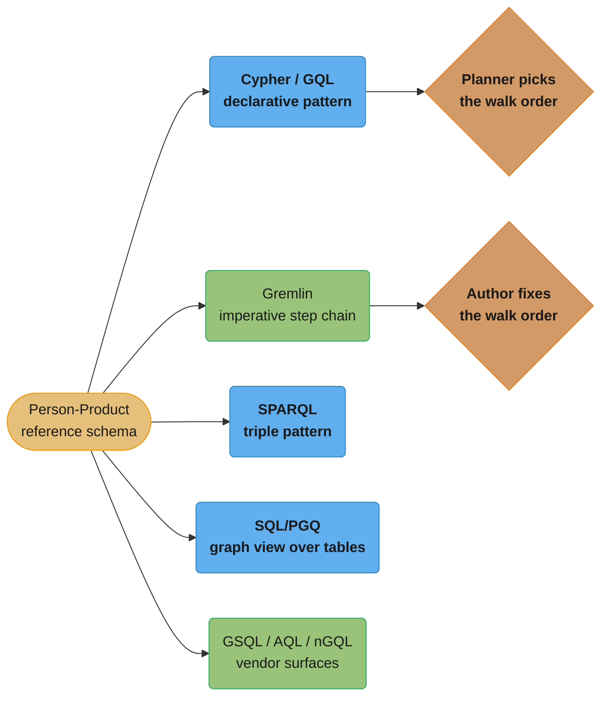
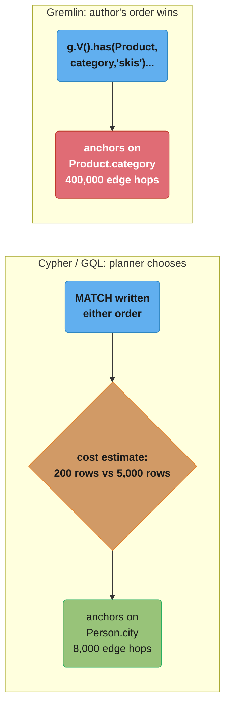

# Graph Query Languages — Cypher, Gremlin, SPARQL, and the Standards Race

> Deep-dive sub-file of [Graph Databases](graph_databases.md). That module owns the Cypher
> primer, the GQL standard (ISO/IEC 39075:2024), the GDS algorithm library, and a short
> TinkerPop mention — see `graph_databases.md` L211-296 and L393-406. This file is the
> language-FAMILY comparison: one schema, five query surfaces, and the paradigm differences
> the parent only gestures at. Version anchors verified against primary sources August 2026:
> Apache TinkerPop **3.8.1** (April 2026); SPARQL 1.1 is a W3C **Recommendation** (21 March
> 2013); SPARQL 1.2 is a W3C **Working Draft**, not yet a Recommendation (dated 20 August
> 2026); RDF 1.2 (the standardized RDF-star) is a W3C **Candidate Recommendation Snapshot**
> (7 April 2026), also not yet a Recommendation.

## 1. Concept Overview

Five genuinely different language paradigms answer graph-shaped questions today, and they
sort into families by how a query *describes* a traversal rather than by which vendor ships
them: **declarative pattern matching** (Cypher, openCypher, GQL), **imperative step-chain
traversal** (Gremlin/TinkerPop), **triple-pattern matching over RDF** (SPARQL), **graph
patterns embedded inside SQL** (SQL/PGQ, Oracle PGQL), and a handful of **vendor surfaces**
(TigerGraph GSQL, ArangoDB AQL, NebulaGraph nGQL) that predate or partially converge on the
standards. The parent module already covers Cypher and GQL syntax in depth; this file puts
all five families side by side against one schema so the paradigm difference is visible in
running code, not asserted in prose.

The organizing device throughout is a small **social/purchase graph** — people who follow
each other and buy products — with the identical five questions asked against every surface:
a 1-hop pattern match, a bounded variable-length traversal, an aggregation, a shortest path,
and a write/upsert. The differences that show up are not cosmetic syntax; they are different
answers to "who decides how the traversal runs" — the query planner, or the person who wrote
the traversal by hand.

---

## 2. Intuition

- **Cypher/GQL says what shape you want** — "a person who follows someone who bought a ski" —
  and hands the engine freedom to decide which end to start from.
- **Gremlin says how to walk there** — "start at this vertex, step to that edge, step to that
  vertex" — a chain of instructions executed in the order written, like a recipe rather than
  a description of the finished dish.
- **SPARQL says what facts must all be true at once** — a set of subject-predicate-object
  triple patterns that must simultaneously match, closer to a `WHERE` clause over a single
  giant three-column table than to a graph traversal at all.
- **SQL/PGQ says "find this shape inside my existing tables"** — a graph pattern is a view
  over rows you already store, so the "database" underneath never changes.
- **Key insight**: the paradigm is a proxy for a deeper question — does a program or a human
  write most of your queries? A human benefits from a declarative language's readability; a
  code generator benefits from an imperative language's compositionality, because appending
  one more `.out()` step is trivial in a way that safely appending one more `MATCH` clause to
  a string of Cypher is not.

---

## 3. Core Principles

### The reference schema, instantiated per model

```cypher
// Property graph (Cypher/GQL/Gremlin) — nodes carry labels, edges carry types + properties
(:Person {id: "p1", name: "Alice", city: "Reykjavik"})
(:Person {id: "p2", name: "Bob",   city: "Austin"})
(:Product {id: "sku42", name: "Carbon Skis", category: "skis"})
(alice)-[:FOLLOWS {since: date("2024-03-01")}]->(bob)
(alice)-[:PURCHASED {amount: 549.00, date: date("2026-01-15")}]->(sku42)
```

```sparql
# RDF triples — the same facts as bare subject-predicate-object atoms.
# Note the purchase must be REIFIED as its own resource (ex:order1) because
# a bare triple has no slot to hang amount/date off of.
ex:alice   a            ex:Person ;
           ex:name      "Alice" ;
           ex:city      "Reykjavik" ;
           ex:follows   ex:bob ;
           ex:purchased ex:order1 .
ex:order1  ex:product   ex:sku42 ;
           ex:amount    "549.00"^^xsd:decimal ;
           ex:date      "2026-01-15"^^xsd:date .
```

```sql
-- Relational tables (SQL/PGQ view target) — exactly the tables you already have
CREATE TABLE persons  (id TEXT PRIMARY KEY, name TEXT, city TEXT);
CREATE TABLE products (id TEXT PRIMARY KEY, name TEXT, category TEXT);
CREATE TABLE follows  (follower_id TEXT, followee_id TEXT, since DATE);
CREATE TABLE purchases(person_id TEXT, product_id TEXT, amount NUMERIC, purchase_date DATE);
```

The RDF version costs **3 extra triples** (`ex:order1 ex:product/amount/date`) to represent
one purchase that the property graph represents as a single edge with two properties — the
reification cost the parent module names at `graph_databases.md` L57, now counted concretely.

### The translation table

The same four concepts get five different names depending which family you are reading:

| Concept | Cypher / GQL | Gremlin / TinkerPop | SPARQL / RDF | SQL/PGQ | GSQL (TigerGraph) |
|---|---|---|---|---|---|
| An entity | node | vertex | resource (IRI or blank node) | vertex (from a `VERTEX TABLE` row) | vertex |
| A connection | relationship | edge | a triple's predicate | edge (from an `EDGE TABLE` row) | edge |
| A type tag | label | label | class, via `rdf:type` | `LABEL` clause | vertex/edge TYPE |
| An attribute | property | property | a further predicate-object pair (often reified) | column | attribute |
| Query unit | pattern (`MATCH`) | traversal step | triple pattern | `GRAPH_TABLE` pattern | GSQL query block |

Getting this vocabulary straight matters beyond trivia: a job posting or a paper that says
"vertex properties" is property-graph-flavored; one that says "predicate" or "triple" is
RDF-flavored — and the two data models are not freely interconvertible, because RDF has no
first-class place to put an edge property without reifying it.

### Paradigm decides query mechanics, not just syntax

A **declarative** language (Cypher, GQL, SPARQL, SQL/PGQ) states constraints and leaves
execution order to a planner; the same query can run a different physical plan on Monday and
Tuesday if statistics change, with identical results. An **imperative** language (Gremlin)
states the walk itself; the traversal executes exactly as written, step by step, and the only
thing a smart engine can optimize is *within* a step (e.g., pushing a `has()` filter earlier
in the byte-compiled plan), never the order the human chose between `.out()` calls that
depend on each other. This single distinction is why Section 6's planning example produces a
50x gap between two Gremlin traversals that are logically identical but written in a
different order, while the Cypher/GQL planner picks the cheap plan for both phrasings on its
own.

---

## 4. Types / Architectures / Strategies

### Family 1 — Declarative pattern matching (Cypher, openCypher, GQL)

Already covered for syntax in `graph_databases.md` L211-296; shown here only as the baseline
against which the other four families are compared.

```cypher
// Q1: 1-hop — products Alice purchased
MATCH (alice:Person {name: "Alice"})-[:PURCHASED]->(p:Product)
RETURN p.name, p.category

// Q2: variable-length 1..3 — everyone Alice's follow-graph reaches within 3 hops
MATCH (alice:Person {name: "Alice"})-[:FOLLOWS*1..3]->(reached:Person)
RETURN DISTINCT reached.name

// Q3: aggregation — revenue and order count per category
MATCH (:Person)-[pu:PURCHASED]->(p:Product)
RETURN p.category, count(pu) AS orders, sum(pu.amount) AS revenue
ORDER BY revenue DESC

// Q4: shortest path — Alice to Zara through FOLLOWS
MATCH path = shortestPath((alice:Person {name:"Alice"})-[:FOLLOWS*]-(zara:Person {name:"Zara"}))
RETURN length(path)

// Q5: write/upsert — idempotent purchase record
MERGE (a:Person {id:"p1"})-[pu:PURCHASED {product_id:"sku42", date:date("2026-01-15")}]->(p:Product {id:"sku42"})
ON CREATE SET pu.amount = 549.00
ON MATCH  SET pu.amount = 549.00
```

**GQL vs Cypher, concretely.** GQL adopted most of Cypher's `MATCH`/`RETURN` shape, but two
keywords differ outright: GQL uses `INSERT` where Cypher uses `CREATE`, and GQL has a `FOR`
statement doing the job of Cypher's `UNWIND`. Neo4j's own GQL-conformance appendix documents
this as an intentional, permanent divergence — Cypher keeps `CREATE`/`UNWIND` so existing
queries never break, and GQL-flavored syntax is added alongside rather than as a replacement.

### Family 2 — Imperative traversal (Gremlin / Apache TinkerPop)

Gremlin traversals are a chain of steps, each one a function from a stream of "travelers" to
another stream. There is no `WHERE` clause the engine can move earlier on its own initiative —
the human decides the walk order, and the walk order is the query plan.

```groovy
// Q1: 1-hop — products Alice purchased
g.V().has('Person', 'name', 'Alice').out('PURCHASED').valueMap('name', 'category')

// Q2: variable-length 1..3 — bounded repeat() step, NOT an unbounded loop
g.V().has('Person', 'name', 'Alice')
  .repeat(out('FOLLOWS')).times(3).emit()
  .dedup().values('name')

// Q3: aggregation — revenue and order count per category
g.V().hasLabel('Product')
  .group().by('category')
    .by(__.in('PURCHASED').count())        // orders per category
  // a second pass or a sack() accumulator sums amount — Gremlin has no
  // single aggregate step doing count+sum together the way Cypher does

// Q4: shortest path — Alice to Zara through FOLLOWS
g.V().has('Person', 'name', 'Alice')
  .repeat(out('FOLLOWS').simplePath()).until(has('name', 'Zara')).limit(1)
  .path()

// Q5: write/upsert — idempotent purchase edge
g.V().has('Person', 'id', 'p1').as('a')
  .V().has('Product', 'id', 'sku42').as('p')
  .coalesce(
    __.select('a').outE('PURCHASED').where(inV().as('p')),
    __.select('a').addE('PURCHASED').to('p').property('amount', 549.00))
```

**The execution model.** A Gremlin traversal is compiled to **Gremlin bytecode** — a
serialized, language-neutral instruction list — before it is sent to a server, which is what
lets Java, Python, JavaScript, and .NET clients submit the identical traversal to any
TinkerPop-compliant graph. That same traversal can run in two modes: **OLTP**, the default,
walks the live graph one traverser at a time for interactive queries; **OLAP**, entered by
attaching `withComputer()` (e.g. `withComputer(SparkGraphComputer.class)`), hands the
traversal to a distributed `GraphComputer` that runs it as vertex programs across a cluster —
the shape of computation PageRank or connected-components needs, not the shape a single
"find Alice's purchases" lookup needs. Gremlin wins for programmatic construction: appending
`.has(prop, val)` to a traversal object in a loop is safe string-free composition, whereas
building a Cypher `MATCH` by concatenating strings invites both bugs and injection. It loses
on readability — the fraud-ring pattern that is one line of Cypher (`graph_databases.md`
L233-235) takes a `repeat().until()` chain in Gremlin, and nothing about the traversal's
*shape* is visible without mentally executing it step by step.

### Family 3 — RDF / triple-pattern (SPARQL)

SPARQL matches a query against a graph of subject-predicate-object **triples**, not typed
nodes and edges — the property graph's labels and edge types are just triples using
`rdf:type` and ordinary predicates.

```sparql
PREFIX ex:  <http://example.org/>
PREFIX xsd: <http://www.w3.org/2001/XMLSchema#>

# Q1: 1-hop — products Alice purchased (walking through the reified order)
SELECT ?productName ?category WHERE {
  ex:alice ex:purchased ?order .
  ?order  ex:product ?product .
  ?product ex:name ?productName ; ex:category ?category .
}

# Q2: variable-length 1..3 — property PATH with a repeat operator
# NOTE: standard SPARQL 1.1 has no {1,3} bound — see §10. This walks
# "1 or more" and then filters, which is the portable but wasteful form.
SELECT DISTINCT ?reached WHERE {
  ex:alice ex:follows+ ?reached .
}

# Q3: aggregation — revenue and order count per category
SELECT ?category (COUNT(?order) AS ?orders) (SUM(?amount) AS ?revenue) WHERE {
  ?order ex:product ?product ; ex:amount ?amount .
  ?product ex:category ?category .
} GROUP BY ?category ORDER BY DESC(?revenue)

# Q4: shortest path — SPARQL 1.1 has no native shortest-path operator;
# ex:follows* returns EVERY reachable node, not the shortest walk, so
# shortest path is typically pushed to a procedural extension or the
# host application.
SELECT ?reachable WHERE { ex:alice ex:follows* ?reachable }

# Q5: write/upsert — SPARQL 1.1 Update
DELETE { ?order ex:amount ?old }
INSERT { ex:alice ex:purchased [ ex:product ex:sku42 ; ex:amount 549.00 ; ex:date "2026-01-15"^^xsd:date ] }
WHERE  { OPTIONAL { ex:alice ex:purchased ?order . ?order ex:product ex:sku42 ; ex:amount ?old } }
```

**Features that make SPARQL distinctive.** `OPTIONAL` is a left-outer-join over triple
patterns — a pattern inside it may fail to match without failing the whole query, exactly
like SQL `LEFT JOIN`. **Named graphs** let one SPARQL dataset hold several independently
addressable sub-graphs (`GRAPH <g> { ... }`), which is how provenance or multi-tenant RDF
stores are usually partitioned — there is no equivalent concept in the property-graph
families, which have one graph per database. **`SERVICE`** federates a query across multiple
SPARQL endpoints in a single request, delegating a sub-pattern to a remote triple store and
joining the results locally — genuinely federated querying that neither Cypher nor Gremlin
has a standard equivalent for. **RDF-star**, the informal name for letting a triple itself be
used as the subject or object of another triple (so a `FOLLOWS` edge could directly carry a
`since` property without the `ex:order1`-style reification shown above), has been folded into
the formal standards track as **RDF 1.2** and **SPARQL 1.2** — but as of August 2026 those are
a W3C Candidate Recommendation Snapshot and a Working Draft respectively, not Recommendations,
so reification remains the portable way to attach properties to a relationship in production
RDF today.

### Family 4 — SQL-embedded (SQL/PGQ, Oracle PGQL)

`graph_databases.md` L243-296 already covers `CREATE PROPERTY GRAPH` and `GRAPH_TABLE` in
full, including the PostgreSQL 19 example — this section stays short by design.

```sql
-- Q1 and Q3 only, as SQL/PGQ (ISO SQL:2023 Part 16) — the rest follow the
-- same GRAPH_TABLE shape shown in the parent module
SELECT * FROM GRAPH_TABLE (social_graph
  MATCH (a IS person WHERE a.name = 'Alice') -[IS purchased]-> (p IS product)
  COLUMNS (p.name AS product_name, p.category)
);

SELECT * FROM GRAPH_TABLE (social_graph
  MATCH (:person) -[o IS purchased]-> (p IS product)
  COLUMNS (p.category, o.amount)
) GROUP BY category
  -- aggregation happens in ordinary SQL AFTER GRAPH_TABLE, not inside it
```

**Oracle PGQL** is the vendor predecessor SQL/PGQ generalized: a SQL-like pattern-matching
language for Oracle's own property-graph feature, whose PGX engine (release 25.4) supports
PGQL 2.1. Oracle's own documentation is explicit about the direction of travel: PGQL
continues to be supported for existing code, but new development targets **SQL/PGQ** (the
ISO SQL:2023 standard, shipping in Oracle AI Database 26ai and PostgreSQL 19 — see
[PostgreSQL Internals](../postgresql_internals/postgresql_internals.md) for the engine that
hosts it) rather than PGQL's own dialect. That is the same convergence-onto-a-standard story
GQL tells for Cypher, one layer down in the stack.

### Family 5 — Vendor/legacy surfaces still worth naming

- **TigerGraph GSQL** is TigerGraph's native, SQL-flavored imperative-declarative hybrid
  query language, purpose-built for distributed parallel execution. Rather than abandon it
  for portability, TigerGraph added **openCypher support that auto-translates incoming
  Cypher into GSQL** before execution, and TigerGraph participates on the ISO committee
  developing GQL — so a GSQL shop gets Cypher-surface compatibility today without giving up
  GSQL's own performance-tuned execution paths, and a GQL on-ramp as conformance matures.
- **AQL (ArangoDB)** is ArangoDB's own declarative language — `FOR`/`FILTER`/`RETURN`, closer
  in shape to a functional query pipeline than to SQL or Cypher — used uniformly across
  ArangoDB's document, graph, key-value, and search engines in one multi-model database. AQL
  is not derived from Cypher, Gremlin, or SQL, and it sits outside both the GQL and SQL/PGQ
  convergence stories: ArangoDB's bet is a single language across data models rather than
  standards conformance for the graph slice alone.
- **nGQL (NebulaGraph)** is explicitly a hybrid: NebulaGraph's own documentation describes it
  as combining a native, NebulaGraph-specific surface with an **openCypher-compatible
  subset** covering `MATCH`, `OPTIONAL MATCH`, and `WITH`. The compatibility is partial by
  design and the differences are real footguns for a Cypher developer — nGQL requires `==`
  for equality rather than `=`, and it enforces a strong schema where openCypher treats
  labels as optional. Treat nGQL Cypher-familiarity as a head start on learning the language,
  never as a guarantee that a Cypher query runs unmodified.

---

## 5. Architecture Diagrams

**One schema, five surfaces.** The same social/purchase graph gets queried through five
structurally different engines; the arrows below are query paradigms, not network calls.



**Data-layout alignment: RDF triples vs a property-graph record.** The same purchase fact —
Alice bought SKU 42 for $549 on 2026-01-15 — costs a different number of records depending on
the model, because RDF has no slot for an edge property and a property graph does:

```
RDF triple store: one row per fact, three columns, no room for edge properties
  subject      predicate      object
  ex:alice     ex:purchased   ex:order1
  ex:order1    ex:product     ex:sku42
  ex:order1    ex:amount      "549.00"
  ex:order1    ex:date        "2026-01-15"
                                                4 triples for ONE purchase

Property graph: one row per entity, properties inline on the edge
  edge                type          properties
  alice -> sku42      PURCHASED     {amount: 549.00, date: "2026-01-15"}
                                                1 edge record for the SAME purchase
```

The property graph wins the storage-and-query-simplicity argument for anything with rich
edge metadata; RDF wins when the data genuinely is bare facts meant to interoperate across
organizations that never agreed on a shared schema in advance — which is the actual reason
linked-data and ontology work standardized on triples rather than property graphs.

---

## 6. How It Works — Detailed Mechanics

### Query planning: reorder freedom vs fixed walk order

Take the schema at real scale: 10,000,000 `Person` nodes, 50,000 `Product` nodes, 400,000
`PURCHASED` edges. An index exists on both `Person.city` and `Product.category`. The query is
"people in Reykjavik who purchased a ski product" — 200 people live in Reykjavik; 5,000
products are tagged `skis`.



- **Anchoring on the 200-row side**: 200 people, ~40 purchases each on average →
  `200 x 40 = 8,000` edge traversals to reach and filter candidate products.
- **Anchoring on the 5,000-row side**: 5,000 ski products, ~80 purchasers each on average →
  `5,000 x 80 = 400,000` edge traversals before the city filter ever runs.
- **Ratio**: `400,000 / 8,000 = 50x` more work for the same logical result.

Cypher's and GQL's cost-based planners use exactly this kind of selectivity estimate — how
many rows does each index actually return — to choose the cheap anchor automatically,
regardless of which order the `MATCH` clauses were typed in (this is the same cost-based
reasoning [SQL Query Optimization](../sql_query_optimization/sql_query_optimization.md) walks
through for relational join ordering). A Gremlin traversal has no such freedom: `g.V().has(
'Product', 'category', 'skis').in('PURCHASED').has('city', 'Reykjavik')` executes in exactly
that order — expand every ski product first, filter by city last — and the only fix is for
the author to notice and rewrite it starting from `g.V().has('Person', 'city', 'Reykjavik')`
instead. `EXPLAIN`/`PROFILE` on the declarative side and manual traversal reordering on the
imperative side are solving the identical problem through opposite mechanisms.

### SPARQL's basic graph pattern and OPTIONAL

A SPARQL `WHERE` block is a **basic graph pattern** — a conjunction of triple patterns that
must all match simultaneously against the same variable bindings, evaluated as a join across
however many triples the pattern names. `OPTIONAL { ... }` changes that one block from an
inner join to a left-outer join: bindings for the pattern outside `OPTIONAL` are always kept,
and the `OPTIONAL` block's variables are filled in when a match exists or left unbound
(`?var` returns nothing rather than eliminating the row) when it does not — the RDF-world
equivalent of a SQL `LEFT JOIN` used precisely because whether every person purchased
something is not guaranteed.

### Gremlin bytecode and the OLTP/OLAP split

A Gremlin client never sends raw text to the server. It builds a traversal object locally,
which TinkerPop serializes to **Gremlin bytecode** — a language-neutral instruction sequence —
before transmitting it. The same bytecode executes against Neo4j, JanusGraph, or Amazon
Neptune Gremlin unmodified, which is the portability property TinkerPop is built around.
Execution mode is a configuration choice on the `TraversalSource`, not a different language:
the default is **OLTP**, walking the live graph store one `Traverser` at a time for
millisecond-latency interactive queries; attaching `.withComputer(...)` switches to **OLAP**,
handing the same traversal to a `GraphComputer` (commonly backed by Spark) that runs it as
distributed vertex programs and reduces over the whole graph — the execution shape
PageRank-style algorithms need and interactive lookups do not.

---

## 7. Real-World Examples

- **Amazon Neptune** ships Gremlin and SPARQL as its two query surfaces over the same managed
  service, letting a team pick imperative property-graph traversal or RDF triple queries
  against the identical underlying storage without standing up a second database.
- **TigerGraph** customers writing native GSQL for parallel graph analytics get openCypher
  compatibility layered on top via query translation, so a team migrating off Neo4j can start
  with familiar Cypher-shaped queries before adopting GSQL for performance-critical paths.
- **DBpedia and Wikidata** expose their knowledge graphs exclusively through public SPARQL
  endpoints — the RDF triple model and SPARQL's `SERVICE` federation are the reason
  cross-dataset linked-data queries (join DBpedia facts with a second organization's RDF
  store in one request) are possible at all.
- **ArangoDB** multi-model deployments run AQL across graph, document, and full-text search
  workloads in one query language, trading standards conformance on the graph slice for one
  language across the whole data platform.
- **NebulaGraph** deployments at social/e-commerce scale (billions of edges) lean on nGQL's
  native, strongly-schema'd surface for the highest-throughput paths, and its openCypher
  subset for onboarding engineers who already know Cypher.
- **Oracle Database** customers on PGQL are the visible edge of the SQL/PGQ convergence story:
  Oracle's own guidance is that new development should target SQL/PGQ over PGQL, the same
  "converge on the standard" arc GSQL and nGQL are both on with openCypher/GQL.

---

## 8. Tradeoffs

| Dimension | Cypher / GQL | Gremlin | SPARQL | SQL/PGQ |
|---|---|---|---|---|
| Paradigm | Declarative pattern match | Imperative step chain | Declarative triple pattern | Declarative pattern over relational view |
| Planner reorders query | Yes — cost-based | No — executes as written | Yes — but no native shortest-path op | Yes — inherits the SQL optimizer |
| Portable across vendors | Growing, via GQL conformance | Yes — TinkerPop-native | Yes — W3C standard since 2013 | Yes — ISO SQL:2023 Part 16 |
| Best fit for programmatic generation | Awkward (string templating) | Strong (traversal objects compose) | Awkward (string templating) | Awkward (string templating) |
| Native edge properties | Yes | Yes | No — requires reification | Yes (inherited from source columns) |
| Federation across stores | No standard mechanism | No standard mechanism | Yes — `SERVICE` | No — single database |
| Bounded variable-length hops | Yes — `*1..3` | Yes — `.times(n)` | No standard bound — see §10 | Fixed-depth only (parent §4) |
| Requires a new storage engine | Yes | Yes | Yes | No — view over existing tables |

---

## 9. When to Use / When NOT to Use

**Choose declarative pattern matching (Cypher/GQL)** when queries are hand-written by
engineers, readability and onboarding matter, and you want the engine's planner to absorb the
cost-estimation work — the default choice for a new native graph database today, and the
direction every other family is converging toward.

**Choose Gremlin** when the same logical query needs to run unmodified against more than one
graph vendor (Neptune, JanusGraph, and a self-hosted graph in one codebase), or when queries
are built programmatically — assembled from conditional branches in application code rather
than typed by a person — because a traversal object composes safely in a way a query string
does not.

**Choose SPARQL** when the data genuinely is RDF — linked data, ontologies, knowledge graphs
meant to interoperate across organizations that never agreed on a shared property-graph
schema — or when a query must federate across multiple independently-operated triple stores
in one request via `SERVICE`. Do not reach for SPARQL because "graph" is in the requirements;
reach for it because the data model is triples.

**Choose SQL/PGQ or Oracle PGQL** when the graph is a *view* over data that already lives in a
relational database and the traversals are shallow and fixed-depth — it removes the entire
argument for a second database (parent module, `graph_databases.md` L290-296). Move to a
native engine and a declarative graph language once queries need variable-length traversal,
shortest path, or a graph-algorithm library the SQL/PGQ view cannot express.

**What actually decides the choice, in order of weight**:

1. **The data model you already have.** RDF triples in hand → SPARQL family. Rows in a
   relational database → SQL/PGQ before anything else, because it needs zero migration.
   Neither → a native property graph and Cypher/GQL.
2. **The engine you must run on.** Amazon Neptune forces Gremlin or SPARQL, never Cypher.
   TigerGraph's fastest paths are native GSQL. The engine constrains the language before
   preference does.
3. **Hand-written vs machine-generated queries.** Programmatic query construction favors
   Gremlin's compositional traversal objects; human-authored ad-hoc querying favors a
   declarative language's readability.
4. **Federation needs.** Only SPARQL's `SERVICE` gives a standard way to join across
   independently operated graph stores in a single query.
5. **Standardization risk.** GQL and SQL/PGQ are both live ISO standards with active
   convergence from every vendor named in this file; betting on a language with no
   convergence story (AQL, or a vendor's fully proprietary extensions) is a bet that vendor
   lock-in is an acceptable long-term cost.

---

## 10. Common Pitfalls

**Pitfall 1: SPARQL `+`/`*` property paths with no way to bound the hop count**

```sparql
-- Broken (in the sense of "always was going to be unbounded"): looks like it
-- should stop somewhere, but SPARQL 1.1 removed {n,m} bounded repetition
-- from the FINAL Recommendation during standardization — it appeared in
-- late working drafts and was cut before publication.
SELECT ?reached WHERE { ex:alice ex:follows+ ?reached }
-- On a densely connected graph this walks every path of every length,
-- which is combinatorial exactly like an uncapped Cypher [:FOLLOWS*].

-- Fix (portable SPARQL 1.1): unroll the fixed depths you actually need,
-- unioned together, rather than relying on a vendor-specific {1,3} extension
SELECT DISTINCT ?reached WHERE {
  { ex:alice ex:follows ?reached }
  UNION { ex:alice ex:follows/ex:follows ?reached }
  UNION { ex:alice ex:follows/ex:follows/ex:follows ?reached }
}
```
Apache Jena's ARQ engine supports `{n,m}` as a nonstandard extension, but a query relying on
it is not portable SPARQL — the same "unbounded is standard, bounded is not" gap the parent
module's `[:KNOWS*1..6]` guidance (Best Practice 8) never has to think about in Cypher.

**Pitfall 2: an unanchored `MATCH` produces a Cartesian product, not an error**

```cypher
-- Broken: two comma-separated patterns share no variable, so Cypher
-- returns every Person paired with every Product — 10,000,000 x 50,000
-- rows before the WHERE clause even runs
MATCH (a:Person), (p:Product)
WHERE a.city = "Reykjavik"
RETURN a.name, p.name

-- Fix: connect the patterns through a relationship, or filter each
-- pattern independently before any implicit cross join happens
MATCH (a:Person {city: "Reykjavik"})-[:PURCHASED]->(p:Product)
RETURN a.name, p.name
```
This is not a Cypher-only trap — the identical mistake in GQL (a comma between unconnected
node patterns) and the identical mistake in SQL (a `FROM a, b` with no join predicate) all
produce the same silent explosion, because "no shared variable" reads as "independent" to
every one of these planners rather than as a mistake.

**Pitfall 3: Gremlin materializes the full vertex set before a late filter**

```groovy
// Broken: has('city', ...) runs AFTER out('PURCHASED') has already
// expanded every product purchase for every person in the graph
g.V().hasLabel('Person').out('PURCHASED').in('PURCHASED').has('city', 'Reykjavik')

// Fix: push the selective filter to the FIRST step, so the traversal
// never touches the 9,999,800 people who are not in Reykjavik
g.V().hasLabel('Person').has('city', 'Reykjavik').out('PURCHASED').in('PURCHASED')
```
Because Gremlin has no planner to reorder steps for you, "filter early" is not a style
preference the way it sometimes is in SQL or Cypher — it is the entire performance budget,
and the fix is always the same: move `has()` as far left as the data dependency allows.

**Pitfall 4: SQL/PGQ's fixed-depth `GRAPH_TABLE` silently returns a partial answer**

The first SQL/PGQ release is deliberately read-only and fixed-depth (parent module,
`graph_databases.md` L291-296). A pattern like `(a)-[IS follows]->(b)-[IS follows]->(c)`
answers "exactly 2 hops," and there is no `*1..3` equivalent to ask "1 to 3 hops" in one
query — teams migrating a bounded-hop Cypher query to SQL/PGQ sometimes drop the variable
length silently, producing a query that compiles and runs but answers a narrower question
than the one they started with. Verify the hop count is genuinely fixed in the business
requirement before treating SQL/PGQ as a drop-in replacement for a variable-length Cypher
`MATCH`.

---

## 11. Technologies & Tools

| Tool / Spec | Family | Role |
|---|---|---|
| Cypher 25 / GQL (ISO/IEC 39075:2024) | Declarative | Native property-graph query — full coverage in the parent module |
| openCypher | Declarative | Multi-vendor Cypher dialect, now converging implementors toward GQL |
| Apache TinkerPop 3.8.1 / Gremlin | Imperative | Vendor-neutral traversal API and bytecode protocol |
| Gremlin Server | Imperative | Reference server executing Gremlin bytecode over any TinkerPop-compliant graph |
| Apache Jena / ARQ | RDF | Java RDF framework and SPARQL engine; source of the `{n,m}` nonstandard path extension |
| SPARQL 1.1 (W3C Recommendation, 2013) | RDF | Query, Update, Federated Query, and 8 further Recommendations |
| SPARQL 1.2 / RDF 1.2 (W3C Working Draft / Candidate Recommendation, 2026) | RDF | In-progress standardization of RDF-star / SPARQL-star triple terms |
| SQL/PGQ (ISO SQL:2023 Part 16) | SQL-embedded | Graph pattern matching inside standard SQL — `CREATE PROPERTY GRAPH`, `GRAPH_TABLE` |
| Oracle PGQL 2.1 (PGX 25.4) | SQL-embedded | Oracle's SQL-like predecessor to SQL/PGQ, still supported |
| TigerGraph GSQL | Vendor | Native SQL-flavored distributed graph language, plus openCypher translation |
| ArangoDB AQL | Vendor | Native multi-model query language, independent of GQL/SQL-PGQ convergence |
| NebulaGraph nGQL | Vendor | Native language plus a partial openCypher-compatible subset |

---

## 12. Interview Questions with Answers

**Q: Why does a standard SPARQL 1.1 property path like `ex:follows+` have no way to cap the number of hops?**
**Short:** SPARQL 1.1's final Recommendation dropped the {n,m} bounded-repetition syntax that appeared in earlier drafts, leaving `+`/`*` unbounded by design.
The `{n}`, `{n,m}`, `{n,}` and `{,m}` bounded-repetition forms existed in late SPARQL 1.1 working drafts but were removed before the 2013 Recommendation was published — the working group's own feature tracking documents this explicitly. The practical effect: `ex:follows+` walks paths of every length until it exhausts the graph, which is combinatorial on a densely connected graph the same way an uncapped Cypher `[:FOLLOWS*]` is. Some engines add a nonstandard extension (Apache Jena's ARQ supports `{n,m}`), but relying on it makes the query non-portable. The portable fix is to `UNION` together the fixed depths you actually need, or bound the result set with `LIMIT` after the fact, understanding that `LIMIT` caps output rows, not traversal work already spent.

**Q: Why does an unanchored `MATCH (a), (b)` in Cypher or GQL silently return a Cartesian product instead of an error?**
**Short:** Two comma-separated patterns that share no variable are treated as independent, so every match of one is paired with every match of the other.
Cypher and GQL both interpret a comma between node patterns as "these are separate patterns to match independently," which is exactly right when they genuinely are independent and exactly wrong when the author meant to connect them through a relationship and forgot. On a 10M-row `Person` table and a 50K-row `Product` table, an unfiltered cross like this returns 500 billion candidate pairs before any `WHERE` predicate runs. The fix is always to connect the patterns through a relationship (`(a)-[:PURCHASED]->(p)`) or to filter each pattern to a small enough set that the cross product is cheap on purpose — never to rely on `WHERE` to clean it up after the fact, since the cross product is materialized (or at least enumerated) before the filter applies.

**Q: Why can two logically identical Gremlin traversals have a 50x runtime difference depending only on step order?**
**Short:** Gremlin executes steps exactly in the order written, so anchoring on the larger candidate set first forces far more work than anchoring on the smaller one.
Gremlin has no cost-based planner reordering pattern clauses the way Cypher and GQL do — the traversal you write is the traversal that runs, step by step. Starting `g.V().has('Product', 'category', 'skis').in('PURCHASED').has('city', 'Reykjavik')` expands all 5,000 ski products (roughly 400,000 purchase edges) before the city filter ever narrows anything, while starting from `g.V().has('Person', 'city', 'Reykjavik')` touches only about 8,000 edges for the identical logical result — a 50x gap from step order alone. The fix is manual: always start a Gremlin traversal from whichever `has()` predicate is most selective, and re-check that ordering whenever the underlying data's cardinalities shift.

**Q: What replaced Cypher's `CREATE` keyword in the GQL standard, and does Neo4j require migrating to it?**
**Short:** GQL uses `INSERT` where Cypher uses `CREATE`, and Neo4j documents this as a permanent divergence it supports alongside Cypher, not a forced migration.
GQL adopted the bulk of Cypher's `MATCH`/`RETURN` pattern-matching shape, but its write and iteration keywords differ: `INSERT` does what Cypher's `CREATE` does, and a `FOR` statement does what Cypher's `UNWIND` does. Neo4j's own GQL-conformance appendix lists these as additional-Cypher features with no GQL equivalent expected to disappear — existing Cypher queries keep working, and GQL-flavored syntax is offered as an alternative surface rather than a replacement. The practical guidance is to write new queries in whichever surface a team is more comfortable with, since Neo4j intends to support both indefinitely rather than deprecating Cypher's original keywords.

**Q: Is SPARQL-star (letting a triple be the subject or object of another triple) part of a finished W3C standard yet?**
**Short:** No — its standardized form, RDF 1.2's triple terms, is only a Candidate Recommendation Snapshot, and SPARQL 1.2 is only a Working Draft.
"RDF-star" and "SPARQL-star" were the community names for the extension that lets a triple be nested inside another triple's subject or object position, which would let a `FOLLOWS` edge carry a `since` property directly instead of requiring the `ex:order1`-style reification this file's schema uses. The W3C formalized that work as RDF 1.2 (introducing "triple terms") and SPARQL 1.2. As of August 2026, RDF 1.2 Concepts is a Candidate Recommendation Snapshot (7 April 2026) and SPARQL 1.2 Query Language is a Working Draft (20 August 2026) — both on the Recommendation track, neither yet a Recommendation. Until they finish standardizing, reification remains the only standards-compliant way to attach a property to an RDF relationship.

**Q: What is Gremlin bytecode and why does it matter for building traversals across multiple programming languages?**
**Short:** Gremlin bytecode is a serialized, language-neutral traversal representation that lets Java, Python, and JavaScript clients submit identical traversals to any TinkerPop server.
A Gremlin client never ships raw traversal text to the server; it builds a traversal object in its host language and TinkerPop serializes that object graph into bytecode before transmission. Because the bytecode format is language-neutral, the same logical traversal — built with Gremlin-Java, Gremlin-Python, or Gremlin-JavaScript — executes identically against any TinkerPop-compliant graph, whether that is Neo4j, JanusGraph, or Amazon Neptune. This is the mechanism behind Gremlin's portability claim: it is not that the syntax merely looks similar across languages, it is that the wire protocol is the same regardless of which client language authored the traversal.

**Q: What actually changes when you attach `.withComputer()` to a Gremlin traversal?**
**Short:** withComputer() switches a traversal from single-machine OLTP graph walking to a distributed OLAP GraphComputer running vertex programs across a cluster.
Every Gremlin traversal can run in two modes without changing its syntax. The default, OLTP, walks the live graph structure directly, one `Traverser` object at a time, and is built for millisecond-latency interactive queries like "products Alice purchased." Attaching `.withComputer(SparkGraphComputer.class)` (or another `GraphComputer` implementation) switches the same traversal to OLAP, where TinkerPop compiles it into vertex programs and map-reduce-style operations distributed across a compute cluster — the execution model whole-graph algorithms like PageRank or connected-components actually need. Choosing OLTP for a whole-graph analytical query, or OLAP for a single interactive lookup, is a common performance mistake in both directions: OLTP on a whole-graph scan single-threads what should be parallel, and OLAP on a point lookup pays cluster-startup overhead for a query that should return in milliseconds.

**Q: Why is a declarative graph query language able to outperform an equivalent imperative traversal on identical data?**
**Short:** A declarative planner can reorder pattern clauses to start from whichever anchor has the fewest matching rows, which an imperative step chain cannot do for itself.
Cypher's and GQL's cost-based planners use index selectivity estimates — how many rows a given predicate actually returns — to decide which part of a `MATCH` pattern to evaluate first, and they make that decision fresh regardless of the order clauses were typed in. A Gremlin traversal has no such layer: it executes exactly the step sequence the author wrote, so a traversal that happens to start from a high-cardinality vertex set does that expensive expansion every single time, even though a logically identical traversal starting from the low-cardinality side would do a fraction of the work. The gap is not a rounding error — on the scale worked through in Section 6, it is 50x for the identical logical query, purely from which side of the pattern the human chose to start walking from.

**Q: How does SPARQL's `OPTIONAL` keyword behave differently from an ordinary triple pattern in the same query?**
**Short:** OPTIONAL turns its enclosed pattern into a left-outer join, keeping the outer bindings even when the optional pattern fails to match.
A SPARQL `WHERE` block's ordinary triple patterns form a basic graph pattern evaluated as an inner join — every pattern must match for a row to appear. Wrapping a sub-pattern in `OPTIONAL { ... }` changes that specific block to a left-outer join: rows from outside the `OPTIONAL` are always kept, and its variables are bound when a match exists or left unbound when it does not, rather than eliminating the row entirely. This is the RDF-world equivalent of SQL's `LEFT JOIN`, and it is the standard way to express "return every person, and their purchase details if they have any" without losing people who have not purchased anything.

**Q: What does SPARQL's `SERVICE` keyword do that no property-graph query language has a standard equivalent for?**
**Short:** SERVICE federates a single SPARQL query across multiple independently operated triple-store endpoints, joining results locally.
`SERVICE <endpoint-url> { ... }` delegates the enclosed sub-pattern to a remote SPARQL endpoint over HTTP and joins its results with the rest of the query locally, all within one request. This lets a query combine, for example, DBpedia's public endpoint with a private organizational RDF store without ETL or data duplication — genuine cross-organization federation. Neither Cypher, GQL, nor Gremlin has a standardized equivalent; a property-graph deployment that needs to combine data from two independently operated graph databases in one query has to build that federation at the application layer instead, because the query language itself offers no `SERVICE`-like primitive.

**Q: Why does representing a relationship's properties in RDF require an extra reified resource, and what does that cost?**
**Short:** RDF triples have no slot for edge properties, so a relationship's attributes must become a separate resource linked by additional triples.
A bare triple is only ever `subject predicate object` — there is nowhere on a `ex:alice ex:purchased ex:sku42` triple to attach an `amount` or a `date`. The standard fix is reification: replace the direct triple with an intermediate resource (`ex:order1`) that the subject links to, and attach the properties to that resource instead — turning one logical fact into three or four physical triples. A property graph represents the identical fact as a single edge record carrying both properties directly, which is both fewer records to store and a shorter, simpler query to write and read back. This is the concrete cost behind the parent module's statement that RDF triple stores "reduce everything to bare subject-predicate-object atoms" (`graph_databases.md` L31) — not an abstract inconvenience but a measurable multiplication of storage records per fact.

**Q: How does TigerGraph support openCypher without abandoning its native GSQL execution engine?**
**Short:** TigerGraph translates incoming openCypher queries into GSQL before execution, so Cypher-shaped queries run on the same native, performance-tuned engine.
Rather than build a second execution path for Cypher, TigerGraph's openCypher support parses an incoming Cypher query and automatically translates it into GSQL, which then runs through TigerGraph's existing distributed, parallel execution engine unmodified. This gives teams migrating from a Cypher-based system a familiar query surface immediately, while TigerGraph itself continues investing performance work in one execution path rather than two. TigerGraph also participates on the ISO committee developing GQL, positioning openCypher support as a bridge toward eventual GQL conformance rather than a permanent separate dialect to maintain.

**Q: What are the concrete gotchas when a Cypher developer starts writing NebulaGraph's nGQL, given its "openCypher-compatible" branding?**
**Short:** nGQL requires == instead of = for equality and enforces a strong schema, unlike openCypher's optional labels, so Cypher familiarity is a head start, not a guarantee.
NebulaGraph's own documentation describes nGQL as combining a native surface with an openCypher-compatible subset covering constructs like `MATCH`, `OPTIONAL MATCH`, and `WITH` — explicitly a partial compatibility, not a full implementation. The differences that trip up an incoming Cypher developer are concrete: nGQL requires the C-style `==` operator for equality comparisons where openCypher accepts `=`, and nGQL enforces a strong, declared schema for vertex and edge types where openCypher treats labels as optional metadata. A query copy-pasted from a Neo4j project into NebulaGraph should be treated as a starting draft to be corrected against nGQL's actual grammar, never as portable Cypher that happens to also run on NebulaGraph.

**Q: When does a machine-generated (programmatically constructed) graph query favor Gremlin over Cypher or GQL, independent of raw readability?**
**Short:** Gremlin traversal objects compose safely by appending steps in code, while building an equivalent declarative query means concatenating strings.
When a query is assembled by application logic — conditionally adding a filter, a hop, or a projection based on runtime branches — a Gremlin traversal is built by calling methods on a traversal object (`.has(...)`, `.out(...)`), which is ordinary, type-checked, injection-safe code composition. Building the equivalent Cypher or GQL query programmatically usually means concatenating query-string fragments, which is both more error-prone and reopens the same injection surface that parameterized SQL exists to close. This is the concrete version of the parent module's portability-vs-readability tradeoff (`graph_databases.md` L699): portability matters for cross-vendor deployment, but compositionality is the reason a query-building library or an internal DSL is more often built on Gremlin than on string-templated Cypher.

**Q: Why can't a Cypher query with rich edge properties always be translated 1:1 into equivalent SPARQL?**
**Short:** The data models mismatch — RDF triples have no native edge-property slot, so any edge property must be reified as an extra resource with no single canonical translation.
A Cypher `(a)-[:PURCHASED {amount: 549, date: "2026-01-15"}]->(b)` relationship carries two properties directly on the edge; there is no single, unambiguous way to express that in bare RDF triples, because the reification pattern (create an intermediate `ex:order1` resource) is a convention, not a mechanical rule with one correct output. Different tools reify differently — some use blank nodes, some use minted IRIs, some wait for RDF 1.2's triple terms once that standard finishes — so an automated Cypher-to-SPARQL translator has to make a reification-strategy choice the original Cypher query never had to make. This is why cross-model migration between property graphs and RDF triple stores is treated as a genuine data-modeling project, not a syntax-conversion script.

**Q: Given that GQL and openCypher conformance is still partial across vendors, what is the risk of standardizing all new graph query development on GQL today?**
**Short:** Partial conformance means a GQL query written against one engine's supported subset can fail unmodified on another engine still closing its own conformance gaps.
GQL is the ISO standard, but conformance is a moving target across vendors: Neo4j documents its own outstanding mandatory-feature gaps in a public conformance appendix, and Neptune, TigerGraph, and Oracle are all described as having conformance work "in flight" rather than complete (`graph_databases.md` L251-257). A query written against the subset of GQL one engine already supports is not guaranteed to run unmodified on a different engine still catching up on that same feature, which undercuts the "write once, run anywhere" case for standardizing early. The pragmatic mitigation is to write GQL-conformant Cypher today — sticking to the mandatory feature set every major engine already implements — while treating full cross-vendor portability as a target the ecosystem is converging toward rather than a guarantee available right now.

---

## 13. Best Practices

1. Pick the family from the data model you already have, not from which language reads
   nicest — RDF triples belong in SPARQL, rows in SQL/PGQ, and a fresh graph in Cypher/GQL.
2. Write GQL-conformant Cypher for new development so query logic ports as vendor GQL
   conformance closes its remaining gaps, rather than leaning on Cypher-only syntax.
3. In Gremlin, always start a traversal from the most selective `has()` predicate available —
   there is no planner to fix a badly ordered traversal for you.
4. Never rely on a nonstandard SPARQL extension (`{n,m}` bounded paths) without confirming
   the target engine supports it; write the portable `UNION`-of-fixed-depths form by default.
5. Treat any "openCypher-compatible" or "GQL-aligned" vendor language (nGQL, GSQL) as
   partially compatible until verified against that vendor's own conformance documentation —
   never assume a Cypher query runs unmodified.
6. Reify RDF relationship properties consistently across a dataset (pick one strategy — blank
   node or minted IRI — and keep it) so downstream SPARQL queries don't have to branch on
   which reification style a given triple used.
7. Reach for SQL/PGQ first when the graph is a shallow, fixed-depth view over data you
   already store relationally — it is strictly cheaper operationally than standing up a
   native graph engine for the same shallow query.
8. Use Gremlin's `withComputer()` OLAP mode only for whole-graph algorithmic work; keep
   interactive point queries on the default OLTP mode to avoid paying cluster-startup cost.
9. Prefer building programmatically-generated graph queries with Gremlin's traversal objects
   over string-templating any declarative language, for the same injection-safety reason
   parameterized SQL exists.
10. Cap every property-path or variable-length pattern explicitly, whether that means
    Cypher's `*1..3`, Gremlin's `.times(n)`, or a `UNION`-of-fixed-depths SPARQL query — an
    unbounded pattern is a production incident waiting on a sufficiently connected graph.

---

## 14. Case Study

**Scenario**: A logistics analytics team runs a knowledge graph of suppliers, shipments, and
regulatory certifications, built by ingesting RDF data published by government trade agencies
(each agency runs its own public SPARQL endpoint) alongside an internal Neo4j graph tracking
live shipment state. The team needs one query answering "which of our active shipments
involve a supplier whose certification, as published by the relevant government agency, has
expired" — a question that spans an internal property graph and an external RDF store neither
side controls.

**Why no single language solves this alone.** The live shipment state is already a property
graph in Neo4j, queried in Cypher for the day-to-day operational dashboard. The certification
data is authoritative only at the government agency's own SPARQL endpoint, published as RDF
and updated on the agency's schedule — pulling a full copy into Neo4j would mean re-syncing a
dataset the team does not own and does not want to be the source of truth for.

**The federated design.**
```sparql
# Runs against the government agency's public SPARQL endpoint directly.
# SERVICE is not needed here since this query targets one endpoint —
# it becomes relevant when a second agency's data must join in the same query.
PREFIX cert: <https://trade-agency.example.gov/ontology/>
SELECT ?supplierId ?expiry WHERE {
  ?cert a cert:Certification ;
        cert:supplier ?supplierId ;
        cert:expiryDate ?expiry .
  FILTER (?expiry < NOW())
}
```
```cypher
// Runs against the internal Neo4j graph, taking the expired-supplier IDs
// pulled from the SPARQL query above as a parameter list
MATCH (s:Shipment {status: "active"})-[:SUPPLIED_BY]->(sup:Supplier)
WHERE sup.id IN $expiredSupplierIds
RETURN s.id, sup.id, sup.name
```
The application layer runs the SPARQL query against the agency endpoint on a schedule (the
certification data changes daily, not per-request), caches the resulting expired-supplier ID
list, and passes it as a parameter into the Cypher query that runs per shipment-dashboard
load against the live Neo4j graph. No data is copied permanently between systems: the RDF
store stays authoritative for certification facts, and the property graph stays authoritative
for shipment state — each query language runs against the model it was built for, with the
join happening once, in application code, rather than inside either database.

**Why not federate with `SERVICE` end-to-end instead of an application-layer join.** SPARQL's
`SERVICE` keyword could in principle reach into a second endpoint, but Neo4j is not a SPARQL
endpoint — `SERVICE` federates across SPARQL stores, not across paradigms. The moment one side
of a federated query is a property graph, the join has to happen outside either query
language, which is exactly the constraint this design accepts rather than fights.

**Result**: the government agency's certification data is queried live, at the freshness the
publishing agency actually offers, with zero ETL pipeline to build or maintain against a
dataset the team does not own; the operational shipment dashboard keeps its existing Cypher
query path untouched and fast, because the expensive cross-organization lookup happens on a
schedule rather than inline with every dashboard load.
