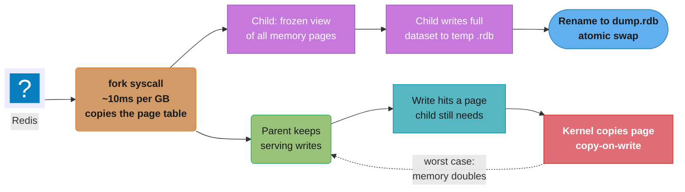
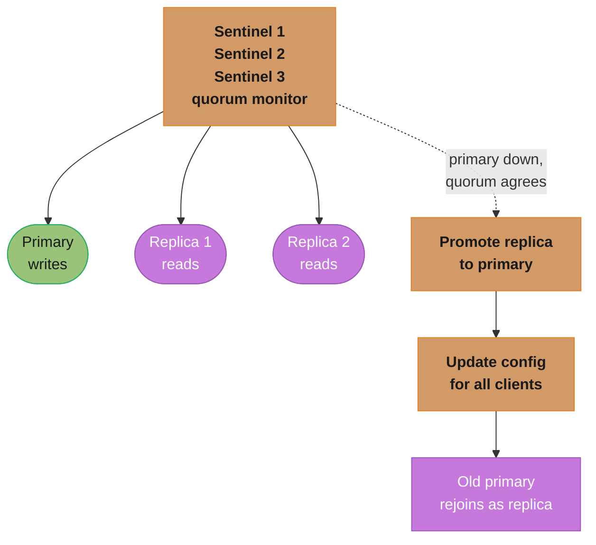
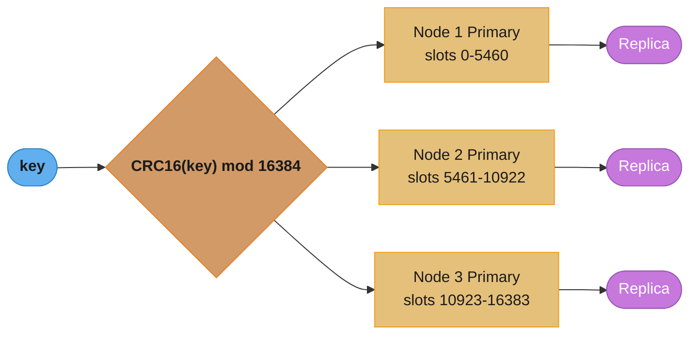
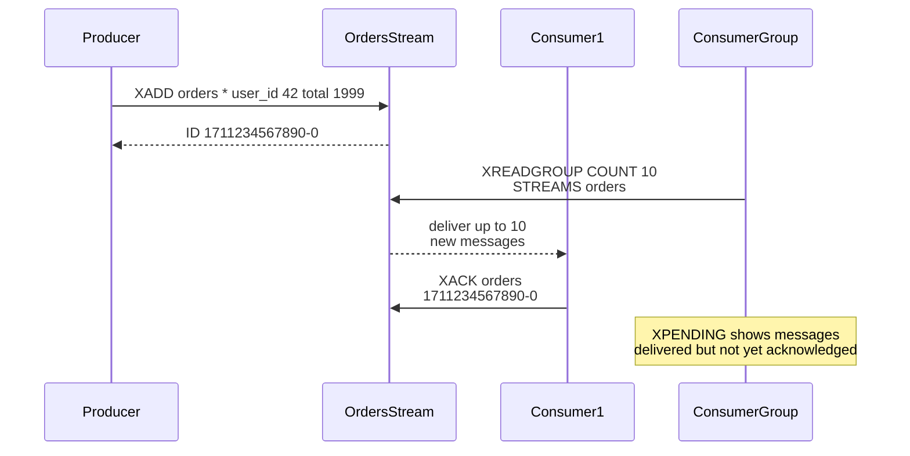
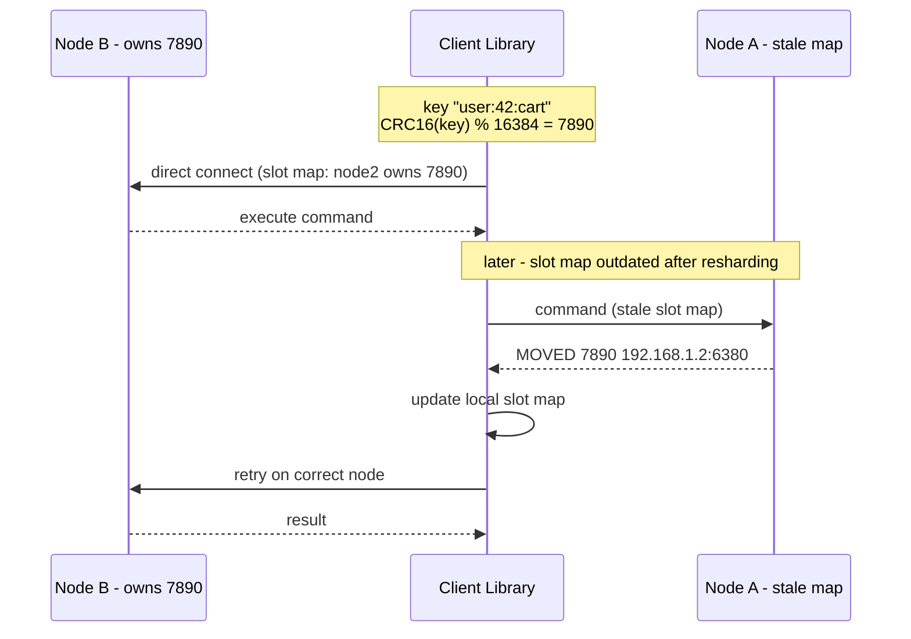
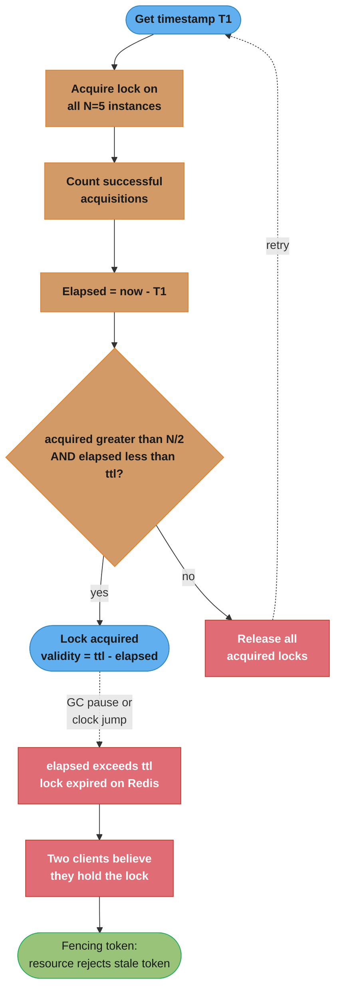

# Key-Value Stores

> **Boundary.** This page teaches the **category** — what a key-value store is for, and the ideas
> that survive swapping Redis for DynamoDB, etcd or Valkey: data-model choice, the HyperLogLog
> error/memory trade, expiration versus eviction, the fixed-slot layer, Redlock and its critique.
> The **product internals** (SDS and listpack layouts, `dict` rehashing, the ten
> `maxmemory-policy` values and the LRU/LFU algorithms behind them, multi-part AOF, `latest_fork_usec`
> and copy-on-write, `PSYNC` and the replication backlog, live slot migration with `ASK`/`ASKING`,
> Functions versus `EVALSHA`, and the Redis-vs-Valkey licence split) live in
> [Redis Internals](../redis_internals/redis_internals.md). Read this page first.

## 1. Concept Overview

Key-value stores are the simplest NoSQL data model: a distributed hash map mapping keys to values. Redis is the dominant in-memory key-value store, combining sub-millisecond latency with rich data structures, persistence, pub/sub, Lua scripting, and clustering. Amazon DynamoDB is the dominant managed, disk-backed one: a partitioned table with no size limit, priced per request, where the partition key decides both data placement and the throughput ceiling of each key. Understanding Redis data structures and their internal encodings is critical for building efficient caching, session, rate limiting, and real-time systems.

---

## 2. Intuition

Redis is like a Swiss Army knife: the basic knife is the string (simple key-value), but the attached tools — sorted sets, streams, HyperLogLog — handle complex use cases that would otherwise require multiple systems. The right data structure choice can be the difference between a 0.5ms and 50ms operation.

- **Key insight**: Every Redis data structure has two internal encodings — a compact one for small sizes and an efficient one for large sizes. Staying below the threshold (default 64-byte values; 512 entries for hashes, 128 for sets and sorted sets) keeps data in the compact encoding, dramatically reducing memory.

---

## 3. Core Principles

### Redis Data Structures and Internal Encodings

```
String:
  Small: embstr (≤ 44 bytes, contiguous allocation with robj)
  Large: raw (separate allocation, INCR for integers)
  Use: cache values, counters, rate limiters, session tokens

List (quicklist of listpacks):
  Small: a single listpack node (compact sequential)
  Large: quicklist (doubly-linked list of listpacks, default node cap 8 KB)
  Use: message queues, activity feeds, recent items, pub/sub queues

Hash (dict / listpack):
  Small (≤ 512 fields, ≤ 64 bytes each): listpack (compact, linear scan)
  Large: hashtable (O(1) ops)
  Use: user sessions, object attributes, counters per entity

Set (hashtable / intset / listpack):
  Small integers only (≤ 512): intset (compact sorted array, O(log n) lookup)
  Small non-integers (≤ 128 members, ≤ 64 bytes each): listpack
  Otherwise: hashtable (O(1) ops)
  Use: unique members, tags, follower/following relationships

Sorted Set / ZSet (skiplist + hashtable / listpack):
  Small (≤ 128 members, ≤ 64 bytes each): listpack (linear scan)
  Large: skiplist + hashtable dual structure
         skiplist: O(log n) for range queries (ZRANGE by index, BYSCORE, BYLEX)
         hashtable: O(1) for member lookup (ZSCORE, ZADD update)
  Use: leaderboards, rate limiters (sliding window), delayed tasks

HyperLogLog: probabilistic cardinality estimation
  Standard error: 0.81%, Memory: 12KB maximum
  Use: unique visitor count, distinct IPs, distinct searches

Bitmap: string with bit operations
  Use: user activity (bit per day), feature flags, bloom filters

Stream: append-only log with consumer groups
  Use: event sourcing, Kafka-lite, job queues with acknowledgment
```

**What this actually says.** The HyperLogLog line reads: "give up exactness and you can count unbounded
distinct items in a fixed 12KB, because HLL never stores the members — only 16,384 tiny counters."
The `0.81%` is not a knob you set directly; it falls out of how many registers you allocate, via
`SE = 1.04 / sqrt(m)`. That framing matters because halving the error costs 4x the memory, so 12KB
is a deliberate stopping point, not an arbitrary one.

| Symbol | What it is |
|--------|------------|
| `m` | Number of registers (buckets) the hashed items are spread across. Redis fixes `m = 16384` |
| `SE` | Relative standard error — the estimate's spread as a fraction of the true count |
| `1.04` | Constant from the Flajolet HyperLogLog paper. Fixed, not tunable |
| 6 bits | Width of one register: enough to store a leading-zero count up to 63 |

**Walk one example.** Both published numbers, `0.81%` and `12KB`, come out of the same `m`:

```
  registers      m  = 16384                (2^14, hard-coded in Redis)

  error          SE = 1.04 / sqrt(16384)
                    = 1.04 / 128
                    = 0.008125             ->  0.81 percent

  memory         16384 registers x 6 bits  = 98304 bits
                 98304 / 8                 = 12288 bytes  = 12 KB

  counting 1,000,000,000 unique visitors:
    estimate lands within 1e9 x 0.008125   = +/- 8,125,000 of the true count
    memory used                            = 12288 bytes -- identical to counting 100
```

The last two lines are the whole selling point: memory is flat in the cardinality. A `SET` holding
1e9 members would need tens of gigabytes; PFADD/PFCOUNT stay at 12288 bytes forever.

**Why `sqrt(m)` and not `m`.** The error shrinks with the *square root* of the register count, so
accuracy is expensive. Drop to `m = 1024` and memory falls 16x to 768 bytes, but the error becomes
`1.04 / sqrt(1024) = 3.25%` — four times worse. Redis picked `m = 16384` as the point where sub-1%
error still fits in a cache-friendly 12KB blob.

### Persistence Modes

A key-value store that lives in memory has to answer one question that a disk-backed database
answers by construction: what survives a restart. There are only two shapes of answer, and Redis
offers both.

**RDB (Redis Database) — Snapshots**: a periodic point-in-time dump written by a forked child.
`fork()` gives the child a frozen view of every memory page without copying; the kernel only copies
a page (copy-on-write) once the parent writes to it, so cost scales with how much the dataset
changes during the snapshot, not its total size. You lose everything written since the last
snapshot.



If every page gets touched before the child finishes writing, total memory temporarily doubles — the mechanism behind Pitfall 1's multi-second fork pause on large datasets.

**AOF (Append-Only File)**: every write command is appended to a log and replayed on restart. The
durability knob is how often that log is `fsync`ed — `always`, `everysec` (the usual production
choice) or `no` — and the trade is the same one every write-ahead log makes: each step toward
zero loss costs throughput.

**Both together** is the normal production shape, since RDB alone loses a snapshot interval and AOF
alone restarts slowly. The mechanics — the fork cost per GB on real hardware, `latest_fork_usec`,
Transparent Huge Pages as a copy-on-write amplifier, the `save` and `auto-aof-rewrite-*` defaults,
what `appendfsync always` actually fsyncs, and what multi-part AOF `[7.0]` changed — are in
[Redis Internals §6.5–6.7](../redis_internals/redis_internals.md).

---

## 4. Types / Architectures / Strategies

### Redis Sentinel (HA for single primary)



Three or more Sentinels monitor the primary and both replicas; once a majority (quorum) agrees the primary is down, they promote a replica, push the new config to clients, and the old primary rejoins as a replica once it recovers. Use Sentinel when you need HA but don't need horizontal scale.

### Redis Cluster (horizontal scale + HA)



16,384 hash slots split across the primary shards (3 shown here) via `CRC16(key) mod 16384`; each primary has a replica for failover. When a client sends a command, the owning primary executes it directly; if the client's cached slot map is stale, the target node replies `MOVED ip:port` and the client redirects to the correct primary (worked example in Section 5). Key tags such as `{user}.cart` and `{user}.profile` hash only on `{user}`, guaranteeing both land on the same slot so multi-key operations work.

The Redis-specific mechanics — which CRC16 variant, the gossip port, the `CLUSTER SETSLOT
MIGRATING`/`IMPORTING`/`NODE` sequence a live reshard actually runs, why `ASK` is not `MOVED` and
what `ASKING` is for, the three hash-tag parsing rules, and the cluster-mode restrictions that
decide whether an application can migrate at all — are in
[Redis Internals §6.9](../redis_internals/redis_internals.md).

**Read it like this.** `CRC16(key) mod 16384` says: "never ask which node owns this key — ask which
of 16,384 fixed slots it falls into, then ask who currently owns that slot." The extra level of
indirection is the entire design: node membership changes reassign *slots*, so a resharding moves a
bounded set of slots instead of re-hashing every key in the cluster.

| Symbol | What it is |
|--------|------------|
| `CRC16(key)` | A 16-bit checksum of the key bytes. Cheap, deterministic, uniform enough for bucketing |
| `mod 16384` | Folds the checksum into a slot number in `[0, 16383]`. `16384 = 2^14` |
| slot | The unit of ownership. A node owns a contiguous set of slots, never individual keys |
| `{tag}` | Key-tag braces: only the text inside them is hashed, forcing co-location |

**Walk one example.** Slot ownership across 3 primaries, then the cost of adding a fourth:

```
  slots per primary   16384 / 3 = 5461.33  ->  cannot split evenly, so:
    Node 1  slots     0 - 5460        = 5461 slots
    Node 2  slots     5461 - 10922    = 5462 slots
    Node 3  slots     10923 - 16383   = 5461 slots
    total             5461 + 5462 + 5461 = 16384   (checks out)

  key "user:42:cart"  ->  CRC16(...) mod 16384 = 7890  ->  Node 2 owns it

  now scale 3 -> 4 primaries:
    new share          16384 / 4 = 4096 slots each   (exact this time)
    each old node hands over 5461.33 - 4096 = 1365.33 slots
    slots migrated     3 x 1365.33 = 4096  =  25 percent of the keyspace
```

Only a quarter of the slots move, and the other 12,288 slots — with every key in them — never leave
their node. Compare naive `hash(key) mod N` with no slot layer: a key only stays put when
`h mod 3 == h mod 4`, which holds for exactly 3 of the 12 residues mod 12 — so 25% stay and **75% of
every key in the cluster relocates**. The fixed 16,384-slot layer is what turns a rehash-everything
event into a bounded slot migration.

### Eviction Policies

Any store with a memory ceiling has to decide what to throw away, and the choice is two independent
questions: which keys are *candidates* (all of them, or only the ones you marked expirable) and how
a victim is *picked* among them (least recently used, least frequently used, random, or soonest to
expire). Recency suits sessions and sliding windows; frequency suits a Zipfian cache and is the only
one that survives a nightly full scan; and refusing to evict at all is the right answer for a job
queue, where losing an entry is a correctness bug rather than a cache miss.

Redis's ten exact policy names (8.6.0 added `allkeys-lrm` and `volatile-lrm`), the fact that its shipped default refuses to evict, and the
approximated-LRU and logarithmic-LFU algorithms behind them are in
[Redis Internals §6.3](../redis_internals/redis_internals.md).

### Key Expiration Is Not Eviction

Best Practice 5 says "set TTL on all cache keys", which is only true if you know what a
TTL actually triggers. Expiration and eviction are separate mechanisms with separate
failure modes: eviction fires under `maxmemory` pressure and picks victims by policy;
expiration fires on the clock and picks the keys you already marked volatile. A key with
a TTL is not freed the moment the TTL passes. Redis removes it in two ways:

- **Passive (lazy)**: a client touches the key, Redis notices it is past its deadline,
  deletes it, and answers as if it were absent. Costs nothing until someone asks.
- **Active**: the slow expire cycle runs `hz` times a second (default `hz 10`). Each pass
  samples 20 keys at random from one database's volatile set and deletes the expired ones;
  **if more than 10% of that sample was expired, it immediately repeats on the same
  database**. At the steady state that is only about 200 keys per second actively
  reclaimed — the lazy path is expected to do most of the work.

Do not confuse the two percentages in that algorithm — they are different constants doing
different jobs. `ACTIVE_EXPIRE_CYCLE_ACCEPTABLE_STALE` (10) is the *repeat* threshold; the
familiar 25 is `ACTIVE_EXPIRE_CYCLE_SLOW_TIME_PERC`, a cap on how much of the `hz` period
one cycle may consume. Both scale with `active-expire-effort` (default `1`, range 1–10);
raising it samples more keys per loop and lowers the repeat threshold further.

That 10% loop is the operational trap. It is adaptive by design, so a keyspace where a
large share of the volatile keys come due in the *same second* — the classic result of
writing a million keys with an identical TTL in a bulk load — makes the cycle iterate
repeatedly on the single command thread until the expired fraction drops back under 10%.
The only thing bounding the burst is that time cap: 25% of the `hz` period, or 25 ms out
of every 100 ms at `hz 10` — a quarter of the command thread surrendered to reclamation
for as long as the backlog lasts. This is the same argument for TTL jitter that stampede
prevention makes, arriving from the memory-reclamation side rather than the cache-miss
side.

Two consequences worth knowing before an incident:

```
  memory freed by a TTL is NOT freed at the deadline
    -> used_memory can sit above what the TTLs imply, and eviction can start
       on keys that are logically already dead
  TTLs are stored as ABSOLUTE Unix timestamps, and time flows while Redis is down
    -> restoring an RDB onto a host with a skewed clock can expire the whole
       dataset the instant it loads
```

**Replicas never expire keys on their own.** The primary synthesizes an explicit `DEL`
into the replication stream and the AOF when a key expires, so expiry is centralized and
cannot diverge between nodes. A replica therefore keeps an expired key in its dataset —
and in its memory accounting — until that `DEL` arrives, which matters when you route
reads to replicas (Pitfall 2) or size a replica by expected key count. A promoted replica
takes over the full expire state and begins expiring independently, as a primary.

### Lua Scripting and Atomicity

```lua
-- Lua scripts in Redis are atomic: no other command executes between lines
-- EVALSHA for efficiency: pre-load script, send SHA for subsequent calls

-- Rate limiter (token bucket, atomic):
local key = KEYS[1]
local limit = tonumber(ARGV[1])
local window = tonumber(ARGV[2])
local current = tonumber(redis.call('GET', key) or '0')
if current + 1 > limit then
    return 0
end
-- Set the TTL only when this INCR created the counter. Calling EXPIRE on every
-- request slides the deadline forward, so a continuously active caller's window
-- never closes and the limit becomes permanent rather than per-window.
if redis.call('INCR', key) == 1 then
    redis.call('EXPIRE', key, window)
end
return 1

-- Execute:
EVAL <script> 1 rate_limit:user:42 100 60
```

### Redis Streams (Kafka-lite)

A Stream is an append-only log with auto-generated timestamp-sequence IDs; producers append, and each consumer in a group gets a distinct slice of the log.



Unlike a plain Redis List (`BRPOP` for a blocking pop, no acknowledgment), a Stream supports consumer groups, acknowledgment, message replay, and multiple independent consumers off the same log.

### DynamoDB: Disk-Backed, Partitioned Key-Value at Scale

Redis keeps the dataset in RAM on nodes you size. Amazon DynamoDB is the other end of the category: a managed, SSD-backed store where AWS splits the table into partitions and you pay per request (on-demand) or per provisioned capacity unit. There is no practical table size limit, a single item is capped at 400 KB, and every access is designed around the key, so the data model is decided by the queries, not by the entities.

#### Partition key, sort key, and item collections

The primary key is either a partition key alone or a partition key plus a sort key. DynamoDB hashes the partition key to pick a partition; within a partition, items with the same partition key form an *item collection* stored in sort-key order. `GetItem` reads one item by full key. `Query` reads a contiguous range of one item collection (`begins_with`, `between`, `<`, `>` on the sort key) and returns up to 1 MB per page. `Scan` reads the whole table and is the one to avoid on a hot path.

Capacity units are the billing and throttling currency:

| Unit | Covers |
|------|--------|
| 1 RCU | 1 strongly consistent read/s, or 2 eventually consistent reads/s, of an item up to 4 KB |
| 1 WCU | 1 write/s of an item up to 1 KB |
| Per partition | at most 3,000 RCU and 1,000 WCU, whatever the table total |
| Per table default | 40,000 RCU and 40,000 WCU (adjustable quota) |

Item size multiplies cost: a 20 KB item costs 5 RCU per strongly consistent read, so one item can take only 3,000 / 5 = 600 such reads per second before its partition throttles.

#### Single-table design

Because there are no joins, related entities that are read together are stored in one item collection, distinguished by a typed sort-key prefix. One `Query` on `PK = CUSTOMER#42` returns the customer, their orders, and the order lines in one round trip:

```
  PK              SK                          other attributes        GSI1PK          GSI1SK
  -------------   -------------------------   ---------------------   -------------   ----------
  CUSTOMER#42     PROFILE                     name, email, tier
  CUSTOMER#42     ORDER#2026-10-01#9001       total, status           STATUS#OPEN     2026-10-01
  CUSTOMER#42     ORDER#2026-10-14#9017       total, status           STATUS#SHIPPED  2026-10-14
  CUSTOMER#42     ORDER#2026-10-14#9017#L1    sku, qty, price
  PRODUCT#77      PROFILE                     title, price

  Query PK = CUSTOMER#42 AND begins_with(SK, "ORDER#2026-10")   -> both October orders + lines
  Query GSI1 PK = STATUS#OPEN                                    -> open orders across customers
```

The base table answers "everything about customer 42"; the overloaded GSI (`GSI1PK`, `GSI1SK` hold different meanings per item type) answers a second access pattern without a second table. The model is fixed by the list of access patterns written down first, and a new pattern later usually means a new GSI or a backfill. Single-table design pays off when access patterns are known and latency-critical; a team that needs ad hoc queries or analytics is better served by multiple tables plus an export to S3 for analysis.

#### GSI vs LSI

| | Global secondary index (GSI) | Local secondary index (LSI) |
|---|---|---|
| Key | Any partition key and sort key | Same partition key as the table, different sort key |
| When created | Any time, backfilled online | Only at `CreateTable`; cannot be added later |
| Read consistency | Eventually consistent only | Strongly consistent available |
| Capacity | Its own RCU/WCU | Shares the table's capacity |
| Size limit | None per key | 10 GB per partition key value (table plus all LSIs) |
| Count | 20 per table (default quota) | 5 per table |

A GSI is a separate, asynchronously maintained table. If its write capacity is too low, writes to the base table that touch the index are throttled too, so an under-provisioned GSI throttles the whole table. An LSI caps each item collection at 10 GB (writes fail with `ItemCollectionSizeLimitExceededException`), and a table with an LSI cannot split an item collection across partitions. Prefer GSIs unless strongly consistent reads on the alternate sort order are a hard requirement.

#### Burst, adaptive capacity, and split for heat

Uneven traffic is the normal state, and DynamoDB has three mechanisms for it:

1. **Burst capacity**: up to 300 seconds of unused read and write capacity is banked and spent on short spikes.
2. **Adaptive capacity**: instantly raises the share of a hot partition, as long as table total and the 3,000 RCU / 1,000 WCU per-partition maximum are not exceeded. In the AWS example, a 400 WCU table over 4 partitions gives each 100 WCU; one partition taking 150 WCU/s is allowed to keep it.
3. **Split for heat**: DynamoDB moves frequently accessed items apart, down to a partition holding one item. It cannot split one item, it will not split by sort key when traffic follows a monotonically increasing sort key (every write goes to the newest end), and it does not split item collections on a table with an LSI.

So adaptive capacity removes throttling from moderately skewed traffic, but one key above 1,000 writes/s still throttles. The fix is write sharding: append a suffix `#0..#N-1` to the partition key, write to a random or hashed shard, and read all N in parallel.

#### Transactions

`TransactWriteItems` and `TransactGetItems` group up to 100 actions on distinct items, 4 MB in total, across tables in one account and Region. Each item costs two reads or writes (prepare and commit), and a cancelled transaction still pays. A `ClientRequestToken` makes a retried write idempotent for 10 minutes. Conflicts fail with `TransactionCanceledException`, and the SDK does not retry them. Transactions are serializable against single-item operations but read-committed against `Query`, `Scan`, and `BatchGetItem`, and GSIs and Streams see the transaction's writes gradually, not atomically.

#### Global Tables

Global Tables (version 2019.11.21) replicate a table across Regions, with a 99.999% availability SLA against 99.99% for a single-Region table. The consistency mode is chosen at creation and cannot change:

| | MREC (default) | MRSC |
|---|---|---|
| Replication | Asynchronous, typically 1 s or less | Synchronous to at least one other Region before the write returns |
| Conflicts | Per-item last writer wins on an internal timestamp | Concurrent write to the same item fails with `ReplicatedWriteConflictException` |
| Strongly consistent read | Latest only if the last write was in this Region | Latest from any replica |
| RPO | Replication delay, usually seconds | Zero |
| Topology | Any number of Regions | Exactly 3 Regions: 3 replicas, or 2 replicas plus a witness |
| Limits | Transactions are atomic only in the calling Region | No transactions, TTL, or LSIs |

MREC is the right default for user-partitioned data written from one home Region. MRSC fits data where two Regions must never accept conflicting writes, such as balances or inventory, and pays for it with cross-Region latency on every write and strongly consistent read.

---

## 5. Architecture Diagrams

**Cluster key routing**: a client hashes a key to a slot, connects straight to the primary its cached slot map names, and transparently re-routes on a `MOVED` reply.



The redirect is transparent to the application: the client library absorbs the `MOVED` reply, updates its slot map, and retries — callers never see the extra round trip.

**Skiplist internal structure (Sorted Set)**: higher levels skip more nodes, so range scans descend from the top level instead of walking every element.

```
Level 3: → → → → [score=50] → → → → [score=90]
Level 2: → → [score=20] → [score=50] → [score=80] → [score=90]
Level 1: [10] → [20] → [30] → [50] → [60] → [80] → [90]
```

`ZRANGE` — by index, `BYSCORE`, or `BYLEX` — is O(log n): navigate the skiplist from the highest level down. `ZSCORE` is O(1): a parallel hashtable maps member to score without touching the skiplist at all.

**In plain terms.** `O(log n)` on a skiplist says: "each level up keeps only a fraction of the nodes
below it — one in four, at Redis's 1/4 promotion probability — so the hops to reach any score grow
with the *logarithm* of `n`, not with `n`." The figures below use log base 2, which is the usual way
to state the shape; the 1/4 promotion moves the constant factor, not the shape. That
framing is what makes the leaderboard in Section 14 viable — the cost of a rank lookup grows by one
single hop every time the player base *doubles*.

| Symbol | What it is |
|--------|------------|
| `n` | Number of members in the sorted set |
| level | One express lane. Redis promotes each node to the next level with probability `1/4` |
| `log n` | Expected hops from the top level down to the target node |
| `+ k` | The `k` elements you actually return, walked sequentially at level 1 |

**Walk one example.** The `O(log(50M) + 100)` claim in the Section 14 case study, spelled out:

```
  members            n = 50,000,000

  descent cost       log2(50,000,000) = 25.58  ->  about 25 hops to locate the start

  ZRANGE 0 99 REV    25 hops (locate)  +  100 sequential steps (emit)
                     = 125 node visits total

  compare a plain sorted array scan:  50,000,000 visits
  compare growth:    n = 50M   -> 25.58 hops
                     n = 100M  -> 26.58 hops   (double the data, ONE extra hop)
                     n = 1M    -> 19.93 hops
```

Doubling from 50M to 100M players adds a single hop. That flat curve is why the case study can quote
"0.3ms regardless of leaderboard size" rather than a size-dependent latency budget — the `+100` term,
not the `log n` term, dominates the work.

---

## 6. How It Works — Detailed Mechanics

### Redlock Algorithm and Its Controversy



Redlock only counts a lock as held if a majority of the N instances (greater than N/2, so 3 of the reference N=5) acknowledge it AND the elapsed acquisition time is still under the lock validity time; otherwise it releases everything — including the instances it thought it had failed to lock — and retries after a random delay. The remaining validity is the TTL minus that elapsed time, minus a small clock-drift allowance. Martin Kleppmann's 2016 critique: a GC pause or clock jump between acquiring and using the lock can let it expire on the Redis nodes unnoticed, so two clients can both believe they hold it — a fencing token (a monotonically increasing number the protected resource must check) closes that gap by rejecting any request carrying a lower token than one it has already seen.

**Practical guidance**: Redlock is safer than single-Redis locks, but for true distributed safety use ZooKeeper (ephemeral nodes) or etcd — both provide linearizable semantics that Redlock cannot guarantee.

### Redis Memory Encoding Thresholds

```
# Change encoding thresholds (values shown are the shipped defaults):
hash-max-listpack-entries 512    # Use listpack for hashes with ≤512 fields
hash-max-listpack-value 64       # Use listpack if all values ≤64 bytes
zset-max-listpack-entries 128
zset-max-listpack-value 64
list-max-listpack-size -2        # -2 = cap each quicklist node at 8 KB
set-max-intset-entries 512       # intset for sets with ≤512 integers
set-max-listpack-entries 128     # listpack for small non-integer sets

# Memory impact:
# Listpack (small): ~30-50% less memory than hashtable/skiplist
# Keep objects small and below thresholds for best memory efficiency
```

### Pipeline and Multi-Exec

```
# Pipeline: batch commands, send in one network round trip
# No atomicity guarantee — commands may be interleaved with other clients
PIPELINE:
SET key1 val1
SET key2 val2
GET key1
# All sent at once, ~1 RTT instead of 3

# MULTI/EXEC: atomic block (no interleaving)
MULTI
SET key1 val1
SET key2 val2
EXEC
# Atomicity: other clients cannot insert commands between MULTI and EXEC
# However: commands queued in MULTI are NOT conditional — cannot use GET result
# For conditional logic: use Lua scripts (also atomic and can read+write)

# WATCH (optimistic locking):
WATCH balance
val = GET balance
MULTI
SET balance (val - 100)
EXEC
# If 'balance' changed between WATCH and EXEC: EXEC returns nil (abort)
```

---

## 7. Real-World Examples

- **Session storage**: HSET user:session:{token} user_id 42 role admin; EXPIRE 86400. Hash stores session fields; TTL auto-expires.
- **Rate limiting**: INCR rate:user:42:min:1711234567; EXPIRE 60. Atomic increment + TTL = sliding window rate limiter.
- **Leaderboard**: ZADD game:scores 1500 user:1 2300 user:2. `ZRANGE game:scores 0 9 REV WITHSCORES` = real-time leaderboard.
- **Job queue**: LPUSH jobs:email '{"to":"alice@example.com"}'. BRPOP jobs:email 0 for blocking worker.
- **Pub/Sub**: PUBLISH chat:room1 "Hello". SUBSCRIBE chat:room1 for real-time messaging.
- **Distributed counter**: INCR page:views:homepage — atomic, no locking needed.
- **Bloom filter**: built into Redis Open Source — `BF.RESERVE seen 0.001 1000000`, then `BF.ADD` / `BF.EXISTS`. A 0.1% error rate costs ~14.4 bits per item.

---

## 8. Tradeoffs

| Feature | Redis | Memcached |
|---------|-------|-----------|
| Data structures | Rich (List, Hash, ZSet, Stream) | String only |
| Persistence | RDB + AOF | None (pure in-memory) |
| Clustering | Built-in (Cluster mode) | Client-side sharding only |
| Replication | Primary-Replica, Sentinel, Cluster | Client-side only |
| Lua scripting | Yes (atomic) | No |
| Pub/Sub | Yes | No |
| Memory overhead | Higher (rich structures) | Lower (string-only) |
| Multi-threading | Commands single-threaded; `io-threads` offloads socket read/write and protocol parsing | Multi-threaded |
| Best for | Complex use cases, sessions, queues, Streams | Simple cache (highest throughput/core) |

| Feature | Redis | DynamoDB |
|---------|-------|----------|
| Storage | RAM, dataset must fit | SSD, no table size limit; 400 KB per item |
| Latency | Sub-millisecond | Single-digit milliseconds |
| Scaling unit | Node you size and reshard | Partition AWS splits; 3,000 RCU / 1,000 WCU each |
| Secondary access | None built in (manual index keys) | GSIs (up to 20) and LSIs (up to 5) |
| Transactions | `MULTI`/`EXEC`, Lua, one node or slot | Up to 100 items, 4 MB, serializable per item |
| Multi-Region | Replicas are active-passive; active-active needs Redis Cloud or Redis Software (CRDT-based) | Global Tables, MREC or MRSC |
| Cost shape | Pay for provisioned memory, busy or idle | Pay per request (on-demand) or per capacity unit |

---

## 9. When to Use / When NOT to Use

**Use Redis when**:
- Caching with rich invalidation logic (sets, sorted sets)
- Session storage with TTL
- Rate limiting (atomic counters)
- Pub/Sub messaging
- Leaderboards and sorted data
- Distributed locks (with limitations)
- Job queues (List BRPOP or Streams)

**Do not use Redis as a primary database when**:
- Data is larger than available RAM (even with eviction, hot data must fit)
- Durability is paramount (AOF offers protection but WAL in PostgreSQL is more robust)
- Complex queries across multiple keys are needed (no joins)

**Use Memcached when**:
- Simple string cache, maximum throughput per CPU core
- No persistence needed, no rich structures
- Multi-threaded workload (Memcached scales linearly with cores)

---

## 10. Common Pitfalls

**Pitfall 1: Large key-value pairs causing fork pause**
A Redis instance stores Python pickle objects averaging 5MB each (session data). The `BGSAVE` fork causes a 3-second pause on a 20GB dataset — every 60 seconds. Fix: use a more efficient serialization (protobuf, msgpack), split large objects across smaller keys, or disable RDB and rely only on AOF with `appendfsync everysec`.

**Pitfall 2: Hot key in Redis Cluster**
A Redis Cluster with 6 shards. One product (viral product ID 42) receives 500K GETs/second — all on the same slot (same Redis node). That node: 100% CPU, 200ms latency. Other nodes: idle. Fix: (1) Local in-process cache (Caffeine/Guava) for ultra-hot keys — reads never hit Redis. (2) Read from replicas: in Cluster mode the client sends `READONLY` on its replica connections so the replica serves reads for slots it mirrors instead of replying `MOVED`; accept the replication lag that comes with it. (3) Key sharding: `GET product:42:shard:{random 0-9}` — 10 copies across different slots, read a random copy.

```
per-copy QPS    = hot-key QPS / c              <- c = number of duplicate keys written
overload factor = per-copy QPS / node budget   <- >1x means that node is over capacity
```

**Put simply.** Key sharding says: "one key can only ever live on one node, so if the traffic won't
fit on one node, make more keys." Sharding the cluster does nothing here — the load is concentrated
by the *key*, not by the key count, and every extra shard you add just gives you another idle node.

| Symbol | What it is |
|--------|------------|
| shards | Number of Redis Cluster primaries. Divides the *keyspace*, not the traffic to one key |
| copies `c` | Number of duplicate keys `product:42:shard:0..c-1` you write the same value into |
| per-copy QPS | Total hot-key QPS divided by `c` — what each owning node actually sees |
| node budget | Sustainable ops/second on one Redis primary. ~100K/s is a safe planning figure |

**Walk one example.** The 500K/second viral product against a 6-shard cluster:

```
  hot key traffic          500,000 GET/s, all on one slot

  what 6 shards buy you    fair share if load were uniform = 500,000 / 6 = 83,333/s
  what actually happens    hot node 500,000/s, other 5 nodes ~0/s
  overload factor          500,000 / 100,000 budget = 5.0x over  -> 100% CPU, 200ms

  fix (3): 10 sharded copies
    per copy               500,000 / 10 = 50,000/s
    vs node budget         50,000 / 100,000 = 0.5x  -> 50% headroom, back in spec

  fix (1): local Caffeine cache at 95% hit rate, layered on top
    reaching Redis         500,000 x (1 - 0.95) = 25,000/s total
```

The two fixes multiply. Note what the copies cost: 10x the memory for that value and 10 writes on
every update, which is why key sharding is reserved for read-mostly hot keys. Without the extra
copies, the hot node's 5x overload cannot be relieved by *any* amount of horizontal scaling.

**Pitfall 3: KEYS command in production**
`KEYS user:*` scans all keys in the keyspace — O(N) where N is total key count. In a Redis with 10M keys, this blocks Redis for 100ms+ (single-threaded command). Fix: use `SCAN 0 MATCH user:* COUNT 100` — iterative, non-blocking (yields after each batch). Never use KEYS in production.

**Pitfall 4: AOF rewrite causing memory spike**
During AOF rewrite (BGREWRITEAOF), Redis forks a child process. The child writes a new, compacted AOF. During rewrite, new commands are appended to both the old AOF and a rewrite buffer. The rewrite buffer can grow to 2-3GB for high write workloads. Combined with the fork (CoW memory duplication), total memory usage can temporarily double. Fix: set `aof-rewrite-incremental-fsync yes` to throttle rewrite I/O; increase available RAM; schedule rewrites during low-traffic periods.

**Pitfall 5: Using MULTI/EXEC for conditional updates**
```
MULTI
GET balance         # Queued — not executed!
SET balance (computed_new_value)  # Based on GET result that hasn't been read
EXEC
# The GET result is not available to compute the SET value within MULTI
```
MULTI/EXEC queues commands but doesn't execute them until EXEC — you cannot read a value mid-transaction and use it. Fix: use Lua scripting (reads and writes in one atomic script) or WATCH + MULTI/EXEC (optimistic locking).

**Pitfall 6: A DynamoDB GSI throttling the base table**
A team adds a GSI on `status` to a provisioned 5,000 WCU orders table and gives the index 500 WCU because "it is only read by a dashboard". A bulk status update then drives 3,000 index writes/s. The GSI cannot absorb them, and DynamoDB throttles the writes to the base table that touch the index, so checkout starts failing with `ProvisionedThroughputExceededException` while the table's own metrics show headroom. A low-cardinality key makes it worse: every `status = OPEN` write lands on one GSI partition key, and with a date sort key (a monotonic pattern split for heat will not split) that key throttles near the 1,000 WCU per-partition limit no matter how much is provisioned. Fix: give the GSI write capacity at least equal to the share of base writes it receives (or use on-demand), and shard low-cardinality index keys (`STATUS#OPEN#0..9`).

---

## 11. Technologies & Tools

| Tool | Purpose |
|------|---------|
| `redis-cli` | Command-line interface for debugging, monitoring |
| `redis-benchmark` | Built-in throughput benchmarking |
| `INFO memory` | Memory usage, eviction stats, fragmentation ratio |
| `INFO replication` | Replication lag, connected replicas |
| `MONITOR` | Real-time command stream (never in production — single-threaded bottleneck) |
| `redis-memory-analyzer` | Analyze key distribution and memory usage |
| `RedisInsight` | Official Redis GUI — keyspace browser, profiler, slowlog |
| Amazon DynamoDB | Managed, partitioned key-value and document store; GSIs, transactions, Global Tables (MREC/MRSC) |
| NoSQL Workbench | AWS desktop tool for modeling DynamoDB single-table designs and access patterns |
| CloudWatch Contributor Insights | Shows the most accessed and most throttled DynamoDB partition keys |
| `Valkey` | BSD-licensed Linux Foundation fork of Redis 7.2.4; wire-compatible, and the default engine on AWS ElastiCache and MemoryDB |
| `Dragonfly` | Redis-compatible, multi-threaded, higher memory efficiency |
| `valkey-cli` / `valkey-benchmark` | The Valkey-side equivalents of `redis-cli` and `redis-benchmark`; command-compatible |

---

## 12. Interview Questions with Answers

**Q: Why is Redlock considered unsafe and what's the alternative?**
**Short:** Redlock is unsafe because a paused process can hold an expired lock while another client acquires it; fencing tokens fix this safely.

Redlock acquires locks across N independent Redis instances. Martin Kleppmann identified a fundamental issue: between acquiring the lock and using it, a process can experience a GC pause or system clock jump. If the pause exceeds the lock TTL, the lock expires on Redis — but the process believes it still holds the lock. Two processes can simultaneously believe they hold the lock. This is possible even with N=5 instances because the guarantee is based on time, and time can be non-monotonic in real systems. Safe alternative: fencing tokens — the lock server returns a monotonically increasing token with each lock grant. The protected resource rejects any operation with a token lower than the highest seen. This works even if two clients simultaneously believe they hold the lock, because only the higher-token request succeeds.

**Q: How does Redis AOF fsync=everysec differ from fsync=always in durability guarantees?**
**Short:** fsync=always guarantees zero data loss per write at high latency cost, while fsync=everysec risks up to one second of writes on power loss.

`fsync=always`: after every write command, Redis calls fsync() — the OS guarantees the data is on durable storage. Zero data loss on any crash. Slowest: one fsync per write = 1-10ms per operation on HDD, limiting throughput to ~1000 writes/second on HDD (higher on NVMe). `fsync=everysec`: Redis accumulates writes in the OS page cache, then fsyncs once per second in a background thread. If the Redis process crashes: zero data loss (last second of data is in OS cache). If the entire machine loses power: up to 1 second of writes are lost. Throughput: near-native (hundreds of thousands of operations per second). Most production deployments use `everysec` — the 1-second window is acceptable for most non-financial use cases, and the throughput improvement is significant.

**Q: Walk me through how Redis Cluster routes a key to the correct node.**
**Short:** Redis Cluster routes each key by hashing it into one of 16384 slots, and a client follows a MOVED redirect when that slot's owner changes.

(1) Client library (or the user) computes the slot: `CRC16(key) % 16384`. Key tags (`{tag}`) hash only the tag portion. (2) The client maintains a slot-to-node mapping (downloaded from cluster on connection). (3) Client connects directly to the node owning that slot and sends the command. (4) If the slot has moved (resharding), the node responds with `MOVED <slot> <ip:port>`. (5) Client updates its slot map and retries on the correct node. (6) During live slot migration: `ASK` redirect is temporary (ask this once, don't update map). Client sends `ASKING` before the command on the destination node. Operations requiring keys on multiple slots (MGET, transactions): all keys must be in the same slot — use key tags `{user:42}session` and `{user:42}cart` to force same slot.

**Q: What are the internal encodings for a Redis Sorted Set and why are two structures maintained?**
**Short:** Small Redis sorted sets use a compact listpack, while large ones maintain both a skiplist for ranges and a hashtable for O(1) score lookups.

Small sorted sets (≤128 members, ≤64 bytes each): listpack — a compact sequential byte array. Linear scan for all operations, but cache-friendly and very memory-efficient. Large sorted sets: dual structure — a skiplist for ordered operations and a hashtable for member lookups. Skiplist: O(log n) for ZADD, ZRANGE (by index, BYSCORE or BYLEX) and ZRANK — range queries navigate through level pointers. Hashtable: O(1) for ZSCORE (member → score lookup) and ZADD update (find existing score to remove from skiplist). Two structures because: range queries need ordering (skiplist), but score lookups by member name need O(1) (hashtable). Maintaining both doubles memory overhead vs a single structure but provides O(log n) for ranges and O(1) for point lookups simultaneously.

**Q: Explain RDB snapshotting using fork and copy-on-write, and what the pause cost is.**
**Short:** RDB snapshotting forks a child process that shares memory via copy-on-write, so the fork pause scales with page table size, not dataset size.

`BGSAVE` (or triggered by `save` configuration): Redis calls `fork()`. The kernel creates a child process that shares all memory pages with the parent — no immediate copy. The child writes the snapshot to a `.rdb` file while the parent continues serving requests. Copy-on-Write (CoW): when the parent modifies a page (e.g., updating a key), the kernel copies that page for the child before the parent modifies it. The child sees the original. Cost: (1) Fork itself: proportional to the page table size, not the data size — a 24GB instance needs a 48MB page table (24GB / 4KB pages x 8 bytes per entry) and that is what gets copied. Redis publishes measured fork times of roughly 9-13ms per GB on physical hardware and modern HVM EC2, about 23ms/GB on KVM, and 240-420ms per GB on older Xen VMs. So a 10GB dataset is a ~100ms pause on decent hardware and multiple seconds on old Xen — check `latest_fork_usec` in `INFO` rather than assuming. (2) Memory: in the worst case (all pages modified during fork), total memory temporarily doubles. (3) I/O: child writes entire dataset to disk — throughput impact during snapshot.

**Q: How does Redis handle pub/sub and what are its limitations vs Streams?**
**Short:** Redis Pub/Sub is fire-and-forget with no persistence or acknowledgment, while Streams add a persistent log, consumer groups, and backpressure.

Pub/Sub: PUBLISH channel message sends to all SUBSCRIBE'd clients. Fire-and-forget: no persistence, no history. If no client is subscribed, the message is dropped. If a subscribed client disconnects, it misses all messages while disconnected. Use case: real-time notifications where some message loss is acceptable (chat, dashboards). Limitations vs Streams: (1) No persistence — messages lost if no subscriber is connected. (2) No consumer groups — each subscriber receives all messages (broadcast). (3) No acknowledgment — cannot track if a message was processed. (4) No backpressure — fast publisher overwhelms slow subscriber. Redis Streams solve all four limitations: persistent log, consumer groups (each consumer in group gets different messages), acknowledgment (XACK), and backpressure (consumer group tracking pending messages).

**Q: What is the hot key problem in Redis Cluster and how do you handle it?**
**Short:** A hot key in Redis Cluster overwhelms its single owning shard, so mitigation relies on local caching, replica reads, or key duplication across slots.

In Redis Cluster, each slot is owned by one primary shard. A "hot key" — a key accessed by thousands of requests per second — sends all traffic to one shard, saturating it while others are idle. Redis is single-threaded for commands: one shard can handle ~100K-500K simple ops/second. A viral product key receiving 1M GETs/second from 100 application servers would saturate that shard. Solutions: (1) Local in-process cache: use Caffeine/Guava with a short TTL (1-5s) in the application. Hot key GETs hit local cache, not Redis. Best for read-only data with acceptable staleness. (2) Read from replicas: configure client to route GET commands to replicas for hot keys. (3) Key duplication with random suffix: `product:42:replica:{0..9}` — 10 copies across different slots, read a random one. Write all copies on update. (4) Add a Redis shard specifically for hot keys.

**Q: Why does a DynamoDB table throttle when its consumed capacity is far below what is provisioned?**
**Short:** Throughput is enforced per partition, at most 3,000 RCU and 1,000 WCU each, so one hot partition key throttles even when the table total has headroom.

DynamoDB spreads a table over partitions by hashing the partition key, and each partition serves at most 3,000 read units and 1,000 write units per second regardless of the table's provisioned or on-demand total. A key that takes most of the traffic (a celebrity user, today's date, a `status = OPEN` GSI key) hits that ceiling while CloudWatch shows the table at 20% of capacity. Three mechanisms soften this: burst capacity banks up to 300 seconds of unused capacity, adaptive capacity instantly gives a hot partition more of the table's share, and split for heat moves busy items onto their own partitions, down to one item per partition. None of them lifts one key above 1,000 WCU, and split for heat does not help when writes follow a monotonically increasing sort key or the table has an LSI. Item size also counts: a 20 KB item costs 5 RCU per strongly consistent read, so that item alone throttles at 600 reads per second. Find the key with CloudWatch Contributor Insights, then write-shard it (`KEY#0..KEY#9`, read all shards in parallel) or cache reads in DAX or an application cache.

**Q: How does Redis actually expire keys, and why do replicas not do it themselves?**
**Short:** Redis expires keys both lazily on access and via an active sampling cycle, and only the primary issues the DEL that replicas apply.

Redis expires keys two ways: passively, when a client touches a key that is past its deadline, and actively, via a slow cycle that runs `hz` times a second (default `hz 10`) and samples 20 volatile keys per pass. The active cycle is adaptive — if more than 10% of the sampled keys were already expired it repeats immediately on the same database — so in the steady state it reclaims only around 200 keys per second and the lazy path does most of the work. Two percentages get conflated here and an interviewer may probe it: 10% is the repeat threshold (`ACTIVE_EXPIRE_CYCLE_ACCEPTABLE_STALE`), while the familiar 25% is `ACTIVE_EXPIRE_CYCLE_SLOW_TIME_PERC`, the cap on how much of the `hz` period one cycle may consume. That adaptivity is also the trap: a bulk load that gives a million keys the same TTL makes them all come due in the same second, the sample stays above 10%, and the cycle loops on the single command thread up to that 25% cap — 25 ms out of every 100 ms at `hz 10` — which is the memory-side argument for TTL jitter. Two consequences follow. Memory is not released at the deadline, so `used_memory` can exceed what the TTLs imply and eviction can start on keys that are logically already dead. And TTLs are absolute Unix timestamps whose clock keeps running while Redis is down, so restoring an RDB onto a host with a skewed clock can expire the entire dataset on load. Replicas never expire keys on their own: the primary synthesizes an explicit `DEL` into the replication stream and the AOF, centralizing expiry so nodes cannot diverge — a replica keeps the dead key, and its memory, until that `DEL` arrives, and only begins expiring independently once promoted.

**Q: What happens when Redis memory reaches maxmemory and eviction policy is allkeys-lru?**
**Short:** When maxmemory is hit under allkeys-lru, Redis samples a small pool of keys and evicts the approximate least-recently-used one before each write.

When `maxmemory` is reached and a new write operation would exceed it, Redis runs the eviction process before executing the write. With `allkeys-lru`: Redis samples a pool of keys (default 5 samples via `maxmemory-samples=5`), tracks the approximate LRU order, and evicts the least recently used key from the sample. After eviction, the write proceeds. This is approximate LRU (not exact) — Redis uses a clock-hand approach to avoid maintaining a full LRU list. Impact: eviction adds ~0.1-1ms per write when memory is full. If eviction rate is very high (nearly all writes require eviction), Redis throughput degrades. Monitor with `INFO stats` → `evicted_keys` counter. If evicting > 1000/second, increase maxmemory or reduce value sizes.

**Q: What is Redis pipelining and how does it improve throughput?**
**Short:** Pipelining batches many commands into one network round trip, multiplying throughput roughly by the number of commands batched per RTT.

Normal Redis: each command = one network round trip (RTT). At 1ms RTT, max throughput = 1000 commands/second per connection. Pipelining: batch N commands in one TCP write, read all N responses in one TCP read — one RTT for N commands. Example: `SET key1 val1; SET key2 val2; GET key1` — pipelined as one write, responses batched. Throughput increase: proportional to RTT and N. At 1ms RTT and N=100: 100,000 commands/second vs 1,000. Important: pipelining is NOT atomic (other clients can interleave). For atomicity + pipelining: use MULTI/EXEC (atomic but no conditional logic) or Lua scripting (atomic + conditional). Best practice for batch operations: use pipelining for cache warming, bulk inserts, batch reads where atomicity is not needed.

**Q: Explain Redis Streams and how they compare to Kafka for event processing.**
**Short:** Redis Streams give sub-millisecond, memory-bound event logs for a single team, while Kafka offers disk-persisted, high-retention, multi-consumer scale.

Redis Streams: an append-only log per key. Producers: `XADD stream-key * field value` — auto-ID based on timestamp-sequence. Consumer groups: multiple consumers in a group each get different messages, tracked by last-consumed ID. XACK removes from pending. XPENDING shows unacknowledged messages. Comparison to Kafka: Redis Streams are simpler (in-memory, no broker fleet), support sub-millisecond latency, but have limited retention (capped by memory). Kafka: disk-persisted, petabyte-scale retention, consumer offset managed by consumer (not server). Use Redis Streams when: low latency required, small-to-medium throughput (< 1M events/second), same team owns producer and consumer. Use Kafka when: high durability, high throughput, long retention, multiple independent consumer teams, complex consumer topologies.

**Q: What is the ziplist/listpack and why does it matter for Redis memory?**
**Short:** Listpack stores small Redis collections as a compact contiguous byte array, using far less memory than a hashtable until a size threshold is crossed.

Listpack is the compact sequential byte encoding Redis uses for small hashes, sets, sorted sets, and list nodes. Stores entries consecutively in memory with no pointer overhead — entries can be as small as 11 bytes total for an integer vs 40+ bytes in a hashtable node. For a hash with 50 fields (≤64 bytes each), listpack uses ~3KB; a hashtable for the same data uses ~12KB — 4x more memory. The encoding automatically upgrades to hashtable/skiplist when the threshold is exceeded. This makes Redis efficient for many small objects: a session object with 10 string fields stays in listpack, dramatically reducing memory for high-cardinality session stores. Tuning: `hash-max-listpack-entries 512, hash-max-listpack-value 64` — reduce thresholds if memory is tight, increase if encoding transitions are frequent and data is just over threshold.

**Q: How do you implement a distributed rate limiter using Redis?**
**Short:** A Redis rate limiter uses an atomic Lua script or sorted set so the increment-and-check for a fixed or sliding window never races.

Fixed window with atomic counter:
```lua
-- Lua script (atomic). KEYS[1] is the FULLY-FORMED bucket key, built by the
-- caller as:  "rate:" .. user_id .. ":" .. floor(now_ms / (window_seconds * 1000))
-- Two things this gets right that the obvious version does not:
--   * the bucket divisor converts milliseconds to the same unit as the window,
--     otherwise the bucket rolls 1000x too fast;
--   * the key is never constructed inside the script -- Redis Cluster routes on
--     the declared KEYS, so a key invented in Lua can address the wrong node.
local limit  = tonumber(ARGV[1])
local window = tonumber(ARGV[2])
local count  = redis.call("INCR", KEYS[1])
if count == 1 then redis.call("EXPIRE", KEYS[1], window) end
return count <= limit and 1 or 0
-- Args: KEYS[1]=bucket key, ARGV[1]=limit, ARGV[2]=window_seconds
```
Sliding window with sorted set:
```
ZADD rate:user:42 <timestamp_ms> <unique_request_id>
ZREMRANGEBYSCORE rate:user:42 0 <timestamp_ms - window_ms>
count = ZCARD rate:user:42
EXPIRE rate:user:42 <window_seconds>
-- All four commands: pipeline or Lua for pseudo-atomicity
```
Token bucket: more complex — the read-refill-write cycle has to be one atomic step, so it belongs in a Lua script (or `SET key value GET` if all you need is read-and-replace). The script reads current tokens, computes refill based on time elapsed, checks if the request can proceed, and writes the new state atomically.

**Q: What is the difference between Redis Sentinel and Redis Cluster?**
**Short:** Redis Sentinel provides HA failover for a single unsharded dataset, while Redis Cluster adds horizontal scaling across multiple sharded primaries.

Redis Sentinel: HA solution for a single-primary/multi-replica setup. Sentinel processes (minimum 3) monitor the primary; if a majority agrees it's down, they promote a replica to primary. No horizontal scale — all data on one shard. Use for: datasets that fit on one server, simple HA, maximum key compatibility. Redis Cluster: horizontal scaling — data split across multiple shards (each a primary + replicas). Provides both HA (replica promotion) and scale. Limitations: multi-key operations require all keys on same slot (use key tags), no databases 1-15 (only db0), some commands not supported in cluster mode. Use for: datasets exceeding single-server capacity, write throughput beyond single-server limits.

**Q: When do you use a GSI instead of an LSI in DynamoDB?**
**Short:** Use a GSI for any new key, added any time with its own capacity but only eventual consistency; an LSI keeps the partition key, must exist at table creation, and caps each key at 10 GB.

A global secondary index is a separate table that DynamoDB maintains asynchronously: it can have a different partition key and sort key, can be created or dropped on a live table, has its own RCU and WCU, and only supports eventually consistent reads. A local secondary index keeps the table's partition key and adds an alternate sort key; it supports strongly consistent reads and shares the table's capacity, but it can only be defined in `CreateTable`, a table can have at most 5 (against a default quota of 20 GSIs), and every item collection (all items with one partition key value, table plus LSIs) is capped at 10 GB, beyond which writes fail with `ItemCollectionSizeLimitExceededException`. An LSI also stops DynamoDB from splitting an item collection across partitions for heat. Default to GSIs. Two GSI traps: an under-provisioned GSI throttles writes to the base table, and a low-cardinality GSI partition key (a status flag) concentrates all index writes on one partition.

**Q: What do DynamoDB Global Tables guarantee in MREC versus MRSC mode?**
**Short:** MREC replicates asynchronously with per-item last-writer-wins and an RPO of seconds; MRSC writes synchronously across exactly three Regions for RPO zero but drops transactions, TTL, and LSIs.

Multi-Region eventual consistency (MREC) is the default: a write commits in one Region and replicates to the others, typically within a second. Concurrent writes to the same item in two Regions are resolved per item by last writer wins on an internal timestamp, so one write is silently discarded, and a strongly consistent read returns the latest value only if the last write happened in the reading Region. Transactions are atomic only in the Region that ran them; other Regions may briefly see part of one. Multi-Region strong consistency (MRSC) replicates every write synchronously to at least one other Region before acknowledging, so strongly consistent reads in any Region see the latest value and RPO is zero. It requires exactly three Regions (three replicas, or two plus a DynamoDB-managed witness), returns `ReplicatedWriteConflictException` instead of resolving conflicts, and does not support transactions, TTL, or LSIs; the mode is fixed at creation and an existing table must be empty to convert. Use MREC for data written from a home Region per user; use MRSC for balances, inventory, or anything where two Regions must never accept conflicting writes, and budget the cross-Region round trip on every write.

**Q: How do you monitor Redis for production issues?**
**Short:** Production Redis monitoring tracks memory usage and fragmentation, eviction and hit-rate counters, replication lag, and slow-command logs.

Key metrics: `INFO memory` → `used_memory` (current usage), `mem_fragmentation_ratio` (> 1.5 indicates fragmentation — consider MEMORY PURGE or restart), `maxmemory` vs `used_memory`. `INFO stats` → `evicted_keys` (should be 0 or very low), `keyspace_hits/misses` (hit rate = hits/(hits+misses), target > 99%), `total_commands_processed`. `INFO replication` → `master_repl_offset` vs replica's `slave_repl_offset` — difference = replication lag in bytes. `INFO clients` → `connected_clients`, `blocked_clients`. `SLOWLOG GET 10` → commands that took > `slowlog-log-slower-than` microseconds. `LATENCY HISTORY event` → latency spikes for fork, AOF, networking events.

**Q: Why is the KEYS command dangerous to run against a production Redis instance?**
**Short:** KEYS scans the entire keyspace on Redis's single thread and blocks every other client until it finishes, so SCAN should be used instead.

KEYS scans the entire keyspace in O(N) time on Redis's single command-processing thread, so it blocks every other client for as long as the scan takes. Against a 10-million-key instance, `KEYS user:*` can block Redis for 100ms or more, and because Redis processes commands on a single thread, every other request queues up behind that one scan for its full duration. There is no partial-progress option with KEYS — it either completes and returns everything or blocks until it does. Use `SCAN 0 MATCH user:* COUNT 100` instead, which iterates the keyspace incrementally and yields control between batches so it never blocks the event loop; reserve KEYS for local development against small datasets only.

**Q: Why can't you read a value inside a MULTI/EXEC block and use it to compute the value you write?**
**Short:** MULTI queues commands without executing them, so a GET inside the block can't be read by application code before EXEC runs the whole batch.

MULTI queues every command without executing it, so a GET inside the block returns nothing to application code until EXEC runs the whole batch atomically afterward. A sequence like `MULTI; GET balance; SET balance <computed_from_get>; EXEC` cannot work as written, because the SET's value has to be computed in application code before EXEC ever runs, but the GET's result isn't available until EXEC has already completed. This trips up engineers who assume MULTI/EXEC behaves like a database transaction that lets you read-then-decide mid-block, when it actually just batches pre-determined commands for atomic execution. Use a Lua script, which can read and write within a single atomic server-side execution, or WATCH-based optimistic locking — read first, then MULTI/EXEC the write, retrying if WATCH detects a concurrent change.

---

## 13. Best Practices

1. Set `maxmemory` and choose `allkeys-lru` or `allkeys-lfu` for cache use cases.
2. Use `allkeys-lfu` for Zipfian access distributions (most cache workloads) — better hit rates than LRU.
3. Keep values under encoding thresholds (512 entries for hashes, 128 for sets/zsets, 64-byte values) for maximum memory efficiency.
4. Use `SCAN` instead of `KEYS` for key iteration in production.
5. Set TTL on all cache keys — keys without TTL leak memory indefinitely.
6. Monitor `mem_fragmentation_ratio` — above 1.5 indicates wasted memory from fragmentation.
7. For distributed locks, use fencing tokens or etcd/ZooKeeper rather than Redlock for safety.
8. Use `appendfsync everysec` for the best durability/performance balance in production.
9. Size the buffer pool: 2x the expected hot working set (extra space for encoding overhead, fragmentation).
10. Avoid `MONITOR` in production — it blocks the single-threaded event loop.

---

## 14. Case Study

**Scenario**: A gaming platform runs a global leaderboard for 50M active players. The leaderboard must show: (1) Top 100 globally. (2) Player's current rank. (3) Players within ±10 of the current player's rank. Update frequency: 200 score changes/second. Query frequency: 500K reads/second.

**Solution using Redis Sorted Set**:
```bash
# Score update (O(log n)):
ZADD leaderboard:global <score> <player_id>
# e.g., ZADD leaderboard:global 15423 player:42

# Top 100 globally (O(log n + 100)):
ZRANGE leaderboard:global 0 99 REV WITHSCORES
# Returns top 100 players with scores in O(log(50M) + 100) ≈ 25 + 100 operations

# Player rank (O(log n)):
ZREVRANK leaderboard:global player:42
# Returns rank (0-indexed). Add 1 for 1-indexed rank. ~0.3ms for 50M entries

# Players within ±10 of rank (O(log n + 20)):
rank = ZREVRANK leaderboard:global player:42
ZRANGE leaderboard:global (rank-10) (rank+10) REV WITHSCORES
# Returns 21 players with scores centered on the player

# Memory:
# 50M players × ~100 bytes (skiplist + hashtable dual encoding, short member ids) = ~5GB
# Fits in a Redis Cluster shard with 8GB RAM, but with only ~3GB of headroom
```

**The idea behind it.** The sizing line reads: "a sorted set costs roughly a fixed number of bytes
per member, so capacity planning is one multiplication, not a simulation." The per-member constant
is what you have to defend in an interview, and the number people guess is always far too low: the
raw score plus a pointer is 16 bytes, but a `skiplist`-encoded ZSet stores every member **twice**,
once in the skiplist for ordering and once in a hashtable for O(1) score lookup. Derive it rather
than quoting it — the constant moves with the member-string length, which is the only input you
control:

```
  zskiplistNode base   ele ptr 8 + score 8 + backward ptr 8            =  24 B
  level array          16 B per level, expected 1/(1-0.25) = 1.33      =  21 B
                       -> node allocation rounds to the 48 B jemalloc bin
  sds member string    hdr 3 + len + NUL, one allocation shared with
                       the dict -> 16 B bin for a 9-char id like
                       "player:42"; 40 B bin for a 36-char UUID
  dictEntry            key ptr 8 + val union 8 (the score, inline) +
                       next ptr 8                                      =  24 B
  bucket array         amortized at load factor <= 1                   = ~11 B

  total (short id)     48 + 16 + 24 + 11                               = ~99 B  -> call it 100
  total (UUID member)  48 + 40 + 24 + 11                               = ~123 B
```

**Use ~100 bytes/member for short ids and ~125 for UUID members. This is the canonical figure for
the section** — [`in_memory_databases`](../in_memory_databases/in_memory_databases.md) derives its
leaderboard sizing from the same constant rather than restating a different one.

| Symbol | What it is |
|--------|------------|
| 50M | Members (players) in the sorted set |
| ~100 bytes | Per-member cost for a short member id: skiplist node 48 + member sds 16 + dict entry 24 + bucket 11 |
| 8GB | RAM on the shard that must hold the whole sorted set — a ZSet is never split across slots |
| 200/s, 500K/s | Write rate (`ZADD`) and read rate the same single key must absorb |

**Walk one example.** Memory, then whether the shard's read budget actually holds:

```
  memory       50,000,000 members x 100 bytes = 5,000,000,000 bytes
                                              = 5.0 GB      (4.66 GiB)
  headroom     5.0 GB of 8 GB  ->  62 percent used, 3.0 GB spare for
               COW during BGSAVE, fragmentation, and the daily/weekly ZSets

  reads        500,000/s against ONE key -> one node, exactly the Pitfall 2 shape
  mitigation   top-100 cached app-side for 5s
               ZRANGE REV calls surviving to Redis = 1 per 5s per app instance
               only the per-player ZREVRANK queries stay uncached
```

Note the tension the case study resolves quietly: the memory math still fits, but only just — at 62
percent used, a BGSAVE fork that dirties half the keyspace and 20 percent jemalloc fragmentation
between them eat most of the 3GB left. And the 500K/s figure lands entirely on a single key, so the
design depends on the 5-second app-side cache far more than on the shard count. Doubling to 100M
players costs 5GB more, which does *not* fit — that is the point at which the global leaderboard
stops being one key and becomes a sharded top-N (per-shard ZSets merged app-side), and doubling
read traffic without the cache would need the same key-sharding fix.

**Regional leaderboards** (daily, weekly, monthly with TTL):
```bash
ZADD leaderboard:daily:20240715 <score> <player_id>
EXPIRE leaderboard:daily:20240715 86400  # Expires at end of day

# Update all affected leaderboards atomically via Lua:
EVAL <script> 3 leaderboard:global leaderboard:daily:... leaderboard:weekly:...
     <score> <player_id>
```

**Result**: Top 100 leaderboard query: 0.3ms at 50M players. Player rank query: 0.3ms. Score update: 0.5ms. The sorted set's O(log n) guarantee means performance is consistent regardless of leaderboard size. 500K reads/second served by Redis Cluster with 6 shards and local application-side caching (5-second TTL) for the global top-100 (rarely changes per second).
