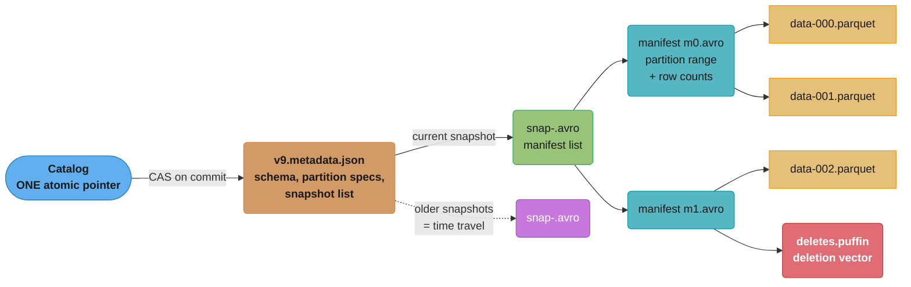
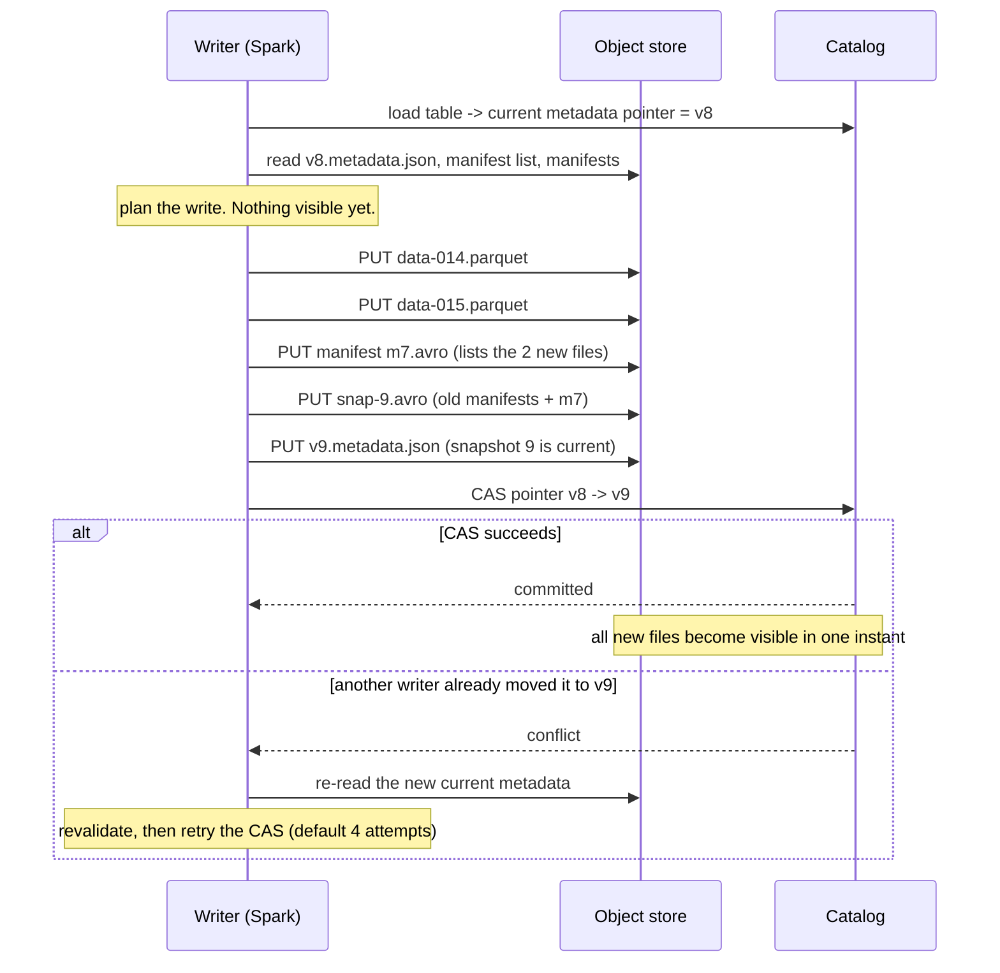

# Lakehouse and Table Formats

> **Version anchor (2026-10-19).** **Apache Iceberg** table spec **v3** is ratified and shipped
> (usable from Iceberg Java **1.10.0**, 11 Sep 2025); the current Java library is **1.12.0**
> (September 2026) and PyIceberg is **0.12.0** (1 Sep 2026). Spec **v4** is in design (milestone open; community
> timeline puts production availability at late 2027 at the earliest). **Delta Lake 4.4.0**
> (20 Aug 2026) is current, pairing with Apache Spark 4.2. **Apache Hudi 1.0** GA'd 16 Dec 2024;
> the current line is **1.2** (1.2.0 on 23 May 2026, 1.2.1 on 24 Sep 2026). **DuckLake 1.0** shipped 13 Apr 2026. **Apache Polaris**
> graduated to an Apache Top-Level Project on 18 Feb 2026. Version-dependent behaviour is tagged
> inline like `[v3]`.
>
> **Scope.** This module owns the **concept**: what a table format is, how ACID works on object
> storage, snapshot isolation and time travel, the metadata layout, the small-file problem, and
> the Iceberg-vs-Delta-vs-Hudi comparison. Iceberg's own spec versions, catalog implementations,
> maintenance procedures and per-engine integrations are the **product** deep dive at
> [Apache Iceberg](../../technologies/apache_iceberg/apache_iceberg.md). The engines that read
> these tables are in
> [Analytical Databases and OLAP](../analytical_databases_and_olap/analytical_databases_and_olap.md);
> the pipeline view — orchestration, ingestion, the ML feature story — is in
> [ML Data Pipelines](../../ml/data_pipelines_and_processing/data_pipelines_and_processing.md).

## 1. Concept Overview

A **table format** is a specification for a set of files in object storage plus the metadata
that turns them into a *table*: a schema, a partition layout, a set of snapshots, and a commit
protocol. It is not a file format — Parquet, ORC and Avro are file formats, and a table format
sits above them.

The problem it solves is precise. Object storage (S3, GCS, Azure Blob) gives you cheap,
effectively infinite, extremely durable bytes and exactly one useful primitive: **atomic
single-object write**. It gives you no transactions, no isolation, no schema, no
`UPDATE`, and — critically — **no atomic multi-file operation**. Before table formats, a
"table" in a data lake was "the set of files under this prefix", which meant:

- A reader listing the prefix mid-write saw a half-written table.
- Deleting a row meant rewriting a directory and hoping nobody read it during the rewrite.
- `LIST` on a prefix with a million objects was the query planner's dominant cost.
- Two writers touching the same partition silently clobbered each other.
- Changing the partitioning scheme meant rewriting and re-pathing everything.

A table format fixes all five with one idea: **the table's identity is a single pointer to a
single immutable metadata file, and every change is an atomic swap of that pointer.**
Everything else — snapshot isolation, time travel, schema evolution, partition evolution,
rollback — falls out of that one mechanism.

A **lakehouse** is the architecture you get when you put a table format over object storage and
point multiple engines at it: warehouse semantics (ACID, schema, `MERGE`, time travel) on lake
economics (object-store pricing, open formats, no vendor holding the bytes).

---

## 2. Intuition

**One-line analogy.** A table is a pointer to a list of files. Committing is changing the
pointer.

**The mental model.** Think of Git. The data files are blobs — immutable, content-addressed by
name, never modified once written. A snapshot is a commit: an immutable object naming exactly
which blobs constitute the table at that instant. The catalog holds the branch ref. Writing
means creating new blobs, writing a new commit that references them, and then
compare-and-swapping the ref from the old commit to the new one. If someone else moved the ref
first, your CAS fails and you rebase — re-read their commit, re-check your changes against it,
and retry.

Every property people find surprising follows directly:

| Property | Why it is free once you have the model |
|---|---|
| Time travel | Old commits still exist. Read one. |
| Rollback | Point the ref at an old commit. |
| Snapshot isolation | A reader resolves the ref once, then reads an immutable commit. |
| Zero-copy clone / branch | A second ref to the same commit. No bytes copied. |
| Schema evolution | The commit carries the schema, and columns are tracked by **id**, not name or position. |
| Partition evolution | The commit records which partition spec each file was written under. |
| The storage bill that never stops growing | Old commits still exist. Nobody deleted the blobs. |

**Why it matters.** This is the mechanism that let "the data lake" stop being a swamp. Without
it, every lake either needed a warehouse copy of everything (double the storage and a pipeline
per consumer) or accepted that its tables were only approximately correct.

**Key insight.** *The atomicity you need from the storage layer is exactly one
compare-and-swap on one small object.* That is the entire trick. Everything expensive
(rewriting a partition, compacting a million small files, deleting rows) happens **before** the
commit, against files nobody can see yet, and becomes visible in a single instant. Which also
means the hard part of a table format is not the data path — it is the **catalog**, because the
catalog is the thing that has to provide that one atomic CAS.

---

## 3. Core Principles

### 3.1 ACID on object storage, mechanism by mechanism

| ACID property | How a table format provides it |
|---|---|
| **Atomicity** | All new files are written first, invisibly. One metadata-pointer swap makes them all visible at once. A crash before the swap leaves orphaned files, never a partial table. |
| **Consistency** | The snapshot names an exact file list; a reader never sees a file set that was not committed. Schema and partition spec travel inside the snapshot. |
| **Isolation** | **Snapshot isolation.** A reader resolves the current snapshot id once and reads only that immutable manifest tree; concurrent commits do not affect it mid-scan. |
| **Durability** | Delegated entirely to the object store (S3 Standard is designed for 11 nines of durability). The format contributes nothing here and needs to contribute nothing. |

Note what is *not* on that list: **serializability across tables**. Almost every catalog gives
single-table atomicity only. Multi-table transactions exist in some catalogs (Nessie's
branching model is the clearest) but are not a property of the table format itself.

### 3.2 Optimistic concurrency, and what "conflict" means

There is no lock. Two writers proceed in parallel and the loser retries:

```
writer A                                writer B
--------                                --------
read current snapshot S0                read current snapshot S0
write new data files                    write new data files
build snapshot S1 (parent S0)           build snapshot S2 (parent S0)
CAS: catalog S0 -> S1  [OK]
                                        CAS: catalog S0 -> S2  [FAILS: ref is S1]
                                        re-read S1
                                        VALIDATE: do my changes still hold?
                                          - pure append  -> yes, always. rebase, retry.
                                          - delete/update -> did S1 touch my files?
                                              no  -> rebase, retry
                                              yes -> genuine conflict, abort
                                        CAS: catalog S1 -> S3  [OK]
```

**The rule this produces:** appends almost never conflict; updates and deletes conflict when
they touch the same data files. So a design with many concurrent appenders and one compactor
is fine, while a design with several concurrent `MERGE` jobs against the same partitions will
thrash. Iceberg retries a commit `commit.retry.num-retries` times (default **4**, with
exponential backoff from 100 ms to 60 s) before surrendering to the caller.

### 3.3 Snapshot isolation and time travel

Every commit produces a new snapshot with an id, a timestamp, a parent, and a summary of what
changed. The table keeps a *history* of them, so both of these work with no extra machinery:

```sql
-- Iceberg, Spark SQL
SELECT * FROM db.events VERSION AS OF 3821550127947089009;
SELECT * FROM db.events TIMESTAMP AS OF '2026-08-01 00:00:00';

-- Delta Lake
SELECT * FROM events VERSION AS OF 412;
SELECT * FROM events TIMESTAMP AS OF '2026-08-01';
```

**Time travel has a retention boundary and it is a cost decision, not a technical one.** Every
retained snapshot pins the data files it references, so they cannot be deleted. Iceberg's
`history.expire.max-snapshot-age-ms` defaults to **432,000,000 ms = 5 days**; extending it to
90 days means holding 90 days of superseded files. This is the most common source of a
lakehouse storage bill that is 4x the size of the live data.

### 3.4 Schema evolution by column ID

The reason schema evolution is safe here and was catastrophic in Hive is one design decision:
**columns are identified by a stable integer id assigned at creation, not by name and not by
position in the file.**

```
Table v1 schema:  1:id(long)  2:name(string)  3:amount(decimal)
  -> parquet file A written with field-ids 1,2,3

RENAME name -> full_name
Table v2 schema:  1:id(long)  2:full_name(string)  3:amount(decimal)
  -> file A is UNCHANGED. Reader maps field-id 2 to full_name. No rewrite.

DROP amount, then ADD a NEW column also called amount
Table v3 schema:  1:id(long)  2:full_name(string)  4:amount(int)
  -> id 3 is retired forever. Old file A's column 3 is simply not projected.
  -> No chance of the old decimal values resurfacing as the new int column.
```

Positional resolution would have re-read the wrong column after a `DROP`; name resolution
would have resurrected dropped data after an add-with-the-same-name. Safe operations are
therefore: add, drop, rename, reorder, and widening type promotions (`int`→`long`,
`float`→`double`, decimal precision increase). Narrowing is not safe and is not allowed.

### 3.5 Partition evolution and hidden partitioning

Hive-style partitioning wrote the partition value into the *path* (`/dt=2026-08-01/`) and
required the query to filter on a synthetic column the user had to know about. Two failures
followed: a query filtering on `event_time` instead of `dt` scanned everything, and changing
the partition granularity meant rewriting every file's path.

Iceberg's **hidden partitioning** records the partition *transform* in metadata
(`days(event_time)`, `bucket(16, user_id)`, `truncate(4, zipcode)`) and stores each file's
partition tuple in the manifest. Two consequences:

- A user filters on `event_time` and pruning happens automatically. There is no `dt` column to
  know about and no way to forget it.
- **Partition evolution is a metadata-only operation.** Change `days(event_time)` to
  `hours(event_time)` and *old files keep their old spec*; new files use the new one. The
  planner applies each file's own spec when pruning. No rewrite, no downtime.

### 3.6 Copy-on-write versus merge-on-read

The single most consequential tuning decision, because it moves cost between the write path
and the read path.

```
A partition holds 100 files x 512 MB.  DELETE 1,000 rows scattered across 40 of them.

COPY-ON-WRITE (CoW)
  rewrite those 40 files without the deleted rows -> 40 new files, 20 GB rewritten
  commit swaps 40 old files for 40 new ones
  WRITE cost: 20 GB rewritten.       READ cost: zero. Files are clean.

MERGE-ON-READ (MoR)
  write a deletion vector per affected file marking the deleted row positions
  40 tiny bitmap blobs, a few KB total
  commit adds the delete files alongside the untouched data files
  WRITE cost: ~kilobytes.            READ cost: every scan must apply 40 delete
                                     vectors, and it compounds with every further delete
                                     until compaction rewrites the files.
```

| | Copy-on-write | Merge-on-read |
|---|---|---|
| Write amplification | very high | very low |
| Read overhead | none | grows with un-compacted deletes |
| Best for | infrequent bulk updates, read-heavy tables | frequent small updates, streaming upserts, CDC |
| Compaction pressure | low | high — it is mandatory, not optional |

Iceberg exposes this per operation: `write.update.mode`, `write.delete.mode` and
`write.merge.mode`, each taking `copy-on-write` or `merge-on-read`. The documented factory
default is `copy-on-write`; engines and platforms commonly override it, so **read the table
properties rather than assuming**. Delta and Hudi expose the same axis under their own names
(Hudi makes it a table *type* — CoW table or MoR table — chosen at creation).

### 3.7 The small-file problem is the defining operational failure

Every write creates files. A streaming job committing every 60 seconds across 200 partitions
creates 288,000 files a day. Cost is **per file**, not per byte:

```
Query planning on a table with N data files must, per scan:
  - read the manifest entries for N files (metadata I/O)
  - for the files that survive pruning, issue >= 1 GET each and read a Parquet footer

1 partition holding 10,000 x 100 KB files  vs  2 x 512 MB files

  GET requests:   10,000 x $0.0004/1000  = $0.004 per full scan
                       2 x $0.0004/1000  = $0.0000008 per full scan
  Footer reads:   10,000 round trips at ~20-50 ms latency each, largely serial per task
                  -> planning alone can take minutes
  Compression:    per-file dictionaries and row groups are tiny, so encoding is far worse
```

At one scan an hour that request cost is trivial; at 50,000 scans a day across thousands of
tables it is a line item, and the *latency* cost is felt on every single query. This is why
compaction (`rewrite_data_files`) is not an optimization you get to later — it is a scheduled
job you run from day one, exactly like ClickHouse's background merges or an LSM-tree's
compaction. Iceberg's `write.target-file-size-bytes` defaults to **512 MB
(536,870,912 bytes)**, which is the size compaction aims at.

---

## 4. Types / Architectures / Strategies

### 4.1 The three-layer stack

```
  QUERY ENGINES     Spark  Flink  Trino  DuckDB  ClickHouse  Snowflake  BigQuery  Athena
        |
  CATALOG           who holds the pointer, and provides the atomic CAS
                    REST catalog (Polaris, Nessie, Lakekeeper, Unity), Glue, Hive metastore
        |
  TABLE FORMAT      Iceberg | Delta Lake | Hudi | Paimon | DuckLake
                    snapshots, manifests, schema, partition spec, delete files
        |
  FILE FORMAT       Parquet (usually), ORC, Avro
        |
  OBJECT STORAGE    S3 / GCS / ADLS / MinIO
```

The layer boundaries are the point. Swap the engine without moving data. Swap the catalog
without rewriting files. That is what "open" buys, and it is the whole argument against a
warehouse whose storage you cannot read from anything else.

### 4.2 Apache Iceberg

Netflix-originated, now the de-facto industry default: every major cloud warehouse reads and
most now write it, and the vendor-neutral governance is a large part of why.

**Spec v3** `[v3]` — ratified and shipped through the 1.8-1.10 releases — is the generation
worth knowing:

- **Deletion vectors** replace positional delete *files*. One compact Roaring bitmap per data
  file, stored in a Puffin blob of type `deletion-vector-v1`, instead of a proliferation of
  small delete files that readers had to merge. This is the change that makes merge-on-read
  practical at scale.
- **Row lineage** — `_row_id` and `_last_updated_sequence_number` maintained by the engine,
  which is what makes efficient incremental/CDC reads possible without a separate change log.
- **Variant type** for semi-structured (JSON-shaped) data with real query support, rather than
  a string column you `json_extract` from.
- **Geometry and geography types.**
- **Default column values**, so adding a non-null column no longer requires a rewrite.

**Position delete files with row data** (a v2 option where each delete also stores a copy of
the deleted row) are no longer written by Iceberg Java 1.12.0 (29 Sep 2026). Existing ones
still read, but `rewrite_position_delete_files` and `rewrite_table_path` fail with
`IllegalArgumentException` on a table that holds them (apache/iceberg PR 17706).

**Spec v4** is in design, targeting metadata efficiency (adaptive metadata trees, single-file
commits). Iceberg Java 1.12.0 ships the first v4 code: a v4 manifest reader (projection and
partition pruning, without content stats or metadata inheritance) and an option to write
manifests in the v4 layout. The spec is not ratified, and community discussion puts production
availability at late 2027 at the earliest, so it is context, not a plan.

### 4.3 Delta Lake

Databricks-originated, open-sourced, and now well past the version most people remember.
**4.4.0** (20 Aug 2026) is current and pairs with Apache Spark 4.2. The 4.0 generation added
**Delta Connect** (Delta operations over the Spark Connect wire protocol), the **Variant**
type, **Type Widening** out of preview, and **Coordinated Commits** — a pluggable commit
protocol that decouples the commit from filesystem semantics, which is Delta's answer to the
same problem an Iceberg REST catalog solves.

Architecturally it differs from Iceberg in one visible way: **the log is a flat, ordered
sequence of JSON files** rather than a manifest tree.

```
_delta_log/
  00000000000000000000.json      commit 0: metaData, protocol, add(file)...
  00000000000000000001.json      commit 1: add(...), remove(...)
  ...
  00000000000000000010.checkpoint.parquet   every 10 commits by default
  00000000000000000010.json
  _last_checkpoint                          points at the newest checkpoint
```

A reader takes the latest checkpoint and replays the JSON commits after it. That is simpler
than Iceberg's manifest tree and reads slightly faster for small tables; the manifest tree
scales better for very large ones, because Iceberg can prune whole manifests by partition
range without reading their contents.

**Liquid Clustering** (from the 3.x line, matured through 4.x) is Delta's replacement for
hive-style partitioning plus Z-ordering: you declare clustering columns and the engine
maintains the layout incrementally, avoiding the "we partitioned by the wrong column and now
must rewrite everything" failure.

**Delta UniForm** writes Iceberg (and via XTable, Hudi) metadata *alongside* the Delta log for
the same physical Parquet files, so an Iceberg reader can consume a Delta table without a
copy. The limitation to state plainly: it is **read-oriented and one-directional** — Delta is
the source format and the write path stays Delta. It is not bidirectional interoperability.

### 4.4 Apache Hudi

Uber-originated and the oldest of the three, built from the start around *upserts* and
incremental processing rather than around append-mostly analytics. **1.0** GA'd 16 Dec 2024.
**1.2.0** (23 May 2026) added `VECTOR`, `VARIANT` and `BLOB` logical types, a
`hudi_vector_search()` Spark table-valued function for k-nearest-neighbour search over a Hudi
table, and Lance as a base-file format alongside Parquet, ORC and HFile (Spark only).

Distinctive properties:

- **CoW and MoR are table types**, chosen at creation, not per-operation modes.
- A **record-level index** maps a record key to the file group that holds it, so an upsert
  knows where to write without scanning. This is why Hudi is faster at high-frequency upserts
  and why it carries more metadata than the other two.
- **Non-blocking concurrency control (NBCC)** `[1.0]` allows concurrent writers to the same
  file group without one aborting, resolving at merge time — a genuinely different answer from
  Iceberg's and Delta's optimistic-abort model.
- **LSM timeline** `[1.0]` restructures the commit timeline itself as an LSM tree so metadata
  scales past the flat-timeline limits of Hudi 0.x.
- **Secondary and expression indexes** `[1.0]`.

Choose Hudi when the workload is genuinely mutation-heavy — a CDC mirror of an OLTP database
with millions of updates an hour. Choose Iceberg or Delta when it is append-mostly analytics,
which is the more common case and is why they have more mindshare.

### 4.5 DuckLake — the interesting inversion

**DuckLake 1.0** (13 Apr 2026, from DuckDB Labs) makes one observation and follows it all the
way: if you need a transactional system to hold the catalog pointer anyway, why keep the rest
of the metadata as a tree of JSON and Avro files in object storage? Put **all** the metadata —
schema, snapshots, statistics, file lists — in a real SQL database (Postgres, MySQL, SQLite,
DuckDB), and keep only the Parquet data files in object storage.

What that buys: a commit becomes one SQL transaction instead of a CAS plus a manifest rewrite;
multi-table and multi-statement transactions become natural; planning a query becomes a SQL
query against indexed metadata rather than reading a manifest tree over the network; and small
changes stop generating metadata files. 1.0 added data inlining (tiny writes go into the
catalog directly, avoiding a file per commit), sorted tables, bucket partitioning, geometry
types, and Iceberg-compatible deletion vectors.

What it costs: the catalog database is now a component you operate, scale and back up, and it
is a hard dependency of every read. That is exactly the tradeoff Iceberg's file-based metadata
was designed to avoid. It is a real position in the design space rather than a strict
improvement.

### 4.6 The catalog tier — the part that actually decides your architecture

The catalog is where the atomic CAS lives, so it decides what concurrency guarantees you have.

| Catalog | What it is | Atomicity | Notes |
|---|---|---|---|
| **Hive Metastore** | the legacy default | single-table, via an RDBMS transaction on `metadata_location` | works, but drags a Thrift service and a schema nobody wants |
| **AWS Glue Data Catalog** | AWS's managed metastore | single-table pointer swap | does **not** implement the Iceberg REST spec; AWS-native integration |
| **Amazon S3 Tables** | Iceberg tables as a first-class S3 resource (GA Dec 2024) | managed | S3 runs compaction and snapshot expiry for you; an S3-integrated Iceberg REST endpoint |
| **Iceberg REST Catalog** | an OpenAPI spec, not a product | server-side atomic commit | the de-facto standard interface; the reason engines are portable |
| **Apache Polaris** | Snowflake-donated REST catalog, **Apache TLP since 18 Feb 2026** | server-side | vendor-neutral governance, RBAC, credential vending |
| **Unity Catalog OSS** | Databricks-donated, at LF AI & Data | server-side | governance across tables, files, models and functions |
| **Project Nessie** | Git-like catalog | server-side, **plus cross-table transactions** | branches, tags, merges over the whole catalog — the only common way to get multi-table atomicity |
| **Lakekeeper** | Rust-native Apache-2.0 REST catalog | server-side | lightweight, built on `iceberg-rust` |
| **Hadoop/filesystem catalog** | pointer via file rename | atomic **only on HDFS** | **not safe for concurrent writers on S3.** Fine for a single-writer test, dangerous in production |

That last row is the one that bites people: a `HadoopCatalog` on S3 looks like it works right
up until two writers commit at once and one silently loses its snapshot.

---

## 5. Architecture Diagrams

### 5.1 The Iceberg metadata tree



*Four levels, and pruning happens at every one: the snapshot names manifests, each manifest
carries the partition range and column statistics of the files it lists, so a query can
eliminate whole manifests without opening them and then whole files without reading them.*

### 5.2 A commit, step by step



*Everything expensive happens before the CAS, against files no reader can see. The only
operation that needs to be atomic is the final pointer swap on one small object.*

### 5.3 Copy-on-write versus merge-on-read, drawn

This one stays ASCII: the column alignment carries the cost comparison.

```
DELETE 1,000 rows scattered across 40 of a partition's 100 x 512 MB files

COPY-ON-WRITE
  before  [F01][F02][F03][F04] ... [F100]          100 files, 51.2 GB
  write   [N01]     [N03][N04]                      40 files rewritten, 20.5 GB written
  after   [N01][F02][N03][N04] ... [F100]          100 files, still clean
          |---------------------------------|
          write cost: 20.5 GB     read cost: 0

MERGE-ON-READ
  before  [F01][F02][F03][F04] ... [F100]          100 files, 51.2 GB
  write    dv1       dv3  dv4                       40 deletion vectors, ~12 KB written
  after   [F01][F02][F03][F04] ... [F100]          data files untouched
           dv1       dv3  dv4
          |---------------------------------|
          write cost: 12 KB       read cost: apply 40 bitmaps on EVERY scan

  ... and after 30 more delete batches, if nothing compacts:
          [F01][F02][F03][F04] ... [F100]
           dv1  dv2  dv3  dv4                       up to 100 vectors to apply per scan
          write cost still ~0     read cost now dominates the query

  Compaction is what closes the loop: rewrite_data_files folds the vectors
  into new clean files, paying the CoW cost ONCE for 31 batches of deletes
  instead of 31 times.
```

*Merge-on-read does not remove the rewrite cost — it defers and amortizes it. A MoR table with
no compaction schedule is a table whose read latency grows without bound.*

### 5.4 Where the time goes in query planning

```
Query: SELECT sum(amount) FROM events WHERE event_date = '2026-08-01' AND org = 'B'
Table: 5 years, daily partitions, 400,000 data files total

  step                        files considered    what eliminates them
  --------------------------  ----------------    -------------------------------
  1. read metadata.json                    -      1 GET, ~50 KB
  2. read manifest list             400,000      names ~60 manifests
  3. prune manifests by                          each manifest carries the min/max
     partition range                 ~6,600      of its files' partition tuples
                                                 -> read 1 manifest, skip 59
  4. prune files by manifest                     per-file partition tuple
     entry partition value              110      -> exactly one day's files
  5. prune files by column                       per-file min/max on `org`
     statistics                          14      -> only files that can hold org B
  6. read data                            14      14 GETs. THIS is the only I/O
                                                 proportional to data size.

  Without step 3 (a flat file list, or one giant manifest), step 4 reads
  metadata for all 400,000 files on every single query.
```

*This is why the manifest tree exists and why partition ranges are stored on the manifest, not
only on the file. A format that skips level 3 works fine at 4,000 files and falls over at
400,000.*

---

## 6. How It Works — Detailed Mechanics

### 6.1 The files, named exactly

```
s3://bucket/warehouse/db/events/
  metadata/
    00009-4a1c....metadata.json        table metadata: schema(s), partition spec(s),
                                       snapshot log, current-snapshot-id, properties
    snap-3821550127947089009-1-9f2....avro    manifest LIST for one snapshot
    9f2c....-m0.avro                   manifest: one row per data file, with
                                       partition tuple, record count, column
                                       lower/upper bounds, null counts
    20260801-deletes.puffin            Puffin blob container: deletion vectors
                                       (blob type deletion-vector-v1), NDV sketches
  data/
    event_date=2026-08-01/
      00000-1-9f2c....parquet
      00001-1-9f2c....parquet
```

The column statistics in the manifest are the load-bearing part: `lower_bound` and
`upper_bound` per column per file are what let step 5 of §5.4 eliminate 96 of 110 files without
opening one of them. A file written by a job that shuffled its rows randomly has bounds
spanning the whole domain and prunes nothing — which is why **sortedness within files is a
performance property you have to maintain deliberately**, exactly as it is for a ClickHouse
sort key.

### 6.2 A `MERGE`, walked end to end

```sql
-- Iceberg on Spark. Upsert a CDC batch into the fact table.
MERGE INTO db.events t
USING staged_changes s
ON t.event_id = s.event_id
WHEN MATCHED AND s.op = 'D' THEN DELETE
WHEN MATCHED               THEN UPDATE SET *
WHEN NOT MATCHED           THEN INSERT *;
```

What the engine actually does, in merge-on-read mode:

1. Read the current snapshot. Plan a join of `staged_changes` against `events`, pruned by
   partition and by the manifest column bounds on `event_id`.
2. For each matched row, determine `(data_file, row_position)`.
3. Group those positions by data file and build one **deletion vector** per touched file — a
   Roaring bitmap of deleted row positions, written into a Puffin blob `[v3]`.
4. Write the new and updated rows as brand-new Parquet data files.
5. Write a manifest listing the new data files and the new delete files, then a manifest list,
   then a metadata file.
6. CAS the catalog pointer. If it fails, re-read, check whether the competing commit touched
   any of *my* data files, and either retry or abort.

In copy-on-write mode, step 3 is replaced by "rewrite each touched data file entirely, without
the deleted rows, merging in the updates" — which is why CoW `MERGE` cost is proportional to
the size of the touched files, not to the number of changed rows.

**Broken → fixed: the streaming commit that kills the table.**

```python
# BROKEN — commits per micro-batch, no compaction, no expiry.
# Looks perfect for a week. Unusable in a month.
(spark.readStream.format("kafka").load()
   .writeStream
   .format("iceberg")
   .outputMode("append")
   .trigger(processingTime="10 seconds")     # 8,640 commits/day
   .option("checkpointLocation", CKPT)
   .toTable("db.events"))
# 200 partitions x 8,640 commits/day = up to 1.7M tiny files/day.
# Query planning goes from 2s to 4 minutes. Snapshot count hits 8,640/day
# and nothing is expirable because retention was never configured.

# FIXED — three changes: a sane trigger, a compaction job, and expiry.
(spark.readStream.format("kafka").load()
   .writeStream
   .format("iceberg")
   .outputMode("append")
   .trigger(processingTime="5 minutes")      # 288 commits/day, 30x fewer files
   .option("fanout-enabled", "false")        # sort by partition before write:
                                             # one open writer at a time, not 200
   .option("checkpointLocation", CKPT)
   .toTable("db.events"))
```

```sql
-- and, on a schedule (hourly compaction, daily expiry):
CALL catalog.system.rewrite_data_files(
  table => 'db.events',
  strategy => 'sort',
  sort_order => 'org_id ASC, event_time ASC',
  options => map('min-input-files','20','target-file-size-bytes','536870912')
);

CALL catalog.system.rewrite_manifests(table => 'db.events');

CALL catalog.system.expire_snapshots(
  table => 'db.events',
  older_than => TIMESTAMP '2026-08-19 00:00:00',   -- 7-day time-travel window
  retain_last => 10
);

CALL catalog.system.remove_orphan_files(
  table => 'db.events',
  older_than => TIMESTAMP '2026-08-19 00:00:00'
);
```

Note the ordering dependency, which is a real trap: `remove_orphan_files` deletes files not
referenced by **any live snapshot**, so running it *before* `expire_snapshots` deletes almost
nothing, and running it with a cutoff younger than an in-flight write can delete files a
running job is about to commit. Always use a cutoff older than your longest-running write job.

### 6.3 Compaction economics, walked

```
Table: 2 TB in a partition, arriving as 60 KB files from a streaming job.

  File count:        2 TB / 60 KB           = 33,300,000 files
  After compaction:  2 TB / 512 MB          = 4,000 files      (8,300x fewer)

Per full scan, request cost alone (S3 Standard, us-east-1 list prices:
GET $0.0004/1,000, LIST $0.005/1,000):

  before:  33.3M GETs   x $0.0004/1000      = $13.32 per scan
  after:    4,000 GETs  x $0.0004/1000      = $0.0016 per scan
  At 500 scans/day:  $6,660/day   ->   $0.80/day

Compaction's own cost, run once:
  read 2 TB + write 2 TB through a Spark cluster.
  On ~10 nodes at ~200 MB/s aggregate useful throughput: ~3 hours of cluster time.
  Paid ONCE. It pays for itself in under an hour of the query load above.
```

The latency effect is larger than the money effect and is what users actually notice: 33
million footer reads cannot be parallelized away, so planning takes minutes before a single
byte of data is read.

### 6.4 Interoperability: what actually converged, and what did not

The 2025-2026 story is convergence, and it is worth being precise about how far it goes,
because "Iceberg and Delta are compatible now" is repeated more confidently than it is true.

- **Deletion-vector encoding converged.** Both Delta and Iceberg v3 use Roaring bitmaps, and
  Iceberg's Puffin blob deliberately chose a big-endian serialization compatible with Delta's
  existing format. **But the containers differ**: Delta writes its own `.bin` files (one file
  can cover several data files); Iceberg writes Puffin files with Puffin's magic bytes, blob
  metadata and checksums. The *bitmaps* are interchangeable; the *files* are not. Do not tell
  an interviewer they are drop-in compatible.
- **Delta UniForm** publishes Iceberg metadata for a Delta table, one-directionally.
- **Hudi** ships an Iceberg-compatibility path, and **Apache XTable** (formerly OneTable)
  translates metadata omni-directionally across all three without moving data.
- **Variant** as a semi-structured type landed in both Iceberg v3 and Delta 4.0.

The honest summary: the *formats* are converging on the same ideas fast, and the *catalog*
layer is where the remaining lock-in lives. Which is precisely why the catalog fight (Polaris
versus Unity versus Glue versus a REST implementation you run yourself) got loud.

### 6.5 Engine support, as of August 2026

| Engine | Iceberg read | Iceberg write |
|---|---|---|
| Apache Spark | yes | yes, full DML, the reference implementation; Iceberg 1.12.0 dropped the Spark 3.4 runtime |
| Apache Flink | yes | yes, streaming sink; Iceberg 1.12.0 ships Flink 1.20, 2.1, 2.2 and 2.3 runtimes (2.0 dropped) |
| Trino / Presto | yes | yes — `MERGE`, `UPDATE`, `DELETE` |
| DuckDB | yes | yes — `INSERT` from `[1.4]`, `UPDATE`/`DELETE` from `[1.4.2]`, `MERGE INTO` and v3 from `[1.5.3]` |
| ClickHouse | yes | append only, and immature |
| Snowflake | yes | yes for Snowflake-managed Iceberg tables |
| BigQuery / BigLake | yes | yes — GA, DML plus high-throughput streaming |
| Amazon Redshift | yes | yes — writes GA Nov 2025, `UPDATE`/`DELETE`/`MERGE` from Apr 2026 |
| Amazon Athena | yes | yes — `INSERT`/`UPDATE`/`DELETE`/`MERGE INTO`, merge-on-read via position deletes |
| Dremio | yes | yes |
| StarRocks | yes | `INSERT` / `INSERT OVERWRITE`; no `UPDATE`/`DELETE`/`MERGE INTO` |

The pattern to notice: **read support is universal and write support is where engines differ**,
because writing means implementing the commit protocol and the conflict rules correctly. A
design that assumes "any engine can write this table" is usually wrong; a design that assumes
"any engine can read it" is usually right.

---

## 7. Real-World Examples

- **Netflix** created Iceberg to fix exactly the Hive failures in §1, and runs it at a scale
  that is the standing existence proof: roughly 2 trillion events a day ingested, single-digit
  petabytes moving daily, hundreds of petabytes at rest, with trillion-row analytical systems
  built on top.
- **Uber** created Hudi, and their published numbers are the clearest picture of a
  mutation-heavy lakehouse: **19,500 Hudi datasets, 350 logical PB, 10 PB ingested per day, 6
  trillion rows per day, around 3 million new files per day.** That last figure is the small-file
  problem stated as a rate, and it is why Hudi's compaction and clustering machinery is as
  developed as it is.
- **Pinterest** migrated a **500 PB** lake from Hive to Iceberg and published the outcome at
  re:Invent 2025: roughly **30% cost reduction on user-deletion workloads**, a **90% speedup on
  ML sampling**, and **65% cost savings with a 90x faster development loop on feature
  backfills.** They standardized on **merge-on-read over copy-on-write specifically for cost** —
  a direct, sourced instance of the §3.6 tradeoff being resolved in production.
- **Adobe Experience Platform** runs petabytes of Iceberg on ADLS with millions of batches a
  day, and published a benchmark ingesting roughly **200,000 small files an hour into a single
  Iceberg table** — useful precisely because it is the pathological case, and it shows where the
  metadata layer starts to strain.
- **Robinhood** runs a multi-petabyte lakehouse with **over 50,000 datasets** — on **Hudi**,
  not Iceberg. Worth knowing as a correction to the assumption that every large lakehouse is
  Iceberg.
- **Expedia** reports roughly **45-70% execution-time and cost savings** on join-heavy Spark
  workloads by using Iceberg's storage-partitioned joins — the payoff for having the partition
  transform in metadata where the optimizer can see it.

---

## 8. Tradeoffs

### The three formats, head to head

| | Iceberg | Delta Lake | Hudi |
|---|---|---|---|
| Origin / governance | Netflix, Apache, vendor-neutral | Databricks, Linux Foundation | Uber, Apache |
| Metadata shape | manifest tree (metadata → list → manifests) | flat ordered JSON log + checkpoints | LSM timeline + record index |
| CoW / MoR | per-operation table property | per-operation, `deletionVectors` | table **type**, fixed at creation |
| Partitioning | hidden partitioning + partition evolution | Liquid Clustering (or hive-style) | hive-style + clustering |
| Upsert performance | good `[v3]` | good | **best** — record-level index |
| Incremental reads | row lineage `[v3]` | change data feed | native, the original design goal |
| Engine breadth | **widest** | wide, Spark-centric heritage | narrower |
| Concurrency | optimistic, abort on conflict | optimistic, abort on conflict | **NBCC** — non-blocking `[1.0]` |
| Best fit | the default: broad engine access, append-mostly analytics | Databricks-centric, or already Delta | mutation-heavy CDC mirrors |

### Lakehouse versus warehouse

| Axis | Lakehouse | Cloud warehouse |
|---|---|---|
| Storage cost | object-store rate (~$0.023/GB-mo S3 Standard) | vendor rate, usually higher |
| Who can read the bytes | any engine that speaks the format | the vendor's engine |
| Query latency, small queries | higher — planning reads metadata over the network | lower — everything is local and warm |
| Concurrency | as much compute as you provision | elastic, metered |
| Operational burden | **you own compaction, expiry, orphan cleanup** | none |
| Governance / RBAC | catalog-dependent, still maturing | mature, integrated |
| Lock-in | low | high |
| Cost predictability | storage predictable, compute is yours | metered and can surprise |

The row that decides most real arguments is the operational one. A lakehouse is not "a
warehouse but cheaper" — it is a warehouse where you have taken on the vacuum, the compaction
and the retention policy as your own scheduled jobs. Teams that skip that work do not get a
cheap warehouse; they get a slow, expensive lake with ACID semantics.

---

## 9. When to Use / When NOT to Use

**Use a lakehouse table format when:**

- More than one engine must read the same data — Spark for ETL, Trino for ad-hoc, DuckDB for
  local analysis, a warehouse for BI. This is the strongest single reason, and it is
  structural rather than a preference.
- The data volume makes warehouse storage pricing the dominant line item.
- You need time travel, rollback or reproducible reads over historical data — ML training-set
  reproducibility is the case that keeps coming up.
- Retention is long and most of the data is cold: object storage is the right home for bytes
  nobody has read in a year.
- Avoiding vendor lock-in on the *storage* is an explicit requirement.

**Do NOT use one when:**

- The workload is OLTP. This should not need saying, but "we'll put the transactional data in
  Iceberg" gets proposed. Commit latency is hundreds of milliseconds to seconds, there are no
  point-lookup indexes, and concurrency is optimistic-with-abort.
- Query latency must be consistently sub-second at high concurrency. Metadata planning over
  object storage costs real milliseconds every time; a real-time OLAP engine with local
  storage will beat it. See
  [Analytical Databases and OLAP](../analytical_databases_and_olap/analytical_databases_and_olap.md).
- The dataset is small. Under a terabyte with one engine, DuckDB over plain Parquet — or a
  Postgres table — is less machinery for the same answer.
- Nobody will own the maintenance. A lakehouse without a compaction and expiry schedule
  degrades on a predictable curve. If there is no team to run those jobs, take the warehouse.
- You need cross-table transactions and cannot adopt a catalog that provides them. Single-table
  atomicity is what most catalogs give you.

**A warehouse still wins when** the consumers are all BI tools and analysts, governance and
row/column-level security matter more than storage cost, query latency at concurrency is the
product, and the team's headcount is better spent on models than on compaction jobs.

---

## 10. Common Pitfalls

**Pitfall 1 — streaming commits with no compaction schedule.** The §6.2 broken example. A
10-second trigger across 200 partitions can produce over a million files a day; query planning
degrades from seconds to minutes, and the object-store request bill becomes visible in the
monthly invoice before anyone connects it to the table. *War story shape:* a team's hourly
dashboard went from 4 seconds to 6 minutes over six weeks with no code change and no data-volume
change — the table had accumulated 41 million files. Compaction fixed it in one afternoon; the
diagnosis took three days because every metric they looked at (CPU, memory, network throughput)
was healthy. **The file count is the metric. Dashboard it.**

**Pitfall 2 — never expiring snapshots.** Old snapshots pin their data files, so the storage
bill grows with *churn*, not with live data. A table that is rewritten daily by compaction and
retains 365 days of snapshots stores roughly 365 copies of itself. *War story shape:* a 12 TB
logical table billed as 47 TB; the fix was `expire_snapshots` with a 7-day window, which
returned 35 TB and cost one query. Nobody had chosen a 365-day time-travel window — it was the
absence of a choice.

**Pitfall 3 — `remove_orphan_files` deleting live data.** It removes files not referenced by
any live snapshot, using a timestamp cutoff. Run it with a cutoff younger than an in-flight
write and it deletes files a running job is about to commit, producing a table that references
files that no longer exist — the one failure in this whole system that is not recoverable by
rolling back a snapshot. **Always use a cutoff older than your longest-running write job, and
never shorten it to "clean up faster".**

**Pitfall 4 — concurrent writers fighting over the same partitions.** Optimistic concurrency
means the loser retries, and retries have a bounded count (Iceberg's default is 4). Several
`MERGE` jobs against the same partitions will exhaust retries and fail the job, and adding
retries makes it slower rather than more correct. Partition the *work*, not just the table: one
writer per partition range, or a single serialized compaction lane.

**Pitfall 5 — merge-on-read without compaction.** MoR makes writes cheap by making reads pay
later. Skip compaction and read latency grows monotonically as deletion vectors accumulate — a
degradation that is invisible in any write-side metric. If you choose MoR, the compaction
schedule is part of the choice, not a follow-up ticket.

**Pitfall 6 — a filesystem catalog on S3.** `HadoopCatalog` depends on atomic rename, which
HDFS has and S3 does not. It works in development with one writer and silently loses commits
under concurrency. Use a REST catalog, Glue, or a metastore.

**Pitfall 7 — assuming file-level Delta/Iceberg interoperability.** The deletion-vector
*bitmap* encodings converged; the *container* formats did not (Delta `.bin`, Iceberg Puffin).
UniForm is read-oriented and one-directional. Plan interop through UniForm or XTable
deliberately, not by assuming a reader will just cope.

**Pitfall 8 — unsorted writes destroying file-level pruning.** Manifest column bounds only
prune when a file's values are narrow. A job that writes randomly-ordered rows produces files
whose `min`/`max` span the whole domain, so step 5 of §5.4 eliminates nothing and every query
reads every file in the partition. Sort on write, or sort during compaction with
`strategy => 'sort'`.

**Pitfall 9 — `fanout-enabled` with many partitions.** With fanout enabled a writer keeps an
open file handle and buffer per partition; across 200 partitions per task that is 200 open
writers and an OOM. Sorting by partition before writing lets each task hold one writer at a
time. This is the same "sort before you write" discipline as the previous pitfall, arriving as
a memory error instead of a latency one.

---

## 11. Technologies & Tools

| Tool | Purpose |
|------|---------|
| Apache Iceberg | Table format; hidden partitioning, partition evolution, spec v3 deletion vectors and row lineage |
| Delta Lake | Table format; ordered JSON transaction log, Liquid Clustering, UniForm, Coordinated Commits |
| Apache Hudi | Table format; record-level index, non-blocking concurrency control, LSM timeline, upsert-first |
| Apache Paimon | LSM-tree-based lake format for streaming updates, Flink-native |
| DuckLake | Lake format keeping all metadata in a SQL catalog rather than in object-store files |
| Apache Parquet | Columnar file format underneath all of the above; row groups, page statistics, bloom filters |
| Apache Avro | Row-oriented format used for Iceberg manifests and manifest lists |
| Apache Puffin | Iceberg's blob container for deletion vectors and statistics sketches |
| Apache Polaris | Vendor-neutral Iceberg REST catalog; Apache Top-Level Project |
| Unity Catalog | Open-sourced Databricks catalog for tables, files, models and functions |
| Project Nessie | Git-like catalog with branches, tags and cross-table transactions |
| Lakekeeper | Rust-native Apache-2.0 Iceberg REST catalog |
| AWS Glue Data Catalog | AWS-managed metastore backing Athena, EMR and Redshift Spectrum |
| Amazon S3 Tables | Iceberg tables as a first-class S3 resource with managed compaction and expiry |
| Apache Spark | Reference read/write engine for all three formats; hosts the maintenance procedures |
| Apache Flink | Streaming ingestion into lakehouse tables |
| Trino | Federated MPP engine; full Iceberg DML |
| Apache XTable | Omni-directional metadata translation between Iceberg, Delta and Hudi |
| dbt | SQL transformation and testing framework, commonly targeting lakehouse tables |

---

## 12. Interview Questions with Answers

**Q: What problem does a table format solve that object storage alone does not?**
**Short:** Object storage gives atomic single-object writes but no atomic multi-file operation, which is exactly what a table needs.

S3 and its peers offer durable bytes and one useful guarantee: a single object write either
happens or does not. A table is inherently many files, so every real table operation — appending
a partition, rewriting files after a delete, compacting — is a multi-file change that object
storage cannot make atomic. Before table formats, a "table" was "the files under this prefix",
which meant a reader listing mid-write saw a torn table, two writers silently clobbered each
other, `LIST` on a million objects dominated planning, and changing the partitioning meant
rewriting every path. A table format collapses all of that to one mechanism: the table is a
single pointer to a single immutable metadata file, and a commit is an atomic compare-and-swap
of that pointer. Snapshot isolation, time travel, rollback, schema evolution and partition
evolution all fall out of that one primitive rather than each needing its own machinery.

**Q: Explain copy-on-write versus merge-on-read and when you would choose each.**
**Short:** Copy-on-write rewrites touched files at write time so reads stay clean; merge-on-read writes tiny delete markers and makes every subsequent read pay.

Deleting 1,000 rows scattered across 40 of a partition's 512 MB files costs, under
copy-on-write, a rewrite of those 40 files — about 20 GB written — after which readers see clean
files with zero overhead. Under merge-on-read the same delete writes 40 deletion vectors, a few
kilobytes total, and every scan afterwards must apply those bitmaps; the overhead compounds with
each further delete batch until compaction folds them in. Choose copy-on-write for read-heavy
tables with infrequent bulk updates, and merge-on-read for streaming upserts and CDC mirrors
where write amplification would otherwise be ruinous. The decisive caveat is that merge-on-read
does not remove the rewrite cost, it defers and amortizes it — so choosing MoR means committing
to a compaction schedule in the same breath, and a MoR table with no compaction has read latency
that grows without bound.

**Q: How does a commit work, and what happens when two writers commit at once?**
**Short:** Both write their files invisibly, then race on a compare-and-swap of the catalog pointer; the loser re-reads, revalidates and retries.

A writer loads the current metadata pointer, writes its new data files, manifests, manifest list
and metadata file into object storage — none of which any reader can see, because nothing points
at them — and then compare-and-swaps the catalog pointer from the version it read to the new
one. If another writer moved the pointer first, the CAS fails and the writer re-reads the new
current state and revalidates: a pure append is always still valid so it simply rebases and
retries, while a delete or update must check whether the competing commit touched the same data
files, retrying if not and aborting if so. Iceberg retries four times by default with
exponential backoff. The practical consequence is that many concurrent appenders coexist
happily, while several concurrent `MERGE` jobs against the same partitions exhaust their retries
and fail — so you partition the *work*, not just the table.

**Q: What is the small-file problem and why is compaction not optional?**
**Short:** Query cost is per file, not per byte, so a streaming writer producing millions of tiny files makes planning dominate every query.

A job committing every ten seconds across 200 partitions creates up to 1.7 million files a day.
Every scan must read a manifest entry per file and issue at least one GET plus a Parquet footer
read per surviving file, and those footer reads are latency-bound round trips that cannot be
parallelized away. A 2 TB partition arriving as 60 KB files is 33 million files; compacted to
Iceberg's 512 MB target it is 4,000. At S3's list price of $0.0004 per thousand GETs that is
$13.32 versus $0.0016 in request cost per full scan, and at 500 scans a day the difference is
thousands of dollars — but the reason anyone notices is that planning went from seconds to
minutes. Compaction (`rewrite_data_files`) is a scheduled job you run from day one, exactly like
background merges in a MergeTree or compaction in an LSM store; it is the same problem in a
different container.

**Q: Why do lakehouse storage bills grow far past the size of the live data?**
**Short:** Every retained snapshot pins the data files it references, so churn — not live size — drives storage, until snapshots are expired.

Snapshots are immutable and the files they name cannot be deleted while they are retained.
A table rewritten daily by compaction that retains a year of snapshots is storing roughly a
year of copies of itself, so a 12 TB logical table can bill as 47 TB. Iceberg's
`history.expire.max-snapshot-age-ms` defaults to five days, which is a sane starting point, but
platforms and pipelines override it and the override is usually never revisited — the long
retention is typically the *absence* of a decision rather than a decision. The fix is
`expire_snapshots` on a schedule with an explicitly chosen time-travel window, followed by
`remove_orphan_files` to clean up files left behind by failed commits. Note the ordering: orphan
removal before expiry finds almost nothing, because expiry is what un-pins the files.

**Q: How can Iceberg rename a column without rewriting any data?**
**Short:** Columns are identified by a stable integer ID stored in both the metadata and the Parquet files, so a name change is metadata-only.

Every column gets an ID at creation, and the data files carry those IDs as Parquet field IDs. A
rename changes the name in the table schema while the ID is untouched, so existing files are
read exactly as before with the reader mapping ID 2 to whatever the current name is. The same
mechanism prevents the two disasters that positional and name-based resolution cause: with
positional resolution, dropping a column shifts every column after it and a reader silently
returns the wrong data; with name-based resolution, dropping `amount` and later adding a new
column also called `amount` resurrects the old values under the new column. Because IDs are
retired permanently, neither can happen. Safe evolutions are add, drop, rename, reorder and
widening promotions such as int to long; narrowing is rejected because it cannot be done without
data loss.

**Q: What is hidden partitioning and what does partition evolution actually cost?**
**Short:** The partition transform lives in metadata rather than in the path, so users filter on the real column and changing the scheme is metadata-only.

Hive wrote the partition value into the directory path and required queries to filter on a
synthetic column such as `dt`; a query filtering on the real `event_time` column scanned
everything, and users had to know a schema detail that had nothing to do with their question.
Iceberg instead records the transform — `days(event_time)`, `bucket(16, user_id)`,
`truncate(4, zip)` — in the partition spec and stores each file's partition tuple in the
manifest, so filtering on `event_time` prunes automatically and there is nothing to forget.
Partition evolution then costs nothing: change `days` to `hours` and existing files keep the
spec they were written under while new files use the new one, with the planner applying each
file's own spec during pruning. Contrast that with Hive, where changing granularity meant
rewriting and re-pathing every file — which is why so many Hive tables were partitioned wrongly
forever.

**Q: Iceberg, Delta Lake or Hudi — how do you actually choose?**
**Short:** Iceberg for the broadest engine access, Delta if you are Databricks-centric, Hudi when the workload is genuinely mutation-heavy.

All three now provide ACID, time travel, schema evolution and both CoW and MoR, so a feature
checklist no longer separates them. Iceberg has the widest engine support and vendor-neutral
Apache governance, which is why it has become the default when several engines must read the
same data. Delta has a flat ordered JSON log rather than a manifest tree, is simpler and
slightly faster to plan on small tables, and is the natural choice inside a Databricks estate;
Liquid Clustering is a genuine advantage over having to pick partition columns correctly up
front. Hudi is the specialist: a record-level index that makes an upsert know which file group
to write without scanning, and non-blocking concurrency control that lets concurrent writers
into the same file group instead of aborting one. If the table is a CDC mirror of an OLTP
database taking millions of updates an hour, that is worth real money; if it is append-mostly
analytics, it is machinery you pay for and do not use.

**Q: Are Iceberg and Delta deletion vectors compatible?**
**Short:** The bitmap encodings converged deliberately, but the container files did not — Delta uses its own .bin files and Iceberg uses Puffin.

Both use Roaring bitmaps, and Iceberg's Puffin `deletion-vector-v1` blob chose a big-endian
serialization specifically for compatibility with Delta's existing format, so the *bitmap
payload* is genuinely interchangeable. The files are not: Delta writes `.bin` files where a
single file can cover several data files, while Iceberg writes Puffin containers with their own
magic bytes, blob metadata and checksums. Saying they are drop-in compatible is the kind of
one-word-off claim that inverts an architecture decision. Real interoperability today comes from
Delta UniForm, which publishes Iceberg metadata for a Delta table but is read-oriented and
one-directional with Delta remaining the write path, or from Apache XTable, which translates
metadata omni-directionally without moving data. The broader point is that the formats are
converging fast and the remaining lock-in has moved up a layer, into the catalog.

**Q: Why is the catalog the most important choice in a lakehouse, more than the format?**
**Short:** The catalog provides the atomic compare-and-swap the whole commit protocol depends on, so it decides your concurrency guarantees.

The format defines the file layout; the catalog defines what "commit" means, and the entire
ACID story reduces to one atomic pointer swap that the catalog must provide. That makes the
catalog the component that determines whether concurrent writers are safe, whether you get
cross-table transactions, how authorization and credential vending work, and which engines can
participate. A Hadoop or filesystem catalog on S3 is the cautionary case: it depends on atomic
rename, which HDFS has and S3 does not, so it appears to work with one writer and silently loses
commits under concurrency. The REST catalog specification is what made engines portable, and the
implementations differ in what they add above it — Polaris for vendor-neutral RBAC and
credential vending, Unity Catalog for governance across tables, files and models, Nessie for
Git-style branching and the cross-table transactions almost nobody else offers, Lakekeeper for a
lightweight self-hosted option.

**Q: When would you keep a cloud warehouse instead of moving to a lakehouse?**
**Short:** When the consumers are all BI users, governance and low-latency concurrency matter more than storage cost, and nobody will own the maintenance jobs.

A lakehouse is not a cheaper warehouse; it is a warehouse where compaction, snapshot expiry and
orphan cleanup have become your scheduled jobs. Teams that skip that work get a slow, expensive
lake that happens to have ACID semantics. So the honest test is whether there is an owner for
those jobs. Beyond that, warehouses still win when query latency at high concurrency is the
product — metadata planning over object storage costs real milliseconds on every query, and a
warehouse's local, warm storage beats it — and when row-level and column-level governance
matters, which is mature in warehouses and still maturing across catalogs. The lakehouse wins
decisively on one axis that overrides the rest when it applies: several engines must read the
same bytes without a copy, or the bytes must not be held by a vendor.

**Q: What does time travel cost, and how do you choose a retention window?**
**Short:** Every retained snapshot pins its data files, so the window is a direct storage bill — pick it from the recovery requirement, not from a default.

Time travel is free at read time and expensive at rest: reading an old snapshot is just reading
an old immutable metadata tree, but keeping it means every file it names must survive. The
window should therefore be derived from what you actually need it for — how long before a bad
write would be noticed and rolled back, and how long a training-set reproducibility requirement
demands. Seven days covers the "someone shipped a bad transform on Friday" case, which is the
usual real requirement; ninety days is a compliance answer and should be priced explicitly.
Measure the cost with the table's churn rate rather than its size: a table compacted daily
accumulates roughly one full copy per retained day, so a 12 TB table with a 90-day window is a
different bill from a 12 TB table that is written once a month. Then run `expire_snapshots` on
a schedule, followed by `remove_orphan_files` — in that order, because expiry is what un-pins
files for orphan cleanup to find.

**Q: What is DuckLake doing differently, and what does that trade away?**
**Short:** It stores all metadata in a SQL database rather than in object-store files, gaining real transactions and losing the "no server required" property.

The observation is that a lakehouse already needs a transactional system to hold the catalog
pointer, so keeping the rest of the metadata as a tree of JSON and Avro files in object storage
is doing the hard work twice. DuckLake puts the schema, snapshots, statistics and file lists in a
real SQL database — Postgres, MySQL, SQLite or DuckDB — and keeps only Parquet data files in
object storage. Commits become one SQL transaction, multi-table transactions become natural,
query planning becomes an indexed SQL query instead of reading a manifest tree over the network,
and small writes stop generating a metadata file each (1.0 inlines tiny writes into the catalog
outright). What it costs is precisely what file-based metadata was designed to avoid: the
catalog database is now a component you operate, scale, secure and back up, and every read
depends on it. It is a legitimate position in the design space rather than a strict improvement.

**Q: A query against an Iceberg table suddenly reads every file in a partition. What would you check?**
**Short:** Almost always the per-file column statistics stopped being selective because a writer produced unsorted files.

Pruning happens at four levels and only the last two depend on the data itself: the manifest
list prunes manifests by partition range, manifest entries prune files by partition tuple, and
then per-file `lower_bound`/`upper_bound` column statistics prune files by predicate. If a job
writes rows in random order, every file's bounds span the whole domain of the filtered column
and that last level eliminates nothing, so the query reads the entire partition even though the
metadata is perfectly healthy. The fix is to sort on write, or to compact with a sort order
(`rewrite_data_files` with `strategy => 'sort'`). The related checks are whether the query
filters on a column that is in no partition transform at all, and whether a recent change moved
the write path to a different engine with different sort behaviour. Sortedness is a performance
property you maintain deliberately — the same lesson a ClickHouse sort key teaches, arriving
here as file-level statistics instead of granule marks.

**Q: Can you run OLTP on a lakehouse table?**
**Short:** No — commit latency is hundreds of milliseconds to seconds, there are no point-lookup indexes, and concurrency is optimistic with aborts.

Every commit writes several objects to a store measured in tens of milliseconds per round trip
and then performs a catalog compare-and-swap, so latency is orders of magnitude away from an
OLTP write. There is no B-tree to find one row: a point lookup prunes by partition and column
statistics and then scans the surviving Parquet files, which is fine at analytical latencies and
absurd at transactional ones. Concurrency is optimistic, so contending writers abort and retry
rather than blocking, which turns a hot row into a job failure rather than a slow transaction.
And there are no foreign keys, no per-row locks and no read-your-writes at row granularity. The
right architecture keeps the OLTP database as the system of record and lands changes into the
lakehouse via CDC, which is the pattern in
[Polyglot Persistence Patterns](../polyglot_persistence_patterns/polyglot_persistence_patterns.md).

**Q: How is this the same problem as an LSM-tree, and what does that tell you?**
**Short:** Both write immutable files and rely on background compaction, so both fail the same way when the write rate outruns compaction.

A lakehouse table and an LSM-tree store share the shape exactly: writes create immutable files,
deletes and updates are recorded as markers rather than applied in place, reads must merge the
markers with the base data, and a background job periodically rewrites everything into fewer,
larger, cleaner files. So the failure mode transfers directly — if ingest outruns compaction,
file count grows, read amplification grows with it, and performance degrades on a curve rather
than falling off a cliff. What differs is the safety net: ClickHouse and Cassandra defend
themselves by delaying and then rejecting writes at a part or pending-compaction threshold,
while a lakehouse has no such guard and simply gets slower and more expensive until someone
looks at the object-store bill. Knowing they are the same problem means the same first
diagnostic works everywhere — count the files per partition and check the compaction backlog
before you look at anything else.

---

## 13. Best Practices

1. **Choose the catalog first, and never use a filesystem catalog on object storage.** It is
   the component that provides the atomic commit; `HadoopCatalog` on S3 silently loses commits
   under concurrency.
2. **Schedule compaction, snapshot expiry and orphan cleanup on day one.** In that order —
   expiry un-pins files, orphan cleanup then finds them. Use an orphan-cleanup cutoff older
   than your longest write job.
3. **Dashboard the file count per partition and the snapshot count.** They are the leading
   indicators for every degradation in this system; query latency is a lagging one.
4. **Pick CoW or MoR deliberately per table, and write down why.** Read-heavy with bulk
   updates → copy-on-write. Streaming upserts and CDC → merge-on-read, with a compaction
   schedule as part of the same decision.
5. **Sort on write, or sort during compaction.** File-level min/max statistics only prune when
   files are narrow; randomly-ordered writes silently disable the most selective pruning level.
6. **Set the commit interval from the file-count budget, not from the freshness wish.** A
   5-minute trigger instead of 10 seconds is 30x fewer files for freshness almost nobody
   actually needs.
7. **Partition the write work, not just the table.** One writer per partition range avoids
   optimistic-concurrency retry storms that no amount of extra retries will fix.
8. **Choose the time-travel window from a stated recovery requirement**, and price it against
   the table's churn rate rather than its live size.
9. **Prefer hidden partitioning and partition evolution over getting the layout right forever.**
   The whole point is that the first choice is no longer permanent.
10. **Cross-link rather than copy for interop.** UniForm and XTable exist; two independently
    maintained copies of the same table do not stay in sync.
11. **Keep the OLTP system of record where it is** and land changes via CDC. A lakehouse table
    is a destination, not a transactional store.
12. **Read the table properties before assuming a default.** CoW-vs-MoR mode, target file size
    and snapshot retention are all commonly overridden by the platform that created the table.

---

## 14. Case Study

**Offloading cold history from PostgreSQL to Iceberg.**

A logistics company's PostgreSQL primary held a `shipment_events` table at **4.8 billion rows
and 2.6 TB**, growing 9 million rows a day. It served two very different workloads: the
application read the last 30 days constantly by `shipment_id`, and analysts and customers ran
reporting queries spanning up to 7 years. The reporting queries were the problem — they timed
out, they thrashed the buffer pool, and vacuum on a table that size had become a scheduling
exercise. The company was quoted a warehouse migration for the whole table.

**The design decision.** Split by temperature rather than by workload. Keep the last 90 days in
PostgreSQL, where point lookups by `shipment_id` are what a B-tree is for; move everything older
into Iceberg on S3, where cold bytes cost $0.023/GB-month and any engine can read them. Union
the two at the query layer for the rare span that crosses the boundary.

**Why Iceberg specifically:** three consumers needed the same bytes — Trino for analyst SQL,
Spark for the nightly ML feature build, and DuckDB for a data scientist's laptop workflow. Any
warehouse would have meant one copy per consumer or one vendor holding all three.

```sql
-- Target table. Hidden partitioning: analysts filter on event_time, not on a dt column.
CREATE TABLE lake.logistics.shipment_events (
    event_id      bigint,
    shipment_id   bigint,
    carrier_id    int,
    event_type    string,
    event_time    timestamp,
    location      string,
    payload       string
)
USING iceberg
PARTITIONED BY (days(event_time), bucket(16, carrier_id))
TBLPROPERTIES (
  'write.target-file-size-bytes' = '536870912',
  'write.delete.mode'            = 'merge-on-read',
  'write.update.mode'            = 'merge-on-read',
  'format-version'               = '3',
  'history.expire.max-snapshot-age-ms' = '604800000'   -- 7 days, chosen not defaulted
);
```

**Backfill.** Seven years of history moved with a keyset-paginated Spark job reading
PostgreSQL by primary-key range — 340 batches, sorted by `(carrier_id, event_time)` before
write so the file-level statistics would be narrow from the start. **Ongoing sync** ran through
Debezium into Kafka, with a Flink job writing to Iceberg on a 5-minute trigger.

**The incident that taught the lesson.** The first three weeks ran with a **30-second** Flink
trigger, because "fresher is better" and nobody had a file budget. With daily partitions times
16 carrier buckets, that produced up to **46,000 files a day**. By week three the table held
**970,000 files**, Trino query planning had gone from 3 seconds to **4 minutes 40 seconds**, and
the S3 request line on the monthly bill had grown by **$1,900** — which is how it was noticed,
because every infrastructure metric was green the whole time.

```sql
-- The fix, in three parts. One-time compaction:
CALL lake.system.rewrite_data_files(
  table => 'logistics.shipment_events',
  strategy => 'sort',
  sort_order => 'carrier_id ASC, event_time ASC',
  options => map('min-input-files','50','target-file-size-bytes','536870912'));
-- 970,000 files -> 5,100 files. 2h40m of Spark, once.

CALL lake.system.rewrite_manifests(table => 'logistics.shipment_events');

CALL lake.system.expire_snapshots(
  table => 'logistics.shipment_events',
  older_than => TIMESTAMP '2026-08-19 00:00:00', retain_last => 10);
CALL lake.system.remove_orphan_files(
  table => 'logistics.shipment_events',
  older_than => TIMESTAMP '2026-08-19 00:00:00');
```

The Flink trigger moved to 5 minutes, and compaction plus expiry became an hourly and daily
Airflow DAG respectively. **Both changes were required** — compacting once without changing the
trigger would have re-accumulated the same 970,000 files in another three weeks.

**A second, subtler problem.** The initial backfill wrote batches without a sort, and those
files had `event_time` bounds spanning whole months. Queries filtering on a single day pruned by
partition correctly but then read every file in the partition, because the column statistics
eliminated none of them. The sorted compaction above fixed it as a side effect — which is the
argument for `strategy => 'sort'` over `strategy => 'binpack'` even when file *count* is the
presenting symptom.

**Result.**

| Metric | Before | After |
|---|---|---|
| PostgreSQL `shipment_events` size | 2.6 TB | 190 GB (90-day window) |
| PostgreSQL autovacuum on that table | 6-9 hours, often skipped | 12 minutes |
| Analyst 1-year report | timeout at 300 s | 11 s (Trino) |
| Cold storage cost | ~$0.115/GB-mo (gp3 + replicas + backups) | $0.023/GB-mo (S3 Standard) |
| Engines able to read the history | 1 | 3 (Trino, Spark, DuckDB) |
| File count in the lake table | — | 5,100, held there by hourly compaction |
| S3 request cost | — | back under $40/month |

**What was deliberately not done.** They did not move the hot 90 days — point lookups by
`shipment_id` are the one thing this architecture is bad at, and PostgreSQL was already good at
it. They did not adopt Hudi despite the CDC feed, because the events are append-only facts and
Hudi's record-level index would have been machinery paid for and unused. And they did not build
their own catalog: a managed Iceberg REST catalog was chosen precisely because the commit
atomicity is the one thing in this design that must be correct rather than clever.

**Cross-links.** The Debezium CDC pipeline is in
[Polyglot Persistence Patterns](../polyglot_persistence_patterns/polyglot_persistence_patterns.md)
and [Debezium](../../technologies/debezium_change_data_capture/debezium_change_data_capture.md);
the engines that query these tables are in
[Analytical Databases and OLAP](../analytical_databases_and_olap/analytical_databases_and_olap.md);
Iceberg's own spec versions, catalog implementations and maintenance procedures in product depth
are in [Apache Iceberg](../../technologies/apache_iceberg/apache_iceberg.md); and the
immutable-file-plus-background-compaction pattern this shares with LSM storage is in
[Storage Engines Internals](../storage_engines_internals/storage_engines_internals.md).
