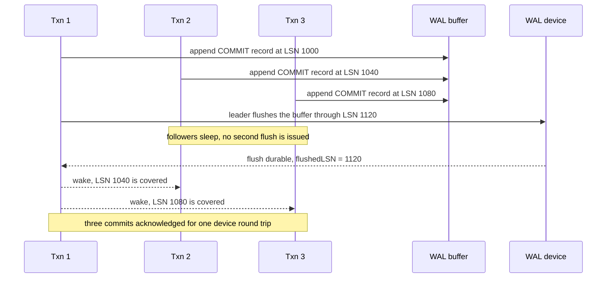
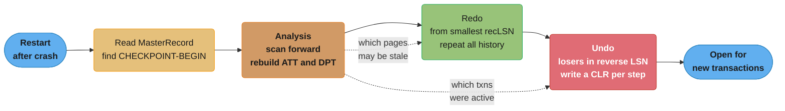
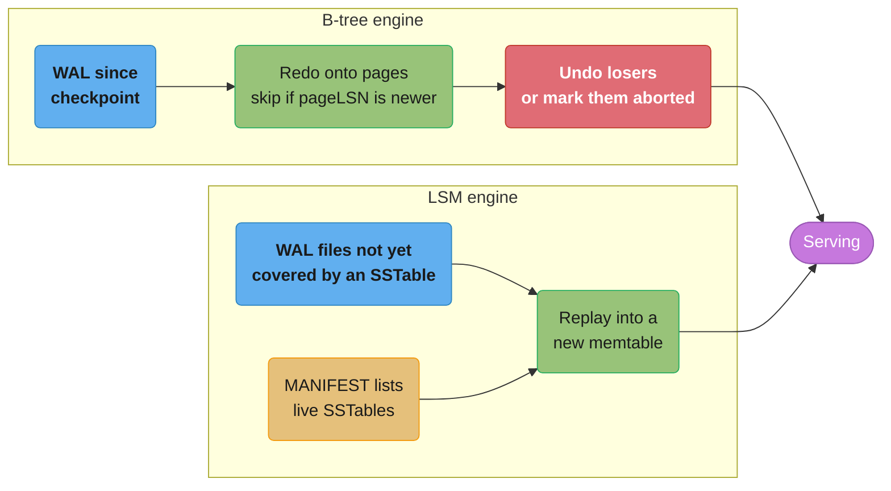

# Logging, Recovery and Checkpointing

> Checked 2026-11-25 against CMU 15-445/645 Fall 2025 (lectures #21 Database Logging and #22 Database Recovery), the ARIES paper (Mohan, Haderle, Lindsay, Pirahesh, Schwarz, *ACM Transactions on Database Systems* vol. 17 no. 1, March 1992, pp. 94-162), the PostgreSQL 19 documentation, the MySQL `trunk` source for InnoDB defaults, the RocksDB `main` headers, the SQLite WAL documentation, the Amazon Aurora SIGMOD 2017 paper and the SQL Server Accelerated Database Recovery documentation.

## 1. Concept Overview

A database promises two things that memory cannot keep: a committed transaction survives a crash (**durability**), and an uncommitted one leaves no trace (**atomicity**). Memory is fast and volatile; storage is slow and durable. Recovery is the set of rules that lets the engine work in memory at memory speed and still keep both promises across a power cut, a kernel panic or a `kill -9`.

Every recovery scheme has two halves (CMU lecture #21):

1. **Runtime actions** — what the engine writes during normal processing so that recovery is possible: log records, checkpoints, page LSNs.
2. **Restart actions** — what the engine does after a crash: find the last checkpoint, **REDO** committed work that never reached the data files, **UNDO** uncommitted work that did.

Write-ahead logging (WAL) is the runtime half almost every engine uses, and **ARIES** — *Algorithms for Recovery and Isolation Exploiting Semantics*, developed at IBM Research for DB2 and published in 1992 — is the canonical restart half. ARIES rests on three ideas: write-ahead logging, **repeating history during redo**, and **logging the undo actions themselves** with compensation log records (CLRs). Checkpoints bound how much log a restart must read, and group commit makes the per-commit log flush affordable.

This module also covers where real engines depart from textbook ARIES: PostgreSQL has no undo phase at all, InnoDB adds a doublewrite buffer for torn pages, LSM engines replay a WAL into a memtable instead of redoing onto pages, Aurora moves redo into the storage tier, and SQL Server's Accelerated Database Recovery replaces the classic undo with versioned rollback.

**Not here.** On-disk page formats, the buffer pool and LSM compaction live in [Storage Engines Internals](../storage_engines_internals/storage_engines_internals.md). Base backups, WAL archiving and point-in-time recovery live in [Backup, Recovery and Disaster Recovery](../backup_recovery_and_disaster_recovery/backup_recovery_and_disaster_recovery.md). Shipping the WAL to replicas lives in [Replication and High Availability](../replication_and_high_availability/replication_and_high_availability.md). What `fsync` really guarantees, write caches, torn sectors and the page cache live in [File Systems and Persistent Storage](../../cs_fundamentals/file_systems_and_persistent_storage/file_systems_and_persistent_storage.md). PostgreSQL's process model and VACUUM live in [PostgreSQL Internals](../postgresql_internals/postgresql_internals.md); InnoDB's redo and undo file layout lives in [MySQL InnoDB Internals](../mysql_innodb_internals/mysql_innodb_internals.md).

---

## 2. Intuition

**One-line analogy.** An accountant writes every change in the journal before touching the ledger. If the office burns down mid-afternoon, a new accountant takes the last audited ledger (the checkpoint) and replays the journal from that point; entries for deals that were never signed are crossed out with a dated correction line rather than erased.

**Mental model.** The log is the truth. Data pages are a cache of the log that can be *behind* it (a committed change that was never flushed, so it needs REDO) or *ahead* of it (an uncommitted change that was flushed early, so it needs UNDO). Recovery reconciles the cache with the truth.

**Why it matters.** Every durability knob a database exposes — `synchronous_commit`, `innodb_flush_log_at_trx_commit`, RocksDB `WriteOptions::sync`, `full_page_writes`, `checkpoint_timeout`, `max_wal_size` — is a position on one of three trade-offs: commit latency vs the window of committed work a crash can lose, runtime I/O vs recovery time, and WAL volume vs torn-page safety. You cannot set them well without the model.

**Key insight.** A commit is durable when its **commit log record** is on stable storage, not when its data pages are. That is what lets an engine acknowledge a commit with one sequential log write instead of dozens of random page writes, and it is why the log flush — and therefore group commit — sits on the critical path of every write transaction.

---

## 3. Core Principles

### UNDO and REDO

| Primitive | Purpose | Needed when |
|-----------|---------|-------------|
| UNDO | Remove the effects of an incomplete or aborted transaction | Uncommitted changes may already be on disk |
| REDO | Re-apply the effects of a committed transaction | Committed changes may not yet be on disk |

Which of the two an engine needs is decided entirely by its buffer pool policy.

### STEAL and FORCE

- **STEAL** — the buffer pool may write a page containing *uncommitted* changes to disk before the transaction ends. Needed so that a transaction's write set can exceed memory. Creates the need for UNDO.
- **FORCE** — every page a transaction changed must be on disk *before* it commits. Makes commit slow (many random writes). Its opposite, **NO-FORCE**, creates the need for REDO.

```
                     FORCE (flush pages at commit)     NO-FORCE (flush pages later)
                   +---------------------------------+---------------------------------+
  NO-STEAL         | no UNDO, no REDO                | no UNDO, needs REDO             |
  (uncommitted     | write set must fit in memory    | rarely used                     |
   pages stay      | slow random writes at commit    |                                 |
   in memory)      | e.g. shadow paging              |                                 |
                   +---------------------------------+---------------------------------+
  STEAL            | needs UNDO, no REDO             | needs UNDO and REDO             |
  (uncommitted     | rarely used                     | fastest at runtime              |
   pages may       |                                 | slowest to recover              |
   reach disk)     |                                 | e.g. WAL + ARIES                |
                   +---------------------------------+---------------------------------+
```

CMU lecture #21 notes that only the two diagonal corners are used in practice. Almost every modern engine sits in the bottom-right corner: it accepts the most complex recovery in exchange for the fastest normal operation.

### The Two WAL Rules

1. **Log before data.** A log record describing a change to page `P` must be on stable storage before `P` itself is written. In LSN terms: before flushing page `P`, ensure `pageLSN(P) ≤ flushedLSN`.
2. **Log before commit.** All of a transaction's log records, including its `COMMIT` record, must be on stable storage before the commit is acknowledged.

Rule 1 makes UNDO possible (the before-image is always findable). Rule 2 makes REDO possible (the after-image of every acknowledged commit is always findable). Break either and recovery cannot be correct.

### Log Sequence Numbers

ARIES tracks every step with a log sequence number (LSN). In PostgreSQL an LSN is a byte offset into the WAL stream and is exposed as the `pg_lsn` type.

| LSN | Where it lives | Meaning |
|-----|----------------|---------|
| `flushedLSN` | memory | Last LSN known to be on stable storage |
| `pageLSN` | each data page | LSN of the latest change applied to this page |
| `recLSN` | dirty page table | LSN of the first change that made this page dirty since its last flush |
| `lastLSN` | active transaction table | Latest log record written by this transaction |
| `prevLSN` | each log record | Previous record of the same transaction, forming a per-transaction backward chain |
| `undoNextLSN` | each CLR | Next record of this transaction still to be undone |
| MasterRecord | a fixed disk location | LSN of the latest checkpoint's begin record (PostgreSQL keeps the checkpoint position in `pg_control`) |

### Physiological Logging

| Scheme | A record says | Size | Recovery | Weakness |
|--------|---------------|------|----------|----------|
| Physical | "bytes 4,096-4,104 of page 17 become X" | large | simple and idempotent with `pageLSN` | page compaction rewrites thousands of bytes of log |
| Logical | "`UPDATE accounts SET ... WHERE ...`" | tiny | re-execute statements | non-deterministic under concurrency, slow to replay |
| Physiological | "on page 17, slot 5, set the row to X" | medium | per-page, layout-independent within the page | none serious; the common choice |

CMU calls physiological logging the most common approach: physical *to* a page, logical *within* it. The engine can reorganize a page's free space after the record is written, because the record names a slot, not a byte offset.

---

## 4. Types / Architectures / Strategies

### Recovery Schemes

| Scheme | Policy | How it works | Recovery cost | Used by |
|--------|--------|--------------|---------------|---------|
| Shadow paging | NO-STEAL + FORCE | Copy-on-write pages; commit atomically swings a root pointer from master to shadow | Almost none; discard shadow pages | Copy-on-write B-tree stores |
| Rollback journal | STEAL + FORCE | Copy each original page to a journal before overwriting it in place; on restart, copy originals back | Restore journaled pages | SQLite rollback-journal mode |
| Write-ahead log | STEAL + NO-FORCE | Append log records; flush pages lazily | Analysis + redo + undo | PostgreSQL, InnoDB, SQL Server, DB2, Oracle |
| Log-only (LSM) | Writes never update pages in place | WAL plus in-memory table, flushed as immutable sorted files | Replay the WAL tail into a new memtable | RocksDB, LevelDB, Cassandra |

CMU's notes record that SQLite used the journal-file approach before 2010 and switched to a write-ahead log after 2010 for better performance. Shadow paging's costs — copying page-table paths on every commit, scattering related data across the disk, and poor support for concurrent writers — are why it lost to WAL for general-purpose engines.

### Checkpoint Types

| Type | During the checkpoint | What it records | Restart reads |
|------|-----------------------|-----------------|---------------|
| Non-fuzzy (blocking) | New transactions blocked, running ones finish, all dirty pages flushed | `<CHECKPOINT>` | Log after the checkpoint only |
| Blocking with tables | New transactions blocked and running ones paused, not finished | `<CHECKPOINT>` with the active transaction table (ATT) and dirty page table (DPT) | Log after the checkpoint, plus older records reachable from ATT and DPT |
| Fuzzy (ARIES) | Transactions keep running | `<CHECKPOINT-BEGIN>`, then `<CHECKPOINT-END>` holding ATT and DPT as of the begin | From the begin record, and from the oldest `recLSN` for redo |
| Spread (PostgreSQL) | Transactions keep running; dirty pages written over ~90% of the interval | A checkpoint record whose REDO pointer marks where replay starts | From the REDO pointer |

A fuzzy checkpoint does not make the data files consistent; it only records enough to bound the work. PostgreSQL's checkpointer writes dirty buffers spread over `checkpoint_completion_target` (default 0.9) of the interval, then writes the checkpoint record and saves its position in `pg_control`.

### Commit Durability Modes

| Engine | Setting | Values and meaning | Default |
|--------|---------|--------------------|---------|
| PostgreSQL | `synchronous_commit` | `off`: no wait for the WAL flush; `local`: wait for local flush; `on`: local flush plus synchronous standbys' flush; `remote_write`: standbys wrote to their OS; `remote_apply`: standbys applied it | `on` |
| PostgreSQL | `fsync` | `off` disables flushing entirely, risking unrecoverable corruption | `on` |
| InnoDB | `innodb_flush_log_at_trx_commit` | `1`: write and flush at each commit; `2`: write at commit, flush once per second; `0`: write and flush once per second | `1` |
| RocksDB | `WriteOptions::sync` | `false`: write to the OS like `write()`; `true`: like `write()` plus `fdatasync()` | `false` |
| SQLite | `PRAGMA synchronous` with `journal_mode=WAL` | WAL file appended per transaction; checkpoint copies pages back | WAL auto-checkpoint at 1,000 pages |

With `synchronous_standby_names` empty, PostgreSQL's `on`, `local`, `remote_write` and `remote_apply` all behave like `local`. RocksDB's header makes the point every engineer should memorize: with `sync=false`, a *process* crash loses nothing, but a *machine* crash can lose recent writes.

### Group Commit

Each transaction must wait for its commit record to be flushed, and a flush costs one device round trip regardless of how many records it carries. Group commit lets one flush cover many waiting commits: the first committer becomes the leader and flushes everything buffered so far, and the others wake when the leader's flush covers their record. PostgreSQL adds an optional deliberate wait, `commit_delay` (default 0 microseconds), applied only when at least `commit_siblings` (default 5) other transactions are active. Since PostgreSQL 9.3 only the leader waits the full delay; followers wait just until the leader's flush completes.

### Recovery in B-Tree Engines vs LSM Engines

| Aspect | B-tree + WAL (PostgreSQL, InnoDB) | LSM + WAL (RocksDB) |
|--------|-----------------------------------|---------------------|
| What is on disk after a crash | Data pages that may be behind or ahead of the log | Immutable SSTables (always complete) plus a WAL tail |
| Redo target | Data pages, guarded by `pageLSN` | A fresh memtable rebuilt from the WAL |
| Undo | Needed (InnoDB undo logs) or replaced by MVCC visibility (PostgreSQL) | Not needed: unflushed data lives only in memory and the WAL |
| Torn pages | Full-page images (PostgreSQL) or a doublewrite buffer (InnoDB) | Not an issue for immutable files; WAL tail corruption handled by the recovery mode |
| What bounds recovery time | WAL since the last checkpoint's redo point | Size of the unflushed memtables (`write_buffer_size` default 64 MB per column family) |
| When old log is freed | After a checkpoint (and archiving or replication) | After the memtable it backs is flushed to an SSTable |
| Metadata log | `pg_control`, control files | `MANIFEST` recording which SSTables make up the database |

### Moving or Replacing Recovery

- **Aurora: the log is the database.** The Aurora paper (SIGMOD 2017) sends only redo records from the database node to a storage tier that replicates each 10 GB segment six ways across three Availability Zones, with a 4-of-6 write quorum and a 3-of-6 read quorum. Storage nodes apply redo continuously in the background, and a read of a stale page applies any pending redo first, so "nothing is required at database startup".
- **SQL Server Accelerated Database Recovery** (SQL Server 2019 and later). Without ADR, recovery follows the ARIES analysis, redo and undo phases, and the Microsoft documentation states that recovery time is roughly proportional to the size of the longest active transaction at the crash. ADR keeps row versions in a persistent version store, so undo becomes an almost instantaneous logical revert and the log can be truncated even while long transactions run.

---

## 5. Architecture Diagrams

### The Commit Path With Group Commit



The leader's single flush covers every commit record appended before it was issued. Commit latency is one flush plus queueing; commit throughput is roughly `commits per flush ÷ flush latency`, which is why a busy server often commits faster than a quiet one.

### ARIES Restart: Three Passes Over the Log



Analysis reads forward from the checkpoint and builds two tables; redo uses the dirty page table to decide where to start, and undo uses the active transaction table to decide what to reverse. Redo moves forward through the log, undo moves backward.

### Where Each Phase Starts on the Log

```
  LSN:   10    20    30      40    50       60     70    80    90     100        crash
         |     |     |       |     |        |      |     |     |      |            X
         T1    T2    CKPT    T1    CKPT     T2     T3    T1    T2     T3
         upd   upd   BEGIN   upd   END      COMMIT upd   upd   END    upd
         P5    P3            P8    ATT,DPT         P5    P3           P1

  Analysis  starts at CHECKPOINT-BEGIN (MasterRecord) ...............> 30 -> 100
  Redo      starts at the smallest recLSN in the DPT .................> 10 -> 100
  Undo      walks losers T1 and T3 backward through prevLSN ...........> 100 -> 10

  T1: 10 <- 40 <- 80        (loser: no COMMIT)
  T2: 20 <- 60 <- 90        (winner: COMMIT at 60, TXN-END at 90)
  T3: 70 <- 100             (loser: no COMMIT)
```

Redo starts *before* the checkpoint because page `P5` was first dirtied at LSN 10 and the fuzzy checkpoint did not force it to disk. The checkpoint bounds analysis, not redo. This is the single most misunderstood detail of ARIES.

### B-Tree and LSM Engines Recover Different Things



A B-tree engine repairs pages in place; an LSM engine never trusts a half-written data structure, because SSTables are written once and recorded in the MANIFEST only when complete. LSM recovery is therefore bounded by memtable size, not by checkpoint frequency.

---

## 6. How It Works — Detailed Mechanics

### Normal Operation in ARIES

**Update.** Append an `UPDATE` record `(LSN, prevLSN, txn, page, before, after)` to the log buffer, apply the change to the buffered page, set `pageLSN = LSN`, set the transaction's `lastLSN = LSN`, and add the page to the DPT with `recLSN = LSN` if it was clean.

**Commit.** Append `COMMIT`, flush the log through that LSN, acknowledge the client. Later, append `TXN-END` without forcing it; it only tells recovery the transaction needs no further work.

**Abort.** Append `ABORT`, then walk the transaction's `prevLSN` chain backward. For each update, restore the before-image and append a **compensation log record** (CLR) carrying the restored value and `undoNextLSN` = the undone record's `prevLSN`. Finish with `TXN-END`. CMU notes the engine does not wait for CLRs to be flushed before telling the application the abort succeeded.

**Page flush.** Before writing page `P`, flush the log through `pageLSN(P)` (WAL rule 1), write the page, remove it from the DPT.

### A Worked ARIES Recovery

The log below is the one drawn in §5. Page states on disk at the moment of the crash: `P5` was flushed after LSN 10 (on-disk `pageLSN = 10`), `P8` was flushed after LSN 40 (on-disk `pageLSN = 40` — an *uncommitted* change on disk, which STEAL allows), `P3` and `P1` were never flushed.

```
 LSN  prev  txn  record             page  change      notes
 ---  ----  ---  -----------------  ----  ----------  ----------------------------------
  10   -    T1   UPDATE             P5    A: 10->20   P5 flushed later, pageLSN 10 on disk
  20   -    T2   UPDATE             P3    B: 5->7
  30   -    -    CHECKPOINT-BEGIN                     MasterRecord points here
  40   10   T1   UPDATE             P8    C: 1->2     P8 flushed later, pageLSN 40 on disk
  50   -    -    CHECKPOINT-END                       ATT {T1:10, T2:20}  DPT {P5:10, P3:20}
  60   20   T2   COMMIT                               log flushed through 60, client acked
  70   -    T3   UPDATE             P5    D: 0->9
  80   40   T1   UPDATE             P3    E: 3->4
  90   60   T2   TXN-END
 100   70   T3   UPDATE             P1    F: 7->8
                 ----- CRASH -----
```

**Analysis** (forward from LSN 30):

```
 LSN  action                                   ATT after          DPT after
 ---  ---------------------------------------  -----------------  ------------------------
  40  T1 lastLSN=40; add P8 with recLSN 40     T1:U@40            P8:40
  50  merge checkpoint ATT and DPT, keeping    T1:U@40 T2:U@20    P5:10 P3:20 P8:40
      newer lastLSN and older recLSN
  60  T2 status -> COMMIT                      T1:U@40 T2:C@60    unchanged
  70  add T3; P5 already in DPT                + T3:U@70          unchanged
  80  T1 lastLSN=80; P3 already in DPT         T1:U@80            unchanged
  90  T2 TXN-END, remove T2                    T1:U@80 T3:U@70    unchanged
 100  T3 lastLSN=100; add P1 with recLSN 100   T1:U@80 T3:U@100   P5:10 P3:20 P8:40 P1:100
```

Losers: `T1` and `T3`. Redo starts at `min(recLSN) = 10`.

**Redo** (forward from LSN 10). An update is skipped if its page is not in the DPT, if its LSN is below the page's `recLSN`, or if the page's own `pageLSN` already covers it:

```
 LSN  page  test                                  result
 ---  ----  ------------------------------------  ------------------------------------
  10  P5    on-disk pageLSN 10 >= 10              skip (already on disk)
  20  P3    pageLSN 0 < 20                        redo B=7, pageLSN=20
  40  P8    on-disk pageLSN 40 >= 40              skip (uncommitted, but on disk: fine)
  70  P5    pageLSN 10 < 70                       redo D=9, pageLSN=70   (loser T3!)
  80  P3    pageLSN 20 < 80                       redo E=4, pageLSN=80   (loser T1!)
 100  P1    pageLSN 0 < 100                       redo F=8, pageLSN=100  (loser T3!)
```

Redo re-applies the losers' updates too. That is "repeating history": after redo, every page is exactly as it was at the instant of the crash, so undo can treat the restart exactly like a normal abort of the losers.

**Undo** (always pick the largest `lastLSN` among losers):

```
 step  pick          undo                     CLR written                   next for txn
 ----  ------------  -----------------------  ----------------------------  ------------
   1   T3 @ 100      P1: F 8->7               110  undoNext=70              T3 @ 70
   2   T1 @ 80       P3: E 4->3               120  undoNext=40              T1 @ 40
   3   T3 @ 70       P5: D 9->0               130  undoNext=none            T3 done: 140 TXN-END
   4   T1 @ 40       P8: C 2->1               150  undoNext=10              T1 @ 10
   5   T1 @ 10       P5: A 20->10             160  undoNext=none            T1 done: 170 TXN-END
```

Final state: `A=10, B=7, C=1, D=0, E=3, F=7` — only `T2`'s committed change survives.

**A second crash during undo.** Suppose the machine dies again right after CLR 120 reaches disk. The next restart's analysis sees CLRs 110 and 120 as the losers' last records. Redo replays them like any update (CLRs are redo-only). Undo reads CLR 110's `undoNextLSN = 70` and CLR 120's `undoNextLSN = 40`, so it resumes at LSN 70 and LSN 40 and never undoes 100 or 80 a second time. That is why ARIES logs the undo: repeated crashes during recovery do a bounded, non-growing amount of work.

### The Same Algorithm as Code

A compact Python model of the three phases. It reproduces the tables above when run on that log.

```python
from dataclasses import dataclass

@dataclass
class Rec:
    lsn: int
    txn: str | None
    kind: str                     # UPDATE, CLR, COMMIT, TXN-END, CKPT-BEGIN, CKPT-END
    page: str | None = None
    key: str | None = None
    before: int | None = None
    after: int | None = None
    prev_lsn: int | None = None
    undo_next: int | None = None
    att: dict | None = None       # CKPT-END only: txn -> lastLSN at CHECKPOINT-BEGIN
    dpt: dict | None = None       # CKPT-END only: page -> recLSN at CHECKPOINT-BEGIN

def analysis(log: list[Rec], master_lsn: int) -> tuple[dict, dict]:
    att: dict[str, dict] = {}     # txn -> {"status": "U" or "C", "last": lsn}
    dpt: dict[str, int] = {}      # page -> recLSN
    ended: set[str] = set()
    for r in log:
        if r.lsn < master_lsn:
            continue
        if r.kind == "CKPT-END":
            for t, last in r.att.items():
                if t not in ended:
                    att.setdefault(t, {"status": "U", "last": last})
            for p, rec in r.dpt.items():
                dpt[p] = min(dpt.get(p, rec), rec)
            continue
        if r.txn is None:
            continue
        if r.kind == "TXN-END":
            att.pop(r.txn, None)
            ended.add(r.txn)
            continue
        entry = att.setdefault(r.txn, {"status": "U", "last": r.lsn})
        entry["last"] = r.lsn
        if r.kind == "COMMIT":
            entry["status"] = "C"
        if r.kind in ("UPDATE", "CLR") and r.page not in dpt:
            dpt[r.page] = r.lsn
    return att, dpt

def redo(log: list[Rec], dpt: dict, disk: dict) -> None:
    start = min(dpt.values())
    for r in log:
        if r.lsn < start or r.kind not in ("UPDATE", "CLR"):
            continue
        if r.page not in dpt or r.lsn < dpt[r.page]:
            continue                                  # change already flushed
        page = disk[r.page]
        if page["lsn"] >= r.lsn:
            continue                                  # pageLSN makes redo idempotent
        page["data"][r.key] = r.after                 # a CLR's "after" is the restored value
        page["lsn"] = r.lsn

def undo(log: list[Rec], att: dict, disk: dict, next_lsn: int) -> int:
    by_lsn = {r.lsn: r for r in log}
    todo = {t: e["last"] for t, e in att.items() if e["status"] == "U"}
    last_written = dict(todo)
    while todo:
        txn, lsn = max(todo.items(), key=lambda kv: kv[1])
        r = by_lsn[lsn]
        if r.kind == "CLR":
            nxt = r.undo_next                         # never undo a CLR, jump past it
        elif r.kind == "UPDATE":
            page = disk[r.page]
            page["data"][r.key] = r.before
            page["lsn"] = next_lsn
            clr = Rec(next_lsn, txn, "CLR", r.page, r.key, after=r.before,
                      prev_lsn=last_written[txn], undo_next=r.prev_lsn)
            log.append(clr)
            by_lsn[clr.lsn] = clr
            last_written[txn] = next_lsn
            next_lsn += 10
            nxt = r.prev_lsn
        else:
            nxt = r.prev_lsn
        if nxt is None:
            log.append(Rec(next_lsn, txn, "TXN-END", prev_lsn=last_written[txn]))
            next_lsn += 10
            del todo[txn]
        else:
            todo[txn] = nxt
    return next_lsn
```

Three details carry the whole algorithm: `min(dpt.values())` is why redo can start before the checkpoint, `page["lsn"] >= r.lsn` is why redo is idempotent and safe to repeat, and the `CLR` branch jumping to `undo_next` is why undo is safe to repeat.

### PostgreSQL: Redo Only, No Undo Phase

PostgreSQL follows the WAL rules and replays from a checkpoint, but its recovery has no undo phase. At startup the server reads `pg_control`, finds the latest checkpoint record, and performs REDO by scanning forward from the WAL location named in that record. An uncommitted transaction's tuples may be in the heap after redo, but its status in `pg_xact` (transaction commit status data) is not committed, so MVCC visibility checks hide those tuples and VACUUM later removes them. The "before value" ARIES needs for undo is, in effect, the older tuple version that MVCC already keeps — the synergy CMU lecture #21 points out between MVCC and recovery.

**Torn pages.** An 8 KB PostgreSQL page written during an OS crash can land half old and half new, and a row-level redo record cannot repair a page it cannot parse. With `full_page_writes = on` (the default), the first modification of each page after a checkpoint logs the entire page image; redo restores that image, then applies later records on top. The cost is WAL volume, and it is why the documentation suggests a longer checkpoint interval as one way to reduce full-page-write overhead.

**The PostgreSQL WAL knobs that matter for recovery**, all defaults from the PostgreSQL 19 documentation:

```ini
# --- durability of each commit ---
synchronous_commit = on          # off: up to 3 x wal_writer_delay of acked commits can be lost
fsync = on                       # off risks unrecoverable corruption, never on a primary
wal_sync_method = fdatasync      # default on Linux and FreeBSD
full_page_writes = on            # off risks torn-page corruption after an OS crash

# --- the WAL writer and group commit ---
wal_buffers = -1                 # 1/32 of shared_buffers, min 64kB, max one segment (16MB)
wal_writer_delay = 200ms
wal_writer_flush_after = 1MB
commit_delay = 0                 # microseconds; > 0 makes the flush leader wait for followers
commit_siblings = 5              # only delay if at least 5 other transactions are active

# --- checkpoints, which bound redo time and WAL retention ---
checkpoint_timeout = 5min        # range 30s to 1 day
max_wal_size = 1GB               # soft limit; a checkpoint starts before WAL would exceed it
min_wal_size = 80MB
checkpoint_completion_target = 0.9
checkpoint_flush_after = 256kB   # Linux default; limits dirty data in the page cache
checkpoint_warning = 30s         # log a hint when WAL-triggered checkpoints come this close

# --- failure handling ---
data_sync_retry = off            # PANIC on a failed data-file flush, then recover from WAL
```

WAL lives in `pg_wal` as 16 MB segment files by default, and the LSN is the byte position in that stream, so subtracting two LSNs gives the WAL volume between them:

```sql
-- How much WAL has this server generated since the last checkpoint's redo point?
SELECT pg_wal_lsn_diff(pg_current_wal_lsn(), redo_lsn) AS bytes_since_redo
FROM pg_control_checkpoint();

-- Are checkpoints timed (healthy) or WAL-triggered (max_wal_size too small)?
SELECT num_timed, num_requested, num_done
FROM pg_stat_checkpointer;          -- PostgreSQL 17+; older releases: pg_stat_bgwriter
```

`num_requested` climbing faster than `num_timed` means `max_wal_size` is forcing checkpoints, each followed by a burst of full-page images.

### Checkpoint Arithmetic

All numbers illustrative; substitute measured rates.

```
  Write workload:          30 MB/s of WAL at peak
  max_wal_size = 1 GB      -> a WAL-triggered checkpoint roughly every 1,024 / 30 = 34 s
  checkpoint_timeout = 5m  -> never reached; num_requested climbs, the log warns

  Full-page-image cost:    40,000 distinct hot pages, each first touched after a checkpoint
                           40,000 x 8 KB = 312 MB of page images per checkpoint
     every 34 s          ->  312 MB / 34 s  = 9.2 MB/s extra WAL  (31% of the stream)
     every 300 s         ->  312 MB / 300 s = 1.0 MB/s extra WAL  (3.5%)

  Recovery-time cost:      redo reads WAL from the last checkpoint's redo point
     max_wal_size 1 GB   ->  at most about 1 GB to replay
     max_wal_size 16 GB  ->  at most about 16 GB to replay
     at 200 MB/s replay  ->  about 5 s  vs  about 80 s
```

Raising `max_wal_size` from 1 GB to 16 GB cuts the full-page-image overhead by about 9x and lets `checkpoint_timeout` govern again, at the cost of a worst-case restart that is about 16 times longer. That is the checkpoint trade-off in one line: runtime write amplification against recovery time.

### Group Commit Arithmetic

```
  WAL flush latency (illustrative, cloud block volume):   2 ms
  One committer per flush:     1 / 2 ms                  =    500 commits/s
  Group commit, 40 per flush:  40 / 2 ms                 = 20,000 commits/s
  commit_delay = 1000 us:      each flush leader waits 1 ms when 5+ siblings are active
                               latency +1 ms, but more commits share each flush
```

Group commit is why `synchronous_commit = on` scales with concurrency: the flush cost is paid per batch, not per transaction. `commit_delay` only helps when the device is slow and concurrency is high; on fast NVMe it mostly adds latency.

### InnoDB: Redo, Undo and the Doublewrite Buffer

InnoDB keeps a redo log for REDO and undo logs for UNDO and MVCC, so its restart is closer to textbook ARIES: apply redo, then roll back transactions that were active at the crash. Three defaults from the MySQL source:

```ini
innodb_flush_log_at_trx_commit = 1   # 1: write and flush at each commit
                                     # 2: write at commit, flush once per second
                                     # 0: write and flush once per second
innodb_redo_log_capacity = 104857600 # 100 MB of redo on disk (the limit, in bytes)
innodb_doublewrite = ON              # write pages to the doublewrite area first
```

InnoDB pages are 16 KB, so a torn write is a real risk. Instead of logging full page images, InnoDB first writes each batch of dirty pages to a sequential doublewrite area, flushes it, and then writes the pages to their real locations. If a page is torn by a crash, recovery restores the intact copy from the doublewrite area and then applies redo. The redo capacity plays the role of `max_wal_size`: a small capacity forces aggressive page flushing to free log space, and a large one lengthens recovery. See [MySQL InnoDB Internals](../mysql_innodb_internals/mysql_innodb_internals.md) for the file layout.

### RocksDB: WAL Replay Into a Memtable

A RocksDB write goes to the WAL and then to the active memtable. When the memtable reaches `write_buffer_size` (default 64 MB per column family) it becomes immutable and is flushed to a new SSTable; once every column family's data in a WAL file has been flushed, that WAL file can be deleted. Recovery reads the `MANIFEST` to learn which SSTables exist and replays only the WAL files not yet covered by an SSTable into a new memtable.

What happens to a damaged WAL tail is a policy, `WALRecoveryMode`:

| Mode | Behaviour on a corrupt or incomplete record |
|------|---------------------------------------------|
| `kTolerateCorruptedTailRecords` | Ignore errors at the tail of the log, assumed to be an incomplete write |
| `kAbsoluteConsistency` | Any I/O error during replay is corruption; refuse to open |
| `kPointInTimeRecovery` (the default) | Stop replay at the first error; recover to a consistent point in time |
| `kSkipAnyCorruptedRecords` | Skip bad records and continue; salvage mode |

Durability per write is `WriteOptions::sync`, default `false`. With `false`, the WAL append behaves like `write()`: safe against a process crash, not against a machine crash. With `true`, it behaves like `write()` followed by `fdatasync()`. `manual_wal_flush = true` goes further and leaves even the `write()` to an explicit `FlushWAL` call.

### SQLite: WAL and Its Checkpoint

In WAL mode, SQLite appends committed pages to a separate `-wal` file and readers consult it alongside the main database file. A **checkpoint** copies those pages back into the database file. By default SQLite runs a checkpoint automatically when the WAL reaches 1,000 pages, on the thread whose commit pushed it over the limit. The SQLite documentation also warns that WAL works best with smaller transactions and does not suit transactions larger than about 100 MB, where the rollback journal can be faster.

### fsync Failure Is a Crash, Not a Retry

PostgreSQL 11.2 (released 2019-02-14) changed the default response to a failed `fsync()` of a data file from retrying to raising a PANIC. The release notes give the reason: some popular operating systems discard kernel buffers they failed to write and report the failure once; a retried `fsync()` then succeeds even though the data is gone. The only safe recovery is to crash and replay from the WAL, which still holds every change since the last checkpoint. `data_sync_retry` (default `off`) controls this; the documentation says to enable it only after investigating how the OS handles buffered data after a write-back failure. The kernel side of this story lives in [File Systems and Persistent Storage](../../cs_fundamentals/file_systems_and_persistent_storage/file_systems_and_persistent_storage.md).

---

## 7. Real-World Examples

**IBM DB2.** ARIES was developed at IBM Research for DB2 (CMU lecture #22), and the 1992 TODS paper remains the reference that other engines' recovery documentation is written against — Microsoft's documentation describes classic SQL Server recovery in exactly its three phases.

**PostgreSQL.** Physiological WAL with full-page images, spread checkpoints, group commit through `commit_delay`/`commit_siblings`, and a redo-only restart because MVCC plus `pg_xact` replaces undo. Since 11.2 a failed data-file flush is a PANIC by default. PostgreSQL 17 split checkpoint statistics into `pg_stat_checkpointer`.

**MySQL InnoDB.** Redo log plus undo logs, a doublewrite buffer on by default against torn 16 KB pages, `innodb_flush_log_at_trx_commit = 1` by default, and a redo capacity of 100 MB by default.

**RocksDB.** WAL plus memtable; recovery replays the unflushed WAL tail, guided by the MANIFEST and the configured `WALRecoveryMode` (point-in-time recovery by default). Per-write `sync` defaults to `false`.

**SQLite.** Switched from its rollback journal to a write-ahead log after 2010 (CMU lecture #21), keeping the journal as an option; in WAL mode it checkpoints automatically at 1,000 pages.

**Amazon Aurora.** The SIGMOD 2017 paper reports that over a 30-minute test Aurora sustained 35 times more transactions than mirrored MySQL with 7.7 times fewer I/Os per transaction on the database node, because only redo records cross the network to a 4-of-6 quorum storage tier, and redo application happens continuously in storage rather than at startup.

**SQL Server.** Classic recovery is ARIES-style; Accelerated Database Recovery, available from SQL Server 2019 and always on in Azure SQL Database, makes rollback instantaneous and recovery independent of long-running transactions by keeping row versions in a persistent version store.

---

## 8. Tradeoffs

### Buffer Pool Policy

| Policy | Runtime speed | Recovery work | Limits |
|--------|---------------|---------------|--------|
| NO-STEAL + FORCE | slow commits (random page writes) | none | Write set must fit in memory |
| STEAL + NO-FORCE | fast (one sequential log flush per commit group) | analysis + redo + undo | Complex recovery code |

### Commit Durability

| Setting | Commit latency | What a crash can lose | Risk of corruption |
|---------|----------------|-----------------------|--------------------|
| PostgreSQL `synchronous_commit = on` | one WAL flush | nothing acknowledged | none |
| PostgreSQL `synchronous_commit = off` | no flush wait | up to 3 x `wal_writer_delay` (600 ms by default) of acked commits | none — lost transactions look cleanly aborted |
| PostgreSQL `fsync = off` | lowest | anything | unrecoverable corruption possible |
| InnoDB `flush_log_at_trx_commit = 2` | write to the OS only | about 1 s of commits on an OS or power failure | none |
| RocksDB `sync = false` | write to the OS only | recent writes on a machine crash, none on a process crash | none with point-in-time recovery |

### Checkpoint Frequency

| Frequent checkpoints | Infrequent checkpoints |
|----------------------|------------------------|
| Short recovery (little WAL since the redo point) | Long recovery |
| More full-page images, more WAL volume | Fewer full-page images |
| More random page writes, more I/O spikes | Smoother I/O, more dirty pages in memory |
| Less `pg_wal` disk space retained | More `pg_wal` disk space retained |

### Torn-Page Protection

| Approach | Extra writes | Where the cost lands | Used by |
|----------|--------------|---------------------|---------|
| Full-page images in the WAL | One page image per page per checkpoint interval | WAL volume, replication bandwidth | PostgreSQL |
| Doublewrite buffer | Every flushed page written twice | Data-file write bandwidth | InnoDB |
| Atomic-write storage | none | Requires hardware or filesystem guarantees | Possible when the platform guarantees it |
| Immutable files | none | Write amplification moves to compaction | LSM engines |

---

## 9. When to Use / When NOT to Use

**Use asynchronous commit (`synchronous_commit = off`, `innodb_flush_log_at_trx_commit = 2`, RocksDB `sync = false`) when:**
- Losing the last fraction of a second of acknowledged writes is acceptable: metrics, clickstream, session data, rebuildable caches.
- The data has another source of truth (the upstream Kafka topic, the batch file) and the job is idempotent on replay.
- You can scope it per transaction — `SET LOCAL synchronous_commit = off` for the bulk insert, not for the ledger.

**Never use it for:**
- Money movement, inventory decrements, idempotency-key tables or anything acknowledged to an external party.

**Never turn off `fsync` or `full_page_writes` on a primary,** unless the whole cluster can be rebuilt from elsewhere, as the PostgreSQL documentation states for initial bulk loads and throwaway clones.

**Lengthen checkpoints (raise `max_wal_size`, `checkpoint_timeout`) when:**
- `num_requested` dominates `num_timed`, or `checkpoint_warning` messages appear, and the restart-time budget allows more WAL to replay.

**Keep them short when:**
- The recovery time objective after a crash is seconds, and failover to a replica is not the primary recovery plan.

**Prefer an engine with versioned undo (SQL Server ADR) or redo-only recovery (PostgreSQL) when:**
- Long-running transactions are normal and a crash must not mean a long undo phase.

---

## 10. Common Pitfalls

**Pitfall 1: `fsync = off` left on after a bulk load.**

```ini
# BROKEN: set for a 4-hour initial load, then forgotten in postgresql.conf
fsync = off
full_page_writes = off
# Months later a host power loss leaves data files that do not match the WAL.
# The server starts, but indexes return rows that the heap does not contain, and
# amcheck reports corruption on 3 of 40 indexes. Restore from the last base backup
# plus WAL archive: 9 hours of downtime.
```

```ini
# FIX: speed up loads without giving up crash safety
fsync = on
full_page_writes = on
synchronous_commit = off      # for the load session only: SET synchronous_commit = off
max_wal_size = 32GB           # fewer checkpoints and fewer full-page images during the load
# and on PostgreSQL, COPY into a table created in the same transaction with
# wal_level = minimal skips WAL for that table's rows (minimal level only)
```

**Pitfall 2: Asynchronous commit on the ledger.** A payments team sets `synchronous_commit = off` cluster-wide to cut p99 commit latency from 4 ms to 0.3 ms. A kernel panic later drops 400 ms of acknowledged transfers; clients had already shown "payment sent". The database is perfectly consistent — those transactions look as if they aborted — which is exactly the problem. Fix: leave the default `on`, and use `SET LOCAL synchronous_commit = off` only inside transactions whose loss is harmless.

**Pitfall 3: Checkpoint storms from an undersized `max_wal_size`.** A write-heavy service generating 30 MB/s of WAL against the 1 GB default checkpoints every ~34 seconds. Each checkpoint restarts the full-page-image cycle, so WAL volume jumps by a third, replication lag grows, and latency spikes line up with checkpoint starts. `pg_stat_checkpointer` shows `num_requested` far above `num_timed`. Fix: raise `max_wal_size` until checkpoints are timed, keep `checkpoint_completion_target = 0.9`, and confirm the restart time is still within budget.

**Pitfall 4: `pg_wal` fills the disk because archiving fails.** `max_wal_size` is a soft limit; the documentation lists a failing `archive_command` among the reasons WAL can exceed it. An expired cloud credential makes every archive attempt fail, WAL segments accumulate at 30 MB/s, and the volume fills in under 2 hours. A primary that cannot write WAL stops accepting writes. Fix: alert on `pg_stat_archiver.failed_count` and on `pg_wal` volume usage, not just on database errors.

**Pitfall 5: Retrying a failed `fsync()`.** Before PostgreSQL 11.2, a failed data-file `fsync()` was retried at the next checkpoint. On operating systems that drop the failed dirty pages and clear the error, the retry reports success and the checkpoint advances past WAL that was the only remaining copy of those changes — silent data loss. Since 11.2 the default is to PANIC and replay from the WAL. Fix: never set `data_sync_retry = on` without proof of how your OS handles write-back failures.

**Pitfall 6: A disk that lies about flushes.** The PostgreSQL WAL documentation warns that drives which report a write as done while it sits in a volatile cache can subvert write-ahead logging, and a power failure then leads to irrecoverable corruption. Consumer SSDs without power-loss protection are the usual culprits. Fix: use storage with power-loss protection or a battery-backed cache, or disable the volatile write cache, and test with a pull-the-plug drill rather than trusting the datasheet.

**Pitfall 7: `sync = false` treated as durable in an embedded store.**

```cpp
// BROKEN: a service stores idempotency keys in RocksDB with the default WriteOptions
rocksdb::WriteOptions wo;                 // sync = false by default
db->Put(wo, idempotency_key, "processed");
ack_to_client();                          // a host power loss can drop this key,
                                          // and the retried request is processed twice
```

```cpp
// FIX: sync the writes that guard external side effects
rocksdb::WriteOptions wo;
wo.sync = true;                           // write() plus fdatasync() before returning
db->Put(wo, idempotency_key, "processed");
ack_to_client();
// or batch many keys into one WriteBatch with sync = true to amortize the flush
```

**Pitfall 8: A long transaction turns a crash into a long outage.** On an engine with a classic undo phase, recovery must roll back every incomplete transaction, and Microsoft's documentation states that recovery time is roughly proportional to the longest active transaction at the crash. A 3-hour batch update that crashes at 2 hours 50 minutes can take a comparable time to undo. Fix: commit batch work in chunks, or use an engine feature that removes the undo phase (SQL Server ADR).

---

## 11. Technologies & Tools

| Tool | Purpose |
|------|---------|
| `pg_waldump` | Decodes PostgreSQL WAL records: LSN, resource manager, record type, full-page images |
| `pg_controldata` | Prints `pg_control`: latest checkpoint location, its REDO location, cluster state |
| `pg_stat_checkpointer` | PostgreSQL 17+ view of timed vs requested checkpoints |
| `pg_stat_wal` | WAL records, full-page images and bytes generated |
| `pg_stat_archiver` | Archive successes and failures, the early warning for a filling `pg_wal` |
| `pg_resetwal` | Last-resort tool that discards WAL to start a damaged cluster; loses data |
| InnoDB `SHOW ENGINE INNODB STATUS` | `LOG` section shows the current LSN, flushed LSN and last checkpoint LSN |
| RocksDB `ldb` | Inspects a RocksDB database, including dumping WAL files and the MANIFEST |
| SQLite `PRAGMA wal_checkpoint` | Runs a WAL checkpoint on demand and reports frames checkpointed |
| fio | Measures device `fsync` and `fdatasync` latency, the floor under commit latency |

---

## 12. Interview Questions with Answers

**Q: When exactly is a transaction durable in a WAL-based database?**
**Short:** When its commit log record, and every earlier log record, is on stable storage; the data pages can still be only in memory.

Under write-ahead logging the engine flushes the log through the transaction's `COMMIT` record and only then acknowledges the commit. The modified data pages may stay dirty in the buffer pool for minutes; if the server crashes, redo rebuilds them from the log. This is the NO-FORCE half of STEAL + NO-FORCE, and it is what turns many random page writes into one sequential log flush. It also means anything that weakens the log flush — `synchronous_commit = off`, `fsync = off`, a disk that lies about its cache — weakens durability directly, whatever happens to the data files.

**Q: What do STEAL and NO-FORCE mean, and why does nearly every engine choose both?**
**Short:** STEAL lets uncommitted pages reach disk early; NO-FORCE lets committed pages stay in memory. Together they give the fastest runtime.

STEAL means the buffer pool may evict a page holding uncommitted changes, so a transaction's write set can be larger than memory; the cost is that recovery needs UNDO. NO-FORCE means commit does not wait for the transaction's pages to be written; the cost is that recovery needs REDO. The alternative, NO-STEAL + FORCE, needs neither but makes commits pay random page writes and caps transaction size at memory. CMU lecture #21 notes that most DBMSs pick STEAL + NO-FORCE because runtime performance matters far more often than recovery speed.

**Q: What are the two rules of write-ahead logging?**
**Short:** Flush a page's log records before the page itself, and flush all of a transaction's log records, including COMMIT, before acknowledging it.

The first rule — before page `P` is written, the log must be flushed through `pageLSN(P)` — guarantees that any uncommitted change that reached disk has a before-image in the log, so UNDO is possible. The second rule — the commit record and everything before it must be durable before the client hears "committed" — guarantees that every acknowledged change has an after-image in the log, so REDO is possible. Group commit and asynchronous commit are both ways of scheduling the second rule; violating either rule makes correct recovery impossible.

**Q: What are the three key ideas of ARIES?**
**Short:** Write-ahead logging, repeating history during redo, and logging undo actions as compensation log records.

ARIES (Mohan et al., ACM TODS, 1992) combines three principles. Write-ahead logging with STEAL + NO-FORCE gives fast normal operation. Repeating history means redo re-applies *every* logged change after the redo point, including those of transactions that will be rolled back, so the database returns to its exact pre-crash state. Logging during undo means each reversal writes a compensation log record, so a crash during recovery never undoes the same change twice. Restart runs as three phases: analysis, redo, undo.

**Q: Why does ARIES redo the updates of transactions it is about to undo?**
**Short:** Repeating history restores the exact pre-crash state, so undo can treat losers like an ordinary rollback on consistent pages.

If redo skipped losers' changes, pages would be in a mixed state — some losers' changes on disk because of STEAL, others missing — and undo would need to know which. By redoing everything, recovery reaches the precise state at the crash, where every loser's changes are present, and then undo walks each loser's `prevLSN` chain exactly as a normal abort would. This is also what makes physiological logging and page-level locking work: the undo of an operation can rely on the page being the way it was right after that operation.

**Q: What is a compensation log record, and why is it never undone?**
**Short:** A CLR logs the reversal of one update and points to the next record to undo; it is redo-only, so repeated crashes never repeat work.

When undo reverses an update, it writes a CLR holding the restored value and `undoNextLSN` = the undone record's `prevLSN`. If the system crashes during recovery, the next restart redoes the CLRs (they are ordinary changes to pages) and then, when undo reaches a CLR, jumps straight to its `undoNextLSN` instead of undoing it. The amount of undo work therefore shrinks with every crash instead of growing. Without CLRs, a crash mid-undo could undo an undo, and repeated crashes could loop.

**Q: Why can ARIES redo start before the last checkpoint?**
**Short:** A fuzzy checkpoint does not flush pages, so redo must begin at the oldest recLSN in the dirty page table, which can predate it.

A fuzzy checkpoint records the dirty page table as of `CHECKPOINT-BEGIN` but lets those pages stay dirty. A page first dirtied long before the checkpoint and still unflushed at the crash needs every change since its `recLSN`. So analysis starts at the checkpoint, but redo starts at `min(recLSN)` across the DPT. In the worked example, page `P5` was dirtied at LSN 10 and the checkpoint began at LSN 30, so redo starts at 10. The checkpoint bounds analysis; how fast the buffer pool cleans old dirty pages bounds redo.

**Q: How does the pageLSN make redo safe to repeat?**
**Short:** Redo skips any record whose LSN is at or below the page's pageLSN, so a change already on the page is never applied twice.

Every page stores the LSN of the last change applied to it. During redo, if a record's LSN is less than or equal to the on-page `pageLSN`, the change is already there — the page was flushed after that update — and the record is skipped. If the record is newer, it is applied and the `pageLSN` advanced. This makes redo idempotent: a crash during redo simply means the next restart redoes again from the same point and skips what was finished. The `recLSN` test lets redo skip many records without even reading the page.

**Q: What is the difference between a blocking checkpoint and a fuzzy checkpoint?**
**Short:** A blocking checkpoint pauses transactions to flush a consistent state; a fuzzy one runs alongside them and records the ATT and DPT.

A non-fuzzy checkpoint stops new transactions, waits for running ones, flushes every dirty page and writes `<CHECKPOINT>`, so restart only reads the log after it — simple but stalls the system. A fuzzy checkpoint writes `<CHECKPOINT-BEGIN>`, snapshots the active transaction table and dirty page table, lets transactions continue, and writes `<CHECKPOINT-END>` with those tables; the MasterRecord then points at the begin record. PostgreSQL's variant spreads the dirty-page writes over 90% of the interval (`checkpoint_completion_target = 0.9`) to avoid I/O spikes.

**Q: What are physical, logical and physiological logging?**
**Short:** Physical logs byte changes, logical logs operations, and physiological logs a change to one page addressed by slot.

Physical logging records exact byte changes and is simple to replay but bulky; reorganizing a page logs every moved byte. Logical logging records statements, which is compact but hard to replay correctly under concurrency and slow because every statement re-executes. Physiological logging records "on page 17, slot 5, the row becomes X": physical to a page, logical within it. CMU calls it the most common approach because a page can compact its free space after the record is written without invalidating it.

**Q: What is group commit and how much does it buy?**
**Short:** One log flush covers every commit record buffered so far, so throughput scales with concurrency instead of being capped by flush latency.

Each commit must wait for a durable log flush, and a flush costs roughly the same whether it carries one commit or forty. With group commit, the first waiter becomes the leader, flushes everything in the log buffer, and wakes the others whose records the flush covered. At an illustrative 2 ms per flush, one commit per flush caps a server at 500 commits per second, while 40 per flush gives 20,000. PostgreSQL's `commit_delay` makes the leader wait briefly for more followers, only when at least `commit_siblings` (default 5) other transactions are active.

**Q: How does `synchronous_commit = off` differ from `fsync = off` in PostgreSQL?**
**Short:** synchronous_commit off can lose recent acked commits but never corrupts; fsync off can corrupt the whole cluster after a crash.

With `synchronous_commit = off`, PostgreSQL acknowledges a commit before its WAL is flushed; the WAL writer flushes within at most three times `wal_writer_delay` (600 ms by default). A crash can lose those commits, but the database stays consistent, as if they had aborted cleanly. With `fsync = off`, PostgreSQL never forces anything to disk, so after an OS crash or power loss the data files and WAL can be mutually inconsistent and corrupt. The first is a legitimate per-transaction trade-off; the second is only for databases you can rebuild from scratch.

**Q: Why does PostgreSQL's crash recovery have no undo phase?**
**Short:** MVCC keeps old row versions and pg_xact records each transaction's status, so uncommitted tuples are simply invisible after redo.

PostgreSQL writes new tuple versions rather than overwriting rows in place. After a crash, it replays WAL from the checkpoint's redo point, which may leave tuples written by transactions that never committed. Those transactions are not marked committed in `pg_xact`, so every MVCC visibility check ignores their tuples, and VACUUM reclaims the space later. The before-image that ARIES keeps in log records for undo is, in PostgreSQL, the previous tuple version that MVCC already retains. The cost moves from recovery time to VACUUM work.

**Q: What is a torn page, and how do PostgreSQL and InnoDB handle it?**
**Short:** A page only partly written at the crash; PostgreSQL logs a full page image after each checkpoint, InnoDB writes pages to a doublewrite area first.

Database pages (8 KB in PostgreSQL, 16 KB in InnoDB) are larger than the units storage writes atomically, so a crash mid-write can leave a page half old and half new — one that a row-level redo record cannot repair. PostgreSQL with `full_page_writes = on` logs the whole page the first time it changes after each checkpoint, and redo starts from that image. InnoDB writes each batch of pages to a sequential doublewrite buffer and flushes it before writing pages in place, so an intact copy always exists. PostgreSQL pays in WAL volume, InnoDB in doubled data-file writes.

**Q: How does recovery differ between a B-tree engine and an LSM engine?**
**Short:** A B-tree engine redoes and undoes onto data pages from a checkpoint; an LSM engine replays only the unflushed WAL tail into a new memtable.

In a B-tree engine, data pages are updated in place, so after a crash they may be behind or ahead of the log, and recovery repairs them using `pageLSN`, checkpoints and full-page images or a doublewrite buffer. In an LSM engine such as RocksDB, SSTables are immutable and complete once recorded in the MANIFEST; only the memtables were lost, so recovery replays the WAL files not yet covered by an SSTable. LSM recovery time is bounded by memtable size (64 MB per column family by default in RocksDB) rather than by checkpoint settings, and there is no torn-page problem for data files.

**Q: How often should a database checkpoint?**
**Short:** Often enough to meet the restart-time budget, rarely enough to keep full-page images and I/O spikes low; measure both.

Each checkpoint lets the engine discard older log and shortens the next recovery, but it costs a burst of page writes and, in PostgreSQL, restarts the full-page-image cycle so WAL volume jumps. With 40,000 hot pages, checkpointing every 34 seconds can add about 9 MB/s of page images, while every 5 minutes adds about 1 MB/s. In PostgreSQL the levers are `checkpoint_timeout` (default 5 min) and `max_wal_size` (default 1 GB); `pg_stat_checkpointer` showing `num_requested` far above `num_timed` means `max_wal_size` is too small for the write rate.

**Q: Why does PostgreSQL PANIC when fsync on a data file fails?**
**Short:** Some kernels drop the failed dirty pages and clear the error, so a retry can falsely succeed; only WAL replay is safe.

Before 11.2, PostgreSQL retried a failed data-file `fsync()` at the next checkpoint. On operating systems that discard the buffers they failed to write and report the error once, the retry succeeds while the data is gone, and the checkpoint then lets the WAL that held those changes be recycled — silent data loss. PostgreSQL 11.2 (February 2019) made a failed flush a PANIC by default, so the server restarts and replays the WAL, which still has every change since the last good checkpoint. `data_sync_retry = off` is that default.

**Q: How does Amazon Aurora avoid a long crash recovery?**
**Short:** Only redo records go to the storage tier, which applies them continuously, so nothing has to be replayed at database startup.

In the Aurora design (SIGMOD 2017) the database node writes no data pages; it sends redo log records to a storage service that keeps each 10 GB segment six times across three Availability Zones and acknowledges a write at 4 of 6 copies. Storage nodes apply redo to pages in the background, and a read of a page that is not current applies its pending redo on demand. The paper states that crash recovery is spread across normal foreground processing and nothing is required at database startup. The same design cut I/Os per transaction on the database node by 7.7 times against mirrored MySQL in the paper's test.

**Q: Why can a long-running transaction make crash recovery slow, and what fixes it?**
**Short:** Classic undo must roll back every incomplete transaction, so recovery time tracks the longest one; versioned undo such as SQL Server ADR removes that.

ARIES-style undo reverses each loser's changes one log record at a time, so a transaction that updated 50 million rows over 3 hours needs a long undo after a crash; Microsoft's documentation says recovery time is roughly proportional to the longest active transaction. Accelerated Database Recovery, from SQL Server 2019, keeps row versions in a persistent version store and rolls back by logically reverting to them, making rollback near-instant and letting the log truncate despite long transactions. Engine-independent fixes are to commit batch work in chunks and to alert on transaction age.

**Q: What does `innodb_flush_log_at_trx_commit` control?**
**Short:** When InnoDB writes and flushes its redo log: 1 at every commit (default), 2 write at commit and flush per second, 0 both per second.

With the default `1`, every commit writes the redo log to the OS and flushes it to disk, so an acknowledged commit survives any crash. With `2`, each commit writes to the OS but the flush happens about once per second, so a MySQL crash loses nothing but an OS crash or power loss can lose about a second of commits. With `0`, both the write and the flush happen about once per second, so even a MySQL process crash can lose recent commits. It is InnoDB's equivalent of PostgreSQL's `synchronous_commit`, applied server-wide.

---

## 13. Best Practices

1. **Keep `fsync = on` and `full_page_writes = on` on every primary and replica.** Speed up bulk loads with per-session asynchronous commit and a larger `max_wal_size` instead.
2. **Scope asynchronous commit to transactions whose loss is harmless.** `SET LOCAL synchronous_commit = off` inside the transaction, never cluster-wide on a system of record.
3. **Size checkpoints from two budgets.** Pick `max_wal_size` so checkpoints are timed under peak write load, then confirm the worst-case WAL to replay fits the restart-time objective.
4. **Monitor checkpoints and WAL.** Alert on `num_requested` outpacing `num_timed`, on `checkpoint_warning` log lines, on `pg_stat_archiver.failed_count` and on `pg_wal` disk usage.
5. **Measure the flush floor.** Benchmark `fdatasync` latency on the WAL device with fio; commit latency can never be lower.
6. **Use storage with power-loss protection for the log.** Then prove it with a pull-the-plug drill before trusting it.
7. **Treat fsync errors as fatal.** Keep `data_sync_retry = off`; investigate the device, then let WAL replay recover.
8. **Sync the writes that guard external side effects.** In embedded stores (RocksDB, SQLite), idempotency keys and outbox rows need a synced write before the acknowledgement.
9. **Bound transaction length.** Chunk batch updates and alert on transaction age; long transactions lengthen undo and hold back log truncation.
10. **Rehearse recovery.** Kill the primary in a staging copy under realistic load and time the restart; the number you measure is the one your RTO depends on.

---

## 14. Case Study

### A 14-Minute Restart and 400 ms of Missing Payments

*Illustrative scenario; the arithmetic follows the formulas and defaults above.*

**Context.** A payments platform runs its ledger on a single PostgreSQL 18 primary with one asynchronous replica. Peak WAL generation at month end is 60 MB/s. Two changes had been made during the year, each for a good reason:

1. After latency spikes every ~17 seconds during month-end runs, the team raised `max_wal_size` from 1 GB to 96 GB and `checkpoint_timeout` to 60 minutes. The spikes vanished.
2. To hit a 1 ms p99 commit target, a consultant set `synchronous_commit = off` in `postgresql.conf`.

**The incident.** At 23:41 on the last day of the month, a hypervisor fault hard-reset the primary. Two things went wrong:

- **Restart took 14 minutes.** The last checkpoint had started 31 minutes earlier. At 60 MB/s that is about 109 GB of WAL from the redo point — more than `max_wal_size`, which is a soft limit. Redo replayed at about 130 MB/s, which is 14 minutes. Automatic failover was not configured, because "restarts take seconds".
- **About 400 ms of acknowledged transfers were missing.** With asynchronous commit the WAL writer had not yet flushed the tail; 212 transfers already shown to customers as sent did not exist after restart. The database itself was perfectly consistent.

**The broken configuration.**

```ini
# BROKEN
synchronous_commit = off         # cluster-wide, including ledger writes
max_wal_size = 96GB              # chosen to stop checkpoint storms, no RTO check
checkpoint_timeout = 60min
# no alerting on checkpoint age, no failover, recovery time never measured
```

**The fix.**

```ini
# FIX: durability by default, async only where loss is harmless
synchronous_commit = on          # the default; ledger commits wait for the WAL flush
commit_delay = 200               # microseconds: let group commit batch more under load
commit_siblings = 5

# checkpoints sized from both budgets
#   restart budget: 60 s of redo at a measured 130 MB/s  ->  at most ~7.8 GB of WAL
#   peak write rate: 60 MB/s  ->  7.8 GB lasts ~130 s between checkpoints
max_wal_size = 8GB
checkpoint_timeout = 5min        # timed checkpoints when load is normal
checkpoint_completion_target = 0.9
```

```sql
-- Asynchronous commit only where loss is acceptable, scoped to the transaction
BEGIN;
SET LOCAL synchronous_commit = off;
INSERT INTO api_request_log (...) VALUES (...);   -- rebuildable from the gateway logs
COMMIT;

-- Alert if checkpoints become WAL-triggered or the redo distance grows
SELECT num_timed, num_requested FROM pg_stat_checkpointer;
SELECT pg_wal_lsn_diff(pg_current_wal_lsn(), redo_lsn) / 1024 / 1024 AS mb_since_redo
FROM pg_control_checkpoint();
```

**Validating the trade-off.** With `max_wal_size = 8 GB`, month-end checkpoints come about every 130 seconds instead of every 17 seconds under the original 1 GB setting. Full-page-image overhead fell from roughly 30% of the WAL stream to under 5%, and the latency spikes did not return because `checkpoint_completion_target = 0.9` spreads the writes. A staged hard-reset drill under replayed month-end load restarted in 52 seconds. Ledger commit p99 rose from 0.4 ms to 2.1 ms, still inside the payment API's 50 ms budget, and with group commit throughput was unchanged.

**Lessons.**
- Every checkpoint setting is a recovery-time setting; size `max_wal_size` from the restart budget as well as from I/O smoothness.
- Asynchronous commit does not corrupt, which is why its data loss goes unnoticed until a customer reports it.
- Recovery time is a number to measure in a drill, not a property to assume.
- When restart cannot meet the objective, the answer is a synchronous replica and automatic failover, covered in [Replication and High Availability](../replication_and_high_availability/replication_and_high_availability.md).

The executor-side counterpart of this page — how spilled hash joins and sorts use temporary files that are never WAL-logged and simply vanish on a crash — is in [Query Execution and Join Algorithms](../query_execution_and_join_algorithms/query_execution_and_join_algorithms.md).

The operating-system layer under the WAL (fsync semantics, journaling file systems, atomic rename and SSD write amplification) is covered in [cs_fundamentals/file_systems_and_persistent_storage](../../cs_fundamentals/file_systems_and_persistent_storage/file_systems_and_persistent_storage.md).
