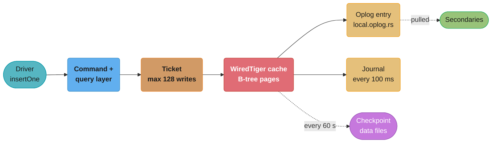
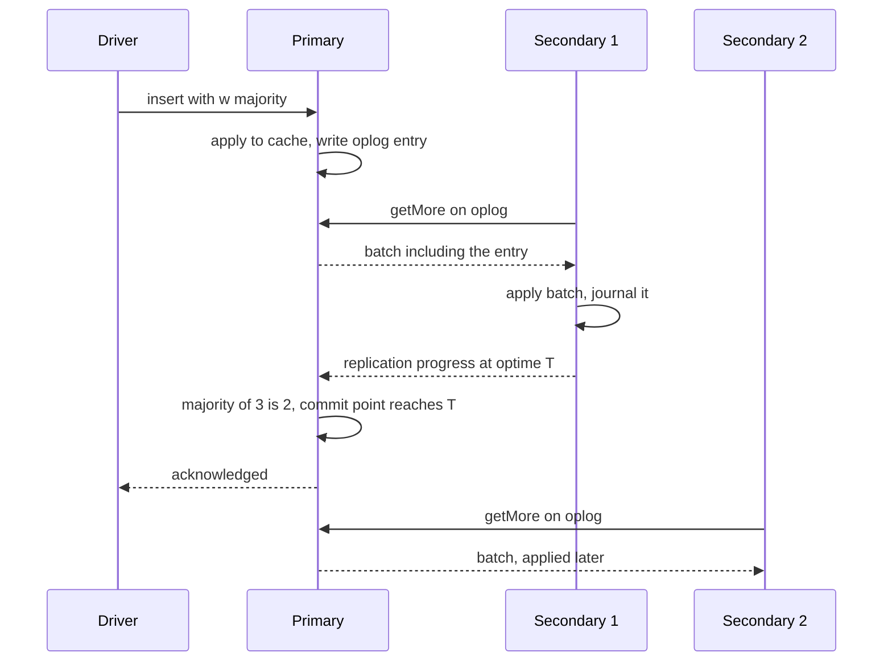
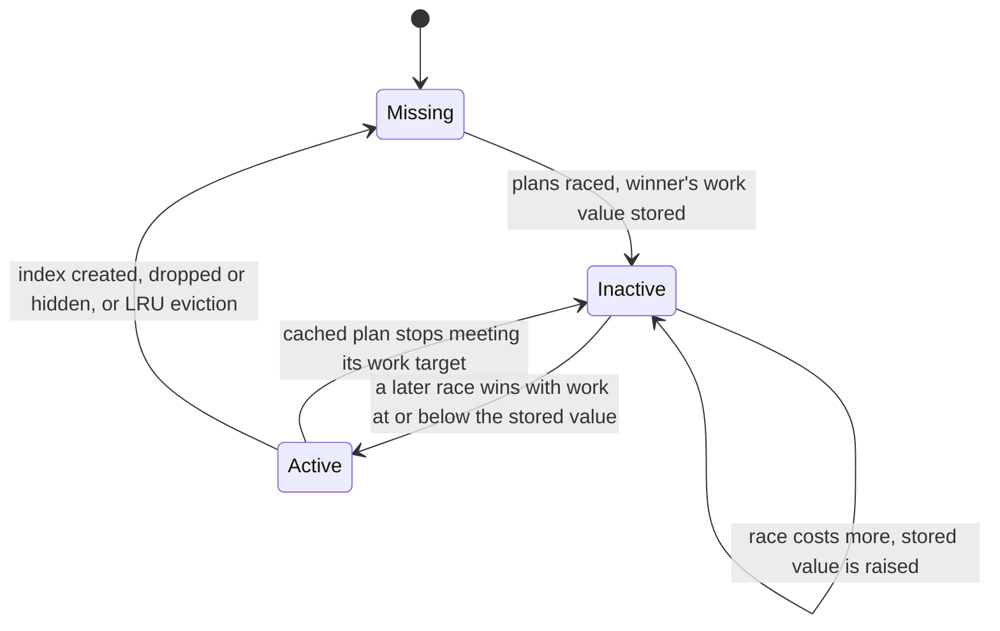
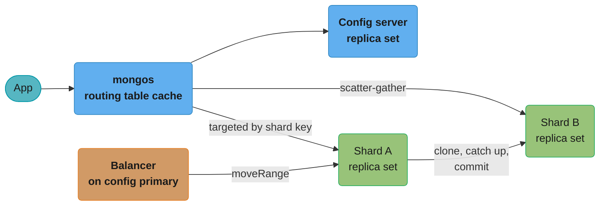

# MongoDB Internals

> **Version anchor (checked 2026-11-25).** **MongoDB 9.0** is current: 9.0.0 shipped on
> 28 September 2026 and the latest patches are **9.0.7** and **9.0.8** (both 10 November 2026;
> 9.0.7 is a security release fixing 25 CVEs, so treat it as the floor). Behaviour that arrived in
> a specific release is tagged inline: `[9.0]` per-operation memory limit and open-transaction
> cap, `[8.3]` cost-based ranker as the plan-selection backup, `[8.0]` `moveCollection` and
> same-key resharding, `[7.0]` dynamic storage-engine tickets, `[6.0]` change-stream pre- and
> post-images and `allowDiskUseByDefault`, `[5.0]` majority read concern always on. **Atlas
> Infinite**, which separates compute from storage, is a public preview; everything below
> describes the classic replica-set architecture (self-managed and Atlas Core) unless it says
> Atlas Infinite.

## 1. Concept Overview

### What this page is, and what it is not

[Document Databases](../document_databases/document_databases.md) teaches the **category**: the
document model, the embedding-vs-referencing decision matrix, the aggregation pipeline as a
language, index types, an overview of sharding and resharding, change streams and transactions
as features, and Queryable Encryption. Every idea there survives swapping MongoDB for another
document store.

This page teaches **the `mongod` and `mongos` processes**: how WiredTiger lays collections out on
disk, sizes its cache, versions data and makes it durable; how the oplog replicates and how
elections and rollbacks work; what each write concern and read concern actually waits for; how
the balancer decides to move data and what a migration does; how the query planner picks and
caches plans; how an aggregation pipeline is executed and bounded; and how change streams ride
on the oplog. If a paragraph names `local.oplog.rs`, `WiredTigerHS.wt`, `rollbackTimeLimitSecs`
or a balancer threshold, it is a fact about MongoDB and it lives here.

Peer pages: [Key-Value Stores](../key_value_stores/key_value_stores.md) and
[DynamoDB Deep Dive](../dynamodb_deep_dive/dynamodb_deep_dive.md) for the managed key-value
contrast, [Wide-Column Databases](../wide_column_databases/wide_column_databases.md) for the
leaderless contrast, and [Storage Engines Internals](../storage_engines_internals/storage_engines_internals.md)
for B-tree and LSM theory.

### A correction worth making early

MongoDB stores every collection and every index as a separate **WiredTiger row-store B-tree**
table. WiredTiger the library also implements other structures, but a MongoDB deployment does
not use an LSM tree for collections or indexes. "WiredTiger is an LSM engine" is a common
interview error.

### The one-sentence thesis

**A MongoDB replica set is one primary that applies writes to a cache of compressed B-trees,
journals them every 100 ms, checkpoints them every 60 seconds, and ships an idempotent operation
log to secondaries that pull it, and almost every production incident is one of those four
numbers or that log meeting a workload it was not sized for.**

- **Cache.** The WiredTiger cache defaults to 50% of (RAM minus 1 GB). When the working set or
  the dirty data outgrows it, latency rises long before memory runs out (§6.2).
- **Journal and checkpoint.** A write acknowledged with `w: 1` and no journal wait can be lost
  in a crash within the 100 ms journal interval (§6.5).
- **Oplog.** It is a capped collection. Its time window bounds how long a secondary can lag,
  how long a change stream can be down and how long a rollback can reach back (§6.6).
- **Majority.** `w: "majority"` is the default and is what makes acknowledged writes survive
  failover; anything less is a bet (§6.6).

---

## 2. Intuition

> **One-line analogy:** a MongoDB replica set is a newsroom where one editor (the primary) edits
> the master copy and dictates every change into a rolling tape (the oplog); the other editors
> (secondaries) replay the tape onto their own copies. The tape is a fixed length, so anyone who
> falls further behind than the tape is long has to start again from a fresh copy.

**Mental model.** Inside each `mongod`, WiredTiger keeps hot B-tree pages uncompressed in its
cache and compressed on disk. Every change goes into the cache and into a journal record; a
checkpoint every 60 seconds writes a consistent snapshot of all files. Replication is a second,
logical layer on top: the oplog records operations, not pages, and every entry can be applied
twice safely.

**Why it matters.** The two most expensive MongoDB mistakes are invisible in development. One is
a write concern weaker than majority, which looks fine until a failover silently rolls back
acknowledged writes. The other is an oplog window shorter than the longest thing that depends on
it, which looks fine until a secondary needs an hour of maintenance or a change-stream consumer
is down over a weekend.

**Key insight.** *Every durability and freshness guarantee in MongoDB is expressed as "which
point in the oplog has reached which members".* Write concern waits for an oplog position to
reach a set of members. Majority read concern reads at the majority-committed position. A change
stream is a cursor on the oplog. Rollback discards oplog entries that never reached a majority.
Once you see the oplog as the spine, the settings stop being a list and become one model.

---

## 3. Core Principles

- **One writer per replica set.** Only the primary accepts writes. Secondaries apply the
  primary's oplog. Scaling writes means sharding, not adding members.
- **Document-level optimistic concurrency.** WiredTiger detects conflicting writes to the same
  document and MongoDB retries the loser transparently; collection and database locks are intent
  locks for most operations.
- **MVCC snapshots.** Each operation reads a point-in-time snapshot; older versions needed by
  open snapshots move to the history store file `WiredTigerHS.wt`.
- **Durability is journal plus checkpoint.** Recovery replays the journal from the last
  checkpoint.
- **Replication is logical and idempotent.** Oplog entries describe the resulting change, not
  the command, so applying an entry twice gives the same result.
- **Majority is the commit point.** A write is safe from rollback once a majority of
  data-bearing voting members have it; MongoDB keeps oplog entries past their size limit rather
  than delete the majority commit point.
- **Sharding moves ranges, not documents.** The balancer migrates contiguous shard-key ranges
  between shards when the data imbalance for a collection crosses a threshold.
- **The planner learns by racing.** Candidate plans compete for a short trial; the winner is
  cached per query shape and evicted when it stops performing.

---

## 4. Types / Architectures / Strategies

### 4.1 Deployment topologies

| Topology | Members | Use |
|---|---|---|
| Standalone | One `mongod` | Development only: no oplog, no change streams, no transactions |
| Replica set PSS | Primary + 2 secondaries | The production default: survives one member loss with majority writes intact |
| Replica set PSA | Primary + secondary + arbiter | Cheaper, but the default write concern drops to `w: 1` (§6.6) |
| Sharded cluster | `mongos` routers, a config server replica set, N shard replica sets | Data or write throughput beyond one primary |
| Atlas Infinite (preview) | Compute nodes over a separate managed storage layer | Two electable compute nodes; storage handles replication and failover |

### 4.2 The layers inside one `mongod`

| Layer | What lives there |
|---|---|
| Network and command layer | Wire protocol, authentication, command dispatch |
| Query layer | Parser, canonical query shape, planner (multi-planner plus cost-based ranker), plan cache, execution engines (classic and slot-based) |
| Replication layer | Oplog writer, oplog fetcher and applier on secondaries, elections, write and read concern waiting |
| Storage API | Record stores and sorted-data interfaces that map collections and indexes onto WiredTiger tables |
| WiredTiger | Cache, B-trees, MVCC, history store, journal, checkpoints, block compression |

### 4.3 Write concern, read concern and read preference

| Setting | Values | What it controls |
|---|---|---|
| Write concern `w` | `0`, `1`, `"majority"`, a number, a tag | How many members must have the write before the client gets an acknowledgment |
| Write concern `j` | `true` / `false` | Whether acknowledgment waits for the on-disk journal |
| `wtimeout` | milliseconds | Stops waiting; the write is **not** undone |
| Read concern | `local`, `available`, `majority`, `linearizable`, `snapshot` | Which committed state a read may return |
| Read preference | `primary`, `primaryPreferred`, `secondary`, `secondaryPreferred`, `nearest` | Which member serves the read |

### 4.4 Shard key strategies

| Strategy | Distribution | Range queries on the key | Typical trap |
|---|---|---|---|
| Ranged on a monotonic field (`_id` ObjectId, timestamp) | All inserts hit the shard owning the top range | Efficient | One hot shard, constant migrations |
| Hashed | Even writes | Scatter-gather for ranges | Cannot serve sorted range reads by key |
| Compound (`tenantId`, `createdAt`) | Even across tenants, ordered within one | Targeted per tenant | A huge tenant becomes a jumbo range |
| Zoned | Pinned ranges to shard groups (data residency, hardware tiers) | Targeted | Zone ranges must be kept in step with data |

### 4.5 Schema pattern families

MongoDB's current data-modeling documentation groups its design patterns as: **computed values**
(pre-compute results on write), **grouping data** (bucket a series, handle outliers), **polymorphic
data** (variable fields in one collection), **document and schema versioning**, the **archive
pattern** (move cold data out) and the **single collection pattern** (related documents grouped by
references in one collection). Each one is an answer to an internal cost on this page: bucketing
fights per-document overhead and index size, outlier handling fights unbounded arrays and the 16 MiB
limit, archiving fights cache residency.

---

## 5. Architecture Diagrams

### 5.1 One write through the layers of a primary



The document change and its oplog entry are written in the same storage transaction, so a
crash cannot leave a write without its oplog record. Secondaries pull the oplog; the primary
does not push.

### 5.2 A `w: "majority"` write in a PSS replica set



The client waits until two of three data-bearing voting members have journaled the entry. A
`w: 1` write returns after the first step on the primary, which is why it can be rolled back.

### 5.3 Plan cache entry states



An entry must win twice before the planner trusts it, and it falls back to `Inactive` when its
work exceeds the expectation. Any DDL on the collection flushes its entries.

### 5.4 Sharded cluster and one migration



`mongos` caches the routing table from the config servers and refreshes it when a shard reports
a stale version. The balancer moves a range only when a collection's data on the fullest and
emptiest shard differs by three times the range size.

### 5.5 What the cache default means on real hosts

```
 host RAM   WiredTiger cache = max(0.5 x (RAM - 1 GB), 0.256 GB)    left for OS cache + mongod
 --------   ------------------------------------------------------    -------------------------
   4 GB     |#####                         1.5 GB                     2.5 GB
  16 GB     |##################            7.5 GB                     8.5 GB
  64 GB     |##################################  31.5 GB             32.5 GB
 256 GB     |...........................................  127.5 GB   128.5 GB
```

*The other half is not wasted: the filesystem cache holds compressed data files, and connections,
aggregation stages and index builds allocate outside the WiredTiger cache. Raising
`cacheSizeGB` toward total RAM trades that away and is the classic route to an OOM kill.*

### 5.6 Oplog window arithmetic

```
 oplog size        sustained oplog write rate        window = size / rate
 -----------       --------------------------        ---------------------------------
 50 GB (default    1 MB/s  (quiet OLTP)              51,200 s  = 14.2 hours
 cap on a big       5 MB/s  (busy OLTP)              10,240 s  =  2.8 hours
 disk)             20 MB/s  (bulk updates)            2,560 s  = 42.7 minutes  <-- danger

 anything that needs history longer than the window fails:
   secondary down for maintenance > window  -> too stale, full initial sync
   change stream consumer down > window     -> resume token no longer in oplog
   rollback needing > window                -> cannot roll back, member needs resync
```

*The window is a time, not a size. A bulk update that rewrites 10 million documents can shrink a
14-hour window to under an hour for as long as it runs. `rs.printReplicationInfo()` shows the
current window; set `oplogMinRetentionHours` when a dependent system needs a guaranteed one.*

---

## 6. How It Works — Detailed Mechanics

### 6.1 Files on disk

Under `storage.dbPath`, each collection and each index is its own WiredTiger table file
(`collection-*.wt`, `index-*.wt`). `WiredTiger.wt` is WiredTiger's own metadata table, and
`WiredTigerHS.wt` is the **history store** that keeps older versions of modified values for open
snapshots. The journal lives in its own directory as log files of about 100 MB each.

Compression defaults:

| Object | Default | Alternatives |
|---|---|---|
| Collection blocks | snappy | zlib, zstd, none |
| Time-series collection blocks | zstd | as above |
| Index | prefix compression | can be disabled |
| Journal | snappy (records of 128 bytes or less are not compressed) | zlib, zstd, none |

Compression is per collection and per index, set at creation. Data is compressed on disk and in
the filesystem cache, and uncompressed in the WiredTiger cache, which is why the same data costs
more RAM inside the cache than outside it.

### 6.2 The WiredTiger cache

The default cache size is the larger of 50% of (RAM minus 1 GB) and 0.256 GB. The cache belongs
to the whole `mongod`, not to a database or collection; you cannot pin documents in it, and it
does not reserve separate space for reads and writes.

When the cache is too full or holds too much dirty data, WiredTiger's eviction threads cannot
keep up and application threads are pulled into eviction work, which shows up as latency on
unrelated operations. The three usual causes are a working set larger than the cache, long-running
snapshots or transactions that pin old versions, and bulk writes that dirty pages faster than
checkpoints clean them. Watch `wiredTiger.cache` in `serverStatus`: bytes currently in the cache,
tracked dirty bytes, and pages read into cache per second.

Set `storage.wiredTiger.engineConfig.cacheSizeGB` explicitly whenever `mongod` shares a host or
runs under a container memory limit, so the cache is computed from the memory it can really use.

### 6.3 MVCC, snapshots and the history store

At the start of an operation WiredTiger gives it a point-in-time snapshot. Writers create new
versions; readers see the version that matches their snapshot. Versions still needed by an open
snapshot but evicted from the cache move to `WiredTigerHS.wt`.

`minSnapshotHistoryWindowInSeconds` `[5.0]` (default **300**) is how long the history must be
kept for snapshot reads at a given cluster time. A `snapshot` read with an `atClusterTime` older
than that window fails with `SnapshotTooOld`. Raising it increases disk use in the history store
and pressure on the cache, so raise it only for a measured need such as long consistent exports.

### 6.4 Concurrency: optimistic writes and tickets

Writes use **document-level optimistic concurrency**: MongoDB takes only intent locks at the
global, database and collection levels, and when WiredTiger detects that two operations modified
the same document, one gets a write conflict and MongoDB retries it transparently. A few
operations (some multi-database operations, `renameCollection` in some cases) still need stronger
locks.

Entry to the storage engine is gated by **tickets**. Since `[7.0]` the number of read and write
tickets is adjusted dynamically to protect throughput under overload, never exceeding **128 read
and 128 write tickets**, with read and write counts always equal on one node. A low number of
available tickets is not itself overload; the queued counts under `queues.execution` in
`serverStatus` are the overload signal.

### 6.5 Durability: journal and checkpoints

| Mechanism | Interval | What it guarantees |
|---|---|---|
| Journal flush | Every 100 ms (`storage.journal.commitIntervalMs`), when a new ~100 MB journal file is created, on a `j: true` or majority write, and after each oplog batch on secondaries | Writes since the last checkpoint can be replayed |
| Checkpoint | Every 60 seconds | Data files are consistent up to this point |

Recovery after a crash: find the last checkpoint in the data files, find its record in the
journal, replay everything after it. The previous checkpoint stays valid while a new one is being
written, and the switch happens when WiredTiger's metadata is atomically updated, so a crash
mid-checkpoint falls back to the older one.

The consequence for application code: a write acknowledged with `w: 1, j: false` is in memory on
one node and can be lost if that node crashes before the next 100 ms journal flush.
`w: "majority"` implies a journal wait when `writeConcernMajorityJournalDefault` is true (the
default).

### 6.6 Replication: oplog, elections, write concern, rollback

**The oplog.** `local.oplog.rs` is a capped collection on every member. The primary applies an
operation and records its effect; secondaries fetch entries from any member (chained or from the
primary) and apply them in batches. Entries are idempotent. Writes that change nothing or fail
produce no entry.

| Oplog setting | Default |
|---|---|
| Size on Linux or Windows with WiredTiger | 5% of free disk, at least 990 MB, at most 50 GB |
| Resize | `replSetResizeOplog`, online, no restart |
| Minimum retention | None by default; `storage.oplogMinRetentionHours` keeps entries younger than N hours even past the size |
| Exceeding the size | Allowed when needed to keep the majority commit point |

**Elections.** Members send heartbeats every 2 seconds. A member that does not answer within 10
seconds is marked inaccessible, and a secondary that loses the primary for longer than
`electionTimeoutMillis` (10 seconds by default) calls an election. MongoDB's documentation says
the median time to elect a new primary should not typically exceed **12 seconds** with default
settings. Writes fail until a primary exists; reads with a secondary-permitting read preference
continue. `catchUpTimeoutMillis` lets a newly elected primary catch up from a more current
secondary before accepting writes, trading failover time against preserving `w: 1` writes.

**Default write concern.** The implicit default is `{ w: "majority" }`, with one exception
computed from the configuration:

```
if (arbiters > 0) and (non_arbiter_voting_members <= majority(voting_members)):
    default write concern = { w: 1 }
else:
    default write concern = { w: "majority" }

PSS: voting 3, majority 2, non-arbiters 3 -> majority
PSA: voting 3, majority 2, non-arbiters 2 -> w: 1   (the arbiter trap)
```

**Rollback.** If a primary accepted writes that no other member received and then lost its
primary role, it rolls those writes back when it rejoins. Writes acknowledged with
`w: "majority"` are never rolled back. Rolled-back documents are written to rollback files when
`createRollbackDataFiles` is on (the default), for manual reconciliation. The rollback time limit
defaults to **24 hours** (`rollbackTimeLimitSecs`); a member that would need to roll back further
needs a resync. Since `[5.0]` `enableMajorityReadConcern` is always true.

**Read concerns, briefly.** `local` returns the member's latest data, which may roll back.
`majority` returns data acknowledged by a majority, which will not roll back. `linearizable`
(primary only) also confirms the primary is still primary, so it is slow. `snapshot` gives a
consistent point-in-time view across documents, used by transactions and `atClusterTime` reads.
Causally consistent sessions combine majority reads and writes so a client reads its own writes
even from secondaries.

### 6.7 Multi-document transactions

- Snapshot isolation over the documents touched, across collections and, on sharded clusters,
  across shards (two-phase commit coordinated by a shard).
- Runtime limit: `transactionLifetimeLimitSeconds`, default **60 seconds**; an older transaction
  is aborted by a background process.
- A transaction writes as many oplog entries as it needs, so there is no 16 MiB total size
  limit, but each entry must still fit in 16 MiB.
- `[9.0]` At most `maxConcurrentMultiDocumentTransactions` (default **10,000**) open
  transactions from external clients; beyond that the server returns `TooManyOpenTransactions`.
- Every open transaction pins a snapshot, so long or abandoned transactions grow the history
  store and add cache pressure. The documentation's guidance: abort abandoned transactions and
  abort and retry on an error.

Retry logic belongs in the driver's `withTransaction` helper, which retries the whole transaction
on `TransientTransactionError` and the commit on `UnknownTransactionCommitResult`.

### 6.8 Sharding: routing, balancing, migrations, resharding

**Routing.** `mongos` keeps a cached routing table (which shard owns which shard-key range,
with a version). A query with the shard key, or a prefix of a compound shard key, is **targeted**
to the owning shards; anything else is **scatter-gather** to all shards and merged on `mongos`.

**Balancing.** The balancer runs on the config server primary and is enabled by default.

| Balancer fact | Value |
|---|---|
| Default range (chunk) size | 128 MB |
| Migration threshold | Data difference of 3 x range size between the fullest and emptiest shard for a collection: 384 MB at the default |
| Concurrent migrations | Each shard in at most one migration; at most floor(n/2) across n shards |
| Cleanup | Asynchronous range deletion on the donor after commit |
| Too-large ranges | Marked jumbo; `attemptToBalanceJumboChunks` or `forceJumbo` to move them |

A migration clones the range from donor to recipient while the donor keeps serving writes,
streams the changes made during the clone, then takes a short critical section to commit the
new ownership in the config servers. Orphaned documents left on the donor are removed in the
background; until then, unfiltered reads on a shard directly (not through `mongos`) can see
them.

**Resharding.** `reshardCollection` rebuilds a collection under a new shard key online. Before
starting, check two documented requirements:

```
write block at commit: the collection blocks writes for up to 2 seconds
free storage per recipient shard >= ((collection_storage + total_index_size) x 2) / shards

example: 3 TB collection + 0.6 TB indexes onto 6 shards
         ((3.0 + 0.6) x 2) / 6 = 1.2 TB free on every shard
```

`[8.0]` adds resharding on the **same** shard key (`forceRedistribution: true`) to spread data
onto new shards or zones, and `moveCollection` to move an unsharded collection to another shard.

### 6.9 The query planner

For a new query shape the planner generates candidate plans from the usable indexes and races
them for a short trial. In the classic multi-planner the winner returns the most results for the
least work. Since `[8.3]` multi-planning has a **cost-based ranker (CBR)** as backup: if no plan
produces results within the trial, rules decide whether to keep racing or let CBR rank plans by a
cost function over cardinality estimates. MongoDB states it currently invokes CBR for a small
share of queries.

The winner is cached per **plan cache query shape** with the Missing, Inactive, Active state
machine shown in §5.3. The plan cache is in memory only, cleared on restart, flushed for a
collection by any DDL on it (index create, drop or hide), and LRU-bounded. Debug information is
kept only while the total of all plan caches is under 0.5 GB. `explain()` bypasses the cache.
Each shape has a `planCacheShapeHash` (also exposed as `queryHash`), which is how you find all
slow queries of one shape in logs and `$planCacheStats`.

Index design follows the **ESR guideline**: equality fields first, then sort fields, then range
fields. An index `{ status: 1, created: -1, amount: 1 }` serves
`{ status: "OPEN", amount: { $gt: 100 } }` sorted by `created` without an in-memory sort.

A plan flip, where a shape's cached plan changes to a worse one after data drift or a new index,
is the classic sudden regression. Pin a known-good plan with query settings (`setQuerySettings`)
or index filters, then fix the root cause.

### 6.10 Aggregation execution and memory

- The optimizer reorders and coalesces stages: a `$match` that only depends on original fields
  moves ahead of `$project` and `$addFields`; `$sort` followed by `$limit` becomes a top-k sort;
  a leading `$match` and `$sort` can use indexes.
- A pipeline may have at most **1,000** stages.
- Each blocking stage (`$group`, `$sort`, `$bucket`, `$setWindowFields` and others) has a
  **100 MB** memory limit; since `[6.0]` `allowDiskUseByDefault` (true) lets stages over the
  limit spill to temporary files.
- `[9.0]` A **per-operation memory limit** caps a whole query at 1 GB or 20% of the memory
  available to the server process, whichever is greater. Operations over it fail with
  `ExceededMemoryLimit` or `QueryExceededMemoryLimitNoDiskUseAllowed`. The per-stage limit and
  spilling are unchanged.
- On a sharded collection the pipeline is split: stages that can run per shard execute on the
  shards; the rest run on a merging node. A `$group` on the shard key runs mostly on shards; a
  `$sort` on a non-key field ends in a merge.
- `[9.0]` Server-side JavaScript (`$function`, `$accumulator`, `$where`) is re-enabled on a
  WebAssembly engine and no longer deprecated, except on ppc64le. It is still far slower than
  native operators.

### 6.11 Change streams

A change stream is an aggregation cursor over the oplog, available on replica sets and sharded
clusters with WiredTiger. Each event's `_id` is its **resume token**; the pipeline must not
remove or change it. A consumer resumes with `resumeAfter` or `startAfter`, or opens at a point
in time with `startAtOperationTime`, and in both cases the point must still be inside the oplog
window. A consumer that is down longer than the window cannot resume and must rebuild.

- Update events carry the changed fields only. `fullDocument: "updateLookup"` reads the current
  majority-committed version of the document, which may be newer than the change.
- `[6.0]` Pre-images and post-images: with `changeStreamPreAndPostImages` enabled on the
  collection, events can carry the document before (`fullDocumentBeforeChange`) and after the
  change. Pre-images are stored separately and purged; `[9.0]` makes the purge metrics estimates.
- On a sharded cluster, `mongos` merges per-shard streams in cluster-time order.

```javascript
// Resumable consumer: persist the token after the side effect succeeds
let token = db.stream_offsets.findOne({ _id: "orders-indexer" })?.token;
const cs = db.orders.watch(
  [{ $match: { operationType: { $in: ["insert", "update", "replace", "delete"] } } }],
  { resumeAfter: token, fullDocument: "updateLookup" }
);
while (cs.hasNext()) {
  const ev = cs.next();
  indexIntoSearch(ev);                                   // idempotent side effect
  db.stream_offsets.updateOne(
    { _id: "orders-indexer" },
    { $set: { token: ev._id, at: new Date() } },
    { upsert: true, writeConcern: { w: "majority" } }
  );
}
```

### 6.12 Atlas Infinite, in one subsection

Atlas Infinite (public preview) separates compute nodes from a managed storage layer that stores
data, replicates it, serves reads, and runs backups and point-in-time recovery. A cluster has two
electable compute nodes, a primary and a standby, plus up to five read-only or analytics nodes.
Compute nodes do not vote; the storage layer coordinates failover, and scaling or replacing a
compute node does not copy data. `w: "majority"` means a majority inside the storage layer, any
`w` of 2 or more is treated as majority, and a majority write is never rolled back. The oplog
window, initial sync and election mechanics in §6.6 are therefore Atlas Core and self-managed
concerns.

---

## 7. Real-World Examples

- **Sizing a default oplog on a 2 TB volume.** 5% of 2 TB free is 100 GB, so the default caps at
  50 GB. At a sustained 5 MB/s of oplog writes that is a 2.8-hour window (§5.6); a nightly batch
  writing at 20 MB/s cuts it to 43 minutes while it runs. Any secondary rebuild or change-stream
  outage longer than that fails. Teams size the oplog for the worst hour, not the average.
- **Cache on a 64 GB host.** The default cache is 31.5 GB. A team that set `cacheSizeGB: 60` to
  "use all the RAM" left 4 GB for the OS page cache, connections and aggregation memory, and the
  kernel OOM killer took `mongod` during the first large `$group`.
- **Resharding a 3 TB collection.** The documented storage formula gives 1.2 TB free per shard on
  six shards; on Atlas that can mean a temporary storage-tier upgrade before the operation and a
  downgrade after.
- **The PSA cost cut.** Replacing a secondary with an arbiter saves one data-bearing node and
  silently changes the default write concern from majority to `w: 1`, re-opening the rollback
  window that majority writes closed.

---

## 8. Tradeoffs

### 8.1 Write concern

| Write concern | Survives primary crash | Survives failover without rollback | Latency cost |
|---|---|---|---|
| `w: 0` | No | No | None, no acknowledgment |
| `w: 1, j: false` | Only if journaled within 100 ms | No | Primary memory only |
| `w: 1, j: true` | Yes | No | Primary journal flush |
| `w: "majority"` (default) | Yes | Yes | Slowest secondary in the majority |

### 8.2 Read preference against read concern

| Need | Read preference | Read concern |
|---|---|---|
| Read your own write | `primary`, or a causally consistent session | `majority` |
| Cheap reads that tolerate staleness | `secondaryPreferred` or `nearest` | `local` |
| Data that will never be rolled back | any | `majority` |
| Consistent multi-document view | `primary` in a transaction | `snapshot` |
| Prove the primary is still primary | `primary` | `linearizable` (slow) |

### 8.3 Shard key choice

| | Hashed `_id` | Ranged `{ tenant, created }` | Ranged ObjectId |
|---|---|---|---|
| Insert distribution | Even | Even across tenants | One hot shard |
| Tenant query | Scatter-gather | Targeted | Scatter-gather |
| Time-range query per tenant | Scatter-gather | Targeted and ordered | Targeted, all on one shard |
| Risk | No locality | Very large tenant becomes jumbo | Constant migrations, write ceiling of one shard |

### 8.4 MongoDB against its neighbours

| | MongoDB | DynamoDB | PostgreSQL with JSONB |
|---|---|---|---|
| Query model | Rich queries, aggregation, secondary indexes on any field | Key and range, GSIs | Full SQL plus JSON operators and GIN indexes |
| Write scaling | Sharding by range or hash, online resharding | Automatic partitioning, per-partition ceiling | Single primary, or an extension or distributed fork |
| Multi-document transactions | Yes, 60 s default limit | Up to 100 items, Region-local | Yes, full ACID |
| Operations | Self-managed or Atlas | Fully managed | Self-managed or managed instance |
| Change data | Change streams over the oplog | Streams, 24 h | Logical decoding |

---

## 9. When to Use / When NOT to Use

**Use MongoDB when:**

- The data is naturally hierarchical and read as documents, and the schema changes often.
- You need rich secondary indexes and aggregation without designing every access pattern up
  front, as DynamoDB requires.
- Write volume or data size will outgrow one machine and a shard key with good cardinality and
  locality exists.
- You want change streams as a first-class CDC feed.

**Do not use MongoDB when:**

- The workload is relational with many-to-many joins on the hot path; `$lookup` across large
  collections is a scatter-and-join you pay for every time.
- You will run a PSA set or `w: 1` writes for data you cannot afford to lose; the cheap topology
  removes the guarantee that makes MongoDB safe.
- Documents are unbounded (arrays that grow without limit, event logs inside one document); they
  hit the 16 MiB limit and rewrite costs grow with every append.
- Strict serializable multi-entity transactions are the norm rather than the exception.

---

## 10. Common Pitfalls

**Pitfall 1: `w: 1` and the rollback nobody saw.** A payments service writes with `w: 1` for
latency. The primary loses its network, a secondary is elected 11 seconds later, and the old
primary rejoins and rolls back 1,400 acknowledged inserts into rollback files that nobody reads.

```javascript
// BROKEN: acknowledged by the primary's memory only, rolled back on failover
db.payments.insertOne(doc, { writeConcern: { w: 1 } });

// FIX: majority (the default), with a timeout; on timeout the write is NOT undone,
// so the caller must check status before retrying (idempotency key on the document)
db.payments.insertOne(
  { ...doc, _id: idempotencyKey },
  { writeConcern: { w: "majority", wtimeout: 5000 } }
);
```

**Pitfall 2: the arbiter that changed the default.** A PSS set becomes PSA to cut cost. The
implicit default write concern becomes `w: 1` by the documented formula, and every service that
relied on the default lost its rollback protection on the same day. Fix: keep three data-bearing
members, or set the cluster-wide default explicitly with `setDefaultRWConcern`.

**Pitfall 3: the oplog window shorter than the maintenance window.** A secondary is taken down
for a 3-hour disk replacement while a backfill writes 15 MB/s into a 50 GB oplog (57-minute
window). It comes back too stale to catch up and needs a full initial sync of 4 TB. Fix: size
the oplog with `replSetResizeOplog` for the worst write hour times the longest planned outage,
or set `oplogMinRetentionHours`, and pause bulk jobs during maintenance.

**Pitfall 4: the change stream that could not resume.** An indexing consumer is down over a
weekend; the resume token is older than the oplog window and `resumeAfter` fails with history
lost. Fix: alarm when the consumer's last token is older than half the window, keep a full
rebuild path, and size the oplog or `oplogMinRetentionHours` for the longest tolerated consumer
outage.

**Pitfall 5: the ObjectId shard key.** `sh.shardCollection("app.events", { _id: 1 })` sends
every insert to the shard owning the highest range; that shard runs hot and the balancer moves
ranges away constantly. Fix: a hashed key for write-heavy, point-read workloads, or a compound
key such as `{ deviceId: 1, ts: 1 }`, using `reshardCollection` for an existing collection after
checking the storage formula.

**Pitfall 6: unbounded arrays.** A `posts` document embeds every comment. Popular posts grow to
megabytes; each new comment rewrites a large document; a multikey index on `comments.author` adds
one index entry per array element; at 16 MiB inserts fail. Fix: bucket comments into documents
of, say, 100 (the grouping pattern), keep a `commentCount` computed value on the post, and
reference rather than embed beyond the first page.

**Pitfall 7: reading your own write from a secondary.** An API writes an order and immediately
reads it with `secondaryPreferred`; 2% of reads return 404 during replication lag. Fix: read
from the primary for that flow, or use a causally consistent session with majority read and
write concern.

**Pitfall 8: the long transaction.** A batch job opens a transaction, updates 200,000 documents
and takes 70 seconds; it is aborted at 60 seconds, and while it ran its snapshot pinned history
and pushed the cache into eviction for every other client. Fix: batch into many short
transactions or use idempotent non-transactional updates with a checkpoint document.

**Pitfall 9: the cache sized for the host, not the container.** `mongod` in a container with a
16 GB limit on a 128 GB host. Fix: set `cacheSizeGB` explicitly to about half the memory the
process may actually use, and leave room for connections and aggregation.

**Pitfall 10: the plan flip.** After a new index is added, a query shape's cached plan switches
to an index that is selective for most tenants and terrible for the largest, and p99 goes from
8 ms to 4 s for that tenant. Fix: find the shape by `planCacheShapeHash`, pin the good plan with
query settings, then redesign the index so one plan is good for every tenant (often by leading
with the equality field the query always has).

---

## 11. Technologies & Tools

| Tool | What it is for |
|---|---|
| MongoDB Server | The `mongod` and `mongos` processes this page describes |
| MongoDB Atlas | Managed MongoDB, including Atlas Core and the Atlas Infinite preview |
| mongosh | Shell for `rs.status()`, `sh.status()`, `explain()`, `$planCacheStats` |
| MongoDB Compass | GUI for schema analysis, explain plans and index use |
| MongoDB Database Tools | `mongodump`, `mongorestore`, `mongostat`, `mongotop` |
| Percona Server for MongoDB | Source-available MongoDB-compatible server with extra operational features |
| Debezium | CDC connector that can read MongoDB change streams into Kafka |

---

## 12. Interview Questions with Answers

**Q: Is WiredTiger in MongoDB an LSM tree or a B-tree?**
**Short:** MongoDB stores every collection and every index as a separate WiredTiger row-store B-tree table, not an LSM tree.

Each collection and index is its own WiredTiger table file on disk, organised as a row-store B-tree whose pages are uncompressed in the WiredTiger cache and block-compressed on disk (snappy for collections, prefix compression for indexes, zstd for time-series collections by default). Writes update cached pages, are recorded in the journal, and reach the data files at checkpoints every 60 seconds. The LSM confusion comes from the WiredTiger library offering other structures; MongoDB does not use them for collections or indexes. That is why MongoDB's write amplification and read behaviour look like a B-tree engine, not like Cassandra or RocksDB.

**Q: Can a write acknowledged by MongoDB be lost?**
**Short:** Yes, a w:1 write can be lost in a crash before its journal flush or rolled back after a failover, while a majority-acknowledged write cannot be rolled back.

With `w: 1, j: false` the write is acknowledged from the primary's memory and becomes durable at the next 100 ms journal flush; a crash in between loses it. Even journaled, a `w: 1` write that no secondary received is rolled back if the primary fails over and later rejoins, and the rolled-back documents go to rollback files. `w: "majority"`, the implicit default, waits until a majority of data-bearing voting members have the entry journaled, and such writes are never rolled back. Keep the default, and remember that `wtimeout` stops the wait without undoing the write.

**Q: Why does adding an arbiter weaken durability even though it adds a vote?**
**Short:** In a PSA set the documented formula switches the implicit default write concern from majority to w:1, because a majority of voters cannot be reached with data-bearing members alone.

The rule is: if there are arbiters and the number of non-arbiter voting members is not greater than the voting majority, the default write concern is `w: 1`. In PSA there are 3 voters, the majority is 2, and only 2 members carry data, so the default becomes `w: 1`. If you force `w: "majority"` in PSA, one secondary outage blocks every majority write. Use three data-bearing members, or set the default explicitly with `setDefaultRWConcern` and accept the availability tradeoff consciously.

**Q: What is the oplog window and what breaks when it is too short?**
**Short:** It is the time span between the oldest and newest oplog entries, and anything needing more history than that fails: lagging secondaries, change-stream resumes and long rollbacks.

The oplog is a capped collection sized by bytes (by default 5% of free disk, between 990 MB and 50 GB), so its window in time depends on the write rate. A secondary offline longer than the window becomes too stale and needs a full initial sync; a change stream cannot resume from a token older than the window; a rollback cannot reach back past it. Bulk updates shrink the window sharply while they run. Monitor it with `rs.printReplicationInfo()`, resize online with `replSetResizeOplog`, and set `oplogMinRetentionHours` when another system depends on a minimum.

**Q: How large is the WiredTiger cache by default, and why not give it all the RAM?**
**Short:** It is the larger of 50% of (RAM minus 1 GB) and 0.256 GB, and the remaining memory serves the OS file cache, connections and query memory.

On a 64 GB host the default is 31.5 GB. The other half holds the filesystem cache of compressed data files, which makes cache misses cheap, plus per-connection memory, aggregation stages, sorts and index builds that allocate outside the WiredTiger cache. Raising the cache toward total RAM removes that headroom and leads to OOM kills during large aggregations. In containers or on shared hosts, set `cacheSizeGB` explicitly, because the default is computed from the memory the process can see, not the limit it lives under.

**Q: How does MongoDB recover after a crash?**
**Short:** It opens the last valid checkpoint, then replays the journal records written after it.

WiredTiger writes a consistent checkpoint of all data files every 60 seconds; while a new checkpoint is written the previous one stays valid, and the switch is an atomic metadata update. Between checkpoints, every change is in the journal, flushed every 100 ms and on journaled or majority writes. Recovery locates the last checkpoint, finds its record in the journal and applies everything after it. On a replica set member, replication then resumes from the member's last applied oplog entry. Data loss on crash is therefore bounded by the journal interval for unjournaled writes and is zero for journaled ones.

**Q: How does MongoDB handle two clients updating the same document at the same time?**
**Short:** WiredTiger uses document-level optimistic concurrency, so one operation hits a write conflict and MongoDB transparently retries it.

Writes take only intent locks at the global, database and collection levels, so writes to different documents run in parallel. When two operations modify the same document, WiredTiger detects the conflict and one of them is retried automatically outside a transaction. Inside a multi-document transaction, a conflict aborts the transaction with a `WriteConflict` labelled `TransientTransactionError`, and the driver's `withTransaction` retries the whole transaction. For application-level lost-update protection, use a version field in the update filter, because the database only serialises the writes, it does not know your invariants.

**Q: What does the balancer actually do, and when does it move data?**
**Short:** It migrates shard-key ranges for a collection when the fullest and emptiest shards differ by three times the range size, 384 MB at the default 128 MB.

The balancer runs on the config server primary, checks per collection, and starts a round only when the imbalance crosses the threshold. Each shard can take part in one migration at a time, so a cluster of n shards runs at most floor(n/2) migrations concurrently. A migration clones the range, streams changes made during the clone, commits ownership in a short critical section, and deletes the donor's copy asynchronously. Ranges too large to move are labelled jumbo. Balancing cost competes with your workload, so many teams schedule a balancing window.

**Q: Why is an ObjectId a poor shard key, and what are the alternatives?**
**Short:** ObjectIds increase monotonically, so every insert lands on the shard owning the top range, creating one hot shard and constant migrations.

The leading bytes of an ObjectId are a timestamp, so new documents always sort after existing ones and fall into the last range. Write throughput is capped at one shard and the balancer keeps moving ranges off it. A hashed shard key spreads inserts evenly but turns range queries on the key into scatter-gather. A compound key such as `{ tenantId: 1, createdAt: 1 }` spreads load across tenants and keeps each tenant's queries targeted and ordered, at the risk of a jumbo range for an outsized tenant. An existing collection can be moved to a new key with `reshardCollection`.

**Q: What does reshardCollection cost?**
**Short:** It needs about twice the collection plus index size in free storage, divided across the shards, and it blocks writes to the collection for up to 2 seconds at commit.

MongoDB builds the collection under the new shard key on the recipient shards while the old one keeps serving, applies ongoing changes, and then commits, blocking writes for up to 2 seconds. Each recipient shard needs free storage of at least `((collection_storage + total_index_size) x 2) / number_of_shards`, so 3 TB of data with 0.6 TB of indexes on 6 shards needs 1.2 TB free per shard. Since 8.0 you can also reshard on the same key to redistribute data onto new shards or zones. If the 2-second write block is unacceptable, refining the existing shard key is the alternative.

**Q: How does the query planner choose and cache a plan?**
**Short:** It races candidate plans for a short trial and caches the winner per query shape, with a cost-based ranker as backup since 8.3.

For a new shape, the classic multi-planner runs each candidate briefly and picks the one that returns the most results for the least work. Since 8.3, when no plan produces results in the trial, rules can hand ranking to the cost-based ranker, which estimates cardinalities. The winner enters the plan cache as Inactive and becomes Active only after a later race confirms it; an Active entry drops back to Inactive when its work exceeds expectations. Any DDL on the collection flushes its entries, and the cache is lost on restart. `explain()` ignores the cache, so it can show a different plan from production.

**Q: A query suddenly became 500 times slower with no code change. How do you investigate?**
**Short:** Suspect a plan flip: find the query shape by its planCacheShapeHash, compare cached and explained plans, pin the good plan with query settings, then fix the index.

Data drift, a new index, or a restart can make the planner cache a different plan for the same shape, one that is fine for typical parameters and terrible for some. Search the slow-query log for the shape's `planCacheShapeHash`, inspect `$planCacheStats`, and run `explain("executionStats")` with the slow parameters. Pin the known-good plan with `setQuerySettings` or an index filter to stop the bleeding. The lasting fix is an index that is good for every parameter value, usually by following the equality, sort, range ordering.

**Q: What memory limits apply to an aggregation pipeline in MongoDB 9.0?**
**Short:** Each blocking stage is limited to 100 MB and spills to disk by default, and since 9.0 the whole operation is capped at 1 GB or 20% of server memory, whichever is greater.

Stages such as `$group` and `$sort` that exceed 100 MB write temporary files because `allowDiskUseByDefault` has been true since 6.0. MongoDB 9.0 adds a per-operation limit across all stages of a query, the greater of 1 GB and 20% of the memory available to the process; exceeding it fails with `ExceededMemoryLimit` or `QueryExceededMemoryLimitNoDiskUseAllowed`. Earlier versions let one operation use unbounded memory. Design pipelines to `$match` and `$project` early, use indexes for the leading `$match` and `$sort`, and prefer pre-computed values for dashboards.

**Q: What happens to a change stream consumer that was down for longer than the oplog window?**
**Short:** It cannot resume because its resume token is no longer in the oplog, so it must rebuild its downstream state from a full read.

A change stream is a cursor over the oplog, and each event's `_id` is a resume token that is valid only while the oplog still holds that point. After an outage longer than the window, `resumeAfter` or `startAtOperationTime` fails. Persist the token after the side effect succeeds, alarm when the consumer's lag approaches half the window, keep side effects idempotent because events can be redelivered around a resume, and keep a backfill path. Sizing the oplog or `oplogMinRetentionHours` for the longest tolerated outage is the preventive control.

**Q: Why might fullDocument updateLookup return a document that does not match the update event?**
**Short:** updateLookup reads the current majority-committed version of the document at lookup time, which can include later changes or be gone after a delete.

Update events carry only the changed fields. With `updateLookup`, MongoDB performs a separate read of the document by its identifier and shard key when the event is returned, so it reflects whatever is committed then, possibly several updates later, or nothing if the document was deleted. If the consumer needs the exact state before or after each change, enable pre- and post-images on the collection (since 6.0) and request `fullDocumentBeforeChange` and `fullDocument: "required"` or `"whenAvailable"`, accepting the storage cost of retained images.

**Q: What limits apply to a MongoDB multi-document transaction?**
**Short:** A default 60-second lifetime, a cap of 10,000 concurrently open transactions since 9.0, and the cache and history pressure of the snapshot it pins.

`transactionLifetimeLimitSeconds` defaults to 60, after which the transaction is aborted. A transaction writes as many oplog entries as it needs, so the old 16 MiB total size limit is gone, but each entry must fit in 16 MiB. MongoDB 9.0 rejects new transactions beyond `maxConcurrentMultiDocumentTransactions`, default 10,000, with `TooManyOpenTransactions`. Each open transaction pins a snapshot, so long or abandoned transactions grow the history store and push the cache into eviction for everyone. Keep transactions short and use the driver's retry helpers.

**Q: How long does a MongoDB failover take, and what does the application see?**
**Short:** With default settings the median time to elect a new primary should not exceed about 12 seconds, during which writes fail and must be retried.

Members exchange heartbeats every 2 seconds; a primary unreachable for 10 seconds (`electionTimeoutMillis`) triggers an election by an eligible secondary. Until a new primary is elected, writes fail with retryable errors; reads with a secondary-permitting read preference continue. Drivers retry eligible writes once by default (retryable writes), which covers a clean failover if the operation is idempotent at the server level. Design clients with timeouts above the election window, idempotency keys on writes, and alarms on election events.

**Q: What does the minSnapshotHistoryWindowInSeconds parameter control?**
**Short:** It is how long WiredTiger keeps older versions for snapshot reads at a past cluster time, 300 seconds by default, beyond which such reads fail with SnapshotTooOld.

Snapshot reads with `atClusterTime` need the versions that existed at that time. WiredTiger keeps them in the cache and the history store file `WiredTigerHS.wt` for at least this window. A longer window allows longer consistent exports and reads at older times but increases history-store disk use and cache pressure on write-heavy workloads. Raise it only for a measured need, and do not set it to 0 on config servers, where internal operations rely on snapshot reads.

**Q: How is Atlas Infinite different from a classic replica set?**
**Short:** It separates compute nodes from a managed storage layer that replicates data and coordinates failover, so compute nodes do not vote and scaling does not copy data.

In a classic replica set every member holds a full copy, members elect a primary, and the oplog window governs lag and recovery. In Atlas Infinite, a public preview, the storage layer stores and replicates data, serves reads and runs backups; the cluster has two electable compute nodes, a primary and a standby, plus up to five read-only or analytics nodes. Failover is coordinated by the storage layer, `w: "majority"` means a majority within the storage layer, and a majority write is never rolled back. Concerns like initial sync time and oplog sizing largely disappear for the operator.

---

## 13. Best Practices

- Keep `w: "majority"` as the write concern and set the cluster default explicitly with
  `setDefaultRWConcern` so a topology change cannot weaken it.
- Run three data-bearing voting members; avoid arbiters for data you cannot lose.
- Size the oplog from the worst write hour and the longest dependent outage (secondary
  maintenance, change-stream consumer, rollback), not from the default; set
  `oplogMinRetentionHours` where a consumer depends on it.
- Set `cacheSizeGB` explicitly in containers and on shared hosts; leave roughly half the usable
  memory outside the WiredTiger cache.
- Monitor cache fullness and dirty bytes, ticket queues, replication lag, oplog window, election
  count and plan-cache churn.
- Choose shard keys with high cardinality, low frequency of any single value and non-monotonic
  growth; prefer compound keys that match the most common targeted query.
- Before `reshardCollection`, check the free-storage formula and that the application tolerates a
  2-second write block.
- Follow the equality, sort, range rule for compound indexes, and check `explain` with the worst
  parameter values, not the typical ones.
- Keep transactions short, retry with the driver helpers, and never leave one open across user
  think time.
- Bound arrays; use the grouping pattern for series and the computed-values pattern for
  counters and summaries.
- Persist change-stream resume tokens after the side effect, make consumers idempotent, and alarm
  on consumer lag relative to the oplog window.
- Patch to 9.0.7 or later; it fixes 25 CVEs.

---

## 14. Case Study

### An events platform that outgrew its shard key and its oplog

**Situation.** A device-telemetry platform stores events in `app.events`, sharded on `{ _id: 1 }`
(ObjectId) across 4 shards, each a PSS replica set on 64 GB hosts with 2 TB volumes and the
default 50 GB oplog. A change stream feeds a search index. Peak ingest is 18,000 events/s at
about 1 KB each. (Illustrative figures.)

**Symptoms.**

1. Shard 4's primary runs at 95% CPU while shards 1 to 3 sit at 20%; insert p99 is 180 ms.
2. The balancer moves a range off shard 4 every few minutes, and migration traffic competes with
   ingest.
3. During a nightly re-tagging job (10 million updates), the oplog window on shard 4 falls to
   about 36 minutes. A secondary taken down for a 2-hour OS patch comes back too stale and starts a 1.6
   TB initial sync.
4. On Monday the search-indexer, down since Saturday because of an expired credential, cannot
   resume its change stream.

**Diagnosis.**

- ObjectId is monotonic, so every insert targets the shard holding the top range (§4.4).
- Shard 4's oplog carries all inserts plus the nightly job: 18 MB/s of ingest plus about
  6 MB/s of updates gives 50 GB / 24 MB/s = 2,133 seconds, about 36 minutes.
- The consumer's resume token was 50 hours old, far outside any window this cluster had.

The original configuration:

```javascript
// BROKEN: monotonic shard key, default oplog, consumer with no lag alarm or rebuild path
sh.shardCollection("app.events", { _id: 1 });
// oplog left at the default 50 GB on every shard
const cs = db.events.watch([], { resumeAfter: lastToken });   // fails after a long outage
```

**The fix.**

```javascript
// FIX 1: reshard on a compound key that spreads devices and keeps per-device order
// storage check first: ((1.8 TB data + 0.3 TB indexes) x 2) / 4 shards = 1.05 TB free per shard
db.adminCommand({
  reshardCollection: "app.events",
  key: { deviceId: "hashed", ts: 1 }
});

// FIX 2: size every shard's oplog for the worst hour x the longest planned outage
// 24 MB/s x 3 h = 259 GB -> 300 GB, plus a retention floor for the change stream
db.adminCommand({ replSetResizeOplog: 1, size: 300 * 1024, minRetentionHours: 24 });

// FIX 3: consumer alarms at half the window and falls back to a rebuild, not a crash
function openStream(token) {
  try {
    return db.events.watch([], { resumeAfter: token, fullDocument: "updateLookup" });
  } catch (e) {
    if (e.code === 286) {          // ChangeStreamHistoryLost
      triggerFullReindex();        // rebuild search from a snapshot read
      return db.events.watch([], { startAtOperationTime: rebuildStartTime() });
    }
    throw e;
  }
}
```

The hashed prefix on `deviceId` spreads devices evenly; `ts` keeps each device's events ordered,
so "events for device X between T1 and T2" stays a targeted, indexed range scan. The 300 GB oplog
fits in 15% of each 2 TB volume. The 24-hour retention floor means the oplog may grow beyond 300
GB on a heavy day, so disk alarms were set at 70%.

**Results after 30 days.**

| Metric | Before | After |
|---|---|---|
| Insert CPU, hottest shard | 95% | 41% (all four within 6 points) |
| Insert p99 | 180 ms | 14 ms |
| Range migrations per day | about 400 | about 6 |
| Oplog window during nightly job | 36 minutes | 3.5 hours (24 h floor while consumer lags) |
| Secondary maintenance requiring initial sync | 1 in 3 | 0 |
| Change-stream outages needing full reindex | 1 per month | 0 (alarm at 50% of window) |

The resharding itself needed 1.05 TB free per shard for about 9 hours and blocked writes for
under 2 seconds at commit; the team scheduled it in the lowest-ingest hour and paused the
nightly job.

Related reading: [Document Databases](../document_databases/document_databases.md) for the
modeling decisions, [Sharding and Partitioning](../sharding_and_partitioning/sharding_and_partitioning.md)
for shard-key theory, [Replication and High Availability](../replication_and_high_availability/replication_and_high_availability.md)
for failover tradeoffs, and [Polyglot Persistence Patterns](../polyglot_persistence_patterns/polyglot_persistence_patterns.md)
for CDC into search.
