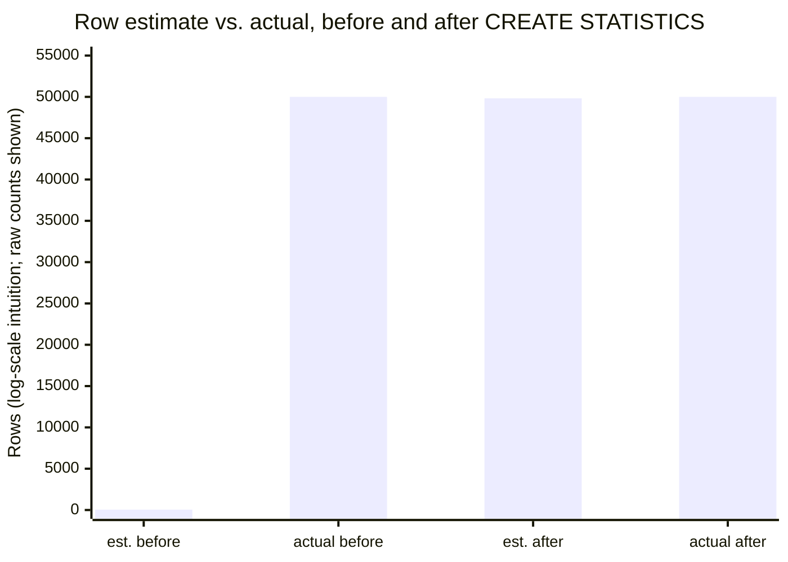

# Planner Cost Model, Statistics & Parallel Execution

> Deep-dive companion to [PostgreSQL Internals](postgresql_internals.md), which owns MVCC,
> VACUUM, WAL, TOAST and the buffer manager. This file owns the other half of "why did the
> planner pick this plan": the arithmetic behind `EXPLAIN`'s cost numbers, how `ANALYZE`
> statistics turn into row estimates, when the planner reaches for extra worker processes,
> when it compiles a query with LLVM, and how a plan gets pinned so it stops changing under
> you. Join-algorithm cost crossovers and generic `EXPLAIN` reading live in
> [SQL Query Optimization](../sql_query_optimization/sql_query_optimization.md) — read that
> first if you have not; this file builds on its cost-model vocabulary rather than
> re-deriving it. **Version anchor (2026-10-19)**: PostgreSQL 18 is current stable; every
> GUC name, default and behaviour below is PG18 unless tagged `[PG19]`. PG19 reached RC1 on
> 15 October 2026 and GA is planned for 19 November 2026; a release candidate can still take
> a fix before GA, so re-check a `[PG19]` default against the final release notes.

---

## 1. Concept Overview

The planner turns a parsed, rewritten query tree into an executable plan by assigning every
candidate plan a numeric cost, computed from a handful of GUC constants and the table/column
statistics `ANALYZE` collected, then picking the cheapest tree. Three largely independent
subsystems build on that same cost model: **extended statistics** correct the cost model's
biggest blind spot (columns that are not actually independent), **parallel execution** lets
the planner spend more CPU cores to lower wall-clock cost when a `Gather` node is cheaper
than a serial scan, and **JIT compilation** trades planning-time cost for execution-time
speed on expensive expressions. All three are cost-driven, not rule-driven — get the cost
inputs wrong and every one of them makes a worse decision, silently.

---

## 2. Intuition

**One-line analogy**: the planner is a delivery-route optimizer that only knows a handful of
average driving speeds — highway, side street, unloading time — and never actually asks
whether today's traffic looks like that average. Statistics are the traffic report; parallel
workers are hiring more trucks when hiring them is cheaper than driving in circles;
JIT is prepping a custom loading dock instead of using the generic one when a shipment is
big enough to be worth the setup time.

**Mental model**: every plan node's cost is priced in units of "one sequential page read"
(`seq_page_cost = 1.0`). Everything else — a random seek, a CPU comparison, spinning up a
worker — is a multiple or fraction of that one unit. Reading an `EXPLAIN` cost is reading an
invoice denominated in page-reads.

- **Key insight**: the planner never measures anything at plan time. It multiplies stored
  statistics by GUC price constants. When the statistics are stale, wrong, or hide a
  correlation, the plan is wrong in a way that looks exactly like a correct plan — a `cost=`
  number with no error attached to it.

---

## 3. Core Principles

### The Five Cost Constants

Every plan node's cost is built from five GUCs (defaults per the current `postgresql.org`
docs for the resource-consumption and query-planning chapters):

| Constant | Default | What it prices |
|---|---|---|
| `seq_page_cost` | `1.0` | Reading one page in physical sequence — the pricing unit everything else is denominated in |
| `random_page_cost` | `4.0` | Reading one page via a non-sequential (random) access |
| `cpu_tuple_cost` | `0.01` | CPU cost to process one row once it is in memory |
| `cpu_index_tuple_cost` | `0.005` | CPU cost to process one index entry during a B-tree descent/scan |
| `cpu_operator_cost` | `0.0025` | CPU cost to evaluate one operator or function call (a `WHERE` predicate, a cast) |

`random_page_cost` defaulting to `4.0` rather than a raw disk-seek penalty (which on 2005-era
spinning media was closer to 40-100x a sequential read) is deliberate: the docs' own
rationale is that most random accesses in practice hit the OS page cache or `shared_buffers`
rather than the platter, so `4.0` already represents a blended, partially-cached average, not
physical seek latency. That is also why the number needs correcting on hardware where the
cache-hit assumption changes.

**`random_page_cost = 1.1` is the standard SSD correction.** An SSD has no seek arm, so a
random 8 KB read costs only marginally more than a sequential one — the residual `0.1` above
`1.0` accounts for the SSD controller's own read-ahead advantage for sequential access, not
seek latency, which no longer exists. Setting it changes every scan-choice crossover in the
planner at once, because `random_page_cost` appears in every index-scan cost formula and in
no seq-scan cost formula — index scans get uniformly cheaper relative to seq scans the moment
you change this one number. §6 below walks the exact arithmetic.

### One Cost Computation, End to End

Take a stated table: `sessions`, 10,000,000 rows across 100,000 pages (about 82 bytes/row —
narrow, mostly-fixed-width columns). Query: `SELECT * FROM sessions WHERE region = 'apac'`,
no `WHERE`-narrowing index used yet.

```
Seq Scan cost = seq_page_cost x pages  +  (cpu_tuple_cost + cpu_operator_cost) x rows
              = 1.0 x 100,000          +  (0.01 + 0.0025) x 10,000,000
              = 100,000                +  125,000
              = 225,000
```

The disk term (`100,000`) reads every page once; the CPU term (`125,000`) evaluates the
`region = 'apac'` predicate against every one of the 10,000,000 rows, whether or not they
match — a seq scan's CPU cost does not depend on selectivity at all, only its output row
count does. This is why the two terms are shown separately: only the CPU term changes if the
predicate gets more expensive to evaluate (a regex vs an equality), and neither term changes
if `region` gets more or less selective.

Now an index scan on `region`, matching 50,000 of the 10,000,000 rows (0.5% selectivity),
worst case one distinct heap page per matching row (no physical correlation between index
order and heap order):

```
Index Scan cost = cpu_index_tuple_cost x matches
                 + random_page_cost x min(matches, pages)
                 + cpu_tuple_cost x matches
                 = 0.005 x 50,000 + 4.0 x 50,000 + 0.01 x 50,000
                 = 250 + 200,000 + 500
                 = 200,750                          (vs. seq scan 225,000 -- 1.12x cheaper)
```

Re-run the same arithmetic with `random_page_cost = 1.1` for SSD storage:

```
Index Scan cost = 250 + 1.1 x 50,000 + 500
                 = 250 + 55,000 + 500
                 = 55,750                            (vs. seq scan 225,000 -- 4.04x cheaper)
```

That is the whole story of the SSD correction in one pair of numbers: at `random_page_cost =
4.0` the index scan only barely wins (1.12x); at `1.1` it wins by 4x, because the one term
that scales with the number of matching rows just got 3.6x cheaper per row while the seq
scan's cost did not move at all. Note this is the textbook worst-case model (zero
correlation between index order and heap order) — PostgreSQL's actual `cost_index()`
interpolates between the random-page and sequential-page price using the column's
`correlation` statistic (§4 below), so a real, well-correlated index wins by more than this
worst-case arithmetic shows, and the practically-observed crossover selectivity on SSD tends
to sit well above the number this simplified model would predict. [SQL Query
Optimization](../sql_query_optimization/sql_query_optimization.md) works the join-algorithm
side of the same cost model — nested loop vs. hash vs. merge join crossovers — which this
file does not re-derive.

---

## 4. Types / Architectures / Strategies

### Statistics Kinds (`pg_statistic` / `pg_stats`)

`ANALYZE` populates one row per column in `pg_statistic` (readable via the `pg_stats` view),
holding: `n_distinct` (negative = fraction of rows that are distinct, positive = an absolute
sampled count), `most_common_vals` / `most_common_freqs` (the MCV list — the top values by
frequency, up to `default_statistics_target` entries, default `100`), a histogram of
`default_statistics_target` equal-frequency buckets over the remaining values, and
`correlation` (`-1.0`..`1.0`, how closely physical row order tracks the column's value
order — high correlation makes range scans and index scans cheap because consecutive matches
share heap pages).

### Extended Statistics (`CREATE STATISTICS`) — Three Kinds

Single-column statistics assume every column is independent, which the planner exploits by
multiplying single-column selectivities together for an `AND`-ed predicate. That assumption
is false whenever columns are correlated (`city` narrows `state`) or functionally dependent
(`zip_code` determines `city` outright). `CREATE STATISTICS` builds multivariate statistics
across a named column set to fix exactly that:

| Kind | What it stores | Fixes |
|---|---|---|
| `ndistinct` | Combined distinct-value count across the column set | `GROUP BY (a, b)` cardinality estimates, which single-column `n_distinct` cannot answer |
| `dependencies` | Per-pair functional-dependency strength, `0`..`1` | `AND`-ed equality predicates where one column's value statistically determines another's |
| `mcv` | The actual joint most-common **combinations**, with their real observed frequency | The specific correlated-skew case: a particular `(a, b)` pair is far more (or less) common than independence predicts |

`CREATE STATISTICS name (kind[, ...]) ON col1, col2 FROM table;` — omitting the kind list
builds all three. **The object is empty until the next `ANALYZE`** — creating it does not
populate it (§10 covers this as a standing trap).

### Parallel Execution Nodes

| Node | What it does | Chosen when |
|---|---|---|
| `Gather` | Launches N workers, collects their output in arbitrary row order | Any parallel-safe subplan whose per-worker cost beats `parallel_setup_cost + parallel_tuple_cost x rows` |
| `Gather Merge` | Same, but preserves a sort order — each worker feeds pre-sorted rows, the leader merges | An `ORDER BY` (or a merge join above it) can be satisfied by sorted worker output |
| `Parallel Seq Scan` | Each worker claims a block range from the table, round-robin | Table exceeds `min_parallel_table_scan_size` (default `8MB`) |
| `Parallel Bitmap Heap Scan` | Bitmap built once (leader or a worker), heap pages divided across workers | An indexable predicate is selective enough for a bitmap, and the heap fetch is the expensive part |
| `Parallel Index / Index-Only Scan` | Workers divide leaf-page ranges of a B-tree | Index exceeds `min_parallel_index_scan_size` (default `512kB`) |
| `Parallel Hash Join` | All workers cooperatively build **one shared** hash table, then each probes it | Both a parallel-safe outer scan and a build side worth sharing |
| `Parallel Append` | Each worker takes whole branches of a `UNION ALL` / partition set | Partitioned tables or `UNION ALL` queries — see also partition-wise joins in the parent module |

**Leader participation**: the process that ran the planner is also a worker by default — it
executes part of the parallel subplan itself while waiting on the others, rather than sitting
idle. This is why a plan can show `Workers Launched: 4` but the real fan-out is effectively 5
execution contexts.

### JIT Compilation Levels

JIT is not one on/off switch — it is three cost thresholds that layer more (and more
expensive-to-produce) compiled code on top of the previous level:

| GUC | Default | What crossing it adds |
|---|---|---|
| `jit_above_cost` | `100000` | Compile the query's expressions (predicates, projections, aggregates) to native code via LLVM instead of interpreting them tree-walk style |
| `jit_optimize_above_cost` | `500000` | Run LLVM's optimization passes over that compiled code — better code, slower to produce |
| `jit_inline_above_cost` | `500000` | Additionally inline small functions and operators into the compiled expression — best code, most compile time |

`[PG19]` The `jit` GUC itself defaults to `on` in every currently-shipped stable release
(PG12 through PG18), but **PostgreSQL 19 flips the default to `off`**, per the committed
change to `jit` (`pgsql-committers`, "jit: Change the default to off") and PG19's own release
notes. The commit's stated reason: JIT reliably helps large analytical scans but "may be so
expensive it completely outweighs the JIT benefits for shorter queries," most large-scale
deployments including the major managed-Postgres vendors already disabled it by default, and
the new default aligns core with that established practice. §6 below walks the pathology this
was written to stop.

### Table Access Methods `[PG12]`

Since PostgreSQL 12, storage is a pluggable interface (`tableam.h`) rather than a hardcoded
heap format. `heap` remains the built-in default (`default_table_access_method = 'heap'`),
and a new AM is registered with `CREATE ACCESS METHOD name TYPE TABLE HANDLER
handler_function;`, then selected per table with `CREATE TABLE ... USING name` or clusterwide
via `default_table_access_method`. The real alternatives in production are almost all
**columnar** AMs — Citus's built-in `columnar` access method is the most widely deployed
in-core-compatible example — trading heap's cheap single-row read/write for column-oriented
compression and vectorized scans on analytical workloads. This is the smallest of this file's
topics because most OLTP schemas never leave `heap`; treat it as "know the interface exists
and what problem it is for," not a deep mechanism to master.

### Asynchronous I/O `[PG18]`

`[PG18]` PostgreSQL 18 added an asynchronous I/O subsystem, controlled by `io_method`, that
lets a backend queue multiple page-read requests instead of blocking on each one — the
release notes describe it as improving "sequential scans, bitmap heap scans, vacuums, and
other operations." Three values:

| `io_method` | Default? | Mechanism | Platform |
|---|---|---|---|
| `sync` | No | The pre-PG18 blocking-read behaviour, kept for troubleshooting/compatibility | All |
| `worker` | **Yes** (PG18 default) | Dedicated background I/O workers (count set by `io_workers`, default `3`) perform reads on the backend's behalf | All (Linux, macOS, Windows) |
| `io_uring` | No | Hands read requests to the Linux kernel's `io_uring` interface, sharing a ring buffer with the kernel to cut syscall overhead | Linux only, kernel 5.1+, and PostgreSQL must be built `--with-liburing` |

`effective_io_concurrency` and `maintenance_io_concurrency` (both default `16`) now also
work on platforms lacking `posix_fadvise()`, because the AIO subsystem no longer depends on
that call to prefetch. **No official PostgreSQL source states a specific speedup multiplier**
for this change — the release notes describe the mechanism, not a benchmark number, so this
file omits one rather than repeating an unsourced "2-3x" figure circulating in secondary
blog posts. What the change reliably improves: cold-cache sequential scans and bitmap heap
scans, where the backend previously issued one blocking read, waited, then issued the next —
now it can have several reads in flight at once, and the actual win depends on storage
latency, queue depth support, and how cold the cache really is.

### Plan Stability Mechanisms

| Mechanism | Where it lives | What it actually does |
|---|---|---|
| `enable_seqscan` / `enable_nestloop` / etc. | Core, session-settable GUCs | Blunt on/off switches per plan-node type — a **diagnostic** tool ("does disabling this change the plan?"), not a targeted fix; flipping one off can push every other query on the connection onto a worse plan |
| `pg_hint_plan` | Out-of-tree extension (third-party, not in PostgreSQL core or `contrib`) | Oracle/MySQL-style `/* comment */` hints embedded in SQL text; the closest thing Postgres has had to inline plan hints, for over a decade, precisely because core never shipped one |
| CTE materialization fence | Core, `AS MATERIALIZED` / `AS NOT MATERIALIZED` `[PG12]` | An accidental optimization fence before PG12 (multiply-referenced CTEs always materialized); made explicit and controllable in PG12 — full mechanics in [SQL Query Optimization §6](../sql_query_optimization/sql_query_optimization.md), not re-derived here |
| `pg_plan_advice` / `pg_stash_advice` | `[PG19]`, in-core `contrib` module | Attaches verified "advice" to a specific query id so a plan you have checked stops flipping when statistics change — see §12 for exactly what "in-core" and "beta" mean here |

---

## 5. Architecture Diagrams

```mermaid
flowchart LR
    classDef io      fill:#61afef,stroke:#2e86c1,color:#1a1a1a,font-weight:bold
    classDef frozen  fill:#c678dd,stroke:#9b59b6,color:#fff
    classDef train   fill:#98c379,stroke:#27ae60,color:#1a1a1a
    classDef mathOp  fill:#d19a66,stroke:#e67e22,color:#1a1a1a,font-weight:bold
    classDef lossN   fill:#e06c75,stroke:#c0392b,color:#fff,font-weight:bold
    classDef req     fill:#56b6c2,stroke:#0097a7,color:#1a1a1a
    classDef base    fill:#e5c07b,stroke:#f39c12,color:#1a1a1a

    Cost(["Cost estimate<br/>from pg_statistic"]) --> Cheap{"Cheapest serial<br/>plan cost?"}
    Cheap -->|"table/index above<br/>min_parallel_*_scan_size"| ParChk{"Parallel-safe<br/>subplan?"}
    Cheap -->|"below threshold"| Serial["Serial plan"]
    ParChk -->|"yes"| Workers["compute worker count<br/>(tripling formula, capped)"]
    ParChk -->|"no (volatile fn,<br/>write, WITH HOLD)"| Serial
    Workers --> Gather["Gather / Gather Merge<br/>+ leader participation"]
    Serial --> JitChk{"plan cost ><br/>jit_above_cost?"}
    Gather --> JitChk
    JitChk -->|"no"| Exec["Execute<br/>(tree-walk interpreter)"]
    JitChk -->|"yes"| Jit["LLVM-compile expressions<br/>(+optimize/+inline past<br/>higher thresholds)"]
    Jit --> Exec

    class Cost req
    class Cheap,ParChk,JitChk mathOp
    class Serial,Exec base
    class Workers,Gather train
    class Jit frozen
```


*The two levers this file adds beyond a plain cost comparison: whether to spend extra worker
processes, and whether to spend extra planning time compiling the winning plan's expressions.*

```
Gather  (cost=1000.00..21877.03 rows=50000 width=24)
        (actual time=0.412..145.223 rows=50000 loops=1)
  Workers Planned: 4
  Workers Launched: 4
  ->  Parallel Seq Scan on events  (cost=0.00..15877.03 rows=12500 width=24)
                                   (actual time=0.089..120.451 rows=12500 loops=4)
        Filter: (created_at > (now() - '30 days'::interval))
        Rows Removed by Filter: 375000
```
*Reading it: `loops=4` means this node ran once per worker (leader included), each returning
about a quarter of the 50,000-row total — `rows=` on a parallel node is per-worker, `Gather`'s
own `rows=` is the reassembled total. `Workers Planned` came from the tripling formula in §6;
`Workers Launched` can fall short of it at runtime (§6, §10) if the shared worker pool is
already checked out by other backends.*


*The independence assumption behind single-column statistics puts the "before" estimate two
orders of magnitude below reality; the joint MCV entry extended statistics builds closes the
gap to within 4%. §6 derives both numbers.*

---

## 6. How It Works — Detailed Mechanics

### Selectivity From an MCV List, By Hand

`customers` has 10,000,000 rows. `pg_stats` for `state`:

```sql
SELECT attname, most_common_vals, most_common_freqs
FROM pg_stats WHERE tablename = 'customers' AND attname = 'state';
--  state | {CA,TX,NY,FL,...} | {0.12,0.09,0.07,0.06,...}
```

`WHERE state = 'CA'` reads its selectivity straight off the MCV list: `0.12`, so the planner
estimates `10,000,000 x 0.12 = 1,200,000` rows — no histogram lookup needed, because an exact
observed frequency beats a bucketed estimate whenever the value is common enough to have one.

For a value **not** in the MCV list (say `state = 'WY'`, too rare for a top-`N` slot), the
planner instead spreads the *remaining* frequency mass evenly across the *remaining* distinct
values: `selectivity = (1 - sum(mcv_freqs)) / (n_distinct - count(mcvs))`. If the 20 listed
MCVs sum to `0.86` and `n_distinct = 51` (all 50 states plus a null-like default), the
fallback rate is `(1 - 0.86) / (51 - 20) = 0.14 / 31 = 0.0045` — about 45,000 estimated rows
for a state that never appears in the MCV list at all. This is the exact mechanism that later
underestimates a rare-but-real value: the fallback formula has no idea that some non-MCV
values are rarer than others.

### The Correlated-Column Disaster, Broken Then Fixed

Same `customers` table, now filtering on two columns together:

```sql
SELECT count(*) FROM customers WHERE city = 'San Francisco' AND state = 'CA';
```

`city` has `n_distinct = 25,000` and, with only `default_statistics_target = 100` MCV slots
available across 25,000 distinct cities, `'San Francisco'` does not make the cut — its
selectivity falls back to the same formula above, roughly `1 / 25,000 = 0.00004`. `state`
does have `'CA'` as an MCV at `0.12`. **Without extended statistics**, the planner treats the
two predicates as independent and multiplies:

```
estimated rows = 10,000,000 x 0.12 x 0.00004 = 48
```

But `city` and `state` are not independent — every customer whose `city` is `'San Francisco'`
already has `state = 'CA'`; the second predicate adds zero real information. The true count,
because San Francisco genuinely represents about 0.5% of this customer base, is:

```
actual rows = 50,000
```

**Before the fix**, `EXPLAIN` shows the damage directly:

```
Nested Loop  (cost=0.43..912.10 rows=48 width=64)
             (actual time=0.089..8341.552 rows=50000 loops=1)
  ->  Index Scan on customers  (cost=0.43..410.22 rows=48 width=40)
                                (actual time=0.041..6890.311 rows=50000 loops=1)
        Index Cond: ((city = 'San Francisco'::text) AND (state = 'CA'::bpchar))
  ->  Index Scan on orders using orders_customer_id_idx
        (cost=0.43..10.40 rows=1 width=24) (actual time=0.041..0.083 rows=12 loops=50000)
```

The planner priced a nested loop assuming 48 outer rows and paid for 50,000 index probes
into `orders` instead — a plan built for a 48-row join running a 50,000-row join, at roughly
1,042x the planned iteration count.

**The fix**:

```sql
CREATE STATISTICS customers_city_state (dependencies, mcv) ON city, state FROM customers;
ANALYZE customers;
```

`dependencies` records that `city` determines `state` at a strength near `1.0`; `mcv` records
the actual joint frequency of the `('San Francisco', 'CA')` pair directly, rather than
deriving it from two single-column numbers. **After the fix**:

```
Hash Join  (cost=1250.00..48912.30 rows=49823 width=64)
           (actual time=1.204..201.887 rows=50000 loops=1)
  ->  Seq Scan on orders ...
  ->  Hash  (cost=..)
        ->  Index Scan on customers  (cost=0.43..8210.11 rows=49823 width=40)
              Index Cond: ((city = 'San Francisco'::text) AND (state = 'CA'::bpchar))
```

`rows=49823` against an actual `50000` is a 0.35% miss instead of a 1,042x one, and the
planner now correctly picks a hash join over a nested loop for a join this large.

### Worker Count: The Tripling Formula

The planner does not pick a worker count from a table — it starts at `1` worker once a
relation crosses `min_parallel_table_scan_size` (default `8MB`, expressed as `1024` 8 KB
pages), then adds one more worker **each time the relation's size triples** past that
threshold, capped at `max_parallel_workers_per_gather` (default `2`):

```
min_parallel_table_scan_size = 8 MB

     table size        workers wanted
        8 MB     ->        1
       24 MB     ->        2      (8 x 3)
       72 MB     ->        3      (24 x 3)
      216 MB     ->        4      (72 x 3)
      648 MB     ->        5      (216 x 3)
    1,944 MB     ->        6      (648 x 3)

  A 2 GB (2,048 MB) table wants 6 workers by this formula --
  but max_parallel_workers_per_gather defaults to 2, so the plan is capped at 2 regardless.
```

**The common misconfiguration**: raising `max_parallel_workers_per_gather` alone (say, to
`8`) without also raising `max_parallel_workers` (cluster-wide cap on active parallel
workers, default `8`) and `max_worker_processes` (hard process-slot ceiling, default `8`,
restart-only) changes what a *single* query is allowed to request, not what the cluster can
actually hand out. Two things then go wrong independently: if several queries request
workers concurrently, the shared `max_parallel_workers` pool runs out and later queries get
fewer workers than planned — this is exactly why `EXPLAIN ANALYZE` can show `Workers Planned:
4` next to `Workers Launched: 2`, with no error, just a plan that degrades to fewer execution
contexts than it was costed for. And raising `max_parallel_workers_per_gather` past
`max_parallel_workers` (or past `max_worker_processes`) is simply inert past that ceiling —
the per-gather number can never exceed what the cluster-wide pool can supply.

### JIT: Where the Latency Actually Comes From

A query's total planned cost decides which of the three JIT thresholds it crosses; nothing
about the query's *actual* runtime matters, because the decision happens before execution.
Two numbers make the pathology concrete: `jit_above_cost = 100000` triggers compilation,
`jit_optimize_above_cost = 500000` and `jit_inline_above_cost = 500000` add LLVM's
optimization and inlining passes on top.

The trap: a table whose statistics go stale after a bulk load (or a query missing a
supporting index) can make the planner's cost estimate balloon well past `100000` for what
is, in reality, a 2ms indexed point lookup — the planner is pricing the *plan it thinks it is
running* (a scan of millions of rows), not the rows the query will actually touch. That
misestimated cost alone is enough to trigger LLVM compilation of the query's expressions.
The PostgreSQL committer who authored the PG19 default-flip stated the mechanism precisely:
compiling and optimizing the expressions "may be so expensive it completely outweighs the
JIT benefits for shorter queries" — the fast path gets slower for a benefit it will never
collect, because it finishes before the compiled code would have paid for itself. This file
does not assert a specific millisecond figure for the overhead beyond that source's own
qualitative description, since no primary PostgreSQL document quotes one; the shape is what
matters — the added latency is roughly constant per query (dominated by invoking LLVM), so it
hurts a 2ms query far more, proportionally, than a 2-second one.

### Async I/O: What `io_method` Actually Changes

Under `io_method = sync` (the pre-PG18 behaviour), a backend performing a sequential scan
issues one blocking read, waits for it, processes the page, then issues the next — I/O and
CPU never overlap within that backend. Under `io_method = worker` (the PG18 default), the
backend can queue several page-read requests at once and hand them to a pool of `io_workers`
(default `3`) background processes, so the kernel can service multiple reads concurrently
while the backend keeps processing pages it already has. `io_method = io_uring` does the same
queuing without a separate worker-process hop, submitting requests directly into a ring
buffer shared with the Linux kernel — available only on Linux with kernel 5.1+ and a
PostgreSQL build compiled `--with-liburing`. Setting `io_method = io_uring` on a platform or
build lacking that support is a startup-time configuration error, not a silent fallback —
verify the build was compiled with `liburing` support before relying on it in production.

---

## 7. Real-World Examples

- **A statistics-target bump on a skewed column.** A multi-tenant SaaS table's `tenant_id`
  column has a handful of enterprise tenants each holding double-digit percentages of all
  rows and thousands of small tenants holding a few rows each. At the default
  `default_statistics_target = 100`, the MCV list captures the large tenants accurately but
  the long tail collapses into the same fallback-average selectivity — queries scoped to a
  small tenant chronically overestimate their own row count. Raising `ALTER TABLE ... ALTER
  COLUMN tenant_id SET STATISTICS 500` on that one column buys more MCV slots without paying
  the cost cluster-wide.
- **A reporting warehouse turning on `jit_optimize_above_cost` deliberately.** An analytical
  cluster running multi-minute aggregation queries over billions of rows lowers
  `jit_optimize_above_cost` for its session (or role) so that heavy expression trees get the
  full LLVM optimization pass, while `jit_above_cost` stays high enough that the OLTP
  connection pool sharing the same cluster never triggers JIT at all.
- **A 2 TB fact table's parallel scan getting capped by concurrency, not table size.** A
  nightly ETL job runs eight concurrent aggregation queries against the same fact table; each
  is individually planned for 6 workers by the tripling formula, but `max_parallel_workers`
  (cluster-wide) is 8 — so once two queries are running, the rest degrade to far fewer
  workers than planned, and the fix is raising `max_parallel_workers` and
  `max_worker_processes` together, not `max_parallel_workers_per_gather`.

---

## 8. Tradeoffs

| Choice | Upside | Downside |
|---|---|---|
| `random_page_cost = 4.0` (default) vs. `1.1` (SSD) | `4.0` is conservative on genuinely spinning media | `4.0` on SSD storage under-uses indexes; leaving the default on SSD hardware is the single most common cost-model misconfiguration |
| More extended statistics objects | Fixes correlated/dependent-column misestimates directly | Each one adds `ANALYZE` time and a small planning-time lookup cost; only worth building where `EXPLAIN` shows a real estimate-vs-actual gap |
| More parallel workers | Lower wall-clock time for large scans/aggregates | Each worker consumes a slot from the shared, cluster-wide pool and adds `parallel_setup_cost` (`1000`) + `parallel_tuple_cost` (`0.1`/row) that a small query never earns back |
| `jit = on` | Meaningfully faster large analytical expression evaluation | Adds LLVM compile latency to every query whose *estimated* cost crosses the threshold, including misestimated fast ones — why PG19 flips the default |
| `io_method = io_uring` vs `worker` | Fewer syscalls, best measured throughput on supported Linux kernels | Linux-only, requires a `liburing` build; `worker` is the safe cross-platform default |
| Columnar table AM vs `heap` | Much better compression and scan throughput for wide analytical tables | Loses `heap`'s cheap single-row read/write and some index/constraint behaviour taken for granted on `heap` |

---

## 9. When to Use / When NOT to Use

**Tune `random_page_cost` immediately after any storage change** — moving to SSD/NVMe
without correcting it from `4.0` leaves every cost comparison biased toward seq scans that
the new hardware no longer justifies.

**Reach for extended statistics only where `EXPLAIN` proves a gap** — build `CREATE
STATISTICS` objects reactively, on the specific column pairs where `rows=` estimated and
`rows=` actual disagree by orders of magnitude, not preemptively across every multi-column
predicate in the schema; each object costs `ANALYZE` time.

**Parallel query pays off on large scans and aggregates, not point lookups.**
`parallel_setup_cost` alone (`1000`) already exceeds the total cost of most indexed OLTP
point lookups, so the planner never even considers parallelizing them — there is nothing to
tune here for small transactional queries; look at `min_parallel_table_scan_size` only for
mid-sized tables that should be parallel and are not yet crossing the threshold.

**Leave JIT at its PG18 default (`on`) only on genuinely analytical workloads**; on a
connection pool mixing OLTP and reporting traffic, prefer PG19's new default (`off`) or, on
PG18, lower `jit_above_cost`'s exposure by disabling JIT for the OLTP role specifically
rather than cluster-wide.

**Do not adopt a columnar table AM for a table that needs fast single-row
`UPDATE`/`DELETE`** — that access pattern is exactly what `heap` is built for; reach for a
columnar AM only for append-mostly, scan-heavy analytical tables.

---

## 10. Common Pitfalls

- **`CREATE STATISTICS` created but never `ANALYZE`d.** The object exists in the catalog
  immediately but holds no data until the next `ANALYZE` — a team that creates the
  statistics object as part of a migration and expects the next query's `EXPLAIN` to improve
  is looking at the *old* estimate until `ANALYZE table_name` (or the next autovacuum
  analyze) actually runs. Measured impact in one incident: a "fix" shipped in a migration sat
  inert for six days until the next autovacuum-analyze cycle happened to hit the table.
- **`max_parallel_workers_per_gather` raised without `max_worker_processes` /
  `max_parallel_workers`.** §6 above; the symptom is `Workers Planned: N, Workers Launched:
  M` with `M < N` under concurrent load, and because `parallel_setup_cost` was already paid
  for `N` workers' worth of coordination, the degraded plan can run *slower* than a correctly
  costed serial plan would have.
- **JIT compiling a fast query after a statistics change.** A table whose row-count estimate
  balloons after a schema change or a skipped `ANALYZE` can push a normally-2ms indexed
  lookup's estimated cost past `jit_above_cost`, adding LLVM compile latency on every
  execution until statistics are corrected — the query gets slower for a benefit it never
  collects, since it finishes before compiled code would out-run interpretation.
- **`io_method = io_uring` set in a config file that gets copied to a non-Linux or
  non-`liburing` build** (a common `postgresql.conf` templating mistake across a mixed dev/
  prod fleet). PostgreSQL fails to start rather than silently downgrading to `worker` —
  catch this in config validation, not in a 3am page.
- **`SELECT *` against a columnar-AM table expecting `heap`'s row-at-a-time write latency.**
  A team migrated an append-heavy audit-log table to a columnar AM for its compression ratio,
  then kept a per-row `UPDATE ... SET reviewed = true` workflow against it; the columnar AM's
  write path is optimized for batch inserts, not scattered single-row updates, and that
  workflow regressed by roughly an order of magnitude until it was rewritten as a batched
  operation.
- **Assuming a higher `default_statistics_target` cluster-wide is free.** Raising it globally
  (rather than per-column, per §7's tenant example) multiplies `ANALYZE` time and per-column
  storage across every table in the cluster for columns that never needed the extra
  resolution — a blunt fix for what is usually a narrow, identifiable problem.

---

## 11. Technologies & Tools

| Tool | Purpose |
|---|---|
| `EXPLAIN (ANALYZE, BUFFERS)` | Actual vs. estimated rows per node, including `Workers Planned`/`Workers Launched` |
| `pg_stats` | Human-readable view over `pg_statistic` — MCVs, histogram, `n_distinct`, `correlation` |
| `pg_stats_ext` / `pg_stats_ext_exprs` | Extended-statistics equivalent of `pg_stats` — inspect what `CREATE STATISTICS` actually captured |
| `pg_aios` | `[PG18]` Live view of in-flight asynchronous I/O requests |
| `auto_explain` | Logs plans for slow queries in production without wrapping every call in `EXPLAIN` by hand |
| `pg_hint_plan` | Out-of-tree extension for inline SQL-comment plan hints — the pre-PG19 answer to "pin this plan" |
| `pg_plan_advice` / `pg_stash_advice` | `[PG19]` In-core `contrib` modules for external, query-id-keyed plan advice — see §12 |
| `hypopg` | Test hypothetical indexes' effect on planner costs without building them |

---

## 12. Interview Questions with Answers

**Q: You raised max_parallel_workers_per_gather to 8 and a query still only gets 2 workers — why?**
**Short:** Per-gather is only a request cap; the cluster-wide max_parallel_workers pool (default 8) supplies the actual workers.

`max_parallel_workers_per_gather` bounds what a single `Gather` node is *allowed to ask for*.
The workers themselves come from a cluster-wide pool sized by `max_parallel_workers`
(default `8`), itself carved out of the hard, restart-only `max_worker_processes` ceiling
(default `8`). Raising the per-gather number without raising the pool it draws from changes
nothing once the pool is already the binding constraint — and if several queries request
workers concurrently, later ones get fewer than planned regardless of any per-gather setting.
Fix by raising `max_worker_processes` and `max_parallel_workers` together, not just the
per-gather knob.

**Q: EXPLAIN ANALYZE shows "Workers Planned: 4" and "Workers Launched: 2" — what happened and is the plan still correct?**
**Short:** Fewer workers launched than planned means the shared worker pool was already checked out by other backends at execution time.

The planner costs the plan assuming it will get the workers it requests; at execution time,
the pool (`max_parallel_workers`) may already be exhausted by other concurrently-running
parallel queries, so the executor launches however many are actually available and proceeds
with fewer. The plan is not wrong, but it is now running with a cost basis (`parallel_setup_
cost` paid for 4 workers' coordination) that does not match what it got — in the worst case
this makes the parallel plan slower than a correctly-costed serial one would have been.
Diagnose by checking concurrent parallel query load at the time, not by re-tuning the query
in isolation.

**Q: A fast, well-indexed OLTP query suddenly gets slower right after a bulk load — what should you check first?**
**Short:** Check whether stale post-load statistics inflated the estimated cost past jit_above_cost, triggering unwanted JIT compilation.

Two separate mechanisms produce this exact symptom and both trace back to statistics:
mis-sized join/scan choices from stale row counts (the classic cause), and — less obviously —
an inflated cost estimate crossing `jit_above_cost` (default `100000`) and triggering LLVM
compilation of a query that used to run in a couple of milliseconds. `ANALYZE` the affected
table first; if the query is still slow, compare `EXPLAIN (ANALYZE)` with and without `SET
jit = off` for that session to isolate whether JIT compile time, not the plan itself, is the
new cost.

**Q: Why does a correlated predicate like "WHERE city = 'San Francisco' AND state = 'CA'" get badly misestimated?**
**Short:** The planner multiplies each column's independent selectivity together, which massively undercounts when the columns are not actually independent.

Without extended statistics, PostgreSQL estimates an `AND`-ed multi-column predicate by
multiplying each column's single-column selectivity, which is only correct if the columns
are statistically independent. `city` and `state` are not — a specific city implies its
state almost deterministically — so the product of two individually-plausible selectivities
(a common state times a rare city) produces an estimate far below the truth. §6 works this
to a concrete number: 48 estimated rows against 50,000 actual, a roughly 1,000x miss that
flips the join algorithm the planner should have picked.

**Q: You just ran CREATE STATISTICS and the next query's estimate did not change — why?**
**Short:** A newly created statistics object holds no data until the next ANALYZE runs against that table.

`CREATE STATISTICS` only registers the object and what it should track; it does not scan the
table. The object stays empty — and invisible to the planner — until `ANALYZE table_name`
(or the next autovacuum-triggered analyze) actually populates it. This is a standing trap in
migrations that create extended statistics and expect the very next query to benefit; always
follow the `CREATE STATISTICS` with an explicit `ANALYZE` in the same migration.

**Q: Setting io_method = io_uring made the server fail to start — what's wrong?**
**Short:** io_uring requires a Linux kernel 5.1+ and a PostgreSQL build compiled with liburing support; anything else fails at startup, not silently.

`io_uring` is the only one of the three `io_method` values with a hard platform dependency —
Linux only, kernel 5.1 or newer, and a server binary built `--with-liburing`. Point a config
file carrying that setting at a macOS/Windows box or a build without `liburing`, and the
server refuses to start rather than falling back to `worker`. Treat `io_method` as
environment-specific configuration that cannot be blindly templated across a mixed fleet.

**Q: What does random_page_cost = 4.0 actually represent, and why isn't it higher given real disk-seek latency?**
**Short:** It's a blended average assuming most random reads are already cached, not the raw physical seek penalty of spinning media.

The default is not modeling a raw disk seek (which on genuinely spinning media could be
40-100x a sequential read) — the documentation's own rationale is that most random accesses
in practice hit the OS page cache or `shared_buffers` rather than the platter, so `4.0`
represents an already-discounted, partially-cached average. On SSD storage, where there is no
seek arm at all, the standard correction drops it to `1.1` — a residual accounting for the
SSD controller's sequential read-ahead advantage, not seek latency. Changing this one number
reprices every index-vs-seq-scan decision in the planner simultaneously, because it appears
in every index-scan cost formula.

**Q: Walk through how PostgreSQL prices a sequential scan.**
**Short:** Seq scan cost is seq_page_cost times pages read, plus (cpu_tuple_cost + cpu_operator_cost) times every row scanned.

`cost = seq_page_cost x pages + (cpu_tuple_cost + cpu_operator_cost) x rows`. The disk term
prices reading every page once regardless of the predicate; the CPU term prices evaluating
the `WHERE` clause against every row the scan touches, whether or not that row ultimately
matches. This is why a seq scan's cost is independent of selectivity — a predicate matching
1% or 99% of rows costs the same seq scan the same amount, because the scan still visits
every row to check.

**Q: How does the planner decide how many parallel workers to request for a scan?**
**Short:** It starts at 1 worker once the table crosses min_parallel_table_scan_size, then adds one worker each time the table's size triples.

The rule is a geometric progression, not a linear one: `1` worker at `min_parallel_table_scan_
size` (default `8MB`), `+1` each time the relevant size triples past that (`24MB` -> 2,
`72MB` -> 3, `216MB` -> 4, and so on), capped at `max_parallel_workers_per_gather`. Doubling
a table's size does not add a worker; tripling it does — which is why worker counts grow
slowly even for very large tables, and why the per-gather cap binds well before the formula's
own growth would.

**Q: What is leader participation and why does it matter for reading EXPLAIN output?**
**Short:** The backend that planned the query also executes part of the parallel subplan itself instead of only waiting on workers.

By default the leader process is not purely a coordinator — it executes a share of the
parallel subplan alongside the launched workers rather than blocking until they finish. That
means the effective fan-out of a `Workers Launched: 4` plan is closer to five concurrent
execution contexts, and it is also why a parallel plan can still make partial progress even
if every worker slot the pool had available was already exhausted (`Workers Launched: 0`) —
the leader still does the work alone in that case, just without the parallelism.

**Q: What are the three kinds a CREATE STATISTICS object can track, and when do you reach for each?**
**Short:** ndistinct fixes multi-column GROUP BY cardinality, dependencies fixes functional-dependency misestimates, mcv fixes specific correlated-value skew.

`ndistinct` corrects `GROUP BY (a, b)` row-count estimates, which single-column `n_distinct`
values cannot answer because they say nothing about the combined cardinality. `dependencies`
captures how strongly one column's value determines another's, correcting `AND`-ed equality
selectivity when that dependency is strong. `mcv` stores the actual joint frequency of
specific common value **combinations**, which is the most precise fix when a particular pair
(not the columns in general) is disproportionately common or rare — the correlated
`city`/`state` example in §6 uses both `dependencies` and `mcv` together.

**Q: What can PostgreSQL never parallelize, regardless of GUC tuning?**
**Short:** The write phase of INSERT/UPDATE/DELETE, any function not marked PARALLEL SAFE, and cursors held open across transactions.

Three categories stay serial no matter how the parallel GUCs are tuned: the actual row
modification in data-changing statements always happens in the leader (though the read-side
subplan feeding an `UPDATE`/`DELETE` can itself be parallel); any function or operator not
explicitly marked `PARALLEL SAFE` forces the whole plan back to serial, because the planner
cannot prove it is safe to run concurrently across workers; and `WITH HOLD` cursors, which
must survive past the transaction that opened them, are incompatible with the transient
worker processes a parallel plan depends on.

**Q: What is the pluggable table access method API, and what does it actually let you change?**
**Short:** Since PostgreSQL 12, table storage is a pluggable interface, letting a table use a non-heap access method like a columnar layout.

`CREATE ACCESS METHOD name TYPE TABLE HANDLER handler_function` registers a new storage
engine behind the `tableam` interface introduced in PostgreSQL 12; `default_table_access_
method` (default `heap`) or a per-table `USING name` clause selects it. The practical use is
almost entirely columnar access methods for analytical tables — trading `heap`'s cheap
single-row read/write for column-oriented compression and vectorized scan throughput; most
OLTP schemas never need to leave `heap` at all.

**Q: What changed about postgres's asynchronous I/O in PG18, and what does io_method control?**
**Short:** PG18 lets a backend queue multiple page reads instead of blocking on each one, chosen via the io_method GUC (sync, worker, or io_uring).

Before PG18, a backend's sequential or bitmap heap scan issued one blocking read, waited,
processed the page, then issued the next — I/O and CPU never overlapped within that backend.
`io_method` now selects how reads are queued: `sync` keeps the old blocking behaviour,
`worker` (the PG18 default) hands queued reads to a small pool of background I/O workers
(`io_workers`, default `3`), and `io_uring` submits them directly to the Linux kernel's
`io_uring` interface on supported Linux builds. No official PostgreSQL source publishes a
specific speedup multiplier for this change — the documented benefit is the mechanism
(overlapping I/O and CPU on cold-cache scans), not a benchmark number.

**Q: How did PostgreSQL historically achieve plan stability without an in-core hint mechanism, and what does PG19 change?**
**Short:** Postgres relied on out-of-tree pg_hint_plan and blunt enable_* GUCs; PG19 (GA planned 19 November 2026) adds pg_plan_advice, an in-core advice module keyed by query id.

Core PostgreSQL never shipped Oracle/MySQL-style inline hints; the levers available were the
`enable_*` GUCs (blunt, session-wide, diagnostic rather than targeted), statistics tuning,
query rewriting, and the third-party out-of-tree extension `pg_hint_plan` for SQL-comment
hints. `[PG19]` `pg_plan_advice`, plus its companion `pg_stash_advice`, changes this by
shipping as an **in-core `contrib` module** — not a third-party extension — that attaches
verified advice to a specific query id, so a plan you have checked stays pinned even after
statistics change underneath it. It ships in PostgreSQL 19, which reached RC1 on 15 October
2026 with GA planned for 19 November 2026; on PG18 and earlier, the out-of-tree `pg_hint_plan` is still the usual
way to pin a plan.

**Q: How does pg_plan_advice differ from pg_hint_plan?**
**Short:** pg_hint_plan is a third-party out-of-tree extension using inline SQL comments; pg_plan_advice is an in-core PG19 contrib module keyed by query id, not query text.

`pg_hint_plan` hints live inside the SQL text itself as specially-formatted comments, are
maintained outside PostgreSQL core, and apply to any query matching the hinted text.
`pg_plan_advice` instead generates and stores advice **externally** from the query — keyed by
a normalized query identifier via `EXPLAIN (PLAN_ADVICE)` and applied automatically through
the companion `pg_stash_advice` extension — and ships as an in-core `contrib` module rather
than a separately maintained project. The practical difference: `pg_plan_advice` advice
travels with the query id independent of cosmetic SQL text changes, and does not require
installing and trusting a third-party extension.

---

## 13. Best Practices

- Set `random_page_cost = 1.1` on SSD/NVMe storage as a day-one deployment step, not a
  reactive tuning exercise — leaving the spinning-disk default on modern storage biases every
  scan-choice decision in the cluster.
- Build `CREATE STATISTICS` objects reactively from a proven `EXPLAIN` estimate-vs-actual
  gap on a specific correlated column pair, and always follow with `ANALYZE` in the same
  migration or deployment step.
- Raise `max_worker_processes` and `max_parallel_workers` together with `max_parallel_
  workers_per_gather` — never the per-gather knob alone.
- Treat `enable_*` GUCs as a diagnostic scalpel for isolating which plan choice is wrong, not
  as a permanent production fix; a session-wide `enable_nestloop = off` degrades every other
  query on that connection too.
- On a connection pool that mixes OLTP and analytical traffic, scope JIT to the analytical
  role (lower `jit_optimize_above_cost` there) rather than tuning it cluster-wide.
- Verify a `liburing`-enabled build and a Linux 5.1+ kernel before setting `io_method =
  io_uring` anywhere it might be templated onto a different platform.
- Re-check `EXPLAIN`'s `Workers Planned` vs. `Workers Launched` under realistic concurrent
  load, not in isolation — a parallel plan tuned against a quiet cluster can behave
  differently once several queries compete for the shared worker pool.

---

## 14. Case Study

**Scenario.** An analytics dashboard's core query — daily active users per region, joined
against a 40,000,000-row `events` table and a 200,000-row `regions` table — degraded from a
sub-second response to 40+ seconds after a routine schema migration added a `campaign_id`
column and backfilled it for every historical row.

**Diagnosis, step by step.**

1. `EXPLAIN (ANALYZE, BUFFERS)` on the slow query showed a `Nested Loop` with an estimated
   `rows=112` against an actual `rows=3,800,000` — the exact shape of the correlated-column
   disaster in §6, this time between `region_code` and `campaign_id` (campaigns are
   region-scoped, so the two columns are functionally near-dependent, and the backfill had
   just introduced the second column without any statistics on the pair).
2. `pg_stats` confirmed `campaign_id` had `n_distinct` in the low thousands with no MCV
   coverage for most values, and `region_code` had a healthy MCV list — exactly the
   ingredients for an independence-assumption undercount once both appeared in the same
   `WHERE` clause.
3. Fix, part one: `CREATE STATISTICS events_region_campaign (dependencies, mcv) ON
   region_code, campaign_id FROM events; ANALYZE events;`. Post-`ANALYZE`, the same query's
   estimate moved to `rows=3,650,000` — close enough to the actual 3,800,000 that the planner
   switched from nested loop to hash join on its own, dropping the query to roughly 4 seconds.
4. That 4 seconds was still a full sequential pass over 40,000,000 rows for a dashboard query
   users expected to feel instant. `events` was 3.1 GB — comfortably above `min_parallel_
   table_scan_size` (8 MB) — but `max_parallel_workers_per_gather` was still the default `2`,
   and the tripling formula wanted far more than that for a table this size. Raising it to
   `4` (with `max_parallel_workers` and `max_worker_processes` already headroomed at `8`, so
   the new per-gather cap was not just inert) let the planner choose a `Parallel Seq Scan`
   feeding a `Gather` into the hash join, cutting the 4 seconds to roughly 1.1 seconds.
5. The remaining gap was JIT: with default `jit = on` (`[PG18]`; this cluster had not yet
   upgraded to PG19), the query's now-correctly-estimated cost was comfortably above `jit_
   optimize_above_cost` (`500000`) for a query this large, so JIT was already earning its
   keep here rather than hurting it — confirmed by comparing `SET jit = off` for one run,
   which came back slower, not faster. The team left JIT on for this specific dashboard role
   and disabled it only for the separate, latency-sensitive OLTP role sharing the cluster.

**Result.** 40+ seconds to roughly 1.1 seconds, from three independent, individually small
levers — extended statistics fixing a 1,000x-scale row misestimate, a parallel-worker cap
that was quietly binding well below what the table's size justified, and confirming (rather
than assuming) that JIT was helping, not hurting, this particular query shape. The order
mattered: fixing the row estimate first is what let the planner even consider the better
join algorithm and the parallel plan in the next two steps — tuning parallelism or JIT
against a plan built on a 1,000x-wrong cardinality estimate would have optimized the wrong
plan.

**See also**: [SQL Query Optimization](../sql_query_optimization/sql_query_optimization.md)
for the join-algorithm cost crossover this case study's plan-shape change relies on,
[PostgreSQL Internals](postgresql_internals.md) for the `EXPLAIN`/statistics fundamentals
this file builds on, and
[Database Performance Tuning](../database_performance_tuning/database_performance_tuning.md)
for cluster-wide resource sizing (`shared_buffers`, `work_mem`) that interacts with both the
hash join and the parallel workers this scenario used.
