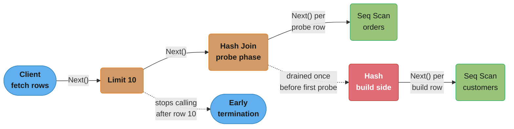
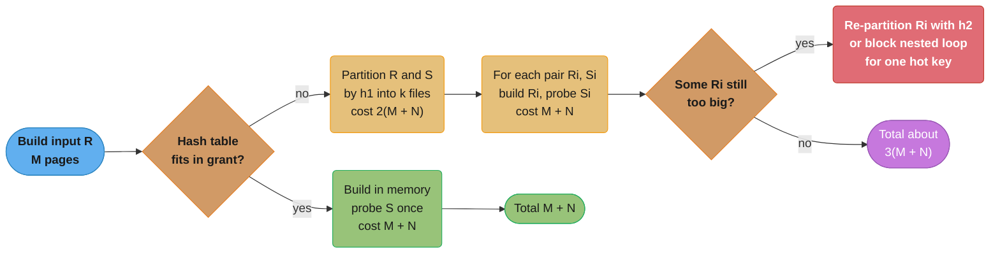
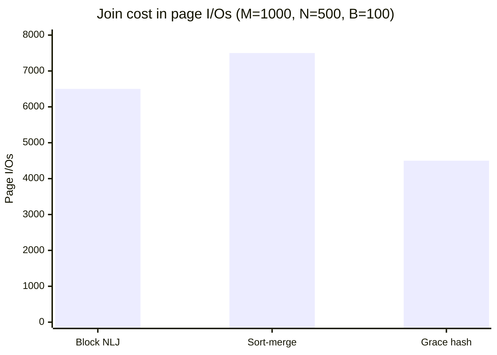
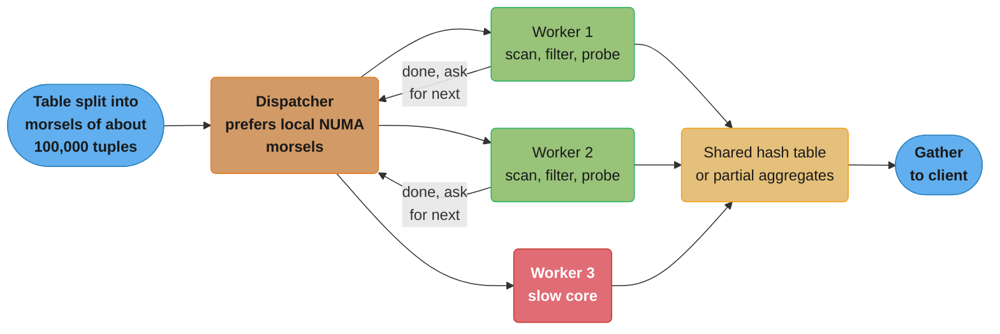

# Query Execution and Join Algorithms

> Checked 2026-11-25 against CMU 15-445/645 Fall 2025 (lectures #11 Sorting & Aggregations, #12 Joins, #13 Query Execution I, #14 Query Execution II) and the PostgreSQL 19 documentation. PostgreSQL 19 is the current documented release; behaviour that differs in 18 is tagged `[PG18]`.

## 1. Concept Overview

The optimizer decides *which* plan to run. The executor decides *how* that plan actually moves rows: how operators hand data to each other, which physical algorithm implements each join, sort and aggregate, how much memory each operator may use before it spills to disk, and how many cores work on one query. Two plans with the same shape can differ by 1,000x in run time purely because of executor mechanics — a hash join whose build side fits in memory reads each input once; the same join with a build side 16x too big reads each input twice and writes most of it once.

This module owns three questions:

1. **Processing model** — tuple-at-a-time iterator (Volcano), materialization, vectorized batches, or compiled push-based code.
2. **Physical algorithms** — nested loop (naive, block, index), sort-merge, hash (in-memory, Grace, hybrid), external merge sort, sort-based and hash-based aggregation.
3. **Parallel and adaptive execution** — exchange operators, morsel-driven scheduling, and plans that change their join algorithm mid-flight.

The primary references are the CMU 15-445/645 Fall 2025 lecture notes (Andy Pavlo) for the cost formulas, and four papers for the processing models: Graefe's *Volcano — an extensible and parallel query evaluation system* (IEEE TKDE vol. 6 no. 1, 1994), Boncz, Zukowski and Nes's *MonetDB/X100: Hyper-Pipelining Query Execution* (CIDR 2005), Neumann's *Efficiently Compiling Efficient Query Plans for Modern Hardware* (PVLDB vol. 4 no. 9, 2011), and Leis, Boncz, Kemper and Neumann's *Morsel-driven parallelism* (SIGMOD 2014).

**Not here.** How the planner estimates rows and picks a join order lives in [SQL Query Optimization](../sql_query_optimization/sql_query_optimization.md) and, for PostgreSQL specifically, [Planner and Parallel Execution](../postgresql_internals/planner_and_parallel_execution.md). Page layout, the buffer pool and B+trees live in [Storage Engines Internals](../storage_engines_internals/storage_engines_internals.md). What happens to a spill file once it reaches the kernel (page cache, `fsync`, read-ahead) lives in [File Systems and Persistent Storage](../../cs_fundamentals/file_systems_and_persistent_storage/file_systems_and_persistent_storage.md). This page starts when the plan is fixed and ends when rows leave the root operator.

---

## 2. Intuition

**One-line analogy.** The iterator model is a bucket brigade passing one brick at a time; the vectorized model passes a pallet of 2,048 bricks; the compiled model fuses the whole brigade into one person who carries each brick from the truck to the wall without setting it down.

**Mental model.** Every executor algorithm answers two questions: *what must fit in memory*, and *how many times do I read the data*. A hash join needs the build side in memory and reads each input once. When the build side does not fit, it partitions both inputs to disk and reads them again — three passes of I/O instead of one. An external sort needs one buffer per input run during the merge; if there are more runs than buffers, it needs another merge pass. Almost every executor performance cliff is a pass count going from 1 to 2 or from 2 to 3.

**Why it matters.** EXPLAIN output names the algorithm (`Hash Join`, `Merge Join`, `Nested Loop`, `HashAggregate`, `Sort Method: external merge`) and reports the evidence (`Batches: 16`, `Disk: 412000kB`, `loops=50000`). Reading those numbers tells you whether a slow query is a wrong plan (an optimizer problem) or a right plan starved of memory (an executor problem). The fix is different for each.

**Key insight.** Hash wins for unsorted equality joins, sort wins when order is already free or is needed anyway, and nested loop wins when the outer side is small and the inner side has an index. The memory grant — `work_mem` times `hash_mem_multiplier` in PostgreSQL — decides whether "one pass" becomes "three passes". Most "the database got slow when the table grew" incidents are a memory grant that stopped fitting.

---

## 3. Core Principles

### Pipelines and Pipeline Breakers

A **pipeline** is a chain of operators where a row can flow from the leaf to the parent without being stored. A **pipeline breaker** is an operator that cannot emit its first output row until it has consumed all of one input. CMU lecture #13 lists the build side of a join, subqueries and `ORDER BY` as the standard breakers.

| Operator | Pipelined input | Blocking input | Why |
|----------|-----------------|----------------|-----|
| Filter, Project | the only input | none | Decides each row alone |
| Hash join | probe side | build side | The hash table must be complete before the first probe can be answered |
| Sort | none | the only input | The smallest row might be the last one read |
| Hash aggregate | none | the only input | A group's `SUM` is not final until every row is seen |
| Merge join | both (if pre-sorted) | none | Two sorted cursors advance in step |
| Nested loop | outer side | none (inner is re-scanned) | Each outer row triggers its own inner scan |
| `LIMIT` | the only input | none | Stops pulling after N rows |

Pipeline breakers are where memory is spent and where spills happen. Everything between two breakers runs as one tight loop.

### Cost Is Counted in Page I/Os

CMU 15-445 measures join cost in disk page reads and writes, ignoring CPU and the cost of writing the final output, because output cost is the same for every algorithm. The notation used throughout this page:

| Symbol | Meaning |
|--------|---------|
| `M`, `m` | Pages and tuples in the outer table `R` |
| `N`, `n` | Pages and tuples in the inner table `S` |
| `B` | Buffer pool frames the operator may use |
| `C` | Cost of one index probe on the inner table |

On SSD-backed systems with a warm buffer pool, CPU and memory bandwidth matter more than this model suggests, which is exactly why vectorized and compiled execution exist. The page-I/O model is still the right first approximation for anything that spills.

### The Memory Grant Is the Hidden Parameter

Every blocking operator gets a memory budget. In PostgreSQL that budget is `work_mem` (default 4 MB) per sort or hash operation, and hash-based operations may use `work_mem × hash_mem_multiplier` (default 2.0), so 8 MB by default. The budget is per operation, per process: a query with three hash joins and a sort, running with 4 parallel workers, can use `(3 × 8 MB + 4 MB) × 5 processes = 140 MB`. A budget that is too small turns one-pass algorithms into multi-pass ones; a budget that is too large, multiplied by concurrency, runs the host out of memory.

### Early vs Late Materialization

A join output can carry full copies of the joined columns (**early materialization**) or only the join keys plus record ids, fetching other columns later (**late materialization**). CMU lecture #12 notes row stores lean early because the whole tuple is already in memory, while column stores lean late because each extra column is a separate read. Late materialization is the reason a columnar engine can join two 50-column tables while touching only 3 columns.

---

## 4. Types / Architectures / Strategies

### Processing Models

| Model | Unit passed between operators | Control flow | Strength | Weakness | Examples |
|-------|-------------------------------|--------------|----------|----------|----------|
| Iterator (Volcano) | 1 tuple per `Next()` call | Pull, top-down | Simple, composable, `LIMIT` stops early | One virtual call and branch per tuple per operator | PostgreSQL, MySQL, most row stores |
| Materialization | All tuples of an operator at once | Pull, operator runs to completion | Few calls, good for OLTP point queries | Large intermediates may spill | Some OLTP engines (CMU #13) |
| Vectorized | A batch of 1,024-2,048 values per column | Pull or push | Amortizes call overhead, SIMD-friendly loops | Intermediate vectors are still materialized between operators | MonetDB/X100 (1,024), DuckDB (2,048), Photon |
| Compiled (data-centric) | A tuple held in CPU registers across operators | Push, bottom-up | No per-tuple interpretation, loops fused across operators | Compile time; harder to debug and to stop early | HyPer, Umbra; PostgreSQL JIT for expressions only |

The X100 paper states its default vector size is 1,024 and that all vectors together should fit the CPU cache. DuckDB's documented `STANDARD_VECTOR_SIZE` is 2,048 tuples. Neumann's 2011 paper states the two design principles of compiled execution: process data so it stays in CPU registers as long as possible, and push data toward consumers instead of letting operators pull it.

### Pull vs Push

- **Pull (top-down)** — the root calls `Next()` on its child, which calls its child. `LIMIT` is trivial: stop calling. Each call is a virtual function with a branch.
- **Push (bottom-up)** — leaves produce rows and call the parent's `consume()` directly. A pipeline compiles to one loop with no per-operator call boundary. Early termination has to be signalled backwards.

### Join Algorithms

| Algorithm | I/O cost (CMU #12) | Needs | Wins when |
|-----------|--------------------|-------|-----------|
| Naive nested loop | `M + m·N` | nothing | Never, beyond toy sizes |
| Block nested loop | `M + ⌈M/(B−2)⌉·N` | `B−2` buffers for outer blocks | Non-equi joins (`<`, `BETWEEN`) with a small outer |
| Index nested loop | `M + m·C` | index on the inner join key | Outer side is small after filtering |
| Sort-merge | `M + N + sort(R) + sort(S)` | sortable keys | Inputs already sorted, output must be sorted, or range join |
| Hash (in memory) | `M + N` | build side fits in memory | Unsorted equi-join, build side fits |
| Grace / partitioned hash | `3·(M + N)` | `B` large enough for partition fan-out | Unsorted equi-join, build side too big |
| Hybrid hash | between `M + N` and `3·(M + N)` | as Grace | Build side somewhat too big; one partition stays in memory |

The sort cost for one table is `2M × (1 + ⌈log_{B−1}⌈M/B⌉⌉)`. Hash joins only work for equality on the complete join key. Sort-merge degrades to `M·N` when every row shares one join key value, which CMU notes is unlikely in practice.

**Hybrid hash.** PostgreSQL's `nodeHashjoin.c` names its algorithm as the hybrid hash join from Zeller and Gray (VLDB 1990): the first batch of the build side stays in memory and is probed while the probe side streams past; only the remaining batches go to temporary files. CMU's notes describe hybrid hash as hard to implement correctly and rarely done in practice; PostgreSQL is the widely deployed exception.

### Aggregation Strategies

| Strategy | How | Output order | Spill behaviour |
|----------|-----|--------------|-----------------|
| Sort aggregate | Sort on the `GROUP BY` key, then one sequential pass | Sorted | External merge sort |
| Hash aggregate | Hash table of `group key → running state` | Unordered | Partition by `h1` to disk, then rehash each partition with `h2` |
| Plain aggregate | Single running state (`SELECT count(*)`) | One row | Never spills |
| Partial + final | Each worker aggregates its share, the leader combines | Depends | Each partial spills on its own |

The running state depends on the function: `AVG` keeps `(COUNT, SUM)`, not the average. PostgreSQL 13 allowed hash aggregation to spill to disk; before 13, the planner avoided a hash aggregate whenever it expected the hash table to exceed `work_mem`, which pushed large `GROUP BY` queries onto slower sort-based plans.

### Sorting Strategies

| Strategy | When the executor uses it |
|----------|---------------------------|
| In-memory quicksort | Input fits in the memory grant |
| Top-N heapsort | `ORDER BY ... LIMIT N`: one scan, a heap of N rows |
| External merge sort | Input exceeds the grant: sorted runs to disk, then `(B−1)`-way merges |
| Incremental sort `[PG13+]` | Input already sorted on a key prefix: sort only within groups that share the prefix |
| Clustered index scan | Index order equals the required order: no sort at all |

An unclustered index scan in key order is almost always worse than an external sort, because each row may be on a different heap page. The exception is a top-N query with small N.

### Parallel Execution

CMU lecture #14 separates **inter-query** parallelism (different queries on different workers, raising throughput) from **intra-query** parallelism (one query on several workers, lowering latency). Intra-query parallelism has three shapes:

- **Intra-operator (horizontal)** — the same operator runs on disjoint fragments of the data. An **exchange** operator combines or redistributes the streams: *gather* (many to one, the common case), *distribute* (one to many), *repartition* (many to many by a new key).
- **Inter-operator (vertical)** — different operators run concurrently in a pipeline, each on its own worker.
- **Bushy** — independent subtrees of the plan run at the same time.

**Morsel-driven scheduling** (Leis et al., SIGMOD 2014) replaces a fixed split of the input with small work units. Each worker repeatedly takes the next *morsel* — the paper settled on about 100,000 tuples — runs it through the whole pipeline, and comes back for more. Fast workers take more morsels, so skew and noisy neighbours stop stretching the tail, and a dispatcher prefers morsels that live on the worker's own NUMA socket.

PostgreSQL uses a process per worker. A `Gather` or `Gather Merge` node starts up to `max_parallel_workers_per_gather` workers (default 2), drawn from `max_parallel_workers` (default 8). PostgreSQL 11 added parallel hash joins that build one shared hash table instead of one private copy per worker.

### Adaptive Execution

The optimizer commits to an algorithm from estimates. Adaptive execution defers or revisits that commitment once real row counts are known.

| System | Mechanism | What can change at run time |
|--------|-----------|-----------------------------|
| SQL Server 2017+ | Batch-mode Adaptive Join | Scans the build input first, then picks Hash Join or Nested Loops against a row-count threshold |
| Apache Spark (AQE on by default since 3.2.0) | Re-plans at shuffle boundaries using runtime statistics | Coalesces shuffle partitions, converts sort-merge join to broadcast hash join or shuffled hash join, splits skewed partitions |
| PostgreSQL 14+ | `Memoize` node | Caches inner-side results of a parameterized nested loop by key, skipping repeated inner scans |
| PostgreSQL (all supported) | Generic vs custom prepared-statement plans | Not adaptive mid-query; covered in [SQL Query Optimization](../sql_query_optimization/sql_query_optimization.md) |

---

## 5. Architecture Diagrams

### The Iterator Model: One `Next()` Per Tuple Per Operator



Calls flow down, rows flow up. The dashed `Hash` edge is the pipeline breaker: the join cannot answer its first `Next()` until the whole build input is in the hash table. `LIMIT 10` simply stops pulling, which is why the iterator model handles early termination for free.

### Hash Join: In-Memory vs Grace Partitioning



The jump from `M + N` to `3(M + N)` is the cliff: the partition pass reads and writes both inputs once, then the probe pass reads them again. A single hot key whose rows exceed memory cannot be split by any hash function, which is why CMU's notes fall back to block nested loop for that one key.

### External Merge Sort: Why One Extra Buffer Page Can Save a Pass

```
  N = 1,000,000 pages to sort (8 KB pages = 7.6 GiB)

  B = 1,000 buffer pages                      B = 1,001 buffer pages
  ---------------------                       ---------------------
  pass 0: sort 1,000 pages at a time          pass 0: sort 1,001 pages at a time
          -> ceil(1,000,000 / 1,000)                  -> ceil(1,000,000 / 1,001)
           = 1,000 runs                                = 1,000 runs
  merge fan-in = B - 1 = 999                  merge fan-in = B - 1 = 1,000
  pass 1: 1,000 runs -> 2 runs                pass 1: 1,000 runs -> 1 run   DONE
  pass 2: 2 runs     -> 1 run   DONE

  passes = 1 + ceil(log_999(1,000)) = 3       passes = 1 + ceil(log_1000(1,000)) = 2
  I/O    = 2N x 3 = 6,000,000 pages           I/O    = 2N x 2 = 4,000,000 pages
                                                       ^ 33% less I/O for 8 KB more memory
```

The pass count is a step function of `⌈N/B⌉` against the fan-in `B−1`. When the run count lands one above the fan-in, a whole extra read-and-write of the data appears. This is why sort spill times jump in steps as a table grows, rather than rising smoothly.

### CMU's Join Example, by I/O Count



The naive nested loop is left off the chart because it needs 50,001,000 I/Os, about 7,700x the block nested loop, and would flatten every other bar. With `B = 100`, block nested loop scans the inner table only 11 times, which is why it lands close to the sort-merge and hash joins here; shrink `B` to 10 and it needs `1000 + 125 × 500 = 63,500` I/Os.

### Morsel-Driven Dispatch



Each worker runs a morsel through the entire pipeline and then returns for another. A worker on a slow core simply finishes fewer morsels; nobody waits on a fixed one-third share assigned at start-up.

---

## 6. How It Works — Detailed Mechanics

### The CMU Join Example, Recomputed

CMU lecture #12 uses `M = 1,000` pages and `m = 100,000` tuples for `R`, `N = 500` pages and `n = 40,000` tuples for `S`, `B = 100` buffer frames, and 0.1 ms per I/O. Recomputing each line from the formulas:

```
  Naive nested loop   M + m*N                = 1,000 + 100,000 * 500   = 50,001,000 I/Os
                                               x 0.1 ms                 = 5,000 s  (1.4 hours)

  Block nested loop   M + ceil(M/(B-2))*N    = 1,000 + ceil(1000/98)*500
                                             = 1,000 + 11 * 500         =      6,500 I/Os
                                               x 0.1 ms                 =      0.65 s

  Sort-merge          sort(R) + sort(S) + M + N
     sort(R) = 2*1000*(1 + ceil(log_99 ceil(1000/100))) = 2,000 * 2     =      4,000
     sort(S) = 2*500 *(1 + ceil(log_99 ceil(500/100)))  = 1,000 * 2     =      2,000
     merge   = 1,000 + 500                                              =      1,500
                                                        total           =      7,500 I/Os
                                               x 0.1 ms                 =      0.75 s

  Grace hash join     3 * (M + N)            = 3 * 1,500                =      4,500 I/Os
                                               x 0.1 ms                 =      0.45 s
```

Two lessons fall out of the arithmetic. First, the naive nested loop is 11,111x worse than Grace hash join on the same data — this is why "a nested loop without an index" is the classic disaster plan. Second, sort-merge pays 6,000 of its 7,500 I/Os to sort; if both inputs arrive already sorted from an index, its cost drops to 1,500 and it beats the hash join.

### The Iterator Model in Code

A minimal Volcano executor, in Python for readability. Every operator implements `open()`, `next()` and `close()`; `next()` returns one row or `None`.

```python
from collections import defaultdict
from typing import Callable, Iterator, Optional

Row = dict

class Operator:
    def open(self) -> None: ...
    def next(self) -> Optional[Row]: ...
    def close(self) -> None: ...

class SeqScan(Operator):
    def __init__(self, rows: list[Row]):
        self.rows = rows
    def open(self) -> None:
        self.pos = 0
    def next(self) -> Optional[Row]:
        if self.pos == len(self.rows):
            return None
        row = self.rows[self.pos]
        self.pos += 1
        return row

class Filter(Operator):
    def __init__(self, child: Operator, pred: Callable[[Row], bool]):
        self.child, self.pred = child, pred
    def open(self) -> None:
        self.child.open()
    def next(self) -> Optional[Row]:
        while (row := self.child.next()) is not None:   # one call per input row
            if self.pred(row):
                return row
        return None

class HashJoin(Operator):
    """Build on the left child (pipeline breaker), probe with the right child."""
    def __init__(self, build: Operator, probe: Operator, bkey: str, pkey: str):
        self.build, self.probe, self.bkey, self.pkey = build, probe, bkey, pkey
    def open(self) -> None:
        self.table: dict = defaultdict(list)
        self.build.open()
        while (r := self.build.next()) is not None:      # drain the whole build side
            self.table[r[self.bkey]].append(r)
        self.probe.open()
        self.pending: Iterator[Row] = iter(())
    def next(self) -> Optional[Row]:
        while True:
            if (out := next(self.pending, None)) is not None:
                return out
            p = self.probe.next()
            if p is None:
                return None
            matches = self.table.get(p[self.pkey], [])
            self.pending = ({**b, **p} for b in matches)

class Limit(Operator):
    def __init__(self, child: Operator, n: int):
        self.child, self.n = child, n
    def open(self) -> None:
        self.child.open()
        self.seen = 0
    def next(self) -> Optional[Row]:
        if self.seen == self.n:
            return None                                  # stop pulling: free early exit
        self.seen += 1
        return self.child.next()
```

The cost is visible in `Filter.next()`: one call per input row, plus one per operator above it. A C engine pays one virtual call and a few unpredictable branches instead of a Python call, but the shape is identical.

### Vectorized Execution: Amortizing the Call

The vectorized `Filter` takes a batch and returns a selection vector of surviving positions. The per-row work becomes a tight loop over a typed array that a compiler can turn into SIMD instructions.

```python
import numpy as np

VECTOR_SIZE = 2048   # DuckDB's STANDARD_VECTOR_SIZE

def vectorized_filter(amount: np.ndarray, threshold: float) -> np.ndarray:
    """One call per 2,048 rows; returns the selection vector of qualifying positions."""
    return np.flatnonzero(amount > threshold)

def vectorized_sum(amount: np.ndarray, sel: np.ndarray) -> float:
    return float(amount[sel].sum())
```

The call-count arithmetic for 100,000,000 rows through a 4-operator pipeline:

```
  tuple-at-a-time:  100,000,000 rows x 4 operators              = 400,000,000 calls
  vectorized:       ceil(100,000,000 / 2,048) = 48,829 batches
                    48,829 batches x 4 operators                 =     195,316 calls
                    ratio                                        = 2,048x fewer calls
```

The interpretation overhead shrinks by the batch size. What remains is the per-element work inside each loop, which stays cache-resident as long as all live vectors fit in cache — the X100 paper's reason for warning against vectors that are too big as well as too small.

### Compiled Execution: Fusing a Pipeline Into One Loop

Neumann's data-centric compilation turns each pipeline (the stretch between two breakers) into one loop. For `SELECT ... FROM customers c JOIN orders o ON c.id = o.customer_id WHERE c.region = 'EU' AND o.amount > 100`, the generated code has this shape:

```python
# Pipeline 1: scan customers -> filter -> build hash table   (ends at the breaker)
ht: dict[int, list[tuple]] = {}
for c in customers:                       # one loop, no operator boundaries
    if c.region == "EU":
        ht.setdefault(c.id, []).append((c.id, c.name))

# Pipeline 2: scan orders -> filter -> probe -> emit          (one loop again)
for o in orders:
    if o.amount > 100:
        for cid, name in ht.get(o.customer_id, ()):
            emit(name, o.id, o.amount)    # the row never left CPU registers
```

There are two loops for a 5-operator plan, because there are two pipelines. The price is compile time: a query that runs for 2 ms is not worth 30 ms of compilation. PostgreSQL's JIT only compiles expressions and tuple deforming, not whole pipelines, and is gated on estimated plan cost (`jit_above_cost`, default 100,000).

### Reading Executor Evidence in PostgreSQL EXPLAIN

The numbers below are illustrative, but the field names are what PostgreSQL prints. PostgreSQL 18 and later print actual row counts with two decimals (`rows=10000.00`).

**Hash join that spilled.** `Batches` greater than 1 means the build side did not fit `work_mem × hash_mem_multiplier`:

```sql
EXPLAIN (ANALYZE, BUFFERS)
SELECT c.name, o.amount
FROM orders o JOIN customers c ON c.id = o.customer_id;

-- Hash Join  (actual time=812.4..6120.7 rows=20000000.00 loops=1)
--   Hash Cond: (o.customer_id = c.id)
--   Buffers: shared hit=1204 read=256296, temp read=241406 written=241406
--   ->  Seq Scan on orders o  (actual rows=20000000.00 loops=1)
--   ->  Hash  (actual time=805.1..805.1 rows=2000000.00 loops=1)
--         Buckets: 262144  Batches: 16  Memory Usage: 8193kB
--         ->  Seq Scan on customers c  (actual rows=2000000.00 loops=1)
```

`Batches: 16` and the `temp read/written` buffers say the same thing: fifteen-sixteenths of both inputs went to temporary files and came back. Raising `work_mem` for this session until `Batches: 1` removes the `temp` counters entirely.

**Hash aggregate that spilled** `[PG13+]`:

```sql
-- HashAggregate  (actual time=3104.2..4980.6 rows=1800000.00 loops=1)
--   Group Key: o.customer_id
--   Batches: 21  Memory Usage: 8241kB  Disk Usage: 236544kB
```

**Sort that spilled vs a top-N sort**:

```sql
-- Sort  (actual time=9870.1..11210.4 rows=20000000.00 loops=1)
--   Sort Key: o.created_at
--   Sort Method: external merge  Disk: 587312kB
--
-- Sort  (actual time=2410.7..2410.7 rows=10.00 loops=1)
--   Sort Key: o.amount DESC
--   Sort Method: top-N heapsort  Memory: 26kB
```

**Memoize on the inner side of a nested loop** `[PG14+]`:

```sql
-- Nested Loop  (actual time=0.04..410.9 rows=100000.00 loops=1)
--   ->  Seq Scan on orders o  (actual rows=100000.00 loops=1)
--   ->  Memoize  (actual time=0.002..0.002 rows=1.00 loops=100000)
--         Cache Key: o.customer_id
--         Cache Mode: logical
--         Hits: 99000  Misses: 1000  Evictions: 0  Overflows: 0  Memory Usage: 120kB
--         ->  Index Scan using customers_pkey on customers c  (actual rows=1.00 loops=1000)
```

`loops=1000` on the index scan, not 100,000: only cache misses reach the index. Memoize pays off when the outer side repeats a small set of keys.

**Incremental sort** `[PG13+]`:

```sql
-- Incremental Sort  (actual rows=500000.00 loops=1)
--   Sort Key: o.customer_id, o.created_at
--   Presorted Key: o.customer_id
--   Full-sort Groups: 15625  Sort Method: quicksort  Average Memory: 30kB  Peak Memory: 30kB
--   ->  Index Scan using orders_customer_id_idx on orders o
```

The input is already ordered by `customer_id`, so the executor only sorts each group of rows that share a `customer_id` by `created_at` — thousands of tiny in-memory sorts instead of one 500,000-row sort.

### Sizing the Hash Join Memory Grant

A hash table entry is the tuple plus overhead (bucket pointer, hash value, tuple header). Estimating 64 bytes per entry is conservative for a narrow build side:

```
  build side       2,000,000 rows x 64 bytes        = 128 MB of hash table
  default grant    work_mem 4 MB x hash_mem_mult 2  =   8 MB
  batches needed   128 / 8 = 16  -> PostgreSQL uses a power of two: 16 batches

  I/O impact (orders 245,000 pages, customers 12,500 pages):
    in memory:  read both once                      =   257,500 page reads
    16 batches: write 15/16 of both, read them back = + 482,812 temp pages
                total page traffic                  ~=  740,312   (about 2.9x)

  grant that fits: 128 MB / 2 (hash_mem_multiplier) -> SET LOCAL work_mem = '64MB'
```

The fix is per query (`SET LOCAL work_mem`), never a global change: `work_mem = 64MB` globally with 200 connections each running two hash operations allows up to `200 × 2 × 128 MB = 51 GB`.

### Bloom Filters on the Probe Side

While building the hash table, the executor can also fill a Bloom filter of build-side keys. Probe rows whose key is "definitely not" in the filter are discarded before touching the hash table, or before leaving the scan node entirely. CMU calls this *sideways information passing*. In a star-schema query where a 200-row dimension filter keeps 0.5% of a 1-billion-row fact table, pushing the filter into the fact scan stops 995,000,000 rows at the scan instead of at the join.

### External Hash Aggregation, Step by Step

```python
import pickle
from collections import defaultdict
from pathlib import Path

def external_hash_aggregate(rows, key, value, partitions: int, spill_dir: Path):
    """Phase 1: partition by h1 to disk. Phase 2: rehash each partition with h2."""
    files = [open(spill_dir / f"p{i}.bin", "wb") for i in range(partitions)]
    for r in rows:                                   # one read of the input
        i = hash(("h1", r[key])) % partitions         # h1 chooses the partition
        pickle.dump((r[key], r[value]), files[i])     # one write of the input
    for f in files:
        f.close()

    for i in range(partitions):                       # one more read of the input
        state: dict = defaultdict(lambda: [0, 0])     # key -> [count, sum] for AVG
        with open(spill_dir / f"p{i}.bin", "rb") as f:
            while True:
                try:
                    k, v = pickle.load(f)
                except EOFError:
                    break
                s = state[k]                          # h2 = Python's dict hashing
                s[0] += 1
                s[1] += v
        for k, (cnt, total) in state.items():
            yield k, total / cnt
```

Every group lands in exactly one partition, so each partition aggregates on its own. If one partition's distinct groups still exceed memory, it is re-partitioned with a different hash function; a single huge group never needs that, because its state is one `[count, sum]` pair.

### Adaptive Join in SQL Server and Spark

SQL Server's batch-mode Adaptive Join reads the build input first. If the row count stays under the operator's threshold, it switches to a nested loop; otherwise it continues as a hash join, without recompiling the plan. The plan shows both branches; the actual-execution properties show which one ran.

Spark's AQE waits until a shuffle stage finishes, reads the real partition sizes, and re-plans the rest. A side that turns out smaller than the adaptive broadcast threshold converts a planned sort-merge join to a broadcast hash join, and skewed partitions in a sort-merge join are split into evenly sized tasks (`spark.sql.adaptive.skewJoin.enabled`, default `true`). The static broadcast threshold, `spark.sql.autoBroadcastJoinThreshold`, defaults to 10 MB.

---

## 7. Real-World Examples

**PostgreSQL.** A tuple-at-a-time iterator executor with a process per backend and per parallel worker. Joins are nested loop, merge or hybrid hash; aggregates are sort, hash or plain. Parallel hash joins with one shared hash table arrived in 11, incremental sort and spilling hash aggregation in 13, `Memoize` in 14. PostgreSQL 12 turned JIT on by default; PostgreSQL 19 turned it off again because, in the release notes' words, the cost-based trigger "has been determined to be unreliable", and sites running many large analytical queries must now enable it. See [PostgreSQL Internals](../postgresql_internals/postgresql_internals.md) for the process model.

**MySQL.** The `HashJoinIterator` in the MySQL source starts in memory and, when the build input does not fit, spills both inputs to chunk files on disk, capped at `kMaxChunks` files per input to avoid running out of file descriptors. Its source comments note that the output keeps the probe input's order only while the join stays in memory.

**DuckDB.** An embedded, vectorized engine; every operator works on vectors of `STANDARD_VECTOR_SIZE` = 2,048 tuples, and vectors can stay in constant, dictionary or sequence form so compressed data flows through operators without being expanded first.

**MonetDB/X100.** The X100 paper introduced vectorized execution with a default vector size of 1,024 and argued that the vectors must fit the CPU cache. Its TPC-H Query 1 analysis is the standard citation for "interpretation overhead dominates a tuple-at-a-time engine".

**HyPer and Umbra.** Neumann's compiled, push-based engines from TU Munich. The 2011 paper generates code through LLVM so that tuples stay in CPU registers across operators within a pipeline.

**Databricks Photon.** A vectorized engine for lakehouse queries, described in *Photon: A Fast Query Engine for Lakehouse Systems* (SIGMOD 2022).

**Apache Spark.** Adaptive query execution has been on by default since 3.2.0 and rewrites join strategies at shuffle boundaries.

**SQL Server.** Batch-mode Adaptive Join, from SQL Server 2017, defers the hash-or-nested-loop decision until the build input has been read.

For the OLAP engines that build on vectorized execution and late materialization, see [Analytical Databases and OLAP](../analytical_databases_and_olap/analytical_databases_and_olap.md).

---

## 8. Tradeoffs

### Processing Models

| Dimension | Iterator | Vectorized | Compiled |
|-----------|----------|------------|----------|
| Per-row overhead | 1 virtual call per operator | 1 call per 1,024-2,048 rows | none inside a pipeline |
| Startup cost | ~0 | ~0 | compile time per query |
| `LIMIT` and early exit | trivial | per batch | needs explicit signalling |
| SIMD use | rare | natural | possible, harder |
| Debuggability | one operator at a time | one operator at a time | generated code |
| Best fit | OLTP, short queries | OLAP scans and aggregates | long OLAP queries |

### Join Algorithms

| Situation | Best choice | Why |
|-----------|-------------|-----|
| 50 outer rows, inner indexed on the key | Index nested loop | 50 probes x ~4 pages each = ~200 pages |
| Both inputs large, unsorted, equality | Hash join | One pass each if the build side fits |
| Both inputs already sorted on the key | Merge join | No hash table, no sort, no memory grant |
| Output must be sorted on the join key | Merge join | The sort is needed anyway |
| Non-equality predicate (`a.ts BETWEEN b.start AND b.end`) | Nested loop or merge (range) | Hash requires equality |
| Build side 10x larger than memory | Grace or hybrid hash | `3(M + N)` beats sort-merge's two external sorts |
| One join key holds 40% of rows | Hash with skew handling, or broadcast | A single partition cannot be split by hashing |

### Sort-Based vs Hash-Based Aggregation

| Dimension | Sort aggregate | Hash aggregate |
|-----------|----------------|----------------|
| Memory driver | Input size | Number of distinct groups |
| Output order | Sorted on the group key | Unordered |
| Few groups, many rows | Sorts all rows needlessly | Tiny hash table, one pass |
| Input already sorted | One sequential pass, no memory | Rebuilds order it then discards |
| Spill cost | External merge sort passes | Partition pass plus rehash pass |

---

## 9. When to Use / When NOT to Use

**Raise the memory grant (per query) when:**
- EXPLAIN shows `Batches` above 1, `Disk:` on a sort, or `Disk Usage` on a hash aggregate, and the query runs at low concurrency (nightly report, ETL step).
- The extra memory removes a whole pass — compute the pass count before and after; doubling memory that does not remove a pass buys almost nothing.

**Do not raise it when:**
- The query runs at high concurrency (an API endpoint at 500 queries per second). Fix the plan or the data shape instead.
- The spill comes from a cardinality misestimate — the executor is spilling because the optimizer expected 1,000 rows and got 10,000,000. That is a statistics problem; see [SQL Query Optimization](../sql_query_optimization/sql_query_optimization.md).

**Use intra-query parallelism when:**
- One query scans hundreds of MB or more and latency matters more than total CPU.
- The host has idle cores at the time the query runs.

**Do not use it when:**
- The system is already CPU-saturated by concurrent queries — parallel workers then only add coordination cost.
- Queries are short OLTP lookups; PostgreSQL starts each parallel worker as a separate process, which costs more than the lookup itself.

**Choose a vectorized or compiled engine when:**
- The workload is aggregations and joins over millions to billions of rows, and the engine is a separate analytical system (DuckDB, ClickHouse, a lakehouse engine) rather than the OLTP primary.

---

## 10. Common Pitfalls

**Pitfall 1: Raising `work_mem` globally to fix one report.**

```sql
-- BROKEN: a 6-minute nightly report spilled 16 batches, so someone did this
ALTER SYSTEM SET work_mem = '256MB';
SELECT pg_reload_conf();
-- Result two weeks later: the OOM killer ends a backend during the 09:00 peak and
-- the postmaster restarts every session. 300 connections x 3 hash/sort operations
-- x (256 MB x 2 for hash) = up to 460 GB requested on a 128 GB host.
```

```sql
-- FIX: scope the grant to the one transaction that needs it
BEGIN;
SET LOCAL work_mem = '128MB';      -- reverts at COMMIT or ROLLBACK
SELECT ...;                        -- the report
COMMIT;
-- or attach it to the reporting role only
ALTER ROLE reporting SET work_mem = '128MB';
```

**Pitfall 2: A nested loop chosen from a 1-row estimate.** The plan reads `Nested Loop (rows=1)` with `actual rows=48000.00 loops=1`, and the inner index scan shows `loops=48000`. The executor is doing exactly what it was told; the optimizer underestimated the outer side by 48,000x, often because of correlated predicates (`city = 'Paris' AND country = 'FR'`). The executor-side symptom is a huge `loops` count on the inner node. The fix is in statistics (`CREATE STATISTICS` for correlated columns), covered in [Planner and Parallel Execution](../postgresql_internals/planner_and_parallel_execution.md).

**Pitfall 3: A skewed join key defeats Grace partitioning.** A marketplace joins `events` to `sellers` on `seller_id`. One house account generates 38% of events. Every partitioning pass sends all of that key's rows to one partition, re-hashing with `h2` puts them in one partition again, and the join degrades to repeated reloads of one oversized batch. Fixes: handle the hot key in a separate query and `UNION ALL` the results, broadcast the small side so no partitioning is needed, or salt the key (append `random() % 16` on the big side and replicate the small side's matching row 16 times).

**Pitfall 4: A sort that spills one pass too many.** A 7.6 GiB sort with `B = 1,000` pages needs 3 passes; with `B = 1,001` it needs 2 (see the diagram in §5). Teams that tune memory by doubling see nothing from several doublings and then a sudden 33% drop. Compute `⌈N/B⌉` against `B − 1` instead of guessing.

**Pitfall 5: The Halloween problem in a hand-written batch job.** CMU #13 records that IBM researchers found this anomaly while building System R, on Halloween in 1976: an update moves a row's position in the index or clustered order that drives the scan, so the scan meets the same row again. Executors guard against it inside one statement by tracking already-modified record ids. Batch jobs that page through a table by the column they modify recreate it across statements:

```sql
-- BROKEN: paging by the column being changed re-reads rows it already moved
-- loop: UPDATE accounts SET tier = tier + 1 WHERE id IN (
--         SELECT id FROM accounts WHERE tier < 3 ORDER BY tier LIMIT 1000);
-- rows raised from tier 1 to tier 2 still match "tier < 3" and are raised again

-- FIX: fix the target set once, then page by an immutable key
CREATE TEMP TABLE targets AS SELECT id FROM accounts WHERE tier < 3;
-- then: UPDATE accounts a SET tier = tier + 1 FROM targets t
--       WHERE a.id = t.id AND t.id BETWEEN :lo AND :hi;
```

**Pitfall 6: JIT cost on short queries `[PG18]`.** On PostgreSQL 12 through 18, JIT is on by default and fires on any plan whose estimated cost exceeds 100,000 — including OLTP queries over large, misestimated tables. EXPLAIN shows a `JIT:` block whose `Timing` total (often tens of ms) exceeds the query's own execution time. PostgreSQL 19 turned `jit` off by default for exactly this reason. On older versions, set `jit = off` for OLTP roles and enable it only for analytical sessions.

**Pitfall 7: Parallel plans silently disabled by an unsafe function.** A query that calls a user-defined function marked `PARALLEL UNSAFE` (the default for `CREATE FUNCTION`) gets no `Gather` node at all, and nothing in the output says why. Mark functions `PARALLEL SAFE` when they only read data and have no side effects.

---

## 11. Technologies & Tools

| Tool | Purpose |
|------|---------|
| `EXPLAIN (ANALYZE, BUFFERS)` | Shows the chosen algorithm per node plus `Batches`, `Disk`, `temp read/written` and `loops` |
| `pg_stat_statements` | Finds queries with high `temp_blks_written`, the signature of spilling sorts and hashes |
| `log_temp_files` | Logs every temporary file above a size threshold, with the query that created it |
| `auto_explain` | Logs plans of slow queries in production, including executor counters |
| DuckDB | Embedded vectorized engine, 2,048-tuple vectors |
| ClickHouse | Columnar OLAP engine with vectorized execution |
| Apache Spark | Distributed engine with adaptive query execution |
| Databricks Photon | Vectorized engine for lakehouse workloads |
| SQL Server | Batch-mode Adaptive Join |
| `perf` | Shows whether a query is CPU-bound in operator code or waiting on I/O |
| pev2 | Visualizes PostgreSQL EXPLAIN trees and highlights the slowest nodes |

---

## 12. Interview Questions with Answers

**Q: Which side of a hash join must fit in memory, and does it have to be the smaller table?**
**Short:** Only the build side must fit; the planner builds on the smaller input after filters, which is not always the smaller table.

Only the build side is held in the hash table; the probe side streams past it one row at a time and needs no memory beyond a buffer. The planner normally builds on whichever input is smaller *after* filtering, so a 10-billion-row fact table filtered to 5,000 rows can be the build side against a 2-million-row dimension. This is also why PostgreSQL may print `Hash Right Join` for a `LEFT JOIN`: it built on the preserved side and swapped the roles. If the chosen build side is larger than `work_mem × hash_mem_multiplier`, the join goes multi-batch, so a wrong size estimate on the build side is the most expensive estimate error a hash join can suffer.

**Q: Why is a nested loop join sometimes the fastest plan, not just a fallback?**
**Short:** With a small outer side and an index on the inner key, a nested loop does a few cheap probes and needs no memory or sort.

An index nested loop costs `M + m·C`: one scan of the outer side plus one index probe per outer row. With 50 outer rows and a 4-level B+tree that is about 200 page touches, far below a hash join that must read the whole inner table once. It also needs no memory grant, starts returning rows immediately, and works with `LIMIT`. The danger is the outer row count: the same plan with 5,000,000 outer rows does 20,000,000 page touches. A nested loop is right when the outer side is genuinely small and the inner side has an index on the join key, and disastrous when either condition is false.

**Q: When does a sort-merge join beat a hash join?**
**Short:** When both inputs already arrive sorted on the join key, or the output must be sorted, or the join predicate is a range.

In CMU's example the sort-merge join costs 7,500 I/Os, of which 6,000 are the two sorts; the merge itself is only `M + N = 1,500`. If both inputs come from index scans in join-key order, the sorts disappear and the merge join costs 1,500 I/Os against 4,500 for a Grace hash join. Merge join also needs no hash table, so it never spills, and its output is already sorted for a following `ORDER BY` or `GROUP BY`. Hash join wins whenever the inputs are unsorted and the build side fits in memory.

**Q: What happens when a hash join's build side does not fit in memory?**
**Short:** It partitions both inputs to disk by a hash of the key, then joins each partition pair, costing about 3(M + N) I/Os instead of M + N.

The Grace (partitioned) hash join hashes both inputs with `h1` into `k` partitions written to disk, so matching keys always land in partitions with the same number. It then loads each build partition into memory, builds a hash table with a second function `h2`, and streams the matching probe partition past it. The partition pass reads and writes both inputs (`2(M + N)`), the join pass reads them again (`M + N`), for `3(M + N)` total. Hybrid hash join — what PostgreSQL implements — keeps the first partition in memory so it never touches disk, landing between `M + N` and `3(M + N)`. In EXPLAIN the evidence is `Batches:` greater than 1 and `temp read/written` buffers.

**Q: What is the Volcano iterator model and what does it cost?**
**Short:** Each operator exposes Next() returning one tuple, so every row costs one virtual call and branch per operator.

Graefe's Volcano model (IEEE TKDE, 1994) gives every operator `open()`, `next()` and `close()`. The root pulls one tuple at a time and each call pulls from its children. It is simple, composable and handles `LIMIT` for free, which is why almost every row store uses it. The cost is interpretation overhead: a 4-operator pipeline over 100 million rows makes 400 million virtual calls with hard-to-predict branches, and the CPU spends more time dispatching than computing. That overhead is irrelevant for an OLTP query touching 20 rows and dominant for an analytical scan.

**Q: How do vectorized and compiled execution remove that overhead differently?**
**Short:** Vectorized execution passes batches of about 2,048 values per call; compiled execution fuses each pipeline into one loop with no calls.

A vectorized engine keeps the operator structure but passes a batch per call — 1,024 in MonetDB/X100, 2,048 in DuckDB — so the call overhead is divided by the batch size and each operator's inner loop runs over a typed array that compiles to SIMD. A compiled engine, as in Neumann's 2011 paper, generates code per pipeline: scan, filter and hash probe become one `for` loop, and the tuple stays in CPU registers between steps. Vectorized engines start instantly and are easier to profile; compiled engines do less work per tuple but pay compile time on every new query. Both beat the iterator model by a wide margin on OLAP scans.

**Q: What is a pipeline breaker and why does it matter for memory?**
**Short:** An operator that must consume a whole input before emitting output, such as a hash build, sort or hash aggregate; it holds that input in memory.

Within a pipeline, a row flows from scan to output without being stored. A pipeline breaker interrupts that flow: a sort cannot emit its smallest row until it has seen every row, and a hash join cannot probe until its hash table is complete. Breakers are where the executor materializes data, so they are where memory grants are spent and where spills happen. Counting breakers in a plan tells you how many memory-hungry operators run at once and what the worst-case memory of the query is.

**Q: How many passes does an external merge sort need?**
**Short:** 1 + ceil(log base (B−1) of ceil(N/B)) passes, each reading and writing all N pages, so I/O is 2N times the pass count.

Pass 0 reads `B` pages at a time, sorts them in memory and writes `⌈N/B⌉` sorted runs. Each later pass merges up to `B − 1` runs into one, using one buffer per input run and one for output. For `N = 1,000,000` pages and `B = 1,000`, pass 0 makes 1,000 runs, and since the fan-in is 999 the merge needs two passes: 3 passes and 6,000,000 I/Os. With `B = 1,001` the fan-in is 1,000, one merge pass suffices, and the cost drops to 4,000,000 I/Os. The pass count is a step function, so memory tuning should target the next step, not a round number.

**Q: When should an aggregate be hash-based rather than sort-based?**
**Short:** Hash when output order does not matter and groups fit in memory; sort when the input is already sorted or sorted output is needed.

Hash aggregation's memory scales with the number of distinct groups, not the number of rows, so `GROUP BY status` over a billion rows needs a hash table of five entries and one pass. Sort aggregation must order every input row first, which is wasted work unless the input is already sorted (from an index) or the query needs the output sorted anyway. When groups exceed memory, hash aggregation partitions to disk and rehashes each partition, which PostgreSQL has supported since 13. Before 13, the planner avoided hash aggregation whenever it expected the table to exceed `work_mem`.

**Q: Why can raising `work_mem` crash a PostgreSQL server?**
**Short:** work_mem is per sort or hash operation per process, and hash operations get twice that, so it multiplies by operations and connections.

`work_mem` is not a per-query or per-server limit. Each sort or hash node may use it, hash nodes may use `work_mem × hash_mem_multiplier` (2.0 by default), and each parallel worker is its own process with its own grants. With `work_mem = 256MB`, 300 connections each running a plan with three hash nodes can request up to 460 GB. Production practice is a modest global value plus `SET LOCAL work_mem` or a per-role setting for the few queries that need more.

**Q: How does data skew break a hash join, and how do engines cope?**
**Short:** One hot key sends all its rows to one partition that hashing cannot split; engines broadcast, split skewed partitions or special-case the key.

Hash partitioning assumes keys spread evenly. If one key holds 38% of the probe side, every hash function sends all of its rows to the same partition, so that partition never fits and recursive partitioning cannot help. CMU's notes fall back to a block nested loop for that one key. Spark's AQE splits a skewed partition of a sort-merge join into several tasks, replicating the matching partition on the other side as needed. Application-level fixes are to broadcast the small side, to handle the hot key in a separate query, or to salt the key on the big side and replicate the small side accordingly.

**Q: What is morsel-driven parallelism and what problem does it solve?**
**Short:** Workers repeatedly grab small chunks of about 100,000 tuples and run them through the whole pipeline, balancing load at run time.

Static parallelism splits the input into one fixed share per worker at start-up, so the slowest worker or the most skewed share sets the query's latency. Morsel-driven scheduling (Leis et al., SIGMOD 2014) cuts the input into morsels — about 100,000 tuples in the paper — and lets each worker take the next morsel whenever it finishes. Fast workers process more morsels, slow ones fewer, and the dispatcher prefers morsels stored on the worker's own NUMA socket. The cost is shared data structures, such as one hash table that all workers build into concurrently.

**Q: What do the gather, distribute and repartition exchange operators do?**
**Short:** Gather merges many worker streams into one, distribute splits one stream into many, and repartition reshuffles many streams by a new key.

Exchange operators are the boundaries of parallel fragments. Gather is the common case: N workers each scan part of a table and the leader collects their rows, as PostgreSQL's `Gather` node does; `Gather Merge` also preserves sort order by merging sorted worker outputs. Distribute fans one stream out to several workers. Repartition, the shuffle in distributed engines, redistributes rows from N producers to M consumers by hashing a new key so that rows with the same join or group key meet on the same worker. Repartition is the expensive one because every row crosses a process or network boundary.

**Q: What is adaptive query execution, and what are two real implementations?**
**Short:** It changes join strategy or partitioning during execution using real row counts, as in Spark AQE and SQL Server Adaptive Join.

Static plans commit to algorithms from estimates, and estimates can be wrong by orders of magnitude. Spark's AQE, on by default since 3.2.0, re-plans at each shuffle boundary from actual partition sizes: it coalesces small partitions, converts a planned sort-merge join to a broadcast hash join when one side turns out small, and splits skewed partitions. SQL Server's batch-mode Adaptive Join, since SQL Server 2017, reads the build input first and switches to a nested loop if the row count stays below a threshold. Both trade a little runtime bookkeeping for protection against the worst estimate errors.

**Q: What does PostgreSQL's Memoize node do?**
**Short:** It caches inner-side results of a parameterized nested loop by key, so repeated outer keys skip the inner scan.

Added in PostgreSQL 14, Memoize sits between a nested loop and its parameterized inner scan. When an outer row's join key was already seen, it returns the cached inner rows instead of re-running the index scan. EXPLAIN shows `Hits`, `Misses` and `Evictions`; 100,000 outer rows over 1,000 distinct keys give 99,000 hits and only 1,000 inner index scans. It helps when the outer side repeats a small set of keys and does nothing useful when every key is distinct; `enable_memoize` turns it off.

**Q: What is the difference between early and late materialization?**
**Short:** Early materialization copies full tuples through the plan; late materialization carries only keys and record ids and fetches columns at the end.

With early materialization, a join's output rows contain all needed columns, so operators above never revisit base tables — natural for row stores, where reading the whole tuple costs nothing extra. With late materialization, operators pass record ids or column offsets and the engine fetches the remaining columns only for rows that survive every filter. Column stores prefer it because each column is a separate read; a query joining two 50-column tables that projects 3 columns reads 3 columns, not 100. The trade is extra random access to fetch columns at the end.

**Q: What is the Halloween problem?**
**Short:** An update moves a row ahead of the scan that drives it, so the scan meets the same row again and updates it twice.

IBM researchers found it while building System R, on Halloween in 1976. When an `UPDATE` changes the column that orders the scan feeding it — an index scan on that column, or a clustered table — a modified row can move to a position the scan has not reached yet, and the scan updates it again. Executors prevent it by recording the record ids they have already modified, or by fully materializing the set of target rows before applying any change. Modern databases handle it inside a single statement; application batch jobs that page through a table by the same column they modify can still recreate it.

**Q: Why did PostgreSQL 19 turn JIT off by default?**
**Short:** The cost-based trigger for JIT proved unreliable, so short queries often paid more in compilation than they saved.

From PostgreSQL 12 through 18, `jit` was on by default and fired on any plan with an estimated cost above `jit_above_cost` (100,000). Plan cost is an estimate in abstract units, not a time, so a misestimated OLTP query over a large table could trigger LLVM compilation costing tens of milliseconds for a query that ran in a few. The PostgreSQL 19 release notes state the costing was found unreliable and made JIT opt-in. Analytical installations that benefited should set `jit = on` explicitly, ideally per role or per session.

**Q: Why is ORDER BY with LIMIT much cheaper than a full sort?**
**Short:** The executor keeps a heap of only N rows during one scan, so memory is tiny and nothing spills to disk.

For `ORDER BY amount DESC LIMIT 10`, the executor never needs the full sorted order. It scans once, keeps a 10-entry heap of the best rows seen so far, and replaces the worst entry when a better row arrives. PostgreSQL reports this as `Sort Method: top-N heapsort  Memory: 26kB` even for a 20-million-row input, where a full sort of the same input would spill hundreds of MB. The optimization disappears if the `LIMIT` sits above a join or aggregate that must run to completion first.

**Q: How does a Bloom filter speed up a hash join?**
**Short:** The build side fills a Bloom filter of its keys, and the probe side drops rows that definitely have no match before probing.

While building the hash table the executor sets bits for each key in a compact Bloom filter that fits in CPU cache. Probe rows are tested against it first; a "definitely not present" answer skips the hash table lookup, and if the filter is pushed into the probe-side scan, the row is discarded before any later operator touches it. CMU calls this sideways information passing. In a star join where a dimension filter keeps 0.5% of fact rows, pushing the filter into the fact scan removes 99.5% of rows at the cheapest possible point. False positives only cost a wasted probe, never a wrong answer.

---

## 13. Best Practices

1. **Read the executor counters before touching the plan.** `Batches`, `Disk:`, `Disk Usage`, `temp read/written` and `loops` separate "wrong algorithm" from "right algorithm, too little memory".
2. **Size memory to remove a pass, not to a round number.** Compute the hash batch count or the merge pass count before and after a change.
3. **Grant memory per query or per role.** `SET LOCAL work_mem` inside the reporting transaction, or `ALTER ROLE reporting SET work_mem`, never a global jump.
4. **Track spills fleet-wide.** Set `log_temp_files` to a threshold such as 10 MB and alert on `temp_blks_written` growth in `pg_stat_statements`.
5. **Give sort-merge the order for free.** If a query joins and orders on the same key, an index on that key can remove both sorts.
6. **Watch the inner `loops` count on nested loops.** `loops` in the tens of thousands on an index scan means the outer estimate was wrong.
7. **Mark read-only functions `PARALLEL SAFE`.** One unsafe function silently disables parallelism for the whole query.
8. **Keep OLTP and heavy analytics on separate engines or replicas.** A vectorized engine on a replica or a lakehouse handles billion-row scans better than any amount of `work_mem` on the primary.
9. **Handle known hot keys explicitly.** A key holding a third of the rows deserves its own code path rather than a hope that the executor copes.
10. **Turn JIT on only where it pays.** On PostgreSQL 12 to 18, disable it for OLTP roles; on 19, enable it only for analytical roles.

---

## 14. Case Study

### The Nightly Revenue Report That Went From 40 Seconds to 25 Minutes

*Illustrative scenario; the numbers are consistent with the formulas above.*

**Context.** A subscription business runs a nightly revenue report on PostgreSQL 18: `invoices` joined to `customers`, grouped by region and plan, ordered by revenue. In January the report took 40 seconds. By October, after `customers` grew from 300,000 to 2,000,000 rows and `invoices` from 30 million to 160 million, it took 25 minutes and missed its 02:00 delivery window twice.

**Investigation.** `EXPLAIN (ANALYZE, BUFFERS)` showed three things:

```sql
-- Sort  (actual time=1483210.4..1499870.2 rows=40.00 loops=1)
--   Sort Key: (sum(i.amount)) DESC
--   Sort Method: quicksort  Memory: 28kB
--   ->  HashAggregate  (actual rows=40.00 loops=1)
--         Group Key: c.region, c.plan
--         Batches: 1  Memory Usage: 37kB
--         ->  Hash Join  (actual time=9214.1..1471002.8 rows=160000000.00 loops=1)
--               Hash Cond: (i.customer_id = c.id)
--               Buffers: shared read=2160000, temp read=2092500 written=2092500
--               ->  Seq Scan on invoices i  (actual rows=160000000.00 loops=1)
--               ->  Hash  (actual rows=2000000.00 loops=1)
--                     Buckets: 262144  Batches: 32  Memory Usage: 8193kB
--                     ->  Seq Scan on customers c  (actual rows=2000000.00 loops=1)
-- JIT:
--   Functions: 21
--   Timing: Generation 3.1 ms, Inlining 210.5 ms, Optimization 1580.2 ms,
--           Emission 905.4 ms, Total 2699.2 ms
```

1. **The hash join went multi-batch.** The `customers` build side (2,000,000 rows, about 250 bytes each including hash-table overhead) needed far more than the 8 MB default hash grant, so it ran 32 batches and wrote 2,092,500 temporary pages (16 GiB) to disk and read them back.
2. **The aggregate and sort were fine.** 40 groups, 37 kB — no action needed there.
3. **JIT spent 2.7 seconds compiling.** Not the main problem, but pure overhead on every run.

**The broken fix that was tried first.**

```sql
-- BROKEN: the on-call engineer raised the global setting at 01:50
ALTER SYSTEM SET work_mem = '512MB';
SELECT pg_reload_conf();
-- The report finished in 3 minutes. At 09:00 the API pool (400 connections) began
-- running its usual two-hash-node plans with 1 GB hash grants each. Memory pressure
-- pushed the host into swap; p99 API latency went from 40 ms to 4 s until the
-- setting was reverted at 09:35.
```

**The fix.**

```sql
-- FIX 1: give the report, and only the report, a grant sized to remove the batches.
-- Build side: 2,000,000 rows x ~250 B = ~500 MB of hash table.
-- Hash grant = work_mem x hash_mem_multiplier, so work_mem = 256MB gives 512 MB.
ALTER ROLE revenue_report SET work_mem = '256MB';
ALTER ROLE revenue_report SET jit = off;          -- 2.7 s of compilation saved per run

-- FIX 2: shrink the probe side before the join. Aggregate invoices per customer first,
-- so the join sees at most 2,000,000 rows on each side instead of 160,000,000.
WITH per_customer AS (
    SELECT customer_id, sum(amount) AS revenue
    FROM invoices
    WHERE issued_at >= date_trunc('month', now()) - interval '1 month'
      AND issued_at <  date_trunc('month', now())
    GROUP BY customer_id
)
SELECT c.region, c.plan, sum(p.revenue) AS revenue
FROM per_customer p
JOIN customers c ON c.id = p.customer_id
GROUP BY c.region, c.plan
ORDER BY revenue DESC;
```

**Result.** With the role-level grant the hash join ran in one batch, and the temporary I/O disappeared. Pre-aggregating by `customer_id` (a hash aggregate over the month's 13 million invoices, using an index on `issued_at`) cut the join's probe side from 160 million rows to at most 2 million. The report dropped from 25 minutes to 31 seconds, and the API tier never saw the larger grant because it runs under a different role.

**Lessons.**
- `Batches: 32` was the whole story; the optimizer had picked the right algorithm.
- Memory grants belong to workloads, not to servers.
- Shrinking an input before a join beats giving the join more memory to process the full input.
- The pass-count view predicts the gain: one batch instead of 32 removes almost all of the `2(M + N)` partition traffic from the `3(M + N)` total.

For the durability side of the same database — why the temporary files of a spilled hash join never touch the WAL, and what a crash halfway through this report would replay — see [Logging, Recovery and Checkpointing](../logging_recovery_and_checkpointing/logging_recovery_and_checkpointing.md).
