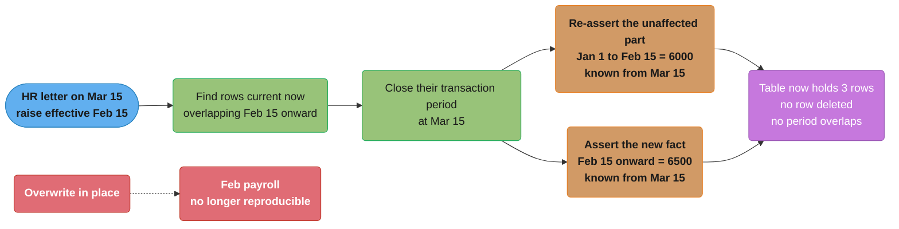
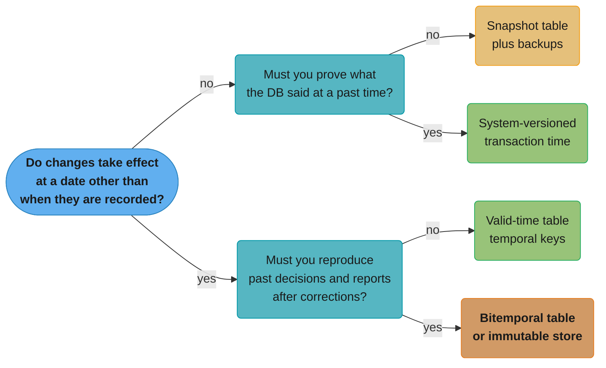

# Temporal and Bitemporal Data

> **Version anchor (November 2026).** Standard: **SQL:2011** (ISO/IEC 9075:2011, adopted
> December 2011) added application-time period tables, system-versioned tables, temporal
> primary keys (`WITHOUT OVERLAPS`), temporal referential integrity and bitemporal tables.
> Products: **PostgreSQL 18** (released 2025-09-25) added temporal `PRIMARY KEY`/`UNIQUE`
> (`WITHOUT OVERLAPS`) and temporal `FOREIGN KEY` (`PERIOD`) over range types;
> **PostgreSQL 19** (released 2026-11-19) adds a documentation section on temporal tables
> but still has no system versioning and no `UPDATE/DELETE ... FOR PORTION OF`.
> **SQL Server 2016 and later** (and Azure SQL) ship system-versioned temporal tables;
> **MariaDB** shipped system-versioned tables in 10.3 and application-time periods in 10.4.3.
> **Snowflake** Time Travel defaults to 1 day (up to 90 on Enterprise); **BigQuery** time
> travel defaults to 7 days (configurable 2 to 7). Cross-links: SCD history in the warehouse
> lives in [Data Warehouse Modeling](../data_warehouse_modeling/data_warehouse_modeling.md);
> table-format time travel lives in
> [Lakehouse and Table Formats](../lakehouse_and_table_formats/lakehouse_and_table_formats.md)
> and [Apache Iceberg](../../technologies/apache_iceberg/apache_iceberg.md); the regulatory
> audit-trail rules that drive most bitemporal designs live in
> [Regulatory Reporting and Audit Trails](../../fintech/regulatory_reporting_and_audit_trails/regulatory_reporting_and_audit_trails.md).

## 1. Concept Overview

A temporal database records **when** a fact was true, not only **what** is true now. Two
independent clocks matter, and almost every temporal bug comes from collapsing them into one:

| Axis | SQL:2011 name | Other names | Who sets it | Answers |
|---|---|---|---|---|
| Valid time | application time | business time, effective time, actual time | the application, from business knowledge | "what was true in the world on date D?" |
| Transaction time | system time | record time, knowledge time, as-recorded | the database, at commit | "what did the database say on date T?" |

A table can track neither (a plain snapshot table), one, or both:

- **Valid-time table** (SQL:2011 application-time period table): each row carries the period
  during which the fact holds in the real world. A future-dated price change and a policy
  effective from next month are both valid-time rows. These rows can be corrected.
- **Transaction-time table** (SQL:2011 system-versioned table): the database keeps every
  previous version of every row with the period during which that version was the database's
  current belief. Nobody can set or edit those timestamps. This is an audit trail built into
  the storage engine.
- **Bitemporal table**: both. "On 25 February, what did we believe Sally's salary was on
  15 February?" is answerable, and so is "and what do we believe now?"

The terms come from Richard Snodgrass's work on temporal databases and are the ones
SQL:2011 adopted. Martin Fowler's "Bitemporal History" (April 2021) uses *actual* and *record*
for the same two axes because workshop audiences found valid/transaction confusing.

**Why it matters.** Systems of record get corrected after the fact: back-dated salary changes,
retroactive price adjustments, late-reported trades, policy endorsements effective last month.
A regulator, auditor or court then asks two different questions: what was true, and what did
you know when you acted. A single timestamp answers at most one of them.

**Boundary.** Slowly changing dimensions in the warehouse (a simplified valid-time model) are
taught in [Data Warehouse Modeling](../data_warehouse_modeling/data_warehouse_modeling.md).
Event sourcing, where state is derived from an append-only log of facts, is taught in
[Event Sourcing and CQRS](../../hld/event_sourcing_cqrs/event_sourcing_cqrs.md); a bitemporal
table is one projection such a log can feed. Point-in-time *recovery* of a whole cluster is
[Backup, Recovery and Disaster Recovery](../backup_recovery_and_disaster_recovery/backup_recovery_and_disaster_recovery.md),
not a query feature. Erasure obligations that collide with immutable history are covered in
[Database Security and Compliance](../database_security_and_compliance/database_security_and_compliance.md).

---

## 2. Intuition

**One-line analogy.** Valid time is the date written *on* a letter. Transaction time is the
date stamped by the post office when it *arrived*. A letter dated 15 February that arrives on
15 March changes what you know about February, without changing what you knew in February.

**The example that makes it click (from Fowler's article).** Payroll runs on 25 February and
pays Sally her monthly salary of $6,000. On 15 March, HR sends a letter: Sally got a raise to
$6,500 effective 15 February. What was Sally's salary on 25 February?

- In the world (valid time): $6,500. The raise was effective on the 15th.
- In the records on 25 February (transaction time): $6,000. That is what payroll used, what
  the cheque said, and what the tax report must reconcile to.

Both answers are correct. A table with one date column can store only one of them, and
whichever it keeps, the other question becomes unanswerable.

**Mental model: a 2D plane.** Put valid time on the x axis and transaction time on the y
axis. Every row is a rectangle: "this value held over this valid period, according to the
database during this transaction period". A correction never erases a rectangle. It cuts the
current one off at the correction's transaction time and draws new rectangles above it.

**Key insight.** *Valid time is a claim about the world and can be wrong; transaction time is
a fact about the database and cannot be.* So valid time is editable (by adding new knowledge)
and transaction time is append-only and system-assigned. Any design that lets an application
write the transaction-time column has turned an audit trail into a suggestion.

---

## 3. Core Principles

### 3.1 Periods are half-open

SQL:2011 period definitions use closed-open semantics: `[start, end)`. A row valid
`[2026-01-01, 2026-02-15)` and the next `[2026-02-15, ...)` touch without overlapping, and a
point query for `2026-02-15` matches exactly one of them. Closed intervals double-count at
every boundary; open-open intervals lose the boundary point. Use `[start, end)` everywhere,
with an unbounded or far-future end for "until further notice".

### 3.2 Transaction time is assigned by the system, at commit, and never edited

SQL Server sets the period start to the **begin time of the transaction**, in UTC, and the
open end to `9999-12-31`. MariaDB uses the current timestamp, and its docs show that setting
the `timestamp` session variable changes the value recorded. Two consequences:

- **The application must not supply transaction time.** If it can, it can forge history.
- **Transaction-begin timestamps do not follow commit order.** A transaction that starts at
  10:00:00 and commits at 10:00:05 stamps its rows 10:00:00, earlier than a short transaction
  that started at 10:00:02 and committed first. "As of 10:00:03" therefore cannot see the
  long transaction's rows, even though nothing else could have read them before 10:00:05.
  For forensic ordering, keep a commit sequence (a log position) beside the timestamp.

### 3.3 Valid time is asserted, and corrections are new assertions

An application writes valid time from business documents: the effective date on a contract,
the trade date on a confirmation. When the assertion was wrong, the fix is a new assertion
recorded at a later transaction time. In a bitemporal table the old assertion stays visible
"as of" the earlier knowledge.

### 3.4 Constraints become temporal

- **Temporal key.** "One salary per employee" becomes "one salary per employee at any valid
  instant": `PRIMARY KEY (employee_id, valid_at WITHOUT OVERLAPS)`. PostgreSQL 18 enforces it
  with a GiST exclusion constraint.
- **Temporal referential integrity.** A child row's valid period must be fully covered by its
  parent's rows: a policy rider valid March to November needs a policy valid over all of March
  to November, possibly across several policy rows. PostgreSQL 18's `FOREIGN KEY (...,
  PERIOD valid_at)` checks exactly that coverage.
- **System-versioned constraints apply to current rows only.** SQL:2011 does not require
  constraints on system-versioned tables to be temporal; they are enforced on current rows.
  History rows are whatever was valid when they were current.

### 3.5 Three query shapes

Snodgrass's taxonomy is the cleanest way to reason about temporal SQL:

| Query shape | Meaning | Example |
|---|---|---|
| Current | as of now on every axis | "Sally's salary today" |
| Time-slice (as of) | the state at one instant on an axis | "salaries on 2026-02-25, as known on 2026-02-25" |
| Sequenced | the answer for each instant, returning periods | "for each period, the total payroll in force" |
| Non-sequenced | compares across instants explicitly | "employees whose salary ever decreased" |

Sequenced queries are the hard ones: a join of two valid-time tables must intersect their
periods, and an aggregate must split time at every boundary where any input changes.

### 3.6 History is data, and data has a lifecycle

System-versioned history grows with the update rate, not the table size. A 10M-row table
updated 50M times a year accumulates 50M history rows a year. Plan retention (SQL Server has a
history-retention management; MariaDB supports `PARTITION BY SYSTEM_TIME`) or partition the history
table by transaction time and drop or archive old partitions on a schedule that matches the
legal retention period, not before.

---

## 4. Types / Architectures / Strategies

### 4.1 Table kinds

| Kind | Columns | Update semantics | Can answer "as was"? | Can answer "as known then"? |
|---|---|---|---|---|
| Snapshot (non-temporal) | none | overwrite | no | no |
| Audit log (side table) | changed row + timestamp + who | trigger writes old row | partly, by replay | yes, if complete and trusted |
| Valid-time | `valid_from`, `valid_to` (or a range) | split periods, insert new | yes | no |
| Transaction-time (system-versioned) | system period, history table | engine moves old version to history | only if valid time equals transaction time | yes |
| Bitemporal | both periods | close current knowledge, insert re-assertions | yes | yes |

The transaction-time-only case is common and subtly wrong for business data: it records *when
the database changed*, which is not *when the change took effect*. It answers "what did the
row say on 25 February" but not "what salary applied on 15 February", because a back-dated
change is stamped 15 March.

### 4.2 Implementation strategies

| Strategy | How | Strengths | Weaknesses |
|---|---|---|---|
| Native SQL:2011 system versioning | SQL Server, MariaDB, Db2, Oracle temporal features | engine-maintained, cannot be bypassed by the app, standard `FOR SYSTEM_TIME` syntax | transaction time only (unless combined with application periods), vendor syntax differences |
| Native application-time periods | MariaDB `PERIOD FOR`, `DELETE ... FOR PORTION OF` | engine splits periods on update and delete | limited product support |
| PostgreSQL ranges + temporal constraints | `daterange`/`tstzrange`, `WITHOUT OVERLAPS`, `PERIOD` foreign keys (18+) | constraints enforced in the engine, flexible | no system versioning; period splitting written by hand; transaction time via triggers |
| Trigger-maintained history table | `AFTER UPDATE OR DELETE` copies `OLD` to a history table | works on any database | bypassable by a superuser or `session_replication_role`, trigger cost, schema drift between tables |
| Event log plus projections | append-only facts, temporal views derived from the log | full replay, matches event sourcing | queries need projections; corrections are compensating events |
| Immutable bitemporal database | XTDB: retains all history by default, bitemporal per SQL:2011, Postgres wire protocol | bitemporality is the default, no extra columns to manage | separate system to operate; writes serialized through one transaction log, no interactive transactions |
| Table-format or warehouse time travel | Iceberg snapshots, Snowflake Time Travel, BigQuery time travel | free, engine-level | bounded retention (Snowflake 1 to 90 days, BigQuery 2 to 7), engine time only, not a business history |

### 4.3 Product support

| Product | System-versioned | Application-time | Temporal keys | Bitemporal |
|---|---|---|---|---|
| SQL Server 2016+, Azure SQL | yes: `PERIOD FOR SYSTEM_TIME`, `SYSTEM_VERSIONING = ON` | no native periods | current rows only | build valid time yourself |
| MariaDB | yes (10.3) | yes (10.4.3), `DELETE/UPDATE ... FOR PORTION OF` | `WITHOUT OVERLAPS` | yes, combine both |
| PostgreSQL 18 / 19 | no (extensions or triggers) | ranges, no `FOR PORTION OF` | `WITHOUT OVERLAPS`, `PERIOD` FKs | build it yourself |
| IBM Db2 (10+) | yes, "Time Travel Query" with `FOR SYSTEM_TIME AS OF` | see IBM docs | see IBM docs | see IBM docs |
| Oracle Database | Flashback Query `AS OF TIMESTAMP` (9i onward); SQL:2011 temporal features in 12c | 12c | see Oracle docs | see Oracle docs |
| XTDB | yes, always on | yes, always on | `_id` per entity | yes, by default |

Oracle's classic Flashback Query reads undo data, so how far back it can go is bounded by undo
retention. Treat it like warehouse time travel:
a recovery tool first.

---

## 5. Architecture Diagrams

### 5.1 The bitemporal plane for Sally's salary

This is a constraint grid: valid time across, transaction time down. ASCII keeps the cells
aligned.

```
                         VALID TIME (when it was true in the world)  ->
                         Jan 1..   Feb 1..   Feb 15..  Mar 1..   Apr 1..
                         Jan 31    Feb 14    Feb 28    Mar 31    onward
TRANSACTION TIME
(when the DB knew it)
  2026-01-01 .. 03-15    6000      6000      6000      6000      6000
  2026-03-15 .. now      6000      6000      6500      6500      6500
                                             ^^^^
                         the correction recorded on 03-15 changes these cells only for
                         readers whose knowledge time is 03-15 or later

Query "salary on Feb 25, as known on Feb 25"  -> row 1, column 3 -> 6000 (what payroll paid)
Query "salary on Feb 25, as known now"        -> row 2, column 3 -> 6500 (what was owed)
Back pay = difference over [Feb 15, Mar 15) at the later knowledge time
```

*Every cell is answerable and none is ever overwritten. The upper row is closed at the
correction's transaction time, not deleted, which is what lets payroll reconcile to the
cheque it actually printed.*

### 5.2 What a correction does to rows



*The correction is three writes in one transaction: one update that only shrinks a
transaction period, and two inserts. Nothing is deleted, so every earlier reader's view can be
reconstructed exactly.*

### 5.3 Choosing the temporal model



*Bitemporal is the right answer only when both questions are asked. Pricing schedules and
HR effective dates usually need valid time; audit of an operational table usually needs
transaction time; regulated restatements need both.*

### 5.4 Splitting a period: what `FOR PORTION OF` does

```
Row before:      policy 1   premium 120   [2026-01-01 ------------------------ 2027-01-01)

UPDATE ... FOR PORTION OF valid FROM '2026-07-01' TO '2027-01-01' SET premium = 150

Rows after:      policy 1   premium 120   [2026-01-01 ------ 2026-07-01)
                 policy 1   premium 150                     [2026-07-01 ---- 2027-01-01)

DELETE ... FOR PORTION OF valid FROM '2026-04-01' TO '2026-05-01'  (a coverage gap)

Rows after:      premium 120   [2026-01-01 -- 2026-04-01)
                 premium 120                               [2026-05-01 -- 2026-07-01)
                 premium 150                                                [2026-07-01 -- ...)
```

*A portion update keeps the parts of the row outside the portion unchanged and rewrites only
the overlap; a portion delete inside a row splits it in two. MariaDB implements both
natively. In PostgreSQL 18 and 19 the same effect is written by hand (section 6.3).*

---

## 6. How It Works — Detailed Mechanics

The SQL in 6.1 to 6.5 runs on PostgreSQL 18 in file order. Statements marked BROKEN raise
an error on purpose and are shown separately.

### 6.1 A valid-time table with a temporal primary key

```sql
CREATE EXTENSION IF NOT EXISTS btree_gist;   -- lets integer keys join a GiST index

CREATE TABLE policy (
    policy_id      int       NOT NULL,
    holder         text      NOT NULL,
    premium_minor  bigint    NOT NULL,
    valid_at       daterange NOT NULL,
    PRIMARY KEY (policy_id, valid_at WITHOUT OVERLAPS)
);

INSERT INTO policy VALUES
    (1, 'Asha', 12000, daterange('2026-01-01', '2027-01-01'));
```

`WITHOUT OVERLAPS` on the last key column turns uniqueness into non-overlap: two rows for
policy 1 may coexist only if their `valid_at` ranges do not overlap. PostgreSQL enforces it
like `EXCLUDE USING gist (policy_id WITH =, valid_at WITH &&)`. The column must be a range or
multirange type, empty ranges are rejected, and non-range key columns need `btree_gist`.

```sql
-- BROKEN: a second premium for an overlapping period. Fails with a conflicting key error.
INSERT INTO policy VALUES
    (1, 'Asha', 13000, daterange('2026-06-01', '2026-09-01'));
```

### 6.2 Temporal referential integrity

```sql
CREATE TABLE policy_rider (
    rider_id    int       NOT NULL,
    policy_id   int       NOT NULL,
    rider_type  text      NOT NULL,
    valid_at    daterange NOT NULL,
    PRIMARY KEY (rider_id, valid_at WITHOUT OVERLAPS),
    FOREIGN KEY (policy_id, PERIOD valid_at)
        REFERENCES policy (policy_id, PERIOD valid_at)
);

-- Covered: March to December lies inside the policy's 2026 validity.
INSERT INTO policy_rider VALUES
    (10, 1, 'accident', daterange('2026-03-01', '2026-12-01'));
```

```sql
-- BROKEN: the rider runs past the end of the policy. Fails the PERIOD foreign key.
INSERT INTO policy_rider VALUES
    (11, 1, 'travel', daterange('2026-06-01', '2027-06-01'));
```

The check is coverage, not overlap: the referenced rows' combined periods must cover the
child's whole period, so a rider can span two consecutive policy rows (before and after a
premium change) and still pass.

### 6.3 Emulating `UPDATE ... FOR PORTION OF` in PostgreSQL

The premium rises to 150.00 from 1 July. The update must shrink the existing row and insert
the new piece in **one statement**, so the temporal foreign key from `policy_rider` never sees
a gap. The `INSERT` reads the `UPDATE`'s `RETURNING` output, which also forces the update to
run first.

```sql
WITH shrunk AS (
    UPDATE policy
    SET    valid_at = daterange(lower(valid_at), '2026-07-01')
    WHERE  policy_id = 1
      AND  valid_at @> date '2026-07-01'
      AND  lower(valid_at) < '2026-07-01'
    RETURNING new.policy_id, new.holder,
              upper(new.valid_at) AS cut,          -- 2026-07-01
              upper(old.valid_at) AS old_upper     -- 2027-01-01 (RETURNING OLD, PG 18+)
)
INSERT INTO policy (policy_id, holder, premium_minor, valid_at)
SELECT policy_id, holder, 15000, daterange(cut, old_upper)
FROM   shrunk;

SELECT policy_id, premium_minor, valid_at FROM policy ORDER BY valid_at;
-- 1 | 12000 | [2026-01-01,2026-07-01)
-- 1 | 15000 | [2026-07-01,2027-01-01)
```

PostgreSQL 18's `RETURNING old.*` / `new.*` hands back both versions of the updated row, so
the old upper bound `2027-01-01` is available without a second read. A general implementation also
handles a portion that ends before the row does (a third, right-hand piece) and rows that lie
wholly inside the portion. This is the code MariaDB's `FOR PORTION OF` saves you from writing,
and the reason to wrap it in one tested function rather than repeating it per table.

### 6.4 A bitemporal table: valid time plus transaction time

```sql
CREATE TABLE salary_bt (
    employee_id   text      NOT NULL,
    salary_minor  bigint    NOT NULL,
    valid_at      daterange NOT NULL,                     -- business effective period
    tx_at         tstzrange NOT NULL                      -- when the DB held this belief
                  DEFAULT tstzrange(now(), NULL),
    EXCLUDE USING gist (employee_id WITH =, valid_at WITH &&, tx_at WITH &&)
);
```

The exclusion constraint says: for one employee, no two rows may overlap in **both** valid
time and transaction time. Overlap in one axis alone is legal and normal: the old belief and
the corrected belief cover the same February, at different transaction times.

In production `tx_at` comes from `now()` (the transaction start) or from a trigger, and the
application role has no privilege to set it. The demo below supplies explicit transaction
times so the output is reproducible.

```sql
-- 2026-01-01: Sally hired at 6,000.00 a month, effective 2026-01-01.
INSERT INTO salary_bt VALUES
    ('sally', 600000, daterange('2026-01-01', NULL), tstzrange('2026-01-01 09:00+00', NULL));

-- 2026-03-15: HR reports a raise to 6,500.00 effective 2026-02-15. One transaction.
BEGIN;
-- 1. Close the current belief that overlaps the corrected valid period.
UPDATE salary_bt
SET    tx_at = tstzrange(lower(tx_at), '2026-03-15 10:00+00')
WHERE  employee_id = 'sally'
  AND  upper_inf(tx_at)
  AND  valid_at && daterange('2026-02-15', NULL);

-- 2. Re-assert the part of the old belief the correction does not touch.
INSERT INTO salary_bt VALUES
    ('sally', 600000, daterange('2026-01-01', '2026-02-15'),
     tstzrange('2026-03-15 10:00+00', NULL));

-- 3. Assert the new fact.
INSERT INTO salary_bt VALUES
    ('sally', 650000, daterange('2026-02-15', NULL),
     tstzrange('2026-03-15 10:00+00', NULL));
COMMIT;
```

### 6.5 The four questions a bitemporal table answers

```sql
-- Q1. Current: salary today, as known now.
SELECT salary_minor FROM salary_bt
WHERE  employee_id = 'sally' AND valid_at @> current_date AND upper_inf(tx_at);
-- 650000

-- Q2. As known then: salary on Feb 25 according to the payroll run on Feb 25.
SELECT salary_minor FROM salary_bt
WHERE  employee_id = 'sally'
  AND  valid_at @> date '2026-02-25'
  AND  tx_at    @> timestamptz '2026-02-25 12:00+00';
-- 600000

-- Q3. As known now: salary on Feb 25 with today's knowledge.
SELECT salary_minor FROM salary_bt
WHERE  employee_id = 'sally'
  AND  valid_at @> date '2026-02-25'
  AND  upper_inf(tx_at);
-- 650000

-- Q4. Restatement diff: what changed between two knowledge times, per valid period.
WITH before AS (
    SELECT valid_at, salary_minor FROM salary_bt
    WHERE employee_id = 'sally' AND tx_at @> timestamptz '2026-03-01 00:00+00'
), after AS (
    SELECT valid_at, salary_minor FROM salary_bt
    WHERE employee_id = 'sally' AND tx_at @> timestamptz '2026-04-01 00:00+00'
)
SELECT b.valid_at * a.valid_at AS period,
       b.salary_minor          AS was,
       a.salary_minor          AS now_known
FROM   before b JOIN after a ON b.valid_at && a.valid_at
WHERE  b.salary_minor <> a.salary_minor;
-- [2026-02-15,) | 600000 | 650000
```

Q4 is the query auditors and finance teams actually need: it lists every period whose value
changed between two knowledge times, which is exactly what drives back pay, a premium
adjustment or a regulatory restatement. Neither a valid-time table nor a system-versioned
table alone can produce it.

### 6.6 SQL Server: system-versioned temporal tables

```sql
-- T-SQL, SQL Server 2016 and later (from the Microsoft Learn overview)
CREATE TABLE dbo.Employee
(
    EmployeeID   INT            NOT NULL PRIMARY KEY CLUSTERED,
    Name         NVARCHAR(100)  NOT NULL,
    AnnualSalary DECIMAL(10, 2) NOT NULL,
    ValidFrom    DATETIME2 GENERATED ALWAYS AS ROW START,
    ValidTo      DATETIME2 GENERATED ALWAYS AS ROW END,
    PERIOD FOR SYSTEM_TIME (ValidFrom, ValidTo)
)
WITH (SYSTEM_VERSIONING = ON (HISTORY_TABLE = dbo.EmployeeHistory));

-- State of the table as the database held it at an instant (interpreted as UTC).
SELECT EmployeeID, AnnualSalary, ValidFrom, ValidTo
FROM   dbo.Employee FOR SYSTEM_TIME AS OF '2026-02-25T12:00:00';
```

How the engine maintains it, per the Microsoft documentation:

| Operation | Current table | History table |
|---|---|---|
| `INSERT` | row with `ValidFrom` = transaction begin time (UTC), `ValidTo` = `9999-12-31` | nothing |
| `UPDATE` | new values, `ValidFrom` = transaction begin time | old version, `ValidTo` = transaction begin time |
| `DELETE` | row removed | old version, `ValidTo` = transaction begin time |
| `MERGE` | behaves as the `INSERT`, `UPDATE` and `DELETE` it performs | same |

The `FOR SYSTEM_TIME` subclauses are `AS OF`, `FROM ... TO`, `BETWEEN ... AND`,
`CONTAINED IN (...)` and `ALL`. `FROM ... TO` excludes versions that became active exactly at
the upper endpoint and `BETWEEN ... AND` includes them; `CONTAINED IN` returns only versions
that opened and closed inside the window.

The columns are named `ValidFrom` and `ValidTo` in Microsoft's examples, but they are
**system time**. Using them as business effective dates is the classic mistake: a back-dated
correction is stamped with the date it was typed.

### 6.7 MariaDB: system versioning, application periods and both

```sql
-- MariaDB: transaction time
CREATE TABLE price (
    sku    VARCHAR(20),
    amount DECIMAL(10, 2)
) WITH SYSTEM VERSIONING;

SELECT * FROM price FOR SYSTEM_TIME AS OF TIMESTAMP '2026-02-25 12:00:00';

-- MariaDB: valid time with native period splitting
CREATE TABLE price_schedule (
    sku        VARCHAR(20),
    amount     DECIMAL(10, 2),
    valid_from DATE,
    valid_to   DATE,
    PERIOD FOR valid_period (valid_from, valid_to)
);

DELETE FROM price_schedule
FOR PORTION OF valid_period FROM '2026-04-01' TO '2026-05-01'
WHERE sku = 'A1';
```

MariaDB's documentation spells out the portion-delete semantics: a row wholly inside the
portion is removed, a row overlapping one end is shrunk, and a row containing the portion is
split into two rows. Declaring both a `PERIOD FOR` application period and `WITH SYSTEM
VERSIONING` on one table gives a bitemporal table.

Two documented behaviours worth knowing before production:

- An `UPDATE` that lists a versioned column in `SET` writes a history row **even if no value
  changes** (`UPDATE t SET x = x`). An ORM that writes every column on save creates a history
  row per save.
- In the documentation's example, a `TIMESTAMP(6)` row-end column shows the open-ended value
  `2038-01-19 05:14:07.999999`: the maximum of the 32-bit epoch, not a business date.

### 6.8 Sizing history

Illustrative arithmetic, assumptions labeled:

```
current rows                     = 10,000,000
updates per year                 = 50,000,000          (assumption: 5 per row per year)
history rows per year            = 50,000,000          (one old version per update)
row size                         ~ 200 bytes           (assumption)
history growth                   ~ 50M x 200 B = 10 GB per year
retention required               = 6 years             (e.g. a broker-dealer core record)
steady-state history             ~ 60 GB, plus indexes

Bitemporal correction cost       = 1 update (close) + 1 to 3 inserts
1% of rows corrected per month   = 100,000 x 12 x ~3 = 3.6M extra rows per year
```

History is cheap until updates are frequent and rows are wide. The usual fixes are to keep
volatile columns (`last_seen_at`, counters) out of versioned tables, partition history by
transaction time, and index history on `(key, period)` with GiST for ranges or B-tree on
`(key, period_end)` for system-versioned tables.

### 6.9 Indexing temporal queries

| Query | Index | Why |
|---|---|---|
| point lookup "key at instant" on a range column | GiST on `(key, valid_at)` (the `WITHOUT OVERLAPS` index already is one) | `@>` and `&&` are GiST operators |
| "current rows only" | partial index `WHERE upper_inf(tx_at)` | current rows are a small fraction of a large bitemporal table |
| as-of scan over a large append-mostly history | BRIN on the transaction-time start column | history is inserted in transaction-time order, so block ranges correlate |
| SQL Server history table | clustered index on the period columns (end, start) | what SQL Server creates for a default history table; add the key for per-entity lookups |

---

## 7. Real-World Examples

- **Payroll back pay.** Fowler's article is a payroll example for a reason: payroll must pay
  on what it knew (the cheque already cashed) and later settle on what was true (the back
  pay). A bitemporal salary table produces the arrears as the Q4 restatement diff in 6.5,
  multiplied over the affected period.
- **Broker-dealer records.** SEC Rule 17a-4, as amended in 2022, allows an electronic
  recordkeeping system that keeps a complete time-stamped audit trail, able to recreate an
  original record if it is modified or deleted, as an alternative to non-rewriteable
  storage. That requirement is transaction time by definition. The rule details, retention
  periods and the WORM alternative are in
  [Regulatory Reporting and Audit Trails](../../fintech/regulatory_reporting_and_audit_trails/regulatory_reporting_and_audit_trails.md).
- **SQL Server's documented scenarios** for system-versioned tables: auditing all data
  changes and data forensics, reconstructing state as of any past time, trend analysis,
  maintaining a slowly changing dimension, and recovering from accidental changes.
- **MariaDB's documented scenarios**: forensic analysis and legal requirements to store data
  for N years, retrospective analytics such as staff information as of one year ago, and
  point-in-time recovery of a table.
- **XTDB** is built around the idea: an immutable SQL database that retains all history by
  default, builds on SQL:2011's bitemporal model, speaks the PostgreSQL wire protocol, and
  serializes every write through one system-wide transaction log (so it does not support
  interactive multi-statement transactions).
- **Insurance and lending.** Policies, endorsements, rates and loan terms are effective-dated
  and frequently corrected retroactively; statements already sent must stay reproducible.
  These are the textbook bitemporal domains.
- **Warehouses and lakes.** Snowflake Time Travel (1 day default, up to 90 on Enterprise) and
  BigQuery time travel (7 days default, 2 to 7) are transaction-time features of the storage
  layer with short retention. Iceberg snapshots give engine time travel bounded by snapshot
  expiry (see [Apache Iceberg](../../technologies/apache_iceberg/apache_iceberg.md) and
  [Trino](../../technologies/trino/trino.md) for querying them). None of them is a business
  history.

---

## 8. Tradeoffs

### 8.1 Valid-time vs system-versioned vs bitemporal

| Concern | Valid-time | System-versioned | Bitemporal |
|---|---|---|---|
| Back-dated changes | modeled correctly | stamped with entry date | modeled correctly |
| Reproduce a past report after corrections | no | only if valid time equals entry time | yes |
| Tamper resistance | none (rows are corrected) | high (engine-maintained) | high if transaction time is engine-maintained |
| Write cost per correction | 1 to 3 rows | 1 history row | 2 to 4 rows |
| Query complexity | moderate (range predicates) | low (`FOR SYSTEM_TIME AS OF`) | high (two predicates, sequenced logic) |
| Native support | MariaDB, PostgreSQL constraints | SQL Server, MariaDB, Db2, Oracle | MariaDB, XTDB; hand-built elsewhere |

### 8.2 Native temporal features vs hand-built

| Concern | Native (SQL:2011 style) | Triggers and history tables | Event log plus projections |
|---|---|---|---|
| Correctness by default | high | depends on every trigger being right | high for the log, projections can lag |
| Bypass risk | low (engine-owned) | high: disable triggers, replication role, superuser | low for the log |
| Portability | low: syntax differs per vendor | medium | high |
| Schema change | engine propagates to history | both tables must change together | upcasting events |
| Query ergonomics | `FOR SYSTEM_TIME` clauses | hand-written range predicates | rebuild or query projections |

### 8.3 Temporal history vs time travel vs backups

| Mechanism | Granularity | Retention | Intended for |
|---|---|---|---|
| System-versioned history | every committed change | as long as you keep it | audit, forensics, as-of queries |
| Warehouse time travel | every change, storage-level | Snowflake up to 90 days, BigQuery up to 7 | undoing mistakes, short look-back |
| PITR from WAL archive | whole cluster to an instant | backup retention | disaster recovery |
| Periodic snapshots | per snapshot | per policy | reporting freezes |

A team that uses time travel or PITR as its audit trail discovers the retention limit on the
day an auditor asks about last year.

---

## 9. When to Use / When NOT to Use

**Use valid time when:**

- Facts take effect on business dates that differ from entry dates: prices, rates, contracts,
  org structure, entitlements, scheduled future changes.
- Overlap must be impossible: one price per SKU per day, one active policy per holder.

**Use system versioning (transaction time) when:**

- You must prove what the database said at a past instant: audit, forensics, regulated
  record keeping.
- You want "undo the last bad update" without a restore.

**Use bitemporal when:**

- Retroactive corrections happen **and** past decisions or reports must be reproducible:
  payroll, insurance, lending, trading and positions, regulatory reporting, tax.

**Do NOT use temporal tables when:**

- The data is high-frequency telemetry. A time-series store is the right tool (see
  [Time-Series Databases](../time_series_databases/time_series_databases.md)); versioning
  each sample doubles writes for no question anyone asks.
- Volatile, meaningless columns (`last_seen_at`, hit counters) live on the row. Move them out
  first or every heartbeat creates a history row.
- Personal data must be erasable on request and the history store cannot erase it. Design
  crypto-shredding or a separate PII store first.

**Do NOT build bitemporal "just in case":**

- Every query gains a second predicate and every correction becomes a multi-row transaction.
  If nobody will ever ask "as known on", a valid-time table plus system versioning covers
  most needs at a fraction of the complexity.

---

## 10. Common Pitfalls

### 10.1 Overwriting valid time on correction

The most common temporal bug: a valid-time table is "corrected" in place, so the database
no longer knows what it believed when it acted.

```sql
CREATE TABLE salary_vt (
    employee_id  text      NOT NULL,
    salary_minor bigint    NOT NULL,
    valid_at     daterange NOT NULL,
    PRIMARY KEY (employee_id, valid_at WITHOUT OVERLAPS)
);
INSERT INTO salary_vt VALUES ('sally', 600000, daterange('2026-01-01', NULL));

-- BROKEN: the correction rewrites February. Payroll's Feb 25 figure is gone for good.
UPDATE salary_vt SET valid_at = daterange('2026-01-01', '2026-02-15')
WHERE  employee_id = 'sally';
INSERT INTO salary_vt VALUES ('sally', 650000, daterange('2026-02-15', NULL));
-- "What did we pay on, on Feb 25?" can no longer be answered from the database.
```

The fix is the bitemporal pattern in 6.4: close the old belief's transaction period and
insert re-assertions. If a full bitemporal table is too much, put the valid-time table under
system versioning (or a trigger-maintained history) so the overwritten belief is still
recoverable as of its transaction time.

### 10.2 Closed intervals at boundaries

```sql
-- BROKEN: BETWEEN is inclusive at both ends. On 2026-02-15 two salaries match.
SELECT count(*) FROM salary_vt
WHERE  employee_id = 'sally'
  AND  date '2026-02-15' BETWEEN lower(valid_at) AND coalesce(upper(valid_at), 'infinity');
-- 2

-- FIX: use range containment, which honours the half-open bound.
SELECT count(*) FROM salary_vt
WHERE  employee_id = 'sally' AND valid_at @> date '2026-02-15';
-- 1
```

A sum over a date join with `BETWEEN` double-counts every boundary day: one extra day of
salary per change, per employee.

### 10.3 Application-supplied transaction time

A service stamps `recorded_at = request.timestamp` from the client. A replayed request, a
client with a skewed clock or a malicious caller writes history in the past. MariaDB's docs
show the engine-side equivalent: setting the `timestamp` session variable changes the
recorded row-start. Revoke that ability from application roles, take transaction time from
the database, and keep a monotonic commit sequence for ordering.

### 10.4 Treating system time as business time

A team builds "price history" on a SQL Server temporal table and reads `ValidFrom` as the
effective date. A price change agreed for 1 March but entered on 3 March is reported as
effective on 3 March; two days of invoices are re-priced wrongly in the analytics. System
time is entry time. Add business effective dates as ordinary columns (or a range) and keep
system versioning for audit.

### 10.5 Time travel as the audit trail

A fintech relies on warehouse time travel for "we can always see the old value". The
auditor asks about a balance from 11 months ago; Snowflake's maximum is 90 days on
Enterprise, BigQuery's is 7. The data is in Fail-safe or gone. Audit history must live in
tables you control with retention you set.

### 10.6 No-op updates inflating history

On MariaDB a `SET col = col` still writes a history row; on any trigger-based design an
unconditional trigger does the same. An ORM that saves every field on every request turned a
2M-row table into 400M history rows in a year (illustrative). Compare before writing
(`WHERE col IS DISTINCT FROM new_value`) and keep volatile columns out of versioned tables.

### 10.7 Sequenced joins without period intersection

```sql
CREATE TABLE dept_vt (
    employee_id text NOT NULL, dept text NOT NULL, valid_at daterange NOT NULL,
    PRIMARY KEY (employee_id, valid_at WITHOUT OVERLAPS)
);
INSERT INTO dept_vt VALUES
    ('sally', 'Sales',   daterange('2026-01-01', '2026-03-01')),
    ('sally', 'Finance', daterange('2026-03-01', NULL));

-- BROKEN: joins on the key only. Every salary row pairs with every dept row.
SELECT s.salary_minor, d.dept FROM salary_vt s JOIN dept_vt d USING (employee_id);

-- FIX: join on overlapping validity and return the intersection.
SELECT s.salary_minor, d.dept, s.valid_at * d.valid_at AS valid_at
FROM   salary_vt s JOIN dept_vt d
       ON d.employee_id = s.employee_id AND d.valid_at && s.valid_at;
```

The fixed query is a sequenced join: one output row per period where both inputs are
constant, with the intersection as its validity.

---

## 11. Technologies & Tools

| Tool | Temporal capability | Notes |
|---|---|---|
| PostgreSQL | range types, `WITHOUT OVERLAPS` keys, `PERIOD` foreign keys (18+) | no system versioning or `FOR PORTION OF` in 18 or 19 |
| btree_gist | PostgreSQL extension | lets scalar key columns join temporal GiST constraints |
| temporal_tables | PostgreSQL extension | trigger-based system versioning |
| SQL Server | system-versioned temporal tables since 2016 | `FOR SYSTEM_TIME AS OF / FROM TO / BETWEEN / CONTAINED IN / ALL` |
| Azure SQL Database | same temporal tables as SQL Server | managed service |
| MariaDB | system versioning, application-time periods, bitemporal | `FOR PORTION OF` updates and deletes |
| IBM Db2 | system-versioned "Time Travel Query" since Db2 10 | `FOR SYSTEM_TIME AS OF` |
| Oracle Database | Flashback Query `AS OF TIMESTAMP`, SQL:2011 temporal features from 12c | Flashback Query bounded by undo retention |
| XTDB | immutable bitemporal SQL database | PostgreSQL wire protocol, MPL licence |
| Snowflake | Time Travel | 1 day default, up to 90 days on Enterprise |
| Google BigQuery | time travel | 7 days default, configurable 2 to 7 |
| Apache Iceberg | snapshot time travel on lake tables | see [Apache Iceberg](../../technologies/apache_iceberg/apache_iceberg.md) |
| Trino | queries Iceberg snapshots and federated sources | see [Trino](../../technologies/trino/trino.md) |

---

## 12. Interview Questions with Answers

**Q: What is the difference between valid time and transaction time?**
**Short:** Valid time is when a fact was true in the world and is set by the application; transaction time is when the database recorded it and is set by the system at commit.

Valid time (SQL:2011 application time) can be in the past or the future and can be corrected,
because it is a claim about the world. Transaction time (system time) is a fact about the
database and is append-only. A back-dated salary raise has a valid start of 15 February and a
transaction start of 15 March. Confusing the two is the root of most temporal bugs: system
time read as business time reports every back-dated change on its entry date.

**Q: What does "bitemporal" let you answer that a single-timeline table cannot?**
**Short:** It answers "what was true on date D according to what we knew on date T", so past decisions stay reproducible after retroactive corrections.

A valid-time table answers "what was true" but loses what you believed before a correction.
A system-versioned table answers "what did the database say" but stamps back-dated changes
with their entry time. A bitemporal table keeps both, so payroll can reproduce the cheque it
printed and also compute the back pay owed, and a regulator's report can be re-run exactly
as filed. The restatement diff between two knowledge times comes for free.

**Q: Why must transaction time be assigned by the database rather than the application?**
**Short:** Because transaction time is an audit record; if the application can set it, any caller can forge or reorder history and the trail proves nothing.

Engine-maintained periods (SQL Server's `GENERATED ALWAYS AS ROW START`) cannot be written by
DML. An application-supplied timestamp is exposed to clock skew, replays and malicious input.
Even engines leave holes: MariaDB lets a session set its `timestamp` variable, which changes
the recorded row start. Revoke that from application roles and keep a commit sequence beside
the timestamp for ordering.

**Q: Why are temporal periods half-open, and what goes wrong otherwise?**
**Short:** A half-open period [start, end) lets consecutive versions touch without overlapping, so every instant matches exactly one version.

SQL:2011 uses closed-open semantics. With closed intervals, an instant at a boundary matches
two versions and joins or sums double-count it; with open-open intervals the boundary instant
matches none. In PostgreSQL use range types and the containment operator `@>`, which honour
the bound; `BETWEEN` on the endpoints is inclusive at both ends and reintroduces the bug.

**Q: How does SQL Server maintain a system-versioned temporal table?**
**Short:** On update or delete it moves the old row version into a history table, setting period end to the transaction begin time in UTC; current rows end at 9999-12-31.

Inserts set the row start to the transaction begin time and the end to the maximum
`datetime2`. Updates write the previous version to history with its end set to the
transaction time and give the current row a new start. Deletes move the row to history.
Queries use `FOR SYSTEM_TIME` with `AS OF`, `FROM ... TO`, `BETWEEN ... AND`,
`CONTAINED IN` or `ALL`, and the times are interpreted as UTC.

**Q: Why can "as of" queries on transaction time miss rows that had committed?**
**Short:** Engines stamp rows with the transaction begin time, so a long transaction's rows carry a timestamp earlier than their commit and earlier than rows committed before them.

A transaction that starts at 10:00:00 and commits at 10:00:05 stamps 10:00:00. A query "as of
10:00:03" sees it as already current, although no reader could have seen it then; and two
transactions' timestamps can order differently from their commits. For forensic ordering,
keep a commit sequence (a log position or monotonic counter) and treat the timestamp as a
label, not an order.

**Q: How do you enforce "one price per product at any moment" in PostgreSQL 18?**
**Short:** Use a temporal primary key, PRIMARY KEY (product_id, valid_at WITHOUT OVERLAPS), over a range column, with btree_gist for the scalar key.

PostgreSQL 18 enforces `WITHOUT OVERLAPS` like an exclusion constraint
`EXCLUDE USING gist (product_id WITH =, valid_at WITH &&)`, backed by a GiST index. The last
column must be a range or multirange and cannot be empty. Before 18 the same rule was written
as an explicit `EXCLUDE` constraint; the temporal key form also lets foreign keys reference it.

**Q: What does a temporal foreign key check?**
**Short:** That the parent's rows, taken together, cover the child row's whole validity period for the same key, not merely that they overlap it.

A rider valid March to November needs policy rows covering all of March to November, possibly
two consecutive rows split by a premium change. PostgreSQL 18 writes it as
`FOREIGN KEY (policy_id, PERIOD valid_at) REFERENCES policy (policy_id, PERIOD valid_at)`, and
the referenced key must be declared `WITHOUT OVERLAPS`. An overlap-only check would accept a
rider that outlives its policy.

**Q: What does UPDATE ... FOR PORTION OF do, and how do you get it without native support?**
**Short:** It applies a change to only part of each row's period, splitting rows so the parts outside the portion keep their old values; without it you shrink and insert in one statement.

MariaDB implements `UPDATE` and `DELETE ... FOR PORTION OF`; a delete inside a row splits it
in two. PostgreSQL 18 and 19 do not. The emulation shrinks the overlapping row and inserts
the new and remainder pieces in a single statement (a `WITH ... UPDATE ... RETURNING` feeding
the `INSERT`), so temporal foreign keys never observe a coverage gap. Wrap it in one tested
function per pattern.

**Q: How do you record a retroactive correction in a bitemporal table?**
**Short:** In one transaction, close the transaction period of the current rows the correction overlaps, then insert re-assertions of the unaffected parts and the new fact, all known from now.

Nothing is deleted and no valid-time row is edited. The closed rows keep answering queries for
earlier knowledge times; the new rows answer for now onward. An exclusion constraint on
`(key WITH =, valid WITH &&, tx WITH &&)` guarantees no two beliefs overlap on both axes. A
correction costs one update and one to three inserts.

**Q: Is warehouse or lakehouse time travel a substitute for temporal tables?**
**Short:** No; time travel is short-retention, storage-level transaction time for recovery, while temporal tables hold business history for as long as you choose.

Snowflake Time Travel defaults to 1 day and reaches 90 days only on Enterprise for permanent
tables; BigQuery's window is 2 to 7 days; Iceberg history ends at snapshot expiry. None
records business effective time, and all are outside your retention control. Use them to undo
mistakes, and keep audit and business history in modeled tables.

**Q: How do temporal tables relate to SCD type 2 in a warehouse?**
**Short:** SCD2 is a valid-time model in a dimension, usually stamped from source change times; it does not record what the warehouse believed, so it is not bitemporal.

An SCD2 dimension answers "segment at the time of the order". If a source back-dates a change,
the warehouse inserts a version with the corrected valid date and the old belief vanishes.
Adding load time as a second period (or snapshotting the dimension at each reporting close)
makes it bitemporal. SQL Server even lists SCD maintenance as a use for system-versioned tables,
but system time alone is entry time, not effective time.

**Q: What is a sequenced query, and why is it hard?**
**Short:** It returns an answer for every instant, as periods; joins must intersect validity periods and aggregates must split time wherever any input changes.

Joining two valid-time tables on the key alone pairs every version with every version. The
correct join adds `a.valid && b.valid` and returns `a.valid * b.valid`. Aggregating over time
needs a sweep over all boundary points. This is where most hand-written temporal SQL goes
wrong, and why tested helper views or functions beat ad hoc queries.

**Q: How should you index a large bitemporal table?**
**Short:** GiST on key plus ranges for point and overlap lookups, a partial index on current rows, and BRIN or partitioning by transaction time for history scans.

Temporal keys already create a GiST index usable by `@>` and `&&`. Most reads are current, so
a partial index `WHERE upper_inf(tx_at)` keeps them fast as history grows. History arrives in
transaction-time order, which suits BRIN and range partitioning, and partitions are also the
unit of retention.

**Q: Your system-versioned history table grew 30x faster than the business data. Why?**
**Short:** Updates that change nothing meaningful still write versions: ORMs writing every column, no-op updates, and volatile fields like last_seen_at on the versioned row.

MariaDB documents that an `UPDATE` listing a versioned column writes a history row even if the
value does not change. Move volatile columns to a separate non-versioned table, compare before
updating, and exclude columns from versioning where the engine allows it. Then partition and
apply a retention policy matching the legal requirement.

**Q: How do immutable temporal history and the right to erasure coexist?**
**Short:** Keep personal data out of the versioned rows or encrypt it per subject so deleting the key erases it everywhere, including history and backups.

A history table that must be retained for years and a request to erase one person's data
conflict directly. Store identifiers and personal attributes in a separate store referenced by
a token, or encrypt them with a per-subject key (crypto-shredding). The temporal history keeps
the business facts and loses the personal data when the key is destroyed. Decide this before
the first version is written; retrofitting it means rewriting history.

**Q: When would you choose XTDB or another immutable store over adding temporal columns to Postgres?**
**Short:** When bitemporal history is the core of the domain and most tables need it, so making it the default beats hand-maintaining periods, triggers and correction logic per table.

XTDB retains all history by default, implements the SQL:2011 bitemporal model and speaks the
Postgres wire protocol, so queries stay SQL. The trade is operating another database and its
write model: all writes go through one serialized transaction log, with no interactive
multi-statement transactions. For two or three temporal tables inside an existing Postgres
estate, range types, temporal keys and a tested correction function are cheaper.

**Q: Which domains genuinely need bitemporal data?**
**Short:** Domains with retroactive corrections and a duty to reproduce past outputs: payroll, insurance, lending, trading and positions, tax and regulatory reporting.

The test is two questions asked of the same data: "what was true" (to settle what is owed now)
and "what did we know when we acted" (to justify past decisions and filings). Broker-dealer
record rules, insurance statements and payroll all ask both. A product catalogue with
scheduled price changes needs valid time only; an operational audit needs transaction time
only.

---

## 13. Best Practices

- **Name both axes explicitly** (`valid_at`, `tx_at`), never a bare `start_date`. Readers
  must know which clock a column is.
- **Use half-open ranges** and containment operators; ban `BETWEEN` on period endpoints in
  review.
- **Let the engine assign transaction time**, deny the application role any way to set it,
  and keep a commit sequence for ordering.
- **Enforce non-overlap in the database** (`WITHOUT OVERLAPS`, exclusion constraints), not in
  application code.
- **Write corrections as one transaction** with a single tested function per table pattern.
- **Keep volatile columns out of versioned tables** and skip no-op updates.
- **Partition history by transaction time** and drop partitions only after the legal
  retention period.
- **Provide current-only views** so most queries never see the temporal predicates.
- **Ship the four standard queries** (current, as known then, as known now, restatement
  diff) as tested views or functions.
- **Separate personal data from history** or encrypt it per subject before the first version
  is written.
- **Do not use time travel or PITR as audit history.**

---

## 14. Case Study

**Scenario (illustrative).** A motor insurer with 2M policies sends monthly premium
statements. Rating errors are discovered weeks later, and endorsements (a new driver, a
changed address) are often reported after their effective date. The premium table was
valid-time only: `policy_premium(policy_id, premium_minor, valid_at)` with a temporal key.
Corrections overwrote the affected periods.

**The incident.** A customer disputed a March statement. The insurer could not reproduce
the statement it sent: the March period had since been corrected twice, and the original
premium existed only in a PDF. The ombudsman asked for the premium as calculated on the
statement date and the basis for each later adjustment. The data team could answer neither
from the database.

```sql
CREATE TABLE policy_premium_vt (
    policy_id     int       NOT NULL,
    premium_minor bigint    NOT NULL,
    valid_at      daterange NOT NULL,
    PRIMARY KEY (policy_id, valid_at WITHOUT OVERLAPS)
);
INSERT INTO policy_premium_vt VALUES (7, 9000, daterange('2026-01-01', '2027-01-01'));

-- BROKEN: a rating correction on 2026-04-10 for March onward overwrites the belief
-- the March statement (sent 2026-03-31) was based on.
WITH shrunk AS (
    UPDATE policy_premium_vt
    SET    valid_at = daterange(lower(valid_at), '2026-03-01')
    WHERE  policy_id = 7 AND valid_at @> date '2026-03-01'
    RETURNING policy_id
)
INSERT INTO policy_premium_vt
SELECT policy_id, 9600, daterange('2026-03-01', '2027-01-01') FROM shrunk;
-- The statement's 90.00 for March is no longer anywhere in the database.
```

```sql
-- FIX: bitemporal premium table. Corrections close beliefs and add new ones.
CREATE TABLE policy_premium_bt (
    policy_id     int       NOT NULL,
    premium_minor bigint    NOT NULL,
    valid_at      daterange NOT NULL,
    tx_at         tstzrange NOT NULL DEFAULT tstzrange(now(), NULL),
    reason        text      NOT NULL,
    EXCLUDE USING gist (policy_id WITH =, valid_at WITH &&, tx_at WITH &&)
);

INSERT INTO policy_premium_bt VALUES
    (7, 9000, daterange('2026-01-01', '2027-01-01'),
     tstzrange('2025-12-20 10:00+00', NULL), 'new business');

-- Correction recorded 2026-04-10, effective 2026-03-01.
BEGIN;
UPDATE policy_premium_bt
SET    tx_at = tstzrange(lower(tx_at), '2026-04-10 09:00+00')
WHERE  policy_id = 7 AND upper_inf(tx_at)
  AND  valid_at && daterange('2026-03-01', '2027-01-01');

INSERT INTO policy_premium_bt VALUES
    (7, 9000, daterange('2026-01-01', '2026-03-01'),
     tstzrange('2026-04-10 09:00+00', NULL), 're-assert: unaffected by rating fix'),
    (7, 9600, daterange('2026-03-01', '2027-01-01'),
     tstzrange('2026-04-10 09:00+00', NULL), 'rating fix ticket RT-4411');
COMMIT;

-- The March statement, exactly as calculated on 2026-03-31:
SELECT premium_minor FROM policy_premium_bt
WHERE  policy_id = 7
  AND  valid_at @> date '2026-03-15'
  AND  tx_at    @> timestamptz '2026-03-31 18:00+00';
-- 9000

-- What is owed for March with today's knowledge, and why it differs:
SELECT premium_minor, reason FROM policy_premium_bt
WHERE  policy_id = 7 AND valid_at @> date '2026-03-15' AND upper_inf(tx_at);
-- 9600 | rating fix ticket RT-4411
```

**Design decisions.**

1. **Transaction time from the database.** `tx_at` defaults from `now()`; the application role
   cannot update it except through the correction function, which only ever shrinks an open
   period to the current transaction time.
2. **A reason on every belief.** The `reason` column (or a foreign key to a change ticket)
   turns the restatement diff into an explanation, which is what the ombudsman asked for.
3. **Statements reference knowledge time.** Each statement row stores the `tx` instant it was
   calculated at, so re-printing it is query Q2 from section 6.5, not a PDF search.
4. **Retention.** Premium history is partitioned by transaction-time year and kept for the
   regulatory period; personal data lives in the policyholder table, encrypted per holder.
5. **Warehouse feed.** The warehouse loads current beliefs into an SCD2 dimension for
   ordinary reporting and loads the full bitemporal history into a separate table for
   restatement analysis, following
   [Data Warehouse Modeling](../data_warehouse_modeling/data_warehouse_modeling.md).

**Numbers (illustrative).** 2M policies, 1.5 endorsements or corrections per policy per year,
about 3 rows per correction: roughly 9M new rows a year on a table that started at 2M rows.
At about 120 bytes per row with indexes, that is about 1 GB a year. Point queries for the
current premium stay sub-millisecond through the partial index on current rows. The
complaint that took two weeks to (fail to) answer became a single query with a documented
reason for every difference.
