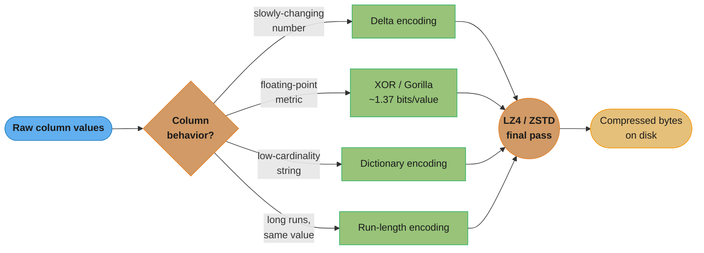
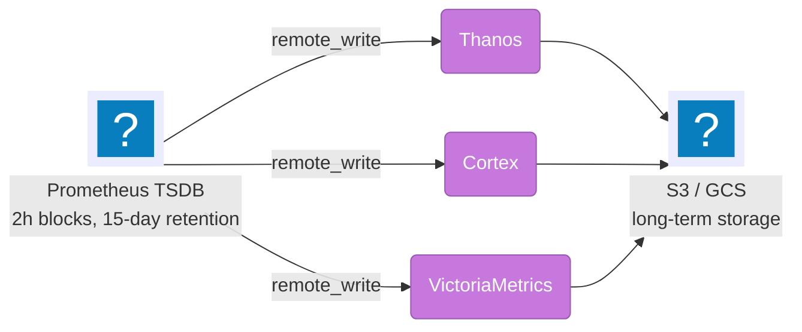
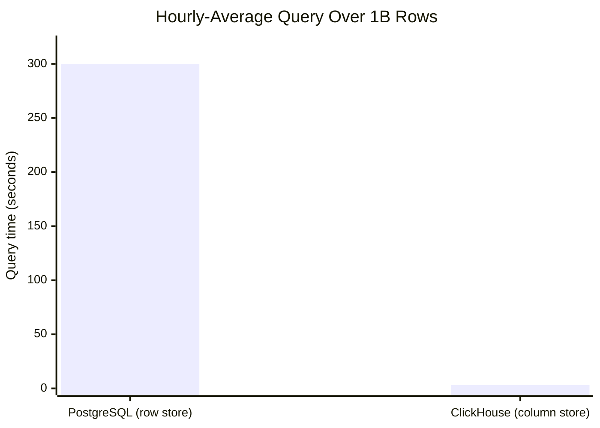
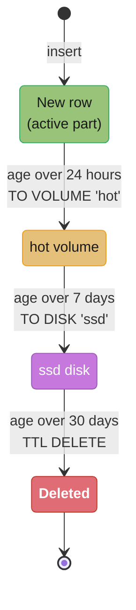
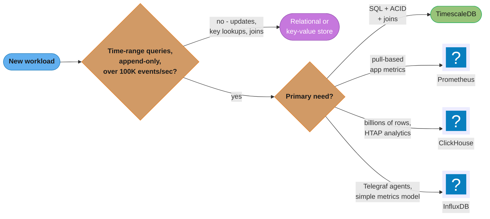

# Time-Series Databases

> **Version anchor (2026-08-25).** **Prometheus 3.x** is current — 3.0 shipped
> November 2024 (first major release since 2.0 in 2017, rebuilt UI, native OTLP
> ingestion, UTF-8 metric/label names) and **native histograms went stable in
> 3.8**. **Remote-Write 2.0** (shipped with 3.0) is the wire protocol this page
> assumes unless a snippet is explicitly labeled 1.0. **InfluxDB 3** — Core and
> Enterprise — reached GA in **April 2025**: a ground-up Rust rewrite on Apache
> Arrow / DataFusion / Parquet / Arrow Flight that replaces the TSM-indexed
> 1.x/2.x engine entirely; where a fact is specific to the old engine it is
> tagged `[InfluxDB 1.x/2.x]`. The open-source **`TimescaleDB`** extension keeps
> its name exactly as written throughout this page — only the company and
> managed platform changed, to **Tiger Data** and **Tiger Cloud** (rebranded 17
> June 2025). **ClickHouse 26.x** is current. Behaviour that depends on a
> specific version is tagged inline, e.g. `[3.8]`, `[InfluxDB 3]`.

## 1. Concept Overview

Time-series databases (TSDBs) are optimized for data with a natural time dimension: metrics, events, sensor readings, financial ticks, and application logs. They exploit the append-only, time-ordered nature of this data for dramatic compression and query performance. Key engines: `TimescaleDB` (PostgreSQL extension, developed by Tiger Data), InfluxDB 3 (Rust/Arrow-based purpose-built TSDB), ClickHouse (columnar OLAP with time-series strengths), Prometheus 3.x (pull-based metrics), QuestDB (high-throughput SQL TSDB built for financial tick data), and VictoriaMetrics (Prometheus-compatible long-term storage).

---

## 2. Intuition

Time-series data has predictable patterns: values arrive in chronological order, old data is rarely updated, and queries typically aggregate over time ranges. These properties enable specialized optimizations: delta encoding (store differences, not values), chunk-based partitioning (drop old chunks instantly), and continuous aggregation (pre-compute hourly/daily summaries).

- **Key insight**: A well-tuned ClickHouse on commodity hardware can compress 1TB of raw time-series data to 10-50GB and return aggregation queries in milliseconds. The compression ratio alone justifies choosing a columnar TSDB over a row-based database for analytics workloads.

---

## 3. Core Principles

### Time-Series Compression

**Delta encoding**: Store the difference between consecutive values instead of absolute values. If temperature readings are [22.1, 22.3, 22.4, 22.2, 22.3], store: [22.1, +0.2, +0.1, -0.2, +0.1]. Values that change slowly compress dramatically.

**XOR compression (Gorilla algorithm, Facebook 2015)**:
```
Floating-point values often differ only in a few bits.
22.1 in IEEE 754: 0 10000011 01100001100110011001101
22.3 in IEEE 754: 0 10000011 01100100110011001100110

XOR: 0 00000000 00000101110101010001011 (many leading zeros)
→ Store only the non-zero portion with leading/trailing zero counts

Result: ~1.37 bits per timestamp (vs 64 bits raw) for typical metrics
Gorilla paper: 12x compression on real Facebook production metrics
```

```
Meaningful bits         = 64 bits - Leading zeros        <- what survives after common bits cancel
stored bits (XOR != 0)  = 2 + 5 + 6 + Meaningful bits    <- control + leading-count + length + payload
stored bits (XOR == 0)  = 1                              <- exact repeat, just the control bit
```

**What this actually says.** "1.37 bits per value" reads: "consecutive readings of the same physical
quantity are nearly identical, so XOR cancels almost every bit, and only the handful of surviving
bits need storing." The compression is not generic — it is a bet on *physical continuity*, which is
why it collapses on data that jumps around (random IDs, unrelated values interleaved into one series).

| Symbol | What it is |
|--------|------------|
| 64 bits | An IEEE 754 double stored raw — the baseline |
| XOR | Bitwise difference of consecutive values. Identical bits cancel to `0` |
| Leading zeros | Bits both values share (sign + exponent + high mantissa). Stored as a count, not bits |
| Meaningful bits | The surviving non-zero window — the only part actually written |
| 1.37 bits | Average cost per value on typical slowly-changing production metrics |

**Walk one example.** Two consecutive CPU readings, then the storage arithmetic:

```
  75.200001 XOR 75.200002
    sign + exponent identical             -> 12 leading zero bits, cancelled
    high mantissa identical               -> ~36 more leading zeros
    surviving window                      -> about 16 meaningful bits
    stored: 2 control bits + 5-bit leading count + 6-bit length + 16 bits = 29 bits
    a repeated value (XOR == 0)           -> 1 control bit, nothing else

  amortised over a real metric stream, the repeats dominate:
    average                                = 1.37 bits per value

  compression vs raw
    64 / 1.37                              = 46.7x on the value column alone
    1,000,000,000 readings raw             = 1e9 x 8 bytes  = 8.00 GB
    1,000,000,000 readings Gorilla         = 1e9 x 1.37 / 8 = 0.171 GB
    saved                                                     7.83 GB
```

**Why the paper says 12x and this says 46.7x.** They measure different things. The 46.7x is the
value column in isolation; the paper's 12x is the whole record — timestamps (compressed separately
with delta-of-delta), series keys, and block overhead included. Quote 12x when asked about a real
system's disk footprint and 46.7x only about the float column, or the numbers will not reconcile.

**Dictionary encoding**: For string columns with low cardinality (host names, metric names), map values to small integers. 1000 unique hosts → 10-bit integer per row vs 20-50 byte string.

**Run-length encoding (RLE)**: For columns with long runs of the same value. Status field = "OK" for 10,000 consecutive rows → store "OK × 10000" rather than 10,000 copies.

**LZ4 / ZSTD as final pass**: Apply general-purpose compression on top of column-specific encoding. ClickHouse default: LZ4. Better compression: ZSTD (slower but 2-3x smaller).

These four encodings are not alternatives — a real column-store pipeline routes each column to the encoding that matches its behavior, then runs every result through the same general-purpose compressor:



Each column takes exactly one branch based on its data behavior, and every branch still passes through a final LZ4/ZSTD stage — this layering is why ClickHouse reaches the 10-50GB-from-1TB ratio cited in the intuition above rather than relying on any single technique alone.

---

## 4. Types / Architectures / Strategies

### TimescaleDB

TimescaleDB is a PostgreSQL extension that adds time-series capabilities while remaining SQL-compatible.

```sql
-- Create a hypertable (automatically partitioned by time):
CREATE TABLE sensor_readings (
    time        TIMESTAMPTZ NOT NULL,
    device_id   BIGINT NOT NULL,
    temperature DOUBLE PRECISION,
    humidity    DOUBLE PRECISION
);
SELECT create_hypertable('sensor_readings', 'time', chunk_time_interval => INTERVAL '7 days');
-- Default chunk = 7 days of data. Each chunk is a separate PostgreSQL table.

-- Compression (TimescaleDB 1.5+):
ALTER TABLE sensor_readings SET (
    timescaledb.compress,
    timescaledb.compress_segmentby = 'device_id',
    timescaledb.compress_orderby = 'time DESC'
);
SELECT add_compression_policy('sensor_readings', INTERVAL '7 days');
-- Chunks older than 7 days are automatically compressed
-- Compression ratio: typically 90-95% (10-20x smaller)

-- Continuous aggregates (pre-computed rollups):
CREATE MATERIALIZED VIEW hourly_averages
WITH (timescaledb.continuous) AS
SELECT time_bucket('1 hour', time) AS hour,
       device_id,
       AVG(temperature) AS avg_temp,
       MAX(temperature) AS max_temp,
       MIN(temperature) AS min_temp
FROM sensor_readings
GROUP BY hour, device_id;
-- Refreshes automatically when new data arrives (or on schedule)

-- Data retention (drop old chunks):
SELECT add_retention_policy('sensor_readings', INTERVAL '90 days');
-- Drops entire 7-day chunks older than 90 days — instant (DROP TABLE, not DELETE)
```

**Tiger Data, Tiger Cloud, and Hypercore.** The extension above is still called
`TimescaleDB` and every SQL snippet on this page runs unchanged — nothing about
the open-source product's name or API changed. What changed (17 June 2025) is
the company behind it: **Timescale rebranded to Tiger Data**, and its managed
service is now **Tiger Cloud** rather than "Timescale Cloud". Tiger Cloud's
storage engine, **Hypercore**, is a hybrid row-columnar engine: a freshly
inserted row lands in row-oriented form (fast single-row inserts and updates,
the same job the uncompressed active chunk does above), then converts to the
columnar form in place as it ages past the compression policy — one engine
covering both regimes instead of a row store plus a separately-maintained
columnar copy. Tiger Cloud layers hot/cold data tiering and horizontally
scalable read replicas on top of that engine. None of this changes how you
write to a self-hosted `TimescaleDB` extension; it is what you get by paying
for the managed platform.

### InfluxDB

InfluxDB comes in two architecturally different generations. **InfluxDB
1.x/2.x** is a purpose-built TSDB with its own storage engine (TSM) and query
languages (InfluxQL, Flux). **InfluxDB 3** — Core and Enterprise, GA April
2025 — is a from-scratch Rust rewrite on the Apache Arrow ecosystem, and the
rewrite exists specifically to remove the cardinality ceiling the TSM design
imposed. Both share the same write-side data model and line protocol.

```
InfluxDB data model (unchanged across generations):
  Measurement: like a table (e.g., "cpu", "temperature")
  Tag: indexed string dimension (host, region, sensor_id)
  Field: the actual measurement values (value, cpu_percent, temperature_celsius)
  Timestamp: nanosecond precision

Line protocol (write format, same on 1.x/2.x and 3.x):
  cpu,host=server01,region=us-east cpu_percent=95.5,idle=4.5 1711234567890000000
  └─ measurement ──┘└── tags ──────┘└────── fields ─────────┘└── timestamp (ns) ┘
```

**`[InfluxDB 1.x/2.x]` TSM (Time-Structured Merge Tree) storage**: an
LSM-tree variant that keeps an **in-memory index of every unique
(measurement, tag-set) combination** so it can seek straight to a series's
data files. That index is exactly what makes tag cardinality a hard ceiling —
see Pitfall 1 below — because every distinct tag combination is a permanent
resident entry, not a value the engine can page to disk mid-query.

```flux
// Flux query language (InfluxDB 2.x):
from(bucket: "sensors")
  |> range(start: -1h)
  |> filter(fn: (r) => r._measurement == "temperature" and r.device_id == "dev-42")
  |> aggregateWindow(every: 5m, fn: mean)
  |> yield(name: "5min_avg")
```

**`[InfluxDB 3]` Rust + Arrow/DataFusion/Parquet/Flight.** InfluxDB 3 Core
(open source, recent-data engine) and Enterprise (adds HA, security, and
scale) replace TSM entirely:

```
InfluxDB 3 storage stack:
  In-memory:  Apache Arrow columnar record batches (recent, unpersisted writes)
  Query:      Apache DataFusion — a Rust SQL query engine that operates
              directly on Arrow batches and Parquet files
  On disk:    Apache Parquet — the persisted, columnar file format
  Wire:       Arrow Flight — a columnar RPC protocol for query results,
              avoiding the row-by-row serialize/deserialize cost of JSON/line
              protocol on the read path
  Streaming:  a built-in Processing Engine transforms/enriches/alerts on
              data as it arrives, before it is queried
```

Because SQL now runs through DataFusion, InfluxDB 3 speaks SQL directly (Flux
still works for 2.x compatibility, but SQL is the primary language). The
Parquet files are addressed by (measurement, time range) rather than by a
resident per-series index entry, so **there is no in-memory structure whose
size is a product of tag cardinality** — the specific mechanism behind
InfluxDB's "dies on high-cardinality tags" reputation is gone by
construction, not tuned around. InfluxDB 3 markets this as "unlimited
cardinality." See the Q&A section for the full before/after mechanism.

### ClickHouse

Columnar OLAP database with exceptional time-series analytics performance.

```sql
-- MergeTree engine family (the core of ClickHouse time-series):
CREATE TABLE sensor_readings (
    device_id   UInt32,
    ts          DateTime,
    temperature Float32,
    humidity    Float32
) ENGINE = MergeTree()
PARTITION BY toYYYYMM(ts)    -- Monthly partitions (drop by dropping partition)
ORDER BY (device_id, ts)      -- Primary key: also the physical sort order
-- ORDER BY determines how rows are physically stored (like a clustered index)
-- Querying by device_id + ts range: sparse primary index skips irrelevant granules

-- Compression:
-- Default: LZ4 per column
-- Better: CODEC(Delta, ZSTD) for slowly-changing values (temperature, metrics)
-- CODEC(Gorilla) for floating-point metrics (implements XOR Gorilla algorithm)
ALTER TABLE sensor_readings MODIFY COLUMN temperature Float32 CODEC(Delta(4), ZSTD(3));

-- Materialized views (real-time pre-aggregation):
CREATE MATERIALIZED VIEW sensor_hourly
ENGINE = AggregatingMergeTree()
PARTITION BY toYYYYMM(hour)
ORDER BY (device_id, hour)
AS SELECT
    device_id,
    toStartOfHour(ts) AS hour,
    avgState(temperature) AS avg_temp_state,
    maxState(temperature) AS max_temp_state
FROM sensor_readings
GROUP BY device_id, hour;

-- Query the materialized view:
SELECT device_id, hour, avgMerge(avg_temp_state), maxMerge(max_temp_state)
FROM sensor_hourly
WHERE device_id = 42 AND hour >= now() - INTERVAL 24 HOUR
GROUP BY device_id, hour;
```

### Prometheus

Pull-based metrics system with its own time-series database. Prometheus
3.x is current (3.0 shipped November 2024).

```yaml
# Prometheus configuration: scrape targets
scrape_configs:
  - job_name: 'application'
    scrape_interval: 15s
    static_configs:
      - targets: ['app-server:8080']
    metrics_path: '/actuator/prometheus'
```

```promql
# PromQL (Prometheus Query Language):

# Rate of HTTP requests per second (over 5 minute window):
rate(http_requests_total{status="200", method="GET"}[5m])

# 95th percentile request latency:
histogram_quantile(0.95, rate(http_request_duration_seconds_bucket[5m]))

# CPU usage by instance:
100 - (avg by (instance) (rate(node_cpu_seconds_total{mode="idle"}[5m])) * 100)

# Alert: when error rate exceeds 1% for 5 minutes:
# In alertmanager:
expr: sum(rate(http_requests_total{status=~"5.."}[5m])) /
      sum(rate(http_requests_total[5m])) > 0.01
for: 5m
```

Prometheus's local TSDB stores data in 2-hour blocks (index + compressed samples, merged by compaction over time) and keeps only 15 days by default; production setups fan the same stream out to one of three long-term backends for durable, multi-cluster storage.



All three backends solve the same gap — Prometheus's own storage is deliberately short-term, so the real choice is scale and multi-tenancy, not whether to add one of them at all.

**`[3.0]` Remote-Write 2.0.** The arrows above used to carry Remote-Write 1.0;
Prometheus 3.0 ships **Remote-Write 2.0** as the default, with automatic
protocol negotiation falling back to 1.0 if the receiving backend is old.
2.0 adds native support for **metadata, exemplars, created timestamps, and
native histograms** in the wire format, and it uses **string interning** —
repeated label names/values are sent once and referenced by index instead of
repeated per-sample — to cut both payload size and the CPU cost of
compressing/decompressing it. Figures reported at KubeCon NA 2024: roughly
**60% smaller messages, 90% less memory, and 70% less CPU** on the write
path versus 1.0, for the same sample volume. This is a straight infrastructure
win for the fan-out above: the same 15-day local retention, cheaper to ship
to Thanos/Cortex/VictoriaMetrics.

**`[3.8]` Native histograms and the cardinality math.** A **classic**
Prometheus histogram materializes one time series *per bucket, per label
combination* — you pick the `le` bucket boundaries up front, and each one is
a first-class series with its own `_bucket{le="..."}` labels. A **native
histogram** stores the entire distribution — exponential bucket schema,
counts, sum — as a **single series per label combination**, with the bucket
layout carried inside that one series instead of exploded across many.
Opt-in via `scrape_native_histograms: true`; it went from experimental in 3.0
to a **stable feature in 3.8**.

```
Classic histogram: 12 `le` buckets, 500 distinct label combinations
  series = buckets x label_combinations
         = 12 x 500                     =  6,000 series
  (plus a _sum and _count series per combination — omitted here for the
   bucket-vs-bucket comparison)

Native histogram: same distribution, same 500 label combinations
  series = 1 x label_combinations
         = 1 x 500                      =    500 series

  reduction: 6,000 / 500                =     12x fewer series just from
                                              collapsing the bucket axis
```

This is the same multiplicative-cardinality shape as the InfluxDB tag pitfall
below — a classic histogram turns "how many buckets did I pick" into a
*multiplier* on every label combination you already have, and native
histograms remove that multiplier by making the bucket axis internal to one
series instead of external across many. The quantile math also gets more
accurate as a side effect: `histogram_quantile()` over a classic histogram is
only as precise as the buckets you guessed in advance, while a native
histogram's exponential schema resolves quantiles without that guess.

**VictoriaMetrics as a remote-write target.** VictoriaMetrics is
Prometheus-**compatible** rather than Prometheus-derived: it accepts
`remote_write`, serves PromQL (plus its own superset, MetricsQL, for
functions PromQL lacks), and is a drop-in Grafana data source. Its pitch
against the stack above is resource footprint — it reports materially lower
memory and disk usage than Prometheus for the same series count and
retention, largely from a more compact on-disk format and less per-series
index overhead. It ships as a single binary (`single-node`, simplest
operationally) or as a sharded `cluster` variant (`vminsert` / `vmstorage` /
`vmselect`) for horizontal scale and multi-tenancy. **Choose VictoriaMetrics
over Prometheus + Thanos/Mimir when** the deciding factor is operational
simplicity and cost at scale — one binary (or one small set of cluster
components) replacing Prometheus-plus-a-separate-long-term-store is less to
run than Prometheus fanning out to a second distributed system, for
teams that don't need Thanos/Mimir's specific multi-cluster federation
model.

### QuestDB

QuestDB is a column-oriented SQL database purpose-built for high-throughput
ingest — the pitch is financial tick data and IoT streams where write rate,
not query complexity, is the bottleneck. It stores columns partitioned by
time on disk (daily/monthly/yearly partitions, chosen like ClickHouse's
`PARTITION BY`) and accepts writes over the **InfluxDB line protocol** as one
of its ingest paths, alongside PostgreSQL wire protocol and its own REST
endpoint — so a Telegraf-based pipeline pointed at InfluxDB can often be
repointed at QuestDB with no format change.

Its query language is ordinary SQL extended with time-series-specific
verbs:

```sql
-- SAMPLE BY: time-bucketed aggregation, ClickHouse's toStartOfHour()
-- equivalent expressed as a clause rather than a function call
SELECT ts, symbol, avg(price)
FROM trades
WHERE ts > dateadd('h', -1, now())
SAMPLE BY 5m;

-- LATEST ON: the most recent row per key, without a window function
SELECT * FROM trades LATEST ON ts PARTITION BY symbol;

-- ASOF JOIN: join each row to the most recent prior row in another table
-- at or before the same timestamp — the canonical "what was the quote
-- when this trade printed" financial query
SELECT trades.ts, trades.symbol, trades.price, quotes.bid, quotes.ask
FROM trades
ASOF JOIN quotes ON (symbol);
```

`ASOF JOIN` is the one that matters most: matching a trade to the most
recent quote *before* it in ordinary SQL means a correlated subquery with
`ORDER BY ts DESC LIMIT 1`, evaluated per row — expensive and awkward.
`ASOF JOIN` expresses "most recent prior row" as a first-class join type
the engine can execute with a single ordered merge pass instead of a
per-row subquery.

---

## 5. Architecture Diagrams

The write path fans in from many producers, buffers through Kafka, lands in the TSDB, and is pre-aggregated before it ever reaches a dashboard:

```mermaid
flowchart LR
    classDef io      fill:#61afef,stroke:#2e86c1,color:#1a1a1a,font-weight:bold
    classDef frozen  fill:#c678dd,stroke:#9b59b6,color:#fff
    classDef train   fill:#98c379,stroke:#27ae60,color:#1a1a1a
    classDef mathOp  fill:#d19a66,stroke:#e67e22,color:#1a1a1a,font-weight:bold
    classDef lossN   fill:#e06c75,stroke:#c0392b,color:#fff,font-weight:bold
    classDef req     fill:#56b6c2,stroke:#0097a7,color:#1a1a1a
    classDef base    fill:#e5c07b,stroke:#f39c12,color:#1a1a1a

    src([IoT / Sensors / Apps]) -->|"write<br/>10M events/sec"| kafka
    kafka -->|consume| tsdb(ClickHouse / TimescaleDB<br/>/ InfluxDB)
    tsdb -->|"real-time<br/>aggregation"| mv(Materialized Views /<br/>Continuous Aggregates)
    mv -->|"query<br/>dashboards, alerts"| dash([Grafana / Kibana /<br/>dashboards])

    kafka@{ icon: "logos:kafka", form: "square", label: "Kafka<br/>ingestion buffer", pos: "b", h: 44 }

    class src,dash io
    class tsdb base
    class mv mathOp
```



**ClickHouse granule structure (primary index)**: MergeTree's sparse primary index stores one index mark per granule (default 8192 rows), not per row — the layout below shows why a query with `ORDER BY (device_id, ts)` can binary-search straight to the matching marks and skip everything else.

```
MergeTree table: ORDER BY (device_id, ts)
Primary key index (sparse): one entry per 8192 rows (default granule_size)

Index marks:
  Mark 0:  device_id=1,  ts=2024-01-01 00:00
  Mark 1:  device_id=1,  ts=2024-01-01 02:00
  Mark 2:  device_id=5,  ts=2024-01-01 00:00
  ...

Query: WHERE device_id = 1 AND ts >= '2024-01-01 01:00'
→ Binary search index marks → skip to Mark 0
→ Read granule 0 (8192 rows), filter by ts >= 01:00
→ Continue to Mark 1, etc.
→ Skip Mark 2+ (device_id=5, not relevant)

Result: read only relevant data blocks, not entire table
```

---

## 6. How It Works — Detailed Mechanics

### ClickHouse vs Row-Based Database for Time-Series

```sql
-- Query: average temperature per hour for last 7 days
-- On 1 billion rows

-- PostgreSQL (row store):
-- Must read full rows (device_id, ts, temperature, humidity, pressure...)
-- Even though we only need temperature column
-- IO: reads all columns = 100 bytes × 1B rows = 100GB data read

-- ClickHouse (column store):
-- Reads ONLY the timestamp and temperature columns
-- Compressed with Delta+ZSTD: effectively ~2-4 bytes/row
-- IO: reads 2 columns = 6 bytes × 1B rows (compressed) ≈ 6GB before decompression
-- Vectorized CPU operations on arrays (SIMD)
-- Result: ClickHouse query: ~3 seconds vs PostgreSQL: ~300 seconds

-- ClickHouse query:
SELECT toStartOfHour(ts) AS hour,
       avg(temperature) AS avg_temp
FROM sensor_readings
WHERE ts >= now() - INTERVAL 7 DAY
GROUP BY hour
ORDER BY hour;
-- Reads ~7 days × partition + sparse index → skip irrelevant data
-- Vectorized aggregation on temperature column only
```



Reading only the 2 needed columns instead of every 100-byte row cuts I/O from ~100GB to ~6GB compressed, turning a ~300-second full-row scan into a ~3-second vectorized column scan — a roughly 100x gap that comes from the columnar layout itself, not from faster hardware.

**Stated plainly.** The columnar win is a two-factor product: "you skip the columns you did not ask
for, *and* the columns you did ask for compress better because neighbouring values are the same
type." Neither factor alone explains 100x — and separating them matters, because only the first one
survives a `SELECT *`.

| Symbol | What it is |
|--------|------------|
| Row width | Bytes per row a row-store must read even to see one column. ~100 bytes here |
| Projection ratio | Columns needed / columns present. The pure layout win |
| Bytes/row/column | Compressed size of one value once same-type values sit adjacently |
| Vectorization | SIMD over contiguous arrays — the CPU-side multiplier on top of the I/O win |

**Walk one example.** The hourly-average query over 1 billion rows, factored:

```
  PostgreSQL (row store)
    must read      100 bytes/row x 1,000,000,000 rows  =  100 GB
    time                                                  ~300 s

  ClickHouse (column store)
    needs          ts + temperature only
    compressed     ~6 bytes for both columns combined (Delta + ZSTD)
    must read      6 bytes/row x 1,000,000,000 rows    =    6 GB
    time                                                    ~3 s

  factor 1 -- projection + compression
    100 GB / 6 GB                                      =   16.7x less I/O
  factor 2 -- vectorized SIMD aggregation, not row-at-a-time
    300 s / 3 s = 100x total;  100 / 16.7               =    6.0x from the CPU side
    16.7 x 6.0                                          =  100x   (reconciles)
```

The decomposition is the useful part in an interview: 16.7x of the speedup is I/O the query never
issued, and 6x is CPU work done on arrays instead of tuples. It also predicts when the win vanishes —
`SELECT *` on a wide table sets the projection ratio to 1, leaving only compression and SIMD, and the
100x collapses toward single digits.

### Downsampling and Retention

```sql
-- Problem: 1B rows/day at raw resolution = 365B rows/year = petabytes
-- Solution: downsample old data, drop raw data after retention period

-- TimescaleDB: continuous aggregate + retention:
-- Keep: 1-minute resolution for 7 days
-- Keep: 1-hour aggregates for 90 days
-- Keep: 1-day aggregates forever
-- Raw data: dropped after 7 days

-- ClickHouse: TTL for automatic downsampling:
CREATE TABLE sensor_readings (
    ts          DateTime,
    device_id   UInt32,
    temperature Float32
) ENGINE = MergeTree()
ORDER BY (device_id, ts)
TTL ts + INTERVAL 30 DAY DELETE,            -- Delete raw data after 30 days
    ts + INTERVAL 7 DAY TO DISK 'ssd',     -- Move to SSD after 7 days
    ts + INTERVAL 24 HOUR TO VOLUME 'hot'; -- Move to hot tier within 24 hours
```

**Put simply.** A downsampling ladder says: "keep resolution only where queries need it, because
storage cost is `series x points_per_second x retention_seconds` and you get to choose a different
`points_per_second` for each age band." The `365B rows/year` figure above is what happens when you
choose one resolution for all ages; the ladder replaces one big product with a sum of small ones.

| Symbol | What it is |
|--------|------------|
| `S` | Number of series (device x sensor combinations) |
| Resolution | Points per series per unit time. 1/sec raw, 1/min, 1/hour, 1/day |
| Retention | How long that band is kept before the next TTL clause fires |
| Points | `S x resolution x retention` — computed independently per band, then summed |

**Walk one example.** 1,000,000 series over a 3-year horizon, flat retention versus the ladder in
the SQL comment above (1-min for 7 days, 1-hour for 90 days, 1-day forever):

```
  flat: keep 1-second raw for 3 years
    1e6 series x 86,400/day x 1,095 days      =  94,608,000,000,000 points
    at 2 bytes/point compressed               =  189.2 TB

  ladder
    1-min,  7 days    1e6 x 1,440 x 7         =  10,080,000,000 points
    1-hour, 90 days   1e6 x    24 x 90        =   2,160,000,000 points
    1-day,  3 years   1e6 x     1 x 1,095     =   1,095,000,000 points
    total                                     =  13,335,000,000 points
    at 2 bytes/point compressed               =  0.0267 TB  (26.7 GB)

  ratio      94,608,000,000,000 / 13,335,000,000  =  7,095x less stored
```

Three orders of magnitude, and the top band still answers "what happened in the last week" at
minute resolution. The retention clauses fire in age order precisely so a row can pass through every
band before deletion rather than being dropped from the top.

**Why the DROP has to be a partition drop.** Pitfall 5 makes this concrete: expiring the raw band
with `DELETE` on a 1B-row table rewrites MVCC tombstones for hours. `drop_chunks` /
`DROP PARTITION` unlinks whole files, so the cost of a retention policy is `O(chunks)`, not
`O(rows)`. Retention math only works if the deletion itself is free.

Each TTL clause above fires independently on row age, so a single row cools through three tiers in sequence rather than jumping straight to deletion:



Tracing one row through the multi-clause TTL statement makes the ordering concrete: active data cools into the hot volume at 24 hours, moves to SSD at 7 days, and is deleted at 30 days — the same age-based tiering that lets ClickHouse keep only what's still worth its storage tier.

---

## 7. Real-World Examples

- **Cloudflare**: Uses ClickHouse for DNS analytics — 1 trillion+ DNS queries per day, queried in < 1 second.
- **Uber**: Uses InfluxDB for ride request metrics, surge pricing triggers, driver location time-series.
- **Netflix**: Uses TimescaleDB for application performance monitoring (APM) — thousands of services emitting metrics.
- **Grafana**: Uses Prometheus + Thanos for its own infrastructure monitoring (millions of time-series).
- **Discord**: Uses ClickHouse for analytics — replaced Spark-based analytics with ClickHouse for 100x query speedup.

---

## 8. Tradeoffs

| Feature | TimescaleDB | InfluxDB | ClickHouse | Prometheus |
|---------|-------------|---------|------------|------------|
| SQL support | Full PostgreSQL | InfluxQL/Flux | SQL-like | PromQL only |
| Write throughput | High (1M rows/s) | Very High | Very High | Medium |
| Query performance | Excellent | Good | Excellent | Good |
| Compression | Excellent (90%+) | Good | Excellent (90-99%) | Good |
| Retention management | Excellent (chunk drop) | Good (bucket retention) | Excellent (TTL/partitions) | Limited (15-day default) |
| Horizontal scale | Limited (Tiger Cloud) | InfluxDB 3 Enterprise (HA) | Excellent (distributed) | Via Thanos/Cortex/VictoriaMetrics |
| Operational complexity | Low (PostgreSQL) | Medium | High | Low |

---

## 9. When to Use / When NOT to Use

**Use time-series database when**:
- Primary query pattern is time-range-based aggregation
- Data is append-only (no updates to historical data)
- High ingestion rate (> 100K events/second)
- Retention policies needed (automatically drop old data)
- Compression is critical (IoT, metrics storage costs)

**TimescaleDB**: best for teams that know PostgreSQL, need full SQL, and want ACID compliance.

**InfluxDB**: best for metrics and monitoring use cases, especially with the Telegraf collector ecosystem. Reach for **InfluxDB 3** (Core/Enterprise) specifically when tag cardinality is high or unpredictable — the Arrow/Parquet rewrite is the direct fix for the memory-index ceiling that made 1.x/2.x brittle under that workload (see Pitfall 1).

**QuestDB**: best for financial tick data and other extreme-ingest SQL workloads where `ASOF JOIN` (join to the most recent prior row) is a core query pattern.

**VictoriaMetrics**: best as a lower-footprint, single-binary swap-in for a Prometheus + Thanos/Mimir long-term-storage stack when full PromQL compatibility is enough and the extra federation features of Thanos/Mimir aren't needed.

**ClickHouse**: best for analytics at scale (billions of rows), complex SQL aggregations, HTAP workloads, and when compression ratio is critical.

**Prometheus**: best for application monitoring with pull-based scraping; not a general-purpose TSDB.

**Do not use TSDB when**:
- Frequent updates to historical data are needed
- Random access to individual records (not time-range)
- Complex joins across many entity types (relational is better)
- Primary key lookups (key-value store is faster)

Collapsing all of the criteria above into one path shows why the four engines are not interchangeable — each wins a different branch of the same decision, not a generic "best TSDB" contest:



Every branch past the first gate still has to satisfy the same "use a TSDB" criteria stated above; the second gate is what actually separates TimescaleDB, Prometheus, ClickHouse, and InfluxDB from each other.

---

## 10. Common Pitfalls

**Pitfall 1: `[InfluxDB 1.x/2.x]` High cardinality tags causing memory explosion**
InfluxDB 1.x/2.x's TSM engine maintains an in-memory index of all unique tag combinations (series cardinality). If `user_id` (millions of unique values) is used as a tag, the series cardinality explodes: 1M users × 10 metrics = 10M series in memory. Symptoms: OOM crashes, slow query performance. Fix: use user_id as a field (not a tag — not indexed), not as a tag. Only index low-cardinality dimensions (region, host, service). **This pitfall is specific to the TSM-indexed 1.x/2.x line.** InfluxDB 3 (Core/Enterprise, GA April 2025) replaced TSM with Parquet files addressed by measurement and time range on the Arrow/DataFusion stack, so there is no resident per-series index whose size multiplies with tag cardinality — InfluxDB 3 markets this as "unlimited cardinality." Migrating to InfluxDB 3 removes the need for the field-vs-tag workaround below; it does not make the underlying multiplicative-cardinality math below wrong, it removes the data structure that math was describing the cost of.

**Read it like this.** Series cardinality is a **product, not a sum**: every distinct combination of
tag values is its own indexed series, so `cardinality = |tag1| x |tag2| x ... x |tagN|`. Adding a tag
does not add rows to the index — it *multiplies* the index. That single word, "multiplies", is the
whole pitfall; teams reason additively about a metric that behaves geometrically.

| Symbol | What it is |
|--------|------------|
| Series | One unique `(measurement, tag-set)` combination. Each has its own in-memory index entry |
| Tag | An **indexed** dimension. Contributes its cardinality as a multiplicative factor |
| Field | An **unindexed** value. Contributes nothing to cardinality — the escape hatch |
| `\|tag\|` | Number of distinct values that tag takes |
| ~3KB | Rough per-series index overhead — series count translates almost directly into RAM |

**Walk one example.** A healthy tag set, then the same schema with one high-cardinality tag added:

```
  healthy: host x endpoint x status
    hosts       500
    endpoints    20
    statuses      5
    series      500 x 20 x 5           =        50,000 series
    index RAM   50,000 x 3 KB          =         150 MB      -> fine

  add user_id as a TAG (1,000,000 distinct users)
    series      500 x 20 x 5 x 1e6     = 50,000,000,000 series
    index RAM   5e10 x 3 KB            =         150 TB      -> OOM, instantly

  the pitfall's own smaller case: 1M users x 10 metrics
    series      1,000,000 x 10         =    10,000,000 series
    index RAM   1e7 x 3 KB             =          30 GB      -> OOM on most nodes

  fix: user_id as a FIELD, not a tag
    series      500 x 20 x 5           =        50,000 series (unchanged)
    cost        you can no longer filter on user_id without scanning
```

**Why the fix has teeth.** Moving `user_id` from tag to field costs you the ability to do
`WHERE user_id = ...` as an indexed lookup — a real loss, not a free win. That is the trade the
Best Practices "keep tag cardinality below 10,000 per tag" rule encodes. And note it is a *per-tag*
rule guarding a *product*: three tags each just inside 10,000 still multiply out to 10^12 series.

**Pitfall 2: ClickHouse ORDER BY chosen incorrectly**
A ClickHouse table with `ORDER BY ts` (time only). Query pattern: `WHERE device_id = 42 AND ts > now() - 1h`. ClickHouse reads all granules for the time range — all devices. Fix: `ORDER BY (device_id, ts)` — device_id as leading key allows skipping granules for other devices. Primary key selectivity: highest-cardinality, most-filtered field should be first in ORDER BY.

**Pitfall 3: Prometheus storage filling up without long-term solution**
Prometheus default retention is 15 days. Teams forget to configure Thanos/Cortex/VictoriaMetrics for long-term storage. When the 15-day window fills: old data is dropped silently. Capacity alert: configure `--storage.tsdb.retention.size=50GB` to limit by size, not just time. For compliance or SLA reporting requiring 90 days of metrics: set up Thanos sidecar or VictoriaMetrics remote write immediately. `[3.0]` Point the `remote_write` config at Remote-Write 2.0 rather than 1.0 when the receiving backend supports it (protocol negotiation falls back to 1.0 automatically otherwise) — the payload-size and CPU savings compound with retention length, since a longer-lived long-term store is shipped proportionally more data.

**Pitfall 4: Missing chunk_time_interval tuning in TimescaleDB**
Default chunk_time_interval=7 days may be wrong. For high-write workloads (1B rows/day), 7-day chunks become too large to compress efficiently — the in-memory chunk (active chunk) consumes too much RAM. Fix: smaller chunk interval (1 day or even 4 hours for very high throughput). For low-write workloads (1M rows/day), 7-day chunks are fine. Rule: active chunk should fit in ~25% of available RAM.

**Pitfall 5: Using DELETE instead of chunk drop for retention**
`DELETE FROM sensor_readings WHERE ts < now() - INTERVAL '90 days'` on a 1B-row table: takes hours, creates tombstones (PostgreSQL MVCC), causes massive table bloat. Fix: use `drop_chunks` (TimescaleDB) which performs `DROP TABLE` on old chunks — instant. ClickHouse: `ALTER TABLE DROP PARTITION 'YYYYMM'` for old monthly partitions — also instant.

---

## 11. Technologies & Tools

| Tool | Purpose |
|------|---------|
| `TimescaleDB` | PostgreSQL extension for time-series (hypertables, compression, continuous aggs) — open-source name unchanged |
| Tiger Cloud | Managed `TimescaleDB` platform from Tiger Data (formerly Timescale Cloud); adds Hypercore hybrid row-columnar storage |
| pg_partman | Automated partition management for PostgreSQL |
| InfluxDB 3 Core / Enterprise | Purpose-built TSDB, GA April 2025 — Rust on Arrow/DataFusion/Parquet/Flight, unlimited cardinality; Enterprise adds HA/security/scale |
| Telegraf | Agent for collecting metrics (InfluxDB ecosystem) |
| ClickHouse | Columnar OLAP with time-series strengths |
| Prometheus 3.x | Pull-based metrics (PromQL, Alertmanager); Remote-Write 2.0 + native histograms (stable `[3.8]`) |
| Thanos | Long-term storage and multi-cluster Prometheus |
| VictoriaMetrics | Prometheus-compatible (PromQL + MetricsQL) long-term store; lower memory/disk footprint than Prometheus at the same series count |
| QuestDB | Column-oriented SQL TSDB for extreme ingest; `ASOF JOIN`/`SAMPLE BY`/`LATEST ON`, InfluxDB line-protocol ingest |
| Grafana | Metrics visualization (supports all of the above) |
| Apache Druid | Real-time OLAP for event streams |
| OpenTSDB | Distributed TSDB built on HBase |

---

## 12. Interview Questions with Answers

**Q: How does ClickHouse achieve such high compression ratios on time-series data?**
**Short:** ClickHouse layers columnar storage, per-column codecs like Delta and Gorilla, then LZ4/ZSTD for 10-100x compression.

ClickHouse achieves 10-100x compression through three layers: (1) Columnar storage: same-type values stored together, enabling type-specific encoding. Integers compress much better than mixed row data. (2) Per-column codecs: `Delta` encoding for sequences that change slowly (subtract adjacent values → small deltas → compress well). `Gorilla` codec implements XOR compression for floating-point metrics (as few as 1.37 bits per value on slowly-changing metrics). `T64` for integer columns. (3) General compression (LZ4 or ZSTD) applied on top of encoded column data. For a typical IoT temperature dataset: raw 64-bit float per reading = 8 bytes; Delta + ZSTD ≈ 0.5-1 byte per reading = 8-16x compression. Production datasets with many repeated values (status fields, hostname) achieve 100x+ compression.

**Q: What is the Gorilla XOR compression algorithm and how does it work?**
**Short:** Gorilla XORs consecutive floats, exploiting shared exponent bits to compress typical metrics to about 1.37 bits per value.

Gorilla (Facebook 2015) compresses floating-point time-series values using XOR between consecutive readings. IEEE 754 doubles representing similar physical values (e.g., server CPU = 75.2%, 75.3%, 75.4%) differ only in their mantissa bits — the exponent and sign bits are the same. XOR of consecutive values produces a result with many leading zero bits (same exponent/sign) and a small non-zero portion. Gorilla stores: (1) First value in full (64 bits). (2) For each subsequent value: if XOR=0 (same value), store 1 control bit. If XOR differs in the same bit range as the previous XOR, store 2 control bits + the non-zero bits. Otherwise, store the leading zero count + length + non-zero bits. Result: typical metrics compress to 1.37 bits/value. Real numbers like 75.200001, 75.200002 share 48+ bits in XOR — stored in 16 bits or less.

**Q: When would you choose TimescaleDB over InfluxDB?**
**Short:** Choose TimescaleDB for SQL and relational joins; choose InfluxDB for a pure metrics workload with the Telegraf ecosystem.

Choose TimescaleDB when: (1) Team knows SQL and PostgreSQL — no new query language to learn. (2) Need full ACID compliance and joins with relational data (user table + sensor table). (3) Data model has complex relationships (not purely metrics). (4) Want to use PostgreSQL ecosystem tools (pg_stat_statements, pgBouncer, Patroni, existing ORM). (5) Compression and retention needs are met by TimescaleDB (they usually are for < 1M writes/second per node). Choose InfluxDB when: (1) Pure metrics/monitoring use case with no relational joins. (2) Need the Telegraf ecosystem (agents, pre-built collectors for 200+ data sources). (3) Simple time-series model fits naturally (measurement + tags + fields). (4) Team prefers Flux or SQL (InfluxDB 3) for querying. TimescaleDB's advantage: it's PostgreSQL underneath — you get mature RDBMS features, whereas InfluxDB is a specialized tool. Note the naming split: the open-source extension is still called `TimescaleDB`; the company and managed platform behind it are now Tiger Data and Tiger Cloud (rebranded June 2025). And if the specific worry is InfluxDB's historical tag-cardinality ceiling, that concern applies to the 1.x/2.x line — InfluxDB 3 (GA April 2025) removed it with an Arrow/Parquet rewrite, so it is no longer a reason to prefer TimescaleDB by default.

**Q: How does Prometheus TSDB store and compress time-series data?**
**Short:** Prometheus stores 2-hour blocks using delta-of-delta timestamp compression and XOR-encoded float samples.

Prometheus TSDB stores data in 2-hour blocks (chunks). Each chunk contains: (1) Index: maps labels (metric name, tag key-value pairs) to series IDs. (2) Samples: compressed time-series data using delta-of-delta compression for timestamps (timestamps change by a constant scrape_interval — delta-of-delta is usually 0 or 1 bit) and XOR encoding for float values. Compression: delta-of-delta for 15-second intervals achieves ~1.7 bytes per sample (vs 16 bytes raw). Chunks compacted periodically into larger blocks for efficiency. Retention: 15-day default → blocks older than 15 days deleted. Long-term: use `remote_write` to send samples to Thanos, VictoriaMetrics, or Cortex for S3-backed storage. As of Prometheus 3.0, `remote_write` defaults to **Remote-Write 2.0**, which adds metadata/exemplars/native-histogram support and string-interned labels to the wire format — reported at roughly 60% smaller payloads and 70% less CPU than 1.0 for the same sample volume, negotiated automatically down to 1.0 if the receiving backend doesn't support 2.0. This is the transport for the same 2-hour-block data described above; it changes what gets shipped off-box, not how the local TSDB stores it.

**Q: What is a hypertable in TimescaleDB and how does partitioning work?**
**Short:** A hypertable transparently partitions a table into time-based chunks, enabling pruning, compression, and instant drops.

A hypertable is a PostgreSQL table abstracted over multiple underlying "chunk" tables, automatically partitioned by time (and optionally by another dimension). `create_hypertable('sensor_readings', 'time', chunk_time_interval => '1 week')` creates the abstraction. Internally: TimescaleDB creates one child table per time interval (one per week by default). Data is automatically routed to the correct chunk on INSERT based on the timestamp. Benefits: (1) Queries with time predicates only scan relevant chunks (partition pruning). (2) Old chunks can be compressed (column-oriented, 90%+ compression). (3) Data retention: `drop_chunks` drops entire chunk tables (instant, no bloat). (4) Parallel query: PostgreSQL parallel workers can scan chunks in parallel. The hypertable is transparent to SQL queries — they still use the parent table name.

**Q: How do continuous aggregates in TimescaleDB differ from PostgreSQL materialized views?**
**Short:** Continuous aggregates recompute only the affected time buckets incrementally, unlike a full materialized view refresh.

PostgreSQL materialized views: require manual `REFRESH MATERIALIZED VIEW` — they become stale after new data arrives. `REFRESH MATERIALIZED VIEW CONCURRENTLY` requires a unique index and still refreshes the entire view. TimescaleDB continuous aggregates: updated incrementally — only the time buckets affected by new data are recomputed, not the entire view. A continuous aggregate on 1 year of data that receives new data for the last hour: only recomputes the last hour's bucket. `refresh_continuous_aggregate` with `{start: now()-2h, end: now()}` only processes 2 hours of data. Can also be refreshed automatically via policy. This makes continuous aggregates practical for real-time dashboards — nearly zero computational cost per refresh for incremental updates.

**Q: What are ClickHouse materialized views and how do they differ from traditional materialized views?**
**Short:** ClickHouse materialized views trigger incrementally on each insert instead of requiring a full periodic refresh.

ClickHouse materialized views are real-time triggers: when data is inserted into the source table, the materialized view's query automatically runs on the newly inserted batch and inserts the results into the view's target table. This is incremental by design — no full refresh needed. The target table uses an aggregating engine (AggregatingMergeTree) that knows how to merge partial aggregates from multiple inserts. Example: `CREATE MATERIALIZED VIEW hourly_avg ... AS SELECT toStartOfHour(ts) AS hour, avgState(temp) ... GROUP BY hour`. Every insert of raw data automatically updates the hourly aggregate. Query the view for pre-aggregated results: `SELECT hour, avgMerge(temp_state) FROM hourly_avg`. Traditional materialized views (PostgreSQL): point-in-time snapshots, require manual or scheduled refresh of the entire result set.

**Q: How do you implement data tiering (hot/warm/cold) in ClickHouse?**
**Short:** TTL-based storage policies move ClickHouse data across NVMe, HDD, and S3 volumes automatically as it ages.

ClickHouse storage policies define multiple storage volumes (storage_policy):
```sql
-- In config.xml or disk configuration:
-- NVMe SSD: hot (last 7 days)
-- HDD: warm (7-90 days)
-- S3: cold (90+ days)

-- TTL on table:
CREATE TABLE events (
    ts DateTime, device_id UInt32, data String
) ENGINE = MergeTree()
ORDER BY (device_id, ts)
TTL ts + INTERVAL 7 DAY TO VOLUME 'warm',
    ts + INTERVAL 90 DAY TO VOLUME 'cold';
```
Moves are triggered by background merge threads. Data automatically migrates from NVMe → HDD → S3 based on age. Query still works across all tiers (ClickHouse fetches from S3 when needed). This dramatically reduces storage costs: NVMe at $2/GB, S3 at $0.023/GB-month — 87x cost difference for cold data.

**Q: What is the difference between InfluxDB tags and fields and why does cardinality matter?**
**Short:** In InfluxDB 1.x/2.x's TSM index, high-cardinality values belong in fields, not tags; InfluxDB 3 removes that limit.

Tags: indexed dimensions, used for filtering (WHERE clause). Fields: actual measurement values, not indexed, stored alongside timestamps. The cardinality issue described below is specific to **InfluxDB 1.x/2.x**: its TSM engine creates one series per unique combination of measurement + all tag values, held in an in-memory series index. With user_id as a tag: 1M users × 10 metrics = 10M series in that index. At ~1-2KB per series: 10-20GB RAM just for the series index. Symptoms: startup takes hours (rebuilding index), queries slow, OOM crashes. Rule for 1.x/2.x: tags should have low cardinality (< 10,000 unique values); high-cardinality dimensions (user_id, trace_id, IP address) should be fields, at the cost of no longer being able to filter on them as an indexed lookup. **InfluxDB 3** (Core/Enterprise, GA April 2025) changes the underlying storage: data is Parquet files on an Arrow/DataFusion engine addressed by measurement and time range, not a resident per-series index, so there is no structure whose size is a product of tag cardinality — InfluxDB 3 advertises this as unlimited cardinality. The tag/field distinction in the write-side line protocol is unchanged across both generations; what changed is only what the *storage engine* does with a tag.

**Q: How does Prometheus handle high-cardinality labels and what breaks?**
**Short:** Unbounded label values create one series per combination in Prometheus, exhausting memory and causing OOM.

Prometheus stores each unique label combination (metric{label1=val1, label2=val2}) as a separate series in memory. 1M unique label combinations = 1M series × ~4KB per series = 4GB RAM minimum for the series index (more for samples). Common sources of cardinality explosion: using user_id, session_id, or trace_id as labels. Impact: Prometheus OOM, scrape timeouts, slow queries. Detection: `prometheus_tsdb_symbol_table_size_bytes` and `prometheus_tsdb_head_series` metrics. Prevention: never use unbounded labels. Use histograms (pre-aggregated buckets) instead of recording individual request latencies. Recording rules: pre-aggregate high-cardinality metrics at Prometheus level before storing. `[3.8]` One specific source of this explosion has a direct fix now: a **classic** histogram multiplies its own bucket count into every label combination (12 buckets × 500 combinations = 6,000 series), while a **native histogram** stores the whole distribution as one series per combination (500 series). That collapses the bucket axis of the cardinality product; it does nothing for an unbounded label like user_id or trace_id sitting on the other axis, which is still the fix described above — move it out of the label set entirely.

**Q: When would you use Apache Druid over ClickHouse for time-series analytics?**
**Short:** Choose Druid for sub-second queries on freshly streamed Kafka data; choose ClickHouse for exact SQL on raw data.

Druid: purpose-built for interactive OLAP on streaming data. Excels at: ingesting from Kafka in real-time, sub-second queries on high-cardinality data after ingestion, approximate queries (HyperLogLog for distinct counts, quantile sketches for percentiles). Auto-pre-aggregates ("rollup") data on ingestion to reduce storage. ClickHouse: excels at exact analytics with full SQL, ad-hoc queries on raw data, extremely high compression, simple operations. Choose Druid when: need guaranteed sub-second queries on freshly-ingested streaming data (Druid is optimized for Kafka → queryable within seconds), data access patterns are predictable and metrics-focused. Choose ClickHouse when: need full SQL, exact results, arbitrary ad-hoc queries, or maximum compression is critical. Both are valid for analytics at scale; ClickHouse is operationally simpler.

**Q: How does downsampling work and why is it necessary for long-term time-series storage?**
**Short:** Downsampling discards high-resolution data over time, keeping coarser aggregates so long-term storage stays manageable.

Without downsampling: 1M metrics at 15-second intervals = 4M data points/minute = 5.76B/day. After 1 year: 2.1 trillion data points. Even with compression, this is unmanageable. Downsampling: compute aggregates at coarser time intervals and discard the original high-resolution data after a retention period. Example: raw data retained for 7 days (1-second resolution), hourly aggregates for 90 days, daily aggregates for 3 years. Query routing: Grafana queries the appropriate resolution dataset based on the time range of the dashboard. For a 1-year dashboard view, querying daily aggregates rather than raw data speeds up the query by 86,400x while losing precision that's invisible at yearly granularity. Implementation: TimescaleDB continuous aggregates, ClickHouse materialized views, Prometheus recording rules + Thanos compaction.

**Q: How does ClickHouse's sparse primary index work, and why does column order in ORDER BY matter?**
**Short:** ClickHouse's sparse index only accelerates queries filtering on the leading ORDER BY column, one mark per granule.

ClickHouse's MergeTree engine stores one index mark per granule of rows, 8192 rows by default, rather than one entry per row. This makes the primary index thousands of times smaller than a traditional B+tree covering every row individually, small enough to keep entirely in memory. A query filtering on the leading column of `ORDER BY` can binary-search the sparse index marks to find the right granule range and skip everything else, but a filter on a column that is not first in `ORDER BY` gains none of this benefit and forces a scan of every granule. This is exactly the mechanism behind the module's own pitfall: a table with `ORDER BY ts` alone must scan all granules across all devices for a `WHERE device_id = 42` filter, while `ORDER BY (device_id, ts)` lets the same query skip straight to that device's granules. Put the highest-selectivity, most-frequently-filtered column first in `ORDER BY`, since only the leading columns of a composite key benefit from the sparse index's binary search.

**Q: How does TimescaleDB's native columnar compression work internally?**
**Short:** TimescaleDB compresses each chunk by segmenting and reordering rows into columnar arrays for delta-friendly encoding.

TimescaleDB compresses each chunk by reorganizing its rows into column-oriented arrays, grouped by `compress_segmentby` and sorted by `compress_orderby`. Segmenting by `device_id` keeps each device's readings together as one compressible unit, while ordering by `time DESC` within that segment means consecutive values are often close in magnitude, letting delta-style encoding shrink them dramatically. This is why the module's compression policy achieves a 90-95% size reduction, 10-20x smaller, on chunks older than the configured compression age: the reorganization happens once per chunk when the compression policy runs, not continuously, so recent uncompressed chunks stay in the fast row-oriented format for efficient inserts. Choosing a `compress_segmentby` column with too many distinct values spreads related rows across many tiny segments and loses most of the compression benefit. Segment by the column your queries filter on most, typically the same column you would use as a partition key, and order by time within it.

**Q: How do you tune chunk_time_interval in TimescaleDB, and what happens if it's set wrong for the write rate?**
**Short:** chunk_time_interval should keep the active chunk within about 25% of RAM, shrinking as write rate grows.

`chunk_time_interval` controls how much time each hypertable chunk spans, and the active chunk should fit within about 25% of available RAM. The default of 7 days works fine for a low-write workload around 1M rows/day, but on a high-write workload of 1B rows/day, a 7-day active chunk grows far too large to hold efficiently in memory, forcing constant eviction and slowing both inserts and later compression. The fix is a smaller interval, as little as 1 day or even 4 hours for very high-throughput ingestion, so the active chunk stays small enough that recent writes and their index updates remain memory-resident. An interval that's too small creates the opposite problem: excessive per-chunk overhead from thousands of tiny chunk tables, each carrying its own indexes and constraint-exclusion metadata. Recalculate the interval whenever write volume changes materially, since the right chunk size is a function of write rate, not a fixed constant chosen once at table creation.

**Q: How do you choose partition granularity for ClickHouse MergeTree tables, and what breaks with too many small partitions?**
**Short:** Partition ClickHouse tables coarsely enough to stay manageable while still matching your retention drop batches.

`PARTITION BY toYYYYMM(ts)` gives monthly partitions, a reasonable default for most time-series tables since it keeps partition count manageable while still allowing whole-month drops for retention. Choosing an overly fine granularity, such as partitioning by day or even by hour on a moderate-volume table, multiplies the number of partition directories and their associated metadata, and ClickHouse's merge process has to manage far more small parts, increasing background merge overhead and slowing queries that must open many partition files just to touch a small time range. This mirrors the shard-count tradeoff in Elasticsearch: too few partitions makes retention and pruning coarse-grained, while too many partitions adds coordination and file-handle overhead that outweighs any pruning benefit. Choose granularity based on drop frequency and data volume per period: partition by month if you drop data in monthly batches and each month holds a healthy multi-gigabyte volume, or by day only if the daily volume alone already justifies its own partition. Monitor partition count with `system.parts` and consolidate granularity if the count grows into the thousands.

**Q: What is a native histogram in Prometheus and how does it change the cardinality math versus a classic histogram?**
**Short:** A native histogram stores one series per label set instead of multiplying bucket count into every combination.

A classic Prometheus histogram materializes one time series per `le` bucket boundary *per label combination* — if you pick 12 buckets and have 500 distinct label combinations, that is `12 x 500 = 6,000` series (plus separate `_sum`/`_count` series on top). A native histogram stores the entire distribution — an exponential bucket schema, counts, and sum — inside a single series per label combination, so the same workload becomes `1 x 500 = 500` series: a 12x reduction from collapsing the bucket axis alone, before counting any other label. Enable it per scrape target with `scrape_native_histograms: true`; the feature was experimental starting in Prometheus 3.0 and became stable in **3.8**. The quantile math also improves as a side effect: `histogram_quantile()` over a classic histogram is only as accurate as the bucket boundaries you guessed at instrumentation time, while the native histogram's exponential schema resolves quantiles without pre-committing to a boundary set. The tradeoff is that native histograms require both the client library and the Prometheus server to support the format — mixed fleets need `scrape_classic_histograms` fallback during migration.

**Q: What does Remote-Write 2.0 add over Remote-Write 1.0 in Prometheus, and why does it matter at scale?**
**Short:** Remote-Write 2.0 adds metadata, exemplars, and native histograms, plus string interning that shrinks payloads sharply.

Remote-Write 2.0, the default wire format since Prometheus 3.0, extends what a `remote_write` sample carries — metadata (type, help text, unit), exemplars, created timestamps, and native histograms all travel natively, instead of being dropped or bolted on as they were in 1.0. The bigger operational win is **string interning**: repeated label names and values across a batch of samples are sent once and referenced by index rather than repeated in every sample, cutting both the bytes on the wire and the CPU cost of compressing and decompressing them. Figures reported at KubeCon NA 2024 put this at roughly 60% smaller messages, 90% less memory, and 70% less CPU versus 1.0 for equivalent sample volume. Protocol negotiation is automatic: a 2.0-capable sender falls back to 1.0 against an older receiving backend (Thanos, Cortex, VictoriaMetrics, or any remote-write-compatible store), so upgrading Prometheus itself does not require upgrading every downstream target in lockstep. The practical effect for capacity planning: the same fleet of Prometheus servers can fan out to a long-term store at a fraction of the network and CPU cost they needed under 1.0.

**Q: Why does InfluxDB 3's rewrite on Arrow, DataFusion, and Parquet remove the cardinality ceiling that InfluxDB 1.x/2.x had?**
**Short:** InfluxDB 3 addresses data by Parquet file and time range instead of a resident per-series index, so cardinality stops costing RAM.

InfluxDB 1.x/2.x's TSM engine has to know, in memory, which files hold which series before it can serve a query — that requires a permanent in-memory index entry for every unique (measurement, tag-set) combination, which is exactly why series cardinality (`|tag1| x |tag2| x ... x |tagN|`) translates almost directly into RAM and why a million-user tag can OOM a node (see Pitfall 1). InfluxDB 3 Core and Enterprise, GA April 2025, replace that engine entirely: writes land as **Apache Arrow** columnar record batches in memory, get queried through **Apache DataFusion** (a Rust SQL engine that operates on Arrow and Parquet directly), and persist to **Apache Parquet** files addressed by measurement and time range rather than by a resident tag-combination lookup. There is no data structure in this design whose size is a product of tag cardinality — a query with a high-cardinality filter scans and filters Parquet row groups instead of dereferencing an index entry that had to exist in RAM before the query even started. That is the mechanical reason InfluxDB 3 can advertise unlimited cardinality: it isn't a tuned-up version of the old ceiling, it is a storage engine that never built the structure the ceiling came from. **Arrow Flight** carries query results over the wire in the same columnar layout, avoiding a row-by-row serialization step on the read path.

**Q: When do you choose a purpose-built TSDB (ClickHouse, InfluxDB 3, QuestDB) over TimescaleDB on PostgreSQL?**
**Short:** Choose a purpose-built TSDB when scale or ingest rate outgrows what a PostgreSQL extension can carry.

`TimescaleDB` wins when the workload needs real SQL joins against relational data, ACID transactions, and the PostgreSQL operational ecosystem (pgBouncer, Patroni, existing ORMs) — it is a PostgreSQL extension first, so you get a mature RDBMS underneath and pay PostgreSQL's per-node write ceiling in return (roughly single-digit millions of rows/second before you need Tiger Cloud's distributed reads or manual sharding). Move to a purpose-built engine when any one of these stops being true: (1) **Scale past single-node PostgreSQL** — ClickHouse's distributed MergeTree or InfluxDB 3 Enterprise's HA scale horizontally by design rather than as an add-on. (2) **No relational joins needed** — if the data model really is just measurement + tags/dimensions + values, the SQL-join guarantee `TimescaleDB` provides is unused overhead. (3) **Extreme ingest with a narrow query shape** — QuestDB's column-oriented engine and `ASOF JOIN` target exactly the tick-data case where PostgreSQL's row-oriented MVCC write path becomes the bottleneck. (4) **Unpredictable or very high tag cardinality** — this used to be an InfluxDB weakness relative to `TimescaleDB`'s relational indexes, but InfluxDB 3's Arrow/Parquet engine removed that specific gap. In short: `TimescaleDB` is the right default when you're not sure yet, because it costs you the least to be wrong about; reach for a purpose-built engine once the workload has told you which axis (join complexity, node count, or ingest rate) it actually needs to scale on.

**Q: What problem does QuestDB's `ASOF JOIN` solve, and why is it awkward to express in standard SQL?**
**Short:** ASOF JOIN matches each row to the most recent prior row in another table, the canonical tick-to-quote query.

`ASOF JOIN` matches each row on the left to the most recent row on the right whose timestamp is at or before it — the textbook case is "what was the bid/ask quote in effect when this trade printed." In standard SQL, that same question requires a correlated subquery per row (`SELECT ... FROM quotes WHERE quotes.symbol = trades.symbol AND quotes.ts <= trades.ts ORDER BY quotes.ts DESC LIMIT 1`), which forces the engine to re-evaluate an ordered scan for every single left-hand row rather than executing one coordinated pass over both time-ordered inputs. `ASOF JOIN` gives the planner enough information to do that in a single ordered merge — walk both tables once, each already sorted by time, and advance the right-hand pointer only forward — turning an O(n log n)-per-row correlated subquery pattern into a linear merge over both series. The same query shape shows up outside finance too: matching a sensor reading to the most recent calibration event, or a request to the most recent config version active at request time; anywhere "most recent prior fact" is the join condition, `ASOF JOIN` is the direct expression of it instead of a workaround.

---

## 13. Best Practices

1. Use chunk interval that keeps the active chunk (latest time period) in 25% of available RAM.
2. Apply compression policies to TimescaleDB chunks older than the active write period.
3. Use Delta + ZSTD codec for slowly-changing numeric metrics in ClickHouse.
4. Set data retention policies before going to production — disk fills silently without them.
5. For InfluxDB: keep tag cardinality below 10,000 unique values per tag.
6. For Prometheus: avoid high-cardinality labels; use recording rules to pre-aggregate.
7. Use continuous aggregates/materialized views for dashboard queries to avoid real-time scanning.
8. Configure tiered storage (hot/warm/cold) from day one — retrofitting is complex.
9. Test query performance at target data volumes before production — columnar databases show very different performance at 1M vs 1B rows.
10. Monitor write amplification and compaction lag in ClickHouse MergeTree — falling behind causes read degradation.

---

## 14. Case Study

**Scenario**: A manufacturing company monitors 100,000 industrial machines. Each machine emits 50 sensor readings (temperature, pressure, vibration, current, voltage...) every second = 5M readings/second total. Requirements: 90-day real-time retention, 3-year downsampled retention, sub-second dashboard queries, anomaly detection alerts.

**Architecture: ClickHouse + TimescaleDB hybrid**:

```sql
-- ClickHouse: raw metrics (90-day hot/warm)
CREATE TABLE machine_metrics (
    ts          DateTime64(3),           -- millisecond precision
    machine_id  UInt32,
    sensor_type LowCardinality(String),  -- enum-like encoding
    value       Float32 CODEC(Gorilla)   -- XOR compression for float metrics
) ENGINE = MergeTree()
PARTITION BY toYYYYMM(ts)
ORDER BY (machine_id, sensor_type, ts)
TTL toDateTime(ts) + INTERVAL 90 DAY DELETE;

-- Materialized view for minute-level aggregates:
CREATE MATERIALIZED VIEW machine_metrics_1min
ENGINE = AggregatingMergeTree()
PARTITION BY toYYYYMM(minute)
ORDER BY (machine_id, sensor_type, minute)
AS SELECT
    machine_id,
    sensor_type,
    toStartOfMinute(ts) AS minute,
    avgState(value) AS avg_val,
    maxState(value) AS max_val,
    minState(value) AS min_val,
    stddevPopState(value) AS stddev_val
FROM machine_metrics
GROUP BY machine_id, sensor_type, minute;
```

**Write pipeline**: 5M readings/second → Kafka → ClickHouse Kafka table engine (consumes directly, no separate consumer needed).

**Results**:
- Compression: 5M readings/sec × 16 bytes raw = 80MB/sec raw → 2-4MB/sec compressed (40:1 ratio)
- 90-day raw retention: 80MB/sec × 7.8M sec ≈ 600TB raw → 15TB compressed
- Sub-second queries on 1-minute aggregates covering all 100K machines across 90 days
- Anomaly detection: Kafka Streams computes z-scores in real-time → alert when value > 3 std devs from historical mean

**What the formula is telling you.** Every line in the results block is one chain:
`machines x sensors x rate x bytes x seconds / compression`. It says: "capacity planning for a TSDB
is a single multiplication whose only uncertain term is the compression ratio — so the compression
ratio is the number you must defend, since a 2x error there is a 2x error in the storage bill."

| Symbol | What it is |
|--------|------------|
| 100,000 x 50 | Machines x sensors each — this product is the ingest rate, and also the series count |
| 16 bytes | Raw width of one reading (timestamp + machine_id + sensor_type + float) |
| 7,776,000 | Seconds in the 90-day retention window |
| 40:1 | Compression ratio delivered by `CODEC(Gorilla)` + `LowCardinality` + LZ4 together |

**Walk one example.** Every published figure in the results block, rebuilt from the scenario:

```
  ingest rate      100,000 machines x 50 sensors x 1/sec   =  5,000,000 readings/sec
  raw throughput   5,000,000 x 16 bytes                    =  80,000,000 B/s = 80 MB/s
  compressed       80 MB/s / 40                            =  2.0 MB/s
                   (the module quotes 2-4 MB/s -- 40:1 is the optimistic end of that band)

  90-day window    90 x 86,400                             =  7,776,000 seconds
  raw volume       80 MB/s x 7,776,000 s                   =  622,080,000 MB = 622 TB
  compressed       622 TB / 40                             =  15.55 TB

  sanity-check the series count against the cardinality rule above:
                   100,000 machines x 50 sensor_types      =  5,000,000 series
                   -> far past InfluxDB's comfort zone; ClickHouse is chosen precisely
                      because ORDER BY (machine_id, sensor_type, ts) is a sort order,
                      not an in-memory series index
```

**Why the compression ratio is the load-bearing term.** Hold everything else fixed and vary only
that divisor: at 40:1 you provision 15.55 TB, at 20:1 you provision 31.1 TB, at 10:1 you provision
62.2 TB. Nothing else in the chain is uncertain — machine count and sample rate are contractual, and
16 bytes is arithmetic. This is why the schema pins `CODEC(Gorilla)` on the float and
`LowCardinality(String)` on `sensor_type` explicitly rather than accepting the LZ4 default: those two
declarations *are* the capacity plan.
