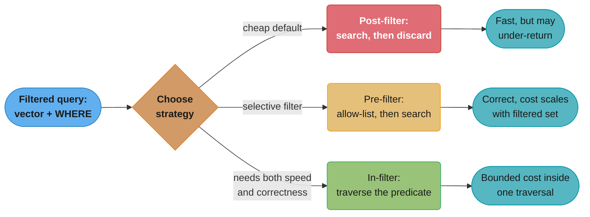
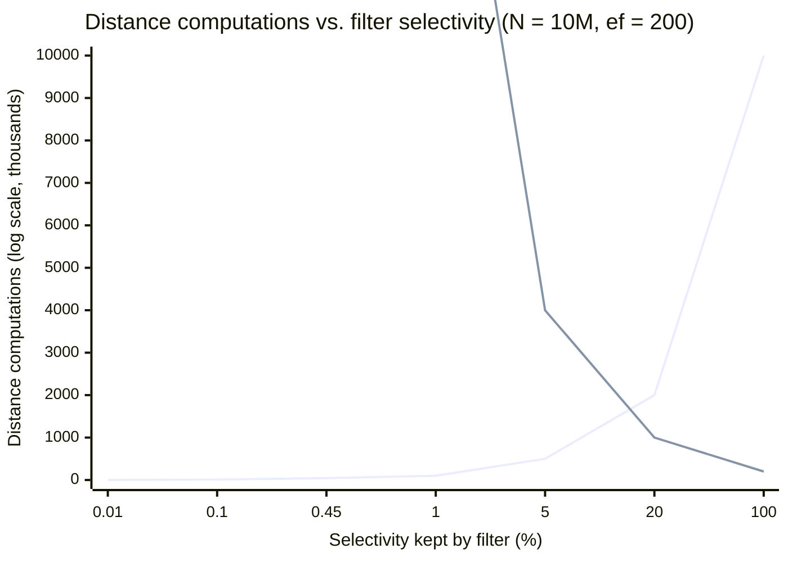
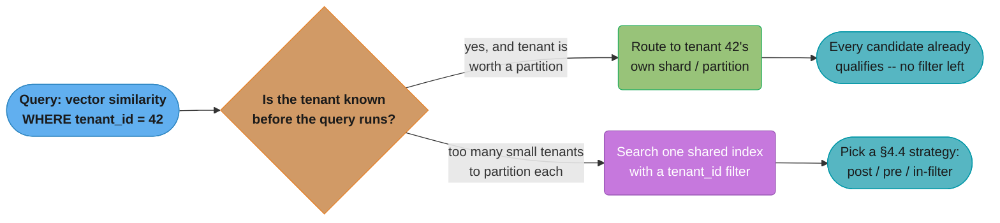

# DiskANN and Filtered Search

> Deep-dive sub-file of [Vector Databases](vector_databases.md). That module covers HNSW, IVF,
> quantization basics, and pgvector's index mechanics — read it first. This file covers the two
> problems that survive after you have mastered those foundations: **the index no longer fits in
> RAM**, and **the query carries a metadata filter that the graph was never built to answer**.
> Both are 2026 production problems, not academic curiosities — the second one silently returns
> wrong results on a green build, which is worse than slow.

---

## 1. Concept Overview

HNSW, as the parent module builds it, makes one assumption everywhere: every vector and every
graph edge lives in RAM. That assumption caps the index at whatever fits on one node, and it says
nothing about metadata. Two production pressures break it. First, a corpus with hundreds of
millions of high-dimensional vectors outgrows any single node's memory long before it outgrows a
single node's disk — the industry's answer is a **disk-resident graph**, pioneered by Microsoft
Research's **DiskANN** and its **Vamana** graph algorithm, now shipping in Postgres as
**pgvectorscale**. Second, almost no real query is pure similarity search — it is similarity
search **within** a tenant, a permission group, a price range, a date window — and a graph built
over the whole corpus was never wired for that subset, so a selective filter can silently strand
the search or blow past the memory savings the index was built to provide. This file covers the
construction algorithm behind disk-resident search, the quantization and truncation levers that
compress a vector's footprint, and the three competing strategies — post-filter, pre-filter,
in-filter — that every vector engine picks among when a `WHERE` clause meets an ANN index.

---

## 2. Intuition

- **DiskANN, in one line:** HNSW is a graph you must hold entirely in your hands to search it;
  DiskANN is a graph left in a filing cabinet, with a coarse compressed floor-plan kept in your
  hands so you know which few drawers to actually open.
- **Filtering, in one line:** the graph's edges were wired for the whole town; asking it to route
  only through the houses with a red door means most of those edges lead nowhere useful, and the
  walk can strand itself in a neighborhood with no red doors at all.
- **Key insight:** both problems have the same shape — a structure built for the *unconstrained*
  case (all data in RAM, all vectors eligible) is asked to serve a *constrained* case (most data
  on disk, most vectors ineligible) — and every technique in this file is a way of pre-computing
  or narrowing so the constrained case does not pay the unconstrained case's cost.

---

## 3. Core Principles

| Principle | What it means here |
|---|---|
| **Random access is what disk punishes, not data volume** | A B-tree or a sequential scan tolerates disk because access is patterned; a graph walk jumps to an arbitrary neighbor at every hop, which is exactly the access pattern spinning disk — and even NVMe SSD — pays a per-seek IOPS cost for. DiskANN's entire design exists to bound *hops*, not to avoid disk. |
| **Cheap-filter-then-expensive-confirm, applied to storage tiers** | The parent module's rescore pattern (binary-quantized candidates, full-precision re-rank) reappears here at a coarser grain: a **compressed** copy of every vector stays resident in RAM for ranking, and only the **short list** pays the cost of a full-precision read — except now that read comes from SSD, not from a nearby cache line. |
| **A graph's connectivity is a property of the WHOLE graph, not any one query** | HNSW's recall guarantee assumes the search can walk to any node from any entry point. A metadata filter removes nodes from *eligibility* without removing their *edges*, so the graph a filtered query actually needs may not be connected at all — this is the single fact that explains every filtering failure mode in §4 and §6. |
| **Selectivity is the variable that decides the right strategy, not the query itself** | The same filtered query — "vectors similar to X where tenant = 42" — wants a different execution strategy depending on whether tenant 42 owns 0.001% or 40% of the corpus. No filtering strategy in this file is universally right; each wins at a different selectivity band, worked out precisely in §6. |

---

## 4. Types / Architectures / Strategies

### 4.1 DiskANN and the Vamana graph

DiskANN (Subramanya, Devvrit, Simhadri, Krishnaswamy, Kadekodi — **NeurIPS 2019**, "DiskANN:
Fast Accurate Billion-point Nearest Neighbor Search on a Single Node") targets exactly the case
HNSW cannot: an index too large for RAM, on a single machine, with SSD instead of a cluster. Its
graph-construction algorithm, **Vamana**, produces a single flat graph (no HNSW-style layers) built
so that a *bounded-hop* greedy search from any entry point reaches any target — the property that
makes a disk-resident search viable at all, because every hop is a random SSD read and the whole
point is to keep the hop count small.

**RobustPrune — the mechanism that makes long-range edges possible.** A naive kNN graph connects
each node only to its geometrically nearest neighbors, which produces short, dense, *local* edges
and a large graph diameter — exactly wrong for a search that must terminate in a handful of hops.
Vamana's construction instead runs a greedy search to gather a candidate neighbor set for each
node, then prunes that set with **RobustPrune**: walk the candidates from nearest to farthest,
keep a candidate `p`, and discard any remaining candidate `p'` for which `alpha * dist(p, p') <=
dist(node, p')` — i.e., discard `p'` only if `p` is *not too much closer* to `p'` than the node
itself is. At `alpha = 1` this is the ordinary diversity rule found in NSG and similar graphs:
keep the closest point in every direction, discard anything a kept point already dominates.
Raising `alpha` above 1 relaxes that domination test, so a candidate a *little* dominated by a
kept neighbor is retained anyway — and because pruning happens over the *whole* candidate set,
not just the locally nearest ones, some of the survivors are geometrically distant. Those survivors
are the graph's long-range "highway" edges, the same shape HNSW gets from its sparse upper layers,
but produced here in a single flat graph rather than a layer hierarchy.

**Two-pass construction.** Vamana builds the graph in two passes over the dataset — where HNSW
and the related NSG algorithm build in one — first with `alpha = 1` to establish a well-connected
base graph quickly, then a second pass with a larger `alpha` that admits the long-range edges the
first pass's stricter pruning discarded. This is a deliberate build-time-for-query-time trade:
Vamana's construction cost runs roughly double a comparable single-pass graph algorithm's, in
exchange for a flatter, shorter-diameter graph that a disk-bound search can afford to walk.

**The two-tier memory layout is what turns the graph into a disk index.** DiskANN keeps two
copies of every vector: a heavily compressed (typically product-quantized) copy resident in RAM
for every node in the graph, used only to *rank* candidates during the beam search, and the
full-precision vector on SSD, read only for the small number of candidates that survive to the
final re-ranking step. The beam search itself walks the graph using the compressed distances —
cheap, RAM-speed, approximate — and only pays an SSD read when a node is a serious re-ranking
candidate, which is what keeps the search **SSD-IOPS-bound** rather than throughput-bound: the
cost model is "number of hops × one random read," not "gigabytes scanned."

### 4.2 StreamingDiskANN and pgvectorscale

Plain DiskANN, as published, is built once from a static dataset — an assumption that does not
survive a production write path. Timescale (now Tiger Data)'s **pgvectorscale** extension for
Postgres ships **StreamingDiskANN**, described in the project's own README as "a new index type
... inspired by the DiskANN algorithm, based on research from Microsoft," engineered to keep
DiskANN's disk-resident memory profile while accepting inserts, updates, and deletes as an
ordinary Postgres index does — the project's release notes report **upsert performance improved
more than 100x, and more than 500x in some update/delete scenarios**, over the extension's earlier
releases, though the README does not publish the underlying streaming-graph-maintenance algorithm
in the detail the original Vamana paper gives for static construction. As of the extension's
current releases it also supports **label-based filtered search** built on Microsoft's own
**Filtered-DiskANN** research (§6.3): a `smallint[]` label column is indexed alongside the vector
column, and a query filters with the array-overlap operator against those labels during the same
graph traversal, rather than as a separate pass.

**On the per-node capacity ceiling: no number is stated here on purpose.** A "~10M to ~50M
vectors per node" figure for StreamingDiskANN could not be traced to any pgvectorscale or Tiger
Data / Timescale primary source — not the README, not the release notes, not their published
benchmark posts. It does not appear in this file. What pgvectorscale's own README *does* publish
is a specific, dated benchmark: on **50 million 768-dimension Cohere embeddings**, pgvector plus
pgvectorscale on **self-hosted Postgres on AWS EC2** achieved **28x lower p95 latency, 16x higher
query throughput, and 99% recall**, at **75% less cost**, against Pinecone's storage-optimized
`s1` index tier. Report that number as exactly what it is — a vendor's own comparison against one
named competitor's tier, not a generalized per-node ceiling — because the two are not
interchangeable claims, and the case study cross-referenced in §14 makes the same caution about
a related pgvectorscale-vs-Qdrant figure.

### 4.3 The quantization ladder and Matryoshka truncation — two independent memory levers

The parent module builds the quantization ladder (float32 → float16 → int8 → PQ → binary) as a
**precision** lever: every scheme keeps the same 1,536 (or whatever) dimensions and represents
each one with fewer bits. **Matryoshka Representation Learning (MRL)** is an orthogonal,
**dimensionality** lever: the embedding model is trained so that a *prefix* of its output — the
first 256 of 1,536 dimensions, say — is itself a valid, if lower-fidelity, embedding, because
training applies the loss function to truncated prefixes as well as to the full vector. The two
compose: truncate first, then quantize what remains, and the savings multiply.

Which models actually support this is a model-by-model fact, not a property of embeddings in
general, and it is worth checking per model rather than assuming: OpenAI's `text-embedding-3`
family exposes a `dimensions` parameter for exactly this purpose (its own announcement reports
that `text-embedding-3-large` truncated to 256 dimensions still outperforms the older, unshortened
1,536-dimension `text-embedding-ada-002` on the MTEB benchmark — a 6x storage reduction with a
*net gain* in retrieval quality, because the newer model's full-size embedding was already the
stronger one to begin with); Google's Gemini embedding models, Voyage AI's `voyage-3`/`voyage-4`
family, Jina's `jina-embeddings-v3`, and Nomic's `nomic-embed-text-v1.5` are also trained with MRL
and each exposes some form of a dimension or truncation parameter. A model with no such training
degrades **catastrophically**, not gracefully, when its raw output vector is simply sliced —
because nothing forced its early dimensions to be independently meaningful — so truncation is
never a technique to apply to an arbitrary embedding model; it applies only to a model whose own
documentation states MRL support.

### 4.4 Three strategies for a filter meeting a graph

| Strategy | Mechanism | Cost profile | Failure mode |
|---|---|---|---|
| **Post-filter** | Run ANN search first, unaware of the filter; apply the filter to whatever the graph walk returned | Cheapest per candidate examined, since the graph walk is unchanged | Returns fewer rows than `LIMIT` asked for whenever the filter is selective — the graph's `ef` candidates were drawn from the whole corpus, and only a `selectivity`-sized fraction of them survive |
| **Pre-filter** | Resolve the filter into a candidate set first (a bitmap, an allow-list from an inverted index), then search only within it — by brute force, or by restricting graph traversal to that set | Correct by construction: every candidate examined already passes the filter | Cost scales with the size of the *filtered set*, not the answer size — a broad filter (99% of the corpus) pays almost the full unfiltered cost twice: build the allow-list, then search inside it |
| **In-filter / filtered traversal** | Evaluate the predicate *during* the graph walk itself — either by wiring extra edges between same-value nodes at index time (Qdrant's filterable HNSW), or by expanding to neighbors-of-neighbors at query time when direct neighbors fail the filter (ACORN-style predicate-agnostic traversal) | Pays a real but bounded cost — extra edges (index-time) or extra hops (query-time) — in exchange for staying inside a single graph traversal | Extra-edges approaches need a per-value index and can still leave rare *combinations* of filters disconnected; hop-expansion approaches pay 2-4x latency at the strictest selectivities |

**The taxonomy is the file's spine — everything downstream picks among these three.**
StreamingDiskANN's label filtering (§4.2, §6.3) is in-filter traversal applied to a disk-resident
graph. pgvector's default HNSW behaviour (parent module, and the case study's §4.2) is
post-filter, compensated by `hnsw.iterative_scan` — which is really pre-filter's allow-list logic
run adaptively: keep pulling more post-filter candidates until enough survive, rather than
computing the allow-list up front. Turbopuffer and LanceDB (§7) each pick their own point on this
spectrum, shaped by their underlying index structure.



The three branches are not tiers of one algorithm — they are genuinely different mechanisms, which
is why a single engine (Qdrant, Milvus) routinely ships more than one and chooses per query based
on measured filter selectivity, exactly as a query planner chooses a join algorithm.

### 4.5 Multi-tenant isolation as filtered ANN's dominant real instance

The single most common filtered-ANN query in production is not an arbitrary metadata predicate —
it is `WHERE tenant_id = ?`, and it deserves its own entry because the right answer is often to
avoid filtering altogether. **Partitioning converts a filtering problem into a routing problem**:
if the tenant is known before the query is issued, route to a shard or partition that holds only
that tenant's vectors, and every candidate the graph returns already qualifies — there is no
filter left to apply, and no selectivity math to reason about. A `tenant_id` filter over one
shared index is the right choice only when tenants are too numerous or too small for a dedicated
partition to be worth its fixed overhead; the case study cross-referenced in §14 works this
exact threshold with real tenant-count numbers (§4.4 there) and is not repeated here.

---

## 5. Architecture Diagrams

**DiskANN's two-tier RAM/SSD layout — the mechanism that makes disk residency SSD-IOPS-bound
rather than throughput-bound:**

```
  RAM (small, fast)                          SSD (large, one seek per hop)
  +----------------------------+             +----------------------------------+
  | compressed vector, node A  |  beam walk   | full-precision vector, node A    |
  | compressed vector, node B  |------------->| full-precision vector, node B    |
  | compressed vector, node C  |  ranks all   | full-precision vector, node C    |
  | ...                        |  N nodes     | ...                              |
  | compressed vector, node N  |  cheaply     | full-precision vector, node N    |
  +----------------------------+             +----------------------------------+
        |                                                    ^
        | beam search picks a short list                     |
        | of candidates using compressed                     |  ONE random read per
        | (approximate) distances only                       |  surviving candidate,
        v                                                     |  not per node visited
  +----------------------------+                              |
  | candidate shortlist        |------------------------------+
  | (tens of nodes, not        |
  |  thousands)                |
  +----------------------------+
        |
        v  re-rank shortlist against EXACT distances read from SSD
  +----------------------------+
  | final top-k, exact-ranked  |
  +----------------------------+

  Every node in the graph costs a RAM lookup during the walk.
  Only the shortlist that survives to re-ranking costs an SSD read.
  That gap -- millions of RAM lookups, tens of SSD reads -- is the whole design.
```

**The quantization + Matryoshka byte-budget ladder, both levers on the same 1,536-dim vector:**

```
  lever            operation                    bytes/vector   vs baseline
  ---------------  ---------------------------  -------------  -----------
  baseline         float32, full 1536 dims           6144 B         1x
  truncate (MRL)   keep first 256 of 1536 dims       1024 B         6x smaller
  + int8           scalar-quantize the 256            256 B        24x smaller
  + binary         1 bit per dim, 256 dims             32 B       192x smaller

  Truncation removes dimensions the MODEL decided were least informative.
  Quantization degrades EVERY remaining dimension equally, regardless of
  how informative it is. That is why truncating first, THEN quantizing what
  is left, usually loses less recall per byte than quantizing harder on the
  full-width vector -- the two levers are cutting along different axes of
  the same vector, and only one of them is guided by what the model learned.
```

**The selectivity crossover — where brute-force over the filtered subset beats post-filtered ANN
over the whole graph:**



Read the two lines' shapes, not their exact crossing pixel: brute-force cost falls in a straight
line as the filter gets more selective (fewer rows to scan), while post-filter ANN cost *rises*
as the filter gets more selective (the graph walk must pull proportionally more candidates to
find enough survivors) — the two curves cross once, and that crossing point is derived exactly in
§6.4.

**Multi-tenant: filtering versus partitioning as two different answers to the same query shape:**



---

## 6. How It Works — Detailed Mechanics

### 6.1 Deriving the RAM wall — where a real corpus stops fitting

The parent module derives the raw payload floor (`dimensions x bytes x N`) at 1,536 dimensions.
Run the same arithmetic at 3,072 dimensions — `text-embedding-3-large`'s full width — on a
concrete, ordinary cloud instance, to see how much the model choice alone moves the wall.

```
  Instance: AWS r6i.2xlarge -- 8 vCPU, 64 GiB RAM (a common "medium" Postgres box)
  64 GiB = 68,719,476,736 bytes

  Reserve ~20% for OS, WAL buffers, connections, and everything else Postgres
  needs beside the index -- a conservative planning number, not a measured one:
    usable for the index  = 68,719,476,736 x 0.80 = 54,975,581,389 bytes

  Per-vector cost at 3072 dims, HNSW M=16 (same shape as the parent's M=16 table):
    raw vector   : 3072 x 4 bytes            = 12,288 bytes
    graph edges  : 16 x 8 bytes (node ids)   =    128 bytes
    total                                       12,416 bytes/vector

  Vectors that fit before the wall:
    54,975,581,389 / 12,416 = 4,428,873 vectors  ~= 4.4M vectors

  Compare to the parent's 1536-dim, 1M-vector example on the SAME instance class:
    at 1536 dims the same 64 GiB holds roughly 8.8M vectors -- exactly 2x, because
    halving the dimension count halves the per-vector byte cost and nothing else
    in the arithmetic changed.
```

**The number that matters is not "4.4M vectors," it is the ratio.** Choosing the 3,072-dimension
model over the 1,536-dimension one on identical hardware cuts the RAM-resident corpus size in
half before a single vector is quantized or truncated — which is exactly why §4.3's two
independent levers (truncate, then quantize) exist: they are the only two ways to push this wall
back out without adding hardware. Below 4.4M vectors on this instance, HNSW works exactly as the
parent module describes it; above that line, either move to a bigger node, apply one of the §4.3
levers, or switch to a disk-resident graph (§4.1) that does not require the whole index to fit
inside the 54.9 GB line at all.

### 6.2 RobustPrune, worked in pseudocode

```python
def robust_prune(node, candidates, alpha, R):
    """
    node: the point being connected
    candidates: nearby points found by a greedy search, nearest-first is NOT
                assumed -- the function sorts them itself
    alpha: >= 1.0. alpha=1 keeps only locally-dominant neighbors (short edges).
           alpha>1 relaxes the dominance test, letting some non-dominant,
           farther candidates survive -- these become the long-range edges.
    R: maximum out-degree (the graph's "M", in HNSW terms)
    """
    candidates = sorted(candidates, key=lambda p: dist(node, p))
    kept = []
    while candidates and len(kept) < R:
        p = candidates.pop(0)          # closest remaining candidate
        kept.append(p)                 # always keep the closest survivor
        # Discard any remaining candidate that p "dominates": p is not much
        # farther from it than `node` itself is, so routing through p is
        # nearly as good as a direct edge -- the direct edge is redundant.
        candidates = [
            p2 for p2 in candidates
            if alpha * dist(p, p2) > dist(node, p2)
        ]
    return kept   # node's final out-edges: a mix of near AND far survivors
```

At `alpha = 1`, the discard test is exactly "closer to `p` than to `node`," the strict local
diversity rule — this collapses toward a plain kNN graph and produces short, high-diameter paths.
Raising `alpha` past 1 makes the test harder to satisfy, so candidates survive that a stricter
rule would have thrown away purely for being "close enough" to an already-kept point — and some
of those survivors are geometrically distant from `node` entirely. That is the mechanism, not a
side effect: **the alpha parameter is a dial between "shortest total edge length" and "shortest
path length,"** and DiskANN needs the second property because every hop costs a disk seek.

### 6.3 Filtered-DiskANN — extending Vamana to labels

Microsoft's own follow-up research, **Filtered-DiskANN** (Gollapudi et al.), extends this same
graph to carry per-node label sets without abandoning the single-graph, single-pass-search shape
that makes DiskANN disk-efficient. `FilteredVamana` builds edges only between label-compatible
candidates during construction; `FilteredGreedySearch` walks the graph maintaining, for each
label present in the query, its own frontier of visited-but-not-expanded nodes, so the search
never has to fall back to scanning label-incompatible regions of the graph. This is the algorithm
pgvectorscale's own label-filtered search (§4.2) is built on, and it is the clean illustration of
**in-filter traversal** from §4.4: the predicate is not a post-hoc check, it is baked into which
edges the construction algorithm was willing to draw in the first place.

### 6.4 The overfiltering trap and its fix, at concrete selectivity numbers

The exact mechanism is documented at length for pgvector in the parent module and the
cross-referenced case study; here is the same failure mode measured by Qdrant against their own
filterable-HNSW alternative, because the numbers make the crossover in §6.5 concrete rather than
theoretical.

```
BROKEN: post-filtering a plain HNSW graph, hnsw_ef=64, k requested.

  Filter keeps 20% of the corpus:
    plain graph, post-filter only  ->  62.9% recall  @ 1.6 ms
    (roughly 1 in 5 of the ef=64 candidates the walk found actually qualify --
     recall suffers but the query does not collapse)

  Filter keeps 1% of the corpus:
    plain graph, post-filter only  ->   0.1% recall  @ 1.6 ms
    (at m=16, filtering out 99% of the corpus leaves under one live edge per
     node on average -- the walk strands itself before it reaches anything
     that would pass the filter; the query returns almost nothing, at the
     SAME latency as a query that worked fine, with no error)
```

```
FIXED, two different mechanisms for the same problem:

  Qdrant's filterable HNSW (extra edges at INDEX time):
    filter keeps 1% of the corpus  ->  99.8% recall  @ 1.0 ms
    cost paid earlier: index build time on a 1M-point collection rose from
    ~116s to 507-652s (4.4x-5.6x slower) to wire the extra same-value edges

  ACORN-style second-hop expansion (extra hops at QUERY time, no index change):
    filter keeps 1% of the corpus  ->  67.7% recall  @ 4.7 ms
    (2.9x the plain graph's latency, but recall goes from unusable to workable
     with zero index-time cost -- the right trade when the filter combination
     was not known ahead of time and no dedicated edge set was ever built for it)
```

**The numbers themselves are the lesson.** A filter selective enough to keep only 1% of a corpus
does not degrade a post-filtered HNSW query gracefully — it collapses it from working (62.9%
recall at 20% selectivity) to nearly useless (0.1% recall at 1%), and the query's *latency* gives
no hint anything went wrong. Both fixes exist because neither is free: wiring extra edges is an
index-time cost you pay once for a query pattern you can predict; expanding hops at query time is
a per-query cost you pay for a filter you could not.

### 6.5 The selectivity crossover, derived

Let `N` be the corpus size, `s` the fraction of the corpus the filter keeps (its selectivity), and
`ef` the candidate-list size a post-filtered HNSW walk uses. Brute-force over the pre-computed
filtered subset costs one distance computation per surviving row:

```
  brute_force_cost(s) = s x N
```

A post-filtered graph walk must pull enough raw candidates from the WHOLE graph that, after the
fraction `s` of them survive the filter, at least `ef` remain — so it visits roughly `ef / s`
nodes, each one a distance computation against the query:

```
  post_filter_ann_cost(s) = ef / s
```

Setting the two equal finds the selectivity where brute-force stops being the more expensive
option:

```
  s x N = ef / s
  s^2   = ef / N
  s*    = sqrt(ef / N)          <- the crossover selectivity
```

**Worked at N = 10,000,000, ef = 200** (a reasonably high-recall setting):

```
  s* = sqrt(200 / 10,000,000) = sqrt(0.00002) = 0.00447  ~=  0.45%

  Below s* = 0.45% kept  -> brute-force the filtered subset is CHEAPER
  Above s* = 0.45% kept  -> the post-filtered graph walk is CHEAPER
```

At `ef = 50` (a faster, lower-recall setting) the same corpus gives `s* = sqrt(50/10,000,000) =
0.00224`, about 0.22% — a lower `ef` narrows the band where brute-force wins, because a smaller
candidate list is cheaper for the graph walk to gather in the first place. **This is a simplified
cost model** — it counts raw distance computations and ignores per-hop traversal overhead, disk
I/O, and SIMD-level constant factors that differ hugely between a graph walk and a linear scan —
but its *shape* matches the measured Qdrant numbers in §6.4: recall collapses catastrophically
right around the 1% selectivity mark, which sits just above this derivation's ~0.45% crossover
for a comparable `ef`. The practical rule it implies: **when a filter is known to be this
selective ahead of time, do not send it through a post-filtered ANN path at all** — either
pre-filter into an allow-list and brute-force that (§4.4), or partition the data so the filter
disappears entirely (§4.5, §6.6).

### 6.6 Deletes, updates, and why churn argues against a graph index

A graph-based ANN index has no cheap way to remove a node. Deleting it means either leaving a
tombstone (mark deleted, filter it out at search time, but keep its edges as pure navigational
structure other nodes still route through) or physically repairing every edge that pointed to it
— the first is cheap per delete and degrades the graph over time, the second is correct but
expensive per delete. Filtered-DiskANN and StreamingDiskANN both lean on the tombstone approach
for the same reason pgvector's HNSW does: a graph is a *global* structure, and a local repair on
every delete does not scale to a real write rate. The consequence is architectural, not merely
operational — **a corpus with a high delete or update rate (an update is a delete plus an insert)
accumulates tombstone hops fastest, and past some ratio the rebuild-versus-degrade trade tips
toward "this workload should not be a graph index at all."** An IVF-style or centroid-based
structure (§7's Turbopuffer entry uses one) tolerates churn far better, because removing a vector
from a cluster's list is a local operation with no edges to repair — the general lesson being that
**graph indexes trade update cost for query cost**, and a write-heavy corpus is the case where
that trade stops paying for itself.

---

## 7. Real-World Examples

- **Turbopuffer** — an object-storage-first vector database: object storage (S3-class) is the
  system of record and write-ahead log, with an NVMe SSD cache tier for recently queried
  namespaces and a memory cache for the hottest ones, so nodes themselves are stateless. Its
  vector index is built on **SPFresh**, a centroid-based (not graph-based) ANN structure — a
  deliberate departure from HNSW/DiskANN's graph shape, because centroid membership can be
  updated locally without the tombstone problem §6.6 describes for graphs. Turbopuffer's own
  published numbers: a cold first query against a 1M-document namespace reads from object storage
  directly (`p50 = 874ms`); a cached, warm query against the same namespace runs at `p50 = 14ms`
  — a two-order-of-magnitude gap that is the direct cost of the object-storage-as-source-of-truth
  design. Filters run against an inverted index built over filterable attributes, evaluated
  alongside vector search rather than as a separate post-hoc pass.
- **pgvectorscale in a Postgres-native RAG platform** — a team already running Postgres for
  everything else adds `CREATE INDEX ... USING diskann (embedding vector_cosine_ops, labels)` to
  push a tenant's chunk table past the RAM ceiling derived in §6.1 without standing up a second
  stateful system, trading the operational simplicity of "one database" against a build/tuning
  surface still younger and less battle-tested than plain HNSW.
- **LanceDB for a multimodal, embedded retrieval workload** — because Lance is a columnar format
  storing vectors, raw media, and structured metadata together, an application that needs
  "find similar images where category = X and in_stock = true" without operating a separate
  database reaches for LanceDB's `where()` predicate rather than a dedicated vector service; the
  prefilter/postfilter choice (§7's engine table) is then a per-query knob, not an architectural
  commitment.
- **Weaviate and Qdrant's adaptive filtering in a customer-facing search product** — a catalog
  search feature that lets end users combine free-text similarity with arbitrary facet filters
  (brand, price band, availability) cannot predict filter selectivity ahead of time, which is
  exactly the case ACORN-style query-time hop expansion (§6.4) was built for: no per-combination
  index to maintain, a bounded latency penalty only paid when a filter turns out to be strict.

---

## 8. Tradeoffs

| Approach | Query cost shape | Build/index cost | Update cost | Recall under selective filter | Best for |
|---|---|---|---|---|---|
| HNSW, RAM-resident (parent module) | O(log N), RAM-speed | Fast-ish, one pass | Cheap insert, tombstone delete | Poor unfiltered (post-filter default) | Corpus fits in RAM, filters are broad or predictable |
| DiskANN / Vamana, disk-resident | O(hops), 1 SSD read/hop | ~2x a one-pass graph algorithm (two passes) | Not supported by the base algorithm | N/A — base DiskANN has no native filter support | Corpus far exceeds RAM, updates are rare or batched |
| StreamingDiskANN (pgvectorscale) | O(hops), 1 SSD read/hop | Similar shape to DiskANN, plus Postgres index-build overhead | Designed for it — 100x-500x upsert gains over earlier releases per vendor | Good — label filtering is in-filter traversal | Postgres-native workloads that outgrow HNSW's RAM ceiling |
| Post-filter (any graph) | Cheapest per candidate | No extra build cost | No extra cost | Collapses below ~1% selectivity (§6.4, §6.5) | Broad filters, or filters unknown until query time and rarely very selective |
| Pre-filter (allow-list) | Scales with filtered-set size | No extra build cost | No extra cost | Correct by construction | Very selective filters, especially below the §6.5 crossover |
| In-filter, extra edges (Qdrant filterable HNSW) | Near plain-graph cost | 4.4x-5.6x slower build (measured, §6.4) | Rebuild cost if the indexed field's cardinality shifts | Excellent for indexed single-field filters | Known, stable, high-frequency filter fields |
| In-filter, hop expansion (ACORN-style) | 2x-3x plain-graph latency | No extra build cost | No extra cost | Good even for unpredictable filter combinations | Ad hoc, combinatorial, or rarely-repeated filters |
| Centroid-based (Turbopuffer's SPFresh) | Different shape than graph hop-count | Rebuild-light, local updates | Cheap — no tombstone problem | Native inverted-index filtering | High-churn corpora where graph tombstones would dominate |

---

## 9. When to Use / When NOT to Use

**Reach for a disk-resident index (DiskANN / pgvectorscale) when:**
- The corpus, at its target dimension and precision, exceeds the RAM-wall arithmetic in §6.1 for
  the node size you are willing to run.
- Writes are infrequent or batchable, or you specifically need StreamingDiskANN's update path
  rather than the base DiskANN algorithm.
- You want to stay inside Postgres and pgvectorscale's tradeoffs (§4.2) are acceptable.

**Do NOT reach for a disk-resident index when:**
- The corpus already fits comfortably in the §6.1 RAM budget — a plain in-memory HNSW graph is
  simpler to operate and has no SSD-hop latency floor to design around.
- The write rate is high enough that §6.6's churn argument applies regardless of which graph
  variant you pick — look at a centroid-based structure instead.

**Reach for pre-filtering (an allow-list) when:**
- The filter's selectivity is known ahead of time and sits below the §6.5 crossover — computing
  the allow-list and brute-forcing it is cheaper than any graph-aware alternative.
- Correctness (never returning fewer rows than `LIMIT` asked for) matters more than shaving
  milliseconds off a query the filter already makes cheap.

**Reach for in-filter traversal (extra edges, or hop expansion) when:**
- The filter field is known, stable, and high-frequency — build the extra edges once (Qdrant's
  filterable HNSW), or
- The filter is ad hoc, combinatorial, or unpredictable, and a 2x-3x latency penalty per query
  beats maintaining an edge set for every combination you might see (ACORN-style expansion).

**Do NOT filter at all when the predicate is `tenant_id` (or similarly known ahead of the
query) and the tenant is large or important enough to justify a dedicated partition** — §4.5 and
§6.6's routing argument makes the filter disappear rather than optimizing it.

---

## 10. Common Pitfalls

**Pitfall 1: Treating "iterative scan" or "extra hops" as a free upgrade instead of a cost you
must budget.** Every in-filter fix in this file (StreamingDiskANN label filtering, Qdrant's
filterable HNSW, ACORN-style hop expansion, pgvector's `iterative_scan`) trades something —
build time, index size, or per-query latency — for correctness under a selective filter. A team
that flips the setting on without re-measuring p95 latency under production filter distributions
will find the fix technically correct and operationally a regression; measure before and after,
per filter selectivity band, not as one aggregate number.

**Pitfall 2: Sizing the RAM wall (§6.1) against the wrong dimension count.** An engineer who
prototypes at 384 dimensions (a small sentence-transformer model) and then swaps to a
production-grade 3,072-dimension model without redoing the §6.1 arithmetic will discover the
node's capacity dropped by 8x with no code change — the model swap alone moved the wall, and
nothing about the index configuration signaled it was about to happen.

**Pitfall 3: Applying quantization or truncation to a model that never trained for it.** Binary
quantization degrades any embedding roughly the same way regardless of training (it is a blunt
precision cut), but *truncation* is only safe for a model explicitly trained with Matryoshka loss
(§4.3). Slicing the first 256 dimensions off a model's output that was never trained that way
does not degrade gracefully — the early dimensions carry no special semantic weight, so the
result is close to random. Check the model's own documentation for MRL support before truncating,
every time a new embedding model enters the stack.

**Pitfall 4: Believing a vendor's own head-to-head benchmark is a general per-node ceiling.**
Both major benchmark figures in this file — pgvectorscale's 28x/16x/75% numbers against Pinecone's
`s1` tier (§4.2), and the case study's 471.57-vs-41.47-QPS figure against Qdrant — are vendor
benchmarks against one named competitor's specific configuration, published by the extension's own
authors. They are real, dated, and reproducible in shape, but they are not "pgvectorscale is N
times faster than vector search in general," and a design document that quotes the throughput
number while dropping the same benchmark's latency and build-time caveats (Qdrant's 39-48% lower
p95/p99, 3.3-hour build vs 11.1 hours) has cherry-picked its own source. Quote the whole comparison
or quote none of it.

**Pitfall 5: Not budgeting for the extra-edges build-time cost before committing to it.** Qdrant's
own measured numbers put filterable-HNSW's index build at 4.4x-5.6x slower than a plain graph on a
1M-point collection (§6.4). At 50M+ points that multiplier is not a rounding error — a nightly
reindex job that used to finish in two hours can silently grow past the maintenance window it was
scheduled inside, and the first sign is a missed SLA, not a build failure.

---

## 11. Technologies & Tools

| Tool / Technique | Category | Purpose |
|---|---|---|
| DiskANN (Microsoft Research) | Algorithm / OSS library | The Vamana graph + disk-resident search that this file is built around |
| pgvectorscale (Timescale / Tiger Data) | Postgres extension | StreamingDiskANN — updatable disk-resident ANN inside Postgres, plus label-based filtering |
| Filtered-DiskANN | Algorithm (research) | Microsoft's extension of Vamana construction and search to per-node label filters |
| ACORN | Algorithm (research, adopted by Qdrant and Weaviate) | Predicate-agnostic filtered traversal over an HNSW-family graph via neighbor-of-neighbor hop expansion |
| Turbopuffer | Managed vector database | Object-storage-first architecture, SPFresh centroid-based ANN, inverted-index filtering |
| LanceDB / Lance format | Embedded vector database + columnar format | Unified vector + structured-data storage, per-query pre/post-filter choice |
| Qdrant filterable HNSW + ACORN-1 | Vector database feature | Both extra-edges and hop-expansion in-filter strategies, chosen per query by measured selectivity |
| Weaviate ACORN | Vector database feature | Adaptive filtered traversal combining roaring-bitmap pre-filtering with hop-expansion, default-enabled |
| Milvus cost-based filter planner | Vector database feature | Chooses among pre-filter, in-filter, and post-filter per query via a cost model |
| Matryoshka-trained embedding models (OpenAI `text-embedding-3`, Gemini embedding, Voyage, Jina v3, Nomic v1.5) | Embedding models | Truncatable-prefix embeddings — the dimensionality lever independent of quantization |

---

## 12. Interview Questions with Answers

**Q: Why does post-filtering an HNSW query sometimes return far fewer rows than the LIMIT asked for?**
**Short:** The graph walk gathers candidates from the whole corpus, and only the filter's own selectivity fraction of them survive.

The ANN search runs first, unaware of the filter, and returns its `ef`-sized candidate list drawn
from the whole graph. The filter is then applied to that fixed-size list, so if the filter keeps
only a small fraction of the corpus, that same small fraction of the candidates survives —
measured by Qdrant at 1% selectivity, a plain post-filtered HNSW query's recall collapsed from
"working" to roughly 0.1%. Nothing about the query errors or warns; it simply returns fewer rows
than requested, indistinguishable at the API layer from "there were only that many matches."

**Q: Why can't you fix a filtered-query recall problem just by raising HNSW's M (connections per node)?**
**Short:** More edges make the unfiltered graph richer, but a selective filter still prunes most of them away regardless of M.

Raising `M` increases every node's total edge count, but the filter removes edges by *eligibility*,
not by count — at 1% selectivity, even a graph with double the edges still has roughly 1% of its
neighbors surviving the filter at each hop, so the walk is still starved of usable paths. The fix
has to change *which* edges exist (extra edges between same-value nodes, Qdrant's approach) or
*how the walk behaves* when it hits a filtered-out neighbor (hop expansion, ACORN's approach) —
neither is achieved by simply making the unfiltered graph denser.

**Q: Why does HNSW hit a hard memory wall that a disk-resident index like DiskANN avoids?**
**Short:** HNSW keeps every vector and every graph edge resident in RAM; DiskANN keeps only compressed vectors in RAM and reads full vectors from SSD.

HNSW's search and construction both assume random access to any node's full vector and edge list
at RAM latency, which caps the index at whatever fits in the node's memory. DiskANN instead keeps
a compressed copy of every vector in RAM for cheap approximate ranking during the beam search, and
reads the full-precision vector from SSD only for the small shortlist that survives to
re-ranking — so the resident memory footprint is bounded by the compressed copies, not by the
full corpus, and the index can be far larger than RAM without the search collapsing into random
page faults.

**Q: Why is binary quantization on a disk-resident index worthless without a rescore pass?**
**Short:** Binary quantization keeps only each dimension's sign, so its ranking is too coarse to trust without a full-precision re-check.

A one-bit-per-dimension code discards magnitude entirely, so distances computed against it are a
rough approximation good enough to narrow a huge candidate pool down to a short list, not good
enough to be the final answer. In a disk-resident design this shows up explicitly as the two-tier
layout in §6.1: the compressed (often binary or PQ) copy stays in RAM purely to pick which
candidates are worth an SSD read, and the SSD read against the full-precision vector is what
actually decides the final ranking — skip that read and the binary-quantized ranking ships as the
answer, at whatever recall loss the compression alone produces.

**Q: When does brute-force scanning a filtered subset beat searching an ANN graph and then filtering?**
**Short:** Below roughly sqrt(ef divided by corpus size) selectivity, scanning the filtered rows directly costs less than the graph walk needs.

Setting brute-force cost (`selectivity x N`) equal to post-filter ANN cost (`ef / selectivity`)
and solving gives a crossover selectivity of `sqrt(ef / N)` — at a 10-million-vector corpus and
`ef = 200`, that works out to about 0.45%. Below that fraction, the post-filtered graph walk has
to pull so many extra candidates to find enough survivors that a direct scan of the (already
small) filtered set is cheaper; above it, the graph's sub-linear search wins as it normally does.
The practical use of the formula is deciding, ahead of time, whether a known-selective filter
should route to brute-force or to the index at all.

**Q: What does the alpha parameter in Vamana's RobustPrune procedure actually control?**
**Short:** Alpha relaxes RobustPrune's diversity test, letting some geometrically distant candidates survive as long-range graph edges.

RobustPrune keeps the closest remaining candidate at each step and discards any other candidate
that the kept one "dominates" — is not much closer to than the node itself is. At `alpha = 1`
that test is strict and produces short, locally clustered edges; raising `alpha` above 1 makes
domination harder to satisfy, so some farther candidates survive the prune anyway. Those survivors
become the graph's long-range highway edges, the mechanism that keeps the graph's diameter — and
therefore its hop count — small enough for a disk-resident search to afford.

**Q: Why does DiskANN's beam search need only about one SSD read per surviving candidate, not per node visited?**
**Short:** The beam search ranks every visited node using RAM-resident compressed vectors, and only reads SSD for the final shortlist.

Every node the walk touches costs a cheap RAM lookup against its compressed copy, which is enough
to decide whether the node is worth keeping as a candidate. Only the nodes that survive to the
re-ranking shortlist — typically tens, not thousands — trigger a full-precision read from SSD.
That split is what turns a graph search that could otherwise cost one random disk seek per hop
into one that costs a random seek only for the small fraction of hops that actually mattered to
the final answer.

**Q: What is the practical difference between pre-filtering and in-filter (filtered) graph traversal?**
**Short:** Pre-filtering computes an eligible set before searching; in-filter traversal evaluates the predicate while walking the graph itself.

Pre-filtering resolves the metadata predicate into an allow-list or bitmap first, then searches —
by brute force, or by restricting the graph walk to that set — so every candidate examined already
qualifies, at a cost that scales with the filtered set's size. In-filter traversal instead checks
the predicate as part of the walk: either by wiring extra edges between same-value nodes at index
time so the walk naturally stays inside eligible territory, or by expanding to a filtered-out
node's own neighbors at query time. The practical difference is where the cost lands — pre-filter
pays it proportional to how many rows pass, in-filter pays it as index-build overhead or per-query
latency regardless of how selective the filter turns out to be.

**Q: How does ACORN's hop-expansion approach differ from Qdrant's filterable-HNSW extra-edges approach to the same filtering problem?**
**Short:** Extra edges are wired once at index time for known fields; hop expansion is paid per query with no index change needed.

Filterable HNSW repairs the graph's connectivity in advance by adding edges between nodes sharing
an indexed payload value, so a filtered walk on that field stays connected — Qdrant measured a
4.4x-5.6x slower index build to buy that, but query latency stays close to the unfiltered case.
ACORN-style expansion changes nothing about the index; instead, when a direct neighbor fails the
filter during the walk, it looks at that neighbor's neighbors too, effectively borrowing
connectivity from one hop further out. That costs 2x-3x query latency instead of a slower build,
which is the right trade for filter fields or combinations too numerous or unpredictable to wire
edges for ahead of time.

**Q: Why does StreamingDiskANN need a different update mechanism than the algorithm in the original DiskANN paper?**
**Short:** The original DiskANN paper describes a static, once-built graph, and does not define how to handle live inserts, updates, or deletes.

The published Vamana construction algorithm builds the graph once from a fixed dataset via its
two-pass RobustPrune process; it has no defined procedure for inserting a new node's edges or
repairing the graph after a delete. StreamingDiskANN, as shipped in pgvectorscale, is built to
accept that live write path while keeping the disk-resident memory profile, and its vendor reports
order-of-magnitude upsert improvements over earlier extension releases as a result — but the
underlying streaming-graph-maintenance algorithm itself is not published in the same depth the
original paper gives for static construction, so treat "how StreamingDiskANN maintains the graph
under writes" as vendor-documented behavior rather than a peer-reviewed specification.

**Q: What is Matryoshka Representation Learning, and how is it different from quantization as a memory-saving lever?**
**Short:** Matryoshka training makes a vector's own dimension prefix independently meaningful, so truncating it — not just compressing it — degrades gracefully.

Quantization keeps every original dimension but represents each one with fewer bits; truncation
under Matryoshka training instead drops dimensions entirely, made safe because the model's loss
function was applied to prefixes of the embedding during training, not just the full vector. The
two levers attack different axes of the same vector and compose: truncate to a shorter prefix,
then quantize what remains, for savings that multiply. The lever only applies to models explicitly
trained this way — OpenAI's `text-embedding-3` family, several Gemini embedding models, Voyage,
Jina v3, and Nomic v1.5 among others — truncating an arbitrary model's output is not the same
operation and degrades far worse.

**Q: Why is multi-tenant vector search usually solved by partitioning the index rather than filtering a shared one?**
**Short:** Partitioning removes the filter from the query entirely, since every candidate a tenant's own partition returns already qualifies.

If the tenant is known before the query runs, routing to that tenant's own shard or partition
means the graph the search walks contains only eligible vectors — there is no selectivity math
left to reason about, and none of the §6.4/§6.5 overfiltering failure modes can occur, because
there is no filter being applied after the fact. A shared index with a `tenant_id` filter is the
right fallback only when tenants are too numerous or individually too small to justify a dedicated
partition's fixed overhead, which is exactly the threshold the cross-referenced case study works
out with concrete tenant-count numbers.

**Q: What does Turbopuffer's object-storage-first architecture trade away compared to an in-memory graph index?**
**Short:** It trades first-query latency for effectively unlimited scale and lower idle cost, since a cold namespace must be read from object storage first.

Object storage is Turbopuffer's source of truth, with SSD and memory as caching tiers rather than
the primary store, so a namespace that has not been queried recently pays a slow "cold" read
directly from object storage before it becomes fast — Turbopuffer's own published numbers show a
1M-document namespace's first query at roughly 874ms versus 14ms once cached. An always-warm
in-memory graph has no such cliff, at the cost of paying for that memory continuously whether the
data is being queried or not; Turbopuffer's design bets that most namespaces are not queried
continuously enough to justify that standing cost.

**Q: How does LanceDB decide between pre-filtering and post-filtering a vector query?**
**Short:** LanceDB defaults to pre-filtering, narrowing the search space before running the vector or full-text search.

LanceDB's query API exposes a `prefilter` parameter that defaults to applying the SQL-style
predicate before the vector or full-text search runs, narrowing the candidate space up front
rather than searching everything and discarding non-matches afterward; post-filtering is
available as an alternative for cases where the filter should refine an already-ranked result set
instead of restricting what gets searched. The choice matters for the same reason it matters
everywhere else in this file — a highly selective filter run as a post-filter risks under-returning
results, while pre-filtering avoids that at the cost of computing the filtered set first.

**Q: Why does a high delete-or-update rate argue against choosing a graph-based ANN index at all?**
**Short:** A graph index has no cheap local delete, so high churn accumulates dead tombstone edges that degrade both recall and latency over time.

Deleting a node from a graph index typically means tombstoning it — marking it deleted and
filtering it at search time while its edges stay in place as pure navigational structure other
nodes still route through — because physically repairing every incoming edge on every delete does
not scale. Past some tombstone ratio the graph fills with hops that lead nowhere useful, and the
only real fix is a rebuild, which for a large disk-resident index can be a multi-hour operation.
A centroid-based structure has no equivalent edge-repair problem, because removing a vector from a
cluster's membership list is a local operation — which is why a workload with a genuinely high
churn rate is a case for reconsidering the graph-index choice entirely, not for tuning around it.

**Q: Why does Vamana's construction cost roughly twice a single-pass graph algorithm's build cost?**
**Short:** Vamana runs two full passes over the dataset, first with alpha equal to one, then again with a larger alpha to add long-range edges.

HNSW and the related NSG algorithm each build their graph in a single pass; Vamana deliberately
runs two, because the first pass's strict `alpha = 1` pruning produces a well-connected but
short-range, high-diameter graph, and only the second pass's relaxed pruning admits the long-range
edges that keep the graph's diameter — and therefore its search hop count — small. That doubled
build cost is a direct trade for the property a disk-resident search actually needs: a shorter
path length is worth more than a shorter build time when every hop is a disk seek.

---

## 13. Best Practices

1. Run the §6.1 RAM-wall arithmetic for your *actual* dimension count and instance size before
   choosing between an in-memory graph and a disk-resident one — the wall moves with the model,
   not just the vector count.
2. Never truncate an embedding model's output unless that model's own documentation states
   Matryoshka training support; an untrained truncation degrades catastrophically, not gracefully.
3. Measure filter selectivity against your own production query distribution before picking a
   filtering strategy — the §6.5 crossover and the §6.4 numbers both depend on selectivity, and a
   strategy tuned for broad filters can fail silently under a selective one.
4. Treat every vendor benchmark (pgvectorscale-vs-Pinecone, pgvectorscale-vs-Qdrant) as a
   comparison against one named competitor's specific configuration — quote the whole comparison,
   including the caveats the vendor itself published, never just the headline multiplier.
5. Budget index-build time separately from query latency when adopting an extra-edges filtering
   strategy (Qdrant's filterable HNSW); the 4.4x-5.6x build-time cost is real and can blow a
   maintenance window that a plain-graph rebuild never approached.
6. For a filter known ahead of time to be highly selective and stable (like `tenant_id` for a
   large tenant), partition or shard rather than filter — it removes the entire class of
   overfiltering failure, not just mitigates it.
7. For an ad hoc or combinatorial filter that cannot be predicted at index-build time, prefer a
   query-time hop-expansion strategy (ACORN-style) over trying to pre-build edges for every
   combination.
8. Compose the quantization ladder and Matryoshka truncation deliberately, in that order —
   truncate first to remove the least-informative dimensions the model itself identified, then
   quantize what remains — rather than reaching for the harshest single lever first.
9. Instrument recall and row-count-versus-LIMIT as first-class production metrics for any filtered
   vector query path; the overfiltering failure mode returns a plausible-looking result with no
   error, so nothing short of measuring the actual row count against what was requested catches it.
10. Re-check tombstone ratio (or the equivalent metric your engine exposes) on any graph index
    under active writes, and have a rebuild trigger before the ratio crosses the point where
    latency and recall both degrade — don't wait for a support ticket to notice.

---

## 14. Case Study

**Scenario.** A stock-photo marketplace indexes 800 million product images for visual similarity
search — "find images like this one" — where every search also carries a licensing filter
(`license_type IN (...)`) and an availability filter (`in_stock = true`), and roughly 15% of the
catalog is added, re-tagged, or retired every month as contributor rights change. Each image's
embedding is 1,024-dimensional. At `1024 x 4 bytes x 800,000,000 = ~3.28 TB` of raw float32
payload alone, this is well past the §6.1 RAM-wall arithmetic on any single reasonably sized node,
even before HNSW's graph overhead is added — a disk-resident approach is not optional here, it is
the entry condition.

**Design, applying this file's two halves together.** The platform adopts pgvectorscale's
StreamingDiskANN, both for its disk-resident memory profile at this scale and for its ability to
accept the monthly 15% churn without the plain-DiskANN static-build assumption breaking (§4.2,
§6.6) — a churn rate that also rules out a pure DiskANN build-once approach outright, since
rebuilding an 800M-image graph on every meaningful drift is not viable within any reasonable
maintenance window. Filtering uses StreamingDiskANN's native label support (§4.2, §6.3): the
`license_type` values (a small, known, stable set) are indexed as the `smallint[]` label column,
so licensing filters are answered by in-filter traversal built into the graph itself rather than
post-filtered — a deliberate choice, because §6.5's crossover math at this corpus size makes any
selective post-filter path a near-certain overfiltering failure (`s* = sqrt(200/800,000,000) ≈
0.016%`, meaning almost any license-type filter that isn't the majority category sits well above
the point where post-filtering would be safe). `in_stock`, which changes far more often than
`license_type` and is closer to boolean, is left as a cheap post-filter with a generous
oversampling factor rather than baked into the graph, since re-labeling it constantly would defeat
the purpose of an index-time filter.

**Where this design leaves off.** The full multi-tenant tiering argument — when to partition
instead of filter, and the exact RAM/tenant-count thresholds that decide it — is worked in detail,
with real tenant-count and node-size numbers, in
[`design_vector_search_platform`](../case_studies/design_vector_search_platform/design_vector_search_platform.md)
§4.1, §4.4, and §5.1-§5.3; this scenario deliberately picks a single large corpus rather than a
multi-tenant one so it does not re-derive that argument. The hybrid dense-plus-BM25 retrieval and
Reciprocal Rank Fusion mechanics used for this marketplace's text-based search fallback are the
parent module's [§6](vector_databases.md#6-how-it-works--detailed-mechanics) and the same case
study's §4.3, not repeated here.
