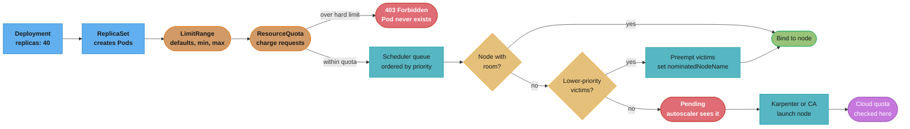
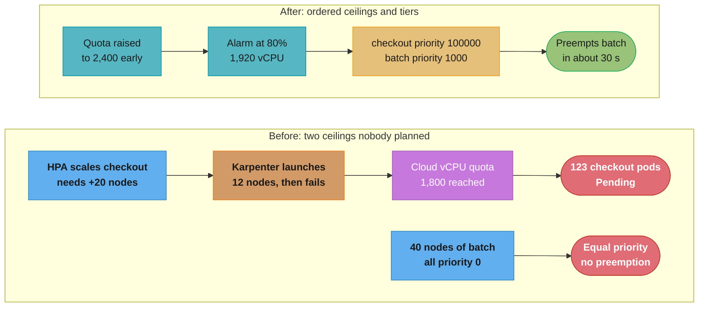

# Capacity & Quota Management

> **Version anchor (2026-11-25).** **Kubernetes 1.37** is the current minor (1.37.2 released 2026-10-13); 1.37, 1.36 and 1.35 are the supported minors. **In-place pod resize** is Stable since 1.35. **Preemption for in-place resize** is Alpha in 1.37 (`InPlacePodVerticalScalingSchedulerPreemption`, off by default). **PodGroup priority and preemption** are Beta in 1.37 but off by default behind `GenericWorkload`. The `VolumeAttributesClass` quota scope is Stable since 1.36. Built-in priorities in 1.37 are `system-cluster-critical` = 2000000000 and `system-node-critical` = 2000001000. **Karpenter** uses the stable `karpenter.sh/v1` API (AWS provider docs at v1.15.3). **GKE** changed its node-reservation formula in 1.37.2-gke.1325000. AWS and GCP quota facts were read from the vendor docs on 2026-11-25; neither vendor publishes a quota-increase lead time.

> Phase 2 — Containers & Kubernetes · Difficulty: Advanced · Follows [Kubernetes Scheduling & Autoscaling](../kubernetes_scheduling_and_autoscaling/kubernetes_scheduling_and_autoscaling.md)

A cluster is full long before the nodes are busy. Capacity is a stack of ceilings: the cloud account's vCPU quota, the node autoscaler's limits, the nodes' allocatable, each namespace's `ResourceQuota`, and finally the scheduler's priority order when something has to give. This module teaches how those ceilings interact, how to size the headroom between them, and how to read the failure when one of them binds.

---

## 1. Concept Overview

**Capacity management** answers three questions: how much can each tenant consume (quota), who loses when demand exceeds supply (priority and preemption), and how much spare room exists before the next burst (headroom).

| Layer | Object | Decides | Fails how |
|-------|--------|---------|-----------|
| Cloud account | AWS Service Quotas, GCP Cloud Quotas | How many vCPUs, GPUs, IPs, load balancers exist at all | Node launch API call errors; pods stay Pending |
| Node autoscaler | Karpenter `NodePool.limits`, Cluster Autoscaler node-group max | How far the cluster may grow | Pods stay Pending, no new node |
| Node | `Allocatable` = capacity minus reserved | What pods may request on one node | Scheduler reports `Insufficient cpu` |
| Namespace | `ResourceQuota`, `LimitRange` | What one tenant may request or create | `403 Forbidden` at admission; the pod is never created |
| Scheduler | `PriorityClass`, preemption | Who is placed first and who is evicted | Low-priority pods evicted, or high-priority pods wait |
| Availability | `PodDisruptionBudget` | How many replicas voluntary actions may remove | Eviction API returns `429`, drain blocks |

**Boundaries.** Requests, limits and QoS classes are taught in [Kubernetes Scheduling & Autoscaling](../kubernetes_scheduling_and_autoscaling/kubernetes_scheduling_and_autoscaling.md) §4; this page only uses them. **GPU quota policy** (queues, cohorts, borrowing, fair sharing, gang admission with Kueue, Volcano and KAI Scheduler) lives in [GPU Cluster Scheduling and Quotas](../../mlops/gpu_cluster_scheduling_and_quotas/gpu_cluster_scheduling_and_quotas.md); **inference replica sizing** lives in [Inference Autoscaling and Capacity Planning](../../mlops/inference_autoscaling_and_capacity_planning/inference_autoscaling_and_capacity_planning.md). The device plugin and DRA mechanism is in [Device Scheduling and DRA](../kubernetes_scheduling_and_autoscaling/device_scheduling_and_dra.md). Tenancy design (namespace vs node pool vs vCluster) is in [Design a Multi-Tenant Platform](../case_studies/design_multi_tenant_platform.md); this page is the mechanism underneath it.

---

## 2. Intuition

> **One-line analogy**: A cluster is a conference hotel. The cloud quota is the number of rooms the hotel will ever rent you, node allocatable is the rooms left after the hotel keeps some for staff, a `ResourceQuota` is each company's room block, priority is who gets bumped when the hotel overbooks, and headroom is the block of empty rooms you hold so a late delegation does not wait for a new wing to be built.

**Mental model.** Every limit is checked at a different moment. Quota is checked once, at admission, when the object is created. Priority is checked at scheduling, when a pod has no room. The cloud quota is checked at node launch, minutes later. Each failure looks different, and the useful skill is knowing from the symptom which ceiling bound.

**Why it matters.** Teams usually discover a ceiling during a launch. A namespace quota stops a Deployment's ReplicaSet from creating pods while the Deployment itself looks healthy. A cloud vCPU quota stops the autoscaler while every Kubernetes object is valid. An un-prioritized batch job holds nodes that a checkout pod cannot take because both pods have priority zero.

**Key insight.** A quota is permission, not capacity. A `ResourceQuota` of 400 CPU gives a tenant the right to ask for 400 CPU; it reserves nothing. An account quota of 2,000 vCPU gives the right to launch instances; it does not guarantee the region has them. Headroom is the only thing that is actually spare capacity.

---

## 3. Core Principles

1. **Quota is admission control, not a reservation.** It rejects objects over the hard limit and holds no capacity for the tenant. See [Kubernetes docs: Resource Quotas](https://kubernetes.io/docs/concepts/policy/resource-quotas/).
2. **Quota is absolute and does not follow nodes.** Adding nodes does not raise any namespace's quota. A controller or a human must change it.
3. **LimitRange makes quota usable.** With a quota on `cpu` or `memory`, every new pod must declare requests or limits; a LimitRange injects defaults so it does.
4. **Priority orders the queue; preemption pays for the order.** A pending pod may evict strictly lower-priority pods. It never evicts equal priority.
5. **PDB is best-effort under preemption and strict under the Eviction API.** Drains and Karpenter honor it; the scheduler tries to and will violate it.
6. **Allocatable, not capacity, is the ceiling.** A node never offers all of its cores to pods.
7. **Headroom is bought three ways:** idle nodes, low-priority placeholder pods, or pre-purchased reservations. Each has a different cost and reaction time.
8. **Plan the ceilings in order.** Cloud quota above autoscaler limits above sum of tenant quotas above AZ-safe capacity. An inverted pair is a latent outage.
9. **Alert at 80%, not 100%.** Quotas with a lead time must alarm while there is still time to raise them.

---

## 4. Types / Architectures / Strategies

### 4.1 Kubernetes quota mechanisms

| Mechanism | Scope | Enforced at | Typical use |
|-----------|-------|-------------|-------------|
| `ResourceQuota` (compute) | Namespace | Admission of Pod create and update | Cap `requests.cpu`, `requests.memory`, `limits.*`, `hugepages-*` |
| `ResourceQuota` (extended) | Namespace | Admission | `requests.nvidia.com/gpu: 4`; only `requests.` prefix allowed |
| `ResourceQuota` (DRA) | Namespace | Admission | `<class>.deviceclass.resource.k8s.io/devices: 4` |
| `ResourceQuota` (storage) | Namespace, per StorageClass | Admission of PVC | `gold.storageclass.storage.k8s.io/requests.storage: 500Gi` |
| `ResourceQuota` (object count) | Namespace | Admission | `count/jobs.batch`, `count/secrets`, `services.loadbalancers` |
| `ResourceQuota` with scope | Subset of pods or PVCs | Admission | Per `PriorityClass`, `Terminating`, `BestEffort`, `CrossNamespacePodAffinity` |
| `LimitRange` | Namespace | Admission (defaults first, then validation) | Defaults, per-container min and max, request-to-limit ratio, PVC size |
| `PriorityClass` | Cluster | Scheduling | Order and preemption |
| Karpenter `NodePool.limits` | NodePool | Provisioning | Cap total `cpu`, `memory`, `nodes` the pool may own |

Quota scopes in 1.37: `BestEffort`, `NotBestEffort`, `Terminating`, `NotTerminating`, `PriorityClass`, `CrossNamespacePodAffinity` and `VolumeAttributesClass`. A quota with a scope may only track the resources that scope supports; others fail validation. The `PriorityClass` scope tracks `pods`, `cpu`, `memory`, `ephemeral-storage` and their `requests.`/`limits.` forms.

### 4.2 Who can remove a running pod, and does the PDB apply

| Actor | API path | Respects PDB | Notes |
|-------|----------|--------------|-------|
| `kubectl drain`, Karpenter drain, Cluster Autoscaler scale-down | Eviction API | Yes (`429` while `disruptionsAllowed` is 0) | Retries until timeout |
| Scheduler preemption | Delete of victims | Best effort | Picks victims whose PDB holds if any exist; otherwise preempts anyway |
| Kubelet node-pressure eviction | Kubelet | No | Counts as involuntary; PDB cannot prevent it, but it counts against the budget |
| Deleting a pod or Deployment | `DELETE` | No | Bypasses the PDB |
| Deployment rolling update | ReplicaSet scale | No | Counts against the budget but is governed by `maxUnavailable` on the Deployment |
| Taint manager (`NoExecute`) | Delete | No | Reason `DeletionByTaintManager` |

The pod's `DisruptionTarget` condition records why: `PreemptionByScheduler`, `DeletionByTaintManager`, `EvictionByEvictionAPI`, `DeletionByPodGC` or `TerminationByKubelet`.

### 4.3 Ways to hold headroom

| Strategy | Mechanism | Reaction time | Cost | Best for |
|----------|-----------|---------------|------|----------|
| Idle nodes | Higher node min, static NodePool, over-sized ASG min | Instant | Full price of idle nodes | Small fixed floors |
| Placeholder (pause) pods | Low-priority Deployment holds capacity; real pods preempt it; displaced placeholders trigger scale-up | Seconds to preempt, then one node-launch time to refill | Same as idle capacity, but sized in pods | Burst absorption, latency-critical scale-up |
| Proportional placeholders | `cluster-proportional-autoscaler` resizes the placeholder Deployment with cluster size | As above | Scales with cluster | Headroom as a percentage |
| Pre-purchased reservation | EC2 capacity reservations or Capacity Blocks, Karpenter `capacityReservationSelectorTerms` | Instant when used | Paid whether used or not | Scarce instance types |
| Scheduled scale | Cron-driven floors | Planned | Only during the window | Predictable peaks |

---

## 5. Architecture Diagrams

### 5.1 The request path through every ceiling



The two rejection points are different species. The quota `403` happens before the pod exists, so no scheduler or autoscaler event ever mentions it; look at the ReplicaSet events. The cloud quota failure happens last, after Karpenter or Cluster Autoscaler has already decided to scale.

### 5.2 The ceilings, in the order they must be planned

```mermaid
flowchart LR
    classDef io      fill:#61afef,stroke:#2e86c1,color:#1a1a1a,font-weight:bold
    classDef frozen  fill:#c678dd,stroke:#9b59b6,color:#fff
    classDef train   fill:#98c379,stroke:#27ae60,color:#1a1a1a
    classDef mathOp  fill:#d19a66,stroke:#e67e22,color:#1a1a1a,font-weight:bold
    classDef req     fill:#56b6c2,stroke:#0097a7,color:#1a1a1a
    classDef base    fill:#e5c07b,stroke:#f39c12,color:#1a1a1a

    CQ(["Cloud vCPU quota<br/>per region or project"]) -->|"caps launches"| NL["Autoscaler limits<br/>cpu, memory, nodes"]
    NL -->|"caps node count"| AL["Cluster allocatable<br/>capacity minus reserved"]
    AL -->|"AZ-safe share"| SQ["Sum of tenant<br/>ResourceQuotas"]
    SQ -->|"caps one tenant"| PD["Pod requests<br/>LimitRange defaults"]
    PD --> PR(["PriorityClass<br/>who wins on contention"])

    class CQ frozen
    class NL,AL req
    class SQ mathOp
    class PD io
    class PR base
```



Each arrow should point from a larger number to a smaller one. If the autoscaler limit exceeds the cloud quota, the limit is a fiction (case study, §14).

### 5.3 From node capacity to what pods can request

```
  Kubernetes docs example: 16 CPU, 32 GiB memory, 100 GiB disk

                        CPU        memory      ephemeral storage
  capacity              16.0       32.0 GiB    100 GiB
  - kubeReserved        1.0         2.0 GiB      1 GiB
  - systemReserved      0.5         1.0 GiB      1 GiB
  - evictionHard        -           0.5 GiB     10 GiB   (nodefs.available 10%)
                        ----       --------    --------
  = allocatable         14.5       28.5 GiB     88 GiB   <- the scheduler's ceiling for requests

  GKE pre-1.37.2 memory formula, 64 GiB node (shares of the bar are to scale)

  |<------------------------------- 64.00 GiB machine --------------------------------->|
  +-----------+------------------------------------------------------------------------+
  |###########|                   allocatable to pods: 58.42 GiB                       |
  +-----------+------------------------------------------------------------------------+
   reserved 5.58 GiB (8.7%) = 2.60 + 2.88 + 0.10 eviction
```

The first block is the documented worked example. In the second block the reservation is not flat: 25% of the first 4 GiB, 20% of the next 4, 10% of the next 8 and 6% of the next 112, so small nodes pay a much higher tax (§6.5).

### 5.4 The price of surviving an AZ loss

```
  Steady need: 143 nodes.  Nodes bought so that losing ONE AZ still leaves >= 143.

  AZs   total nodes   extra over 143   bars: one # = 5% extra
   2       286          +100%          ####################
   3       216           +51%          ##########
   4       192           +34%          #######
   5       180           +26%          #####
   6       174           +22%          ####
```

More zones make single-AZ tolerance cheaper (extra = 1 / (AZs - 1), before rounding), but each added AZ adds cross-zone traffic and one more pool to keep balanced.

### 5.5 One preemption, on a clock

```
  t = 0 s       checkout pod P (priority 100000) is Pending: no node has room
  t = 0 s       scheduler picks node N, victims = 2 batch pods (priority 1000)
                P.status.nominatedNodeName = N   (P is NOT bound yet)
  t = 0..30 s   victims run their graceful termination (default 30 s);
                the scheduler keeps placing other pods in the meantime
  t ~ 30 s      victims gone: P binds to N, or to another node that freed first
                (if a higher-priority pod arrives first it may take N and clear the nomination)
```

The gap between "preempted" and "scheduled" is the victims' `terminationGracePeriodSeconds`. Short grace periods on batch pods shrink it; a PDB on the victims can make the scheduler pick a different node, or be ignored when no PDB-safe set exists.

---

## 6. How It Works — Detailed Mechanics

### 6.1 ResourceQuota

A quota is evaluated on every create and update of a covered object. Usage is tracked for non-terminal pods only (`.status.phase` not `Failed` or `Succeeded`). Several quotas can coexist in one namespace; an object is charged against every quota whose scope it matches.

```yaml
# Compute and storage for the payments tenant.
apiVersion: v1
kind: ResourceQuota
metadata: {name: compute, namespace: payments}
spec:
  hard:
    requests.cpu: "400"
    requests.memory: 1600Gi
    limits.memory: 3200Gi            # memory limit total only; no CPU limit total (see LimitRange)
    pods: "2000"
    persistentvolumeclaims: "100"
    requests.storage: 20Ti
    gold.storageclass.storage.k8s.io/requests.storage: 5Ti
---
# Object counts protect the control plane and cloud bills, not the nodes.
apiVersion: v1
kind: ResourceQuota
metadata: {name: objects, namespace: payments}
spec:
  hard:
    count/jobs.batch: "200"          # a runaway CronJob cannot create unbounded Jobs
    count/secrets: "300"             # Secrets are large; too many can stop servers and controllers starting
    services.loadbalancers: "2"      # each LoadBalancer Service is a billed cloud resource
    services.nodeports: "0"
```

Extra mechanics worth knowing:

- Without a scope, a quota on `cpu` or `memory` forces every new pod to declare requests or limits for that resource. For other resources, such as ephemeral storage, pods that set nothing are ignored by the quota.
- `pods` counts non-terminal pods and exists to stop a tenant exhausting Pod IPs. `count/pods` is the generic spelling.
- Object-count syntax is `count/<resource>.<group>` for non-core groups and `count/<resource>` for core; it also covers CRDs (`count/widgets.example.com`). Aggregated APIs are not enforced by the core control plane.
- Extended resources only allow the `requests.` prefix, because overcommit is not allowed for them.
- Quota on DRA devices uses `<deviceclass>.deviceclass.resource.k8s.io/devices`. Devices from claims and from extended-resource allocation count toward the same totals.
- Neither contention nor a quota change affects objects that already exist. Lowering a quota below current usage blocks new objects; it evicts nothing.
- Protect the quota object itself: a tenant who can edit or delete their own quota has no quota. The Kubernetes docs suggest a `ValidatingAdmissionPolicy` for this.

**Scoped quotas for priority.** One quota per tier caps how much of each priority a tenant may hold:

```yaml
apiVersion: v1
kind: ResourceQuota
metadata: {name: prod-critical, namespace: payments}
spec:
  hard: {requests.cpu: "300", requests.memory: 1200Gi, pods: "1500"}
  scopeSelector:
    matchExpressions:
      - {scopeName: PriorityClass, operator: In, values: [prod-critical]}
---
apiVersion: v1
kind: ResourceQuota
metadata: {name: batch, namespace: payments}
spec:
  hard: {requests.cpu: "100", requests.memory: 400Gi}
  scopeSelector:
    matchExpressions:
      - {scopeName: PriorityClass, operator: In, values: [batch]}
```

A pod of class `prod-critical` is charged to `compute` (unscoped) and to `prod-critical` (scoped). To make a high priority class unavailable except where a quota explicitly allows it, pass this admission config to `kube-apiserver` through `--admission-control-config-file`:

```yaml
apiVersion: apiserver.config.k8s.io/v1
kind: AdmissionConfiguration
plugins:
  - name: "ResourceQuota"
    configuration:
      apiVersion: apiserver.config.k8s.io/v1
      kind: ResourceQuotaConfiguration
      limitedResources:
        - resource: pods
          matchScopes:
            - scopeName: PriorityClass
              operator: In
              values: ["platform-critical"]
```

With that in place a pod using `platform-critical` is rejected in any namespace that lacks a matching quota object, so only namespaces you deliberately give a quota can use the class. On managed control planes, check whether the API server flag is reachable before relying on it; an admission policy (Kyverno, ValidatingAdmissionPolicy) achieves the same end ([policy as code](../policy_as_code_and_compliance/policy_as_code_and_compliance.md)).

**Other scopes.** `Terminating` matches pods with `activeDeadlineSeconds` set and `NotTerminating` those without; together they let you cap deadline-bound batch separately from long-running services. `BestEffort` and `NotBestEffort` split pods by QoS class. `CrossNamespacePodAffinity` with `pods: "0"` stops a namespace from using cross-namespace (anti)affinity terms, which could otherwise block other tenants from a failure domain.

```yaml
# Bound batch with a deadline separately from long-running services.
apiVersion: v1
kind: ResourceQuota
metadata: {name: deadline-batch, namespace: analytics}
spec:
  hard: {pods: "300", requests.cpu: "200", requests.memory: 800Gi}
  scopeSelector:
    matchExpressions:
      - {scopeName: Terminating, operator: Exists}
---
# Forbid cross-namespace pod affinity in this namespace.
apiVersion: v1
kind: ResourceQuota
metadata: {name: no-cross-ns-affinity, namespace: analytics}
spec:
  hard: {pods: "0"}
  scopeSelector:
    matchExpressions:
      - {scopeName: CrossNamespacePodAffinity, operator: Exists}
```

### 6.2 LimitRange

A LimitRange runs first at admission: it applies defaults to pods that declare nothing, then validates min, max and ratio. It checks only at admission; existing pods are untouched. With two LimitRanges in a namespace, which default wins is not deterministic, so keep one.

```yaml
apiVersion: v1
kind: LimitRange
metadata: {name: tenant-defaults, namespace: payments}
spec:
  limits:
    - type: Container
      defaultRequest: {cpu: 250m, memory: 256Mi}   # injected when a container sets no request
      default: {memory: 1Gi}                        # injected limit: memory only, no CPU limit
      min: {cpu: 50m, memory: 64Mi}
      max: {cpu: "4", memory: 16Gi}
      maxLimitRequestRatio: {memory: "4"}           # limit may not exceed 4x request
    - type: PersistentVolumeClaim
      min: {storage: 1Gi}
      max: {storage: 500Gi}
```

A LimitRange does not check that the defaults are consistent with what a client submits. A pod that sets `requests.cpu: 700m` with no limit, in a namespace whose LimitRange injects a `500m` CPU limit, is invalid because the request exceeds the limit (§10, pitfall 1). Pair every compute quota with a LimitRange; the [multi-tenant case study](../case_studies/design_multi_tenant_platform.md) shows the quota-without-LimitRange outage in full.

### 6.3 PriorityClass and preemption

A `PriorityClass` is cluster-scoped. User values may be any 32-bit integer up to 1,000,000,000; names may not start with `system-`. Pods get `priority` from the `priorityClassName` at admission; an unknown class is rejected. `globalDefault: true` may exist on only one class and applies only to pods created after it; existing pods stay at 0 (or whatever they had).

A reasonable tier ladder:

| Class | Value | Preempts lower | Used by |
|-------|-------|----------------|---------|
| `system-node-critical` | 2000001000 (built in) | yes | kube-proxy, CNI node agents |
| `system-cluster-critical` | 2000000000 (built in) | yes | CoreDNS, metrics-server |
| `platform-critical` | 1000000 | yes | Ingress, CSI, observability agents (restricted by quota) |
| `prod-critical` | 100000 | yes | Checkout, auth, payment path |
| `prod-default` | 10000, `globalDefault: true` | yes | Every other service |
| `batch` | 1000 | `preemptionPolicy: Never` | Reports, backfills, CI |
| `overprovisioning` | -10 | `preemptionPolicy: Never` | Placeholder pods (§6.7) |

```yaml
apiVersion: scheduling.k8s.io/v1
kind: PriorityClass
metadata: {name: prod-default}
value: 10000
globalDefault: true
description: "Default for production services without an explicit class."
---
apiVersion: scheduling.k8s.io/v1
kind: PriorityClass
metadata: {name: batch}
value: 1000
preemptionPolicy: Never        # queued ahead of lower pods, but never evicts running work
description: "Jobs that may wait and may be preempted."
```

**How preemption runs.** The scheduler pops pods in priority order. When no node fits pod P, preemption looks for a node where removing one or more pods with lower priority than P would let P fit, and evicts only as many as needed (timeline in §5.5). Then:

- `status.nominatedNodeName` on P records the chosen node. P is not bound yet and need not end up there; if another node frees first, or a higher-priority pod arrives, the scheduler may use a different node.
- Victims get their full graceful termination period (30 seconds by default). Until they exit, the scheduler keeps placing other pods. Setting a small `terminationGracePeriodSeconds` on low-priority pods shortens the gap.
- Among candidate nodes the scheduler prefers the set of victims with the lowest priority, but if those victims' PDBs would be violated it may choose another node with higher-priority victims. If no PDB-safe set exists, it preempts anyway.
- Preemption does not consider QoS. A Guaranteed pod at low priority is preempted before a BestEffort pod at higher priority.
- It is single-node: if P would fit only after evicting a pod on a different node (zone-wide anti-affinity), the scheduler will not do it. Inter-pod affinity to a lower-priority pod blocks preemption on that node.
- With the Beta `GenericWorkload` gate, a PodGroup carries its own `priority` and can be preemptor or victim; that is the native gang primitive, thinner than Kueue.

**Non-preempting.** `preemptionPolicy: Never` puts the pod ahead of lower-priority pods in the queue but never evicts. The Kubernetes docs name data-science jobs as the use case: prioritized, yet unwilling to discard existing work.

**Priority and node-pressure eviction.** The kubelet ranks eviction candidates by (1) whether usage exceeds requests, (2) priority, (3) usage relative to requests. A low-priority pod that stays within requests is not evicted by node pressure; a higher-priority pod that exceeds its requests can be.

### 6.4 PodDisruptionBudget under preemption and drains

`disruptionsAllowed = currentHealthy - minAvailable` (or the `maxUnavailable` equivalent); percentages round up. Pods from drains, autoscaler scale-down and Karpenter consolidation go through the Eviction API: `200` if allowed, `429` if the PDB blocks, `500` if more than one PDB selects the same pod. Full mechanics and the drain-deadlock arithmetic are in [Kubernetes Scheduling & Autoscaling](../kubernetes_scheduling_and_autoscaling/kubernetes_scheduling_and_autoscaling.md) §6; what matters for capacity is the interaction:

```yaml
apiVersion: policy/v1
kind: PodDisruptionBudget
metadata: {name: checkout, namespace: payments}
spec:
  maxUnavailable: 1                      # works at any replica count; minAvailable == replicas deadlocks drains
  unhealthyPodEvictionPolicy: AlwaysAllow # a crash-looping replica must not block a node drain
  selector: {matchLabels: {app: checkout}}
```

- **Preemption ignores the PDB when it must.** A PDB cannot protect a pod from a higher-priority pod that has nowhere else to go. If an SLO depends on a replica count, protect it with priority, not only a PDB.
- **PDBs shape consolidation.** Karpenter reports `pdb default/x prevents pod evictions` as an `Unconsolidatable` event and skips the node; with a `terminationGracePeriod` set on the NodeClaim it eventually force-deletes pods that are still blocking.
- **An empty selector `{}` matches every pod in the namespace.** One careless PDB can freeze every drain in that namespace.
- **Zero-eviction PDBs** (`maxUnavailable: 0`, or `minAvailable` equal to replicas) are legal and make a drain of that node never complete.
- **Rolling updates are not PDB-gated**, though unavailable pods count against the budget.

### 6.5 Node allocatable and reserved resources

`Allocatable = Capacity - kubeReserved - systemReserved - evictionHard` (memory also subtracts pre-allocated hugepages). Memory `Capacity` is `MemTotal` from `/proc/meminfo`, not installed RAM, and can shift after a kernel update. The scheduler never over-subscribes allocatable.

```yaml
apiVersion: kubelet.config.k8s.io/v1beta1
kind: KubeletConfiguration
kubeReserved:   {cpu: 1000m, memory: 2Gi, ephemeral-storage: 1Gi}   # kubelet, container runtime
systemReserved: {cpu: 500m,  memory: 1Gi, ephemeral-storage: 1Gi}   # sshd, udev, kernel memory
evictionHard:   {memory.available: "500Mi", nodefs.available: "10%"}
enforceNodeAllocatable: [pods]                                        # start here
```

Kubelet defaults for `evictionHard` are `memory.available: 100Mi`, `nodefs.available: 10%`, `nodefs.inodesFree: 5%` and `imagefs.available: 15%`. `kubeReserved` is meant to scale with pod density. The docs advise enforcing only `pods` first, then compressible `kube-reserved` and `system-reserved`, and enforcing non-compressible `systemReserved` only after exhaustive profiling, because an OOM-kill in that cgroup can take down critical services. `reservedSystemCPUs` (Stable) defines an explicit cpuset for system daemons and replaces the CPU figures in `kubeReserved` and `systemReserved`.

**Managed defaults differ.** On Karpenter-AWS the `kubeReserved`, `systemReserved` and `evictionHard` live in the `EC2NodeClass` `kubelet` block. On GKE the reservation is a tapered formula (pre-1.37.2):

| Machine memory | Reserved (25% / 20% / 10% / 6% / 2% tiers + 100 MiB eviction) | Share of node |
|----------------|--------------------------------------------------------------|----------------|
| 4 GiB | 1.00 + 0.10 = 1.10 GiB | 27.4% |
| 8 GiB | 1.80 + 0.10 = 1.90 GiB | 23.7% |
| 16 GiB | 2.60 + 0.10 = 2.70 GiB | 16.9% |
| 64 GiB | 2.60 + 2.88 + 0.10 = 5.58 GiB | 8.7% |
| 128 GiB | 2.60 + 6.72 + 0.10 = 9.42 GiB | 7.4% |

CPU on the same formula: 6% of the first core, 1% of the next, 0.5% of the next two, 0.25% above four. A 4-vCPU node reserves 80 m (allocatable 3920 m); a 16-vCPU node reserves 110 m. From 1.37.2-gke.1325000, memory is `Min(earlier formula, 15 MiB x maxPods + BaseOverhead)` with a 500 MiB base on Container-Optimized OS and 700 MiB on Ubuntu, and CPU reservation is capped at 1 vCPU. Always read `kubectl get node -o yaml` instead of assuming a formula.

**Consequence for sizing.** Small nodes pay a larger reservation share and a per-node DaemonSet tax (CNI, logging, node-exporter, CSI). Many 4 GiB nodes strand far more memory than fewer 64 GiB nodes, while large nodes have a larger blast radius per failure.

### 6.6 In-place pod resize and quota

In-place resize (Stable since 1.35) changes a running container's CPU and memory through the Pod `resize` subresource without recreating the pod:

```yaml
resizePolicy:
  - {resourceName: cpu,    restartPolicy: NotRequired}       # default; applied live
  - {resourceName: memory, restartPolicy: RestartContainer}  # restart this container to apply
```

```bash
kubectl patch pod web-0 --subresource resize --patch \
  '{"spec":{"containers":[{"name":"web","resources":{"requests":{"cpu":"3"},"limits":{"cpu":"3"}}}]}}'
```

How it touches capacity controls:

| Control | Behavior on resize |
|---------|--------------------|
| Scheduler accounting | Uses the **maximum** of desired requests, allocated requests and actual requests from status for a node with a pending or incomplete resize |
| `ResourceQuota` | Charges the **maximum** of desired (unless the resize is `Infeasible`), actual and allocated requests; a quota controller also re-evaluates pod updates whose `.status` resources change |
| `LimitRange` | A resize that violates min or max is rejected, as a create would be |
| QoS class | Fixed at creation; a Guaranteed pod's requests must keep equalling limits |
| Node full | Resize becomes `PodResizePending` with reason `Deferred` (retry) or `Infeasible` (never) |
| Retry order of deferred resizes | Higher priority first; then Guaranteed before Burstable; then longest-deferred |
| Preemption for a deferred resize | Alpha in 1.37, off by default; scheduler may evict lower-priority pods on the same node; per-node opt-out via `spec.podPreemptionPolicy.disableResizePreemption` |

**Worked example.** A namespace has `requests.cpu: 10` and 9 in use. Pod A's desired CPU goes 2 to 3: the charge becomes max(3 desired, 2 actual, 2 allocated) = 3, usage 10, admitted. Going to 4 would make usage 11 and the resize is rejected. Scaling A back from 3 to 1 does **not** free quota instantly: the charge stays max(1, 3, 3) = 3 until the kubelet actuates the shrink and updates status. Automation that shrinks one pod and grows another in the same breath can be refused on the grow.

Limits: only CPU and memory; no resize of ephemeral containers or Windows pods; static CPU or memory manager policy pods cannot be resized; a memory decrease is best-effort against OOM kills; resource requests cannot be removed once set. VPA's `InPlaceOrRecreate` mode builds on this and falls back to eviction when the change cannot be applied live.

### 6.7 Headroom: placeholder pods, Cluster Autoscaler and Karpenter

**Placeholder pods.** A Deployment of pause pods at a very low priority keeps resources that real pods can take. When a real pod arrives with no room, the scheduler preempts placeholders; the displaced placeholders go Pending, which makes the node autoscaler add capacity, which they then occupy. The pattern comes from the Cluster Autoscaler FAQ.

```yaml
apiVersion: scheduling.k8s.io/v1
kind: PriorityClass
metadata: {name: overprovisioning}
value: -10                       # the lowest value that still triggers scale-up
globalDefault: false
preemptionPolicy: Never
description: "Placeholder pods that hold capacity for bursts."
---
apiVersion: apps/v1
kind: Deployment
metadata: {name: capacity-headroom, namespace: platform}
spec:
  replicas: 80
  selector: {matchLabels: {app: capacity-headroom}}
  template:
    metadata: {labels: {app: capacity-headroom}}
    spec:
      priorityClassName: overprovisioning
      terminationGracePeriodSeconds: 0        # leave the node the moment a real pod needs it
      containers:
        - name: pause
          image: registry.k8s.io/pause:3.8
          resources: {requests: {cpu: "4", memory: 16Gi}}
```

Cluster Autoscaler ignores pods below `--expendable-pods-priority-cutoff` (default -10): they neither trigger scale-up nor block scale-down. That is why placeholders sit at -10, not lower. Real pods at 0 or above can preempt them. Size placeholders to fit the nodes: a placeholder larger than free space on any node will never schedule. The placeholders also consume the `platform` namespace's `pods` and CPU quota, so size that quota to match.

**Sizing the headroom.** Headroom must cover the demand that arrives while the new capacity is being created: `placeholder capacity = (growth rate) x (node provisioning time)`. The Cluster Autoscaler FAQ gives about 3 to 4 minutes node provisioning on GCE and about 5 minutes end to end with HPA, with CA itself the smallest factor. Worked numbers: a 4,000-pod service growing 20% in 5 minutes needs +800 pods; over a 4-minute launch window that is 800 x 4/5 = 640 pods; at 500 m / 2 GiB each, 320 vCPU and 1,280 GiB, i.e. 80 placeholders of 4 vCPU / 16 GiB. That is 320 of 2,200.8 allocatable vCPU, a 14.5% idle-capacity tax for removing the node-launch wait from the user's path.

**Cluster Autoscaler.** Scales node groups when pods are unschedulable; scale-down starts 10 minutes after a node becomes unneeded by default. When scale-up fails for lack of cloud quota it backs off and may wait up to 30 minutes before retrying. Pods whose PDB or scheduling constraints cannot be moved elsewhere pin their node.

**Karpenter.** Provisions nodes from pending pods, and bounds them with `limits`; picks the highest-`weight` NodePool that fits; consolidates by `consolidationPolicy` (`WhenEmpty`, `WhenEmptyOrUnderutilized`, `Balanced`) after `consolidateAfter`; and throttles voluntary disruption with `budgets`.

```yaml
apiVersion: karpenter.sh/v1
kind: NodePool
metadata: {name: general}
spec:
  template:
    spec:
      nodeClassRef: {group: karpenter.k8s.aws, kind: EC2NodeClass, name: default}
      requirements:
        - {key: karpenter.sh/capacity-type, operator: In, values: ["spot", "on-demand"]}
        - {key: kubernetes.io/arch, operator: In, values: ["amd64", "arm64"]}
  limits:
    cpu: "2000"            # keep BELOW the account vCPU quota, never above it
    memory: 8000Gi
  weight: 10
  disruption:
    consolidationPolicy: WhenEmptyOrUnderutilized
    consolidateAfter: 1m
    budgets:
      - nodes: "10%"
      - {schedule: "0 9 * * mon-fri", duration: 8h, nodes: "0"}   # no voluntary disruption in business hours
```

Karpenter has no namespace-based provisioning; separate tenants with taints, tolerations and node selectors. The pod annotation `karpenter.sh/do-not-disrupt` stops graceful consolidation of a node. When consolidation has several candidates, it prefers nodes running fewer pods, nodes that expire soon, nodes with lower-priority pods and lower total disruption cost. Setting a high `PriorityClass` on DaemonSets lets kube-scheduler preempt lower pods to make room, best effort. Placeholder pods are generic Kubernetes, not a documented Karpenter recipe: they work because a preempted placeholder is just another unschedulable pod.

### 6.8 Cloud service quotas

**AWS.** Quotas are per Region. EC2 instance quotas are in vCPUs, grouped by family and purchase option:

| Quota (On-Demand, running) | Default | Adjustable | Quota code |
|----------------------------|---------|------------|-----------|
| Standard (A, C, D, H, I, M, R, T, Z) | 5 | Yes | `L-1216C47A` |
| P instances | 0 | Yes | `L-417A185B` |
| G and VT instances | 0 | Yes | `L-DB2E81BA` |
| DL, F, Inf, Trn, X, High Memory, HPC | 0 | Yes | one code each |
| Standard Spot requests | 5 | Yes | `L-34B43A08` |

Spot has its own set of quotas, and Dedicated Hosts and Capacity Blocks have separate ones. EC2 automatically raises On-Demand and Spot quotas based on usage; you may also request an increase. A GPU family at 0 default means a first GPU cluster must file a request before it can launch one node.

```bash
aws service-quotas list-service-quotas --service-code ec2 --region us-east-1 \
  --query "Quotas[?QuotaCode=='L-1216C47A']"
aws service-quotas request-service-quota-increase --service-code ec2 \
  --quota-code L-1216C47A --desired-value 2400 --region us-east-1
aws service-quotas list-requested-service-quota-change-history-by-quota \
  --service-code ec2 --quota-code L-1216C47A --region us-east-1
```

Smaller increases are usually auto-approved; larger ones go to Support, with no priority handling, and Support can approve, deny or partially approve. A request starts `Pending`, moves to `Quota requested` and gets a Support case number. CloudWatch alarms can be attached to quotas that support them. **AWS publishes no lead time**, so treat it as unknown, record your own history, and request before the capacity review rather than during the launch.

**GCP.** Cloud Quotas has three types: allocation (how much is allocated, such as VMs), rate (per period) and concurrent. Quotas are mostly project-level, with folder and organization levels for some, and are global, regional or zonal; a resource may carry both a regional and a zonal quota, so zone usage drains the shared regional quota. Most adjustment requests are decided by automated systems using undisclosed criteria (resource availability, account age, other factors); some escalate to humans, and you may be asked to pay in advance. A **quota adjuster** can raise quotas automatically as you near the value but needs usage history. Set quota alerts so you hear before failure. Increases are generally requested at project level.

**Quota is not capacity.** An account quota of 2,000 vCPU does not guarantee instances exist. Karpenter treats insufficient-capacity errors from the Fleet API as a different failure: those offerings (zone x capacity type) are temporarily removed so it can try others, and it falls back to On-Demand only if the NodePool allows it. For scarce types, buy a reservation, and keep NodePool instance-type requirements wide. Sizing the cloud side for GPU nodes is covered in [GPU node lifecycle](../case_studies/cross_cutting/gpu_node_lifecycle.md) and [GPU and AI FinOps](../cloud_cost_optimization_finops/gpu_and_ai_finops.md).

### 6.9 Capacity planning math

Node packing is set by the tightest resource, after reserved resources and DaemonSets:

```
allocatable_cpu  = node_cpu - kube/system reserved
available_cpu    = allocatable_cpu - sum(DaemonSet CPU requests)
pods_per_node    = min( floor(available_cpu / pod_cpu), floor(available_mem / pod_mem), maxPods )
nodes_needed     = ceil( pods / pods_per_node )
nodes_AZ_safe    = AZs * ceil( nodes_needed / (AZs - 1) )          # survive losing one AZ
```

Worked example. A 16 vCPU / 64 GiB node on the GKE pre-1.37.2 formula: allocatable 15.89 vCPU (110 m reserved) and 58.42 GiB (5.58 GiB reserved). Five DaemonSets at 100 m / 128 MiB take 0.5 vCPU and 0.625 GiB, leaving 15.39 vCPU and 57.80 GiB. A pod of 500 m / 2 GiB fits `floor(15.39/0.5) = 30` by CPU and `floor(57.80/2) = 28` by memory, so **28 per node, memory bound**. 4,000 pods need `ceil(4000/28) = 143` nodes. For single-AZ tolerance across 3 AZs: `3 x ceil(143/2) = 3 x 72 = 216` nodes (+51%). A 20% HPA-burst allowance on top of 4,000 pods is 4,800 pods, `ceil(4800/28) = 172` nodes before AZ tolerance.

Quota sizing for the same family with 100 nodes: allocatable after DaemonSets is 100 x 15.39 = 1,539 vCPU and 5,780 GiB. AZ-safe share is 2/3: 1,026 vCPU and 3,853 GiB. A defensible split:

| Tenant | requests.cpu | requests.memory (4 GiB per vCPU) | Share of AZ-safe CPU |
|--------|--------------|----------------------------------|----------------------|
| payments | 400 | 1,600 GiB | 39.0% |
| search | 250 | 1,000 GiB | 24.4% |
| data | 250 | 1,000 GiB | 24.4% |
| Sum of guarantees | 900 | 3,600 GiB | 87.7% |
| Platform reserve | 126 | 253 GiB | 12.3% |

Check: 400+250+250 = 900; 900/1,026 = 87.7%; 1,026-900 = 126; 3,853-3,600 = 253. If the sum of quotas exceeds allocatable the quotas are oversubscribed; contention is then first-come-first-served, so oversubscribe on purpose, with priority and borrowing rules, not by accident.

### 6.10 Multi-tenant fairness

- **Quota is a ceiling, not a fair share.** Two tenants under quota can still starve each other if the sum of quotas exceeds the cluster. `ResourceQuota` also does not borrow idle capacity from a neighbor.
- **Fairness tools in order of weight:** (1) namespace `ResourceQuota` plus `LimitRange`; (2) PriorityClass tiers with per-tier quotas; (3) node pools with taints for noisy or regulated tenants; (4) a queueing layer (Kueue, Volcano, KAI) when you need borrowing, fair share and gang admission, covered in [GPU Cluster Scheduling and Quotas](../../mlops/gpu_cluster_scheduling_and_quotas/gpu_cluster_scheduling_and_quotas.md).
- **Quota that follows demand.** The docs say to build it as a controller that watches usage and adjusts `hard` limits; some teams do this in their IDP ([platform engineering](../platform_engineering_and_idp/platform_engineering_and_idp.md)).
- **Quota on the cloud side.** Per-team cloud accounts or projects give per-team cloud quotas. GCP supports folder and organization quota levels for some resources. Across many clusters, the same questions repeat per cluster; see [multi-cluster and fleet management](../multi_cluster_and_fleet_management/multi_cluster_and_fleet_management.md).

### 6.11 Monitoring the ceilings

```promql
# Namespace quota at risk (kube-state-metrics)
kube_resourcequota{type="used"} / ignoring(type) kube_resourcequota{type="hard"} > 0.9

# Cluster CPU requested vs allocatable (the scheduler's view of "full")
sum(kube_pod_container_resource_requests{resource="cpu"})
  / sum(kube_node_status_allocatable{resource="cpu"})

# Pods stuck waiting: a growing count with autoscaler limits not reached means a cloud quota or capacity error
sum(kube_pod_status_phase{phase="Pending"})
```

Kube-scheduler also exposes `kube_pod_resource_request` and `kube_pod_resource_limit` on `/metrics/resources`; they account for pod-level resources and are recommended over the container-level metrics. Add the cloud side: a Service Quotas CloudWatch alarm at 80% of the vCPU quota, and GCP quota alerts. See [observability: Prometheus](../observability_metrics_prometheus/observability_metrics_prometheus.md).

### 6.12 Triage: from symptom to ceiling

| Symptom | Ceiling that bound | First command | What you see |
|---------|-------------------|---------------|--------------|
| Deployment 0/N, no pods exist | Namespace quota or LimitRange | `kubectl describe rs -n NS` | `FailedCreate`: `exceeded quota` or `must be less than or equal to cpu limit` |
| Pods Pending, `Insufficient cpu`, no new nodes | Autoscaler limit or cloud quota | `kubectl get nodeclaims` (Karpenter) or the CA status ConfigMap | NodeClaim not launching, or scale-up back-off |
| Pods Pending, nodes exist but are full of equal-priority pods | No priority tier | `kubectl get pod -o jsonpath='{.spec.priority}'` | Priority 0 everywhere |
| Pods evicted, condition `DisruptionTarget` | Preemption | `kubectl get events` and the pod's conditions | Reason `PreemptionByScheduler` |
| Drain or upgrade hangs | PDB with zero allowed disruptions | `kubectl get pdb -A` | `ALLOWED DISRUPTIONS` is 0 |
| Resize accepted but nothing changes | Node full or infeasible | `kubectl get pod -o yaml` | Condition `PodResizePending`, reason `Deferred` or `Infeasible` |
| Node memory pressure with spare requests | Reserve too small | `kubectl describe node` | Allocatable close to capacity, evictions at the node |

---

## 7. Real-World Examples

These are patterns from the vendor documentation, not company anecdotes.

- **Kubernetes docs' reference split.** A cluster of 32 GiB RAM and 16 cores: team A 20 GiB and 10 cores, team B 10 GiB and 4 cores, 2 GiB and 2 cores held in reserve. The sum of quotas deliberately equals capacity minus a reserve.
- **Cluster Autoscaler overprovisioning.** A Deployment of pause pods at priority -10 with `terminationGracePeriodSeconds: 0`, optionally resized by the cluster-proportional autoscaler, is the project's own recipe for burst absorption.
- **GKE tapered reservations.** Reserved memory falls from 27.4% of a 4 GiB node to 7.4% of a 128 GiB node, which is why node-size choice is a cost lever (§6.5).
- **AWS GPU quotas default to zero.** P, G and VT, DL, Inf and Trn families start at 0 vCPU, so the first GPU node group always needs a quota request first; plan it before the hardware decision. See [GPU node lifecycle](../case_studies/cross_cutting/gpu_node_lifecycle.md).
- **Karpenter NodePool limits per team.** Separate NodePools with taints and `limits` cap each team's cloud spend independently of Kubernetes quota.
- **Priority-scoped namespaces.** Restricting a `cluster-services` class to `kube-system` with the `limitedResources` admission config is the documented way to stop tenants taking top priority.
- **In-place resize for stateful workloads.** The feature exists so single-replica or sensitive stateful pods can grow without a restart, with quota charged at the larger of old and new values.

See also [Design a Kubernetes Platform](../case_studies/design_kubernetes_platform.md), [Design an Autoscaling Platform](../case_studies/design_autoscaling_platform.md) and [Design a GPU Training and Inference Cluster](../case_studies/design_gpu_training_and_inference_cluster.md), where priority classes and quotas appear in context.

---

## 8. Tradeoffs

| Decision | Option A | Option B | Key factor |
|----------|----------|----------|-----------|
| Headroom form | Idle nodes | Low-priority placeholder pods | Placeholders cost the same but are sized in pods and give capacity back instantly |
| Placeholder sizing | Static replica count | Proportional to cluster size | Fixed burst vs percentage of fleet |
| Quota basis | Requests only | Requests plus limits | Limits quotas on CPU invite throttling; memory limits quota is common |
| Quota total vs capacity | Sum <= AZ-safe allocatable | Oversubscribed | Guarantees vs utilization; oversubscription needs priority and borrowing |
| Node size | Many small nodes | Few large nodes | Reservation tax and DaemonSet tax vs failure blast radius |
| AZ tolerance | N+1 AZ | Degrade gracefully | +51% nodes at 3 AZs vs lost capacity during outage |
| PDB strictness | `maxUnavailable: 1` | `minAvailable` = replicas | Drainable vs frozen |
| Batch class | `preemptionPolicy: Never` | `PreemptLowerPriority` | Do not evict running work vs queue-jump |
| Cloud quota | Request big increases early | Request on demand | Unknown lead time vs idle paperwork |
| Capacity guarantee | Reservation | Quota only | Quota is permission, reservation is supply |
| Node autoscaler | Karpenter `limits` | CA node-group max | Both cap growth; neither exceeds the cloud quota |
| Priority enforcement | apiserver `limitedResources` | Admission policy (Kyverno, VAP) | Managed control planes may not expose the flag |

---

## 9. When to Use / When NOT to Use

**Use quotas, priority and headroom when:**
- Several teams share a cluster (any `ResourceQuota` plus `LimitRange` per namespace).
- Batch and serving share nodes (PriorityClass tiers with non-preempting batch).
- Scale-up latency is user-visible (placeholder pods).
- Cloud spend or API quotas can fail a launch (alarms, Karpenter limits, quota requests).
- Autoscalers or controllers evict pods (PDBs sized for replica count).

**Do not:**
- Put a `ResourceQuota` on `limits.cpu` as a cost control; CPU limits cause throttling, and requests are what the scheduler uses.
- Use `ResourceQuota` as a GPU scheduler. It rejects at creation with no queue, borrowing, gang admission or preemption; see [GPU Cluster Scheduling and Quotas](../../mlops/gpu_cluster_scheduling_and_quotas/gpu_cluster_scheduling_and_quotas.md).
- Hand out high priority classes freely. Priority without a scoped quota turns every tenant into a preemptor.
- Treat a cloud quota raise as capacity.
- Keep placeholder pods in a single-tenant dev cluster that scales to zero at night; the cost buys nothing.
- Over-engineer a 3-node cluster: one namespace, defaults and a PDB are enough.

---

## 10. Common Pitfalls

**Pitfall 1 — A LimitRange default limit below the pod's request.**

```yaml
# BROKEN: the default CPU limit (500m) is injected into any pod that sets no limit.
# A pod that requests 700m and omits a limit then has request > limit and is rejected:
#   spec.containers[0].resources.requests: Invalid value: "700m": must be less than or equal to cpu limit
apiVersion: v1
kind: LimitRange
metadata: {name: cpu-resource-constraint}
spec:
  limits:
    - type: Container
      default: {cpu: 500m}
      defaultRequest: {cpu: 500m}
      max: {cpu: "1"}
      min: {cpu: 100m}
```

```yaml
# FIX: do not default a CPU limit at all (also avoids CFS throttling), and default only the request.
# Pods that set their own request then validate regardless of the defaults.
apiVersion: v1
kind: LimitRange
metadata: {name: cpu-resource-constraint}
spec:
  limits:
    - type: Container
      defaultRequest: {cpu: 500m}
      max: {cpu: "4"}
      min: {cpu: 100m}
```

**Pitfall 2 — Every team marks itself critical.**

```yaml
# BROKEN: nothing stops any namespace using the top user class. When it is mistakenly given to
# batch or a noisy service, it preempts real production pods, and PDBs only slow it down.
apiVersion: v1
kind: Pod
metadata: {name: nightly-report, namespace: team-x}
spec:
  priorityClassName: platform-critical
```

```yaml
# FIX: make the class unusable without a quota object (apiserver ResourceQuotaConfiguration
# limitedResources with scope PriorityClass In [platform-critical]), then grant it only here.
apiVersion: v1
kind: ResourceQuota
metadata: {name: platform-critical, namespace: observability}
spec:
  hard: {pods: "200", requests.cpu: "40"}
  scopeSelector:
    matchExpressions:
      - {scopeName: PriorityClass, operator: In, values: [platform-critical]}
```

**Pitfall 3 — Placeholder pods at the wrong priority.**

```yaml
# BROKEN: -100 is below Cluster Autoscaler's default cutoff of -10, so displaced placeholders
# never trigger scale-up and the headroom drains and never refills. At priority 0 they would
# be equal to real pods, which cannot preempt equal priority at all.
apiVersion: scheduling.k8s.io/v1
kind: PriorityClass
metadata: {name: overprovisioning}
value: -100
```

```yaml
# FIX: -10 is the lowest value that still triggers scale-up, and Never stops them evicting anyone.
apiVersion: scheduling.k8s.io/v1
kind: PriorityClass
metadata: {name: overprovisioning}
value: -10
preemptionPolicy: Never
```

**Pitfall 4 — A PDB that freezes the node fleet.**

```yaml
# BROKEN: at replicas: 3 this allows zero disruptions. Every drain, upgrade and Karpenter
# consolidation of a node holding a replica blocks forever (429 from the Eviction API).
apiVersion: policy/v1
kind: PodDisruptionBudget
metadata: {name: checkout}
spec:
  minAvailable: 3
  selector: {matchLabels: {app: checkout}}
```

```yaml
# FIX: one at a time at any replica count, and let broken replicas be evicted.
apiVersion: policy/v1
kind: PodDisruptionBudget
metadata: {name: checkout}
spec:
  maxUnavailable: 1
  unhealthyPodEvictionPolicy: AlwaysAllow
  selector: {matchLabels: {app: checkout}}
```

**Pitfall 5 — An autoscaler ceiling above the cloud quota.**

```yaml
# BROKEN: the NodePool allows 2,400 vCPU but the account's On-Demand Standard quota is 1,800.
# Karpenter keeps trying to launch past node 112 and the launch calls fail; pods stay Pending
# while every Kubernetes object looks valid.
spec:
  limits: {cpu: "2400"}
```

```bash
# FIX: raise the cloud quota first, alarm at 80%, and keep the NodePool limit at or below the
# quota actually granted. Request before the capacity review; no lead time is published.
aws service-quotas request-service-quota-increase --service-code ec2 \
  --quota-code L-1216C47A --desired-value 2400 --region us-east-1
```

**Pitfall 6 — Quota set once, never revisited.** A quota is absolute: after the fleet doubles, the tenant's quota is the same, and the per-tenant ceiling is now far below what the cluster can give. Equally, after the fleet shrinks, the sum of quotas exceeds capacity and contention returns. Review the sum of quotas against AZ-safe allocatable every time the node count changes materially.

**Pitfall 7 — Object counts forgotten.** The Kubernetes docs warn that CronJobs creating too many Jobs can cause a denial of service. A count quota is the last defence, but finished Jobs stay as objects until something deletes them.

```yaml
# BROKEN: no concurrency control, unlimited history, no TTL, no count quota.
# A slow downstream makes runs pile up; thousands of Job objects accumulate.
apiVersion: batch/v1
kind: CronJob
metadata: {name: reconcile, namespace: payments}
spec:
  schedule: "*/1 * * * *"
  jobTemplate:
    spec:
      template:
        spec:
          restartPolicy: Never
          containers: [{name: run, image: reconcile:1.0}]
```

```yaml
# FIX: forbid overlap, cap history, expire finished Jobs, and backstop with count/jobs.batch.
apiVersion: batch/v1
kind: CronJob
metadata: {name: reconcile, namespace: payments}
spec:
  schedule: "*/1 * * * *"
  concurrencyPolicy: Forbid
  successfulJobsHistoryLimit: 3
  failedJobsHistoryLimit: 3
  jobTemplate:
    spec:
      ttlSecondsAfterFinished: 3600
      template:
        spec:
          restartPolicy: Never
          containers: [{name: run, image: reconcile:1.0}]
```

**Pitfall 8 — Reading Pending as a scheduler problem.** If pods never exist, the quota `403` is the cause and no scheduler event will mention it. Check the ReplicaSet or Job events first (`FailedCreate`), then `kubectl describe quota` (triage table, §6.12).

---

## 11. Technologies & Tools

| Tool | Role | Notes |
|------|------|-------|
| `ResourceQuota`, `LimitRange` | Namespace ceilings and defaults | Built in; quota scopes per priority, QoS and termination |
| `PriorityClass` | Order and preemption | Built-in `system-*` classes; `preemptionPolicy: Never` |
| `PodDisruptionBudget` | Voluntary-disruption cap | `unhealthyPodEvictionPolicy: AlwaysAllow` recommended |
| kubelet Node Allocatable | `kubeReserved`, `systemReserved`, `evictionHard` | `enforceNodeAllocatable: [pods]` first |
| Cluster Autoscaler | Node-group scaling | Priority cutoff -10; overprovisioning recipe; 30-minute failed-scale-up back-off |
| Karpenter | Just-in-time nodes | `limits`, `weight`, `consolidationPolicy`, `budgets`, `do-not-disrupt` |
| cluster-proportional-autoscaler | Resizes the placeholder Deployment with cluster size | Dynamic headroom percentage |
| kube-state-metrics | `kube_resourcequota`, node allocatable, pod phases | Source for quota and capacity alerts |
| AWS Service Quotas | Per-Region quotas, increase API, CloudWatch alarms | vCPU-based EC2 quotas; `ListServiceQuotas`, `RequestServiceQuotaIncrease` |
| GCP Cloud Quotas | Project, folder and org quotas, quota adjuster, alerts | Allocation, rate and concurrent quota types |
| ValidatingAdmissionPolicy, Kyverno | Protect quota objects, restrict priority classes | See [policy as code](../policy_as_code_and_compliance/policy_as_code_and_compliance.md) |
| Kueue, Volcano, KAI Scheduler | GPU and batch queueing, borrowing, fair share | Owned by mlops; see [GPU Cluster Scheduling and Quotas](../../mlops/gpu_cluster_scheduling_and_quotas/gpu_cluster_scheduling_and_quotas.md) |
| Cluster API, fleet tooling | Spreading capacity across clusters | See [multi-cluster and fleet management](../multi_cluster_and_fleet_management/multi_cluster_and_fleet_management.md) |

---

## 12. Interview Questions with Answers

**Q: A Deployment shows 0 of 5 pods ready, no pods exist, and the scheduler logs nothing. What is wrong?**
**Short:** A ResourceQuota rejected the pods at admission, so the ReplicaSet could not create them; the Deployment itself was accepted, and the cause is in the ReplicaSet's FailedCreate events.
Quota is enforced when a Pod is created or updated, before the scheduler ever sees it, and it returns `403 Forbidden` to the ReplicaSet controller. The Deployment creation succeeds because the Deployment is not the charged object. Run `kubectl describe rs` for `FailedCreate` with the exceeded resource, then `kubectl describe quota -n <ns>` for used versus hard. A second common cause is a quota on `cpu` or `memory` combined with pods that declare neither requests nor limits, which is rejected outright. Fix by raising the quota, lowering requests, or adding a LimitRange default.

**Q: What is the difference between a ResourceQuota and a LimitRange?**
**Short:** ResourceQuota caps the namespace's aggregate consumption and object counts, while LimitRange constrains and defaults each individual container, pod or PVC in that namespace.
A quota says "payments may request 400 CPU in total"; a LimitRange says "no container may request more than 4 CPU, and a container with no request gets 250m". They are complementary: a compute quota forces every pod to declare requests, and a LimitRange is how undeclared pods get defaults instead of being rejected. LimitRange also enforces min and max, a limit-to-request ratio, and PVC size bounds, and runs first at admission. Neither affects pods already running.

**Q: Does lowering a ResourceQuota evict running pods?**
**Short:** No: quota is checked only at create and update, so lowering it blocks new objects while existing pods keep running, even when usage is above the new hard limit.
The documentation states that neither contention nor changes to quota affect already created resources. The over-quota namespace simply cannot create more pods or scale up, and a rolling update that must create a replacement pod first can be rejected mid-rollout. To shed load you must scale or delete workloads yourself. Treat a quota reduction as a change that needs a communicated deadline.

**Q: Two pods have the same priority and the cluster is full. Can one preempt the other?**
**Short:** No. Preemption only evicts pods with strictly lower priority than the pending pod, so equal-priority pods wait in the queue until capacity frees up.
This is the usual cause of a stuck launch: batch jobs and production services both run at the default priority 0 because no PriorityClass or `globalDefault` exists. The pending pod is not preempting anything even though the cluster is full of work that could wait. Define tiers (for example production above batch) and set a `globalDefault`; note that a new `globalDefault` applies only to pods created afterwards, so existing pods keep their old priority until recreated.

**Q: How does the scheduler choose preemption victims, and does a PDB protect them?**
**Short:** It picks a node where removing lower-priority pods lets the pod fit, preferring the lowest-priority victim set, and tries to respect PDBs but preempts anyway if no PDB-safe set exists.
Preemption is per node: it finds a node where evicting one or more lower-priority pods makes the pending pod schedulable, and removes only as many as needed. It prefers nodes whose victims have the lowest priority, but may pick a node with higher-priority victims if the lowest set would violate a PDB. If none is PDB-safe, preemption proceeds regardless. So a PDB reduces preemption damage but cannot guarantee a replica count; use priority tiers for that. Victims get their full graceful termination period (30 seconds by default), and the preemptor's `nominatedNodeName` is set meanwhile.

**Q: Do Pod priority and QoS class decide the same thing?**
**Short:** No, they are orthogonal: preemption looks only at priority, while the kubelet ranks node-pressure eviction by usage over requests, then priority, then usage relative to requests.
Scheduler preemption ignores QoS, so a Guaranteed pod at low priority is preempted before a BestEffort pod at higher priority. The kubelet's eviction order starts with whether the pod's usage exceeds its requests, then priority, then how far over. A pod that stays within its requests is not evicted by node pressure, whatever its priority. Practical consequence: set requests honestly, and use PriorityClass for scheduling-time ordering, not QoS tricks.

**Q: What does `preemptionPolicy: Never` do, and when do you use it?**
**Short:** The pod is queued ahead of lower-priority pods but never evicts running pods; it waits for capacity to free naturally, which suits batch jobs that must not discard others' work.
`Never` is Stable since 1.24. The pod still outranks lower-priority pods in the scheduling queue and can itself be preempted by higher-priority pods. The Kubernetes docs name data-science jobs: prioritized, but without discarding running work. It is also right for placeholder pods so they never evict anything. The default `PreemptLowerPriority` is correct for latency-critical services that must displace work to scale.

**Q: How do you stop tenants from using the highest PriorityClass?**
**Short:** Add a PriorityClass-scoped ResourceQuota only where the class is allowed, and configure the quota admission plugin's limitedResources so the class is rejected anywhere without such a quota.
A PriorityClass is cluster-scoped and anyone who can create pods can reference it, which the Kubernetes docs warn can let a malicious or careless user evict other pods. Pass an `AdmissionConfiguration` to `kube-apiserver` with `limitedResources` for `pods` matching scope `PriorityClass In [<class>]`. Pods using the class are then admitted only in namespaces that hold a matching quota object with enough `pods` allowance. If you cannot edit apiserver flags (some managed control planes), enforce the same rule with ValidatingAdmissionPolicy or Kyverno.

**Q: Which actors respect a PodDisruptionBudget and which do not?**
**Short:** Anything using the Eviction API respects it (drain, Karpenter, Cluster Autoscaler); scheduler preemption only tries to, while deletes, node-pressure eviction and rolling updates bypass it.
The Eviction API returns `429` while `disruptionsAllowed` is 0 and `500` if two PDBs select the same pod; if no PDB covers the pod it always returns `200`. Direct pod or Deployment deletes bypass the PDB. Kubelet node-pressure eviction is involuntary, so a PDB cannot prevent it, though it counts against the budget. Rolling updates are governed by the Deployment's own `maxUnavailable`, not the PDB. The `DisruptionTarget` condition's reason field records which path removed the pod.

**Q: Why can a PDB with `minAvailable` equal to the replica count break your cluster upgrades?**
**Short:** It allows zero voluntary disruptions, so every drain or consolidation of a node holding one of its pods blocks forever, because the Eviction API keeps returning 429.
With 3 replicas and `minAvailable: 3`, `disruptionsAllowed` is 0 permanently. The documentation states that a drain of a node running an unevictable pod never completes. The same applies to Karpenter consolidation (it reports `Unconsolidatable`) and Cluster Autoscaler scale-down. Use `maxUnavailable: 1`, which keeps working as replicas change, and set `unhealthyPodEvictionPolicy: AlwaysAllow` so a crash-looping replica cannot block a drain either.

**Q: How is node allocatable computed, and why can't a 4-core node hold 4 cores of requests?**
**Short:** Allocatable is capacity minus kubeReserved, systemReserved and eviction thresholds; the scheduler never over-subscribes it, so a 4-core node offers less than 4 cores of requests.
For the documented example (16 CPU, 32 GiB), reserving 1 CPU and 2 GiB for Kubernetes daemons, 0.5 CPU and 1 GiB for the OS and a 500 MiB eviction threshold gives 14.5 CPU and 28.5 GiB. Managed services use their own formula: GKE (before 1.37.2) reserves 25% of the first 4 GiB, 20% of the next 4, 10% of the next 8 and 6% of the next 112, plus 100 MiB, so a 4-vCPU node reserves 80 m. Always read `kubectl get node` allocatable. Small nodes lose a larger share, then lose more to DaemonSets.

**Q: What is the difference between kubeReserved and systemReserved, and which do you enforce?**
**Short:** kubeReserved covers Kubernetes daemons such as the kubelet and runtime, systemReserved covers OS daemons and kernel memory; enforce only `pods` first, because enforcing the reserves can starve critical services.
Both subtract from allocatable by default without enforcement. Enforcing them places the daemons in cgroups with hard bounds, so an OOM inside `system-reserved` can kill sshd or other critical processes. The docs advise starting with `enforceNodeAllocatable: [pods]`, then enforcing only the compressible parts, then non-compressible `kubeReserved`, and `systemReserved` only after exhaustive profiling. Reserve memory for the kernel in `systemReserved`, since kernel memory is not accounted to pods.

**Q: How does in-place pod resize interact with ResourceQuota?**
**Short:** Quota charges the maximum of desired, actual and allocated requests, so a resize up is admitted only if it fits, and a shrink frees quota only after the kubelet applies it.
The enhancement proposal states quota uses the maximum of the desired resources (unless the resize is `Infeasible`), the actual resources in status and the allocated resources, mirroring the scheduler. A namespace at 9 of 10 CPU can grow one pod from 2 to 3 CPU but not to 4. A shrink does not release quota until the kubelet actuates it and status changes, so automation that shrinks one pod to grow another can be rejected. The quota controller was extended to re-evaluate updates where status resources change. LimitRange min and max are also checked on a resize.

**Q: What happens when an in-place resize does not fit on the node?**
**Short:** The pod gets a PodResizePending condition: Deferred if it might fit later, so the kubelet retries it, or Infeasible if it can never fit; the pod keeps running at its old size.
The retry order for deferred resizes is higher priority first, then Guaranteed before Burstable, then longest-deferred. Since the QoS class cannot change, a Guaranteed pod must keep requests equal to limits. In 1.37 an Alpha, off-by-default gate lets the scheduler preempt lower-priority pods on the same node to make room for a deferred resize, with a per-node opt-out through `spec.podPreemptionPolicy.disableResizePreemption`. Memory-decrease resizes are best-effort against OOM kills, and a container whose `resizePolicy` is `RestartContainer` restarts in place.

**Q: How do placeholder (pause) pods give a cluster headroom?**
**Short:** Low-priority pause pods hold node capacity; real pods preempt them instantly, and the displaced placeholders go Pending, which makes the autoscaler add the next node.
Use a PriorityClass of -10, the lowest value that still triggers Cluster Autoscaler, with `preemptionPolicy: Never` and `terminationGracePeriodSeconds: 0` so placeholders leave immediately. Size them to the burst you must absorb during node launch: growth rate times provisioning time. For a 4,000-pod service growing 20% in 5 minutes with a 4-minute launch, that is 640 pods or 320 vCPU, about 14.5% of a fleet with 2,200.8 allocatable vCPU. The cluster-proportional-autoscaler can scale the placeholder count with cluster size.

**Q: Why must overprovisioning pods have priority -10 and not lower?**
**Short:** Cluster Autoscaler ignores pods below its priority cutoff (default -10): they trigger no scale-up and do not block scale-down, so lower-priority placeholders would never get replaced.
The cutoff flag is `--expendable-pods-priority-cutoff`. Pods below it are treated as expendable, "best effort" fillers. A placeholder at -100 is displaced by a real pod, goes Pending, and the autoscaler ignores it, so the headroom is never refilled. At priority 0 they equal real pods, which cannot preempt equal priority. The Cluster Autoscaler FAQ reserves -10 for overprovisioning as the lowest value that still triggers scaling.

**Q: Your NodePool limit is 2,400 vCPU but pods stay Pending at 1,800 vCPU. What do you check?**
**Short:** The cloud account's vCPU quota. Karpenter's limit is a ceiling it enforces on itself, but the cloud API refuses launches beyond the account quota, and the failure shows up in launch errors.
Check the EC2 Service Quotas value for the instance family (for example `L-1216C47A` for Standard On-Demand vCPUs, counted in vCPUs not instances), and the NodeClaim and Karpenter controller events. Cluster Autoscaler backs off after a failed scale-up for up to 30 minutes, so the symptom persists after the quota is raised. Set the NodePool limit at or below the granted quota, alarm at 80% of the quota, and file increases before the capacity review. Also distinguish quota from insufficient capacity: Karpenter handles the latter by trying other offerings.

**Q: How long does an AWS or GCP quota increase take?**
**Short:** Neither vendor publishes a lead time: AWS auto-approves smaller increases and sends larger ones to Support without priority, and GCP uses automated review with undisclosed criteria, sometimes asking for prepayment.
AWS says Support can approve, deny or partially approve, and urgent or denied requests must be escalated to Support separately. GCP evaluates most requests automatically on criteria such as resource availability and account history, escalates some to humans, and may require an advance payment. Quota adjuster automation on GCP needs usage history. So design the process, not the number: record your own turnaround, request ahead of each capacity review and treat a first-time GPU or large-region request as a project dependency.

**Q: Is a cloud quota increase the same as having capacity?**
**Short:** No. The quota only permits you to launch; the region can still return insufficient capacity, so scarce instance types need reservations and wide instance-type diversity.
Karpenter treats an insufficient-capacity error from the Fleet API as a separate failure from a quota error: that offering (zone and capacity type) is removed temporarily so other options are tried, and it falls back to On-Demand only if the NodePool allows it. Keeping instance-type requirements wide improves the odds on Spot and On-Demand alike. For types that are genuinely scarce, use capacity reservations or Capacity Blocks (which have their own quotas) and point Karpenter at them with `capacityReservationSelectorTerms`.

**Q: How do you size headroom to survive the loss of an availability zone?**
**Short:** Buy enough nodes that the remaining zones still hold the steady load: extra capacity is 1 divided by (zones minus 1), so 3 AZs cost about 50% more nodes than the baseline.
For a 143-node steady need, 3 AZs require `3 x ceil(143/2) = 216` nodes (+51%), 4 AZs require 192 (+34%) and 6 AZs 174 (+22%). Two zones need double. Rounding adds a little per zone. Apply the same factor to quota: AZ-safe allocatable is 2/3 of total for 3 zones, so the sum of tenant quotas should stay below that. It is a policy choice; many teams accept degraded capacity for non-critical tiers and keep N+1 AZ only for the revenue path.

**Q: Why use object-count quotas such as `count/jobs.batch` or `services.loadbalancers`?**
**Short:** They protect the control plane and the cloud bill, not the nodes: a runaway CronJob, thousands of Secrets or surprise LoadBalancer Services can break etcd, controllers or the budget.
The Kubernetes docs call out Secrets (large, and too many can prevent servers and controllers from starting) and Jobs (a badly configured CronJob can create enough of them to cause denial of service). `services.loadbalancers` bounds billed cloud load balancers per namespace, and `pods` bounds Pod IP consumption. The syntax is `count/<resource>.<group>` for non-core resources, including CRDs. Aggregated APIs are not enforced by the core control plane.

**Q: Why does a completed Job free pod quota but not `count/jobs.batch`?**
**Short:** The `pods` and compute quotas count only non-terminal pods, so finished pods release usage, but a `count/jobs.batch` quota counts Job objects until they are deleted.
A pod in phase `Succeeded` or `Failed` is terminal and drops out of the `pods`, `cpu` and `memory` totals. The Job object itself remains in the API, so a count quota on Jobs fills up with finished work. Set `ttlSecondsAfterFinished` on Jobs and `successfulJobsHistoryLimit` and `failedJobsHistoryLimit` on CronJobs, and size the count quota for the number of live plus retained Jobs.

**Q: Which quota scopes would you use for deadline-bound batch versus long-running services?**
**Short:** Use `Terminating` for pods with `activeDeadlineSeconds`, `NotTerminating` for the rest, and a `PriorityClass` scope to cap each tier; `BestEffort` splits pods by QoS.
`Terminating` matches pods with `activeDeadlineSeconds` set to any number and `NotTerminating` those without, so a short-lived batch cap does not eat the service quota. A scoped quota may only track the resources its scope supports; others fail validation. The `PriorityClass` scope tracks `pods`, `cpu`, `memory`, `ephemeral-storage` and their `requests.` and `limits.` forms. A pod is charged against every quota whose scopes it matches, including an unscoped one.

**Q: A namespace quota is 400 CPU but the cluster only has 300 free. What happens?**
**Short:** Quota is independent of cluster capacity, so the pods are admitted but the extra ones stay Pending; contention is resolved first-come-first-served, not fairly.
The docs state that if total capacity is less than the sum of quotas there may be contention, handled first-come-first-served. Adding nodes does not raise any quota. To get fair behavior, keep the sum of guarantees below AZ-safe allocatable (in the worked example 900 of 1,026 vCPU), or use a queueing layer with borrowing and fair sharing such as Kueue, covered in the mlops module. A controller that adjusts `hard` values from usage is the documented way to make quota follow demand.

**Q: How would you detect a quota problem before it causes an incident?**
**Short:** Alert on kube_resourcequota used over hard at 90%, on cluster CPU requested over allocatable, on Pending pods that persist, and on cloud quota utilization at 80% through Service Quotas or GCP quota alerts.
Namespace quota: `kube_resourcequota{type="used"} / ignoring(type) kube_resourcequota{type="hard"} > 0.9`. Cluster fullness: requested CPU over allocatable CPU, using the scheduler's `kube_pod_resource_request` where pod-level resources are in use. Cloud side: a CloudWatch alarm on a Service Quotas utilization metric for quotas that support one, and GCP quota alerts. Add a ratchet to the review: quota increases take an unpublished time, so the 80% alarm is the deadline to file, not the deadline to finish.

**Q: Why not use ResourceQuota on `nvidia.com/gpu` as your GPU policy?**
**Short:** It is a hard cap checked at pod creation with no queue, borrowing, gang admission or preemption, so it either strands GPUs or fails jobs; use it only as a backstop under a queue.
Extended resources allow only `requests.nvidia.com/gpu` in a quota; DRA devices use a `deviceclass.resource.k8s.io/devices` key. Both are plain counts. GPU scheduling policy (queues, cohorts, fair sharing, gang admission) belongs to Kueue, Volcano or KAI Scheduler, taught in [GPU Cluster Scheduling and Quotas](../../mlops/gpu_cluster_scheduling_and_quotas/gpu_cluster_scheduling_and_quotas.md). Keep the quota as a safety net on top.

---

## 13. Best Practices

- Pair every compute `ResourceQuota` with one `LimitRange`; default requests and memory limits only.
- Add object-count quotas for `count/jobs.batch`, `count/secrets` and `services.loadbalancers`, and set TTLs on Jobs.
- Protect quota objects from tenant edits with a ValidatingAdmissionPolicy.
- Define 4-6 PriorityClass tiers, one `globalDefault`, `preemptionPolicy: Never` for batch, and a scoped quota for any class above production.
- Keep the PDB as `maxUnavailable: 1` with `unhealthyPodEvictionPolicy: AlwaysAllow`; never `minAvailable` equal to replicas.
- Enforce only `pods` in `enforceNodeAllocatable` first; read allocatable from the node, not a formula.
- Hold burst headroom with `-10` placeholders sized as growth rate x node launch time.
- Order the ceilings: cloud quota > autoscaler limits > sum of tenant quotas (AZ-safe) > requests.
- Alarm on quotas at 80%: `kube_resourcequota` used/hard at 90%, cloud Service Quotas and GCP quota alerts at 80%.
- Record your own quota-increase turnaround; file increases ahead of the capacity review.
- Reserve scarce instance types; keep instance-type requirements wide for the rest.
- Link policy for GPUs to a queue layer; keep `ResourceQuota` as the backstop.
- Review the sum of quotas whenever node count changes materially.

---

## 14. Case Study

### Scenario: A launch stalls at 112 nodes while batch jobs sit on 40

An e-commerce platform on EKS runs 100 nodes (16 vCPU / 64 GiB, 15.39 vCPU available after DaemonSets) across 3 AZs. The numbers are illustrative; the mechanisms are documented behavior. A launch needs 120 nodes at peak. Karpenter's NodePool `limits.cpu` is 2,400, but the account's On-Demand Standard vCPU quota is 1,800. All pods run at priority 0 because no PriorityClass was ever defined.



```yaml
# BROKEN: limits above the account quota, no priority tiers, no quota alarm.
apiVersion: karpenter.sh/v1
kind: NodePool
metadata: {name: general}
spec:
  limits: {cpu: "2400", memory: 9600Gi}     # account quota is 1,800 vCPU, so this is fiction
  # no PriorityClass exists: checkout and batch are both priority 0
```

```yaml
# FIX: ordered ceilings, priority tiers, non-preempting batch, scoped quota.
apiVersion: karpenter.sh/v1
kind: NodePool
metadata: {name: general}
spec:
  limits: {cpu: "2000", memory: 8000Gi}     # at or below the granted quota (raised to 2,400)
---
apiVersion: scheduling.k8s.io/v1
kind: PriorityClass
metadata: {name: prod-critical}
value: 100000
description: "Checkout and the payment path."
---
apiVersion: scheduling.k8s.io/v1
kind: PriorityClass
metadata: {name: batch}
value: 1000
preemptionPolicy: Never
description: "Analytics and backfills; preemptible."
---
apiVersion: v1
kind: ResourceQuota
metadata: {name: batch, namespace: analytics}
spec:
  hard: {requests.cpu: "620", requests.memory: 2480Gi}
  scopeSelector:
    matchExpressions:
      - {scopeName: PriorityClass, operator: In, values: [batch]}
```

```bash
# Raise the quota ahead of the launch review; alarm in CloudWatch at 80% (1,920 vCPU).
aws service-quotas request-service-quota-increase --service-code ec2 \
  --quota-code L-1216C47A --desired-value 2400 --region us-east-1
```

**Outcome metrics (illustrative):**

| Metric | Before | After |
|--------|--------|-------|
| Max launchable nodes | 112 (1,800 / 16, rounded down) | 150 (2,400 / 16); NodePool limit 125 |
| Peak need | 120 nodes (1,920 vCPU) | 120 nodes, 80% of quota, alarm fires on purpose |
| Pending checkout pods at peak | about 123 | 0 |
| Capacity freed by preemption | none (equal priority) | batch pods evicted, graceful period 30 s by default |
| Free vCPU headroom at steady state | 200 of 1,800 (11%) | 800 of 2,400 (33%) |
| Quota-planning mismatches | NodePool 2,400 vs quota 1,800 | Limit 2,000 vs quota 2,400 |

### Where the numbers come from

```
max nodes (before)   = floor(1800 / 16)            = 112      (+12 over the 100 running)
nodes still needed   = 120 - 112                    = 8
pods that cannot run = 8 x 15.39 vCPU / 1 vCPU      = 123.1   -> about 123 pods of 1 vCPU
batch footprint      = 40 nodes x 15.39             = 615.6 vCPU  (quota set to 620 above)
alarm threshold      = 0.80 x 2400                  = 1920 vCPU = 120 nodes at 16 vCPU
steady headroom      = (2400 - 1600) / 2400         = 33.3%
steady headroom (before) = (1800 - 1600) / 1800     = 11.1%
```

**Stated plainly.** "The cluster was never short of Kubernetes capacity; it was short of permission to buy nodes and of a rule for who yields." Three separate defects stacked: the autoscaler limit exceeded the cloud quota, the quota had no alarm, and no priority tier let production displace batch.

**What to do differently.** Request quota increases at the capacity review, not during the launch. Treat `NodePool.limits` as a number derived from the cloud quota, never the other way round. Give production a higher PriorityClass than batch, make batch non-preempting so it never evicts others, and scope its quota so it cannot grow back into the headroom. For burst, add `-10` placeholders sized to growth rate times node launch time (§6.7). For GPU capacity, the same principles apply but the queueing layer belongs in [GPU Cluster Scheduling and Quotas](../../mlops/gpu_cluster_scheduling_and_quotas/gpu_cluster_scheduling_and_quotas.md); for upgrades that drain nodes, see [cluster lifecycle and fleet upgrades](../kubernetes_architecture/cluster_lifecycle_and_fleet_upgrades.md). Quota exhaustion is a reportable incident class; see [incident management](../incident_management_and_oncall/incident_management_and_oncall.md), [SRE principles and SLOs](../sre_principles_and_slos/sre_principles_and_slos.md) and [cloud cost optimization and FinOps](../cloud_cost_optimization_finops/cloud_cost_optimization_finops.md) for the cost side.
