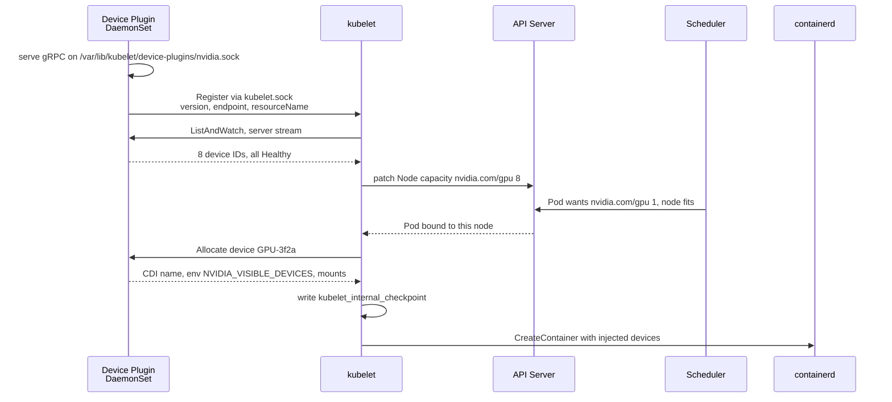
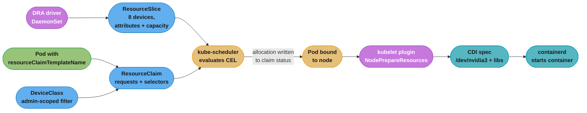

# DRA and Device Plugins (Cross-Cutting Primitive)

> A shared infrastructure primitive referenced by the ML platform / GPU case studies. How a GPU, an FPGA, a SmartNIC or an FPGA-backed accelerator actually becomes schedulable in Kubernetes — the device plugin gRPC contract that has carried accelerators since 2017, the wall that contract hits (`nvidia.com/gpu` is an opaque integer and nothing else), and Dynamic Resource Allocation, the API that replaces the integer with a typed device catalogue the scheduler can query. This is the layer directly under [`gpu_node_lifecycle.md`](./gpu_node_lifecycle.md): that file gets a node to the point where it advertises GPUs, this one explains what "advertises" means and what it costs you.

> **Version anchor (2026-08-27).** Kubernetes **v1.37 "Garhwal"** shipped 2026-08-26. **DRA core graduated to GA in v1.34** and the API group is **`resource.k8s.io/v1`** — `ResourceClaim`, `ResourceClaimTemplate`, `DeviceClass`, `ResourceSlice`. The `DynamicResourceAllocation` feature gate is **locked on since v1.35**. In v1.36 **prioritized list went Stable**, and **partitionable devices, device taints, device binding conditions, consumable capacity and extended-resource-backed-by-DRA all reached Beta, enabled by default**; **device taints and tolerations went GA in v1.37**. The **device plugin API is still `v1beta1`** (`k8s.io/kubelet/pkg/apis/deviceplugin/v1beta1`) and is **not deprecated** — the two models run side by side on the same node. NVIDIA's DRA driver now lives at **`kubernetes-sigs/dra-driver-nvidia-gpu`** (donated at KubeCon EU 2026), requires **Kubernetes 1.32+**, and officially supports **ComputeDomains for Multi-Node NVLink**; its **GPU-allocation kubelet plugin ships disabled by default**.

Read this alongside [`gpu_node_lifecycle.md`](./gpu_node_lifecycle.md) (what happens before a device is advertised), [`../../ml_platform_and_gpu_infrastructure/`](../../ml_platform_and_gpu_infrastructure/ml_platform_and_gpu_infrastructure.md) (the module), and [`../design_ml_platform_infrastructure.md`](../design_ml_platform_infrastructure.md) (the case study). For scheduler and kubelet mechanics see [`../../kubernetes_scheduling_and_autoscaling/`](../../kubernetes_scheduling_and_autoscaling/kubernetes_scheduling_and_autoscaling.md) and [`../../kubernetes_architecture/`](../../kubernetes_architecture/kubernetes_architecture.md).

---

## 1. Concept Overview

Kubernetes knows about two resources natively: CPU and memory. Everything else — a GPU, an InfiniBand HCA, a TPU, an FPGA, a hardware crypto module — is a **vendor problem**, and the kubelet exposes exactly two extension points for it.

**The device plugin** (2017, still `v1beta1`) is the old one. A DaemonSet on each node runs a gRPC server on a Unix socket under `/var/lib/kubelet/device-plugins/`, registers itself with the kubelet, and from then on streams a list of device IDs. The kubelet sums that list into a single number and publishes it as an **extended resource** on the Node object: `nvidia.com/gpu: 8`. A Pod asks for `nvidia.com/gpu: 1`. The scheduler does integer arithmetic — capacity minus allocated, does the request fit — and binds. The kubelet then calls the plugin's `Allocate` and the plugin replies with the device nodes, environment variables and mounts to inject into that container.

That model is small, stable, and completely blind. An extended resource is an **opaque non-negative integer**. It cannot say which GPU. It cannot say how much memory that GPU has, what its compute capability is, which PCIe root complex it hangs off, or whether two of them share an NVLink island. Every real question about heterogeneous hardware becomes a labelling exercise: you tag the node `nvidia.com/gpu.product=NVIDIA-H100-80GB-HBM3`, add a `nodeSelector`, and hope nobody mixes card types inside one node pool.

**Dynamic Resource Allocation (DRA)** replaces the integer with a catalogue. The vendor driver publishes a `ResourceSlice` per node listing every device by name, with typed **attributes** (product name, driver version, compute capability, NVLink domain) and typed **capacities** (memory as a `Quantity`). A workload writes a `ResourceClaim` — or, far more commonly, a `ResourceClaimTemplate` so each Pod gets its own — whose device requests carry **CEL selector expressions** evaluated against those attributes. The scheduler evaluates the CEL at **schedule time**, against the real catalogue, before it picks a node. It does not bind and then discover the hardware was wrong.

The two models coexist. A node can run the NVIDIA device plugin advertising `nvidia.com/gpu` *and* a DRA driver publishing `ResourceSlice`s, and in 2026 most production clusters do exactly that — device plugin for the ordinary "give me a GPU" case, DRA where the request has structure.

---

## 2. Intuition

> A device plugin is a **turnstile with a counter**. It tells the building "eight people can still come in" and nothing else — not which door, not which floor, not whether the person needs the freight elevator. DRA is the building's **room-booking system**: every room is listed with its size, its projector, and which corridor it shares, and you book by writing "a room with at least 40 seats on the same corridor as the one my colleague booked."

**Mental model.** The device plugin publishes a **scalar**; DRA publishes a **table**. Everything else follows from that one difference. A scalar supports one question — is there enough? A table supports selection, correlation between devices, per-device policy, and sharing. This is why "add a field to the device plugin API" was never the fix: there is nowhere in `nvidia.com/gpu: 8` to put a field.

**Why it matters.** Accelerator fleets are heterogeneous by the time they are two years old — A100s beside H100s beside H200s, some MIG-partitioned, some not. Under the scalar model every one of those distinctions has to be encoded as node labels and taints, which means the *node* becomes the unit of scheduling and a mixed-card node is unschedulable in practice. On hardware costing $2–$5 per GPU-hour, that rounding error is the whole cluster's utilisation.

**Key insight.** The device plugin decides *after* the scheduler has already committed to a node; DRA decides *with* the scheduler, before binding. The device plugin's `Allocate` call happens on a node the scheduler picked using only a count, so any constraint the count cannot express is discovered too late to be a scheduling input — it can only be a crash.

---

## 3. Core Principles

1. **An extended resource is an opaque integer, and that is deliberate.** The kubelet does not know what `nvidia.com/gpu` means; it sums what the plugin reports. Extended resources cannot be overcommitted — request must equal limit, and a Pod requesting one always lands in the Guaranteed-or-Burstable accounting with the device fully reserved. There is no fractional request, no unit, no attribute.
2. **The plugin owns the device, the kubelet owns the accounting.** `ListAndWatch` is a server-streaming RPC: the plugin pushes a new full list whenever a device changes health or disappears. The kubelet never polls hardware and never talks to a driver.
3. **Allocation state survives kubelet restarts through a checkpoint file, not through the plugin.** `/var/lib/kubelet/device-plugins/kubelet_internal_checkpoint` records which Pod/container holds which device IDs. That file, not the plugin, is the source of truth after a restart.
4. **In DRA the driver publishes, the scheduler decides, the kubelet plugin prepares.** Three separate roles, often three separate binaries in one DaemonSet: a controller writing `ResourceSlice`s, the upstream scheduler evaluating CEL, and a kubelet plugin implementing `NodePrepareResources`/`NodeUnprepareResources` that returns CDI device names to inject.
5. **CEL selectors are filters, never sorts.** A selector says which devices are *acceptable*. DRA does not yet implement scoring, so among acceptable devices the scheduler takes the first set that fits. If you need "prefer H100, accept A100", that is a `firstAvailable` prioritized list, not a cleverer CEL expression.
6. **Structured parameters mean the scheduler never calls the vendor.** Early DRA had the scheduler talk to a vendor controller for each claim, which put a third-party HTTP hop in the scheduling loop. Structured parameters moved everything the scheduler needs into the `ResourceSlice`, so allocation is pure computation over API objects — that is what made GA possible.
7. **Both models converge on CDI.** Container Device Interface JSON is what actually tells the runtime to bind-mount `/dev/nvidia0` and the driver libraries. Device plugin `Allocate` responses and DRA `NodePrepareResources` responses both end up as CDI device names handed to containerd.

---

## 4. The Two Models Side by Side

| | Device plugin (`v1beta1`) | DRA (`resource.k8s.io/v1`) |
|---|---|---|
| What the node advertises | `nvidia.com/gpu: 8` — one integer | `ResourceSlice` listing 8 named devices with attributes and capacities |
| Where selection happens | Scheduler does integer fit; plugin picks the actual device *after* binding | Scheduler picks the exact device *before* binding |
| Expressing "≥ 40 GB of GPU memory" | impossible — node labels + `nodeSelector` | `device.capacity["gpu.nvidia.com"].memory.compareTo(quantity("40Gi")) >= 0` |
| Expressing "two GPUs on the same NVLink island" | impossible | a `matchAttribute` constraint across two requests in one claim |
| Sharing one device between Pods | only by lying — time-slicing advertises N replicas of one card | `allowMultipleAllocations` + consumable capacity (Beta, v1.36) |
| Sharing one device between containers in a Pod | impossible — `Allocate` is per-container | one claim referenced by several containers' `resources.claims` |
| Dynamic partitioning (MIG) | pre-partitioned at node bring-up, static | partitionable devices via shared counters (Beta, v1.36) |
| Marking one bad card unschedulable | cordon the whole node | device taint on that device (GA, v1.37) |
| Failure shape | Pod binds, then crashes on the wrong hardware | Pod stays `Pending` with an unsatisfied claim |
| Blast radius of a restart | plugin restart re-registers; checkpoint holds allocations | driver restart re-publishes slices; claims are API objects |

**Where each fits.** The device plugin is right when every device in the pool is interchangeable and a Pod wants a whole one — a homogeneous inference fleet of identical L4s, an RDMA NIC per node. DRA earns its complexity the moment the request has *structure*: mixed card generations in one pool, topology that matters, MIG profiles chosen per workload, or one device shared under a policy.

---

## 5. Architecture Diagrams

Device plugin registration and allocation — note that `Allocate` fires *after* the scheduler has already bound the Pod to this node:


*The scheduler committed to this node knowing only the number 8. Everything the plugin returns — which card, what it can do — arrives one step too late to influence that decision.*

DRA turns the same flow inside out: the catalogue exists in the API before scheduling, so selection happens where the decision is made.


*The `ResourceSlice` is a normal API object written before any Pod exists. That is the whole trick: the scheduler reasons about devices the same way it reasons about nodes, with no vendor callback in the loop.*

Where each model's information lives, and what is lost:

```
DEVICE PLUGIN                          DRA
  Node.status.capacity                   ResourceSlice.spec.devices[]
  +---------------------------+          +-------------------------------------------+
  | nvidia.com/gpu:  8        |          | name: gpu-3                               |
  +---------------------------+          |   attributes:                             |
                                         |     productName: NVIDIA-H200              |
  everything below is GONE:              |     computeCapability: 9.0                |
    which of the 8                       |     nvlinkDomain: "island-a"              |
    how much memory                      |     driverVersion: 580.65.06              |
    which NUMA node                      |   capacity:                               |
    which NVLink island                  |     memory: 141Gi                         |
    MIG profile                          |   taints: [ecc-degraded:NoSchedule]        |
    health of THIS one                   +-------------------------------------------+
```
*Eight named rows with typed fields, versus one integer. Every "impossible" row in the section 4 table is a direct consequence of that collapse.*

---

## 6. How It Works — Detailed Mechanics

### 6.1 The device plugin gRPC contract

Two services. The kubelet serves `Registration` on `/var/lib/kubelet/device-plugins/kubelet.sock`; the plugin serves `DevicePlugin` on its own socket in the same directory.

```protobuf
service Registration {
  rpc Register(RegisterRequest) returns (Empty) {}
  // RegisterRequest: version ("v1beta1"), endpoint ("nvidia.sock"),
  //                  resource_name ("nvidia.com/gpu"), options
}

service DevicePlugin {
  rpc GetDevicePluginOptions(Empty) returns (DevicePluginOptions) {}
  rpc ListAndWatch(Empty) returns (stream ListAndWatchResponse) {}
  rpc Allocate(AllocateRequest) returns (AllocateResponse) {}
  rpc GetPreferredAllocation(PreferredAllocationRequest)
        returns (PreferredAllocationResponse) {}   // optional
  rpc PreStartContainer(PreStartContainerRequest)
        returns (PreStartContainerResponse) {}     // optional
}
```

`ListAndWatch` never returns. It pushes a complete `Device{ID, Health, Topology}` list on every change; `Health` is `"Healthy"` or `"Unhealthy"`, and an unhealthy device simply drops out of the node's allocatable count. `Allocate` receives the device IDs the kubelet chose and returns the mounts, device specs, environment variables and CDI device names to inject. `GetPreferredAllocation` is the only place the plugin gets to express topology preference — the kubelet asks "of these available IDs, which N would you rather I used", which is how the NVIDIA plugin keeps a 4-GPU request on one NVLink island. It is a *hint*: the kubelet is free to ignore it, and the scheduler never saw it at all.

### 6.2 Why the count is a wall

```yaml
# The entire vocabulary available to a Pod under the device plugin model.
resources:
  limits:
    nvidia.com/gpu: 2          # integer. request must equal limit. no unit, no attribute.
```

An extended resource is a `Quantity` constrained to non-negative integers, and Kubernetes forbids overcommitting it — `requests` is forced equal to `limits`. So:

- **"a GPU with at least 40 GB"** — no field exists. You label the node and use `nodeSelector`, which means a node with an 80 GB card and a 24 GB card is a node you cannot describe.
- **"two GPUs on the same NVLink island"** — the scheduler allocates a count; the plugin picks the pair afterwards and can only hint. Cross-island instead of NVLink is a **~7x** bandwidth loss on H100 (NVLink 4 at 900 GB/s per GPU bidirectional versus PCIe Gen5 x16 at 128 GB/s), and **~14x** on B200 (NVLink 5 at 1.8 TB/s). Nothing in the request could have prevented it.
- **"a MIG slice of this profile"** — expressible only by pre-partitioning the node and advertising a *different resource name* per profile (`nvidia.com/mig-3g.71gb`), which fixes the partition layout at node bring-up for every workload that lands there.
- **"share this card between two Pods"** — the device plugin's time-slicing config advertises `replicas: 4` of one physical GPU. Four Pods each believe they own a card; they contend for the same SMs and the same HBM with **no memory isolation and no fault isolation**. An OOM in one takes down all four.
- **"share one device across containers in a Pod"** — `Allocate` is called per container. There is no shape for it.

### 6.3 The DRA object graph

The driver publishes what exists:

```yaml
apiVersion: resource.k8s.io/v1
kind: ResourceSlice
metadata:
  name: gpu-node-17-gpu.nvidia.com
spec:
  driver: gpu.nvidia.com
  nodeName: gpu-node-17
  pool:
    name: gpu-node-17
    generation: 4
    resourceSliceCount: 1
  devices:
    - name: gpu-3
      attributes:
        productName:       { string: "NVIDIA H200" }
        computeCapability: { version: "9.0.0" }
        nvlinkDomain:      { string: "island-a" }
        migCapable:        { bool: true }
      capacity:
        memory: { value: "141Gi" }
```

`attributes` is a map of typed values — exactly one of `bool`, `int`, `string` or `version` per entry — and `capacity` values are `Quantity`. The hard limits are worth knowing before you design an attribute schema: **at most 32 attributes and capacities combined per device**, and **at most 128 devices per `ResourceSlice`, dropping to 64 if any device carries taints or consumes counters**. A driver with more devices than that splits across several slices in the same pool, which is what `resourceSliceCount` is for.

The admin publishes what is *permitted*:

```yaml
apiVersion: resource.k8s.io/v1
kind: DeviceClass
metadata:
  name: nvidia-gpu
spec:
  selectors:
    - cel:
        expression: device.driver == "gpu.nvidia.com"
```

A `DeviceClass` is cluster-scoped and its selectors are **inherited** by every request naming it. This is the access-control lever: install only classes whose selectors cover the hardware a tenant may touch, and a claim cannot reach past them.

The workload declares what it needs:

```yaml
apiVersion: resource.k8s.io/v1
kind: ResourceClaimTemplate
metadata:
  name: two-big-gpus
  namespace: training
spec:
  spec:
    devices:
      requests:
        - name: gpus
          exactly:
            deviceClassName: nvidia-gpu
            allocationMode: ExactCount      # or All. default ExactCount, default count 1
            count: 2
            selectors:
              - cel:
                  expression: |-
                    device.capacity["gpu.nvidia.com"].memory
                      .compareTo(quantity("80Gi")) >= 0 &&
                    device.attributes["gpu.nvidia.com"].computeCapability
                      .isGreaterThan(semver("9.0.0"))
      constraints:
        - requests: ["gpus"]
          matchAttribute: "gpu.nvidia.com/nvlinkDomain"
```

That `matchAttribute` constraint is the thing the device plugin model could not say at all: *whichever* two devices you pick, they must agree on `nvlinkDomain`. The Pod then references the template — note the flat fields, since the `source:` wrapper was tombstoned in Kubernetes 1.31:

```yaml
spec:
  resourceClaims:
    - name: gpu-pair
      resourceClaimTemplateName: two-big-gpus
  containers:
    - name: trainer
      resources:
        claims:
          - name: gpu-pair
```

A `ResourceClaimTemplate` mints one claim per Pod, garbage-collected with the Pod. A bare `ResourceClaim` is a long-lived object shared by whichever Pods reference it — right for a persistent inference server, wrong for Job pods, because a shared claim serialises them.

### 6.4 Prioritized fallback, taints, and partitioning

Three v1.36/v1.37 additions cover the operational cases that used to require a second scheduler.

**Prioritized list** (Stable, v1.36) replaces `exactly` with an ordered `firstAvailable` list of up to 8 subrequests. The scheduler tries them in order:

```yaml
requests:
  - name: accelerator
    firstAvailable:
      - name: prefer-h200
        deviceClassName: nvidia-gpu
        selectors: [{ cel: { expression: 'device.attributes["gpu.nvidia.com"].productName == "NVIDIA H200"' } }]
      - name: fallback-a100
        deviceClassName: nvidia-gpu
        count: 2      # two A100s instead of one H200
```

**Device taints** (GA, v1.37) let you fence one bad card instead of cordoning a $27/hour node. The driver adds a taint to that device in the `ResourceSlice`; claims need a matching toleration to be allocated it. A `NoExecute` taint added *after* allocation evicts every Pod consuming the claim — which is exactly the DCGM auto-fencing loop from [`gpu_node_lifecycle.md`](./gpu_node_lifecycle.md) §6.2, narrowed from node granularity to device granularity. A device may carry at most 16 taints, and any taints in a slice cut its device limit to 64.

**Partitionable devices** (Beta, v1.36) model MIG properly. The slice declares `sharedCounters` — the physical GPU's memory and SM budget — and each MIG-profile device declares what it `consumesCounters`. Allocating one `3g.71gb` device automatically makes every overlapping profile unallocatable, because the counters are gone. That is the difference between MIG-as-DRA and MIG-as-device-plugin: the layout is *derived* from what is claimed rather than frozen at bring-up.

The profiles themselves, for reference when writing a selector (max instances per GPU in brackets):

| GPU | Profiles |
|---|---|
| A100 80GB / H100 80GB SXM5 | `1g.10gb` (7), `1g.20gb` (4), `2g.20gb` (3), `3g.40gb` (2), `4g.40gb` (1), `7g.80gb` (1) |
| H200 141GB | `1g.18gb` (7), `1g.35gb` (4), `2g.35gb` (3), `3g.71gb` (2), `4g.71gb` (1), `7g.141gb` (1) |
| B200 180GB | `1g.23gb` (8), `1g.45gb` (4), `2g.45gb` (3), `3g.90gb` (2), `4g.90gb` (1), `7g.180gb` (1) |

**Consumable capacity** (Beta, v1.36) is the sanctioned form of sharing: a device sets `allowMultipleAllocations: true` and a `requestPolicy` on a capacity, and claims consume a slice of it. Unlike time-slicing, the scheduler knows the total and stops overselling it.

### 6.5 What the NVIDIA stack looks like in practice

Three components, and confusing them is the most common cause of a cluster where nothing schedules:

| Component | Ships | Role |
|---|---|---|
| **GPU Operator** | driver DaemonSet, container toolkit, DCGM exporter, MIG manager, node feature discovery | gets the node to the point where CUDA works at all — see [`gpu_node_lifecycle.md`](./gpu_node_lifecycle.md) |
| **NVIDIA device plugin** | `nvidia.com/gpu` extended resource, optional time-slicing and MPS config | the classic path, installed by the GPU Operator by default |
| **DRA driver** (`kubernetes-sigs/dra-driver-nvidia-gpu`) | `ResourceSlice` publisher + kubelet plugin, own Helm chart | the DRA path, requires Kubernetes 1.32+ |

The DRA driver is **not** part of the GPU Operator and is installed separately. Its **ComputeDomain** kubelet plugin — securely scoping Multi-Node NVLink across a GB200 rack — is what is officially supported today; the **GPU-allocation plugin ships disabled by default in the Helm chart**. So a realistic 2026 cluster runs the GPU Operator plus the device plugin for ordinary GPU requests, and adds the DRA driver where MNNVL or per-workload MIG is the point. Plan for both, not a migration.

---

## 7. Real-World Examples

- **NVIDIA GB200 NVL72 racks** are the reason ComputeDomains exist: 72 GPUs in one NVLink domain, where "which island" is not a performance detail but a correctness boundary for the IMEX daemons that set up cross-node memory. There is no integer that expresses it.
- **GKE** exposes GPU time-sharing and MIG through its own node-pool configuration on top of the device plugin, and has been shipping DRA-based accelerator flows since the API stabilised — the managed platforms adopted DRA before most self-managed clusters did.
- **AKS** documented MIG-with-DRA in March 2026, which is the clearest published example of the partitionable-devices model replacing statically-partitioned node pools.
- **OpenShift** shipped DRA as GA in 4.21 (March 2026), which matters because it is the point where DRA stopped being a thing you enable and became the thing you get.
- **HAMi**, the CNCF GPU-sharing project, has "complete DRA standard adaptation" on its 2026 roadmap — the sharing projects that grew up working around the device plugin's limits are converging on DRA's consumable capacity instead of maintaining their own scheduler.

---

## 8. Tradeoffs

| Decision | Device plugin | DRA | Guidance |
|---|---|---|---|
| Operational surface | one DaemonSet, one integer | driver + CRDs + CEL + scheduler interaction | Stay on the plugin while every device is interchangeable |
| Debuggability | `kubectl describe node` shows the number | `kubectl get resourceslices` plus reading a CEL expression | Plugin failures are louder; DRA failures are more precise |
| Failure timing | binds, then crashes on wrong hardware | stays `Pending` with an unsatisfied claim | Pending is strictly better than CrashLoopBackOff, and strictly harder to alert on |
| Heterogeneous pools | node labels + `nodeSelector`, node is the unit | device is the unit | Mixed-generation fleets are the break-even point |
| Sharing | time-slicing, no isolation | consumable capacity, scheduler-aware | Never time-slice anything with a latency SLO |
| Ecosystem maturity | a decade of vendor plugins | vendor coverage still a fraction of it | Check your specific vendor before committing |

| Time-slicing | MIG | MPS |
|---|---|---|
| Context-switches the whole GPU | Hardware-partitioned SMs and HBM | Shared context, concurrent kernels |
| No memory or fault isolation | Full memory and fault isolation | Memory isolation only from Volta MPS onward |
| Any GPU | A100 and later, data-centre parts | Any GPU |
| Right for dev boxes and bursty notebooks | Right for multi-tenant inference | Right for cooperative small kernels from one tenant |

---

## 9. When to Use / When NOT to Use

**Reach for DRA when:**
- The pool is heterogeneous and a Pod genuinely needs *this kind* of card, not *a* card.
- Topology decides throughput — multi-GPU training where NVLink adjacency is a 7–14x bandwidth difference, or GPU/NIC NUMA pairing.
- MIG layout should follow the workload rather than being frozen when the node boots.
- One expensive device must be shared under a policy the scheduler can enforce.
- You need to fence a single degraded card without cordoning a whole eight-GPU node.

**Stay on the device plugin when:**
- Every device in the pool is identical and Pods want whole ones. The integer is genuinely sufficient and the plugin is a decade more battle-tested.
- Your vendor has no DRA driver, or has one whose allocation path ships disabled — which as of 2026-08 includes NVIDIA's GPU allocation plugin.
- The cluster is below Kubernetes 1.32, or you run a managed control plane that has not exposed the API.
- The team's operational vocabulary is `kubectl describe node`. DRA moves debugging into CEL and CRDs, and that is a real cost on a small team.

**Do not** run both models over the same devices without a plan. Two allocators over one physical GPU will both hand it out, and neither will notice.

---

## 10. Common Pitfalls

**Pitfall 1: deleting the device plugin DaemonSet while Pods hold devices.**

```yaml
# BROKEN: someone "cleans up" the plugin during an upgrade.
# The kubelet loses the ListAndWatch stream, so allocatable nvidia.com/gpu -> 0.
# But the running Pods keep their devices: kubelet_internal_checkpoint still
# records the allocation, and containerd never revoked the device nodes.
# Node now reports 0 GPUs while 8 are in use. The autoscaler reads 0 GPUs and
# a fully-utilised node as "empty of GPU work" and considers it for
# consolidation -- and the replacement node schedules nothing either.
```

```yaml
# FIX: treat the plugin as node-critical infrastructure, not an add-on.
spec:
  template:
    spec:
      priorityClassName: system-node-critical
      tolerations:
        - { key: nvidia.com/gpu, operator: Exists, effect: NoSchedule }
      containers:
        - name: nvidia-device-plugin
          volumeMounts:
            - { name: device-plugin, mountPath: /var/lib/kubelet/device-plugins }
```
Upgrade the plugin in place with a rolling update; never scale it to zero on a node with running GPU Pods.

**Pitfall 2: the checkpoint file fails to restore and the node lies.** If `kubelet_internal_checkpoint` cannot be read at kubelet start — disk full during the write, a corrupted file, an upgrade that changed its shape — the kubelet logs a warning, continues, and leaves the device manager's maps **empty**. It does **not** drop allocatable capacity to zero. The scheduler keeps sending GPU Pods to a node whose device manager will admit them without allocating anything, and they start with no `/dev/nvidia*` at all. Alert on `failed to write deviceplugin checkpoint` and on the node's allocatable GPU count diverging from the DCGM-reported device count; the recovery is to drain the node and restart the kubelet with the stale checkpoint removed.

**Pitfall 3: node reboot ordering.** The chain is driver → container toolkit (containerd config) → device plugin → DCGM. If the plugin's DaemonSet starts before the toolkit has rewritten `/etc/containerd/config.toml`, `Allocate` returns device nodes containerd cannot inject, and Pods fail with `failed to create shim`. The GPU Operator sequences this with node labels and validator pods; if you assemble the stack by hand, gate the plugin on a driver-ready label rather than on the node being `Ready`.

**Pitfall 4: a `ResourceClaim` stuck `Pending` because nothing matches.** The symptom is a Pod with `status.conditions` naming an unsatisfied claim and no scheduler event explaining why. Debug in this order: `kubectl get resourceslices` (does the driver publish anything on any node?), then `kubectl describe resourceslice` (are the attribute names spelled the way your CEL expects?), then the CEL itself. The trap is that **a typo in an attribute domain is not an error** — `device.attributes["gpu.nvida.com"].productName` evaluates to no match, silently, forever. Test a selector against a real slice before shipping it.

**Pitfall 5: topology and NUMA misalignment.** A GPU on socket 0 paired with the NIC on socket 1 pushes every RDMA transfer across the inter-socket link instead of a PCIe peer-to-peer path, and the job simply runs slower with nothing in the logs. Under the device plugin the only lever is the kubelet's Topology Manager with `--topology-manager-policy=single-numa-node`, which makes the *kubelet* reject a misaligned admission — it turns a silent slowdown into a `TopologyAffinityError`, which is better but is still a post-binding failure. Under DRA the NUMA node is an attribute and a `matchAttribute` constraint makes it a scheduling input.

**Pitfall 6: assuming time-slicing is isolation.** `replicas: 4` in the device plugin's config advertises four `nvidia.com/gpu` for one physical card. Four Pods land, all four allocate GPU memory from the same 80 GB, and the first one to over-allocate takes the other three down with a CUDA OOM they did not cause. It is a fair scheduler for cooperating dev workloads and a shared-fate accident for anything with an SLO. Use MIG for hard isolation, or DRA consumable capacity for sharing the scheduler actually accounts for.

**Pitfall 7: writing a CEL selector as if it sorted.** `device.capacity[...].memory.compareTo(quantity("40Gi")) >= 0` returns *every* card with at least 40 GB, and the scheduler takes the first fitting set — quite possibly the 141 GB H200 you were saving for the model that needs it. Selectors filter. If you mean preference, use `firstAvailable`; if you mean exclusivity, use a `DeviceClass` the other tenants cannot reference.

---

## 11. Technologies & Tools

| Tool | Model | Notes |
|---|---|---|
| `k8s-device-plugin` (NVIDIA) | device plugin | advertises `nvidia.com/gpu`; time-slicing and MPS config; installed by the GPU Operator |
| `kubernetes-sigs/dra-driver-nvidia-gpu` | DRA | ComputeDomains for MNNVL supported; GPU allocation plugin disabled by default; Kubernetes 1.32+ |
| NVIDIA GPU Operator | neither | driver, toolkit, DCGM, MIG manager — the layer beneath both models |
| `nvidia-mig-parted` / MIG manager | device plugin | applies a static MIG layout at node bring-up |
| CDI (Container Device Interface) | both | the JSON both models emit to tell containerd what to inject |
| Topology Manager (kubelet) | device plugin | `single-numa-node` policy; the only NUMA lever without DRA |
| DCGM + dcgm-exporter | both | device health; the signal that drives a device taint |
| `kubectl get resourceslices` | DRA | the first command in any DRA debugging session |
| Kueue / Volcano | both | gang scheduling on top; a multi-worker job needs all claims satisfied together |
| HAMi | device plugin | GPU sharing with memory limits; converging on DRA per its 2026 roadmap |

---

## 12. Interview Questions with Answers

**Q: Why does DRA exist at all when the device plugin already works?**
Because an extended resource is an opaque non-negative integer and there is nowhere in `nvidia.com/gpu: 8` to put anything else. Every question that matters about heterogeneous hardware — how much memory, which generation, which NVLink island, which MIG profile, is this specific card degraded — has no field. The workarounds all push the distinction up to the node (labels plus `nodeSelector`, one node pool per card type), which means the node becomes the unit of scheduling and a mixed-card node is unschedulable in practice. DRA replaces the integer with a `ResourceSlice` catalogue of named devices carrying typed attributes and capacities, and lets the request carry a CEL expression the scheduler evaluates before binding. The design point is not "more features" — it is moving the decision from after binding to during scheduling.

**Q: Walk through what actually happens when a Pod requests `nvidia.com/gpu: 1`.**
The device plugin DaemonSet has already registered with the kubelet over `/var/lib/kubelet/device-plugins/kubelet.sock` and is streaming `ListAndWatch` responses; the kubelet sums the healthy device IDs and patches `nvidia.com/gpu: 8` onto the Node. The scheduler does integer arithmetic — capacity minus allocated — finds a node that fits, and binds. Only then does the kubelet call the plugin's `Allocate` with the device IDs it chose, and the plugin returns the CDI device names, environment variables and mounts to inject. The kubelet writes the assignment to `kubelet_internal_checkpoint` and asks containerd to create the container. The critical ordering is that `Allocate` happens *after* binding: anything the plugin knows about the specific card was never available to the scheduler, so any mismatch surfaces as a crash rather than as a scheduling decision.

**Q: What is the `kubelet_internal_checkpoint` file and what breaks when it does?**
It is `/var/lib/kubelet/device-plugins/kubelet_internal_checkpoint`, the kubelet's record of which Pod and container holds which device IDs, plus the registered device list. It exists because the kubelet must survive a restart without double-allocating a device to a second Pod while the first is still running — the plugin cannot tell it, so the file does. The dangerous failure is that if the file cannot be restored the kubelet **warns and continues** with empty device-manager maps rather than dropping allocatable capacity to zero; the node keeps advertising GPUs, the scheduler keeps sending Pods, and they are admitted with no device actually allocated. Alert on checkpoint write failures and on divergence between allocatable GPU count and the DCGM-observed device count, and recover by draining and restarting the kubelet with the stale checkpoint removed.

**Q: A Pod using DRA is stuck `Pending`. How do you debug it?**
Work down the object graph rather than at the Pod. First `kubectl get resourceslices` — if the driver is publishing nothing, the problem is the DaemonSet, not the claim. Then describe a slice and read the actual attribute names and capacity keys, because the most common cause is that the CEL selector names an attribute domain that does not exist, and **a domain typo is not an error** — the expression simply never matches, silently and permanently. Then check the `DeviceClass` the request names, since its selectors are inherited and can be narrower than the claim's author expected. Then check whether the devices exist but are already allocated, or carry a taint the request does not tolerate. The Pod's `status.conditions` will name the unsatisfied claim but will not explain it, so the explanation always comes from the slice and the selector.

**Q: How would you express "two GPUs on the same NVLink island" under each model?**
Under the device plugin you cannot, and that is the point. The scheduler allocates a count; the plugin picks the actual pair afterwards and can only express a preference through the optional `GetPreferredAllocation` hint, which the kubelet may ignore and the scheduler never saw. Getting it wrong costs about 7x on H100 — NVLink 4 at 900 GB/s per GPU bidirectional against PCIe Gen5 x16 at 128 GB/s — and about 14x on B200 at 1.8 TB/s. Under DRA you write one request with `count: 2` plus a claim-level constraint `matchAttribute: "gpu.nvidia.com/nvlinkDomain"`, which says: whichever two devices you choose, they must agree on that attribute. The scheduler enforces it before binding, so the failure mode becomes an unschedulable Pod instead of a job that quietly runs at a seventh of its throughput.

**Q: The device plugin supports GPU time-slicing. Why is that not the same as sharing?**
Time-slicing works by lying to Kubernetes: `replicas: 4` in the plugin's config advertises four `nvidia.com/gpu` for one physical card, so four Pods bind believing they each own one. They then contend for the same SMs and the same HBM with no memory isolation and no fault isolation — the first Pod to over-allocate triggers a CUDA OOM that takes down all four, and none of them caused it. It is acceptable for cooperating development workloads and unacceptable for anything with a latency SLO. Hard isolation needs MIG, which partitions SMs and memory in hardware; scheduler-accounted sharing needs DRA's consumable capacity, where the device declares `allowMultipleAllocations` with a request policy and the scheduler knows the total it is dividing. The distinction to hold onto is that time-slicing oversells a resource the scheduler thinks is exclusive.

**Q: What are structured parameters and why did DRA need them to reach GA?**
Structured parameters mean everything the scheduler needs to allocate a device lives in ordinary API objects — the `ResourceSlice`'s typed attributes and capacities — so allocation is pure computation the scheduler performs itself. The earlier design had the scheduler call out to a vendor controller for each claim, which put third-party code, and a network round trip, inside the scheduling loop; that is unacceptable for a GA feature because a slow or wedged vendor controller stalls scheduling cluster-wide, and because it makes the scheduler's behaviour unreproducible. Moving to structured parameters also enabled the Cluster Autoscaler to simulate DRA allocations, since it can evaluate the same CEL against the same objects without calling anyone. The general lesson is that Kubernetes graduates extension points that keep third-party logic out of the critical path.

**Q: How does DRA model MIG better than the device plugin does?**
Under the device plugin, MIG is static: `nvidia-mig-parted` applies a layout at node bring-up and the plugin advertises a distinct extended resource per profile, such as `nvidia.com/mig-3g.71gb`. The partition is frozen before any workload arrives, so changing it means draining the node, and a node partitioned for small inference slices cannot serve a job that wants a whole card. DRA's partitionable devices (Beta since v1.36) declare `sharedCounters` on the slice — the physical GPU's memory and SM budget — and each profile device declares what it `consumesCounters`; allocating one `3g.71gb` on an H200 makes every overlapping profile unallocatable because the counters are spent. The layout is derived from what is claimed instead of decided in advance, which is the difference between advertising a partition and modelling one.

**Q: Are device plugins deprecated?**
No. The device plugin API is still `v1beta1` in `k8s.io/kubelet/pkg/apis/deviceplugin`, it is supported, and both models run side by side on the same node — a cluster can advertise `nvidia.com/gpu` through the plugin while a DRA driver publishes `ResourceSlice`s for the same hardware. The direction of travel is clear and the vendors are moving, but the practical position in 2026 is that DRA's vendor coverage is still a fraction of the device plugin's, and NVIDIA's own DRA driver ships its GPU-allocation plugin disabled by default while its ComputeDomain plugin is the supported path. Plan for coexistence rather than a migration date, and never point both allocators at the same physical devices — they will each hand them out and neither will notice.

**Q: What is a `DeviceClass` for, if the claim already carries selectors?**
It is the admin-scoped half of the contract and it is how DRA does access control. A `DeviceClass` is cluster-scoped, and its selectors are **inherited** by every request that names it — a claim can only narrow what the class already permits, never widen it. So an administrator installs classes matching the hardware a tenant may touch and grants access to those class names; a tenant writing a claim cannot reach devices no installed class covers. It is also the natural place for driver-specific configuration that should apply to every claim of that kind, since a class carries `config` entries the driver receives. Practically, treat classes as the policy layer and claims as the request layer.

**Q: What does the kubelet's Topology Manager give you, and why is it not enough?**
`--topology-manager-policy=single-numa-node` makes the kubelet reject a Pod at admission if the devices, CPUs and memory it would get cannot all come from one NUMA node. That converts the silent failure — a GPU on socket 0 driving a NIC on socket 1, so every RDMA transfer crosses the inter-socket link and the job just runs slower with nothing in the logs — into a visible `TopologyAffinityError`. It is not enough because it fires *after* the scheduler bound the Pod: the scheduler never knew about NUMA, so the Pod bounces from node to node collecting admission failures rather than being placed correctly the first time. Under DRA the NUMA node is a device attribute and a `matchAttribute` constraint makes alignment a scheduling input, which is the difference between rejecting bad placements and not making them.

**Q: What happens if the device plugin DaemonSet is deleted while GPU Pods are running?**
The kubelet loses the `ListAndWatch` stream and drops the node's allocatable `nvidia.com/gpu` to zero, but the running Pods keep their devices — the checkpoint still records the allocation and containerd never revoked the device nodes. So the node reports zero GPUs while eight are in use, which confuses everything downstream: the autoscaler reads a node with no GPU capacity and no GPU-consuming workload it can see, and considers consolidating a fully-busy $27/hour machine. The fix is treating the plugin as node-critical infrastructure — `priorityClassName: system-node-critical`, a toleration for the GPU taint, rolling updates only, never scaled to zero on a node with running GPU Pods. The general shape is worth remembering: in Kubernetes, capacity reporting and actual resource possession are separate mechanisms, and they can disagree.

**Q: What are device taints and what problem do they solve that node taints do not?**
Device taints (GA in v1.37) attach a taint to one device inside a `ResourceSlice`, and a claim needs a matching toleration to be allocated it; a `NoExecute` taint added after allocation evicts every Pod consuming that claim. The problem they solve is granularity. Before them, one card throwing uncorrectable ECC errors meant cordoning the entire node — on an eight-GPU box you fence seven healthy GPUs to isolate one bad one, which on an A100 node is roughly $24/hour of working hardware taken out of service. With device taints the DCGM-driven fencing loop narrows to the failing device and the other seven keep serving. The operational limits to know: at most 16 taints per device, and any taints in a slice cut its maximum device count from 128 to 64.

**Q: A CEL selector matches more devices than you wanted and the scheduler picks the wrong one. What went wrong?**
The selector was written as if it sorted. CEL selectors are pure filters — `device.capacity["gpu.nvidia.com"].memory.compareTo(quantity("40Gi")) >= 0` returns every card with at least 40 GB, and since DRA does not implement scoring, the scheduler takes the first acceptable set it finds. That may well be the 141 GB H200 you were reserving for the model that actually needs it. The fixes are structural rather than expressional: use `firstAvailable` to state an ordered preference (prefer an H200, fall back to two A100s), or use a `DeviceClass` the other tenants cannot reference to make the reservation an access-control fact rather than a hope. Anything that reads as "prefer" or "best" cannot be expressed as a selector.

**Q: How do the two models actually get the device into the container?**
Both converge on CDI, the Container Device Interface. Under the device plugin, `Allocate` returns some combination of device specs, mounts, environment variables and CDI device names, and the kubelet passes them to containerd. Under DRA, the driver's kubelet plugin implements `NodePrepareResources`, which returns CDI device names for the allocated devices, and `NodeUnprepareResources` to tear them down. In both cases CDI JSON is what tells the runtime to bind-mount `/dev/nvidia3`, the driver libraries and `nvidia-smi` into the container's namespace. That shared bottom layer is why the container's view is identical either way — the difference between the models is entirely in who decided *which* device, and when.

**Q: What are the sizing limits on a `ResourceSlice` and why should you care before designing an attribute schema?**
A device may carry at most 32 attributes and capacities combined, a `ResourceSlice` at most 128 devices — dropping to 64 if any device carries taints or consumes counters — and a device at most 16 taints. You care because these interact with MIG: a node whose GPUs are partitioned into many small profiles multiplies its device count fast, and adding taints for health fencing halves the ceiling at the same time. A driver that exceeds the limit must split across several slices in the same pool, coordinated through `pool.resourceSliceCount` and `pool.generation`, which is more moving parts during a driver restart. Design the attribute set for what selectors actually need to filter on rather than exporting everything `nvidia-smi` knows.

---

## 13. Best Practices

- **Run the device plugin as `system-node-critical`** with a toleration for the GPU taint, and never scale it to zero on a node holding GPU Pods.
- **Alert on capacity divergence** — allocatable `nvidia.com/gpu` versus the DCGM-observed device count. That single check catches a failed checkpoint restore, a wedged plugin, and a half-finished driver upgrade.
- **Gate the plugin on driver readiness**, not on the node being `Ready`; the toolkit must have rewritten the containerd config before `Allocate` can return anything usable.
- **Use `ResourceClaimTemplate`, not bare `ResourceClaim`, for Job and batch Pods** — a shared claim serialises everything that references it.
- **Test every CEL selector against a real `ResourceSlice`** before shipping it. An attribute-domain typo matches nothing, silently and permanently.
- **Use `DeviceClass` as the policy boundary.** Install only classes covering hardware a tenant may reach, and grant access by class name.
- **Express preference with `firstAvailable`, never with a cleverer selector** — DRA does not score, so a filter that matches more is a filter that picks worse.
- **Never time-slice anything with a latency SLO.** MIG for hard isolation, consumable capacity for accounted sharing.
- **Fence at device granularity once you are on v1.37** — a device taint keeps seven good GPUs earning while one bad one is isolated.
- **Do not point both allocators at the same devices.** Pick one per device pool and label the pools so it is obvious which is which.

---

## 14. Summary

The device plugin and DRA answer the same question — how does a non-CPU device become schedulable — and differ in exactly one place: what the node publishes. A plugin publishes an integer, so the scheduler can only ask "does it fit", and every richer question is deferred to an `Allocate` call that happens *after* binding, where the only available response to a mismatch is a crash. DRA publishes a typed catalogue, so selection, correlation between devices, per-device taints and accounted sharing all become scheduling inputs. Everything else follows: `nodeSelector`-per-card-type versus CEL selectors, cordoning a node versus tainting a card, time-slicing's shared-fate OOM versus consumable capacity the scheduler tracks, a MIG layout frozen at bring-up versus one derived from what is claimed.

In practice, 2026 clusters run both. The GPU Operator gets CUDA working, the device plugin serves ordinary "give me a GPU" requests, and a DRA driver handles the cases with structure — Multi-Node NVLink, per-workload MIG, mixed-generation pools. Know both contracts, keep the plugin node-critical, alert on the capacity divergence that reveals when the node is lying about what it has, and reach for DRA the day the request stops being a number.

**See also:** [`gpu_node_lifecycle.md`](./gpu_node_lifecycle.md) · [`kubernetes_production_hardening.md`](./kubernetes_production_hardening.md) · [`../design_ml_platform_infrastructure.md`](../design_ml_platform_infrastructure.md) · [`../../ml_platform_and_gpu_infrastructure/`](../../ml_platform_and_gpu_infrastructure/ml_platform_and_gpu_infrastructure.md) · [`../../kubernetes_scheduling_and_autoscaling/`](../../kubernetes_scheduling_and_autoscaling/kubernetes_scheduling_and_autoscaling.md) · [`../../kubernetes_architecture/`](../../kubernetes_architecture/kubernetes_architecture.md) · [`../../kubernetes_operators_and_crds/`](../../kubernetes_operators_and_crds/kubernetes_operators_and_crds.md) · [`../../container_runtimes_and_oci/`](../../container_runtimes_and_oci/container_runtimes_and_oci.md)
