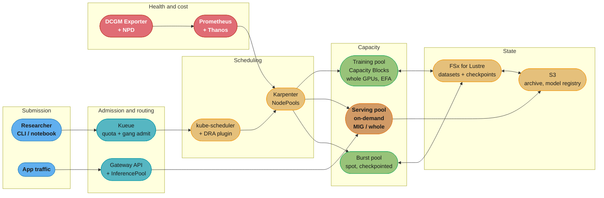

# Design a GPU Training and Inference Cluster

> **Version anchor (2026-08-27).** Kubernetes **DRA is GA (1.34)** with its feature gate **locked on in 1.35**, API group `resource.k8s.io/v1`; **partitionable devices / consumable capacity are not GA**, and the `ResourceSlice` schema changed incompatibly between 1.34 and 1.35. Kubernetes **1.35 introduced a native `Workload` API for gang scheduling** — **alpha, disabled by default**, `scheduling.k8s.io/v1alpha1`, gate `GenericWorkload`. **Kueue v0.19.x** (a Kubernetes SIG subproject) and **Volcano ~1.14** (CNCF **Incubating**) are the production gang schedulers today. **Karpenter 1.14**, **NVIDIA GPU Operator v26.7** (DCGM 4.6.0-1, device plugin v0.20.0), **NCCL 2.27.7**, **vLLM ~0.28**, **KServe 0.18** (CNCF Incubating since 2025-09-29). **Gateway API Inference Extension v1.6.0**: `InferencePool` is **v1/stable** at `inference.networking.k8s.io/v1`, while `InferenceObjective`, `InferenceModelRewrite` and `EndpointPickerConfig` were **removed in v1.6.0 and migrated to `llm-d`** (they were `v1alpha2`/`v1alpha1`, never v1) — and, separately, the full EPP, Body-Based Routing and latency-predictor *implementations* also moved to `llm-d`, leaving a lightweight reference EPP for conformance. Those are two distinct migrations; do not conflate them.
>
> **On prices.** This document deliberately contains **no dollar figures**. AWS's EC2 pricing page renders its tables dynamically and no on-demand hourly rate for any P5/P6 instance could be pulled from a primary AWS source at the time of writing. Every cost argument below is therefore expressed in **GPU-hours**, **ratios**, and **tokens per GPU-second** — units you can multiply by whatever your account actually pays. Read the live pricing page or your own Cost Explorer for the multiplier; do not inherit a number from a document.

---

## Intuition

A GPU cluster looks like one system and is two, and almost every failure in this design comes from treating it as one.

**Training is a gang.** A 512-GPU job is not 512 independent placements — it is one placement of 512 GPUs that must all start together, be topologically close together, and die together. Give it 511 and you have not given it 99.8% of a job; you have given it zero, plus 511 GPUs held hostage while the scheduler looks for the last one. Its failure mode is *deadlock*, and its cost metric is model-FLOPs utilisation over days.

**Inference is a queue.** Requests arrive independently, each one wants a slice of a GPU for milliseconds, and the system's job is to keep the queue short without keeping too many GPUs warm. Its failure mode is *latency*, and its cost metric is tokens per GPU-second.

The two want opposite things from every layer beneath them. Training wants NVLink-adjacent whole cards, long uninterrupted holds, and tolerates preemption because it checkpoints. Inference wants fractional cards, instant elasticity, and cannot tolerate preemption at all. Training scales by adding a gang; inference scales by adding a replica. A scheduler tuned for one starves the other.

So the design question is not "how do I run GPUs on Kubernetes". It is: **how do I run two workloads with opposite scheduling semantics on one expensive, failure-prone, capacity-constrained pool of hardware, without either one making the other's problem worse?**

Three facts shape every answer:

1. **The hardware fails, visibly and often.** GPUs throw XID errors, ECC errors go from correctable to uncontained, NVLink degrades, and a node stays `Ready` through all of it. Kubernetes' health model does not know what a GPU is.
2. **Capacity is not elastic.** You cannot autoscale into a GPU family that has no capacity in your region. Capacity Blocks and long-term commitments exist because the on-demand pool for current-generation accelerators is not something you can rely on at 3am.
3. **Idle GPU time is the entire cost story.** A cluster at 30% utilisation costs the same as one at 90% and delivers a third as much. Every design decision here is ultimately about the denominator.

Per-team GPU quotas, queues, and gang scheduling are covered in [GPU Cluster Scheduling and Quotas](../../mlops/gpu_cluster_scheduling_and_quotas/gpu_cluster_scheduling_and_quotas.md).

---

## 1. Requirements Clarification

### Functional

| # | Requirement | Detail |
|---|---|---|
| F1 | Multi-node distributed training | Jobs from 8 to 512 GPUs, all-or-nothing admission, topology-aware placement inside an NVLink domain where possible |
| F2 | Fine-tuning and experimentation | Short jobs (1-8 GPUs), high submission rate, must not queue behind a 14-day pretraining run |
| F3 | LLM inference serving | Multiple models, continuous batching, request-level autoscaling, per-model SLOs |
| F4 | Classical model serving | Small models that should share a card rather than own one |
| F5 | Multi-tenancy | 12 teams, per-team quota, borrowing of idle quota, preemption when the owner returns |
| F6 | Checkpoint and resume | A training job survives node loss with bounded lost work |
| F7 | Self-service | A researcher submits a job without opening a ticket or knowing what a `ResourceClaim` is |
| F8 | Model and image distribution | Weights and container images reach a new node fast enough that scale-out is useful |

### Non-functional

| # | Requirement | Target | Why this number |
|---|---|---|---|
| N1 | Training GPU utilisation (DCGM SM occupancy, not allocation) | > 60% fleet-wide | allocation-based dashboards routinely read 100% while SMs idle at single digits |
| N2 | Inference p99 time-to-first-token | < 500 ms for interactive models | above this, streaming stops feeling interactive |
| N3 | Inference p99 inter-token latency | < 60 ms | roughly 16 tokens/s, faster than comfortable reading |
| N4 | Time from GPU fault detection to workload rescheduled | < 5 min | a silently-failing node poisons every gang that lands on it |
| N5 | Maximum lost training work on node failure | < 20 min | sets the checkpoint interval, which sets the storage throughput requirement |
| N6 | Gang admission latency for an available 64-GPU job | < 60 s | above this, researchers batch submissions and utilisation gets spiky |
| N7 | Cold start for a scaled-to-zero inference endpoint | < 90 s | dominated by weight loading, which sets the storage and image strategy |
| N8 | Control-plane availability | independent of GPU pool health | a GPU incident must not take down the API server |

### Explicitly out of scope

- Model architecture, training recipes, hyperparameters, evaluation quality. This is infrastructure.
- Data labelling, feature engineering and the feature store. See [`../../ml/case_studies/cross_cutting/feature_store_and_point_in_time_correctness.md`](../../ml/case_studies/cross_cutting/feature_store_and_point_in_time_correctness.md).
- The LLM application layer — RAG, agents, prompt management.
- On-premises hardware procurement. This design is AWS-primary, and the patterns transfer.

### The questions to ask before designing anything

1. **What is the largest single job?** 8 GPUs and 512 GPUs are different clusters. Below one node, you need no gang scheduling and no EFA; above one NVLink domain, network topology becomes the dominant design constraint.
2. **Is inference latency-critical or throughput-critical?** Batch scoring can share a pool with training. Interactive serving cannot.
3. **What is the tolerance for preemption?** This decides the spot/Capacity Block/on-demand mix, and it decides it per workload class, not per cluster.
4. **How heterogeneous is the fleet?** A single GPU SKU can be counted with integers. Three generations with different memory and interconnect cannot — that is what DRA exists for.
5. **Who pays?** Chargeback design determines whether teams hoard reservations, and hoarding is the single largest source of low utilisation.

---

## 2. Scale Estimation

Concrete numbers for a mid-sized platform: 12 teams, one 70B-class model in continuous pretraining, a steady stream of fine-tunes, and production inference for four models.

### Training capacity

```
Pretraining run:     512 GPUs x 24 h/day x 14 days = 172,032 GPU-hours
Fine-tuning:         ~40 jobs/week x 8 GPUs x 6 h  = 1,920 GPU-hours/week
Experimentation:     ~200 jobs/week x 1-2 GPUs x 1 h ~ 300 GPU-hours/week

Steady-state training floor: 512 GPUs (the pretrain) + ~64 GPUs of burst.
```

At 8 GPUs per `p5.48xlarge` (H100) or `p6-b200.48xlarge` (B200), 512 GPUs is **64 instances**. That number matters: EC2 Capacity Blocks for ML support cluster sizes of **1 to 64 instances**, so a 512-GPU H100 reservation is exactly at the ceiling, and 1,024 GPUs means two Capacity Blocks with no guarantee they are topologically adjacent.

### Interconnect

```
Per-instance EFA:      up to 3,200 Gbps on p5/p5en/p6-b200 = 400 GB/s
NVLink per GPU:        H100  900 GB/s bidirectional
                       B200  1.8 TB/s bidirectional
Ratio, intra-node : inter-node   roughly 2:1 on H100, 4.5:1 on B200

=> An all-reduce that stays inside one node is dramatically cheaper than
   one that crosses the fabric, and the gap widened with Blackwell.
   This is why topology-aware placement is not an optimisation.
```

A `p6e-GB200` UltraServer puts **72 GPUs in a single NVLink domain** with 13.4 TB of HBM3e and up to 28.8 Tbps of EFAv4 — which changes the calculus entirely for jobs that fit inside 72 GPUs, because they never touch the slower fabric at all.

### Model and KV-cache memory (arithmetic, not a benchmark)

For a 70B-parameter model at bf16:

```
Weights:            70e9 params x 2 bytes            = 140 GB
                    -> does not fit one 80 GB H100; needs >= 2 GPUs
                    -> fits one B200 (180 GB) with room for KV cache

KV cache per token, GQA with 80 layers, 8 KV heads, head_dim 128:
   2 (K and V) x 80 x 8 x 128 x 2 bytes = 327,680 bytes = 320 KiB/token

At 8,000 tokens of context:   327,680 B x 8,000  = 2.6 GB per sequence
On an 8x H100 node (640 GB), weights sharded across 8:
   640 - 140 = 500 GB free, minus ~15% framework overhead ~ 425 GB
   425 GB / 2.6 GB ~ 165 concurrent 8k-token sequences
```

That last line is the number an inference platform is actually built around: **concurrency is memory-bound, not compute-bound**, and the KV cache is what runs out. It is also why `vllm:kv_cache_usage_perc` is the right autoscaling signal — it is a direct measure of how close you are to the wall.

### Checkpoint and storage

```
Adam mixed-precision optimiser state, per parameter:
   4 B fp32 master + 4 B momentum + 4 B variance + 2 B bf16 weights = 14 B

70B model:   70e9 x 14 B  ~  980 GB per full checkpoint

Target: lose < 20 min of work (N5)  ->  checkpoint every 15 min
Sharded across 64 nodes: ~15 GB per node per checkpoint
Write window budget: 60 s  ->  ~250 MB/s per node, ~16 GB/s aggregate
```

FSx for Lustre sustains far more than that — AWS documents **over 1 TB/s** aggregate at scale — so checkpoint throughput is a solved problem *if* you provision for it. Teams that checkpoint to plain S3 from 64 nodes simultaneously discover it is not.

### Inference throughput

```
Target load:      500 requests/s peak
Avg output:       300 tokens/request
Target ITL:       50 ms/token  ->  each live sequence emits ~20 tokens/s
Output demand:    500 x 300 = 150,000 tokens/s

Little's law, which is what actually sizes the fleet:
   avg request duration = 300 tokens x 50 ms = 15 s
   concurrency          = 500 req/s x 15 s   = 7,500 live sequences

From the memory bound above, ~165 sequences per 8x H100 node:
   7,500 / 165 = ~46 nodes = ~368 GPUs at saturation
```

Two things fall out of this that people routinely get wrong. **Concurrency, not request rate, sizes the fleet** — a request that streams for 15 seconds occupies KV cache for 15 seconds whether or not new requests arrive. And **the binding constraint is memory, not FLOPs**, which is why the ITL target and the context length are load-bearing inputs rather than details. §10 adds the headroom the p99 target requires.

The honest framing for an interview: **you cannot size an inference fleet without benchmarking your model at your context length**. Anyone who hands you a tokens-per-second number for "an H100" without naming the model, quantisation, batch size and sequence length is guessing.

### Failure rate

At 64 instances × 8 GPUs = 512 GPUs running continuously, GPU faults are not exceptional events — they are a background rate you design around. This is why N4 exists, why checkpointing is mandatory rather than prudent, and why a training job that cannot survive losing a node is a job that will not finish.

---

## 3. High-Level Architecture



### The three-pool split, and why it is not negotiable

| Pool | Capacity type | GPU sharing | Disruption policy | Runs |
|---|---|---|---|---|
| **Training** | Capacity Blocks or committed capacity | whole GPUs, EFA enabled | consolidation disabled; drain respects the gang | the pretraining run and large fine-tunes |
| **Serving** | on-demand, always-on floor | MIG for small models, whole GPUs for LLMs | PDB-protected, no spot, slow consolidation | production inference |
| **Burst** | spot | whole GPUs | aggressive consolidation; workloads must checkpoint | experimentation, short fine-tunes, batch scoring |

Sharing one pool between training and serving fails for four independent reasons, any one of which is sufficient: a spot reclaim aimed at a training worker kills a serving pod; Karpenter consolidation churns nodes under latency-sensitive endpoints; one disruption budget cannot satisfy both gang semantics and PDBs; and a training job's memory pressure changes the serving pod's p99 on a shared card. Kueue's cohort borrowing recovers most of the bin-packing efficiency the split costs, which is why the split is affordable.

The **admission path** is the part people miss. A training job never talks to the scheduler directly — it goes through Kueue, which holds it until the *whole* gang's quota is available. The scheduler only ever sees jobs that can be placed. That inversion is what prevents the partial-placement deadlock described in §4.

Multi-region is deliberately asymmetric: **inference is multi-region, training is not.** Datasets have gravity, and cross-region all-reduce is not a thing. Serving topology and failover follow [`./cross_cutting/multi_cluster_networking.md`](./cross_cutting/multi_cluster_networking.md).

---

## 4. Component Deep Dives

### 4.1 Device allocation: DRA instead of integer counting

The old model — `resources: limits: {nvidia.com/gpu: 1}` — treats a GPU as a fungible integer. It cannot express "an 80 GB card with NVLink to its three siblings", it cannot express a shared partition, and it cannot express a driver-specific configuration. On a fleet with H100, H200 and B200 nodes, integer counting silently gives a job whichever card the scheduler found first.

**DRA is GA in Kubernetes 1.34** and its gate is **locked on in 1.35**. The four objects, and what each is for, are covered in depth in [`../kubernetes_scheduling_and_autoscaling/device_scheduling_and_dra.md`](../kubernetes_scheduling_and_autoscaling/device_scheduling_and_dra.md); here is what a training job actually asks for.

```yaml
# DeviceClass: the admin describes what counts as "a training GPU" here.
apiVersion: resource.k8s.io/v1
kind: DeviceClass
metadata:
  name: gpu-training
spec:
  selectors:
    - cel:
        expression: |
          device.driver == "gpu.nvidia.com" &&
          device.attributes["gpu.nvidia.com"].memory >= 80000000000 &&
          !device.attributes["gpu.nvidia.com"].migEnabled
---
# ResourceClaimTemplate: pod-scoped, so each Pod gets its own claim and
# the claim is garbage-collected with the Pod. A bare ResourceClaim shared
# by a Deployment is the leak described in §9.
apiVersion: resource.k8s.io/v1
kind: ResourceClaimTemplate
metadata:
  name: eight-gpus-one-node
  namespace: research
spec:
  spec:
    devices:
      requests:
        - name: gpus
          exactly:
            deviceClassName: gpu-training
            allocationMode: ExactCount
            count: 8
      constraints:
        # All eight must share a physical host -- this is the constraint
        # integer counting could never express, and it is the difference
        # between an NVLink all-reduce and a fabric all-reduce.
        - requests: ["gpus"]
          matchAttribute: "gpu.nvidia.com/hostname"
```

```yaml
# The worker Pod template referencing it.
apiVersion: v1
kind: Pod
metadata:
  name: pretrain-worker
  namespace: research
spec:
  resourceClaims:
    - name: gpus
      resourceClaimTemplateName: eight-gpus-one-node
  containers:
    - name: trainer
      image: ghcr.io/example/trainer@sha256:2c9d...
      resources:
        claims:
          - name: gpus
        limits:
          vpc.amazonaws.com/efa: 1        # the EFA device plugin, separately
          hugepages-2Mi: 5120Mi
          memory: 800Gi
```

Verify what actually happened — never trust the manifest:

```bash
kubectl get resourceslices -o custom-columns=\
NODE:.spec.nodeName,DRIVER:.spec.driver,DEVICES:'.spec.devices[*].name' | head

kubectl get resourceclaim -n research -o custom-columns=\
NAME:.metadata.name,STATE:.status.allocation.devices.results[*].device,\
POD:.status.reservedFor[*].name
```

**Two traps that are current, not historical.** Partitionable devices and consumable capacity — the features that would let DRA express MIG slices natively — are **not GA**, so MIG is still configured on the node rather than requested by the Pod. And the `ResourceSlice` schema **changed incompatibly between 1.34 and 1.35** (`SharedCounters` and `Devices` can no longer coexist in one slice), so a DRA driver pinned across that upgrade publishes inventory the scheduler ignores — with the symptom being pods stuck `Pending` and no event explaining why.

### 4.2 Gang admission with topology, in Kueue

This is the heart of the training half. Kueue holds a job until the entire gang's quota is available, then admits it atomically.

```yaml
apiVersion: kueue.x-k8s.io/v1beta1
kind: ResourceFlavor
metadata:
  name: h100-capacity-block
spec:
  nodeLabels:
    node.kubernetes.io/instance-type: p5.48xlarge
    example.com/capacity-type: capacity-block
  topologyName: nvlink-topology          # topology-aware placement
---
apiVersion: kueue.x-k8s.io/v1beta1
kind: ClusterQueue
metadata:
  name: research-pretrain
spec:
  namespaceSelector: {}
  cohort: gpu-fleet                       # borrowing happens inside a cohort
  preemption:
    reclaimWithinCohort: Any              # take back lent quota when needed
    withinClusterQueue: LowerPriority
  resourceGroups:
    - coveredResources: ["nvidia.com/gpu"]
      flavors:
        - name: h100-capacity-block
          resources:
            - name: "nvidia.com/gpu"
              nominalQuota: 512
              borrowingLimit: 128         # may borrow up to 128 idle GPUs
              lendingLimit: 64            # may lend at most 64 of its own
---
apiVersion: kueue.x-k8s.io/v1beta1
kind: LocalQueue
metadata:
  name: pretrain
  namespace: research
spec:
  clusterQueue: research-pretrain
```

```yaml
# The job: one label routes it through Kueue, and the topology annotation
# asks for the tightest placement the fleet can offer.
apiVersion: batch/v1
kind: Job
metadata:
  name: pretrain-70b-run41
  namespace: research
  labels:
    kueue.x-k8s.io/queue-name: pretrain
spec:
  parallelism: 64
  completions: 64
  completionMode: Indexed          # stable rank identity per worker
  backoffLimit: 0                  # the gang restarts as a gang, not per pod
  template:
    metadata:
      annotations:
        kueue.x-k8s.io/podset-preferred-topology: "topology.k8s.aws/network-node-layer-2"
    spec:
      restartPolicy: Never
      subdomain: pretrain-70b-run41
      containers:
        - name: trainer
          image: ghcr.io/example/trainer@sha256:2c9d...
          env:
            - name: NCCL_DEBUG
              value: "WARN"
            - name: NCCL_SOCKET_IFNAME
              value: "^lo,docker"
            - name: FI_PROVIDER
              value: "efa"
            - name: NCCL_BUFFSIZE
              value: "8388608"
          resources:
            limits:
              nvidia.com/gpu: 8
              vpc.amazonaws.com/efa: 32
              hugepages-2Mi: 5120Mi
```

`backoffLimit: 0` with gang restart is not a detail. A distributed training job whose rank 7 restarts alone rejoins a collective that has already moved on, and hangs in an all-reduce until somebody notices — often hours later, burning 512 GPUs on a deadlock.

**Kueue versus Volcano versus the native Workload API.** Kueue (a Kubernetes SIG subproject, v0.19.x) owns quota, borrowing, preemption and admission, and delegates placement to the default scheduler. Volcano (CNCF **Incubating**, ~1.14) replaces the scheduler outright with its own gang-aware one. Kubernetes **1.35 added a native `Workload` API** for gang semantics — `scheduling.k8s.io/v1alpha1`, gate `GenericWorkload`, **alpha and off by default**. The native API is a lower-level primitive that Kueue and Volcano may eventually build on; it is not a replacement for either today, and a 2026 candidate is expected to know it exists without over-claiming its maturity.

### 4.3 The broken configuration, and the fix

This is the single most instructive failure in the whole design, because both halves look completely reasonable.

```yaml
# BROKEN — two independent mistakes that compound into a fleet-wide stall.
#
# (1) No Kueue queue label. The job goes straight to the default scheduler,
#     which places workers ONE AT A TIME. With 64 workers needing 8 GPUs
#     each and 500 GPUs free, 62 workers get placed, 2 stay Pending, and
#     the 496 GPUs the 62 are holding do NOTHING while they wait. Two other
#     jobs behind it do the same. The fleet reads 100% allocated at ~4% SM
#     utilisation.
#
# (2) No topology constraint. The 8 GPUs a worker gets may be on different
#     hosts, so every all-reduce that should have crossed NVLink crosses
#     the fabric instead.
apiVersion: batch/v1
kind: Job
metadata:
  name: pretrain-70b-run41
  namespace: research
spec:
  parallelism: 64
  template:
    spec:
      restartPolicy: OnFailure     # (3) rank restarts alone, rejoins a
      containers:                  #     collective that moved on, hangs
        - name: trainer
          resources:
            limits:
              nvidia.com/gpu: 8
```

```yaml
# FIXED — atomic admission, topological locality, gang restart.
apiVersion: batch/v1
kind: Job
metadata:
  name: pretrain-70b-run41
  namespace: research
  labels:
    kueue.x-k8s.io/queue-name: pretrain      # (1) all 64 or none
spec:
  parallelism: 64
  completions: 64
  completionMode: Indexed
  backoffLimit: 0                            # (3) restart as a gang
  template:
    metadata:
      annotations:                           # (2) keep the gang close
        kueue.x-k8s.io/podset-required-topology: "kubernetes.io/hostname"
    spec:
      restartPolicy: Never
      containers:
        - name: trainer
          resources:
            limits:
              nvidia.com/gpu: 8
              vpc.amazonaws.com/efa: 32
```

The measurable difference is not subtle: partial placement turns a fleet into a mutual-deadlock machine, and the dashboards say everything is fine because *allocation* is 100%.

### 4.4 Inference: autoscale on a signal that means something

```yaml
apiVersion: apps/v1
kind: Deployment
metadata:
  name: llama-70b
  namespace: serving
spec:
  replicas: 4
  selector:
    matchLabels: { app: llama-70b }
  template:
    metadata:
      labels: { app: llama-70b }
    spec:
      nodeSelector:
        example.com/pool: serving
      containers:
        - name: vllm
          image: vllm/vllm-openai:v0.28.0
          args:
            - --model=/models/llama-70b
            - --tensor-parallel-size=8
            - --max-model-len=8192
            - --gpu-memory-utilization=0.92
            - --enable-prefix-caching
          ports:
            - { name: http, containerPort: 8000 }
          resources:
            limits: { nvidia.com/gpu: 8 }
          volumeMounts:
            - { name: models, mountPath: /models, readOnly: true }
          readinessProbe:
            httpGet: { path: /health, port: http }
            initialDelaySeconds: 60
            periodSeconds: 5
      volumes:
        - name: models
          persistentVolumeClaim: { claimName: model-weights-lustre }
```

```yaml
# BROKEN — autoscaling an LLM endpoint on CPU utilisation.
# A vLLM pod pegs one CPU marshalling requests and sits near-idle on the
# rest, regardless of GPU saturation. The HPA scales on a number that has
# no relationship to whether requests are queuing.
apiVersion: autoscaling/v2
kind: HorizontalPodAutoscaler
spec:
  metrics:
    - type: Resource
      resource:
        name: cpu
        target: { type: Utilization, averageUtilization: 70 }
```

```yaml
# FIXED — scale on queue depth and KV-cache pressure, the two signals that
# actually predict latency. Note the metric name: vllm:kv_cache_usage_perc
# is the current one; vllm:gpu_cache_usage_perc is the older, renamed form.
apiVersion: autoscaling/v2
kind: HorizontalPodAutoscaler
metadata:
  name: llama-70b
  namespace: serving
spec:
  scaleTargetRef:
    apiVersion: apps/v1
    kind: Deployment
    name: llama-70b
  minReplicas: 2
  maxReplicas: 24
  metrics:
    - type: Pods
      pods:
        metric: { name: vllm_num_requests_waiting }
        target: { type: AverageValue, averageValue: "4" }
    - type: Pods
      pods:
        metric: { name: vllm_kv_cache_usage_perc }
        target: { type: AverageValue, averageValue: "800m" }   # 0.80
  behavior:
    scaleUp:
      stabilizationWindowSeconds: 0      # queue depth is a leading signal
      policies:
        - { type: Percent, value: 100, periodSeconds: 30 }
    scaleDown:
      stabilizationWindowSeconds: 600    # a GPU pod is expensive to lose
      policies:
        - { type: Percent, value: 20, periodSeconds: 120 }
```

The asymmetric `behavior` block is the design: scale up immediately because queue depth predicts the latency violation before it happens, and scale down slowly because tearing down a pod that took 90 seconds to load 140 GB of weights is expensive and reversible only at that price.

### 4.5 Routing: `InferencePool` and where the rest of GAIE went

```yaml
# InferencePool is v1/stable in GAIE v1.6.0.
apiVersion: inference.networking.k8s.io/v1
kind: InferencePool
metadata:
  name: llama-70b
  namespace: serving
spec:
  targetPortNumber: 8000
  selector:
    app: llama-70b
  extensionRef:
    name: llama-70b-epp
---
apiVersion: gateway.networking.k8s.io/v1
kind: HTTPRoute
metadata:
  name: llama-70b
  namespace: serving
spec:
  parentRefs:
    - { name: inference-gateway }
  rules:
    - backendRefs:
        - group: inference.networking.k8s.io
          kind: InferencePool
          name: llama-70b
```

Why a specialised pool rather than an ordinary Service: round-robin is actively wrong for LLM serving. Replicas have wildly different amounts of KV cache in flight, and a prefix-cache-aware router that sends a request to the replica already holding its prefix avoids recomputing thousands of tokens of prefill. That is a large win that a generic load balancer cannot express.

**Be precise about what moved.** In **GAIE v1.6.0**, `InferenceObjective`, `InferenceModelRewrite` and `EndpointPickerConfig` were **removed and migrated to `llm-d`** — they were `v1alpha2`/`v1alpha1` and never reached v1. **Separately**, the full Endpoint Picker, Body-Based Routing and latency-predictor *implementations* also moved to `llm-d`, leaving a lightweight reference EPP in the GAIE repo for conformance testing. Two different migrations with two different meanings, and conflating them produces confidently wrong architecture advice.

### 4.6 Capacity: Karpenter, Capacity Blocks and spot

```yaml
apiVersion: karpenter.sh/v1
kind: NodePool
metadata:
  name: gpu-burst-spot
spec:
  template:
    metadata:
      labels:
        example.com/pool: burst
    spec:
      taints:
        - { key: nvidia.com/gpu, value: "true", effect: NoSchedule }
      requirements:
        - { key: node.kubernetes.io/instance-type, operator: In,
            values: ["p5.48xlarge", "p5en.48xlarge", "p6-b200.48xlarge"] }
        - { key: karpenter.sh/capacity-type, operator: In, values: ["spot"] }
      nodeClassRef:
        group: karpenter.k8s.aws
        kind: EC2NodeClass
        name: gpu
      expireAfter: 168h
  limits:
    nvidia.com/gpu: 256          # a spending circuit breaker, not a target
  disruption:
    consolidationPolicy: WhenEmpty
    consolidateAfter: 2m
    budgets:
      - nodes: "10%"             # Karpenter's default when unset
---
apiVersion: karpenter.sh/v1
kind: NodePool
metadata:
  name: gpu-training-reserved
spec:
  template:
    metadata:
      labels:
        example.com/pool: training
        example.com/capacity-type: capacity-block
    spec:
      taints:
        - { key: workload, value: training, effect: NoSchedule }
      requirements:
        - { key: node.kubernetes.io/instance-type, operator: In,
            values: ["p5.48xlarge"] }
      nodeClassRef:
        group: karpenter.k8s.aws
        kind: EC2NodeClass
        name: gpu-capacity-block
  disruption:
    consolidationPolicy: WhenEmpty
    consolidateAfter: Never      # NEVER consolidate a running gang
    budgets:
      - nodes: "0"               # no voluntary disruption at all
```

**EC2 Capacity Blocks for ML**, with its real constraints: you can reserve **up to 8 weeks ahead**, for **1-14 days in one-day increments or 15-182 days in seven-day increments**, in cluster sizes of **1 to 64 instances**, across P6e-GB200, P6-B300, P6-B200, P5en, P5e, P5, P4d, Trn2 and Trn1. A block has a **hard end time**, and this is the operational fact that surprises teams: the instances terminate when the block expires whether or not your job finished. That end time belongs in a calendar, an alert, and the training job's own planning.

Spot for the burst pool works only because everything on it checkpoints. Spot capacity for current-generation GPU instances is genuinely scarce and cannot be relied on for a floor — treat it as opportunistic capacity for restartable work, never as the thing your production inference runs on.

### 4.7 Health: the node that lies about being Ready

A GPU can be functionally dead while the kubelet reports `Ready`, because the kubelet has no idea what a GPU is. The GPU Operator (v26.7) ships DCGM 4.6.0-1 and DCGM Exporter; Node Problem Detector translates what DCGM sees into a node condition Kubernetes can act on. The full lifecycle — startup taints, auto-fencing, spot-interruption drain, decommission — is in [`./cross_cutting/gpu_node_lifecycle.md`](./cross_cutting/gpu_node_lifecycle.md).

The XIDs worth memorising, because they are the difference between "retry" and "evacuate":

| XID | Meaning | Action |
|---|---|---|
| **48** | double-bit ECC error | the GPU is dying — cordon, drain, replace |
| **79** | GPU has fallen off the bus | hardware or driver fault, the device is gone — replace |
| **94** | contained ECC error | memory degrading — schedule replacement |
| **95** | uncontained ECC error | output may be corrupt — evacuate immediately |
| 13, 31 | application-level fault (illegal address, page fault) | usually the workload's bug, not the hardware's |

```yaml
# Node Problem Detector rule: turn a DCGM signal into a taintable condition.
- type: permanent
  condition: GpuUnhealthy
  reason: XidCriticalError
  pattern: 'NVRM: Xid \(PCI:[0-9a-f:.]+\): (48|79|94|95),.*'
```

The 95 case is the one to explain in an interview: an uncontained ECC error means a memory error the hardware could not confine, so **results computed on that GPU may be silently wrong**. It is not a performance problem, it is a correctness problem, and a training run that continues through one produces a model nobody can trust.

---

## 5. Design Decisions & Tradeoffs

### DRA versus the device plugin

| | Device plugin (`nvidia.com/gpu: N`) | DRA (`ResourceClaim`) |
|---|---|---|
| Expresses | a count | a count, attributes, constraints and driver config |
| Heterogeneous fleets | no — every GPU is fungible | yes — CEL selectors on memory, model, MIG state |
| Topology | via node labels and affinity, indirectly | `matchAttribute` constraints, directly |
| Maturity | ubiquitous, universally understood | **GA in 1.34, gate locked in 1.35** |
| MIG | configured on the node, requested by resource name | partitionable devices **not GA** — still node-side |

**Decision:** DRA for training, where topology and heterogeneity matter. The device plugin is entirely adequate for a homogeneous serving pool, and "we migrated everything to DRA" is a cost with no benefit if every card is identical. The migration path is per-node-pool, which is what makes it survivable.

### Gang scheduler

| | Kueue | Volcano | Native `Workload` API |
|---|---|---|---|
| Model | quota and admission; default scheduler places | replaces the scheduler | a core primitive for pod-group binding |
| Quota, borrowing, preemption | **strong** — cohorts, lending limits | present, less developed | none — it is not a queueing system |
| Maturity | Kubernetes SIG subproject, v0.19.x | CNCF **Incubating**, ~1.14 | **alpha, off by default** (1.35) |
| Risk | admission-only means placement quirks remain | a second scheduler is a large blast radius | too early to build on |

**Decision:** Kueue. Multi-tenant quota with cohort borrowing is the requirement that actually matters (F5), and keeping the default scheduler keeps the blast radius small. Volcano is the right answer if you need scheduling policies the default scheduler cannot express at all. Watch the native Workload API; do not build on it yet.

### Capacity strategy

| Option | Guarantee | Fits |
|---|---|---|
| On-demand | none for current-gen GPUs at scale | the serving floor |
| **Capacity Blocks** | a reserved window, 1-64 instances, hard end time | the pretraining run, planned large fine-tunes |
| Savings Plans / committed use | discount, not capacity | the steady-state baseline you know you will use |
| Spot | none; scarce for current-gen GPUs | checkpointed burst work only |

**Decision:** Capacity Blocks for the pretraining floor, on-demand for serving, spot for burst. The reasoning is that **Capacity Blocks buy certainty and Savings Plans buy discount, and they are not substitutes** — a Savings Plan does not get you a GPU when the region has none.

### GPU sharing

| Mode | Isolation | Use for |
|---|---|---|
| Whole GPU | complete | training, and any LLM whose weights need the card |
| **MIG** | hardware-enforced memory and fault isolation, up to 7 instances | multi-tenant production inference of small models |
| Time-slicing | **none** — a co-tenant OOM can kill you | dev notebooks and trusted bursty work only |

**Decision:** whole GPUs for training, MIG for the small-model serving tier, time-slicing only in the development namespace. MIG is supported on A100, H100, H200 and B200, with profile names like `1g.18gb` on H200 and `1g.23gb` on B200. One nuance worth stating precisely: **MIG works on GB200/B300 silicon per GPU, but rack-scale partitioning across a full NVL72 NVLink domain is not production-ready as of early 2026** — do not flatten that to "MIG works on GB200".

### Scale-to-zero for inference

**Decision: per model, never global.** Scale-to-zero is right for the long tail of rarely-used endpoints and wrong for anything with a latency SLA, because the cold start is real: schedule a pod, possibly provision a node, run the GPU node's driver and device-plugin bring-up, and load tens to hundreds of gigabytes of weights. Meeting N7 (< 90 s) requires the weights to be on FSx or pre-staged on the node, not pulled from S3 per cold start. For tier-1 models, `minReplicas: 1` with a warm pool.

### Training and serving on one cluster

**Decision: one cluster, three node pools.** Two clusters doubles the control-plane and observability surface for a benefit — isolation — that node pools, taints and separate Karpenter NodePools already provide. The exception is regulatory: if training data cannot share a control plane with production serving, that is a compliance requirement and it wins. Control-plane hardening for a cluster this size follows [`./cross_cutting/kubernetes_production_hardening.md`](./cross_cutting/kubernetes_production_hardening.md).

---

## 6. Real-World Implementations

- **AWS** publishes the constraints this design is built around: EC2 Capacity Blocks for ML with its 8-week booking horizon, 1-64 instance cluster sizes and hard end times; the `aws-efa-k8s-device-plugin` exposing `vpc.amazonaws.com/efa`; and the P6e-GB200 UltraServer's 72-GPU NVLink domain with 13.4 TB of HBM3e. The P6e-GB300 UltraServer reached GA on 2025-12-02.
- **NVIDIA** ships the GPU Operator (v26.7 bundling DCGM 4.6.0-1, DCGM Exporter, and device plugin v0.20.0) and documents the XID error taxonomy that every serious GPU platform's health checking is built on. MIG's supported hardware and profile naming come from the same source.
- **Google** shipped DRA support in GKE and its engineering blog is one of the clearest published explanations of why integer-counting device management broke down — the same argument this design makes in §4.1.
- **Kubernetes SIG Scheduling** ships Kueue (v0.19.x) as the queueing layer and, in 1.35, the alpha `Workload` API — a rare case of a pattern being proven by projects and then absorbed into the core.
- **CNCF** hosts Volcano (Incubating since March 2022, accepted April 2020) and KServe (Incubating since 2025-09-29), which is a useful reminder that the batch-scheduling and model-serving layers are both still maturing.
- **vLLM** popularised PagedAttention and continuous batching, and its metric surface (`vllm:num_requests_waiting`, `vllm:kv_cache_usage_perc`) is why LLM autoscaling on a meaningful signal is possible at all — before it, teams autoscaled on CPU because nothing better was exposed.
- **`llm-d`** is now the home of the Endpoint Picker, Body-Based Routing and latency-predictor implementations, plus the `InferenceObjective` and `InferenceModelRewrite` APIs removed from GAIE in v1.6.0. Knowing where those went is a current-events question a 2026 interviewer can reasonably ask.

---

## 7. Technologies & Tools

| Layer | Choice | Why | Watch out for |
|---|---|---|---|
| Device allocation | DRA (`resource.k8s.io/v1`) | topology and heterogeneity are expressible | `ResourceSlice` schema changed 1.34 -> 1.35 |
| Fallback allocation | NVIDIA device plugin v0.20.0 | ubiquitous, fine for homogeneous pools | cannot express locality |
| Queue and quota | Kueue v0.19.x | cohorts, borrowing, atomic gang admission | admission only; placement is still the default scheduler's |
| Alternative scheduler | Volcano ~1.14 (CNCF Incubating) | richer placement policy | replacing the scheduler is a large blast radius |
| Node provisioning | Karpenter 1.14 | fast, per-pool disruption budgets | default budget is 10%; set `0` for training pools |
| Reserved capacity | EC2 Capacity Blocks for ML | the only real capacity guarantee | hard end time; 1-64 instances; 8-week horizon |
| GPU runtime | NVIDIA GPU Operator v26.7 | driver, toolkit, device plugin, DCGM in one | node bring-up is minutes, gate it with a taint |
| GPU health | DCGM 4.6.0-1 + DCGM Exporter + NPD | turns XIDs into node conditions | cardinality — see the note below |
| Interconnect | EFA + `aws-efa-k8s-device-plugin` + AWS OFI-NCCL | `vpc.amazonaws.com/efa` as a schedulable resource | hugepages and pod memory limits must be set too |
| Collectives | NCCL 2.27.7 | `NCCL_DEBUG`, `NCCL_SOCKET_IFNAME` for triage | a silent hang is usually a topology or interface problem |
| Inference engine | vLLM ~0.28 | PagedAttention, continuous batching, prefix caching | autoscale on its metrics, not on CPU |
| Serving framework | KServe 0.18 (CNCF Incubating) | scale-to-zero, canary, model registry integration | cold start is the whole story |
| Inference routing | Gateway API Inference Extension v1.6.0 | `InferencePool` v1, prefix-cache-aware routing | most of the rest moved to `llm-d` |
| Training storage | FSx for Lustre | over 1 TB/s aggregate at scale; S3-linked | provision throughput for the checkpoint burst, not the average |
| Archive | S3, S3 Express One Zone | AWS documents up to 10x faster access for Express | Express is one-AZ by design |
| Metrics | Prometheus + Thanos | DCGM at fleet scale | per-GPU per-container labels explode cardinality |

Metric cardinality deserves its own line: DCGM Exporter emits a series **per GPU per metric**, and joining that to pod and container labels multiplies it. At 512 GPUs this is the fastest way to take down your monitoring with your own observability. See [`./cross_cutting/prometheus_cardinality_and_scale.md`](./cross_cutting/prometheus_cardinality_and_scale.md).

---

## 8. Operational Playbook

### Daily

- **GPU utilisation, not allocation.** The headline dashboard is DCGM SM occupancy per team beside allocated GPU-hours per team. A team at 100% allocation and 9% occupancy is the finding.
- **Kueue queue depth and admission latency** per ClusterQueue. Rising admission latency with idle GPUs means fragmentation, not scarcity.
- **Inference SLO burn rate** per model, computed as in [`./cross_cutting/slo_error_budget_math.md`](./cross_cutting/slo_error_budget_math.md).
- **Capacity Block expiry calendar.** Anything ending inside 14 days is on the standup agenda.

### Runbook: a training job is hung with no error

Symptom: 512 GPUs at ~100% "utilisation", no log output for 20 minutes, no crash.

1. `NCCL_DEBUG=INFO` on a restart, or read the last collective in the existing logs. A hang in an all-reduce with mismatched ranks is the most common cause.
2. Check whether one rank restarted alone — `kubectl get pods -l job-name=... --sort-by=.status.startTime`. A pod newer than its siblings has rejoined a collective that moved on. This is the `restartPolicy: OnFailure` bug from §4.3.
3. Check `NCCL_SOCKET_IFNAME` resolved to the EFA interface and not to a management NIC. A job that "works but is slow" and then hangs under load is often running collectives over the wrong interface.
4. Check DCGM for XID 48/79/94/95 on any node in the gang. One dying GPU stalls the whole collective, and it will not appear as a pod failure.

### Runbook: XID critical error

1. NPD sets the `GpuUnhealthy` condition; the taint controller taints the node.
2. Training pods on it are evicted; the gang restarts from the last checkpoint (bounded by N5, 20 minutes).
3. Karpenter replaces the node. Bring-up is minutes — driver, container toolkit, device plugin — gated behind a startup taint so nothing schedules onto a half-ready GPU node.
4. Record the instance ID and AZ. Repeat failures on one host or one AZ are a support case, and the failure-rate-per-host dashboard is how you notice.

### Runbook: spot interruption on the burst pool

1. The interruption notice arrives; Karpenter cordons and starts draining.
2. The training container's `preStop` hook triggers an emergency checkpoint. Whether this succeeds is a function of how much you checkpoint and how fast your storage is — which is exactly why §2 sized the checkpoint write window.
3. Kueue requeues the job. If the pool has no capacity, it waits rather than partially placing — the same property that prevents the deadlock in §4.3.

### Runbook: Capacity Block is expiring in 48 hours

1. Confirm from the block's end time, not from someone's memory. **Instances terminate at expiry whether or not the job finished.**
2. Either extend by booking an adjacent block (subject to availability, and there is no guarantee it is topologically adjacent), or checkpoint and plan a clean stop.
3. If the run must continue, the migration is a checkpoint-and-restart on new capacity — plan for the wall-clock cost of that, not just the GPU-hours.

### Upgrades

- **GPU driver upgrades are node replacements**, not in-place changes. Roll the pool with Karpenter drift, one node at a time, with the training pool's disruption budget at `0` until its jobs reach a checkpoint boundary.
- **Kubernetes 1.34 -> 1.35 with DRA** requires upgrading the DRA driver in lockstep because of the `ResourceSlice` schema change. Test on a canary pool; the failure mode is pods stuck `Pending` with no useful event.
- **vLLM upgrades change metric names occasionally** — `vllm:gpu_cache_usage_perc` became `vllm:kv_cache_usage_perc`. An HPA referencing a metric that no longer exists does not error; it stops scaling. Assert on the metric's presence in the upgrade pipeline.

---

## 9. Common Pitfalls & War Stories

**The 4%-utilisation fleet that read 100% allocated.** Three large jobs submitted without Kueue queue labels each got partially placed by the default scheduler. Job A held 496 of the 512 GPUs it needed, B held 240 of 256, C held 56 of 64 — and all three waited forever, because the GPUs each needed were held by the others. The dashboard showed the fleet fully allocated, so the capacity team's response was to request more quota. **Quantified impact: 792 GPUs held for ~26 hours — over 20,000 GPU-hours — producing zero output**, plus a capacity request that would have made it worse. **Fix:** Kueue admission is mandatory — an admission webhook now rejects any Pod requesting `nvidia.com/gpu` in the research namespaces without a queue label.

**The node that was Ready and computing garbage.** A node threw XID 95 — an *uncontained* ECC error — nine hours into a fine-tune. The kubelet reported `Ready` throughout because the kubelet does not know what a GPU is. The job completed, the model was registered, and it failed evaluation with metrics that looked like a training bug. **Quantified impact: 9 hours × 8 GPUs = 72 GPU-hours wasted, plus three days of debugging a model that was fine and hardware that was not.** **Fix:** NPD rules for XID 48/79/94/95 setting a node condition, and a hard rule that XID 95 evacuates immediately because it is a correctness fault, not a performance one.

**Autoscaling an LLM on CPU.** The serving HPA scaled on CPU utilisation, which for a vLLM pod is near-constant regardless of GPU saturation. Under a traffic ramp, queue depth climbed, p99 TTFT went from 400 ms to 11 s, and the HPA added no replicas because CPU never moved. **Quantified impact: 40 minutes of a 25-minute-detection SLO breach on the flagship model.** **Fix:** HPA on `vllm_num_requests_waiting` and `vllm_kv_cache_usage_perc`, with an asymmetric `behavior` block — instant scale-up, 10-minute scale-down stabilisation.

**The `ResourceClaim` that pinned a GPU for six weeks.** A team created a bare `ResourceClaim` rather than a `ResourceClaimTemplate` and referenced it from a Deployment. The claim is a cluster object with its own lifecycle; deleting the Deployment left it allocated, holding a GPU that nothing was using. Nobody noticed because the fleet was busy. **Quantified impact: one H100 idle for six weeks — about 1,000 GPU-hours — invisible to every utilisation dashboard, because the GPU read as allocated.** **Fix:** `ResourceClaimTemplate` for anything pod-scoped, so the claim is owner-referenced to the Pod and garbage-collected with it, plus a weekly audit for claims with an empty `reservedFor`.

**Checkpointing to S3 from 64 nodes at once.** Checkpoints went straight to S3 rather than through FSx. Sixty-four nodes writing ~15 GB simultaneously every 15 minutes produced request-rate throttling, so checkpoint writes took 4-6 minutes instead of 60 seconds, during which the GPUs were idle. **Quantified impact: roughly 20% of the run's wall clock spent writing checkpoints — about 34,000 GPU-hours of a 172,000-GPU-hour run.** **Fix:** checkpoint to FSx for Lustre, which is provisioned for the burst; asynchronously tier to S3 afterwards.

**The Capacity Block that ended at 02:00.** A 14-day block expired mid-run. The instances terminated on schedule, exactly as documented. The last checkpoint was 12 minutes old, so almost nothing was lost — but the run stopped for 31 hours while a new block was found, and the new block was not topologically adjacent, so all-reduce performance dropped measurably after the restart. **Quantified impact: 31 hours of schedule, plus a lasting throughput regression for the remainder of the run.** **Fix:** Capacity Block end times are calendar events with a 14-day and a 48-hour alert, and the run plan accounts for the boundary rather than discovering it.

**Metric cardinality took down monitoring during the incident.** DCGM Exporter joined to pod and container labels across 512 GPUs, with a per-GPU recording rule added during a previous investigation and never removed. Prometheus OOMed during a GPU incident — the exact moment the metrics were needed. **Quantified impact: 40 minutes of an incident conducted blind.** **Fix:** drop high-cardinality joins at scrape time, aggregate per node rather than per container for fleet views, and treat recording rules as code with an owner. See [`./cross_cutting/prometheus_cardinality_and_scale.md`](./cross_cutting/prometheus_cardinality_and_scale.md).

**Rank 7 restarted alone.** `restartPolicy: OnFailure` on a distributed training job. One worker OOMed, restarted, and rejoined an in-progress collective. NCCL blocked, the other 63 workers blocked behind it, and the job hung at apparent full utilisation. **Quantified impact: ~6 hours × 512 GPUs = ~3,000 GPU-hours before anyone noticed the loss timestamps had stopped advancing.** **Fix:** `restartPolicy: Never` plus `backoffLimit: 0`, so the gang restarts as a gang — and an alert on training-loss staleness, which is the only signal that distinguishes "hung" from "working" at the infrastructure layer.

---

## 10. Capacity Planning

### Training: work backwards from the deadline

```
Given:  70B model, 1.4T tokens, target 21 days wall clock
Assume: 6 x params x tokens FLOPs for training  (standard estimate)

  Total FLOPs = 6 x 70e9 x 1.4e12 = 5.88e23

  H100 bf16 dense peak ~ 990 TFLOP/s. At 40% MFU (a realistic, not
  optimistic, figure for a well-tuned run at this scale):
     effective = 396e12 FLOP/s per GPU

  GPU-seconds = 5.88e23 / 396e12 = 1.48e9
  GPU-hours   = 412,000
  Over 21 days (504 h): 412,000 / 504 = 818 GPUs

  Round to whole nodes: 818 / 8 = 103 instances
  -> exceeds the 64-instance Capacity Block ceiling
  -> two blocks, or accept 512 GPUs and a 33-day schedule
```

The last two lines are the planning conversation, and it is a scheduling conversation rather than a budget one. **MFU is the lever with the most leverage**: 40% versus 30% is a 33% difference in wall clock for the same hardware, and it is bought with topology-aware placement, the right parallelism strategy, and not spending 20% of the run writing checkpoints.

### Inference: size on concurrency, not on request rate

```
Given:  500 req/s peak, 300 output tokens avg, 8k context
        p99 TTFT < 500 ms, p99 ITL < 60 ms

Memory bound (from §2, 8x H100 node, 70B bf16):
   ~425 GB usable for KV cache
   2.6 GB per 8k sequence -> ~165 concurrent sequences per node

Concurrency needed (Little's law, from §2):
   concurrency = 500 req/s x 15 s = 7,500 live sequences
   7,500 / 165 = ~46 nodes = ~368 GPUs at saturation

Running a queue at saturation gives unbounded latency, so size for
~60% steady-state occupancy to hold the p99:
   368 / 0.6 = ~613 GPUs  ->  77 nodes
```

**Headroom is not waste.** A queueing system run at 100% occupancy has unbounded queue length by construction, so the 40% you appear to be "wasting" is precisely what buys N2 and N3. If that feels expensive, the lever is raising per-node concurrency — shorter `max-model-len`, KV-cache quantisation, better prefix-cache hit rate — not running the queue hotter.

### The reservation decision

| Class | Sizing basis | Instrument |
|---|---|---|
| Training floor | the largest concurrent planned run | Capacity Block, booked at the 8-week horizon |
| Serving floor | p50 concurrency plus headroom | on-demand, plus a commitment for the discount |
| Serving peak | p99 concurrency minus the floor | on-demand, autoscaled |
| Burst | whatever is left | spot, and only for checkpointed work |

The discipline that matters: **book the Capacity Block against the run plan, not against the annual budget.** A block booked "to have capacity" and left idle is the most expensive possible mistake, and it is the one an unfunded chargeback model produces reliably. Bill teams on **utilisation-weighted** GPU-hours — reserved-and-idle costs the same as reserved-and-busy, and only a bill that reflects that changes behaviour.

### Growth signals to watch

- **Kueue admission latency rising while utilisation falls** — fragmentation, not scarcity. Adding capacity will not fix it; changing the shape of jobs or the flavour granularity will.
- **KV-cache usage saturating before request queue depth** — you are memory-bound, so quantisation, a shorter `max-model-len`, or better prefix-cache hit rate buys more than more GPUs.
- **Control-plane latency rising with node count.** Past a few thousand nodes, etcd write throughput, API-server latency and scheduler decision time bind before the GPUs do. A large GPU platform is a Kubernetes control-plane scaling problem with accelerators attached. See [`./cross_cutting/kubernetes_production_hardening.md`](./cross_cutting/kubernetes_production_hardening.md).

---

## 11. Interview Discussion Points

**Q: Why can't you run training and inference on the same node pool, and what does splitting them cost?**
Because they want opposite things from every layer. Training tolerates preemption (it checkpoints) and wants whole NVLink-adjacent cards held for days; inference cannot tolerate preemption at all and wants fractional cards with instant elasticity. On a shared pool, four independent things break: a spot reclaim aimed at a training worker kills a serving pod; Karpenter consolidation churns nodes under latency-sensitive endpoints; one disruption budget cannot satisfy both gang semantics and PodDisruptionBudgets; and a training job's memory pressure moves the serving pod's p99 on a shared card. The cost of splitting is bin-packing efficiency, and Kueue's cohort borrowing recovers most of it by lending idle quota across the split with preemption when the owner returns.

**Q: A 64-worker training job is stuck Pending with 500 GPUs free. What happened?**
Almost certainly fragmentation plus a missing topology constraint, or an admission path that was bypassed. Each worker needs 8 GPUs on one host, so 500 GPUs spread as 4 free cards on 125 nodes satisfies nothing. If the job also skipped Kueue, the default scheduler will have placed workers one at a time and left the job holding most of what it needs while waiting forever for the rest — and the fleet reads 100% allocated at single-digit utilisation while three such jobs deadlock each other. The fix is atomic gang admission through Kueue so the job either gets all 64 placements or none, plus a topology constraint so the 8 GPUs per worker are on one host. If it is genuinely fragmentation, that is a defragmentation problem — drain and repack — not a capacity problem, and adding nodes makes it worse.

**Q: Walk me through what happens when a GPU throws XID 95 during a 14-day training run.**
XID 95 is an *uncontained* ECC error, which means a memory error the hardware could not confine — so results computed on that GPU may be silently wrong. That makes it a correctness fault, not a performance one, and the response is evacuation rather than retry. DCGM sees it, Node Problem Detector translates it into a `GpuUnhealthy` node condition, the taint controller taints the node, and the training pods are evicted. The gang restarts from the last checkpoint, so lost work is bounded by the checkpoint interval — 15 minutes in this design. Karpenter replaces the node, and the new one sits behind a startup taint until the driver, container toolkit and device plugin are ready, because a half-initialised GPU node that accepts pods is worse than one that is missing. The part that catches teams out is that none of this happens by default: the kubelet reports `Ready` throughout, because Kubernetes has no idea what a GPU is.

**Q: Why is CPU utilisation the wrong autoscaling signal for an LLM endpoint, and what is the right one?**
Because a vLLM pod's CPU usage is essentially constant — it marshals requests and copies tokens — and has no relationship to whether the GPU is saturated or requests are queuing. You can be at 400 ms p99 TTFT or 11 seconds with identical CPU. The right signals come from the inference engine: `vllm:num_requests_waiting` is queue depth, a *leading* indicator that predicts a latency violation before it happens, and `vllm:kv_cache_usage_perc` is how close you are to the memory wall that actually limits concurrency. Note the name — it was `vllm:gpu_cache_usage_perc` in older versions, and an HPA pointing at a renamed metric does not error, it silently stops scaling. Configure the behaviour asymmetrically: scale up with a zero stabilisation window because queue depth leads, and scale down slowly because a pod that takes 90 seconds to load 140 GB of weights is expensive to discard.

**Q: What is DRA, why did integer GPU counting break, and what is not GA yet?**
The device-plugin model exposes a GPU as an integer extended resource, so `nvidia.com/gpu: 8` means "any eight". That cannot express which eight — whether they share a host and an NVLink domain, which is the difference between an intra-node all-reduce and a fabric all-reduce — nor can it distinguish an 80 GB H100 from a 180 GB B200 on a mixed fleet. DRA replaces the count with a claim: a `DeviceClass` with CEL selectors over device attributes, a `ResourceClaimTemplate` describing what a Pod needs including cross-request constraints like "same hostname", and `ResourceSlice` objects the driver publishes as inventory. It is **GA in 1.34** with the gate **locked on in 1.35**. Two things are not GA: **partitionable devices and consumable capacity**, so MIG is still configured node-side rather than requested per Pod. And the `ResourceSlice` schema changed incompatibly between 1.34 and 1.35, so the driver must be upgraded in lockstep — the failure mode is pods stuck `Pending` with no explanatory event.

**Q: Kueue, Volcano, or the native Workload API — which and why?**
Kueue for most platforms. It owns quota, cohort borrowing, preemption and atomic gang admission, and delegates placement to the default scheduler, which keeps the blast radius small — if Kueue misbehaves you have a queueing problem, not a cluster that cannot schedule anything. Multi-tenant quota with borrowing is usually the requirement that actually drives the choice, and it is Kueue's strongest area. Volcano replaces the scheduler entirely, which buys richer placement policy at the cost of a much larger blast radius; take it when you need scheduling the default scheduler genuinely cannot express. The **native `Workload` API arrived in Kubernetes 1.35** as `scheduling.k8s.io/v1alpha1` behind the `GenericWorkload` gate — **alpha and off by default**. It is a lower-level primitive that Kueue and Volcano may build on, not a replacement for either today. Knowing it exists is expected in 2026; building on it is not.

**Q: How do EC2 Capacity Blocks change the design, and what is the trap?**
They are the only real capacity guarantee for current-generation accelerators, so they are what a planned training run should sit on — Savings Plans buy a discount, not a GPU when the region has none. The constraints shape the plan directly: you book **up to 8 weeks ahead**, for **1-14 days in one-day increments or 15-182 days in seven-day increments**, in cluster sizes of **1 to 64 instances**. That last number is why a 512-GPU H100 run is exactly at the ceiling and a 1,024-GPU run needs two blocks with no guarantee of topological adjacency. The trap is the **hard end time**: instances terminate at expiry whether or not your job finished. That end time belongs in a calendar with a 14-day and a 48-hour alert, and the run plan must account for the boundary rather than meeting it at 02:00.

**Q: How would you cut cost per million tokens in half without touching the model?**
Four levers, in order of payoff. **Batching and cache hit rate**: continuous batching plus prefix caching often doubles throughput on shared-prefix traffic like system prompts or RAG contexts, and it is a configuration change. **Right-sizing the KV cache**: `max-model-len` set to the p99 real context rather than the model's maximum frees memory that directly becomes concurrency, since concurrency is memory-bound. **Quantisation of the KV cache or weights**, which is the boundary of "not touching the model" and needs an eval gate before it ships. **Scale-to-zero on the long tail**, per model, for anything without a latency SLA. What is *not* on the list is buying faster GPUs: if utilisation is 30%, a faster GPU is 30% utilised too. Measure tokens per GPU-second, because that is the denominator every one of these levers moves.

**Q: How do you provide multi-tenancy for twelve teams without either starvation or hoarding?**
Four layers. **Quota and fairness**: Kueue ClusterQueues in one cohort, each with a nominal quota plus explicit `borrowingLimit` and `lendingLimit`, so idle quota does work and is reclaimed by preemption when the owner returns — this is what makes high utilisation compatible with guaranteed access. **Compute isolation**: MIG for multi-tenant serving, because it gives hardware-enforced memory and fault isolation, and never time-slicing where a latency SLA or an untrusted tenant is involved. **Blast radius**: separate namespaces, `ResourceQuota`, and Karpenter NodePool `limits` as spending circuit breakers so no runaway job provisions unbounded GPUs. **Accountability**: chargeback on **utilisation-weighted** GPU-hours, because billing on allocation rewards hoarding and hoarding is the largest single cause of a low-utilisation fleet. The hard part in practice is tuning preemption so borrowing does not thrash.

**Q: What is the Gateway API Inference Extension and what changed in v1.6.0?**
It is the Kubernetes API for routing inference traffic, and its central object is **`InferencePool`**, which is **v1/stable** at `inference.networking.k8s.io/v1` — a pool of model-serving replicas with an endpoint-picker extension, referenced from an `HTTPRoute` as a backend. It exists because round-robin is actively wrong for LLM serving: replicas hold different amounts of KV cache, and routing a request to the replica already holding its prefix avoids recomputing thousands of tokens of prefill. In **v1.6.0**, `InferenceObjective`, `InferenceModelRewrite` and `EndpointPickerConfig` were **removed and migrated to `llm-d`** — they were `v1alpha2`/`v1alpha1` and never reached v1. **Separately**, the full Endpoint Picker, Body-Based Routing and latency-predictor *implementations* also moved to `llm-d`, leaving a lightweight reference EPP for conformance testing. Those are two distinct migrations and conflating them is the easy mistake.

**Q: When should you not use scale-to-zero for inference, and what dominates the cold start?**
Never for anything with a latency SLA, and never as a global default — it is a per-model decision. The cold start is the sum of scheduling a pod, possibly provisioning a node, the GPU node's driver and device-plugin bring-up (minutes, not seconds), and loading the weights, which for a 70B bf16 model is 140 GB. Weight loading dominates, which means meeting a 90-second target requires the weights to be on FSx or pre-staged on the node — pulling them from S3 per cold start does not make the budget. It is right for the long tail of rarely-used endpoints where the alternative is paying continuously for zero traffic, and wrong for anything an auditor or a customer might hit without warning. For tier-1 models, `minReplicas: 1` with a warm pool.

**Q: How do you size a training run, and which assumption is most load-bearing?**
Work backwards from the deadline. Total FLOPs is approximately `6 × params × tokens` — for a 70B model on 1.4T tokens that is 5.88e23. Divide by achieved per-GPU throughput, which is peak FLOPs times **model-FLOPs utilisation**: H100 bf16 peak is around 990 TFLOP/s, so at 40% MFU each GPU delivers about 396 TFLOP/s effective. That gives roughly 412,000 GPU-hours, and dividing by the wall-clock target gives the GPU count. **MFU is the load-bearing assumption** and the widest error bar: 40% versus 30% is a 33% difference in wall clock for identical hardware, and it is bought with topology-aware placement, the right parallelism strategy, and not spending a fifth of the run writing checkpoints to storage that cannot absorb the burst. Quote MFU as a number you will measure and revise, not as a constant.

**Q: What breaks first as this cluster grows, and it is not the GPUs?**
The Kubernetes control plane, past roughly a few thousand nodes: etcd write throughput, API-server request latency, scheduler decision time, CoreDNS QPS and CNI IP allocation all bind before the accelerators do, and the pod churn from bursty training and scale-to-zero makes it worse. Mitigations are the usual ones — dedicated fast disks and a raised quota for etcd, API-server scaling, fewer and more batched scheduling decisions via gang admission, NodeLocal DNSCache, and tuning Karpenter and Kueue to avoid thundering-herd pod creation. Second in line is your own observability: DCGM Exporter emits a series per GPU per metric, and joining that to pod and container labels across 512 GPUs will OOM Prometheus during exactly the incident you needed it for. The mental shift is that a large GPU platform is a Kubernetes control-plane and observability scaling problem with expensive hardware attached.

**Q: Your fleet reports 100% GPU allocation and 9% SM utilisation. Where do you look, in order?**
Allocation and utilisation diverging is the single most informative signal on this platform, and there are four common causes. **Partial placement deadlock** — jobs holding most of a gang while waiting for the rest, which you see as high Kueue queue depth alongside high allocation. **Hung collectives** — a job whose loss has stopped advancing while its GPUs read busy, usually a rank that restarted alone or a dying GPU stalling an all-reduce. **Leaked `ResourceClaim`s** — claims with an empty `reservedFor` holding devices for deleted workloads, which is invisible to every utilisation dashboard because the GPU reads as allocated. **Genuine inefficiency** — a data loader that cannot feed the GPU, or 20% of the run spent writing checkpoints to storage that cannot absorb the burst. Check in that order, because the first three are bugs with a fix and the fourth is a tuning project.

**Q: How would you migrate an existing fleet from integer GPU counting to DRA without a maintenance window?**
Per node pool, never globally, and with the fallback intact the whole way. Stand up the DRA driver alongside the existing device plugin on one pool, publish `ResourceSlice` inventory, and verify with `kubectl get resourceslices` that the devices and attributes are what you expect before any workload asks for them. Move one workload class — the one that benefits most, usually large multi-node training, because topology constraints are what DRA buys you — and run it in parallel with the integer-based version until the placements and throughput match. Then convert the pool, and leave the homogeneous serving pool on the device plugin indefinitely, because DRA buys nothing where every card is identical. The version dependency is the trap: the `ResourceSlice` schema changed incompatibly between Kubernetes 1.34 and 1.35, so the driver and the cluster must move together, and the failure signature is pods stuck `Pending` with no event explaining why.
