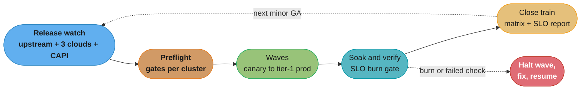
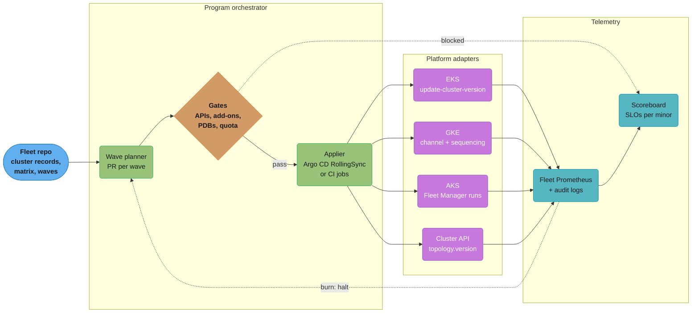
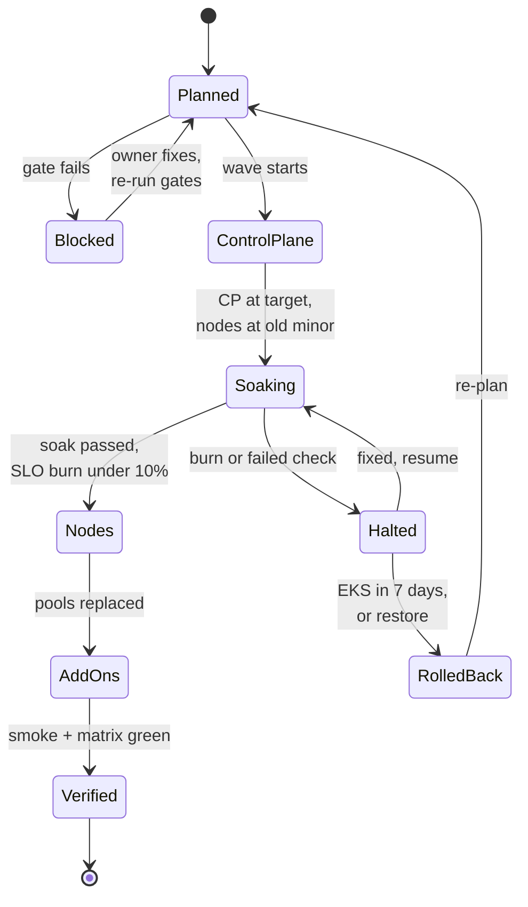
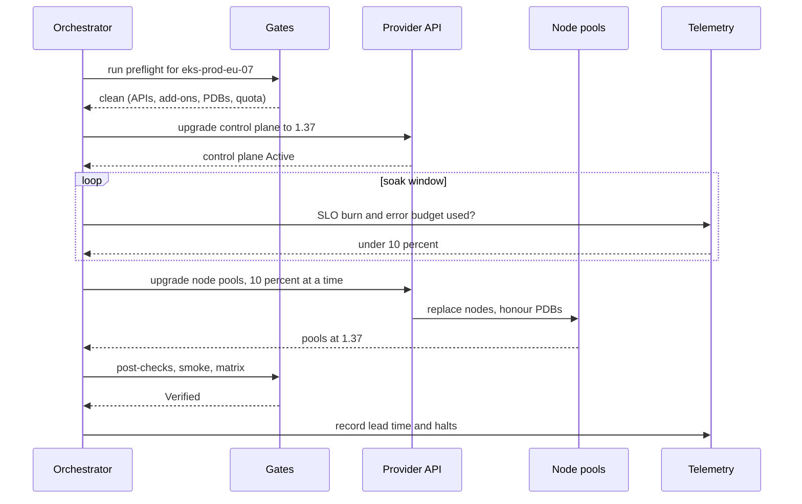
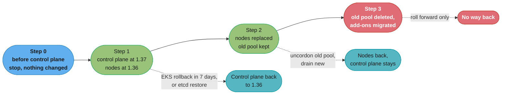

# Design a Kubernetes Fleet Upgrade Program

> Upgrading one cluster is a maintenance task. Upgrading 200 clusters across three clouds, every quarter, forever, is a railway timetable: trains leave on schedule, each one stops at the same stations in the same order, and a signal fault on one line holds the next train instead of sending it into the wreck.

> **Version anchor (2026-11-25).** **Kubernetes 1.37** is the current minor (latest patch 1.37.2, released 2026-10-13); the project maintains 1.37, 1.36 and 1.35, each for about 14 months (12 standard plus 2 maintenance; 1.35 ends 2027-02-28, 1.36 ends 2027-06-28, 1.37 ends 2027-10-28). **Version skew:** `kube-apiserver` instances within one minor of each other; `kube-controller-manager`, `kube-scheduler` and `cloud-controller-manager` never newer than the API server and at most one minor older; `kubelet` and `kube-proxy` never newer and at most **three** minors older; `kubectl` within one minor either way; the API server never skips a minor. The upstream deprecated-API guide lists **no built-in API removals after v1.32** (`flowcontrol.apiserver.k8s.io/v1beta3`), so most removal risk on current jumps comes from add-on CRDs. **Amazon EKS:** 14 months of standard support from the EKS release, then 12 months of extended support at **$0.60 instead of $0.10 per cluster-hour**; versions in standard support are 1.37, 1.36, 1.35 and 1.34 (1.34 leaves standard support 2026-12-02); in-place upgrades can be rolled back **one minor within 7 days**. **GKE:** blue-green node-pool soak defaults to 3,600 s, surge drains honour PodDisruptionBudgets for **up to one hour**, fleet rollout sequencing supports up to five fleets with a soak time between them. **AKS:** 12-month support per minor; **from 2027-06-01 AKS upgrades clusters that stay on an unsupported version, ignoring the maintenance window and deprecated-API usage, and can override a PDB**. **Cluster API v1.14.x:** no downgrades, skip-upgrades at most n-3, N and N-1 minors supported. **Karpenter** 1.15.x is the line that supports Kubernetes 1.37. **cert-manager 1.21** lists Kubernetes 1.33 to 1.36 (not 1.37) as supported. Every duration, count and dollar figure marked "assumption" below is modeled, not measured.

**Key insight:** The hard part of a fleet upgrade is not the upgrade command. It is the **program** around it: knowing before each wave which clusters will break (API removals, add-on gaps, PDBs that cannot drain), moving them in an order that makes every failure small and early, and accepting that the control plane cannot be taken back, so all your rollback has to be built out of soak time, snapshots and blue-green capacity. A fleet that upgrades three times a year with gates and waves is calmer than one that upgrades once a year by heroics.

---

## Intuition

Take a single cluster upgrade as the reference unit: roughly 40 minutes of control plane work and four hours of node replacement, as modeled in [cluster_lifecycle_and_fleet_upgrades](../kubernetes_architecture/cluster_lifecycle_and_fleet_upgrades.md). Multiply by 200 clusters, three clouds and three minors a year and you get 600 control-plane upgrades and 36,000 node replacements a year. No team does that by hand, and none should do it as one big parallel push either: the day an add-on, a webhook or a removed API breaks something, it breaks everywhere at once.

The design answer is a **program**, not a script:

1. **Version is data.** Every cluster's target minor lives in Git. An upgrade is a reviewed change to that file.
2. **Gates before waves.** Four checks run per cluster before it may enter a wave: removed APIs, add-on compatibility, PDB drainability, capacity and quota.
3. **Waves ordered by blast radius.** One canary per platform, then non-production, then production tiers, with a soak between each and an automatic halt on SLO burn.
4. **Rollback built from soak time.** Control plane first, a soak, then nodes, then add-ons, because each step you take moves a point of no return behind you.
5. **A scoreboard.** The program has SLOs of its own (currency, lead time, halt rate), reviewed monthly like any other service.



*The program loop. Every train runs the same five stages, and the dashed edges are the two ways it can stop: a halt inside a wave, and the next release restarting the loop.*

**Why this system exists:** upstream ships a minor about every four months and supports it about 14 months, EKS charges $0.50 more per cluster-hour once a version leaves standard support, and AKS will upgrade you on its own schedule from 2027-06-01 if you fall off the supported list. Not upgrading is therefore not a choice; the only choice is whether you upgrade on your schedule, in waves, with gates, or on the provider's schedule, all at once.

This case study applies the single-cluster mechanics in [cluster_lifecycle_and_fleet_upgrades](../kubernetes_architecture/cluster_lifecycle_and_fleet_upgrades.md), the fleet tooling in [multi_cluster_and_fleet_management](../multi_cluster_and_fleet_management/multi_cluster_and_fleet_management.md) (including its wave wiring with Cluster API and Argo CD progressive syncs), and the capacity and quota ceilings in [capacity_and_quota_management](../capacity_and_quota_management/capacity_and_quota_management.md). It does not repeat them. The platform that owns the clusters is designed in [design_kubernetes_platform](./design_kubernetes_platform.md); the delivery layer in [design_gitops_delivery_pipeline](./design_gitops_delivery_pipeline.md), and the promotion mechanics (Kargo stages, gates, approvals) in [environment_promotion](../gitops_argocd_flux/environment_promotion.md).

---

## 1. Requirements Clarification

### Functional requirements

- **FR1, one version per cluster, as data.** Each cluster has a record (platform, Region, tier, wave, current minor, target minor, node-pool policy, owner) in a fleet repository. Changing `target` is the only way to start an upgrade.
- **FR2, a quarterly train.** One train per quarter moves the fleet to the newest minor that is generally available on all three managed services and buildable on Cluster API. Quarters in which no new minor qualifies carry patch and node-image work instead.
- **FR3, API-removal gates.** No cluster enters a wave while it requests an API the target minor removes. Detection combines a Git scan, the API server's deprecated-API metric, audit-log events and an admission ratchet.
- **FR4, version-skew enforcement.** The orchestrator refuses any step that would break the skew policy, for example a control-plane step while kubelets sit three minors behind.
- **FR5, add-on compatibility matrix.** A machine-readable matrix of CNI, CSI, ingress or Gateway controller, service mesh, cert-manager, autoscaler and operators, checked per cluster against the target minor before the wave and before the control-plane step.
- **FR6, node-pool strategy per pool.** Each pool declares surge, minimal (drain-first), blue-green, or Karpenter drift, and the program applies it uniformly across clouds.
- **FR7, PDB and drain hygiene.** Pods that cannot be evicted are found and fixed before the wave, and admission prevents new ones.
- **FR8, bounded rollback.** For every step the runbook states what can be undone, for how long, and what it costs; control-plane downgrade is never part of the plan.
- **FR9, progress tracking.** A dashboard and SLOs show, per minor, how many clusters are done, blocked, halted or forced by a provider.
- **FR10, halt and resume.** Any wave can be stopped by a person or by an automatic gate and resumed without redoing finished clusters.

### Non-functional requirements

| Requirement | Target |
|---|---|
| Fleet size | **200 clusters:** 90 EKS, 50 GKE, 40 AKS, 20 Cluster API self-managed (assumption) |
| Nodes | **12,000** (60 average per cluster), about 600 node pools (assumption) |
| Cadence | **One minor per quarter**, three minors a year, plus one patch and node-image train |
| Currency (hard floor) | **100%** of clusters inside upstream-supported and provider-standard-support minors at all times |
| Lead time | Fleet-wide availability of the target minor to last production cluster: **at most 75 days** |
| Version spread | At most **2 minors** across the fleet in steady state |
| Upgrade-caused tier-1 downtime | At most **10% of the monthly error budget** per cluster per train (2.2 min of 21.9 min at 99.95%) |
| Halt rate | At most **5%** of clusters (10) halted by a gate per train |
| Program staffing | **5 engineers** (assumption) |
| Provider-forced upgrades | **0** per year |

### Out of scope

- Application upgrades and tenant remediation work itself. The program tracks it and escalates; tenant teams own the fix (see [design_multi_tenant_platform](./design_multi_tenant_platform.md)).
- Cluster creation, tenancy and policy design, covered in [design_kubernetes_platform](./design_kubernetes_platform.md).
- Cross-cluster networking mechanics, in [multi_cluster_networking](./cross_cutting/multi_cluster_networking.md); only the Cilium ClusterMesh skew constraint is used here.
- Migration between clouds or data centres, in [design_zero_downtime_infra_migration](./design_zero_downtime_infra_migration.md). This design is a recurring in-place cadence, not a one-off move.
- Disaster-recovery design for the platform itself, in [disaster_recovery_and_resilience](../disaster_recovery_and_resilience/disaster_recovery_and_resilience.md).

### Assumptions this case study depends on

| Assumption | Value | Why it matters |
|---|---|---|
| Uniform cluster size | 60 nodes, 3 pools of 20, 400 PDBs | Makes every duration and cost reproducible |
| Control-plane step | 40 min wall clock | Modeled; providers publish no fixed duration |
| Node replacement | maxUnavailable 10% = 2 nodes per batch, 8 min per batch | Same arithmetic as the sibling lifecycle page |
| Pool order inside a cluster | Pools upgraded serially | Conservative; parallel pools cut 4 h to about 80 min |
| Blended node price | $0.384 per node-hour | The on-demand `m5.2xlarge` price used in the sibling case study |
| Loaded engineer cost | $250,000 per year, 1,800 productive hours | Used only for relative comparison |
| Tier mix | 4 canary, 60 non-prod, 50 prod tier-2, 86 prod tier-1 | Defines the waves |

---

## 2. Scale Estimation

### Fleet composition

| Platform | Clusters | Nodes (60 each) | Control-plane upgrade API | Node-pool engine |
|---|---|---|---|---|
| EKS | 90 | 5,400 | `aws eks update-cluster-version` | Managed node groups, Karpenter on 30 clusters |
| GKE | 50 | 3,000 | Release channel or `gcloud container clusters upgrade` | Surge or blue-green node pools |
| AKS | 40 | 2,400 | `az aks upgrade` | Node pools with `--max-surge` |
| Cluster API | 20 | 1,200 | `Cluster.spec.topology.version` | `MachineDeployment` rolling update |
| **Total** | **200** | **12,000** | | |

Plus **3 Cluster API management clusters** that sit outside the 200 and are upgraded first and alone.

### Upgrade volume per year

```
Minor trains a year                  = 3        (upstream ships about every 4 months)
Control-plane upgrades               = 3 x 200  = 600
Node-pool upgrades (3 pools each)    = 600 x 3  = 1,800
Node replacements, minor trains      = 3 x 12,000 = 36,000
Node replacements, patch/image train = 1 x 12,000 = 12,000
Total node replacements per year     = 48,000   (about 131 a day, every day)
Per minor train: 12,000 nodes over about 37 working days = 324 nodes a working day
```

The alternative that cuts churn is the skew allowance: kubelets may run three minors behind, so a pool could skip two of every three minor trains. The design does not use it as policy (Decision 4) but keeps it as the emergency lever when a train is halted.

### One cluster, wall clock

```
Control plane:    1 step x 40 min                         = 40 min     (assumption)
Node pools:       3 pools x 10 batches x 8 min            = 240 min
                  (20 nodes / 2 per batch = 10 batches; new node 3 + drain 4 + wait 1 = 8 min)
Verification:     smoke + SLO check                       = 20 min
Total per cluster                                         = 300 min = 5 h
```

### Wave schedule for one train (working days from W0 start)

| Wave | Clusters | Batch | Working days | Soak after | What it proves |
|---|---|---|---|---|---|
| Preflight | 200 | n/a | 14 calendar days before W0 | n/a | Gates green, mgmt plane upgraded |
| W0 canary | 4 (one per platform) | 4 | 2 | 5 | Target minor + add-ons work on each cloud |
| W1 non-prod | 60 | 15 (25%) | 4 | 5 | Tenant workloads survive at scale |
| W2 prod tier-2 | 50 | 10 | 5 | 3 | Production traffic shapes |
| W3 prod tier-1, group A | 43 | 9 | 5 | 3 | Customer-facing, half the Regions |
| W4 prod tier-1, group B | 43 | 9 | 5 | 0 | Remaining Regions |
| **Total** | **200** | | **37 working days** | | **about 52 calendar days** |

```
Preflight 14 + waves 52 = 66 calendar days   vs a 91-day quarter  =>  25 days of slack for halts
Batches of 15 clusters x 60 nodes x 10% surge = 90 surge nodes live at once (W1, the widest wave)
```

### Provider lag decides when the train can leave

The train cannot start before the **slowest** platform offers the target minor.

| Minor | Upstream GA | EKS release | EKS lag | AKS GA | Source |
|---|---|---|---|---|---|
| 1.35 | 2025-12-17 | 2026-01-27 | 41 days | Mar 2026 | EKS docs, AKS docs |
| 1.36 | 2026-04-22 | 2026-06-02 | 41 days | Jun 2026 | same |
| 1.37 | 2026-08-26 | 2026-10-01 | 36 days | Oct 2026 | same |

AKS lags upstream by 2 to 3 months. Measured from upstream GA, the lead time would be about 90 + 66 = 156 days; measured from **fleet-wide availability** it is 66. That is why the lead-time SLO in §1 starts at availability, and why a separate hard floor (never leave standard support) protects the calendar.

### Support-window arithmetic

```
EKS standard support    = 14 months from EKS release (about 426 days)
Train start lag         = up to 90 days (AKS)  +  program 66 days  = 156 days after upstream GA
Slack to standard-support end = 426 - 156 = 270 days before any cluster is in danger
```

Even with a fully halted quarter (another 91 days) the fleet still has 179 days of margin on EKS. The margin that actually binds is AKS: 12 months from AKS GA, with platform-initiated upgrades 60 days after end of life.

### API-removal blast radius (assumption)

```
Tenant-owned deployables across the fleet      = 1,800 Helm releases / Kustomize apps
Share using an API the next minor deprecates   = 5%   -> 90 apps
Clusters with at least one runtime client on a
  deprecated API (operators, CI, controllers)   = 12%  -> 24 clusters
```

Built-in removals are rare now (none after v1.32), so most of the 90 are add-on CRD versions.

### PDB drain risk (assumption)

```
PDBs: 200 clusters x 400 = 80,000
At 0 allowed disruptions at any instant: 1.5% = 1,200  ->  6 per cluster
Any one of the 6 can stall a drain: EKS fails the node group update after 15 min (PodEvictionFailure)
```

### Cost of getting behind, EKS only

```
Extended-support premium = ($0.60 - $0.10) x 730 h  = $365 per cluster per month
All 90 EKS clusters in extended support           = 90 x 365 = $32,850 per month = $394,200 per year
10 clusters still on 1.34 after 2026-12-02        = 10 x 365 = $3,650 per month
```

The premium is a price tag on deferral, and it is dwarfed by the cost of an unplanned forced upgrade, which is why §10 compares them.

---

## 3. High-Level Architecture

Four planes. The **fleet repository** says what should be true. The **program orchestrator** decides when each cluster may move. **Platform adapters** translate "move cluster X to 1.37" into the right call on EKS, GKE, AKS or Cluster API. **Gates and telemetry** decide whether the wave may continue.



*The control loop. A wave is a PR that sets `target` on a set of clusters. Gates run before the applier, telemetry runs after it, and the dashed edges feed back into planning: blocked clusters go to the scoreboard, a burning SLO halts the wave.*

### Component inventory

| Component | Responsibility | Source of truth |
|---|---|---|
| Fleet repository | Cluster records, wave assignments, target minor, exemptions | Git |
| Compatibility matrix | Add-on versions mapped to supported Kubernetes minors | Git, generated from vendor pages and reviewed |
| Wave planner | Opens one PR per wave, orders clusters inside it | Fleet repo + inventory |
| Gate runner | API scan, add-on check, PDB audit, quota check, skew check | Per-cluster, run on demand and in CI |
| Applier | Argo CD `RollingSync` for Cluster API clusters, CI jobs calling provider APIs for EKS/GKE/AKS | Fleet repo |
| Platform adapters | One thin wrapper per platform with the same verbs: `plan`, `upgrade-control-plane`, `upgrade-nodes`, `status` | Provider API |
| Telemetry | Per-cluster Prometheus with an external `cluster` label, API server audit logs shipped to a central store | Prometheus, log store |
| Scoreboard | Per-minor progress, program SLOs, halt reasons, forced-upgrade watch | Derived |

### Per-cluster flow



*Every cluster passes the same states. `Soaking` between the control plane and the nodes is the only place a rollback is cheap, which is why it exists and why waves never skip it in production.*

### Version-skew grid the orchestrator enforces

```
 API server at 1.37 (single-instance or all HA instances)
 ------------------------------------------------------------------------------------
 Component                   1.34   1.35   1.36   1.37   1.38     Rule
 kube-apiserver (HA peer)     x      x      ok     ok     x       within 1 minor of each other
 controller-mgr / scheduler   x      x      ok     ok     x       not newer, at most 1 older
 kubelet, kube-proxy          ok     ok     ok     ok     x       not newer, at most 3 older
 kubectl                      x      x      ok     ok     ok      within 1 minor either way
 Cilium ClusterMesh peer      -      -      -      -      -       peers at most 1 Cilium minor apart
 ------------------------------------------------------------------------------------
 ok = supported   x = unsupported   Fleet policy: kubelets within 1 minor of the API server
```

*The supported window for kubelets is wide (1.34 to 1.37), the fleet policy is narrow (1.36 or 1.37). The gap between the two is the room the program uses when a train is halted: nodes may lag without leaving support. A kubelet at exactly three minors behind is a hazard, not a state: the next control-plane step is blocked until those nodes move.*

### Data flow: one train

1. **Release watch** notices the target minor is available on all three clouds and a Cluster API machine image exists. It opens the train: a tracking issue and a draft PR that sets `target: "1.37"` for wave 0.
2. **Preflight** runs the gates for all 200 clusters, files tickets for the clusters that fail, and upgrades the management clusters first.
3. **Waves** merge one PR at a time. The applier moves each cluster through the state machine above; telemetry decides whether the next batch may start.
4. **Close** records the lead time, halt count and exceptions, refreshes the compatibility matrix, and schedules the next release watch.
5. **Forced-upgrade watch** runs continuously and flags any cluster approaching a provider end-of-support date (EKS extended support, AKS 12-month end of life and platform-initiated upgrade month, GKE version end of support).

---

## 4. Component Deep Dives

### 4.1 The fleet record: version as data

One file per cluster. The orchestrator reads it, never a console.

```json
{
  "name": "eks-prod-eu-07",
  "platform": "eks",
  "region": "eu-west-1",
  "tier": "prod-tier-1",
  "wave": 3,
  "current": "1.36",
  "target": "1.37",
  "nodePools": {"general": "surge", "stateful": "blue-green", "gpu": "minimal"},
  "addons": {"cert-manager": "1.21", "istio": "1.31", "karpenter": "1.15"},
  "owner": "team-checkout",
  "exemption": null
}
```

CI on the fleet repository enforces what no human reviewer reliably catches:

| Rule | Why |
|---|---|
| `target` minus `current` is at most 1 minor per train | The API server never skips a minor, so a bigger jump is a catch-up lane (§8), not a wave |
| `wave` never decreases as `tier` gets more critical | Canary before dev before prod, by construction |
| Each wave has at least one cluster per platform before W2 | A cloud that is absent from the canaries is untested (§9 failure 1) |
| `exemption` carries an expiry date and a ticket | A silent permanent exception is a cluster that never upgrades |
| W3 and W4 clusters need a PDB audit artifact under 7 days old | Drain hygiene is checked at the last moment that matters |

The wave PR itself is a one-line diff per cluster. How `RollingSync` or Open Cluster Management turns the wave label into an ordered rollout, and the custom health check that makes "Healthy" mean "upgraded", is in [multi_cluster_and_fleet_management](../multi_cluster_and_fleet_management/multi_cluster_and_fleet_management.md) section 6.6. This design reuses that wiring for the Cluster API clusters and drives the managed services through thin CI jobs behind the same state machine.

### 4.2 API-removal gates: five layers, because each misses something

Built-in API removals are rare now (the guide lists none after v1.32), but the failure has not gone away: it moved to **add-on CRDs** and to **clients that were never in Git**. One scan cannot cover both.

| Layer | Catches | Misses |
|---|---|---|
| 1. Git scan (`pluto detect-files`) | Rendered Helm and Kustomize output, before apply | Anything created at runtime by an operator or a CI job |
| 2. Live metric `apiserver_requested_deprecated_apis` | Built-in deprecated APIs requested since the API server started | CRD versions; also resets on every API server restart |
| 3. Audit log annotation `k8s.io/deprecated: "true"` | **Who** and **which object**, the metric cannot say | Needs audit logs shipped and indexed |
| 4. Admission ratchet (`ValidatingAdmissionPolicy`) | Stops **new** writes to a deprecated version once you flip it to Deny | Existing stored objects and read-only clients |
| 5. CRD stored-version check | Add-on CRDs whose old version is still persisted, which blocks the CRD upgrade | Built-in types |

```bash
# Layer 1: rendered manifests in Git and releases already installed
pluto detect-files -d ./fleet/manifests --target-versions k8s=v1.37.0
helm template ./charts/api | pluto detect - --target-versions k8s=v1.37.0
pluto detect-helm -o wide --target-versions k8s=v1.37.0

# Layer 2: the metric, joined with request counts so you see how hot the caller is
kubectl get --raw /metrics | grep apiserver_requested_deprecated_apis
```

The metric is a per-process gauge, so on its own it forgets on every restart, and managed control planes restart on upgrade. In the fleet Prometheus (each cluster scrapes its API server and adds a `cluster` label) the series persists, and a 30-day window makes the gate honest:

```promql
# Clusters that requested an API removed in the NEXT minor (1.38) at any time in 30 days,
# with the request rate so a one-off kubectl is distinguishable from a hot controller.
max by (cluster, group, version, resource, removed_release) (
  max_over_time(apiserver_requested_deprecated_apis{removed_release="1.38"}[30d])
)
```

```bash
# Layer 3: who is calling a deprecated API, from the API server audit log
jq -c 'select(.annotations["k8s.io/deprecated"] == "true")
       | {user: .user.username, verb: .verb, group: .objectRef.apiGroup,
          version: .objectRef.apiVersion, resource: .objectRef.resource,
          ns: .objectRef.namespace}' audit.log | sort | uniq -c | sort -rn | head -20
```

Each platform ships the API server audit log to its own logging service (a provider setting you enable per cluster), and the fleet pipeline forwards only the filtered events to one place; the cluster-side baseline these clusters share is in [kubernetes_production_hardening](./cross_cutting/kubernetes_production_hardening.md).

```yaml
# Layer 4: the ratchet. Warn and Audit first (a signal and a record), flip to Deny on the deadline.
apiVersion: admissionregistration.k8s.io/v1
kind: ValidatingAdmissionPolicy
metadata: {name: no-new-widgets-v1beta1}
spec:
  failurePolicy: Fail
  matchConstraints:
    matchPolicy: Exact            # only requests that name the deprecated version
    resourceRules:
    - apiGroups: ["widgets.example.com"]
      apiVersions: ["v1beta1"]
      operations: ["CREATE", "UPDATE"]
      resources: ["widgets"]
  validations:
  - expression: "false"
    message: "widgets.example.com/v1beta1 is removed by the add-on in the next train, use v1"
---
apiVersion: admissionregistration.k8s.io/v1
kind: ValidatingAdmissionPolicyBinding
metadata: {name: no-new-widgets-v1beta1}
spec:
  policyName: no-new-widgets-v1beta1
  validationActions: [Warn, Audit]   # becomes [Deny] on the deadline
```

```bash
# Layer 5: CRDs that still have more than one persisted version need a storage migration
kubectl get crd -o json | jq -r '.items[]
  | select(.status.storedVersions | length > 1)
  | "\(.metadata.name) \(.status.storedVersions | join(","))"'
```

**BROKEN to FIX.** A gate that ran only layer 1 reported green on all 200 clusters. On 24 of them (12%, the assumption in §2) an operator installed by a Helm chart outside the manifests directory still stored objects at `widgets.example.com/v1beta1`, and the add-on bump that the target minor required shipped a CRD that no longer served that version.

```text
# BROKEN: one layer, Git only
gate: pluto detect-files -d ./fleet/manifests --target-versions k8s=v1.37.0   -> exit 0
result: CRD update rejected at wave 2, 24 clusters held mid-train, 11 days of slip (assumption)

# FIX: all five layers must be clean; layers 2 to 5 read the live cluster
gate: git scan clean
  AND max_over_time(apiserver_requested_deprecated_apis{removed_release=~"1.37|1.38"}[30d]) is empty
  AND audit annotations show no caller in the last 14 days
  AND no CRD has storedVersions containing a version the target chart no longer serves
```

### 4.3 Version skew and the add-on compatibility matrix

The skew grid in §3 is the part Kubernetes defines. The part nobody defines for you is the **add-on matrix**: every add-on has its own support range, and the range moves every release.

| Add-on class | Rule that binds the program | Source |
|---|---|---|
| cert-manager | Releases supported until the second subsequent minor ships; **1.21 lists Kubernetes 1.33 to 1.36, 1.20 lists 1.32 to 1.35**; 1.22 is expected around Nov 2026 with support TBD | cert-manager releases page |
| Istio | **1.32 supports 1.33 to 1.37; 1.31 supports 1.32 to 1.37**; the control plane may be one version ahead of the data plane, revisions recommended | Istio supported releases |
| Karpenter | **1.37 needs 1.15.x, 1.36 needs 1.13 or later**; regular releases are supported only until the next minor ships, LTS every 6 months | Karpenter compatibility |
| Cluster API | The management cluster's release must support the target Kubernetes minor; N and N-1 are supported; **no downgrade**; skip at most n-3 | Cluster API versions page |
| Cilium ClusterMesh | Connected clusters at most **one** Cilium minor apart, so Cilium walks the mesh, not the wave order | sibling fleet page, section 6.6 |
| EKS managed add-ons (VPC CNI, CoreDNS, kube-proxy, CSI) | Ask the API: `aws eks describe-addon-versions --kubernetes-version 1.37 --addon-name vpc-cni` | EKS docs |

The matrix is data in the repository, one entry per add-on version with a `min` and `max` Kubernetes minor, regenerated by a bot from vendor pages and reviewed by the add-on owner. The gate reads it:

```python
#!/usr/bin/env python3
"""preflight.py matrix.json cluster.json pdbs.json: block a cluster whose add-ons or PDBs would stop the upgrade."""
import json, sys

def minor(v):
    return int(v.lstrip("v").split(".")[1])

def addon_problems(matrix, addons, target):
    t, out = minor(target), []
    for name, ver in sorted(addons.items()):
        rng = matrix.get(name, {}).get(ver)
        if rng is None:
            out.append(f"{name} {ver}: not in the compatibility matrix")
        elif not minor(rng["min"]) <= t <= minor(rng["max"]):
            out.append(f"{name} {ver}: supports {rng['min']} to {rng['max']}, target is {target}")
    return out

def pdb_problems(pdb_list):
    out = []
    for p in pdb_list["items"]:
        if p["status"]["disruptionsAllowed"] == 0:
            m = p["metadata"]
            out.append(f"PDB {m['namespace']}/{m['name']}: 0 disruptions allowed, a drain will stall")
    return out

if __name__ == "__main__":
    matrix, cluster, pdbs = (json.load(open(f)) for f in sys.argv[1:4])
    problems = addon_problems(matrix, cluster["addons"], cluster["target"]) + pdb_problems(pdbs)
    for line in problems:
        print(f"BLOCK {cluster['name']}: {line}")
    sys.exit(1 if problems else 0)
```

Run against `eks-prod-eu-07` (cert-manager 1.21, Istio 1.31, an unlisted external-dns 0.18, and one PDB at zero) the gate prints, and exits 1:

```text
BLOCK eks-prod-eu-07: cert-manager 1.21: supports 1.33 to 1.36, target is 1.37
BLOCK eks-prod-eu-07: external-dns 0.18: not in the compatibility matrix
BLOCK eks-prod-eu-07: PDB billing/ledger-api: 0 disruptions allowed, a drain will stall
```

This is a live example, not a contrived one: as of 2026-11-25 cert-manager 1.21 does not list 1.37, so a train targeting 1.37 is held for every cluster running it until cert-manager publishes a release that does. The ordering rule that comes out of it: add-ons whose support range covers **both** the current and the target minor are upgraded **before** the control plane step; add-ons that only support the target are upgraded **after** it. An add-on that supports neither is a blocker for the whole train, and it gets an owner and a date, not an exemption.

### 4.4 Node pool strategies, uniformly across clouds

The program does not abstract the clouds away; it normalises the **verbs** and keeps each cloud's native mechanism.

| Strategy | EKS | GKE | AKS | Cluster API | Spare capacity |
|---|---|---|---|---|---|
| Surge | Managed node group default, `maxUnavailable` up to 100 nodes | `maxSurge=1, maxUnavailable=0` default | `--max-surge`, 33% recommended for production | `MachineDeployment` `maxSurge` | Needs quota and capacity |
| Minimal (drain first) | Minimal update strategy | `maxSurge=0, maxUnavailable>0` | `--max-surge 0 --max-unavailable N` | `maxSurge: 0` | None, but pods go Pending |
| Blue-green pool | New node group, cordon old, delete later | Native blue-green, default pool soak 3,600 s | New pool, cordon and drain old | New `MachineDeployment` | Up to 2x the pool |
| Drift roll (Karpenter) | Karpenter on 30 EKS clusters | Not used here | Not used here | Not used here | Replace-first by default |

```hcl
# EKS managed node group, general pool: 10% at a time, nodes jump straight to the target.
resource "aws_eks_node_group" "general" {
  cluster_name    = "eks-prod-eu-07"
  node_group_name = "general"
  version         = "1.37"
  update_config {
    max_unavailable_percentage = 10
  }
}
```

```bash
# GKE: surge with a spare pair of nodes, and a blue-green pool for stateful workloads.
gcloud container node-pools update general --cluster=gke-prod-eu-12 \
  --max-surge-upgrade=2 --max-unavailable-upgrade=0
gcloud container node-pools update stateful --cluster=gke-prod-eu-12 \
  --enable-blue-green-upgrade \
  --standard-rollout-policy=batch-percent=0.25,batch-soak-duration=60s \
  --node-pool-soak-duration=3600s

# AKS: 33% surge for production pools, fixed capacity for the GPU pool.
az aks nodepool update -g rg-prod-we -n general --cluster-name aks-prod-we-03 --max-surge 33%
az aks nodepool update -g rg-prod-we -n gpu --cluster-name aks-prod-we-03 --max-surge 0 --max-unavailable 1
```

On Karpenter clusters the "node upgrade" is a **drift roll**: the control plane moves, then the pinned AMI in the `EC2NodeClass` moves, Karpenter marks every node on the old AMI `Drifted`, and replaces them subject to the NodePool's disruption budgets. That makes the budget, not the update config, the thing that sets the pace, and it makes an unpinned AMI a fleet-wide trigger.

```yaml
apiVersion: karpenter.sh/v1
kind: NodePool
metadata: {name: general}
spec:
  template:
    spec:
      nodeClassRef: {group: karpenter.k8s.aws, kind: EC2NodeClass, name: general}
      expireAfter: 720h
  disruption:
    consolidationPolicy: WhenEmptyOrUnderutilized
    consolidateAfter: 5m
    budgets:
    - nodes: "10%"                       # steady state: at most 10% of nodes disrupted at once
    - nodes: "0"                         # no drift rolls during business hours (UTC)
      reasons: ["Drifted"]
      schedule: "0 8 * * mon-fri"
      duration: 10h
---
apiVersion: karpenter.k8s.aws/v1
kind: EC2NodeClass
metadata: {name: general}
spec:
  amiSelectorTerms:
  - alias: al2023@v20261110              # pinned: never "@latest" in a fleet
```

To stop a drift rollout mid-flight, add a `Drifted` budget of `nodes: "0"`: it stops new drift disruptions but not drains already started. Pods are evicted through the Eviction API, so PDBs are respected, and `terminationGracePeriod` on the NodeClaim is the only deadline a drift drain has.

**Mechanics worth knowing:** EKS launches up to twice the number of AZs as extra instances during a managed node group update, and each new node must register within 15 minutes or the update fails; GKE surge nodes consume Compute Engine quota, and with `maxUnavailable=0` GKE will not start a node until the surge resources exist; AKS needs quota and IP space for the surge count, and from Kubernetes 1.35 retries a surge of 1 if the full surge cannot be had, and rejects the upgrade if pool size plus surge would exceed 1,000 scale-set instances. Capacity and quota ceilings are planned in [capacity_and_quota_management](../capacity_and_quota_management/capacity_and_quota_management.md); GPU pools follow [gpu_node_lifecycle](./cross_cutting/gpu_node_lifecycle.md).

One cluster, end to end, with the soak in the middle:



*The soak loop between the control plane and the node pools is the rollback window. Everything before it is reversible by stopping; the node step is where the cheap exits end.*

### 4.5 PDB and drain hygiene

Every node replacement is a negotiation with every PodDisruptionBudget on that node. Three platforms, three failure behaviours:

| Platform | Drain behaviour | Failure mode |
|---|---|---|
| EKS managed node group | Each node must drain within **15 min**, then 60 s wait before termination | `PodEvictionFailure`; the force flag deletes the Pods instead |
| GKE surge | PDB and graceful termination honoured for **up to one hour** | After one hour remaining Pods are force-evicted |
| AKS | Cordon and drain, PDB-aware | `PodDrainFailure` on an unsatisfied PDB; a **platform-initiated** upgrade (from 2027-06-01) can override the PDB |
| Karpenter | Eviction API, PDBs respected | Node stays, with an `Unconsolidatable` or blocked event, until the PDB allows it |

Measure it, then prevent it:

```promql
# PDBs that allow zero disruptions right now, per cluster. Sample twice, a minute apart: a replica
# that is mid-restart looks like zero for a moment.
count by (cluster) (kube_poddisruptionbudget_status_pod_disruptions_allowed == 0)
```

```yaml
# Prevention: refuse a PDB that can never allow a disruption. Warn first, Deny after one train.
apiVersion: admissionregistration.k8s.io/v1
kind: ValidatingAdmissionPolicy
metadata: {name: pdb-must-allow-disruption}
spec:
  failurePolicy: Fail
  matchConstraints:
    resourceRules:
    - apiGroups: ["policy"]
      apiVersions: ["v1"]
      operations: ["CREATE", "UPDATE"]
      resources: ["poddisruptionbudgets"]
  validations:
  - expression: >-
      !(has(object.spec.maxUnavailable) && string(object.spec.maxUnavailable) in ["0", "0%"])
      && !(has(object.spec.minAvailable) && string(object.spec.minAvailable) == "100%")
    message: "A PodDisruptionBudget must allow at least one voluntary disruption"
```

A static check cannot see `minAvailable: 2` on a two-replica Deployment, which also allows nothing, so the runtime query stays in the gate. The PDB-versus-quota interactions (eviction, preemption, `unhealthyPodEvictionPolicy`) are in [capacity_and_quota_management](../capacity_and_quota_management/capacity_and_quota_management.md).

**BROKEN to FIX.** A single-replica admin service sat on one node of a 20-node pool with `minAvailable: 1`.

```yaml
# BROKEN: one replica, minAvailable 1 -> disruptionsAllowed 0 -> the drain of that node never ends
apiVersion: policy/v1
kind: PodDisruptionBudget
metadata: {name: admin-ui, namespace: ops}
spec:
  minAvailable: 1
  selector: {matchLabels: {app: admin-ui}}
```

```yaml
# FIX: two replicas (Deployment replicas: 2) and a budget that lets one go at a time
apiVersion: policy/v1
kind: PodDisruptionBudget
metadata: {name: admin-ui, namespace: ops}
spec:
  maxUnavailable: 1
  selector: {matchLabels: {app: admin-ui}}
```

On an EKS node group the BROKEN form fails the whole update at the 15-minute mark; the other 19 nodes had already been replaced, so the pool is left split across two versions until someone fixes the budget and retries.

### 4.6 Rollback limits: what you can and cannot take back

The control plane is the hard line. Upstream has no supported control-plane downgrade; once the new API server has persisted objects in new storage versions, an older one may not read them. What exists instead is a ladder of decreasing options.



*Each step moves the point of no return behind you. The soak between steps 1 and 2 is long (72 hours in production, assumption) because it is the only stretch where the control plane can still be reversed without also reversing nodes.*

| Step done | What can be undone | Mechanism | Cost |
|---|---|---|---|
| Gates only | Everything | Do nothing | None |
| Control plane upgraded, nodes not | Control plane, one minor | **EKS:** rollback within 7 days; **self-managed:** restore the pre-upgrade etcd snapshot | EKS: add-ons and managed node groups are not rolled back. etcd: every write since the snapshot |
| Nodes replaced, old blue-green pool kept | Node pool | Uncordon the old pool, drain the new one | Double capacity for the soak |
| Nodes replaced, old pool deleted | Nothing on the nodes | Roll forward with a fixed image | Hours of degraded capacity |
| Add-on CRDs migrated, storage rewritten | Nothing | Roll forward | Schema is one-way |

**EKS rollback, exactly.** The prerequisites from the documentation: initiated within 7 days of the upgrade completing; the cluster was upgraded in place (a cluster created at the current version cannot roll back); one minor only (a cluster upgraded 1.31 to 1.32 to 1.33 can go back only to 1.32); a currently supported version; the cluster `ACTIVE`; and not auto-upgraded at the end of extended support. EKS keeps etcd data, workloads and persistent volumes; it does **not** roll back add-on versions, self-managed or hybrid nodes, or managed node groups (use `UpdateNodegroupVersion`), and if worker nodes run the control plane's version they must be rolled back first. Readiness is reported as `ROLLBACK_READINESS` insights.

**etcd restore, exactly.** On self-managed Cluster API clusters the equivalent is a restore, and it is not a rewind button:

1. Stop **all** API server instances. Restoring etcd under a running API server is explicitly unsupported.
2. Restore the snapshot on **all** etcd members, from a snapshot taken by the same etcd major.minor.
3. Restart the API servers, then restart the scheduler, controller manager and kubelets so nothing runs on stale state; critical components lose their leader lock and restart themselves during the restore.
4. Accept the loss: everything written after the snapshot is gone. With a snapshot every 30 minutes (assumption) the recovery point is up to 30 minutes old. GitOps re-applies what is in Git; Jobs, Events, operator-generated Secrets and PVC bindings created since the snapshot are not.
5. Check skew: if kubelets were already upgraded to 1.37, restoring a 1.36 control plane makes them newer than the API server, which is unsupported. This is why the program never replaces nodes before the soak ends.

**BROKEN to FIX.** A runbook said "if the upgrade fails, downgrade the control plane". At 02:10 on a Sunday, with 31 of 43 nodes replaced, the on-call engineer found the step had no supported command behind it: EKS offers a rollback bounded to 7 days with nodes first, and the other platforms roll forward.

```text
# BROKEN runbook line
If the wave fails: downgrade the control plane to the previous minor.

# FIX runbook (§8 names each as R-numbered runbooks)
Before the control plane step: snapshot etcd (self-managed) or confirm ROLLBACK_READINESS insights (EKS).
After the control plane step:  soak 72 h in production; do NOT replace nodes until the soak passes.
If the soak fails:  EKS rollback inside 7 days, or etcd restore, nodes untouched.
If a node step fails: stop the wave, uncordon the old blue-green pool, fix the image, retry.
Otherwise:           roll forward. There is no downgrade.
```

For the cases where "an instant way back" is a hard requirement (regulated or revenue-critical clusters), the answer is not a better rollback; it is a **blue-green cluster**: build the target-version cluster, deploy from Git, shift traffic, keep the old cluster until the soak ends. That is the same pattern as [design_zero_downtime_infra_migration](./design_zero_downtime_infra_migration.md), applied to a version change, and it is what the catch-up lane uses for clusters several minors behind.

### 4.7 Program tracking, SLOs and the burn gate

The program is a service, so it has SLIs. These metrics come from a small exporter that reads the fleet repository and the provider APIs (names are this design's, not an upstream standard):

| Metric | Meaning |
|---|---|
| `fleet_cluster_info{cluster,platform,tier,wave,control_plane_minor,target_minor}` | One series per cluster, value 1 |
| `fleet_cluster_minors_behind` | `target_minor - control_plane_minor` |
| `fleet_cluster_kubelet_skew` | Control-plane minor minus oldest kubelet minor |
| `fleet_cluster_days_to_standard_support_end` | Provider standard-support end minus today |
| `fleet_cluster_state{state}` | The state-machine value from §3 |

```yaml
groups:
- name: fleet-upgrade-program
  rules:
  - record: fleet:clusters_not_at_target:count
    expr: count(fleet_cluster_minors_behind > 0)
  - alert: FleetKubeletSkewAtLimit
    expr: fleet_cluster_kubelet_skew >= 3          # a further control-plane step is blocked
    for: 1h
    labels: {severity: ticket}
  - alert: FleetNearStandardSupportEnd
    expr: fleet_cluster_days_to_standard_support_end < 60
    labels: {severity: page}
  - alert: FleetWaveBurnGate
    # slo:burn_budget_fraction:ratio is a per-cluster recording rule (fraction of the monthly budget used)
    expr: count(fleet_cluster_state{state="Soaking"} and on(cluster) slo:burn_budget_fraction:ratio > 0.10) >= 1
    labels: {severity: page}
```

| Program SLO | Target | Window |
|---|---|---|
| Currency: clusters in provider standard support and upstream support | 100% | continuous |
| Lead time from fleet-wide availability to last prod cluster | at most 75 days | per minor |
| Version spread | at most 2 minors | continuous |
| Upgrade-caused tier-1 budget burn per cluster | at most 10% of the monthly budget | per train |
| Clusters halted by a gate | at most 5% (10) | per train |
| Provider-forced upgrades | 0 | per year |

The burn gate uses the budget math in [slo_error_budget_math](./cross_cutting/slo_error_budget_math.md): a 99.95% monthly objective is 43,800 minutes x 0.0005 = **21.9 minutes**, so 10% is **2.19 minutes** per tier-1 cluster per train. Any cluster over that in `Soaking` halts the wave; two clusters in the same wave over it halt the train. Per-cluster Prometheus federation and label hygiene for 200 clusters follow [prometheus_cardinality_and_scale](./cross_cutting/prometheus_cardinality_and_scale.md).

---

## 5. Design Decisions & Tradeoffs

**Decision 1: every minor, not every other minor.** Skipping alternate minors halves node churn but doubles the removals and add-on jumps in each train, and stretches the gap between upgrades to about 8 months. With AKS at 12 months of support and up to 3 months of provider lag, that leaves almost no slack. Every minor keeps each train small and the calendar loose. The skew allowance (kubelets three behind) is held back as the halt-recovery lever, not a policy.

**Decision 2: one orchestrator, native mechanics underneath.** GKE rollout sequencing (up to five fleets, soak between them) and AKS Fleet Manager update runs (stages and groups, honouring maintenance windows) are good, but each knows only its own cloud. The program owns the **order, gates and state** in Git and calls the provider for the **mechanics**. Provider maintenance windows and exclusions stay on as a second brake.

**Decision 3: surge by default, blue-green only where an instant way back pays.**

| Pool kind | Strategy | Reason |
|---|---|---|
| Stateless, elastic | Surge, 10% unavailable | Cheapest: about $9 of surge per cluster per train |
| Stateful tier-1, latency-critical | Blue-green with 24 h soak | About $19,800 of duplicate capacity per train across 86 clusters |
| GPU, reserved, scarce | Minimal / `maxSurge=0` after a checkpoint | The spare capacity does not exist |
| Karpenter | Drift with `Drifted` budget and pinned AMI | Pace set by the budget, stoppable with `nodes: "0"` |

**Decision 4: nodes within one minor of the control plane.** The tighter fleet policy (the skew policy allows three) keeps any halt recoverable, because a halted train leaves at most two versions in play. The cost is every pool is replaced every minor train: 36,000 node replacements a year instead of 18,000. The AMI refresh that CVE patching needs would replace most of them anyway.

**Decision 5: catch-up lane for laggards.** A cluster two or more minors behind steps the control plane one minor at a time (3 steps for 1.34 to 1.37, about 2 h of control-plane work), jumps its nodes once (1.34 kubelets under a 1.37 API server are exactly at the 3-minor limit), and upgrades the add-ons last. If the same jump also swaps the CNI or another core add-on, the lane is a **blue-green cluster** instead.

**Decision 6: gates fail closed, tenants own remediation.** An advisory gate becomes a gate people click through. A blocked cluster gets an owner, a ticket and a deadline, and a bounded exemption (30 days, one renewal) is the only way past.

| Approach | Blast radius | Cost | Speed | Rollback |
|---|---|---|---|---|
| Big bang, all clusters | 200 clusters | Lowest | 1 week | None |
| Waves + gates (chosen) | 4, then 15, 10, 9 per batch | About $5,500 surge a year | 66 days | Soak + EKS 7 days / restore |
| Provider auto-upgrade only | Provider decides | None | Forced | None, ignores PDBs on AKS |
| Replace every cluster each minor | 1 cluster at a time | 2x clusters during overlap | Slow | Instant (traffic back) |

---

## 6. Real-World Implementations

Company post-mortems on fleet upgrades could not be fetched from primary sources for this page, so none is cited. What follows are the vendor mechanisms the design is built on, each read from the vendor documentation on 2026-11-25.

- **Amazon EKS** gives each minor 14 months of standard support and 12 of extended support at $0.60 per cluster-hour, surfaces deprecated-API and add-on findings as upgrade insights refreshed every 24 hours, and supports a one-minor rollback within 7 days of an in-place upgrade. The 15-minute node drain limit and 15-minute node bootstrap limit are hard failure points.
- **GKE** auto-upgrades clusters by release channel (Rapid, Regular, Stable, Extended), offers fleet rollout sequencing for up to five fleets with a soak time between them, and supports surge, blue-green and autoscaled blue-green node pools. Extended support (up to 24 months total) is Extended-channel only and carries a fee.
- **AKS** supports each minor for 12 months, offers Fleet Manager update runs, and announced that from 2027-06-01 it upgrades clusters left on an unsupported version after a 60-day grace period, ignoring the maintenance window and deprecated-API usage and possibly overriding a PDB.
- **Cluster API** makes the version a field (`topology.version`), rolls control plane then workers, supports N and N-1 releases, forbids downgrades of itself, and is the right substrate for the 20 self-managed clusters and the management plane.
- **Karpenter** turns node upgrade into drift: a NodePool or `EC2NodeClass` change marks nodes `Drifted`, and budgets rate-limit the roll; a `Drifted` budget of `nodes: "0"` stops it.

---

## 7. Technologies & Tools

| Tool | Role | Strength | Limit |
|---|---|---|---|
| Pluto, kube-no-trouble | Git and Helm deprecated-API scan | Fast, CI-friendly | Blind to runtime clients |
| `apiserver_requested_deprecated_apis` + audit annotation `k8s.io/deprecated` | Live detection | Finds the unknown caller | Per-process gauge; needs shipped logs |
| ValidatingAdmissionPolicy (stable since 1.30) | Admission ratchet, PDB policy | In-process, no webhook to fail | CEL only |
| EKS upgrade insights | Provider-side readiness | Add-on and API findings | EKS only |
| Cluster API + ClusterClass | Self-managed fleet | One upgrade verb across providers | Management cluster becomes tier-0 |
| Argo CD ApplicationSet `RollingSync` | Wave execution | Git-native ordering | Beta, health check needed |
| GKE rollout sequencing, AKS Fleet Manager | Native waves | Maintenance-window aware | One cloud each |
| Karpenter | Node drift roll | Budgeted, stoppable | EKS only here; AMI must be pinned |
| Kyverno or VAP | PDB and API policy | Prevents the next bad object | Policy upgrades are themselves a risk |
| Prometheus + exporter | Scoreboard | Reuses fleet telemetry | Custom exporter to own |

---

## 8. Operational Playbook

### (a) The train, T-minus

| When | Action | Owner |
|---|---|---|
| Release watch trigger | Target minor on EKS, GKE, AKS and a CAPI image exist; open train issue | Program |
| T-30 d | Refresh matrix from vendor pages; list add-on blockers with owners | Add-on owner |
| T-21 d | Layers 1 to 5 across the fleet; tickets for failing clusters | Program |
| T-14 d | Upgrade the 3 management clusters, then Argo CD and the orchestrator | Platform |
| T-7 d | PDB audit, quota and IP checks, snapshot schedule confirmed | SRE |
| W0 | 4 canaries, one per platform; soak 5 working days | Program |
| W1 to W4 | Batches per §2; each batch gated on the previous one's SLO | Program + on-call |
| Close | Lead time, halts, exceptions; refresh matrix; schedule the next watch | Program |

Never run a wave on a Friday, during a customer freeze, or while the previous batch is unresolved.

### (b) Halt criteria (automatic unless stated)

1. Any `Soaking` cluster uses more than 10% of its monthly error budget (2.19 min at 99.95%).
2. Two clusters in the same wave fail the post-check.
3. Any cluster reports `PodEvictionFailure`, `PodDrainFailure` or a stuck drain beyond 30 minutes (page, manual).
4. A control-plane step does not complete within 90 minutes (assumption: twice the 40-minute model).
5. An unexpected add-on error rate increase on any canary.

### (c) Named runbooks

- **R1 Blocked cluster:** read the gate output, assign the owner, set a 30-day exemption only if the cluster stays in support.
- **R2 Stuck drain:** `kubectl get pdb -A`, find `ALLOWED DISRUPTIONS 0`, fix the budget or replicas. Force only for a service the owner has signed off as expendable.
- **R3 Control-plane soak failure:** EKS rollback (nodes first if they match), or etcd restore per §4.6.
- **R4 Karpenter drift storm:** add a `Drifted` budget of `nodes: "0"`, then find the AMI change.
- **R5 Catch-up lane:** step the control plane one minor at a time, jump nodes once, add-ons last; blue-green cluster if the CNI changes.
- **R6 Provider-forced upgrade warning:** a cluster inside 60 days of end of support gets the next free slot ahead of its wave.

---

## 9. Common Pitfalls & War Stories

These are **modeled failure modes**, not reported incidents: the mechanisms and platform behaviours are from vendor documentation, the cluster counts and durations are assumptions from §1 and §2.

**1. The canaries were all on one cloud.** AKS Standard pools upgraded to Kubernetes 1.37 or later can have LocalDNS enabled during the upgrade when the pool has no explicit profile, and custom virtual-network DNS must then answer both UDP and TCP on port 53. An all-EKS canary cannot see that. If 10 of the 40 AKS clusters (W2) hit it, DNS fails for about 25 minutes before the halt gate fires.

```text
# BROKEN: W0 = 4 EKS clusters
# FIX: W0 = 1 EKS + 1 GKE + 1 AKS + 1 CAPI; AKS preflight runs dig +udp and dig +tcp against the custom DNS server
```

**2. A PDB at zero in the middle of a wave.** Six PDBs per cluster sit at zero allowed disruptions (§2). In a 15-cluster batch that is 90 stuck drains: EKS fails each node group at 15 minutes, GKE force-evicts after an hour, and the pool is left split across versions. FIX is §4.5: the admission policy plus the runtime query as a hard gate.

**3. An unpinned AMI starts a fleet-wide roll.** 30 Karpenter clusters (1,800 nodes) reference `al2023@latest`. A new AMI lands on a Tuesday; every NodePool drifts at once, and the default budget lets 10% of nodes go at a time, so 180 nodes are replaced fleet-wide with no wave, no soak and no gate.

```yaml
# BROKEN: the AMI moves when the vendor says so
amiSelectorTerms: [{alias: al2023@latest}]
# FIX: pin the alias, move it in the wave PR, and keep a Drifted budget of 0 in business hours
amiSelectorTerms: [{alias: al2023@v20261110}]
```

**4. An add-on outside its support range.** cert-manager 1.21 lists Kubernetes 1.33 to 1.36. If 62 clusters run it (assumption) and the control plane moves to 1.37 anyway, those clusters run an untested pairing until 1.22 ships. FIX: §4.3 blocks the cluster, the add-on owner gets a date, and the train slips by the add-on's release, not by a risk acceptance.

**5. Kubelets three minors behind.** Ten EKS clusters still on 1.34 jump to a 1.37 control plane, which is exactly the three-minor limit; 1.34 also leaves EKS standard support on 2026-12-02, adding 10 x $365 = $3,650 a month. When 1.38 arrives their control plane cannot step until the nodes move. FIX: the catch-up lane moves nodes in the same train as the last control-plane step, and `FleetKubeletSkewAtLimit` ticket-alerts at 3.

**6. A forced upgrade ignores the waves.** AKS 1.35 reaches end of life in Mar 2027; its platform-initiated upgrade month is Jun 2027, and that upgrade ignores maintenance windows and deprecated-API usage and can override a PDB. Three AKS clusters carrying a "temporary" exemption are upgraded at 14:00 on a trading day.

```text
# BROKEN: exemption: {reason: "vendor cert pending"}      (no expiry)
# FIX:    exemption: {reason: "vendor cert pending", expires: 2027-03-01, ticket: FLT-482}
#         forced-upgrade watch pages at 60 days before end of support
```

**7. Workload clusters upgraded before the management cluster.** Cluster API v1.14.x supports N and N-1 and cannot be downgraded; its release must support the target Kubernetes minor before any workload cluster moves. Upgrading 20 CAPI clusters first leaves them unmanaged, and a bad management upgrade is a fleet-wide pause. FIX: management clusters go first, alone, at T-14 days.

---

## 10. Capacity Planning

### Concurrency is bounded by quota, not by the orchestrator

```
Surge nodes live in the widest batch  = 15 clusters x 60 nodes x 10% = 90 nodes
vCPU needed (8 vCPU nodes)            = 90 x 8 = 720 vCPU, split across the Regions in the batch
Per-cluster IPs for the control plane = EKS needs up to 5 free IPs in the cluster subnets
AKS surge                             = quota and IP space for the surge count; a pool plus surge over 1,000 instances is rejected
```

The quota gate compares `surge nodes x vCPU` to the unused quota per Region and per account; neither AWS nor GCP publishes a quota-increase lead time, so the request goes in at T-30, as in [capacity_and_quota_management](../capacity_and_quota_management/capacity_and_quota_management.md).

### Cost and staffing (all assumptions, per year)

| Item | Arithmetic | Result |
|---|---|---|
| Surge capacity | 6 nodes x 4 h x $0.384 x 200 clusters x 3 trains | $5,530 |
| Blue-green, stateful tier-1 | 2,150 nodes x 24 h x $0.384 x 3 trains | $59,443 |
| EKS extended support if all 90 fell behind | 90 x $365 x 12 | $394,200 |
| Manual baseline | 24 h x 600 cluster upgrades = 14,400 h | 8.0 FTE |
| Program | 5 engineers x 1,800 h + 1.5 h x 600 = 9,900 h | 5.5 FTE |
| Saving | 4,500 h = 2.5 FTE x $250,000 | about $625,000 |
| Tenant remediation (outside the program) | 90 apps x 8 h x 3 trains | 2,160 h, 1.2 FTE |

The program is not cheaper than doing nothing, because doing nothing ends in a forced upgrade. It is cheaper than the manual alternative and bounds the tail.

### Growth

Doubling to 400 clusters at the same batch width doubles the wave time to about 74 working days, which leaves no slack in a quarter. The fix is **parallel platform lanes** (each cloud runs its own batches, 2 to 4 at a time) rather than wider batches: the surge quota per cloud, not the orchestrator, is the ceiling.

---

## 11. Interview Discussion Points

**Q: Why run upgrades in waves instead of as fast as possible?**
**Short:** Waves keep each failure small and early: a bad add-on, removed API or PDB breaks 4 canaries, not 200 clusters.
Parallelism makes the cost of one bad assumption proportional to fleet size. With waves ordered by blast radius (canary per platform, non-prod, tier-2, tier-1 in two groups) the first failure arrives while only 2% of the fleet has moved, and the soak between waves turns a slow failure into a halt. The price is calendar time: 66 days of a 91-day quarter, which still leaves 25 days of slack.

**Q: Which gates must pass before a cluster enters a wave?**
**Short:** Removed APIs, add-on compatibility, PDB drainability and quota or capacity, plus the skew check, all failing closed.
Removed APIs use five layers (Git scan, deprecated-API metric, audit annotation, admission ratchet, CRD stored versions) because each misses a class. The add-on gate reads a compatibility matrix per cluster. The PDB gate queries `disruptionsAllowed` at runtime. Quota compares surge vCPU to free quota per Region. Advisory gates become click-through, so a blocked cluster gets an owner, a ticket and a bounded exemption.

**Q: How do you find API removals when the clusters are not yours to edit?**
**Short:** Combine Git scans, the API server's deprecated-API metric kept in central Prometheus, and audit-log events that name the caller.
`apiserver_requested_deprecated_apis` is a per-process gauge with a `removed_release` label, so it resets on every restart; scraping it into a central store and taking `max_over_time` over 30 days fixes that. The audit annotation `k8s.io/deprecated: "true"` then tells you who and which object. Built-in removals are rare after v1.32, so most findings are add-on CRD versions and need the stored-version check.

**Q: What is the real kubelet skew limit, and why does the fleet use a stricter one?**
**Short:** Kubelets may be up to three minors older than the API server, never newer; the fleet keeps them within one so a halted train stays recoverable.
At exactly three behind, the next control-plane step is blocked until nodes move. A fleet policy of one leaves the other two minors as a reserve: if a train halts after the control plane, nodes can lag without leaving support. The cost is replacing every pool every minor (36,000 node replacements a year in this fleet).

**Q: How do you keep an add-on compatibility matrix honest?**
**Short:** Keep it as versioned data with min and max Kubernetes minors per add-on version, bot-refreshed from vendor pages and owned by a named person.
The matrix fails the gate if an add-on version is missing or outside range. The live example: cert-manager 1.21 lists 1.33 to 1.36, so a 1.37 train is held for clusters running it. Add-ons that support both minors go before the control plane; target-only versions go after; an add-on supporting neither blocks the train with an owner and a date.

**Q: Surge, blue-green or Karpenter drift: how do you choose per pool?**
**Short:** Surge by default, blue-green for stateful tier-1 pools that need an instant way back, minimal for scarce GPU pools, and budgeted drift on Karpenter.
Surge costs about $9 per cluster per train in modeled capacity; blue-green on 86 clusters costs about $19,800 per train. GPU pools often cannot surge, so drain first after a checkpoint. On Karpenter the budget sets the pace, an unpinned AMI is a fleet-wide trigger, and a `Drifted` budget of `nodes: "0"` stops the roll.

**Q: Can you roll back a control-plane upgrade?**
**Short:** Not in general: upstream has no downgrade; EKS allows one minor within 7 days, self-managed clusters restore etcd and lose every write since.
Treat rollback as a ladder that gets shorter with each step: soak after the control plane, keep the old blue-green pool until nodes pass, never rewrite storage until the soak ends. An etcd restore needs all API servers stopped, loses writes since the snapshot, and breaks skew if kubelets were already upgraded. Regulated clusters needing an instant exit use a blue-green cluster.

**Q: A cluster is three minors behind. What do you do?**
**Short:** Step the control plane one minor at a time, jump the nodes once, upgrade add-ons last, or replace the cluster if the CNI also changes.
The API server never skips a minor, so 1.34 to 1.37 is three control-plane steps (about 2 hours modeled), after which 1.34 kubelets are exactly at the three-minor limit and must move before a further step. A blue-green cluster is cleaner when core add-ons change or when the cluster is reproducible from Git.

**Q: How do you stay in control against provider-forced upgrades?**
**Short:** Track each cluster's end-of-support dates, alert at 60 days, and put exemptions on an expiry, because forced upgrades ignore your waves.
EKS auto-upgrades at the end of extended support and then cannot roll back. From 2027-06-01 AKS upgrades clusters left on unsupported versions after a 60-day grace period, ignoring maintenance windows and deprecated-API usage, possibly overriding a PDB. The SLO is zero provider-forced upgrades a year.

**Q: What are the program's SLOs?**
**Short:** 100% of clusters in standard support, lead time at most 75 days, at most 2 minors in the fleet, 10% budget burn per train, at most 5% halted.
Lead time starts at fleet-wide availability, not upstream GA, because AKS can lag upstream by 2 to 3 months. The burn gate comes from the budget arithmetic in the error-budget page: 21.9 minutes a month at 99.95%, so 2.19 minutes per cluster per train.

**Q: How do three clouds change the design?**
**Short:** Normalise the verbs, not the mechanisms: one state machine and gate set, with per-cloud adapters for each provider's own upgrade API.
EKS has upgrade insights and a 7-day rollback, GKE has channels and rollout sequencing, AKS has Fleet Manager and a forced-upgrade policy, and Cluster API has `topology.version`. The canary wave needs one cluster per platform because each has platform-specific traps, such as AKS LocalDNS defaults.

**Q: What does the program cost, and is it worth it?**
**Short:** About 5.5 FTE against 8 FTE of manual toil, and it avoids up to $394,200 a year of EKS extended support plus forced-upgrade risk.
Surge capacity is about $5,530 a year; duplicate blue-green capacity about $59,443. All of these are modeled from stated assumptions. The honest comparison is not program versus nothing, but program versus a fleet that is always behind.

**Q: How would you handle GPU pools?**
**Short:** Drain first after a checkpoint, never surge into capacity that does not exist, and align with host-maintenance windows.
Surge needs spare accelerators that a reservation may not have. The minimal strategy or `maxSurge=0` with `maxUnavailable` above zero replaces nodes in place, so training jobs restart from their last checkpoint. See [gpu_node_lifecycle](./cross_cutting/gpu_node_lifecycle.md).

**Q: Why does this need its own case study when a single-cluster upgrade is documented?**
**Short:** Because the hard failures are program failures: ordering, gates, skew across add-ons, rollback ladders and forced upgrades.
A single-cluster upgrade is a procedure; a fleet upgrade is a recurring system with inventory, state, SLOs and budgets. [design_kubernetes_platform](./design_kubernetes_platform.md) covers who owns the clusters; this page covers how they are kept current without a fleet-wide outage.

**Q: What is the first thing you would build?**
**Short:** The inventory and gates, because a fleet whose versions and blockers you cannot see cannot be upgraded safely.
Fleet records in Git and the preflight gate come before any orchestrator: they cost days, they find the real blockers (add-on gaps, PDBs, CRD stored versions), and they make the first canary wave boring. Waves and dashboards follow once the gates give a stable signal.
