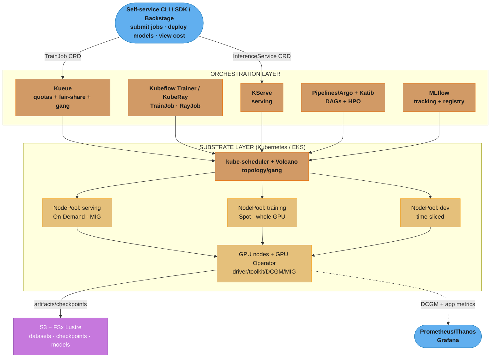
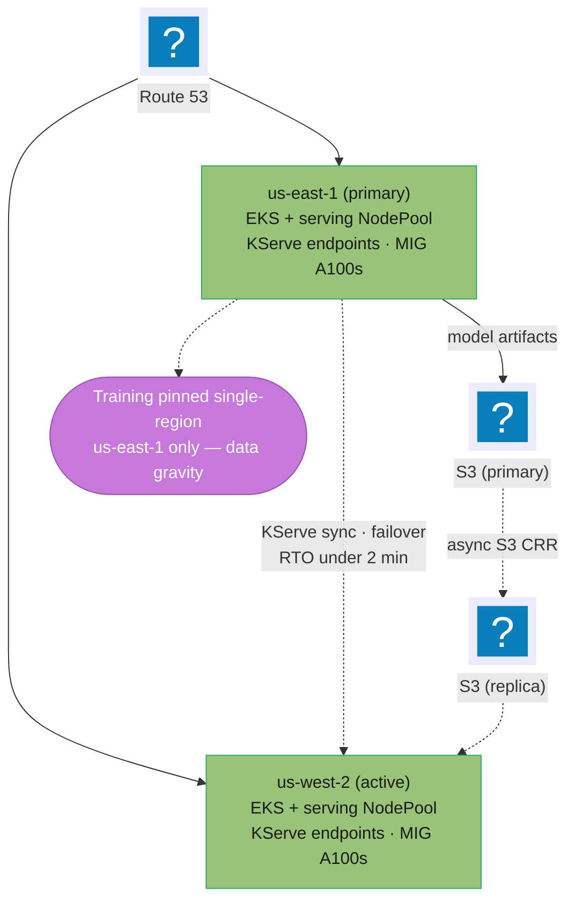
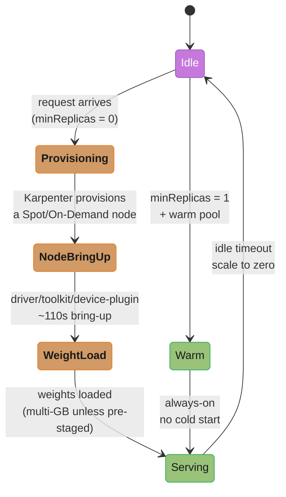
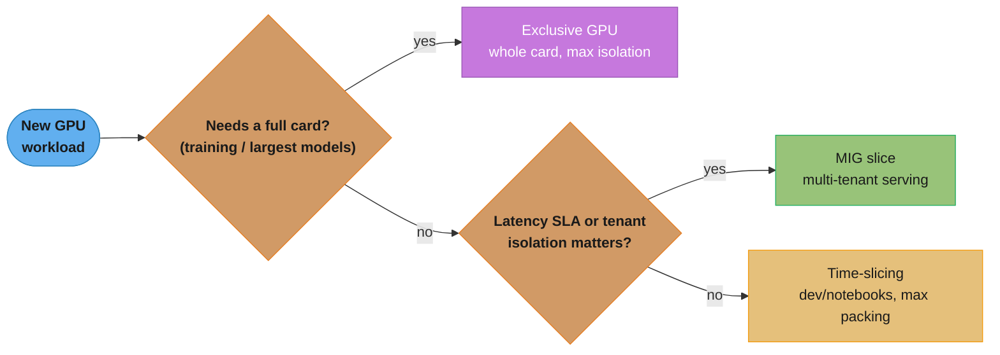
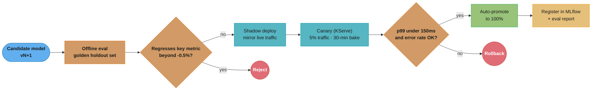

# Design an ML Platform Infrastructure

> Principal-grade case study · Phase 8 (Specialized Platforms & Performance) · 11-section template
> Reference template: [`../../llm/case_studies/design_gpu_inference_platform.md`](../../llm/case_studies/design_gpu_inference_platform.md)
>
> **Scope next to its sibling.** This case study designs the **product layer** of an ML platform: self-service submission, pipelines, experiment tracking, the model registry and promotion, lineage, and chargeback. GPU scheduling depth (gang admission with topology, capacity modes, inference routing) is delegated to [design_gpu_training_and_inference_cluster](design_gpu_training_and_inference_cluster.md), the same way cluster tenancy is delegated to [design_kubernetes_platform](design_kubernetes_platform.md); §4.1 shows only the queue objects the product layer submits into. Quota and scheduler policy is taught in [mlops/gpu_cluster_scheduling_and_quotas](../../mlops/gpu_cluster_scheduling_and_quotas/gpu_cluster_scheduling_and_quotas.md).

## Intuition

> Building an ML platform is **building an internal airline, not flying one plane**. Any team can charter a single jet (one data scientist SSH-ing into one GPU box); an airline is the scheduling, the gate assignments, the maintenance crews, the fuel contracts, and the safety board that let *hundreds* of flights share a fleet efficiently and never crash into each other. The hard part was never the engines (the models) — it's the operations that keep $50M of aircraft (GPUs) busy, isolated, and on time.

**Key insight:** An ML platform's product is **GPU utilization and self-service**, not models. The platform team owns scheduling, isolation, cost, and observability so that dozens of ML teams ship without each reinventing GPU provisioning — and so the company runs its accelerators at 65%+ instead of 20%. Every architectural decision is judged on two axes: does it raise utilization, and does it reduce the friction for an ML engineer to get from "I have code" to "it's training/serving in prod"?

**Mental model:** Three planes stacked. The **substrate** (Kubernetes + GPU Operator + Karpenter) makes GPUs schedulable, isolated, and elastic. The **orchestration** layer (Kueue/Volcano for batch gang-scheduling, Kubeflow/Ray for training, KServe for serving) turns "train this on 16 GPUs" or "serve this model" into Pods. The **product** layer (self-service APIs, quotas, observability, chargeback) makes it usable and accountable. This case study designs all three.

**Why this system exists:** Without a platform, every ML team copies a Terraform module, hand-builds GPU AMIs, fights driver mismatches, over-allocates whole GPUs to tiny models, and runs at ~20% utilization — multiplying the single largest line item in the cloud bill across N teams. The platform centralizes the hard 20% so the other 80% (modeling) can move fast.

The serving platforms that run on this infrastructure, such as KServe, are compared in [Model Serving Platforms](../../mlops/model_serving_platforms/model_serving_platforms.md).

---

## 1. Requirements Clarification

**Context:** A company with ~120 ML engineers across 14 teams (recommendations, fraud, search ranking, forecasting, several LLM/GenAI teams). Today each team self-manages GPUs on EC2; utilization is ~22%, GPU spend is ~$1.8M/month, and onboarding a new model to production takes ~3 weeks of infra work.

### Functional requirements

- **Self-service training**: submit a distributed training job (single- or multi-GPU, multi-node) via a CRD/CLI/SDK without provisioning infrastructure.
- **Self-service serving**: deploy a model as an autoscaling endpoint (including scale-to-zero for rarely-used models) with canary rollout.
- **Multi-tenancy**: 14 teams share GPU pools with quotas, fair-share queuing, and isolation so one team can't starve or crash another.
- **Pipelines**: orchestrate preprocessing → train → evaluate → register → deploy as a DAG.
- **Experiment tracking & model registry**: every run's params/metrics/artifacts tracked; promote models with registry aliases (`@challenger`, `@champion`), with the deployed version pinned in Git.
- **Lineage**: every registered version traceable to its code commit, immutable dataset snapshot and pipeline run, enforced at registration.
- **Reproducible pipelines**: unchanged steps (same data snapshot and code version) are served from a cache instead of re-run.
- **GPU sharing**: fractional GPUs (MIG/time-slicing) for small inference; whole/many GPUs for training.
- **Cost attribution**: per-team GPU-hour chargeback with utilization weighting.
- **Observability**: GPU utilization, job/endpoint health, lag-to-ready, and per-team dashboards.

### Non-functional requirements (with concrete targets)

| Dimension | Target |
|-----------|--------|
| GPU fleet utilization | ≥ 65% (from ~22% today) — the headline goal |
| Training job queue-to-start (p95) | < 5 min when quota available; gang jobs admitted atomically |
| Serving p99 latency | < 150 ms for online models (excluding cold start) |
| Serving availability | 99.9% (≈43 min/month error budget) for tier-1 endpoints |
| Cold-start (scale-to-zero models) | < 30 s with warm pool; < 3 min worst case |
| Spot training cost saving | ≥ 60% vs On-Demand, with < 6 min work lost per interruption |
| Model deploy time (code → prod endpoint) | < 30 min (from ~3 weeks) |
| Platform control-plane availability | 99.95% |

### Out of scope (cross-referenced, not rebuilt)

- **Model architecture, training-loop code, hyperparameter strategy** → [`../../ml/`](../../ml/README.md), [`../../llm/`](../../llm/README.md).
- **The GPU inference serving *application* design** (KV cache, batching, routing) → [`../../llm/case_studies/design_gpu_inference_platform.md`](../../llm/case_studies/design_gpu_inference_platform.md).
- **Feature store internals / point-in-time correctness** → [`../../ml/case_studies/cross_cutting/feature_store_and_point_in_time_correctness.md`](../../ml/case_studies/cross_cutting/feature_store_and_point_in_time_correctness.md).
- **Generic Kubernetes platform multi-tenancy** → [`./design_kubernetes_platform.md`](./design_kubernetes_platform.md) (we build *on* it).

---

## 2. Scale Estimation

### Workload mix

```
14 teams. Steady-state demand (measured from current usage):
  Online serving:   ~40 models, ~22k inference RPS aggregate at peak
  Batch training:   ~30 concurrent training jobs at peak, avg 8 GPUs each = 240 training GPUs
  Batch inference / ETL:  bursty, ~80 GPUs at nightly peak
  Notebooks / dev:  ~120 engineers, bursty, mostly fractional GPUs
```

### GPU fleet sizing

```
Serving (MIG-sliced A100 80GB, 1g.10gb each = 7 slices/GPU -- the 1g.10gb profile
exists only on the 80GB card, i.e. p4de.24xlarge, not p4d's 40GB A100s):
  40 models, avg 3 replicas, each fits a 10GB slice = 120 slices
  120 slices / 7 = ~18 physical A100s for serving (call it 24 with headroom + warm pool)

Training:
  240 training GPUs at peak (mostly Spot), elastic via Karpenter

Batch/ETL: 80 GPUs nightly (Spot, scale to ~0 daytime)

Notebooks/dev: time-sliced, ~16 A100s shared across 120 engineers

Peak fleet ≈ 24 (serving, On-Demand) + 240 (training, Spot) + 80 (batch, Spot) + 16 (dev) ≈ 360 GPUs peak
Average fleet (training/batch are bursty) ≈ 180 GPUs
```

### Cost math (the business case)

```
Today: ~$1.8M/month at ~22% utilization. Effectively paying ~$1.8M for ~$400k of useful work.

Platform targets:
  - Serving: MIG slicing collapses 40 whole-GPU endpoints (~40 A100s) to ~24 -> save ~16 A100s
  - Training/batch on Spot (~65% off): 320 bursty GPUs at Spot vs On-Demand
      On-Demand p4de.24xlarge ≈ $27.45/hr / 8 A100 80GB -> $3.43/GPU-hr; Spot ≈ $1.25/GPU-hr
  - Scale-to-zero + Karpenter consolidation removes idle-node waste

Modeled new spend: ~$410k/month with training and batch pinned at their peak all month
  (~$270k at the steady-state mix -- see the §10 worked fleet), at ~66% utilization.
  Useful-work check: today's $1.8M buys ~525k On-Demand GPU-hours ($1.8M / $3.43), i.e.
  ~719 GPUs running all month, of which 22% is useful = ~158 GPU-equivalents. The new
  fleet at peak is 360 GPUs x 66% = ~238 GPU-equivalents. MORE work for less money.
  => ~$1.4M/month saved (~78%), AND more work done. The platform team (say 6 engineers,
     ~$1.5M/yr loaded) pays for itself in ~5 weeks of savings.
```

### Control-plane scale

```
~45 GPU nodes at peak (360 GPUs at 8 per p4de.24xlarge) plus the CPU fleet, and a few
thousand Pods (serving replicas + training workers + sidecars + dev notebooks).
etcd, API server, scheduler must handle Pod churn from bursty training + scale-to-zero.
Cardinality risk: DCGM exports ~30 series/GPU x 360 GPUs x (MIG multiplies) -> watch it.
  (See ./cross_cutting/prometheus_cardinality_and_scale.md)
```

### Product-layer load (the part that is not GPUs)

```
Tracking API
  runs in flight at peak        = 30 training jobs + ~200 sweep trials       = ~230
  metric writes per run         = 25 metrics every 30 s
  unbatched                     = 230 x 25 / 30                              = ~190 requests/s
  batched (one log_metrics call per step)  = 230 / 30                         = ~8 requests/s
  -> batching in the SDK is a 25x load reduction on the tracking server

Registry and deploy
  promotions per day            = 40 models x ~0.3                           = ~12
  alias reads per deploy        = 1 (resolved once, pinned in Git; never at Pod start)

Pipelines
  workflows per day             = ~900, ~6 Pods each                          = ~5,400 Pods/day
```

The tracking server is sized by the unbatched number, not the batched one, until the SDK enforces batching; that single client-side change is the cheapest capacity win on the product layer. Detailed sizing is in §10.

---

## 3. High-Level Architecture


*Three planes stacked: the product layer turns a CLI/SDK call into a `TrainingJob` or `InferenceService` CRD, the orchestration layer (Kueue/Kubeflow Trainer/KServe/Pipelines/MLflow) turns that into scheduled Pods, and the substrate layer (Karpenter's three NodePools + the GPU Operator) turns Pods into running GPUs — artifacts land in S3/FSx and metrics flow to Prometheus/Thanos/Grafana.*

**Component inventory:**
- **Product layer**: CLI/SDK + Backstage golden paths; quota & cost views.
- **Kueue**: cluster-wide quotas, fair-share across teams, gang admission for distributed jobs.
- **Training**: Kubeflow Trainer (one `TrainJob` CRD, framework chosen by the referenced runtime) and KubeRay (RayJob) — pick per team.
- **Serving**: KServe `InferenceService` (autoscaling, scale-to-zero, canary), often wrapping Triton.
- **Pipelines**: Kubeflow Pipelines / Argo Workflows for DAGs; MLflow registry.
- **Substrate**: EKS, NVIDIA GPU Operator, Karpenter (3 NodePools), Volcano for topology/gang.
- **Storage**: S3 (durable), FSx for Lustre (hot training data + model weight cache).
- **Observability**: DCGM exporter + Prometheus/Thanos + Grafana; per-team dashboards.

**Data-flow narrative (training):** ML engineer runs `mlctl train submit job.yaml` → a `TrainJob` (labeled with the team's Kueue queue) is created → Kueue checks the team's quota and admits the job only when all N GPUs are simultaneously available (gang) → Volcano places workers topology-aware (NVLink-packed) → Karpenter provisions Spot GPU nodes if needed (lifecycle bring-up, ~110s) → workers run, checkpointing to S3 every ~6 min → on completion the model is logged to MLflow.

**Data-flow narrative (serving):** engineer runs `mlctl serve deploy model.yaml` → a KServe `InferenceService` requesting a `mig-1g.10gb` slice is created → KServe (via Knative) autoscales replicas on RPS, scaling to zero when idle → a canary rollout shifts 5% traffic, checks p99/error metrics, then promotes or rolls back → traffic served behind an ALB.

**Data-flow narrative (promotion):** the pipeline's register step creates version N in the MLflow registry with lineage tags (§4.8) → the offline eval gate passes and sets the `@challenger` alias → the deploy step resolves `@challenger` to a concrete artifact URI and opens a PR that pins it into the shadow and canary `InferenceService`s → canary gates pass (§8a) → the same step moves `@champion` to version N, records the previous champion as a tag, and merges the PR that pins version N for 100% of traffic. The registry says what *should* run; Git says what *does* run; an hourly reconciliation compares the two.

**Multi-region note:** Tier-1 serving runs active-active across two regions for the 99.9% SLA; training is single-region (data gravity — datasets live in one region's S3/FSx). Cross-region serving topology and failover follow [`./cross_cutting/multi_cluster_networking.md`](./cross_cutting/multi_cluster_networking.md).


*Serving is active-active across two regions (Route 53 health-checked routing, RTO under 2 min on failover); training stays pinned to us-east-1 because moving petabyte datasets is cost-prohibitive — only the trained model artifact replicates via async S3 CRR.*

The asymmetry is deliberate: **serving is replicated** (small model artifacts, latency-SLA-bound, needs regional redundancy) while **training is pinned** (petabyte datasets have gravity; you move the model to the data's region, not the data to the model). This is the standard ML-platform multi-region pattern.

---

## 4. Component Deep Dives

### 4.1 Multi-tenant quotas and gang scheduling (Kueue)

The core fairness and correctness engine. Each team gets a `ClusterQueue` with a GPU quota; jobs queue when over quota and are admitted **atomically** (all GPUs or none) to prevent the distributed-training deadlock.

```yaml
# A team's queue with a hard GPU quota and borrowing across a shared cohort
apiVersion: kueue.x-k8s.io/v1beta2
kind: ClusterQueue
metadata: { name: fraud-team }
spec:
  cohortName: shared-gpu              # teams in a cohort can borrow each other's idle quota
  resourceGroups:
    - coveredResources: ["nvidia.com/gpu"]
      flavors:
        - name: a100-spot
          resources:
            - name: nvidia.com/gpu
              nominalQuota: 64          # fraud team's baseline
              borrowingLimit: 32        # may borrow up to 32 more if idle in the cohort
  preemption:
    reclaimWithinCohort: Any            # reclaim borrowed GPUs when the owner needs them
```

```yaml
# The training job points at the team's LocalQueue; Kueue does gang admission.
apiVersion: trainer.kubeflow.org/v1alpha1
kind: TrainJob
metadata:
  name: fraud-ranker-pretrain
  labels: { kueue.x-k8s.io/queue-name: fraud-team-lq }
spec:
  runtimeRef: { name: torch-distributed }   # ClusterTrainingRuntime picks the framework
  trainer:
    image: fraud:v3
    numNodes: 4                             # rank 0 included -- 4 full GPU consumers
    numProcPerNode: 8                       # one process per GPU
    resourcesPerNode:
      limits: { nvidia.com/gpu: 8 }
# 32 GPUs; admitted only when 32 are available -> released together. No partial placement.
```

**Concrete behavior:** When the experimentation team is idle, fraud can borrow up to 32 of its GPUs; when experimentation submits, Kueue preempts the borrowed GPUs (its jobs checkpoint and requeue). This is how you hit 65% utilization without starving anyone — idle quota is lent, not wasted.

### 4.2 Serving with KServe + MIG + scale-to-zero

```yaml
apiVersion: serving.kserve.io/v1beta1
kind: InferenceService
metadata: { name: fraud-scorer }
spec:
  predictor:
    minReplicas: 0                    # scale to zero when idle (rare-model cost saving)
    maxReplicas: 20
    scaleTarget: 50                   # target 50 RPS/replica (from a capacity test)
    scaleMetric: rps
    model:
      modelFormat: { name: triton }
      storageUri: s3://models/fraud-scorer/v7
      resources:
        limits: { nvidia.com/mig-1g.10gb: 1 }   # a 10GB slice, not a whole A100
    nodeSelector: { workload: serving }
    tolerations: [{ key: nvidia.com/gpu, operator: Exists, effect: NoSchedule }]
```

For tier-1 models that can't tolerate cold start, `minReplicas: 1` plus a warm GPU pool (see [`./cross_cutting/gpu_node_lifecycle.md`](./cross_cutting/gpu_node_lifecycle.md) §"warm pool") keeps p99 within 150ms.


*The cold path (Idle → Provisioning → NodeBringUp → WeightLoad) is what a scale-to-zero model pays on its first request after idling — the ~200s that paged on-call in War story 4 (§9). `minReplicas: 1` plus a warm pool detours straight through Warm to Serving, which is why it's reserved for tier-1 and compliance-critical models.*

### 4.3 Karpenter NodePools — the three workload classes

Separate pools so training Spot churn never touches serving, and each gets the right pricing/disruption policy:

```yaml
# Training: Spot, whole GPUs, protected from consolidation mid-run
apiVersion: karpenter.sh/v1
kind: NodePool
metadata: { name: gpu-training }
spec:
  template:
    metadata: { labels: { workload: training } }
    spec:
      nodeClassRef: { group: karpenter.k8s.aws, kind: EC2NodeClass, name: gpu }
      startupTaints: [{ key: nvidia.com/gpu-not-ready, effect: NoSchedule }]
      taints: [{ key: nvidia.com/gpu, effect: NoSchedule }]
      requirements:
        - { key: karpenter.sh/capacity-type, operator: In, values: ["spot"] }
        - { key: node.kubernetes.io/instance-type, operator: In,
            values: ["p4de.24xlarge","p5.48xlarge"] }
  disruption: { consolidationPolicy: WhenEmpty, consolidateAfter: 2m }
  limits: { nvidia.com/gpu: 320 }      # spending circuit breaker
---
# Serving: On-Demand, MIG, stable
apiVersion: karpenter.sh/v1
kind: NodePool
metadata: { name: gpu-serving }
spec:
  template:
    metadata: { labels: { workload: serving } }
    spec:
      nodeClassRef: { group: karpenter.k8s.aws, kind: EC2NodeClass, name: gpu-mig }
      requirements:
        - { key: karpenter.sh/capacity-type, operator: In, values: ["on-demand"] }
        - { key: node.kubernetes.io/instance-type, operator: In,
            values: ["p4de.24xlarge"] }      # 80GB A100s -- 1g.10gb MIG profile
  disruption: { consolidationPolicy: WhenEmpty, consolidateAfter: 10m }
  limits: { nvidia.com/gpu: 32 }
```

### 4.4 The data path — feeding the GPUs

A GPU starved for data is wasted money. Hot datasets live on **FSx for Lustre** (linked to S3), giving ~hundreds of GB/s aggregate read throughput so dataloaders don't starve the GPUs:

```yaml
# PVC backed by FSx for Lustre, mounted read-only by training Pods
apiVersion: v1
kind: PersistentVolumeClaim
metadata: { name: training-data }
spec:
  accessModes: ["ReadOnlyMany"]
  storageClassName: fsx-lustre
  resources: { requests: { storage: 4800Gi } }
```

Model weights for serving are pre-staged on the node (or FSx) so scale-up doesn't pay an S3 download per cold start — a key cold-start lever from [`./cross_cutting/gpu_node_lifecycle.md`](./cross_cutting/gpu_node_lifecycle.md).

### 4.5 Pipelines + experiment tracking + model registry (the reproducibility spine)

Self-service training is only trustworthy if every run is reproducible and every promoted model is traceable. The platform wires Kubeflow Pipelines (or Argo Workflows) for the DAG and MLflow for tracking/registry:

```python
# A pipeline step logs params, metrics, and the model artifact to MLflow.
# Promotion is an alias move (@challenger -> @champion), see §4.7; stages are deprecated.
import mlflow

mlflow.set_tracking_uri("http://mlflow.platform.svc:5000")
with mlflow.start_run(run_name="fraud-scorer-v8") as run:
    mlflow.log_params({"lr": 3e-4, "batch": 512, "gpus": 32})
    # ... training loop (checkpointing to S3 every ~6 min) ...
    mlflow.log_metric("val_auc", 0.948)
    mlflow.pytorch.log_model(pytorch_model=model, name="model",
                             registered_model_name="fraud-scorer")
# Promotion is gated by eval (see §8a); only a model that passes gets the @champion alias.
```

```yaml
# The pipeline DAG (Argo Workflows): preprocess -> train -> eval -> register -> deploy.
# Each node is a Pod; train requests GPUs via the team's Kueue queue.
apiVersion: argoproj.io/v1alpha1
kind: Workflow
metadata: { generateName: fraud-pipeline- }
spec:
  entrypoint: ml-dag
  templates:
    - name: ml-dag
      dag:
        tasks:
          - { name: preprocess, template: spark-prep }
          - { name: train, template: trainjob, dependencies: [preprocess] }
          - { name: eval, template: eval-gate, dependencies: [train] }
          - { name: register, template: mlflow-register, dependencies: [eval] }
          - { name: deploy, template: kserve-canary, dependencies: [register] }
```

**Why it matters:** when a production model misbehaves, you can trace the exact run, data snapshot, hyperparameters, and code commit that produced it, and roll back to the previous registered version in seconds. Without this spine, "which model is in prod and how was it built?" becomes an archaeology project during an incident.

### 4.6 A broken config that wasted GPUs — and the fix

Early in the rollout, serving endpoints requested whole GPUs and training had no gang admission. Result: 40 whole A100s for serving at 9% utilization, and distributed jobs deadlocking.

```yaml
# BROKEN: serving endpoint takes a whole A100 for a 4GB model;
# AND the training job has no Kueue queue, so the default scheduler
# places workers one-by-one and deadlocks under contention.
spec:
  predictor:
    minReplicas: 3
    model:
      resources: { limits: { nvidia.com/gpu: 1 } }   # whole A100 for 4GB
# (training TrainJob with no kueue.x-k8s.io/queue-name label -> no gang admission)
```

```yaml
# FIX: MIG slice for serving + Kueue gang admission for training.
spec:
  predictor:
    minReplicas: 1                                    # tier-1 keeps one warm; rare models use 0
    model:
      resources: { limits: { nvidia.com/mig-1g.10gb: 1 } }   # 10GB slice
# training job now labeled kueue.x-k8s.io/queue-name -> atomic all-or-nothing placement
```
Impact of the fix: serving collapsed from ~40 A100s to ~24 (slices) — 2 fewer p4de.24xlarge at $27.45/hr, **~$40k/month** — and the deadlocks vanished, which bought back far more than the hardware line: the GPUs that were held hostage by partial placements went back to producing training throughput.

### 4.7 Model promotion with registry aliases — BROKEN (stages) → FIX (aliases)

MLflow deprecated Model Registry **stages** (`Staging`, `Production`, `Archived`) in 2.9.0 and documents them for removal in a future major release; the replacement is **aliases**, mutable named pointers to a version (`@champion`, `@challenger`). The platform's first registry integration used stages, and serving loaded "whatever is in Production":

```python
# BROKEN: stage-based promotion. Only one fixed set of stage names, transitions are
# global to the model, and the serving side resolves models:/fraud-scorer/Production,
# which is deprecated and gives no way to name two candidates at once.
from mlflow import MlflowClient
client = MlflowClient()
client.transition_model_version_stage(name="fraud-scorer", version=8, stage="Production")
# serving: mlflow.pyfunc.load_model("models:/fraud-scorer/Production")
```

```python
# FIX: aliases. The eval gate moves @challenger; promotion after the canary moves @champion.
# Rollback is pointing @champion back at the previous version, a single API call.
from mlflow import MlflowClient
client = MlflowClient()
client.set_registered_model_alias("fraud-scorer", "challenger", 8)   # passed offline eval
# ... shadow + canary pass (§8a) ...
prev = client.get_model_version_by_alias("fraud-scorer", "champion").version
client.set_registered_model_alias("fraud-scorer", "champion", 8)
client.set_model_version_tag("fraud-scorer", "8", "previous_champion", prev)
# serving: mlflow.pyfunc.load_model("models:/fraud-scorer@champion")
```

KServe never reads the alias directly at request time. The deploy step resolves `@champion` to a concrete version and artifact URI and writes that URI into the `InferenceService`, so what runs is pinned and auditable in Git even though the registry pointer is mutable.

### 4.8 Lineage: from a production prediction back to data and code

A registered version is only reproducible if it records what produced it. The pipeline's register step attaches three things to every version, and the promotion gate refuses a version missing any of them:

```python
# Tags written by the register step (Argo passes these in as parameters)
client.set_model_version_tag("fraud-scorer", "8", "git_commit", "3f9c2e1")
client.set_model_version_tag("fraud-scorer", "8", "dataset_uri",
    "s3://ml-data/fraud/train/2026-11-20/")              # immutable, date-partitioned snapshot
client.set_model_version_tag("fraud-scorer", "8", "dataset_manifest_sha256",
    "9b1d...e7")                                         # hash of the object list + ETags
client.set_model_version_tag("fraud-scorer", "8", "pipeline_run", "fraud-pipeline-7k2qx")
```

The dataset is never "the latest table": training reads a date-partitioned prefix that is written once, and the manifest hash proves the files did not change afterwards. With that, the incident question "which data trained the model that is mis-scoring right now?" is a registry lookup, not a search. Data-versioning depth (point-in-time correctness, label versioning) is in [mlops/dataset_and_label_versioning](../../mlops/dataset_and_label_versioning/dataset_and_label_versioning.md).

### 4.9 Pipeline caching: do not re-run a 2-hour preprocess for a hyperparameter change

```yaml
# Argo Workflows step-level memoization: the preprocess output is cached in a ConfigMap
# keyed by the dataset snapshot, so a new training run on the same data skips it.
- name: spark-prep
  inputs:
    parameters: [{name: dataset_uri}, {name: prep_version}]   # prep_version = image digest
  memoize:
    key: "prep-{{inputs.parameters.dataset_uri}}-{{inputs.parameters.prep_version}}"
    maxAge: "168h"                       # a week; snapshots are immutable anyway
    cache:
      configMap: {name: ml-prep-cache}   # needs create/update on configmaps for argo's role
  container:
    image: "registry.example.com/spark-prep@{{inputs.parameters.prep_version}}"
```

Two limits shape the design. The cache lives in a ConfigMap, which is capped at 1 MiB, so memoized steps must output a small pointer (an S3 prefix), never the data itself; a step whose cached output would push the ConfigMap past the limit ends in `Error`. And the key must include everything that changes the output: Argo does not hash the template for you, so a key of `dataset_uri` alone would keep serving the old output after the prep code changed. Putting the image digest in both the key and the image reference makes a code change a cache miss by construction.

### 4.10 The self-service contract: one spec, four platform objects

Data scientists never write Kueue, Kubeflow Trainer or MLflow objects by hand. They submit one spec, and the platform's admission service validates it and renders the rest:

```yaml
# job.yaml -- the only file a data scientist writes for a training run
team: fraud
experiment: fraud-scorer
code: {repo: git@github.example.com:ml/fraud.git, commit: 3f9c2e1}
data: {snapshot: s3://ml-data/fraud/train/2026-11-20/}
resources: {gpus: 32, gpu_type: a100, spot: true}
checkpoint: {every: 6m, to: s3://ml-ckpt/fraud/}
register: {model: fraud-scorer, eval_gate: auc_no_regression_0.5pct}
```

```text
rendered by the platform (never edited by users)
  TrainJob            labels: kueue.x-k8s.io/queue-name=fraud-lq; numNodes 4 x 8 GPUs
  LocalQueue          fraud-lq -> ClusterQueue fraud-team (quota, cohort borrowing)
  MLflow experiment   fraud-scorer; run tags: git_commit, dataset_uri, pipeline_run
  Argo Workflow       preprocess (memoized) -> train -> eval -> register -> deploy
```

The admission service rejects a spec without a pinned commit, an immutable snapshot URI or a checkpoint target, which is how the lineage in §4.8 and the Spot discipline in §4.3 are enforced rather than recommended. It also caps `gpus` at the team's quota plus its borrowing limit, so a typo cannot request 320 GPUs.

---

## 5. Design Decisions & Tradeoffs

**Decision 1: Kubernetes substrate (EKS) over a bespoke scheduler or pure SageMaker.**
- *Alternatives:* Slurm (HPC-style), fully-managed SageMaker for everything, a homegrown scheduler.
- *Rationale:* The company already runs EKS; Kubernetes gives one substrate for training *and* serving, a rich ecosystem (GPU Operator, Karpenter, Kueue, KServe), and avoids per-job SageMaker pricing at this volume. Slurm is excellent for pure HPC training but weak for autoscaling online serving and self-service.
- *Consequences:* Inherits Kubernetes control-plane scaling concerns (etcd, scheduler) and the GPU-on-K8s complexity this whole section covers.

**Decision 2: Kueue for quotas/gang, not raw scheduler.**
- *Alternatives:* Volcano alone, default scheduler + namespace ResourceQuotas, YuniKorn.
- *Rationale:* Kueue gives team quotas, fair-share, **borrowing within a cohort** (the utilization lever), and gang admission, integrating cleanly with Kubeflow/Ray. We still use Volcano *underneath* for topology-aware (NVLink) placement.
- *Consequences:* Two scheduling layers to understand; preemption semantics must be carefully tuned so borrowing doesn't thrash.

**Decision 3: MIG for serving, Spot for training, time-slicing only for dev.**
- *Alternatives:* time-slice everything (max packing), exclusive GPUs everywhere (max isolation).
- *Rationale:* Matches isolation to risk — serving needs hardware isolation (MIG) for predictable p99; training is fault-tolerant so Spot's ~65% discount ($1.25 vs $3.43/GPU-hr) wins; dev is trusted/bursty so time-slicing maximizes packing.
- *Consequences:* MIG fragments (slices wasted if model sizes mismatch slice sizes); Spot needs checkpointing discipline.


*The rule of thumb from Section 11's Q&A made visual: exclusive whole cards for training and the biggest models, hardware-isolated MIG slices wherever a latency SLA or multi-tenant isolation matters, and time-sliced sharing only for trusted, bursty dev/notebook use.*

**Decision 4: KServe for serving over a homegrown deployment.**
- *Alternatives:* plain Deployments + HPA, Ray Serve, SageMaker endpoints.
- *Rationale:* KServe gives a standard `InferenceService` CRD with scale-to-zero, canary, and multi-framework support — the self-service "golden path." Triton inside it maximizes GPU throughput.
- *Consequences:* Knative dependency; cold-start engineering needed for scale-to-zero.

**Decision 5: Separate training/serving NodePools with different capacity types.**
- *Alternatives:* one shared GPU pool.
- *Rationale:* Opposite profiles (Spot/bursty vs On-Demand/steady), opposite disruption policies; a shared pool causes Spot reclaims to kill serving and consolidation churn to destabilize endpoints.
- *Consequences:* Slightly lower bin-packing efficiency across pools; mitigated by Kueue borrowing.

**Decision 6: Promotion state lives in the registry as aliases; what runs is pinned in Git.**
- *Alternatives:* MLflow stages (`Production`); serving that loads "the latest version"; a deploy that reads the alias at Pod start.
- *Rationale:* Stages are deprecated since MLflow 2.9 and allow one global state per model. Aliases name any number of candidates. Resolving the alias at deploy time and committing the concrete version keeps GitOps as the record of what runs, so a Pod restart can never silently pick up a newly promoted model.
- *Consequences:* Promotion is two writes (the alias, then the Git commit), so the deploy step must be the only writer of `@champion`; a manual alias move without a deploy leaves the registry and production disagreeing, which the reconciliation alert in Runbook 4 catches.

**Decision 7: Build the platform vs buy (Anyscale/Databricks/SageMaker).**
- *Rationale:* At ~$1.8M/month GPU spend and 14 teams, the savings and control justify a 6-engineer platform team; managed offerings' per-unit pricing would exceed self-run at this scale, and data-residency/control needs argue for in-house.
- *Consequences:* Ongoing platform-team headcount; on-call for a stateful, expensive system.

| Decision | Chosen | Key alternative | Why chosen |
|----------|--------|-----------------|-----------|
| Substrate | EKS / Kubernetes | Slurm, SageMaker | One substrate for train+serve, rich ecosystem |
| Quota/gang | Kueue (+Volcano) | Default sched, YuniKorn | Cohort borrowing + gang admission |
| Serving share | MIG | Time-slicing, exclusive | Isolation for predictable p99 |
| Training cost | Spot + checkpoint | On-Demand | ~65% cheaper, training is restartable |
| Serving stack | KServe + Triton | Plain Deployment, Ray Serve | Golden-path CRD, scale-to-zero, throughput |
| Build vs buy | Build | SageMaker/Anyscale | Savings + control at this scale |
| Promotion state | Registry aliases + version pinned in Git | Registry stages; "latest" | Deprecated stages; pinned versions are auditable and roll back with one alias move |

---

## 6. Real-World Implementations

- **Uber — Michelangelo.** Uber's ML platform standardized feature engineering, training, and serving company-wide so modelers don't operate infrastructure. Their public posts describe a unified platform team owning the substrate and the feature store (Palette), with self-service training/serving — the canonical "platform as product" model this design follows.
- **Spotify — Hendrix / Ray on GKE.** Spotify runs ML on GKE and has publicly discussed adopting Ray for distributed training and Kubeflow Pipelines for orchestration, exactly the orchestration-layer split (Ray for compute, Kubeflow for DAGs) used here.
- **OpenAI — Kubernetes past 7,500 nodes.** OpenAI's engineering blog documents scaling Kubernetes for training to thousands of nodes and the control-plane bottlenecks (etcd, API server, DNS, CNI) that emerge — the scaling lessons baked into §2 and §10 of this design.
- **Anyscale / Ray users (Cohere, OpenAI, Instacart, Shopify).** KubeRay on Kubernetes elastically scales Ray clusters across hundreds of GPUs for both training (Ray Train) and batch inference (Ray Data); Instacart and Shopify have described Ray-based ML platforms.
- **Meta.** Meta runs enormous GPU fleets with DCGM-based health checking and automated draining of degraded nodes — at their scale GPU hardware failures are routine, validating the auto-fencing lifecycle in [`./cross_cutting/gpu_node_lifecycle.md`](./cross_cutting/gpu_node_lifecycle.md).
- **NVIDIA — GPU Operator + DGX Cloud.** The reference for the substrate layer: GPU Operator + MIG + DCGM is exactly how NVIDIA's own managed GPU clusters bring up and monitor nodes.

---

## 7. Technologies & Tools

| Tool | Layer | Strength | Watch out for |
|------|-------|----------|---------------|
| EKS + NVIDIA GPU Operator | Substrate | Standard GPU bring-up, health, MIG | ~110s cold bring-up; driver/CUDA pinning |
| Karpenter | Substrate | Fast, Spot-aware, instance-flexible | AWS-primary; consolidation can disrupt if mis-set |
| Kueue | Orchestration | Quotas, fair-share, cohort borrowing, gang | Preemption tuning; pairs with Volcano for topology |
| Volcano | Orchestration | Topology-aware (NVLink) gang scheduling | Overlaps Kueue; clarify which owns what |
| Kubeflow Trainer | Orchestration | One `TrainJob` CRD for PyTorch/JAX/DeepSpeed/MPI/XGBoost | Heavyweight install footprint |
| KubeRay / Ray | Orchestration | Python-native train+serve+tune+data | Another cluster abstraction to operate |
| KServe + Triton | Serving | Scale-to-zero, canary, max GPU throughput | Knative dependency; cold-start work |
| MLflow | Tracking/registry | Experiment tracking + model aliases (`@champion`, `@challenger`) | Stages are deprecated since 2.9; scaling the tracking DB at high run volume |
| DCGM + Prometheus/Thanos | Observability | GPU health + utilization at scale | Cardinality (see cross_cutting/prometheus_cardinality) |
| FSx for Lustre | Data | High-throughput hot data for dataloaders | Cost; S3 linkage management |

**AWS ↔ GCP ↔ Azure platform mapping:**

| Capability | AWS | GCP | Azure |
|-----------|-----|-----|-------|
| Managed K8s + GPU | EKS + GPU Operator | GKE (GPU pools, time-sharing, MIG) | AKS GPU pools |
| Node autoscaler | Karpenter | GKE node auto-provisioning | AKS Node Auto Provisioning (Karpenter) |
| Managed ML platform | SageMaker AI | Gemini Enterprise Agent Platform (formerly Vertex AI) | Azure ML |
| Hot data | FSx for Lustre | Filestore / GCS FUSE | Azure NetApp Files |
| Managed Prometheus | AMP | Managed Service for Prometheus | Azure Monitor managed Prometheus |

---

## 8. Operational Playbook

### (a) Eval pipeline — gating model promotion

Every model promotion runs through an automated gate before it can serve tier-1 traffic — mirroring the LLM eval-harness pattern ([`../../llm/case_studies/cross_cutting/llm_eval_harness_in_production.md`](../../llm/case_studies/cross_cutting/llm_eval_harness_in_production.md)) but for classical/online models:


*Every promotion runs the same staged gate — offline eval, shadow, canary — with an automatic rollback the moment a metric gate breaks, so a bad model version never survives long enough to hurt the SLA.*

### (b) Observability — the span/metric hierarchy

```
Platform SLO dashboards (per team + global):
  GPU layer:   DCGM_FI_DEV_GPU_UTIL (the headline), FB_USED, ECC, throttle, temp
  Scheduling:  Kueue admitted vs pending jobs, queue wait p95, gang-admission failures
  Serving:     per-InferenceService p50/p99, RPS, error rate, replica count, scale-to-zero hits
  Training:    job success rate, Spot interruptions, checkpoint age, GPU-hours/team
  Cost:        GPU-hours allocated vs utilized per team (the chargeback view)
  Control plane: etcd latency, scheduler decision time, API server p99
```
Utilization (not allocation) is the headline metric; the cost dashboard juxtaposes "GPU-hours you reserved" vs "GPU-hours actually busy" per team to drive the chargeback conversation. SLO/error-budget accounting follows [`./cross_cutting/slo_error_budget_math.md`](./cross_cutting/slo_error_budget_math.md).

### (c) Product-layer SLOs

The GPU fleet has utilization targets; the product layer has user-facing SLOs of its own, because a data scientist experiences the platform through submission and promotion, not through DCGM:

| SLI | Target | Measured as |
|---|---|---|
| Job submission to admission (quota available) | p95 under 2 min | `TrainJob` creation to Kueue `Admitted` condition |
| Tracking API availability | 99.9% monthly | non-5xx share of MLflow API requests |
| Tracking write latency | p99 under 250 ms | MLflow server request histogram |
| Promotion lead time (eval pass to 100% traffic) | under 4 h for tier-1 | `@challenger` set to `@champion` set |
| Registry/Git agreement | 100% of tier-1 endpoints | hourly reconciliation of alias versus pinned version |

A 99.9% monthly target allows about 43 minutes of tracking-API errors a month; the burn-rate alerting for these follows the same multi-window pattern as serving ([`./cross_cutting/slo_error_budget_math.md`](./cross_cutting/slo_error_budget_math.md)).

### (d) Incident runbooks

**Runbook 1 — Serving p99 SLO breach (tier-1 endpoint).**
Symptom: p99 > 150ms, burn-rate alert firing. Diagnosis: check replica count (did autoscale lag a traffic spike?), MIG co-tenant contention, GPU util saturation, or a bad model version. Mitigation: bump `minReplicas`, roll back the last model version if it correlates, or move the endpoint to exclusive GPU if a noisy co-tenant. Resolution: re-run the capacity test; adjust `scaleTarget`; if MIG contention, isolate.

**Runbook 2 — Training jobs stuck Pending.**
Symptom: a team's jobs queue forever. Diagnosis: `kubectl get workloads` (Kueue) — over quota? cohort borrowing exhausted? GPU NodePool at its `limits` cap? Spot capacity unavailable in the region? Mitigation: raise quota/borrowing, increase NodePool limit, or fall back to On-Demand for the pool. Resolution: review fair-share weights; add capacity reservation for predictable peaks.

**Runbook 3 — GPU node health failure.**
Symptom: DCGM ECC/XID alert on a node. Diagnosis: confirm via `nvidia-smi`/DCGM which GPU. Mitigation: cordon + drain (PDB-respecting; training checkpoints) per [`./cross_cutting/gpu_node_lifecycle.md`](./cross_cutting/gpu_node_lifecycle.md); Karpenter replaces it. Resolution: track failure rates per instance/AZ; open a support case if a host repeatedly fails.

**Runbook 4 — Tracking server or registry degraded.**
Symptom: training steps slow down while GPU utilization drops, or the deploy step times out resolving `@champion`. Diagnosis: MLflow server p99 and Postgres CPU/connection count; a team logging metrics one call per step (thousands of HTTP calls per run) is the usual cause; for the registry, compare the version behind `@champion` with the version pinned in the deployed `InferenceService` (they must match). Mitigation: rate-limit or batch the noisy client (`log_metrics`/`log_batch`), scale the tracking server horizontally (it is stateless in front of Postgres and S3), and if `@champion` and Git disagree, treat Git as the truth and re-point the alias. Resolution: client-side batching in the platform SDK, and an hourly reconciliation alert on alias versus deployed version.

**Runbook 5 — Cost spike / runaway provisioning.**
Symptom: GPU-hours or spend alert spikes. Diagnosis: a buggy job or HPA creating Pods endlessly; which team/queue? Mitigation: the NodePool `limits` cap should have bounded it — if not, set/lower it; pause the offending queue. Resolution: per-team spend alerts; require quota for new workloads; post-incident review of the cap.

---

## 9. Common Pitfalls & War Stories

**War story 1 — The 9%-utilization serving fleet.** A company served 40 models, each on a whole A100, at ~9% utilization — every model used <10GB of an 80GB card. Allocation dashboards showed "100% of GPUs in use," so no one questioned it until finance flagged the bill. MIG-slicing serving collapsed 40 cards to ~24, and scale-to-zero took the rare models to nothing between requests; 5 p4de.24xlarge became 3, recovering **~$40k/month** — and, more importantly, the freed cards absorbed serving growth for a year without a purchase. *Lesson: alert on DCGM utilization, never allocation.*

**War story 2 — Karpenter killed a 5-hour training run nightly.** A training NodePool ran with default `WhenEmptyOrUnderutilized` consolidation; Karpenter judged a node "underutilized" mid-run and disrupted it. Checkpoints were hourly, so each interruption lost ~50 minutes; across a 240-GPU training fleet at $1.25/GPU-hr that is ~$250 a night, and it happened most nights — ~$7.5k/month quietly burned re-computing the same steps. Fix: `consolidationPolicy: WhenEmpty` + `do-not-disrupt` annotation + 6-minute checkpoints. *Lesson: protect running training from consolidation; checkpoint frequently.*

**War story 3 — Distributed training deadlock at quarter-end.** Under contention, the default scheduler placed 14 of 16 workers for several jobs; each held its GPUs waiting for the missing 2, which could never schedule. Throughput collapsed across the cluster for hours; a model release slipped a day. Fix: Kueue gang admission (all-or-nothing). *Lesson: never let the default scheduler place distributed training.*

**War story 4 — Cold start paged on-call during an audit.** A compliance model was scaled to zero (rarely used). An auditor hit it; the first request waited **~200s** (~40s Karpenter provisioning + ~110s node bring-up + ~50s to pull a 6GB model) — past the 3-minute worst-case cold-start target — the request timed out, and a synthetic monitor paged. Fix: `minReplicas: 1` for compliance-critical-but-rare models, weights pre-staged on a warm node. *Lesson: scale-to-zero trades cost for cold start; choose per model.*

**War story 5 — DCGM cardinality crashed Prometheus.** Enabling per-MIG-slice DCGM metrics across 360 GPUs multiplied series count past the Prometheus memory ceiling; the server OOM-crashed, taking down all platform dashboards during an unrelated incident — so on-call was flying blind. Fix: recording rules + dropping high-cardinality labels + Thanos for long-term, per [`./cross_cutting/prometheus_cardinality_and_scale.md`](./cross_cutting/prometheus_cardinality_and_scale.md). *Lesson: GPU metrics are a cardinality risk; budget series.*

**War story 6 — Spot drought stranded a deadline.** A regional A100 Spot shortage left a team's training jobs Pending for hours before a launch. The pool was Spot-only with no fallback. Fix: NodePool with Spot-preferred + On-Demand fallback (`capacity-type In [spot, on-demand]` with Spot weighted), and capacity reservations for known peak windows. *Lesson: Spot-only has no floor; design On-Demand fallback for deadline-bound work.*

**War story 7 — A cleanup job deleted the model in production.** A storage-cost script deleted registered model versions older than 90 days. One was still the version serving a tier-1 endpoint, because that model had not been retrained in four months; the next Pod restart failed to fetch its artifact and the endpoint fell back to its last two warm replicas for six hours until the artifact was restored from S3 versioning. Fix: retention keeps every version referenced by an alias or by a deployed `InferenceService`, S3 versioning stays on for the artifact bucket, and deletion runs as a dry-run report for a week before acting. *Lesson: "old" is not "unused"; derive retention from references, not age.*

**War story 8 — A memoized step served stale features for two weeks.** The preprocess step's memoization key was the dataset URI only. A bug fix to the feature code shipped, but every training run on the existing snapshot hit the cache and trained on the old features; offline metrics looked fine because the eval set came from the same cached output. Fix: the key includes the prep image digest (§4.9), and a pipeline lint rejects memoized templates whose key does not reference the image or code version. *Lesson: a cache key that omits the code version turns a bug fix into a silent no-op.*

---

## 10. Capacity Planning

**Primary bottleneck resource: GPU-hours, sized per workload class.**

Serving capacity (MIG slices):
```
slices_needed = Σ_models (replicas × 1)              # each replica = 1 MIG slice
physical_gpus_serving = ceil(slices_needed / 7)      # 7× 1g.10gb per A100
  worked: 120 slices / 7 = 18 -> provision 24 (headroom + warm pool + canary capacity)
```

Training capacity (whole GPUs, elastic):
```
peak_training_gpus = Σ_jobs (workers × gpus_per_worker) at peak concurrency
  worked: 30 jobs × 8 GPUs = 240 GPUs peak; average ~120 (bursty)
Spot cost = avg_training_gpus × hours × $1.25/GPU-hr
  worked: 120 × 730 hr × $1.25 ≈ $109.5k/month (vs ~$300k On-Demand at $3.43/GPU-hr)
```

Per-replica serving sizing (from a capacity test, see [`../performance_and_load_testing/`](../performance_and_load_testing/performance_and_load_testing.md)):
```
measured: fraud-scorer sustains ~50 RPS/replica (MIG slice) at p99 < 150ms (knee at ~70 RPS)
peak aggregate: 22,000 RPS across all models
fleet check: 22,000 RPS / 120 replicas = ~180 RPS/replica on average, so most of the 40
  models are far lighter than fraud-scorer; only the heavy ones sit near 50 RPS/replica,
  and those are exactly the ones re-tiered below
for a 4,000-RPS model: 4000 / 50 = 80 replicas... -> but that's 80 slices = ~12 A100s for ONE model
  => such a hot model should get exclusive or larger MIG slices, not 1g.10gb. Re-tier it.
HPA/KServe scaleTarget = 70% of knee = ~50 RPS/replica (leaves headroom for the ~15s scale lag)
```

**Worked fleet example (steady state):**
```
Serving:  24 A100 80GB On-Demand; they come 8 to a p4de.24xlarge, so 24 = 3 instances
          3 × $27.45/hr × 730 ≈ $60.1k/month
Training: ~$109.5k/month (Spot, above; ~$219k if the 240-GPU peak ran all month)
Batch/dev: ~$60k/month (Spot + time-sliced)
Storage/control/observability: ~$40k/month
Total ≈ $270k/month steady, ~$410k with training and batch at peak all month
      (vs $1.8M before) at ~66% utilization.
```

**Product-layer capacity: tracking server, artifact store, pipeline controller.** The GPU fleet is the cost; these are what page you at 2 a.m. The inputs below are this platform's own measurements, stated as assumptions:

```
Experiment tracking (MLflow, Postgres backend)
  runs/day                     = 14 teams x ~60 runs           = ~840
  metric points per run        = 200 steps x 25 metrics        = 5,000
  metric rows/day              = 840 x 5,000                   = 4.2 M
  at ~100 bytes/row in Postgres (with index)                   = ~420 MB/day
  one year retained                                            = ~150 GB  -> one db.r-class instance, not a cluster
  log_metric calls per run if logged one at a time             = 5,000 HTTP calls; batch them
    (log_metrics / log_batch) or the tracking server, not the GPUs, sets the step rate

Model artifacts (S3)
  registered versions/month    = 40 models x ~6                 = 240
  avg artifact size            = 2 GB (largest ranker 9 GB)
  growth                       = 240 x 2 GB                     = ~480 GB/month
  keep all versions 1 year     = ~5.8 TB x $0.023/GB-mo         = ~$133/month at the end of year 1
  -> storage is not the constraint; keep every version referenced by an alias or a deployment,
     lifecycle the rest to an infrequent-access class after 90 days

Pipeline controller (Argo Workflows)
  workflows/day                = ~900 (training + batch + eval)
  pods per workflow            = ~6
  Workflow objects kept in etcd for 7 days = 6,300 objects, each with node status that grows with steps
  -> enable the workflow archive (Postgres) and a TTL strategy (e.g. secondsAfterCompletion: 86400)
     so completed Workflows leave etcd after a day; etcd's 2 GiB default quota is shared with
     everything else in the cluster
```

**Scaling triggers:**
- GPU fleet utilization > 80% sustained → expand NodePool `limits` and/or capacity reservations.
- Kueue queue-wait p95 > 5 min → raise quotas or add capacity.
- Serving p99 approaching 150ms → re-run capacity test, lower `scaleTarget`, or re-tier to bigger slices.
- etcd/API-server latency rising with Pod count → scale control plane, reduce churn (see OpenAI lessons §6).

---

## 11. Interview Discussion Points

**Q: Why is GPU utilization the headline metric for an ML platform, and how do you actually raise it from 22% to 65%?**
Because GPUs are the dominant cost (often 60–80% of an ML org's cloud bill), so utilization *is* the dollar efficiency of the platform — 22% means you're paying ~3× for the work you get. You raise it with several compounding levers: MIG-slice serving so small models share cards instead of monopolizing them; gang-schedule and bin-pack training; let teams **borrow idle quota** within a cohort (Kueue) so reserved-but-unused GPUs do work; scale rarely-used models to zero; and use Karpenter consolidation to kill idle nodes fast. Crucially you measure DCGM *utilization*, not allocation — many fleets look "100% allocated" while SMs sit at 9%. The combination, not any single lever, gets you from 22% to 65%+.

**Q: Walk me through what happens when a data scientist submits a 32-GPU distributed training job.**
They run `mlctl train submit`, creating a `TrainJob` labeled with their team's Kueue LocalQueue. Kueue checks the team's ClusterQueue quota; if 32 GPUs are available (own quota or borrowable from the cohort), it admits the job **atomically** — all 32 or none — avoiding the partial-placement deadlock. Volcano then places the 4 nodes (rank 0 included) topology-aware, packing GPUs onto NVLink-connected devices for fast all-reduce. If nodes are needed, Karpenter provisions Spot GPU instances, which go through the ~110s bring-up (driver→toolkit→device-plugin) gated by a startup taint. Workers start, checkpoint to S3 every ~6 minutes (so a Spot reclaim loses little), and on completion the model is logged to MLflow. The whole flow is self-service — the scientist never touched infrastructure.

**Q: How do you provide multi-tenancy so 14 teams share GPUs without starving or crashing each other?**
Isolation and fairness at three levels. **Quotas/fairness:** Kueue ClusterQueues give each team a nominal GPU quota with fair-share and cohort borrowing — idle quota is lent and reclaimed via preemption when the owner needs it, which is how you get high utilization without starvation. **Compute isolation:** MIG gives hardware-enforced memory/fault isolation for serving so one tenant can't crash or read another's; training gets whole GPUs. **Blast-radius:** separate NodePools and namespaces, ResourceQuotas, and NodePool `limits` caps so no team's runaway job can provision unbounded GPUs. **Accountability:** per-team GPU-hour chargeback weighted by utilization discourages hoarding. The subtle part is preemption tuning so borrowing doesn't thrash.

**Q: Why separate training and serving onto different node pools and pricing models?**
They have opposite profiles. Training is long, bursty, fault-tolerant, wants whole/many GPUs, and is happy on Spot (~65% cheaper) because it's restartable via checkpointing. Serving is steady, latency-sensitive, wants fractional GPUs (MIG), and needs stable On-Demand capacity plus a warm pool. On a shared pool, Spot reclaims meant for training would kill serving Pods, consolidation churn would destabilize latency-sensitive endpoints, and a single disruption policy can't satisfy both gang-training and PDB-protected serving. Separate Karpenter NodePools let each have the right capacity type, disruption policy, and taints. Kueue borrowing recovers most of the bin-packing efficiency you'd otherwise lose by splitting.

**Q: How do you decide MIG vs time-slicing vs exclusive GPUs for a given workload?**
By the isolation-vs-utilization tradeoff for that workload's risk. **Exclusive** (whole GPU) for training and the largest models — they need all of it. **MIG** for multi-tenant production inference — hardware-enforced isolation gives predictable p99 and prevents one tenant crashing another, at the cost of fixed slice sizes and some fragmentation. **Time-slicing** only for dev/notebooks and trusted bursty workloads — maximum packing with zero isolation, so a co-tenant's OOM can crash you and p99 is unpredictable. The rule of thumb: if a latency SLA or tenant isolation matters, never time-slice; if it's trusted/bursty and you want max packing, time-slice; if it needs a full card, give it one.

**Q: What's your approach to cost on this platform, and how do you do chargeback?**
Multiple layers. **Spot** for all fault-tolerant compute (training/batch) with checkpointing — the single biggest lever (~65% off: $1.25 vs $3.43/GPU-hr). **MIG + scale-to-zero** to stop over-allocating cards to small/rare models. **Karpenter consolidation** to kill idle nodes within minutes. **NodePool `limits`** as spending circuit breakers. For chargeback: tag Pods → nodes with team labels, attribute GPU-hours per team (via Kubecost or cloud cost-allocation tags), and — critically — show **GPU-hours allocated vs utilized** per team so a team that reserves 100 GPU-hours but uses 8% gets an actionable bill. Billing on utilization-weighted GPU-hours discourages hoarding, which raises fleet utilization for everyone.

**Q: How does scale-to-zero work and when should you NOT use it?**
KServe (via Knative) removes all replicas of an idle endpoint, so you pay nothing for GPUs when there's no traffic — essential for the long tail of rarely-used models. The catch is cold start: the first request after scale-down waits for a Pod to schedule, possibly a node to be provisioned (Karpenter, minutes) and brought up (~110s), and multi-GB weights to load — tens of seconds to minutes. Don't use it for latency-critical-but-bursty endpoints, or compliance/SLA-bound models where a cold-start timeout is unacceptable (we got paged when an auditor hit a scaled-to-zero compliance model). For those, `minReplicas: 1` with a warm pool. It's a per-model cost-vs-cold-start decision, not a global setting.

**Q: At what scale does the Kubernetes control plane become the bottleneck, and what do you do?**
Past roughly a few thousand nodes (OpenAI documented ~7,500), the control plane — etcd write throughput, API-server request latency, scheduler decision time, CoreDNS QPS, CNI IP allocation — hits limits before the GPUs do, especially with the Pod churn from bursty training and scale-to-zero. Mitigations: give etcd dedicated fast disks and raise its quota; scale/shard the API server; reduce scheduler load with gang scheduling (fewer, batched decisions); cap metrics cardinality so monitoring doesn't add load; deploy NodeLocal DNSCache; and tune Karpenter/Kueue to avoid thundering-herd Pod creation. The mental shift is that a large GPU platform is fundamentally a Kubernetes-control-plane scaling problem with GPUs attached.

**Q: How do you handle a Spot interruption mid-training without losing the run?**
AWS gives ~120s notice. Karpenter's interruption queue (or the Node Termination Handler) cordons the node and sends SIGTERM; the training Pod traps it (and/or uses a `preStop` hook) to write a checkpoint — model, optimizer, step — to S3 within a `terminationGracePeriodSeconds` set under 120s. Checkpoints also fire every ~6 minutes regardless, so worst-case loss is small. After the node dies, Karpenter sees the pending Pod and relaunches (Spot, with On-Demand fallback to avoid Spot-drought stalls), and training resumes from the last checkpoint. For very large jobs, PyTorch Elastic lets the job rescale around a lost worker instead of restarting. This discipline is what makes Spot's discount safe for training.

**Q: Build vs buy — when would you NOT build this platform?**
You shouldn't build when the scale doesn't justify a platform team. With one or two ML teams and modest GPU spend, a managed offering (SageMaker AI, Gemini Enterprise Agent Platform (formerly Vertex AI), Databricks, Anyscale) gets you training and serving without operating stateful, expensive infrastructure or staffing on-call — the per-unit premium is cheaper than a 6-engineer platform team. Build when GPU spend is large (here ~$1.8M/month), many teams share the fleet (so centralizing the hard parts has leverage), you need fine-grained control or data residency, and the modeled savings (~$1M/month here) dwarf the platform team's cost. The breakpoint is roughly: does centralizing scheduling/isolation/cost across N teams save more than it costs to run? At 14 teams and this spend, clearly yes.

**Q: How do you keep GPUs from being starved by the data pipeline?**
A GPU waiting on data is as wasted as an idle one, and it's a common hidden cause of low utilization (DCGM shows the card allocated but at 12% SM busy). The fixes: put hot training data on a high-throughput store like FSx for Lustre (hundreds of GB/s aggregate) linked to S3, not on slow per-Pod EBS; tune dataloader worker counts and prefetching so CPU preprocessing keeps ahead of the GPU; cache decoded/preprocessed data; and for serving, pre-stage model weights on the node to avoid per-cold-start S3 downloads. You diagnose it by correlating GPU utilization with I/O metrics — if the card is allocated but idle and disk/network reads are saturated, the bottleneck is upstream and adding GPUs won't help.

**Q: A tier-1 model starts mis-scoring. How do you find the data and code that produced it within minutes?**
Every registered version carries lineage tags written by the pipeline's register step: the git commit, the immutable dataset snapshot URI, a hash of that snapshot's object manifest, and the pipeline run ID, and the promotion gate refuses a version that lacks any of them. The deployed `InferenceService` pins the exact version, so the path is: deployed version → registry tags → commit and snapshot. Because training reads write-once, date-partitioned prefixes and the manifest hash proves nothing changed, "which data trained this?" is a lookup. Without it, the same question during an incident means reconstructing a training run from logs, which is exactly when nobody has time to.

**Q: Why did the platform move model promotion from registry stages to aliases, and how does rollback work now?**
MLflow deprecated Model Registry stages in 2.9.0, and they were the wrong shape anyway: one fixed set of global states per model, no way to name two candidates, and serving that resolved "whatever is in Production" at load time. Aliases are named, mutable pointers: the eval gate sets `@challenger`, the canary's success moves `@champion`, and the previous champion's version is recorded as a tag. Rollback is one call that points `@champion` back. The deploy step resolves the alias to a concrete version and artifact URI and commits that into the `InferenceService`, so the running model is pinned in Git even though the registry pointer moves.

**Q: A preprocessing step takes two hours. How do you stop every hyperparameter experiment from re-running it, without serving stale data?**
Memoize the step and make the key carry everything that determines its output. Argo Workflows' step-level memoization stores a template's outputs in a ConfigMap under a key you choose, with an optional `maxAge`; here the key combines the immutable dataset snapshot URI and the prep image digest, so a new run on the same data and code is a cache hit and any change to either is a miss. Because ConfigMaps are capped at 1 MiB, the cached output is a pointer to the prepared data in S3, not the data. The failure to avoid is a key that omits the code version: Argo does not hash the template, so the old output would be served after the prep logic changed.

**Q: How do you safely roll out a new model version to a tier-1 endpoint?**
Through the eval gate, not a direct swap. First an offline eval on a golden holdout set compares the candidate's key metric (AUC/precision) against current prod, gating on no regression beyond a small threshold. Then a shadow deploy mirrors live traffic to the candidate with no user impact, comparing predictions and latency. Then a KServe canary shifts ~5% of live traffic and monitors p99 (<150ms) and error rate for a bake period, auto-promoting to 100% if gates hold and auto-rolling-back on breach. The promoted version and its eval report are registered in MLflow for auditability. This staged gate — offline → shadow → canary → promote — is how you change a revenue-critical model without betting the SLA on it.

---

**Cross-cutting references used:** [gpu_node_lifecycle](./cross_cutting/gpu_node_lifecycle.md) · [kubernetes_production_hardening](./cross_cutting/kubernetes_production_hardening.md) · [slo_error_budget_math](./cross_cutting/slo_error_budget_math.md) · [prometheus_cardinality_and_scale](./cross_cutting/prometheus_cardinality_and_scale.md) · [multi_cluster_networking](./cross_cutting/multi_cluster_networking.md)

**Related modules:** [ml_platform_and_gpu_infrastructure](../ml_platform_and_gpu_infrastructure/ml_platform_and_gpu_infrastructure.md) · [kubernetes_scheduling_and_autoscaling](../kubernetes_scheduling_and_autoscaling/kubernetes_scheduling_and_autoscaling.md) · [kubernetes_operators_and_crds](../kubernetes_operators_and_crds/kubernetes_operators_and_crds.md) · [performance_and_load_testing](../performance_and_load_testing/performance_and_load_testing.md) · [cloud_cost_optimization_finops](../cloud_cost_optimization_finops/cloud_cost_optimization_finops.md)

**Related case studies:** [design_kubernetes_platform](./design_kubernetes_platform.md) · [design_autoscaling_platform](./design_autoscaling_platform.md) · [`../../llm/case_studies/design_gpu_inference_platform.md`](../../llm/case_studies/design_gpu_inference_platform.md)
