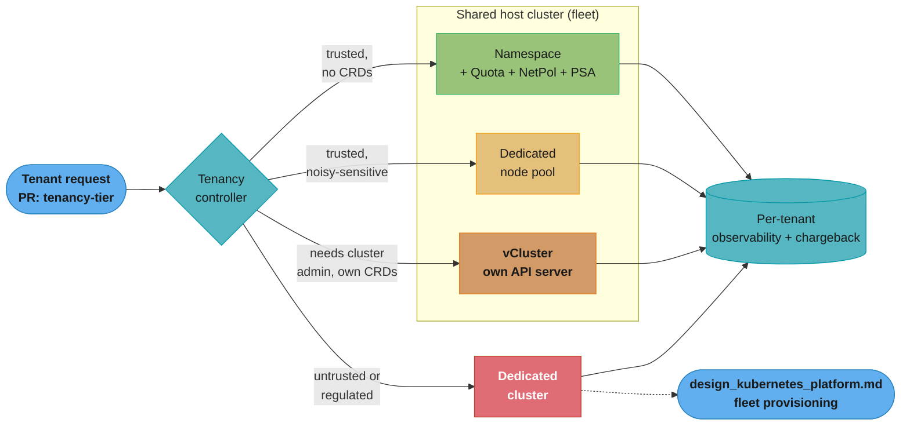
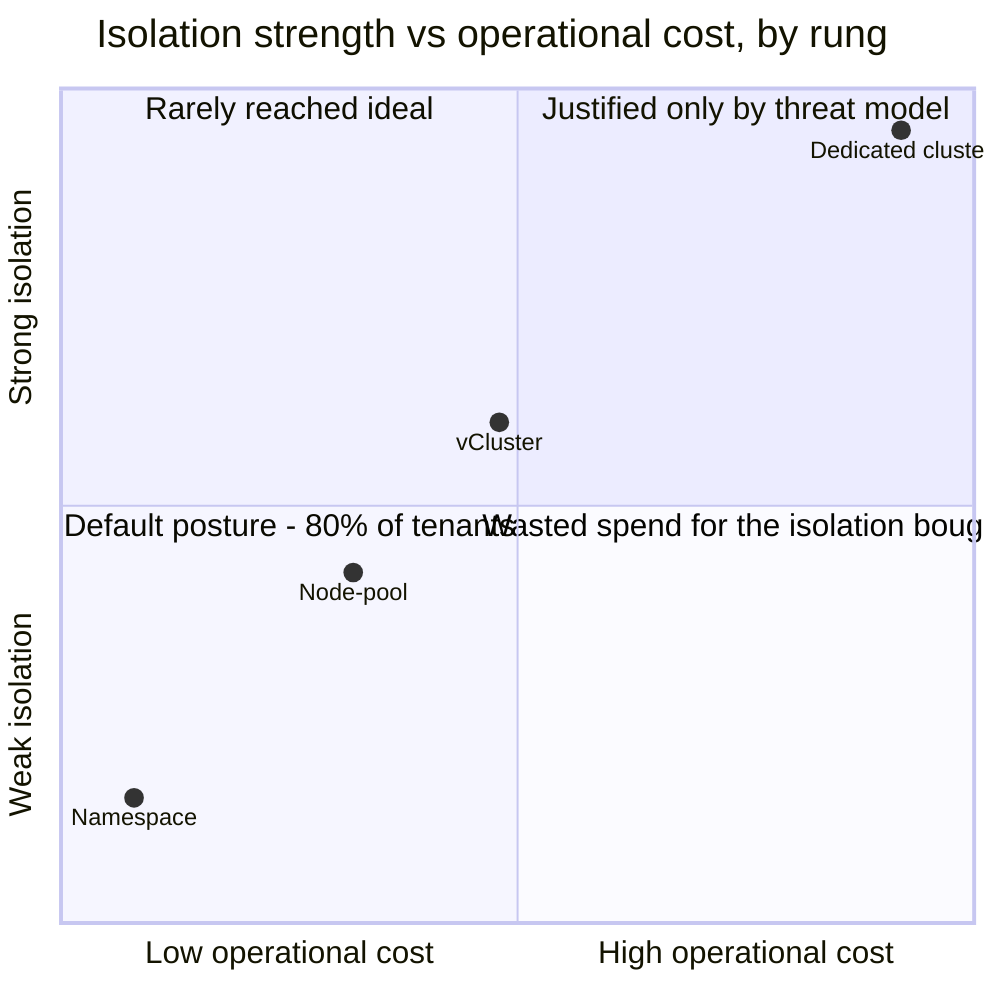

# Design a Multi-Tenant Platform — The Isolation Ladder

> **Version anchor (2026-08-27).** **Kubernetes NetworkPolicy** `networking.k8s.io/v1` (stable). **Pod Security Admission** stable since **v1.25**; `PodSecurityPolicy` was deprecated in **v1.21** and **removed in v1.25** — deprecated and removed are not the same claim, and this page never uses the first word for the second fact. **vCluster v0.27** ("Private Nodes") is the current release referenced below. **gVisor** (`runsc`) and **Kata Containers** (QEMU / Cloud Hypervisor / Firecracker) are cited from their own docs, not a vendor's marketing page. **Amazon EKS** control-plane price: **$0.10/cluster/hour**, standard support. Every apiVersion, price, and product claim below carries its own source and check-date; see the citation table at the end of this file's companion report.

**Key insight:** "How do we isolate tenants on Kubernetes?" has four different correct answers, and the interview trap is picking one and defending it forever. The right answer is a **ladder** — namespace, node-pool, virtual cluster, dedicated cluster — where each rung buys a specific, nameable guarantee at a specific, nameable cost, and the platform's job is routing each tenant to the cheapest rung that satisfies *their* threat model, not the platform's convenience.

---

## Intuition

A namespace is a filing cabinet, not a wall. Two tenants in the same cluster share a building: the same electrical grid (the kernel), the same fire alarm system (cluster-scoped RBAC and admission webhooks), the same elevator (the API server), and — if nobody built partitions — the same open floor plan (the pod network). A `Namespace` object gives every tenant their own drawer with a label on it. It does **not** give them their own building, and the single most common platform-design mistake is treating the drawer as if it were a locked room.

**The four rungs, in the order a real platform reaches for them:**

```
Cost / operational burden  ----------------------------------------------->
Namespace  --->  Node pool  --->  vCluster  --->  Dedicated cluster
(soft)           (soft+kernel)    (control-plane)  (hard)

Isolation strength  ------------------------------------------------------>
```

1. **Namespace-per-tenant** — a logical boundary inside one shared API server, one shared etcd, one shared set of nodes. Cheap, fast, and leaky at exactly the points namespaces were never designed to cover: CRDs, admission webhooks, cluster-scoped RBAC, and the Linux kernel itself.
2. **Node-pool-per-tenant** — same shared API server and etcd, but the tenant's pods are pinned (taint/toleration + `nodeSelector`/affinity) to nodes no other tenant can schedule onto. Closes the *kernel* and *noisy-neighbor* gap namespaces leave open, at the cost of bin-packing efficiency.
3. **Virtual cluster (vCluster)** — the tenant gets their own API server, their own etcd (or SQLite/embedded store), their own CRDs and cluster-scoped RBAC, running as pods inside a host namespace. A syncer projects the subset of objects that need real infrastructure (pods, services) down into the host cluster. Closes the *control-plane* gap. Does **not** close the kernel gap — the syncer still schedules real pods onto real, shared host nodes, running the same host kernel, unless paired with a sandboxed runtime or dedicated node pool.
4. **Cluster-per-tenant** — the tenant gets a real, physically separate control plane and (usually) dedicated nodes. Closes every gap. Costs a full control plane and a full upgrade/patch/on-call burden per tenant.

**Mental model — pick the rung by asking two questions, not by counting tenants:** *Does this tenant need to install their own CRDs / cluster-scoped RBAC / operators?* and *what is on the other side of the isolation boundary — a coworker's misconfigured Job, or an adversary's exploit code?* A trusted internal team with no CRD need stays on a namespace even at 500 engineers. An untrusted plugin or a regulator-mandated boundary jumps straight to a dedicated cluster even at team size one. Tenant *count* decides how many rungs you need in the ladder; tenant *threat model* decides which rung each tenant lands on.

This case study assumes the control-plane and admission mechanics in [../kubernetes_architecture/kubernetes_architecture.md](../kubernetes_architecture/kubernetes_architecture.md) and [../kubernetes_security/kubernetes_security.md](../kubernetes_security/kubernetes_security.md), and builds directly on the fleet-and-onboarding design in [design_kubernetes_platform.md](design_kubernetes_platform.md) — that case study answers "how do 50 clusters serve 200 tenants"; this one answers "which of the four isolation rungs does any one tenant belong on, and why."

---

## 1. Requirements Clarification

### Functional requirements

- **Self-service tenant onboarding at any rung.** A team requests a tenancy tier (namespace / node-pool / vCluster / dedicated cluster) via a PR; the platform provisions the corresponding isolation primitives without a ticket.
- **A published, testable threat model per rung.** Each rung's guarantee is written down as a table of "what this stops" and "what this does not stop" (§4.1), not tribal knowledge.
- **Resource fairness.** No tenant's workload can starve another tenant of CPU, memory, or scheduler throughput, at any rung.
- **Network fencing.** No tenant's pod can reach another tenant's pod or service unless explicitly allowed, at any rung.
- **A kernel-boundary option.** For a tenant class the platform does not trust to run arbitrary code on a shared kernel (external plugins, marketplace apps, an ML notebook running user-submitted code), the platform must offer a sandboxed or VM-isolated runtime, not just a network/RBAC boundary.
- **Per-tenant observability and chargeback.** Every tenant's CPU/memory/storage/network spend is attributable to a cost center, at every rung, with a documented allocation method for shared cluster overhead.
- **Migration between rungs.** A tenant that outgrows its rung (adds a CRD requirement, changes threat class) can be moved up without a service rewrite.
- **A decision framework, not a policy.** The platform publishes the *criteria* for rung placement (threat model + CRD/cluster-scoped-resource need), and applies it consistently rather than case-by-case negotiation.

### Non-functional requirements

| NFR | Target |
|-----|--------|
| Tenants served | 300 (mix of internal teams, one regulated business unit, one external-plugin surface) |
| Rung distribution (typical mature platform) | ~80% namespace, ~12% node-pool, ~7% vCluster, ~1% dedicated cluster |
| Namespace tenant onboarding | p95 < 5 min from PR merge to ready |
| vCluster tenant onboarding | p95 < 15 min (control-plane pods must reach Ready) |
| Dedicated-cluster onboarding | < 30 min end-to-end (reuses the fleet provisioning path in [design_kubernetes_platform.md](design_kubernetes_platform.md)) |
| Cost-allocation accuracy | ≥ 90% of spend mapped to a cost center (namespace-proportional allocation, shared-namespace costs split and disclosed) |
| Network-policy admission | Every tenant namespace has both `Ingress` and `Egress` default-deny within 60s of creation — no window where a namespace is unfenced |
| Noisy-neighbor blast radius | A single tenant's runaway workload affects at most its own rung: its own node pool (rung 2+) or nothing outside its `ResourceQuota` (rung 1) |
| Kernel-isolated workload overhead budget | < 20% p99 latency tax vs native runc, for the ~5% of workloads that need it |
| Platform team size | 6 engineers own the tenancy ladder as a sub-product of the fleet platform in [design_kubernetes_platform.md](design_kubernetes_platform.md) |

### Out of scope

- Cluster and fleet lifecycle itself (provisioning, upgrades, multi-region placement) — that is [design_kubernetes_platform.md](design_kubernetes_platform.md) in full; this case study only covers the tenant-facing isolation axis.
- CI/CD pipeline isolation — [design_ci_cd_platform.md](design_ci_cd_platform.md).
- Secrets distribution — [design_secrets_management_platform.md](design_secrets_management_platform.md).
- Application-level multi-tenancy (a SaaS product's own row-level tenant isolation inside one database) — a different, adjacent problem this platform does not solve.
- Non-Kubernetes tenancy (VM-per-tenant, serverless-per-tenant) — noted for contrast in §5 only.

A reader who has not yet read [design_kubernetes_platform.md](design_kubernetes_platform.md) can still follow this case study end to end — every cross-reference into it names the specific mechanism borrowed (cluster provisioning, GitOps reconciliation, fleet observability) rather than assuming familiarity with its own numbering. The reverse is not true: that case study's own Decision 1 covers three of this ladder's four rungs at survey depth, and a reader who wants the full threat-model reasoning behind picking one is the reader this file is for.

---

## 2. Scale Estimation

### Tenant distribution across the ladder

```
Total tenants:                 300
  Namespace-per-tenant  (80%):  240   trusted internal teams, no CRD need
  Node-pool-per-tenant  (12%):   36   noisy-neighbor-sensitive or license-bound (GPU, per-core software)
  vCluster              (7%):    21   need cluster-admin semantics: their own CRDs/operators, or a
                                       staging environment that must look like a real cluster to test on
  Dedicated cluster     (1%):     3   one regulated business unit (data-residency boundary),
                                       one external-plugin surface (untrusted code), one M&A integration
```

This 80/12/7/1 split is the shape a mature platform converges to — not a target to engineer toward on day one. A platform that starts by handing out vClusters "to be safe" pays rung-3 overhead for rung-1 threat models; a platform that starts everyone on namespaces and *escalates on request* (§5's decision framework) lands here naturally within 12-18 months.

### Per-rung overhead math

```
Namespace-per-tenant:
  API-server/etcd overhead per tenant:      ~0 (shares the fleet's existing control plane)
  Extra objects per tenant:                 Namespace + ResourceQuota + LimitRange +
                                             2 NetworkPolicies + RoleBindings ≈ 6 objects, ~4 KiB
  240 tenants:                              ~1,440 objects, ~1 MiB — negligible against the
                                             fleet's per-cluster etcd budget (see design_kubernetes_platform.md §2)

Node-pool-per-tenant:
  Minimum viable pool:                      3 nodes (HA against a single node failure)
  36 tenants x 3 nodes x m5.2xlarge:        108 nodes dedicated, vs. shared-pool bin-packing
  Bin-packing loss vs. shared pool:         typically 25-40% idle headroom per dedicated pool
                                             (can't borrow slack across tenant boundaries)

vCluster:
  Control-plane pods per tenant:            API server + (etcd or embedded store) + syncer,
                                             roughly 3 pods, low hundreds of MiB of memory and
                                             a fraction of a vCPU at idle -- an order of magnitude
                                             cheaper than a real control plane, not free
  21 tenants:                               ~21 x 3 = 63 extra pods on the host cluster's
                                             existing node pools (no dedicated nodes required
                                             unless paired with rung 2)

Dedicated cluster:
  Control plane (EKS, verified):            $0.10/cluster/hour x 730h = $73/cluster/month
  3 clusters:                               $219/month in control-plane fees alone --
                                             trivial next to node cost, but each cluster also
                                             carries its OWN full upgrade/patch/on-call burden,
                                             which is the real cost (see §9)
```

The control-plane dollar cost of a dedicated cluster is a rounding error ($73/month); the reason it is the *last* rung, not the second, is operational — every dedicated cluster is a fleet of one that the platform team must upgrade, patch CVEs on, and carry pager duty for, independent of the shared fleet's cadence.

### vCluster control-plane HA — the overhead number a single-replica estimate misses

The "~3 pods per tenant" figure above assumes a single-replica vCluster, which is a reasonable default for a dev/staging vCluster but not for one backing a production workload. A production vCluster runs its API server and store as a multi-replica `Deployment`/`StatefulSet` the same way any production control plane would:

```
Single-replica vCluster (dev/staging):    ~3 pods   (API server, store, syncer)
HA vCluster (production):                 ~6-7 pods (2x API server, 2-3x store
                                                       replicas for quorum, syncer)
21 vCluster tenants at a 60/40 dev-prod split:
  13 dev/staging @ ~3 pods:                39 pods
   8 production  @ ~7 pods:                56 pods
  Total:                                   95 pods -- not the flat 63 the
                                            single-replica estimate gives

Memory, roughly (low hundreds of MiB per pod, API-server-heavy):
  95 pods x ~250 MiB average:              ~24 GiB fleet-wide -- still a
                                            fraction of one shared node pool's
                                            capacity, but the HA multiplier is
                                            the number a capacity review (§10)
                                            needs, not the dev-only estimate.
```

This is the same lesson as the etcd math in [design_kubernetes_platform.md](design_kubernetes_platform.md) §2 applied one layer down: a per-tenant overhead number that looks negligible in aggregate still needs its *worst-case* multiplier stated explicitly, or a capacity review under-provisions the exact pool that absorbs it.

### Node cost reference (verified)

```
m5.2xlarge on-demand, us-east-1:  $0.384/hour  (AWS EC2 on-demand; cross-checked against
                                                 instances.vantage.sh, updated 2026-07-22;
                                                 checked here 2026-08-27)
36 dedicated node-pool tenants x 3 nodes x $0.384/hr x 730h:   ~$151,300/month
  vs. the same 108 nodes' worth of capacity shared in a bin-packed pool
      at typical 70% utilization:                              ~$105,900/month
Dedicated-pool premium for rung 2:                              ~$45,400/month, ~43% over shared
```

That premium is the price of the noisy-neighbor guarantee for the 12% of tenants who need it — and the number a platform team should be able to say out loud when a tenant asks for a dedicated pool "just in case."

### Isolation-gap-closed math (the interview framing)

```
                      CRDs/RBAC   Kernel      Control       Etcd/API
                      isolated?   isolated?   plane isolated? isolated?
Namespace                NO          NO           NO            NO
Node-pool                NO          YES          NO            NO
vCluster                 YES         NO*          YES           partial
Dedicated cluster        YES         YES**         YES           YES

 *  unless paired with node-pool or a sandboxed runtime (§4.7)
 ** only if nodes are also dedicated per tenant, not merely per cluster on shared hardware
```

Reading this table left to right per row is the entire interview answer to "why not just always use vClusters": a vCluster closes two of four gaps (CRDs/RBAC and control-plane) and leaves the kernel gap exactly as open as a namespace does, unless you spend a *second* rung's budget stacking it on a dedicated node pool.

---

## 3. High-Level Architecture



The **tenancy controller** is the single decision point: it reads a tenant's declared threat class and CRD requirement from its onboarding request and routes to exactly one rung. All four rungs report into the same per-tenant observability and chargeback pipeline (§8), so cost and health are comparable across rungs even though the isolation mechanics differ completely.

### Component inventory

| Component | Role |
|-----------|------|
| **Tenancy controller** (`Tenant` CRD + controller) | Reads the tenant's declared threat class + CRD need; renders the namespace/quota/netpol/PSA bundle, a node-pool claim, a vCluster HelmRelease, or hands off to fleet cluster provisioning. |
| **Namespace bundle** | `Namespace` + `ResourceQuota` + `LimitRange` + default-deny `NetworkPolicy` pair + Pod Security Admission labels + `RoleBinding` (§4.2-§4.4). |
| **Node-pool claim** | Karpenter `NodePool`/`NodeClass` scoped by taint + tenant label, paired with tenant-side `tolerations` + `nodeAffinity` (§4.5). |
| **vCluster control plane** | `vcluster` Helm chart running an API server + store + syncer as pods in a host namespace (§4.6). |
| **Sandboxed `RuntimeClass`** | gVisor (`runsc`) or Kata Containers `RuntimeClass` objects, selectable per-pod for the kernel-isolation rung (§4.7). |
| **Policy engine** | Kyverno/OPA Gatekeeper admission, identical to [design_kubernetes_platform.md](design_kubernetes_platform.md) §4.4 — enforced at every rung, including inside a vCluster's own API server. |
| **Cost pipeline** | OpenCost (CNCF incubating) aggregating per-namespace, per-node-pool, and per-vCluster spend into chargeback reports (§8). |

### Data flow — a tenant requesting the vCluster rung

1. Team opens a PR declaring `tier: vcluster`, justification `"ships our own CRDs (Argo Rollouts, custom operator)"`.
2. CI runs a policy check: does the justification match an approved reason code (CRD need, cluster-admin need, isolated staging)? If not, the PR is auto-rejected with a link to the decision framework in §5.
3. On merge, the tenancy controller renders a `HelmRelease` for the `vcluster` chart into a fresh host namespace, with `ResourceQuota`/`LimitRange`/`NetworkPolicy` applied to that host namespace exactly as a namespace tenant would get them (§4.6) — the vCluster's blast radius on the host is still fenced like any other namespace.
4. The tenant receives a `kubeconfig` pointed at the vCluster's own API server (exposed via a ClusterIP + Ingress or a local port-forward for dev).
5. Inside their vCluster, the tenant has cluster-admin: they install their own CRDs, RBAC, and operators, invisible to every other tenant.
6. The syncer projects `Pod`, `Service`, and a configured allowlist of other object kinds down into the host namespace as real, scheduled, quota-bound workloads.

---

## 4. Component Deep Dives

### 4.1 What a namespace isolates — and what it does not

This is the table every platform engineer should be able to recite, because it is also the table every "just use namespaces" answer in an interview is missing.

| Boundary | Namespace isolates it? | Why / why not |
|----------|------------------------|----------------|
| Object names within the tenant | Yes | `Namespace` is the K8s scoping unit for named objects (Pods, Services, ConfigMaps...). |
| RBAC via `Role`/`RoleBinding` | Yes, if authored correctly | Namespace-scoped roles bind only within the namespace — but a `ClusterRoleBinding` or an over-broad `ClusterRole` reference breaks this silently. |
| CRDs (`CustomResourceDefinition`) | **No** | CRDs are cluster-scoped. Two tenants cannot each install a CRD of the same name with different schemas, and one tenant's operator can watch and mutate every namespace's custom resources unless its RBAC is deliberately narrowed. |
| Admission webhooks (validating/mutating) | **No** | A `ValidatingWebhookConfiguration`/`MutatingWebhookConfiguration` is cluster-scoped and, unless scoped with a `namespaceSelector`, runs against every tenant's objects — a buggy tenant-authored webhook can break admission fleet-wide. |
| Cluster-scoped RBAC visibility | **No** | Nothing stops a tenant with only namespace-level `edit` from calling `kubectl get namespaces` or `kubectl get nodes` — that information is not namespace-scoped and is visible cluster-wide by default. |
| Linux kernel / node | **No** | Every pod on a shared node shares that node's kernel, cgroups implementation, and any kernel-level CVE surface. A container-escape exploit crosses the namespace boundary instantly because the boundary was never a kernel boundary. |
| CPU/memory fairness (noisy neighbor) | **Only with `ResourceQuota` + `LimitRange`** | An empty namespace has zero resource ceiling; see §4.2's broken example. |
| Network reachability | **Only with `NetworkPolicy`** | Kubernetes' default is flat, fully-routable pod networking; see §4.3. |
| etcd / API-server availability | **No** | A tenant that floods the API server (a `kubectl apply` loop, a leaking controller) degrades the shared control plane for everyone, regardless of namespace. |

Six of nine rows are "no" or "only if you built the fence yourself." That is the honest scope of a namespace: it is an addressing and RBAC-scoping primitive, not a security boundary. Everything from here to §4.7 is the platform closing those gaps one at a time.

The cluster-scoped-visibility row is easy to underestimate until it is demonstrated. A tenant granted nothing but namespace-scoped `edit` in their own namespace can still run:

```
kubectl get namespaces                  # every tenant's namespace name, labels included
kubectl get nodes                       # fleet node inventory, instance types, capacity
kubectl get crds                        # every CRD any tenant has installed, cluster-wide
kubectl get clusterrolebindings         # who has what cluster-scoped access, org-wide
```

None of those four calls touch a namespace-scoped RBAC verb — `Namespace`, `Node`, `CustomResourceDefinition`, and `ClusterRoleBinding` are themselves cluster-scoped objects, so `list`/`get` on them is governed by a `ClusterRole`, not the tenant's namespace-local `Role`. A platform that grants the built-in `edit` `ClusterRole` via a namespace-scoped `RoleBinding` (exactly as §4.2's fixed manifest does) is deliberately narrow: `edit` carries no permission on cluster-scoped resource *types*, so those four commands return only what any authenticated user can already see, which is itself worth stating explicitly rather than assuming — "no RBAC grant" is not the same claim as "no visibility," and the difference is what a tenant onboarding a CRD (§4.6) needs a vCluster to actually change.

### 4.2 ResourceQuota and LimitRange — the BROKEN → FIX that defines soft multi-tenancy

A common near-miss: a platform team adds a `ResourceQuota` (learning from the bare-namespace mistake) but forgets `LimitRange`, believing the quota alone is the fix.

```yaml
# BROKEN: a ResourceQuota with no LimitRange. Looks safe. Is not.
apiVersion: v1
kind: ResourceQuota
metadata:
  name: team-search-quota
  namespace: team-search
spec:
  hard:
    requests.cpu: "32"
    requests.memory: 128Gi
    pods: "200"
```

What goes wrong: `ResourceQuota` only *caps* aggregate usage — it does not *set* a default for pods that specify no `resources.requests` at all. A single pod with no requests is scheduled as `BestEffort` and, critically, **a namespace-wide `ResourceQuota` on `requests.cpu`/`requests.memory` requires every pod in that namespace to declare requests, or the pod is rejected outright at admission** — so the failure mode is not silent starvation, it is every unrequested-resource pod across the team's CI/CD suddenly failing to schedule the moment quota lands, usually discovered at 2 a.m. when a hotfix Deployment cannot roll out. Teams "fix" this by hand-adding huge `requests` to unblock themselves, and one over-provisioned Job (`requests.cpu: "30"`) now consumes 94% of the whole namespace's quota by itself — functionally the same starvation the quota was meant to prevent, just self-inflicted.

```yaml
# FIXED: ResourceQuota paired with LimitRange, so every pod gets a sane
# default the moment it omits requests/limits, and no single container
# can claim the whole namespace's ceiling.
apiVersion: v1
kind: ResourceQuota
metadata:
  name: team-search-quota
  namespace: team-search
spec:
  hard:
    requests.cpu: "32"
    requests.memory: 128Gi
    limits.cpu: "64"
    limits.memory: 256Gi
    pods: "200"
    count/jobs.batch: "40"
---
apiVersion: v1
kind: LimitRange
metadata:
  name: team-search-defaults
  namespace: team-search
spec:
  limits:
    - type: Container
      default:        { cpu: 500m, memory: 512Mi }   # applied if a container omits limits
      defaultRequest: { cpu: 100m, memory: 128Mi }    # applied if a container omits requests
      max:            { cpu: "4",  memory: 8Gi }      # no single container can eat the quota
      min:            { cpu: 50m,  memory: 64Mi }
```

`LimitRange`'s `max` field is the line that actually prevents one Job from consuming the whole team's quota — without it, `ResourceQuota` bounds the *aggregate*, but nothing bounds any one *container's* share of that aggregate.

### 4.3 NetworkPolicy default-deny — the second BROKEN → FIX

The most common "we have default-deny" claim that is not actually default-deny:

```yaml
# BROKEN: looks like default-deny. Silently breaks DNS and every egress call,
# and does NOT deny ingress at all, because policyTypes omits it.
apiVersion: networking.k8s.io/v1
kind: NetworkPolicy
metadata:
  name: default-deny
  namespace: team-payments
spec:
  podSelector: {}
  egress: []
```

Two separate bugs stack here. First, `policyTypes` was never set — Kubernetes infers it from which of `ingress`/`egress` are present, so an empty `egress: []` with no `policyTypes` field silently defaults to `policyTypes: [Egress]` only, leaving **ingress completely open**, the opposite of what the name implies. Second, even once `policyTypes: [Ingress, Egress]` is added correctly, an empty `egress: []` blocks **all** egress including DNS lookups to CoreDNS on UDP/53 — every pod in the namespace starts failing DNS resolution within seconds, which looks like a random outage, not a policy change, because nothing in the pod's own logs mentions NetworkPolicy.

```yaml
# FIXED: explicit policyTypes for both directions, and DNS carved out
# before anything else, so egress-deny does not double as a self-inflicted
# DNS outage.
apiVersion: networking.k8s.io/v1
kind: NetworkPolicy
metadata:
  name: default-deny-all
  namespace: team-payments
spec:
  podSelector: {}
  policyTypes: [Ingress, Egress]
  ingress: []
  egress: []
---
apiVersion: networking.k8s.io/v1
kind: NetworkPolicy
metadata:
  name: allow-dns
  namespace: team-payments
spec:
  podSelector: {}
  policyTypes: [Egress]
  egress:
    - to:
        - namespaceSelector:
            matchLabels: { kubernetes.io/metadata.name: kube-system }
      ports:
        - { protocol: UDP, port: 53 }
        - { protocol: TCP, port: 53 }
---
apiVersion: networking.k8s.io/v1
kind: NetworkPolicy
metadata:
  name: allow-same-tenant
  namespace: team-payments
spec:
  podSelector: {}
  policyTypes: [Ingress]
  ingress:
    - from:
        - namespaceSelector:
            matchLabels: { team: payments }
        - namespaceSelector:
            matchLabels: { kubernetes.io/metadata.name: ingress-system }
```

The ordering matters as a *template* discipline: the tenancy controller renders `default-deny-all` and `allow-dns` in the same reconciliation as the namespace itself (§4.4's Kyverno `generate` rule can auto-inject both), so there is never a window where a namespace exists without both policies — an unfenced namespace, even for 60 seconds, is exactly the noisy-neighbor and lateral-movement risk this whole section exists to close.

### 4.4 Pod Security Admission — the kernel-adjacent guardrail namespaces get for free

Pod Security Admission (PSA) has been stable since **Kubernetes v1.25** and replaced `PodSecurityPolicy`, which was deprecated in v1.21 and **removed** — not deprecated, removed, no fallback — in v1.25. PSA is a built-in admission controller driven entirely by three labels on the `Namespace` object itself, at one of three levels: `privileged`, `baseline`, `restricted`.

```yaml
apiVersion: v1
kind: Namespace
metadata:
  name: team-payments
  labels:
    team: payments
    cost-center: cc-4471
    pod-security.kubernetes.io/enforce: restricted   # blocks non-compliant pods at admission
    pod-security.kubernetes.io/audit: restricted      # logs would-be violations even if enforce is looser
    pod-security.kubernetes.io/warn: restricted       # surfaces a kubectl warning to the submitter
```

`restricted` forbids privileged containers, host namespaces (`hostNetwork`, `hostPID`, `hostIPC`), most capability additions, and requires a non-root, seccomp-profiled security context — it is the closest a namespace-only tenant gets to a kernel-adjacent guardrail without an actual kernel boundary. It is still not a kernel boundary: `restricted` reduces the *attack surface* a container needs to escalate out of, it does not stop a kernel-level 0-day from crossing to a sibling pod on the same node. That gap is what §4.7 closes.

### 4.5 Node-pool-per-tenant — closing the kernel-sharing gap without a new control plane

For the ~12% of tenants who are trusted (no vCluster/CRD need) but noisy-neighbor-sensitive — a GPU team whose batch jobs saturate a node, a licensing-bound workload that must not co-reside with other tenants' processes — dedicate a node pool instead of escalating to a virtual or real cluster:

```yaml
# Karpenter NodePool scoped to one tenant via taint; Karpenter only ever
# provisions this pool's nodes for pods that tolerate the taint.
apiVersion: karpenter.sh/v1
kind: NodePool
metadata:
  name: tenant-mlgrid-pool
spec:
  template:
    metadata:
      labels: { tenant: mlgrid }
    spec:
      taints:
        - key: tenant
          value: mlgrid
          effect: NoSchedule
      requirements:
        - key: node.kubernetes.io/instance-type
          operator: In
          values: [m5.2xlarge, m5.4xlarge]
  disruption:
    consolidationPolicy: WhenEmptyOrUnderutilized
---
# The tenant's own Deployment must explicitly opt into the pool.
apiVersion: apps/v1
kind: Deployment
metadata: { name: mlgrid-worker, namespace: team-mlgrid }
spec:
  template:
    spec:
      tolerations:
        - { key: tenant, value: mlgrid, effect: NoSchedule }
      affinity:
        nodeAffinity:
          requiredDuringSchedulingIgnoredDuringExecution:
            nodeSelectorTerms:
              - matchExpressions:
                  - { key: tenant, operator: In, values: [mlgrid] }
```

This closes the "shares a kernel with a stranger" gap the namespace rung leaves open (§4.1's table), because no other tenant's pod can land on these nodes at all — the taint plus the tenant's own toleration is a two-sided lock, not a preference. It does **not** close the CRD/control-plane gap; a node-pool tenant still shares the fleet's one API server, one etcd, and one set of CRDs with every namespace tenant. The cost is the ~43% bin-packing premium computed in §2 — paid specifically for kernel isolation, nothing else.

### 4.6 vCluster — closing the control-plane and CRD gap

```yaml
# HelmRelease for a vCluster: the tenant gets a real API server + CRDs +
# cluster-scoped RBAC, isolated from every other tenant's, while the host
# cluster still fences the vCluster's own blast radius like any namespace.
apiVersion: helm.toolkit.fluxcd.io/v2
kind: HelmRelease
metadata: { name: vcluster-fraud-ml, namespace: vc-fraud-ml }
spec:
  interval: 10m
  chart:
    spec:
      chart: vcluster
      version: "0.27.x"
      sourceRef: { kind: HelmRepository, name: loft, namespace: flux-system }
  values:
    controlPlane:
      distro:
        k8s: { enabled: true }        # real upstream kube-apiserver, not k3s, for CRD parity
    sync:
      toHost:
        ingresses: { enabled: true }
        networkPolicies: { enabled: true }   # the tenant can author their OWN NetworkPolicies
      fromHost:
        nodes: { enabled: true, selector: { labels: { tier: general } } }
    policies:
      resourceQuota:
        enabled: true
        quota: { requests.cpu: "32", requests.memory: 128Gi, count/pods: "200" }
      limitRange: { enabled: true }
      networkPolicy: { enabled: true }   # host-side fence: default-deny on the host namespace itself
```

Inside their vCluster, the `fraud-ml` team installs their own CRDs (say, a custom feature-store operator), grants themselves cluster-admin *within that virtual cluster*, and runs a staging environment that behaves exactly like a real cluster for testing operator upgrades — none of which a namespace tenant could safely do without risking every other tenant's CRDs. The syncer translates their `Pod` objects down to real pods in the `vc-fraud-ml` host namespace, which — critically — is *itself* wrapped in the same `ResourceQuota`/`LimitRange`/`NetworkPolicy` bundle as any namespace tenant (§4.2-§4.3). **A vCluster is a namespace tenant from the host's point of view, with a control plane running inside it** — that framing is the fastest way to answer "does a vCluster replace namespace isolation" (no, it sits on top of it) and "does a vCluster isolate the kernel" (no, unless its pods also land on a dedicated node pool or a sandboxed `RuntimeClass`, per §4.5/§4.7).

Overhead is real but an order of magnitude below a second real cluster: the API server, store, and syncer are three additional pods per tenant on the host's existing node pools, not three additional nodes.

### 4.7 gVisor and Kata Containers — the actual kernel boundary

Neither the namespace rung, the node-pool rung, nor the vCluster rung changes *which kernel* a container's syscalls hit. For the ~5% of workloads whose threat model is "this container may be running exploit code" (a marketplace plugin, a user-submitted notebook, a public-facing PR-preview environment), the platform swaps the container **runtime**, not the tenancy rung, via Kubernetes' `RuntimeClass`.

```
Isolation stack, bottom to top:

  Hardware  ------------------------------------------------------------
  Host kernel  -----------------------------------------------------
    runc (default)        : container process talks DIRECTLY to host
                             kernel syscalls -- a kernel exploit reaches
                             every co-located pod's kernel instantly
    -----------------------------------------------------------------
    gVisor (runsc)         : container syscalls hit Sentry, a userspace
                             kernel written in Go -- most syscalls never
                             reach the real host kernel at all
    -----------------------------------------------------------------
    Kata Containers         : container runs inside its OWN lightweight
                             VM (QEMU / Cloud Hypervisor / Firecracker)
                             -- syscalls hit a real, but disposable and
                             hardware-isolated, guest kernel
  -----------------------------------------------------------------
  Same physical node, same host kernel underneath either sandbox
```

Neither sandbox needs a new node pool or a new cluster; both are selected per-pod:

```yaml
apiVersion: node.k8s.io/v1
kind: RuntimeClass
metadata: { name: gvisor }
handler: runsc
---
apiVersion: node.k8s.io/v1
kind: RuntimeClass
metadata: { name: kata-qemu }
handler: kata-qemu
---
# A tenant's workload opts into the sandbox with one field.
apiVersion: apps/v1
kind: Deployment
metadata: { name: plugin-runner, namespace: team-marketplace }
spec:
  template:
    spec:
      runtimeClassName: gvisor
```

Choosing between them is a syscall-interception-vs-virtualization tradeoff, not a "which is more secure" question — both are load-bearing in production at scale, for different threat shapes:

| | gVisor (`runsc`) | Kata Containers |
|---|---|---|
| Mechanism | Userspace kernel (Sentry) intercepts syscalls in Go | Lightweight VM per pod via hardware virtualization |
| Boundary strength | Strong for syscall-surface reduction; still shares the host kernel for what it does pass through | Strongest — a real hardware/hypervisor boundary, closest to a full VM |
| Startup overhead | Low — no VM boot | Higher — VM boot, though `Cloud Hypervisor`/Firecracker cut this to the low hundreds of ms |
| Syscall/IO-heavy workload tax | Higher — every intercepted syscall pays a userspace round trip | Lower once booted — near-native inside the guest |
| Where it fits this ladder | Default sandboxed rung: most untrusted-code cases, low overhead budget | Reach for it when the threat model explicitly includes "assume the sandbox itself can be broken" |

The practical guidance for a platform team: gVisor first, because its overhead is closer to native and it covers the overwhelming majority of "I don't trust this container's code" cases; escalate to Kata only for the workloads whose compliance or threat model requires a real hypervisor boundary, the same "escalate on justified request" pattern as the rung ladder itself.

### 4.8 Migrating a tenant between rungs

Rung placement is not permanent — a namespace tenant that starts shipping their own operator, or a node-pool tenant whose workload turns out to need cluster-admin semantics, escalates without a service rewrite. The migration path differs by direction because the rungs are not nested supersets of each other in every dimension (§2's isolation-gap table: vCluster and node-pool close *different* gaps, so "upgrading" from one to the other is not strictly linear).

```
Namespace  ->  Node-pool:    add a NodePool claim + toleration/affinity to the tenant's
                              existing Deployments. No object schema changes, no data
                              migration -- the workload's Service/ConfigMap/Secret objects
                              are untouched. Typically a same-day change.

Namespace  ->  vCluster:     the tenant's EXISTING objects do not move automatically --
                              a vCluster is a new, empty API server. The tenant's manifests
                              are re-applied (via the same GitOps repo, re-pointed at the
                              vCluster's kubeconfig) rather than migrated object-by-object.
                              PersistentVolumeClaims bound to real storage need an explicit
                              data-copy step, since the vCluster's PVC is a NEW claim that
                              the syncer projects to a NEW host-side PVC.

Node-pool  ->  vCluster:      same as Namespace -> vCluster, PLUS the node-pool claim is
                              released once the vCluster's own workloads (synced to the
                              host) are confirmed healthy -- do not release capacity before
                              confirming, or the migration's own rollback path disappears.

vCluster   ->  Dedicated
cluster:                      closest thing to a "real" migration in the traditional sense:
                              a new cluster is provisioned (design_kubernetes_platform.md
                              §4.1), the vCluster's manifests are re-applied against it, and
                              data is copied via the same PVC-snapshot mechanism any
                              cluster-to-cluster migration uses. The vCluster's control-plane
                              pods are torn down only after the new cluster passes the same
                              golden-path smoke test every new fleet cluster passes.
```

The practical rule: **escalating a rung is a re-apply, not an in-place upgrade**, except for the namespace-to-node-pool case, which is genuinely in-place because it adds scheduling constraints without touching the API objects themselves. Any migration touching stateful data (a `PersistentVolumeClaim`) needs an explicit copy step regardless of which two rungs are involved, because a new API server — real or virtual — always means a new object identity for anything the syncer or cluster boundary re-creates rather than merely re-schedules.

### 4.9 Cluster-per-tenant — the rung of last resort

Reuses the fleet cluster-provisioning path from [design_kubernetes_platform.md](design_kubernetes_platform.md) §4.1 verbatim — a `Cluster`/`AWSManagedControlPlane` via Cluster API. What is different here is *when* this case study routes a tenant to it: only when the threat model or a regulatory boundary makes even a vCluster-plus-sandboxed-runtime combination insufficient — genuinely untrusted code with a data-residency requirement, or a compliance regime that mandates a physically separate control plane and cannot be satisfied by a logical one, however strong. At $73/month in control-plane fees this is never a cost decision; it is always an operational-burden decision, because every dedicated cluster inherits its own upgrade cadence, patch cycle, and on-call rotation independent of the shared fleet (§9).

---

## 5. Design Decisions & Tradeoffs

### Decision 1 — Default rung: namespace, with an explicit escalation path

- **Decision:** Every new tenant starts on a namespace. Escalation to node-pool, vCluster, or dedicated cluster requires a written justification matching one of three reason codes: **noisy-neighbor sensitivity** (→ node-pool), **CRD/cluster-admin need** (→ vCluster), **untrusted code or regulatory boundary** (→ sandboxed runtime or dedicated cluster).
- **Alternatives considered:** vCluster-by-default ("give everyone their own cluster-like thing") — pays rung-3 control-plane overhead for the 80% of tenants who never touch a CRD. Cluster-per-tenant-by-default — the 200x-control-plane mistake namespaces exist to avoid.
- **Rationale:** The isolation-gap table in §2 shows each rung closes a specific gap at a specific cost; defaulting to the cheapest rung and escalating on evidence keeps the platform's aggregate cost close to the 80/12/7/1 distribution instead of inflating toward vCluster-for-everyone.
- **Consequences:** Requires the platform to actually enforce the reason-code check at PR time (§3's onboarding flow), or "just in case" escalation requests creep the distribution upward over time — the single most common way a mature tenancy ladder degrades.

### Decision 2 — vCluster distro: real `k8s`, not `k3s`, for CRD parity

- **Decision:** Run the vCluster control plane on the `k8s` distro (real upstream `kube-apiserver`), not the lighter `k3s` distro vCluster also supports.
- **Alternatives:** `k3s` — smaller footprint, faster to start, but historically diverges from upstream API behavior on some CRD and admission-webhook edge cases, which defeats the exact reason a tenant escalated to this rung (CRD parity with a real cluster).
- **Rationale:** Tenants choosing vCluster over a namespace are choosing it specifically because they need cluster-admin/CRD semantics that behave like production; a distro that diverges from upstream reintroduces the gap this rung exists to close.
- **Consequences:** Slightly higher per-tenant control-plane footprint than `k3s` would give; still an order of magnitude below a dedicated cluster (§2).

### Decision 3 — Sandboxed runtime is a per-pod `RuntimeClass`, not a separate tenancy rung

- **Decision:** gVisor/Kata selection is orthogonal to the namespace/node-pool/vCluster/cluster ladder — any tenant at any rung can run specific workloads under a sandboxed `RuntimeClass` without changing rung.
- **Alternatives:** Treat "sandboxed" as a fifth rung with its own onboarding path — adds a decision axis that does not actually correlate with the CRD-need axis the other four rungs are organized around.
- **Rationale:** The kernel-boundary question ("do I trust this specific container's code") and the control-plane question ("does this tenant need their own API server") are independent; a namespace tenant running a user-submitted-code feature needs gVisor with zero relationship to whether they also need a vCluster.
- **Consequences:** Two independent decisions to teach, not one — documented explicitly in §1's "ask two questions" framing precisely so this does not collapse into a single, wrong axis.

### Decision 4 — LimitRange is mandatory wherever ResourceQuota is applied

- **Decision:** The tenancy controller's namespace template refuses to render a `ResourceQuota` without a paired `LimitRange` — enforced at the template level, not left to tenant discipline.
- **Alternatives:** `ResourceQuota` alone, documented as "best practice" to pair with `LimitRange` — the §4.2 war story is exactly what happens once "best practice" meets a deadline.
- **Rationale:** The single most common noisy-neighbor incident starts with a quota that bounds the aggregate but not any one container's share of it.
- **Consequences:** None material — both objects are cheap and idempotent to render together.

### Decision 5 — The reason-code gate is a CI check, not a review-time suggestion

- **Decision:** A rung-escalation request (node-pool, vCluster, dedicated cluster) is machine-checked against one of the reason codes in Decision 1 at PR time; a request with no matching reason code fails CI, not human review.
- **Alternatives:** Leave the reason-code framework as documented guidance a platform engineer applies during PR review — the §9 "vCluster creep" pitfall is the measured cost of exactly this alternative: a documented-but-unenforced gate drifted from 7% to 19% vCluster share in twelve months.
- **Rationale:** A judgment call applied inconsistently by whichever engineer happens to review a given PR degrades under review-queue pressure; a machine check degrades only if the check itself is removed, which is a visible, auditable event.
- **Consequences:** The reason-code taxonomy must stay small and precise enough to encode as a check (three codes, §5's Decision 1) — a framework that needs six exception clauses to describe is a framework nobody can automate, which is itself a signal the rungs need re-thinking, not the check.

### Comparison table — all four rungs

| Dimension | Namespace | Node-pool | vCluster | Dedicated cluster |
|-----------|-----------|-----------|----------|--------------------|
| CRDs / cluster-scoped RBAC isolated | No | No | **Yes** | Yes |
| Kernel isolated | No | **Yes** | No (unless stacked with node-pool/sandbox) | Yes |
| Control plane isolated | No | No | **Yes** (own API server) | Yes |
| Marginal cost per tenant | ~0 | ~43% node premium (§2) | Few hundred MiB, fraction of a vCPU | $73/mo control plane + full node cost + on-call |
| Onboarding latency (p95) | < 5 min | < 10 min | < 15 min | < 30 min |
| Operational burden added to platform team | None | Pool sizing only | Chart upgrades, syncer edge cases | Full upgrade/patch/on-call per cluster |
| Right threat model | Trusted, no CRDs | Trusted, noisy-sensitive | Trusted, needs cluster-admin | Untrusted or regulator-bound |



300 tenants land bottom-left by default. The two middle rungs exist for the two orthogonal gaps namespaces leave — kernel (node-pool) and control-plane (vCluster) — and only the 1% with a genuine regulatory or untrusted-code boundary justify the top-right corner.

### Decision framework — the one paragraph an interviewer wants back

Pick the rung by answering two questions, never by tenant headcount: **(1) Does this tenant need to install CRDs, cluster-scoped RBAC, or otherwise act as if they own the API server?** If yes, they need at least a vCluster. **(2) What is on the other side of the boundary — a coworker's misconfigured Job, or an adversary's exploit code?** If the latter, they need a kernel boundary (node-pool minimum, sandboxed runtime or dedicated cluster for genuinely untrusted code), independent of question 1's answer. A tenant that answers "no" and "coworker" stays on a namespace forever, however large the team gets.

Walking three tenants through the framework makes the matrix concrete:

- **`team-checkout`** (200 engineers, no CRDs, internal-only code): CRD need = no, threat = coworker. Stays on a namespace. Team size never enters the decision.
- **`team-ml-platform`** (12 engineers, ships a custom Kubeflow-style operator with its own CRDs, entirely internal code): CRD need = yes, threat = coworker. Lands on a vCluster — cluster-admin semantics, no kernel boundary needed.
- **`marketplace-plugins`** (3 engineers, hosts third-party-submitted plugin code, no CRDs of their own): CRD need = no, threat = adversary. Lands on a namespace with a sandboxed `RuntimeClass` (§4.7) — the smallest rung that still closes the kernel gap, since a full vCluster would buy them nothing against an adversarial threat model that a namespace-plus-gVisor does not also buy.

The third example is the one most platform teams get wrong on the first pass, defaulting `marketplace-plugins` to a vCluster "because untrusted code sounds serious" — the framework's second question is answered correctly (adversary), but the wrong rung is reached for, because a vCluster's guarantee (question 1: control-plane isolation) has nothing to do with the actual threat (question 2: kernel isolation).

---

## 6. Real-World Implementations

- **Airbnb** documented its shift toward namespace-based multi-tenancy with strict `ResourceQuota`/`LimitRange` templates and a paved-road onboarding flow, explicitly to avoid a cluster-per-team sprawl as the company scaled past hundreds of internal services — the same escalate-on-justification posture this case study formalizes.

- **Datadog** has spoken publicly about running very large individual clusters and hitting practical ceilings tied to shared-control-plane mechanics (etcd, admission webhook fan-out, watch cache) well before reaching upstream-tested node/pod limits — direct evidence for §4.1's claim that control-plane sharing, not raw node count, is usually the first wall a namespace-only fleet hits.

- **Loft Labs** (the maintainer of vCluster) documents production usage patterns where platform teams give data-science and platform-engineering teams a vCluster specifically so those teams can install their own CRDs and operators (e.g., custom scheduling or ML-pipeline CRDs) without touching the host cluster's cluster-scoped objects — the exact CRD-need reason code in Decision 1.

- **Google's gVisor** is used in production inside Google Cloud's own multi-tenant serverless offerings (App Engine, Cloud Run, and Cloud Functions each run customer code inside gVisor sandboxes) specifically because those platforms run **untrusted, customer-submitted code** on shared infrastructure — the canonical real-world instance of §4.7's "adversary, not coworker" threat model.

- **Kata Containers** is a member project of the OpenInfra Foundation with contributions from Intel, Huawei, and other hyperscaler-adjacent vendors, built by merging Intel Clear Containers and Hyper.sh's runV specifically to give container-speed workflows a real hypervisor boundary — used where a compliance or threat model requires assuming the sandbox itself could be broken, the escalation case documented in §4.7's table.

- **CNCF's OpenCost** (incubating project) underlies the per-tenant chargeback pipeline in §8; multiple platform teams across the CNCF ecosystem (its adopters list includes companies running multi-tenant Kubernetes at scale) use it specifically to attribute shared-cluster spend back to namespace-level cost centers, the same namespace-proportional allocation model in §8.

- **Shopify** has documented running its fleet on Kubernetes with a "platform of platforms" model — dedicated platform teams own database, streaming, and observability sub-platforms — and, at the application-data layer, shards tenants by a `shop_id` key specifically to localize the blast radius of a noisy-neighbor tenant, the same blast-radius reasoning behind this case study's node-pool rung, applied one layer up the stack. Their published platform-engineering goal of covering roughly 80% of deployment and operational use cases with one paved path is the same ratio this case study's default-namespace-rung posture converges to (§2's 80/12/7/1 split).

---

### A retired tool worth naming so nobody reaches for it

The **Hierarchical Namespace Controller (HNC)** — a `kubernetes-sigs` project that let a platform model tenant sub-namespaces with inherited RBAC and policy — was **archived** (moved to `kubernetes-retired/hierarchical-namespaces`) in **2025**. It solved a real problem (delegating namespace *creation* to a tenant without granting cluster-admin) that this case study's tenancy controller solves instead by keeping namespace creation entirely on the platform side of the PR-merge boundary (§3's data flow) — tenants request, the controller creates, and there is no live delegation model to maintain or, now, to migrate off of. If existing manifests or documentation reference HNC, treat it the same as a `PodSecurityPolicy` reference in §9: a retired dependency, not a deprecated-but-working one.

---

## 7. Technologies & Tools

| Tool | Category | Strengths | Weaknesses | Fit here |
|------|----------|-----------|------------|----------|
| **`ResourceQuota` + `LimitRange`** (core API) | Resource fairness | Free, built-in, no extra controller | Only as good as the template that renders them (§4.2) | Every rung's baseline |
| **`NetworkPolicy`** (`networking.k8s.io/v1`) | Network fencing | Free, built-in, CNI-enforced | Additive-only semantics are easy to get backwards (§4.3) | Every rung's baseline |
| **Pod Security Admission** | Kernel-adjacent guardrail | Built-in since v1.25, label-driven, no webhook to operate | Reduces attack surface, is not a kernel boundary | Every rung's baseline |
| **Karpenter `NodePool`** | Node-pool isolation | Fast, right-sized provisioning; taint-based tenant pinning is a one-field config | Bin-packing loss vs. a shared pool (§2) | Rung 2 |
| **vCluster** | Control-plane isolation | Real API server + CRDs per tenant, cheap vs. a real cluster, `k8s`/`k3s`/`k0s` distro choice | Syncer edge cases on exotic object kinds; still shares the host kernel | Rung 3 |
| **gVisor (`runsc`)** | Kernel-boundary sandbox | Low overhead, no VM boot, production-proven at Google Cloud scale | Syscall-heavy workloads pay a userspace round-trip tax | Default sandboxed runtime |
| **Kata Containers** | Kernel-boundary VM | Strongest boundary short of a dedicated cluster; hardware-virtualization backed | Higher startup latency; another runtime to operate | Escalation sandbox for stricter threat models |
| **Kyverno / OPA Gatekeeper** | Admission policy | Enforces the tenancy template (quota/netpol/PSA presence) at every rung, including inside a vCluster | Policy authored twice if the vCluster's own API server also needs it | Cross-rung guardrail |
| **OpenCost** (CNCF incubating) | Cost allocation | Vendor-neutral, per-namespace/label allocation, real-time | Namespace-proportional allocation caps accuracy around the 70-80% band without label-level tagging discipline | Chargeback pipeline (§8) |

Every row above maps to exactly one rung or to every rung at once ("baseline"); none is a tool a platform adopts in isolation from the decision framework in §5 — the table is a shopping list only after the rung is chosen, never a substitute for choosing it.

That ordering — decision first, tooling second — is the same ordering §5's Decision framework subsection walks through with three named tenants, and it is worth re-reading together with this table rather than treating either in isolation.

---

## 8. Operational Playbook

### (a) Per-tenant observability across all four rungs

The same SLIs must be comparable whether a tenant is a namespace, a node-pool, or a vCluster, or chargeback and health dashboards fragment by rung instead of by tenant:

- **Quota saturation**: `kube_resourcequota{type="used"} / kube_resourcequota{type="hard"}`, labeled by `namespace` — works identically for a namespace tenant and for a vCluster's host namespace.
- **Node-pool utilization**: per-pool CPU/memory request vs. capacity, to catch the §2 bin-packing loss drifting worse than the ~25-40% baseline.
- **vCluster control-plane health**: the syncer's own `apiserver_request_duration_seconds` inside the virtual API server, plus host-side pod health for the vCluster's own pods — a vCluster that is "up" from the tenant's view but syncer-lagging silently stops projecting new pods to the host.
- **Sandboxed-runtime overhead**: p99 latency delta between `runtimeClassName: gvisor`/`kata-*` pods and their `runc` baseline, tracked against the < 20% NFR budget from §1.
- **Cross-tenant network-policy coverage**: a periodic Kyverno background scan confirming every namespace (including every vCluster host namespace) still carries both default-deny policies — catches drift from a manual `kubectl edit` bypassing the template.

```yaml
# Two of the alerting rules behind the SLIs above, kept deliberately small:
# quota saturation feeds Runbook 1, syncer lag feeds Runbook 2.
groups:
  - name: tenancy-ladder
    rules:
      - alert: TenantQuotaNearExhaustion
        expr: |
          kube_resourcequota{type="used"} / kube_resourcequota{type="hard"} > 0.9
        for: 10m
        labels: { severity: warning }
        annotations:
          summary: "Namespace {{ $labels.namespace }} at {{ $value | humanizePercentage }} of {{ $labels.resource }} quota"
      - alert: VClusterSyncerLagging
        expr: |
          increase(vcluster_syncer_reconcile_errors_total[10m]) > 5
        for: 5m
        labels: { severity: warning }
        annotations:
          summary: "vCluster {{ $labels.namespace }} syncer reconcile errors rising -- see Runbook 2"
```

### (b) Cost allocation and chargeback

Namespace-proportional allocation via OpenCost is the default: CPU/memory/storage/network cost is split by each namespace's share of requested (not merely used) resources, with GPU and other specialized hardware allocated by direct node-pool ownership where a node-pool is dedicated (§4.5's tenants get pod-for-pod accurate GPU chargeback, since nothing else shares the node).

```yaml
# OpenCost allocation config: shared platform namespaces (ingress-system,
# kube-system, observability) are pooled into an explicit "platform-shared"
# bucket rather than silently zeroed out or dumped onto one tenant.
allocation:
  sharedNamespaces:
    - kube-system
    - ingress-system
    - observability
  sharedNamespaceSplit: even   # documented and agreed with finance up front,
                                # per §1's chargeback accuracy NFR
  idleAllocation: proportional  # unallocated node capacity split by tenant's
                                 # share of requested resources, not usage
```

vCluster tenants get charged for both layers: the host namespace's real node cost (the vCluster's own control-plane pods, plus every synced-down workload pod), reported to the tenant as one combined line so "my vCluster" and "my chargeback" are the same mental model, not two.

### (c) Named runbooks

**Runbook 1 — a namespace tenant's quota-starvation incident (post-§4.2 template).**
- *Symptom:* `kube_resourcequota{type="used"}` at ≥ 95% for one namespace; new pods `Pending` with `exceeded quota` in events.
- *Diagnosis:* `kubectl describe resourcequota -n <ns>`; check whether one Deployment/Job's `LimitRange`-bounded requests still account for a disproportionate share.
- *Mitigation:* If the tenant genuinely needs more, raise the quota via the same PR-based flow as onboarding (never `kubectl edit` in prod — it drifts from the GitOps source of truth). If a single workload is misconfigured, have the tenant fix its own `requests`/`replicas` first — the quota is doing its job.
- *Resolution:* If this is the third such incident for one tenant in a quarter, that tenant is a Decision 1 escalation candidate for the node-pool rung, not a quota-increase candidate.

**Runbook 2 — vCluster syncer falling behind.**
- *Symptom:* Tenant reports pods stuck `Pending` inside their virtual cluster while the host namespace shows healthy capacity.
- *Diagnosis:* Check the syncer pod's own resource usage and logs for reconciliation lag; a syncer under memory pressure (large tenant object count) falls behind silently rather than erroring loudly.
- *Mitigation:* Bump the syncer's own `resources.requests`/`limits` (it is just another pod in the host namespace, subject to the same `LimitRange` defaults unless explicitly overridden); restart if wedged.
- *Resolution:* If a tenant's object count has grown past the syncer's comfortable working set, that is itself a signal the tenant may need a dedicated cluster rather than a vCluster — track syncer lag as a rung-4-escalation signal, symmetrically with Runbook 1's rung-2 signal.

**Runbook 3 — a sandboxed-runtime workload blowing its latency budget.**
- *Symptom:* p99 latency on `runtimeClassName: gvisor` pods exceeds the < 20% NFR tax vs. the `runc` baseline for that same workload.
- *Diagnosis:* Profile whether the workload is syscall-heavy (gVisor's known weak spot — every syscall pays a userspace round trip through Sentry) rather than compute-bound.
- *Mitigation:* For a genuinely syscall-heavy workload that still needs a kernel boundary, evaluate migrating that specific workload to Kata Containers, whose per-syscall tax is lower once its VM has booted, at the cost of a higher cold-start.
- *Resolution:* Document the workload's runtime choice and the measured overhead in the tenant's onboarding record — this is exactly the kind of number a future capacity-planning pass (§10) needs and should not have to re-measure.

**Runbook 4 — a NetworkPolicy audit finds an unfenced namespace.**
- *Symptom:* The periodic Kyverno background scan (§8a) flags a namespace missing one or both default-deny policies.
- *Diagnosis:* Check the namespace's creation timestamp against the tenancy controller's reconciliation logs — this is almost always either a namespace created outside the GitOps flow (a break-glass `kubectl create namespace` during an incident that never got backfilled into Git) or a policy manually deleted during debugging and never restored.
- *Mitigation:* Re-render the namespace from the tenant template immediately (§4.3); this is non-disruptive for existing traffic, since adding a default-deny-plus-explicit-allow pair only removes paths that were never intentionally granted.
- *Resolution:* If the root cause is a break-glass namespace, add a same-day follow-up ticket to backfill it into Git — an out-of-band namespace is invisible to every §10 capacity and §8 chargeback number until it is.

---

## 9. Common Pitfalls & War Stories

Every incident below traces back to one of two root causes: a guarantee the platform believed a rung provided that it did not (the vCluster-as-security-boundary and PodSecurityPolicy pitfalls), or a control the platform built but did not enforce mechanically (the vCluster-creep and burst-sizing pitfalls). Read them in that pairing — it is the same distinction §5's Decision 5 draws between documenting a rule and gating on it.

**War story — the noisy-neighbor incident that justified the node-pool rung.** A shared namespace-only cluster hosted both `team-search` (steady, predictable load) and `team-batch` (nightly ETL jobs). `team-batch`'s `ResourceQuota` was sized generously — 64 CPU, 256 GiB — because their peak nightly job genuinely needed it. One night a retry loop in a misconfigured CronJob caused the batch job to re-trigger every 5 minutes instead of once nightly, each run legitimately within quota individually but collectively saturating the shared node pool's actual physical capacity long before any one namespace's quota was breached — **quota bounds one tenant's ceiling, it does not bound the shared pool's floor.** `team-search`'s pods, sharing the same physical nodes, saw p99 latency jump from 80ms to 1.4s for six hours before an on-call engineer correlated the two teams' dashboards. The fix that shipped that week was not a bigger cluster — it was moving `team-batch` to a dedicated node pool (§4.5), because their workload shape (bursty, unpredictable, resource-hungry) was structurally a bad fit for sharing a pool with a latency-sensitive tenant, independent of how correctly their quota was sized. **Quantified impact:** six hours of `team-search` p95/p99 SLO breach, a customer-visible latency incident, and — after the node-pool migration — zero repeat incidents across the following two quarters, at the ~43% node-cost premium computed in §2, which the platform team now quotes to any tenant asking "why can't I just get a bigger quota instead."

**Pitfall — treating a vCluster as a full security boundary.** A platform team stood up vClusters for a set of "semi-trusted" internal tools teams specifically because those teams wanted to install their own admission webhooks, and (reasonably) assumed the vCluster's isolated API server meant the tools running inside it were also kernel-isolated from other tenants. A container-escape-class bug in a widely used base image (not exploited in this instance, caught by a routine CVE scan) would have crossed straight into the shared host kernel, because every one of those vCluster's pods was scheduled onto the same shared node pool as every namespace tenant. The fix: any vCluster hosting workloads whose *code* — not just their control-plane needs — is semi-trusted must also carry a sandboxed `RuntimeClass` (§4.7) or a dedicated node pool; a vCluster answers "does this tenant need cluster-admin," never "do I trust this tenant's code."

**Pitfall — the "just in case" vCluster creep.** Twelve months after the vCluster rung launched, request volume for it had grown from the expected ~7% of tenants to 19%, almost entirely teams whose written justification was some form of "might need CRDs later" rather than a present need. The tenancy controller's PR-time reason-code check (§3) had been added after launch, not at launch, and the backlog of already-provisioned vClusters never got re-evaluated. **Quantified impact:** roughly 12 percentage points of tenants (about 36 of 300) carrying vCluster-rung control-plane and syncer overhead — call it several hundred pods' worth of API-server/store/syncer pods across the fleet — for a namespace-rung threat model, discovered only when a capacity review (§10) asked why the fleet's aggregate pod count for "platform overhead, not tenant workload" had grown faster than tenant count. The durable fix was enforcing the reason-code gate at the PR that *requests* a rung, not just documenting it, and adding a quarterly review that asks every vCluster tenant to re-justify against the current reason codes.

**Pitfall — PodSecurityPolicy zombie manifests.** A platform inherited Kubernetes manifests referencing `PodSecurityPolicy` from a pre-1.25 cluster generation. Because `PodSecurityPolicy` was **removed**, not deprecated, in v1.25 (§0's version anchor), those manifests did not degrade gracefully — they failed outright with an unrecognized-kind error the first time anyone tried to reapply them during a disaster-recovery drill, at the exact moment nobody wanted to be debugging a stale API reference. The fix is mechanical (migrate to the PSA labels in §4.4) but the lesson is structural: a removed API is a landmine that only detonates during recovery, which is why this case study's version anchor calls out "removed, not deprecated" by name rather than trusting readers to remember the distinction.

**Pitfall — sizing a node pool for the average tenant, not the tenant's actual burst shape.** A platform team provisioned the §4.5 dedicated node pool for a GPU-bound tenant using the same 3-node HA-minimum sizing pattern used for every other node-pool tenant, based on that tenant's *average* daily utilization. The tenant's actual workload was bursty — near-idle for 20 hours, then a training run needing every node's full capacity simultaneously for 4 hours — and Karpenter's `consolidationPolicy: WhenEmptyOrUnderutilized` had, correctly, scaled the pool down to near its 3-node floor during the idle window, so the burst arrived to a cold pool and a multi-minute node-provisioning delay before training could start. The average-utilization sizing pattern that works for the platform's typical steady-load tenant actively fights a bursty one. **Quantified impact:** four separate training-run delays of 6-11 minutes each in the first month, until the fix — a `minSize` floor sized to the tenant's *burst* capacity rather than their average, accepting the idle-time cost as the explicit price of that tenant's workload shape, and documenting it in their onboarding record as a rung-4.5-with-burst-floor variant rather than a plain node-pool default.

---

## 10. Capacity Planning

```
Fleet baseline (from design_kubernetes_platform.md §2):    50 clusters, ~15,000 nodes
Tenancy-ladder overhead added to that baseline:

  Namespace tenants (240):        ~1,440 K8s objects, ~1 MiB etcd  -- negligible
  Node-pool tenants (36):         108 dedicated nodes, ~$151,300/mo gross,
                                   ~$45,400/mo premium over shared bin-packing
  vCluster tenants (21):          ~63 extra pods (API server + store + syncer x21),
                                   low hundreds of MiB memory each -- rounds to a
                                   fraction of one shared node pool's headroom
  Dedicated-cluster tenants (3):  3 extra control planes ($219/mo) + their own
                                   dedicated node pools, sized per tenant workload

Growth model:
  Tenant count grows ~15%/year historically.
  Rung distribution (80/12/7/1) held stable across the last 18 months ONLY
  after the reason-code gate (§9's "vCluster creep" fix) was enforced at
  request time -- without that gate, vCluster share alone drifted to 19%
  in 12 months on an unchanged tenant count, i.e. the gate is a capacity
  control, not just a governance one.

Signals that trigger a capacity review before the next scheduled quarter:
  - vCluster share exceeds 10% of total tenants (2026 target ceiling)
  - Any single node-pool's utilization sustains > 85% for 7 consecutive days
    (headroom for the next tenant's onboarding burst is gone)
  - Syncer lag (Runbook 2) trending upward across more than one vCluster
    simultaneously -- usually a host-cluster capacity signal, not a
    per-tenant one
```

The load-bearing number for a capacity conversation is not tenant count, it is **rung distribution drift** — a fleet that holds 80/12/7/1 stable scales linearly with tenant growth; a fleet where vCluster or dedicated-cluster share creeps upward scales *faster* than tenant growth, because those rungs carry per-tenant control-plane overhead that namespaces do not.

### Two-year projection, held distribution vs. drifted distribution

```
                          Year 0 (300 tenants)   Year 2, held 80/12/7/1   Year 2, drifted to 65/15/17/3
                                                  (400 tenants, +15%/yr)   (same 400 tenants)

Namespace                240 (80%)               320 (80%)                260 (65%)
Node-pool                 36 (12%)                 48 (12%)                 60 (15%)
vCluster                  21 (7%)                  28 (7%)                  68 (17%)
Dedicated cluster          3 (1%)                    4 (1%)                 12 (3%)

vCluster control-plane
pods (~3/tenant)          63                       84                      204   <- +143% vs held case
Dedicated control planes
($73/mo each)            $219/mo                  $292/mo                 $876/mo <- +200% vs held case
```

The tenant-count growth alone (300 to 400, +33%) would be a routine, budgeted capacity increment. The drifted-distribution column is the same 400 tenants producing 2-3x the platform-overhead growth of the held column — which is exactly why §10's trigger signals track rung *share*, not absolute tenant count, and why the §5 Decision 5 reason-code gate is graded as a capacity control in this section, not merely a governance one.

---

## 11. Interview Discussion Points

**Q: Why not just give every tenant their own vCluster and skip the namespace rung entirely?**
**Short:** A vCluster still shares the host kernel and pays real control-plane overhead a namespace tenant pays zero of.
A vCluster closes the CRD/control-plane gap in §4.1's table but leaves the kernel gap exactly as open as a bare namespace — its pods still land on shared host nodes running the shared host kernel unless separately paired with a node pool or sandboxed runtime. For the 80% of tenants with no CRD need, that overhead buys nothing they didn't already have on a namespace, at real per-tenant cost (§2).

**Q: What specifically does a Kubernetes Namespace fail to isolate?**
**Short:** CRDs, admission webhooks, cluster-scoped RBAC visibility, the kernel, and control-plane availability.
All five are cluster-scoped or infrastructure-level and sit outside the `Namespace` object's scoping mechanism entirely — see §4.1's full table. A namespace is an addressing and RBAC-scoping primitive, and the moment an interview question involves "what if the tenant needs their own CRD" or "what if the tenant's code is untrusted," the answer has left the namespace rung.

**Q: A ResourceQuota is set on a namespace. Is that namespace protected from noisy-neighbor incidents?**
**Short:** Only if paired with a LimitRange — quota alone bounds the aggregate, not any single container's share.
Without a `LimitRange`, one oversized container can legally consume the entire namespace's quota by itself, functionally recreating the starvation the quota exists to prevent (§4.2). The `LimitRange`'s `max` field, not the `ResourceQuota`'s `hard` field, is what actually stops a single Job from eating everyone else's headroom.

**Q: You wrote `egress: []` on a NetworkPolicy expecting default-deny. What actually happens?**
**Short:** Without `policyTypes: [Ingress, Egress]` set explicitly, an empty egress-only policy leaves ingress wide open.
`policyTypes` is inferred from which of `ingress`/`egress` blocks are present if omitted, so a policy authored with only an `egress:` field silently applies to egress alone — the opposite of the intended default-deny-everything. Even once fixed, an empty `egress: []` also blocks DNS to CoreDNS on UDP/53, which must be explicitly allowed or every pod in the namespace loses name resolution (§4.3).

**Q: Is PodSecurityPolicy still usable if a cluster is running an older Kubernetes version?**
**Short:** No — it was removed in v1.25, not deprecated; there is no fallback to fall back to.
`PodSecurityPolicy` was deprecated in v1.21 as a warning that migration was coming, then genuinely removed as an API in v1.25 — manifests referencing it fail with an unrecognized-kind error, not a warning (§9's war story). Pod Security Admission, stable since the same v1.25, is the only supported built-in replacement.

**Q: When do you reach for a dedicated node pool instead of just bumping a tenant's ResourceQuota?**
**Short:** When the noisy-neighbor problem is about the shared pool's physical capacity, not any one tenant's declared ceiling.
A `ResourceQuota` bounds what one tenant can *request*; it does nothing to stop the shared node pool's actual physical CPU/memory from being oversubscribed by several tenants' legitimately-within-quota bursts landing at the same time — the §9 war story's exact failure mode. A dedicated node pool closes that gap structurally, at the ~43% bin-packing premium computed in §2, rather than by repeatedly raising a quota that was never the bottleneck.

**Q: What is the actual security boundary difference between gVisor and Kata Containers?**
**Short:** gVisor intercepts syscalls in a userspace kernel; Kata runs the workload inside a real, separate VM kernel.
gVisor's Sentry process mediates syscalls without full hardware virtualization, giving lower overhead at a somewhat narrower boundary; Kata boots an actual lightweight VM per pod via QEMU/Cloud Hypervisor/Firecracker, giving a hardware-enforced boundary at higher (though shrinking, with Firecracker) startup cost. Neither needs a new tenancy rung — both are selected per-pod via `RuntimeClass`, orthogonal to namespace/node-pool/vCluster/cluster (§4.7).

**Q: A tenant asks for a vCluster "just in case we need CRDs later." Do you grant it?**
**Short:** No — the reason-code gate requires a present, not speculative, CRD or cluster-admin need.
Granting speculative escalations is exactly how the §9 "vCluster creep" pitfall happened: vCluster share drifted from 7% to 19% of tenants in a year on unjustified requests, each individually cheap but collectively real control-plane overhead across dozens of tenants. The fix is enforcing the decision framework (§5) at request time, not auditing it after the fact.

**Q: How do you charge back cost for a tenant running inside a vCluster?**
**Short:** As one combined line: the vCluster's own control-plane pods plus every workload pod it syncs to the host.
Namespace-proportional allocation (via OpenCost) treats the vCluster's host namespace like any other tenant namespace, so a vCluster tenant's bill already includes their API-server/store/syncer overhead alongside their actual workloads (§8) — reporting it as two separate line items would obscure that the control-plane overhead is a direct consequence of the tenant's own rung choice.

**Q: Your platform has 300 tenants. How many should be on each rung?**
**Short:** Roughly 80% namespace, 12% node-pool, 7% vCluster, 1% dedicated cluster, and drift from that is a signal, not noise.
That distribution (§2) is what a platform converges to when rung placement is driven by the two-question decision framework (§5) rather than tenant preference; a materially higher vCluster or dedicated-cluster share without a matching rise in genuine CRD-need or regulatory tenants means the escalation gate has stopped being enforced (§9, §10).

**Q: Does closing the kernel-isolation gap (node-pool or sandboxed runtime) also close the control-plane gap, or vice versa?**
**Short:** No — they are orthogonal; closing one buys nothing toward the other.
A dedicated node pool stops a tenant's pods from sharing a kernel with another tenant, but does nothing about shared CRDs, cluster-scoped RBAC, or API-server availability; a vCluster gives an isolated control plane while its pods still run on the same shared kernel as everyone else unless separately paired with rung 2 or §4.7. Only a dedicated cluster closes both simultaneously, which is exactly why it is the most expensive rung.

**Q: What is the single most common way a "we have default-deny NetworkPolicy" claim turns out to be false in an audit?**
**Short:** Missing or wrong `policyTypes`, or an egress-deny that also silently blocks DNS.
Both are silent-failure modes: the first makes ingress open when the author believed it denied, the second breaks name resolution for every pod in the namespace the moment the policy applies, and neither produces an error message that names NetworkPolicy as the cause (§4.3).

**Q: A tenant on a namespace wants to migrate to a vCluster. Do their existing Deployments and PVCs move automatically?**
**Short:** No — a vCluster is a brand-new API server, so manifests are re-applied and PVC data needs an explicit copy.
The vCluster's API server has no knowledge of objects created in the tenant's old namespace, so the migration is a re-apply of the same GitOps manifests against a new kubeconfig, not an in-place upgrade; stateful data behind a `PersistentVolumeClaim` needs an explicit snapshot-and-restore step because the vCluster's PVC is a new claim with a new identity (§4.8).

**Q: A platform's docs still mention the Hierarchical Namespace Controller (HNC) for delegated tenant sub-namespaces. Should a new platform adopt it?**
**Short:** No — HNC was archived to `kubernetes-retired` in 2025 and should be treated as a removed dependency, not a deprecated one.
The problem HNC solved — letting a tenant create their own sub-namespaces without cluster-admin — is better solved in this design by keeping namespace creation entirely server-side of a PR merge (§3), which needs no live delegation controller to operate or eventually migrate off of.

---

## Cross-References

- [design_kubernetes_platform.md](design_kubernetes_platform.md) — the fleet-and-onboarding platform this tenancy ladder is one axis of; owns cluster lifecycle, GitOps delivery, and multi-cluster networking this case study deliberately does not repeat.
- [../kubernetes_security/kubernetes_security.md](../kubernetes_security/kubernetes_security.md) — RBAC and Pod Security Standards mechanics referenced throughout §4.
- [../kubernetes_scheduling_and_autoscaling/kubernetes_scheduling_and_autoscaling.md](../kubernetes_scheduling_and_autoscaling/kubernetes_scheduling_and_autoscaling.md) — taint/toleration and Karpenter mechanics underlying §4.5.
- [cross_cutting/kubernetes_production_hardening.md](cross_cutting/kubernetes_production_hardening.md) — the broader hardening checklist (probes, PDBs, security context) this case study's §4 isolation primitives sit alongside.
- [design_ml_platform_infrastructure.md](design_ml_platform_infrastructure.md) — GPU-specific multi-tenant scheduling (Kueue gang/quota/borrowing) as a sibling case study to this one's general-purpose ladder.
- [design_secrets_management_platform.md](design_secrets_management_platform.md) — per-tenant secret scoping and rotation, the access-control axis this case study's §4 network and RBAC boundaries deliberately leave to that file rather than duplicating.
- [design_ci_cd_platform.md](design_ci_cd_platform.md) — ephemeral build-runner isolation, the CI/CD-specific instance of the same "how much do we trust this workload's code" question §4.7 and §5's decision framework answer for long-running tenant workloads.
