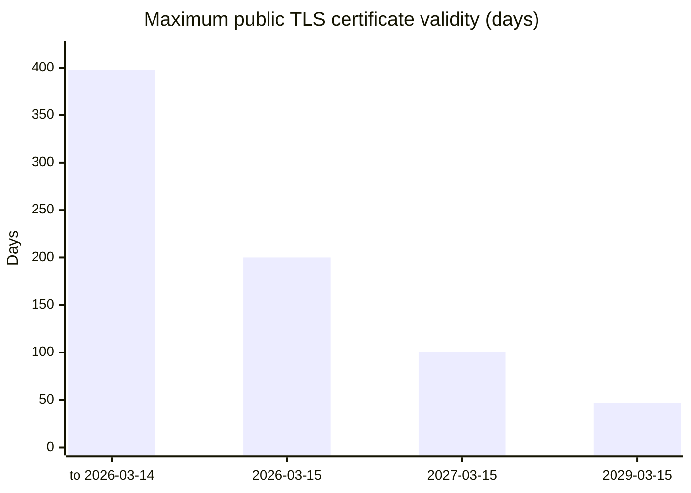
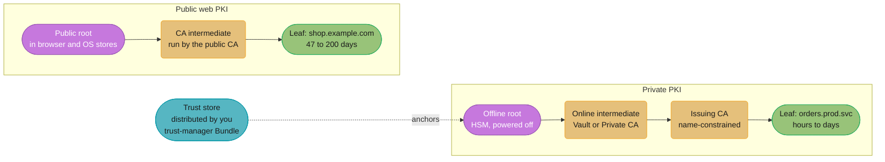
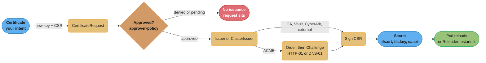
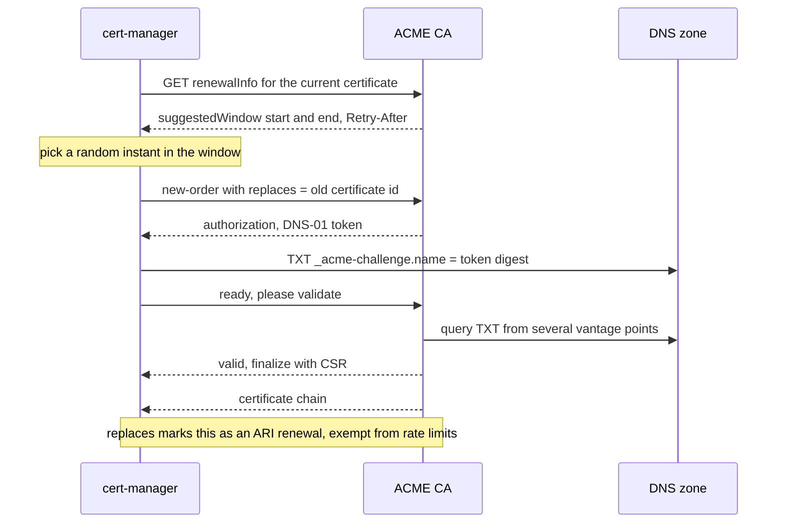
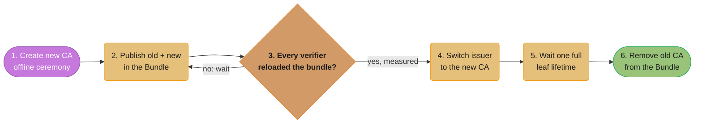
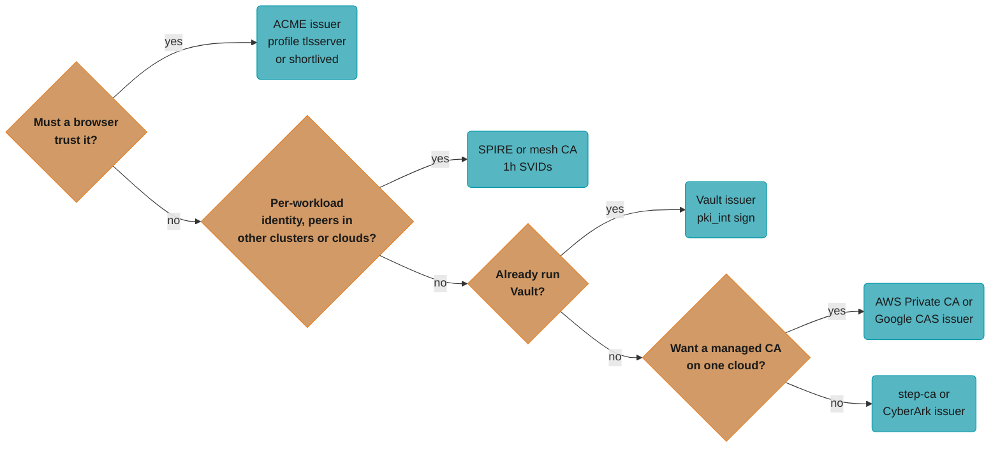
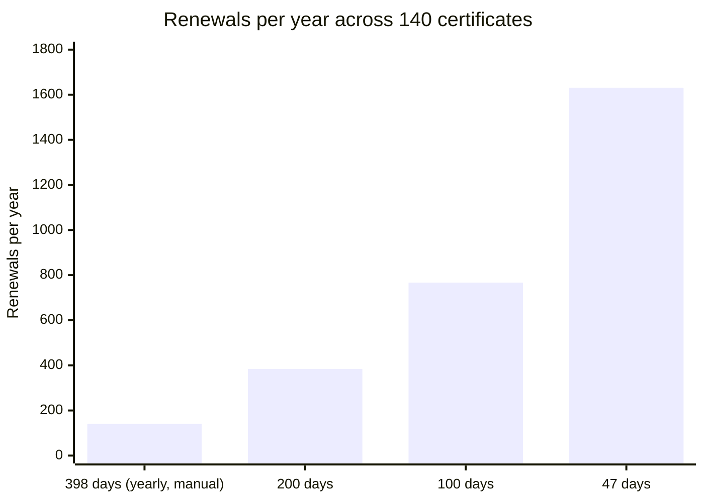

# Certificate and PKI Lifecycle

> Phase 4 - Infrastructure as Code & Config | Difficulty: Advanced

> **Version anchor (2026-11-25).** Current releases: **cert-manager v1.21.3** (2026-10-23; supported lines are 1.21 and 1.20, and 1.21 supports Kubernetes 1.33 to 1.36), **trust-manager v0.26.0** and **approver-policy v0.29.0** (both 2026-10-27), **csi-driver v0.16.1** and **csi-driver-spiffe v0.15.1** (both 2026-10-23), **istio-csr v0.19.1**, **cmctl v2.6.2**, **SPIRE v1.16.0** (2026-11-05) and **x509-certificate-exporter v4.2.4** (2026-11-02). Kubernetes **1.37** is the current minor. CA/Browser Forum **Baseline Requirements v2.3.1** (2026-10-04), section 6.3.2: maximum subscriber certificate validity is **200 days** for certificates issued from 2026-03-15, **100 days** from 2027-03-15 and **47 days** from 2029-03-15; a "short-lived" certificate is **7 days or less**. Let's Encrypt: the default `classic` profile still issues **90-day** certificates, moves to **64 days on 2027-02-10** and **45 days on 2028-02-16**; OCSP URLs left its certificates on 2025-05-07; the TLS client-authentication EKU has been gone since 2026-07-08. ACME Renewal Information (ARI) is **RFC 9773** (June 2025).

> **Pricing anchor (checked 2026-11-25).** AWS Private CA: **$400 per CA per month** in general-purpose mode, **$50** in short-lived mode (certificates of 7 days or less); general-purpose certificates cost **$0.75** each for the first 1,000 a month, **$0.35** for 1,001 to 10,000 and **$0.001** above that; short-lived mode costs **$0.058** per certificate. An AWS KMS key costs **$1 per month**. Source: [AWS Private CA pricing](https://aws.amazon.com/private-ca/pricing/) and [AWS KMS pricing](https://aws.amazon.com/kms/pricing/). Every cost table below derives from these rates.

An X.509 certificate is a signed claim with an expiry date written into it. Everything else in PKI (chains, revocation, trust stores) is machinery for deciding whether to believe the claim; the expiry date is the one part that fails **by itself, on a date known months in advance, with no attacker involved**. This module is the operations view: how certificates get issued, delivered to workloads, rotated and retired automatically, how public and private trust differ, how the Kubernetes control plane's own certificates expire, and how to monitor the one failure that is entirely preventable. It deliberately **links instead of re-teaching** the neighbours: the Vault PKI engine ([hashicorp_vault](../../technologies/hashicorp_vault/hashicorp_vault.md) section 6.7), SPIFFE/SPIRE and pod certificates ([workload_identity_and_federation](../kubernetes_security/workload_identity_and_federation.md)), Envoy SDS ([envoy_proxy](../../technologies/envoy_proxy/envoy_proxy.md) section 6.15), mesh mTLS theory ([service_mesh_and_service_discovery](../../backend/service_mesh_and_service_discovery/service_mesh_and_service_discovery.md)), and the TLS handshake and post-quantum story ([transport_security_frontier](../../backend/http_protocols/transport_security_frontier.md)).

---

## 1. Concept Overview

Every certificate goes through four verbs, and an outage lives in whichever verb is still manual:

1. **Issue** - prove who you are (domain control for a public CA, an approved request for a private one) and get a signed certificate.
2. **Deliver** - put the key and chain where the process can read them (Secret, tmpfs volume, SDS stream, load balancer).
3. **Rotate** - replace the certificate before `notAfter`, on a new key, and make the running process **use** the new one.
4. **Retire** - stop trusting what should not be trusted (old CA, compromised key, decommissioned name).

Three trust planes need different answers to those verbs:

| Plane | Who is the CA | Who must trust it | Lifetime you control | This module |
|-------|---------------|-------------------|----------------------|-------------|
| **Public web PKI** | A CA in browser and OS root programs (Let's Encrypt, commercial CAs) | Everyone, no distribution step | **No.** The Baseline Requirements cap it: 200 days now, 47 days by 2029-03-15 | ACME, cert-manager ACME issuers, the schedule, rate limits |
| **Private PKI** | A CA you run (Vault, AWS Private CA, step-ca, cert-manager CA issuer) | Only the clients you configure | **Yes.** The Baseline Requirements state that they do not address enterprises that run their own PKI for internal purposes with a root not distributed by any application software supplier | Offline root, intermediates, name constraints, trust-manager |
| **Workload identity** | A SPIRE server or mesh CA issuing SPIFFE SVIDs | Peers in the same trust domain | Yes, and it is short: SPIRE defaults to a **1h** X509-SVID and a **5m** JWT-SVID | Linked, not re-taught |

Kubernetes adds a fourth, easily forgotten PKI: the cluster's own CA, which signs the API server, etcd, kubelet and component certificates. `kubeadm` issues the leaf certificates for **one year** and the CAs for **ten**, and nobody renews them until the API server stops answering.

**Certificate expiry is a named outage class.** Section 6.10 gives the taxonomy and the monitoring design; the short version is that you alert on a renewal that did not happen, not on a calendar number.

---

## 2. Intuition

> **One-line analogy**: A certificate is a passport with an expiry date. The CA is the passport office, the trust store is the border agent's list of offices they believe, and revocation is the "lost or stolen" list nobody at the border actually checks. The expiry date is the only control that always works, which is why the industry is making passports last weeks instead of years.

**Mental model**: A verifier checks five things in order: the signature chain up to a trust anchor it already holds, `notBefore <= now <= notAfter` on **every** certificate in the chain, that the name it dialled appears in the SAN, that the key usages fit (server vs client), and that no constraint on any CA in the chain forbids the name. Four of the five are static. The time check is the only one that changes without anyone touching anything.

**Why it matters**: a certificate that expires fails closed and fails **everywhere at once** at the same second, in every process that cached it. The outage is deterministic: its date was known the day the certificate was issued. The only variable is whether anyone, or any controller, was assigned to act on it.

**Key insight**: **shortening lifetimes is not a security tax, it is the forcing function for automation.** A 398-day certificate can be renewed by a calendar reminder and a person. A 47-day one renews about 11.65 times a year per name; a 6-day one about 82 times. No human process survives that, so the industry is deliberately making the manual process impossible, and the engineering job is to make the automatic one boring and observable.

---

## 3. Core Principles

1. **Automate issuance end to end.** If a human types a command anywhere between "name needed" and "process serving the new certificate", the process is one staffing change from an outage.
2. **Lifetime must be shorter than your slowest human process, and longer than your slowest outage.** Hours to days for workload identity; the public maximum for edge certificates; never "whatever the default was".
3. **Renew by fraction of lifetime, never by fixed days.** `renewBefore: 720h` is correct for a 90-day certificate and nonsense for a 45-day one. cert-manager's default (renew two thirds of the way through) and `renewBeforePercentage` survive every lifetime change.
4. **Generate a new key on every renewal.** cert-manager's `rotationPolicy: Always` has been the default since v1.18; a certificate renewed on the same key is a longer-lived key, not a rotated one.
5. **Trust before identity.** Distribute the new CA to every verifier **before** the first certificate signed by it exists. Reversing the order is how a CA rotation becomes a fleet outage.
6. **Separate CA tiers by blast radius.** An offline root that signs only intermediates; online intermediates that sign only issuing CAs; name constraints that cap what a compromised issuing CA can claim.
7. **Monitor the renewal, not the expiry.** The alert that matters is "this certificate should have renewed and did not", fired while there is still margin left, plus an external probe of what the endpoint really serves.
8. **Inventory everything with a `notAfter`.** Roots, intermediates, CRLs (`nextUpdate`), webhook `caBundle` fields, kubeconfig client certificates and ACME account credentials all expire, and most are not in the leaf-certificate dashboard.

---

## 4. Types / Architectures / Strategies

### 4.1 The CA/Browser Forum schedule (ballot SC-081v3, Baseline Requirements sections 6.3.2 and 4.2.1)

| Issued on or after | Max validity | Max domain-validation reuse | Renew at 2/3 of life, every | Renewals per year per name |
|--------------------|-------------:|----------------------------:|----------------------------:|---------------------------:|
| before 2026-03-15 | 398 days | 398 days | 265.3 days | 1.38 |
| **2026-03-15 (in force today)** | **200 days** | **200 days** | 133.3 days | 2.74 |
| 2027-03-15 | 100 days | 100 days | 66.7 days | 5.48 |
| 2029-03-15 | 47 days | **10 days** | 31.3 days | 11.65 |
| "short-lived" (7 days or less) | up to 7 days | n/a | 4.4 days at 160 h | about 82 |



Validity falls by a factor of 8.5 across three steps. The renewals-per-year column is the operational number: it multiplies every ticket, every DNS-01 validation and every deploy-time reload by about 8.4 between 2026 and 2029. The compact version of this table also lives in [networking_for_devops](../networking_for_devops/networking_for_devops.md); this module owns what you do about it.

The domain-validation reuse column matters more than it looks. From 2029-03-15 a CA may reuse a past validation for only **10 days**, so a 31-day renewal interval means **every renewal needs a fresh HTTP-01 or DNS-01 challenge**. Version 2.3.1 of the Baseline Requirements already defines a persistent DNS record for this (`_validation-persist.<name>` TXT with an `accounturi` and an optional `persistUntil` timestamp, treated as 10-day reuse); Let's Encrypt announced in December 2025 that it expects to support DNS-PERSIST-01 in 2026, and as of its 2026-07-22 upcoming-features page it is not listed as shipped.

### 4.2 ACME challenge types

| Challenge | Where it is answered | Wildcards | Needs inbound reachability | Fits |
|-----------|---------------------|-----------|---------------------------|------|
| **HTTP-01** | `http://<name>/.well-known/acme-challenge/<token>`, port 80 only, follows up to 10 redirects | No | Yes, port 80 from the internet, from multiple vantage points | Public sites, simplest automation, IP identifiers |
| **DNS-01** | TXT at `_acme-challenge.<name>`; CNAME or NS delegation is followed | **Yes** | No | Wildcards, private-network hosts with public names, many servers behind one name |
| **TLS-ALPN-01** (RFC 8737) | TLS on port 443 with a custom ALPN protocol | No | Yes, port 443 | TLS-terminating proxies that cannot serve port 80; limited client support |

cert-manager implements **HTTP-01 and DNS-01 only**. The Let's Encrypt documentation warns that putting full DNS API credentials on a web server raises the impact of that server being compromised, and recommends narrowly scoped credentials or delegating `_acme-challenge` to a dedicated zone (cert-manager supports this with `cnameStrategy: Follow`).

### 4.3 Issuer types in cert-manager

| Issuer | What signs | Trusted by | Good for | Watch for |
|--------|-----------|-----------|----------|-----------|
| **ACME** | A public ACME CA (Let's Encrypt and others) | Browsers, OS stores | Edge and public hostnames | Rate limits, 47-day cadence, solver reachability |
| **CA** | A CA certificate and key stored in a Kubernetes Secret | Whatever you distribute the CA to | Demos, small private PKI | The cert-manager docs say it is for demos or advanced users who already run a PKI; the CA key sits in etcd |
| **SelfSigned** | The certificate signs itself | Nobody by default | Bootstrapping a CA certificate | Not usable with the CSI driver |
| **Vault** | A Vault PKI mount's `sign` endpoint | Your trust bundle | You already run Vault; policy-rich private PKI | Auth method (Kubernetes SA, and AWS IAM auth since v1.21) |
| **CyberArk** (formerly Venafi; the YAML key is still `venafi`) | CyberArk Certificate Manager SaaS or Self-Hosted, or Palo Alto Networks NGTS | Per the zone's CA | Enterprises with a central certificate team | One Issuer per zone; user-provided CSRs |
| **External** (separate controllers) | AWS Private CA (`aws-privateca-issuer`), Google CAS (`google-cas-issuer`), Smallstep (`step-issuer`), `istio-csr` | Per the CA | Managed private CA, mesh | Each has its own signer name for approval policy |

### 4.4 Let's Encrypt profiles (checked 2026-11-25)

| Profile | Validity | Authorization reuse | Max names | Common Name | Revocation info |
|---------|---------:|--------------------:|----------:|-------------|-----------------|
| `classic` (default) | 90 days now; 64 days from 2027-02-10; 45 days from 2028-02-16 | 30 days now; 10 days from 2027-02-10; 7 hours from 2028-02-16 | 100 | Yes (first SAN promoted) | CRL |
| `tlsserver` (opt-in) | 45 days | 7 hours | 25 | No | CRL |
| `shortlived` (opt-in) | **160 hours** | 7 hours | same as `tlsserver` | No | CRL URL still present today, "may change" |

In cert-manager the `profile:` field on the ACME issuer (cert-manager 1.18 and later) selects one. Specifying a profile against an ACME server without profile support makes the `CertificateRequest` fail with an error.

---

## 5. Architecture Diagrams

**Public and private trust chains: what the verifier already holds**



The public chain needs no distribution step because the root program already put the anchor in every client. The private chain works only after you have shipped the root to every verifier, which is exactly the job trust-manager automates and the step a CA rotation must do first.

**cert-manager issuance: one `Certificate`, five controllers**



The approval gate is the control point. In a default install cert-manager approves every request that uses a built-in issuer; production installs disable that with `disableAutoApproval=true` (Helm, cert-manager 1.15 and later) and let approver-policy decide.

**ACME DNS-01 with ARI: why renewal asks the CA when**



**Lifetime, renewal and alert bands for one 47-day certificate (ASCII)**

```
 0d                                                31.3d      36.6d      41.8d      47d
 |-------------------------------------------------|----------|----------|----------|
 |  healthy: more than 33% of the life left        | renewal  |  ticket  |   page   |
 |                                                 |  window  |   band   |   band   |
 |-------------------------------------------------|----------|----------|----------|

 31.3d: cert-manager renews (two thirds elapsed, 33% of the life left)
 36.6d: ticket fires (22% left, 10.4 days)
 41.8d: page fires (11% left, 5.2 days)
```

A renewal that works never reaches the ticket band. The ticket and page thresholds are fractions of the certificate's own lifetime, so the same two PromQL rules cover a 47-day certificate and a 24-hour one.

**A kubeadm cluster's own PKI (names from `kubeadm certs check-expiration`)**

```
 ca (10y)                       etcd-ca (10y)                front-proxy-ca (10y)
  |- apiserver                   |- etcd-server                |- front-proxy-client
  |- apiserver-kubelet-client    |- etcd-peer
                                 |- etcd-healthcheck-client
                                 |- apiserver-etcd-client

 Client certificates embedded in kubeconfig files (no CA column shown by kubeadm):
   admin.conf    controller-manager.conf    scheduler.conf

 All ten leaf certificates: 1 year by default. kubelet.conf is NOT in the list: the kubelet
 rotates its own client certificate under /var/lib/kubelet/pki.
```

Ten leaf certificates and three CAs per control-plane node. Renewal and restart must happen on every control-plane node of a replicated control plane.

---

## 6. How It Works - Detailed Mechanics

### 6.1 X.509 and chain of trust, as an operator needs it

Four commands answer most questions:

```bash
# What does the endpoint actually serve? (SNI matters: --servername)
openssl s_client -connect shop.example.com:443 -servername shop.example.com -showcerts </dev/null

# Dates, names and key usage of a certificate file
openssl x509 -in tls.crt -noout -subject -issuer -dates -ext subjectAltName,extendedKeyUsage

# Does the chain verify against a specific trust bundle?
openssl verify -CAfile root-certs.pem -untrusted intermediates.pem tls.crt

# Expiry of the leaf the server presents
echo | openssl s_client -connect shop.example.com:443 -servername shop.example.com 2>/dev/null \
  | openssl x509 -noout -enddate
```

What to read in the output: **SAN, not Common Name** (the Baseline Requirements mark Common Name as NOT RECOMMENDED, and Let's Encrypt's `tlsserver` profile omits it); `Not After` on the leaf **and on every intermediate the server sends**; `Extended Key Usage` (`serverAuth` vs `clientAuth`: Let's Encrypt no longer issues `clientAuth` at all, so mTLS client certificates come from a private CA); `Basic Constraints: CA:TRUE, pathlen:N` on CAs; `Name Constraints` on constrained CAs.

A server should send the leaf **and** its intermediates but **not** the root: the verifier must already hold the root, and cert-manager follows the same rule (`tls.crt` is the leaf plus the chain, the root is omitted). A missing intermediate is the classic "works in the browser, fails in curl" bug: some clients can fetch a missing intermediate, server-side clients generally do not.

### 6.2 ACME in cert-manager: issuers and solvers

```yaml
apiVersion: cert-manager.io/v1
kind: ClusterIssuer
metadata:
  name: le-prod
spec:
  acme:
    server: https://acme-v02.api.letsencrypt.org/directory
    email: pki-team@example.com
    profile: tlsserver                  # cert-manager >= 1.18: 45-day certificates today
    privateKeySecretRef:
      name: le-prod-account-key         # lose it and you cannot revoke certificates issued under it
    solvers:
      - selector:
          dnsZones: ["example.com"]
        dns01:
          cnameStrategy: Follow         # _acme-challenge.example.com CNAME -> a narrowly scoped zone
          route53:
            region: eu-west-1
            hostedZoneID: Z0EXAMPLEACME  # ambient IAM role on the controller ServiceAccount, no access keys
      - http01:                         # everything else: serve the token through the Gateway
          gatewayHTTPRoute:
            parentRefs:
              - {kind: Gateway, name: public-gw, namespace: infra}
```

Mechanics that cause tickets:

- An `Order` and a `Challenge` are created per certificate and per DNS name; **you never create them by hand** and they cannot be edited, only recreated.
- cert-manager runs a **self-check** (retrying every 10 seconds) that the challenge is visible before asking the CA to validate. It processes up to **60 challenges at once** (`--max-concurrent-challenges`) and never validates two challenges for the same hostname (HTTP-01) or the same `_acme-challenge` name (DNS-01) at once.
- With `cnameStrategy: Follow`, cert-manager follows **any** CNAME at `_acme-challenge.<name>`, **including one synthesised by a wildcard record**. A `*.example.com CNAME lb.example.org` then sends the TXT write to `lb.example.org`, which fails. Create an explicit record at the challenge name, or leave the default `None`.
- cert-manager 1.21 added `waitInsteadOfSelfCheck` (skip the self-check and wait a fixed time) for split-horizon DNS and NAT-hairpin setups where cert-manager cannot see what the CA sees.
- Under a default-deny NetworkPolicy the temporary `acmesolver` Pod must be reachable from your ingress or Gateway, and the API server must reach the cert-manager webhook.
- Let's Encrypt validates **from multiple vantage points**; DNS propagation of up to an hour on slow providers is real, which is why DNS-01 needs a provider with an API that reports propagation.

### 6.3 Renewal arithmetic and the rate limits that bite

Renewal itself is rarely rate-limited: Let's Encrypt treats a renewal via ARI as exempt from **all** rate limits, and a non-ARI order with the **exact same set of identifiers** is exempt from the per-account and per-registered-domain limits. The limits that hurt are the ones on **new** identifier sets and on failures:

| Limit (Let's Encrypt, page updated 2026-08-05) | Value | Refill |
|------------------------------------------------|------:|--------|
| New orders per account | 300 per 3 hours | 1 per 36 seconds |
| New certificates per registered domain | **50 per 7 days** | 1 per 202 minutes |
| New certificates per exact identifier set | **5 per 7 days** | 1 per 34 hours; **no override** |
| Authorization failures per identifier per account | 5 per hour | 1 per 12 minutes |
| Consecutive authorization failures per identifier | 1,152, then the identifier is paused | 1 per day |
| New accounts per IP | 10 per 3 hours | 1 per 18 minutes |

Two arithmetic checks worth running before a design review. A SaaS onboarding 60 new tenant hostnames a day under one registered domain issues **420 certificates a week against a limit of 50**, an 8.4x overrun that a wildcard (one certificate, DNS-01) removes. And a platform that **deletes and recreates a namespace** that owns a `Certificate` requests the same identifier set again each time; the sixth in seven days is refused, with no override available.

Renew with ARI where the client supports it. In cert-manager 1.21, ARI support (RFC 9773) is **experimental** behind the `ACMEUseARI` feature gate; until it is on, rely on the percentage-based default.

### 6.4 The `Certificate` resource, renewal and key rotation

```yaml
apiVersion: cert-manager.io/v1
kind: Certificate
metadata: {name: shop-tls, namespace: edge}
spec:
  secretName: shop-tls
  issuerRef: {name: le-prod, kind: ClusterIssuer}
  dnsNames: [shop.example.com, www.shop.example.com]
  # No duration: an ACME CA chooses the lifetime (the profile decides it).
  renewBeforePercentage: 33           # a fraction survives 90d, 45d and 6d lifetimes; renewBefore does not
  privateKey: {algorithm: ECDSA, size: 256, rotationPolicy: Always}
  renewal:                             # cert-manager 1.21: renew only inside an approved window
    policy: RenewBefore
    windows:
      - {cron: "0 9 * * 1-4", timezone: Europe/London, windowDuration: 7h}
```

Facts that decide whether this works:

- `spec.duration` defaults to 90 days, the **minimum is 1 hour**, and the minimum effective `renewBefore` is **5 minutes**. `duration` must exceed `renewBefore`, and setting `renewBefore` close to `duration` risks a **renewal loop**; Let's Encrypt sets `notBefore` one hour before issuance, so a 90-day certificate has an 89-day, 23-hour working duration.
- The default renewal point is **two thirds of the way through** the issued duration; `status.renewalTime` shows when. `renewBeforePercentage` computes from the **actual** duration of what the CA issued, which is why it is recommended.
- Renewal windows are a preference, not a guarantee: if no window opens before expiry, cert-manager renews at the computed time anyway rather than let the certificate expire. A monthly window leaves no margin; daily or weekly windows are safe.
- `rotationPolicy: Always` (default since v1.18; it was `Never` before) generates a **new private key on every issuance** and writes it only after the new certificate is signed. Some issuers, including the CyberArk issuer, refuse key reuse.
- **Deleting the Secret is not a rotation procedure.** The supported way to force reissuance is `cmctl renew shop-tls` (or editing a spec field that triggers it).
- By default cert-manager does **not** delete the Secret when the `Certificate` is deleted (`--enable-certificate-owner-ref` changes that): the service keeps working, and quietly stops renewing.
- Root and long-lived intermediate CA certificates that need an offline ceremony can be marked `renewal.policy: Disabled`.

The renewal only helps if the **process picks the file up.** Go (a `GetConfigForClient` callback re-reading on change), Envoy (SDS swaps secrets atomically with no restart) and nginx (reload) can; a Java service loading a keystore once at startup cannot. Reloader or an equivalent restarts the Deployment when the Secret changes, and then **every renewal is a rollout**, which is the other reason renewal windows exist.

```go
// Server side of an mTLS listener that re-reads the key pair and CA bundle when files change.
type reloader struct {
    mu                    sync.Mutex
    certFile, keyFile, ca string
    cert                  *tls.Certificate
    pool                  *x509.CertPool
    certMod, caMod        time.Time
}

func (r *reloader) refresh() error {
    r.mu.Lock()
    defer r.mu.Unlock()
    if st, err := os.Stat(r.certFile); err == nil && !st.ModTime().Equal(r.certMod) {
        c, err := tls.LoadX509KeyPair(r.certFile, r.keyFile)
        if err != nil {
            return err
        }
        r.cert, r.certMod = &c, st.ModTime()
    }
    if st, err := os.Stat(r.ca); err == nil && !st.ModTime().Equal(r.caMod) {
        pem, err := os.ReadFile(r.ca)
        if err != nil {
            return err
        }
        p := x509.NewCertPool()
        if !p.AppendCertsFromPEM(pem) {
            return fmt.Errorf("no certificates in %s", r.ca)
        }
        r.pool, r.caMod = p, st.ModTime()
    }
    if r.cert == nil || r.pool == nil {
        return fmt.Errorf("key pair or CA bundle not loaded")
    }
    return nil
}

func (r *reloader) serverConfig(*tls.ClientHelloInfo) (*tls.Config, error) {
    if err := r.refresh(); err != nil {
        return nil, err
    }
    r.mu.Lock()
    defer r.mu.Unlock()
    return &tls.Config{
        MinVersion: tls.VersionTLS13, Certificates: []tls.Certificate{*r.cert},
        ClientAuth: tls.RequireAndVerifyClientCert, ClientCAs: r.pool,
    }, nil
}

// srv := &http.Server{Addr: ":8443", TLSConfig: &tls.Config{GetConfigForClient: r.serverConfig}}
```

`GetConfigForClient` runs per handshake, so a renewed certificate (and a new CA in the bundle) is live on the next connection with no restart; two `stat` calls per handshake are cheap next to the handshake's public-key operations.

### 6.5 Approval and policy: the gate that is open by default

```yaml
apiVersion: policy.cert-manager.io/v1alpha1
kind: CertificateRequestPolicy
metadata: {name: workload-mtls}
spec:
  allowed:
    dnsNames:
      validations:
        - rule: self.endsWith('.' + cr.namespace + '.svc.cluster.local') || self.endsWith('.' + cr.namespace + '.svc')
          message: a workload may only request names inside its own namespace
    isCA: false
    usages: ["server auth", "client auth", "digital signature"]
  constraints:
    maxDuration: 72h
    privateKey: {algorithm: ECDSA, minSize: 256}
  selector:
    issuerRef: {name: internal-issuing-ca, kind: ClusterIssuer, group: cert-manager.io}
---
apiVersion: rbac.authorization.k8s.io/v1
kind: ClusterRole
metadata: {name: cert-manager-policy:workload-mtls}
rules:
  - {apiGroups: ["policy.cert-manager.io"], resources: ["certificaterequestpolicies"], verbs: ["use"], resourceNames: ["workload-mtls"]}
---
apiVersion: rbac.authorization.k8s.io/v1
kind: ClusterRoleBinding
metadata: {name: cert-manager-policy:workload-mtls}
roleRef: {apiGroup: rbac.authorization.k8s.io, kind: ClusterRole, name: cert-manager-policy:workload-mtls}
subjects:
  - {kind: ServiceAccount, name: cert-manager, namespace: cert-manager}   # cert-manager creates the CertificateRequests
```

approver-policy semantics: a request is evaluated only by policies that both select its issuer **and** are bound to the requester by RBAC (`use` verb). **One permitting policy approves.** If matching policies exist and none permits, the request is **denied** (a permanent failure with backoff). If **no** policy is appropriate, the request is **neither approved nor denied** and sits there. `allowed` is deny-by-default per attribute; `constraints` is allow-by-default. approver-policy requires the built-in approver to be disabled (`disableAutoApproval=true`, Helm, cert-manager 1.15 and later), and turning that on in a running cluster with no other approver **stops all issuance**, including trust-manager's own webhook certificate unless you install its policy.

### 6.6 Internal CA design

```
  Offline root (10 to 20 y)      key in an HSM or air-gapped, used for ceremonies only
       |   signs, then goes back in the safe
       v
  Intermediate (3 to 5 y)        online in Vault PKI, AWS Private CA or step-ca; pathlen:1
       |
       v
  Issuing CA per environment     name-constrained: prod.example.com and *.svc.cluster.local only
       |                         separate prod and non-prod CAs: a staging leak cannot mint prod
       v
  Leaf certificates (hours to days)
```

Each tier signs only the tier below it, so the key that can sign everything is the one that is never online.

Design values (recommendations, not standards): root 10 to 20 years, intermediate 3 to 5 years (the Vault example in this repo tunes `pki_int` to 43800 h = 5 years), leaf hours to days. Rules that decide the dates: a child can never outlive its parent; **rotate an intermediate at half its life**, so the old one still has at least (maximum leaf lifetime + trust-propagation time) of validity left when the last leaf it signed is replaced.

**Name constraints** (RFC 5280 section 4.2.1.10) cap what a compromised CA can claim: a CA constrained to `prod.example.com` and `10.10.0.0/16` cannot validly issue for `google.com`, in any client that enforces the extension. cert-manager can issue a constrained CA with `spec.nameConstraints` (mark it `critical: true`). **Gotcha:** cert-manager's built-in CA and SelfSigned issuers do **not** check a requested SAN against the constraints in the chain, so the certificate may be issued successfully and then be rejected by clients during the handshake. Test the chain with a verifier before trusting the issuer.

| Where the CA key lives | Control | Cost shape |
|------------------------|---------|------------|
| Kubernetes Secret (cert-manager CA issuer) | Anyone who can read the Secret or etcd can mint certificates; encrypt etcd with KMS v2 ([kubernetes_security](../kubernetes_security/kubernetes_security.md)) | Free; demo grade by the project's own warning |
| Vault PKI mount behind the barrier | Policy, audit device, seal | Operate Vault; see [hashicorp_vault](../../technologies/hashicorp_vault/hashicorp_vault.md) section 6.7 |
| AWS Private CA | IAM, CloudTrail | Metered, table below |
| Cloud KMS or HSM signing key | Private key is created in KMS and **never leaves it unencrypted**; every signature is an API call | **$1 per key per month** on AWS KMS, plus per-request fees |
| Offline root on an HSM | Physical ceremony, quorum | Staff and process, not infrastructure |

AWS Private CA arithmetic (rates from the pricing anchor; a 30-day month; workloads renew at two thirds of their lifetime):

| Workload certificate | Certificates per month (5,000 workloads) | General-purpose mode | Short-lived mode |
|----------------------|-----------------------------------------:|---------------------:|-----------------:|
| 24 hours (renew every 16 h, 1.5 a day each) | 225,000 | $400 + $750 + $3,150 + $215 = **$4,515** | $50 + $13,050 = **$13,100** |
| 1 hour (renew every 40 min, 36 a day each) | 5,400,000 | $400 + $750 + $3,150 + $5,390 = **$9,690** | $50 + $313,200 = **$313,250** |

The counter-intuitive result is that **short-lived mode is the expensive one at fleet volume**: its $0.058 flat rate beats the tiered general-purpose rate only below about **74,400 certificates a month (about 2,480 a day)**, found by solving `50 + 0.058n = 4,290 + 0.001n`. Below that (a few hundred internal services, a CI fleet) short-lived mode is cheaper; at mesh scale an in-cluster issuer (Vault, `step-ca`, SPIRE) has no per-certificate fee, trading it for operations. For the Vault side of the arithmetic, 5,000 pods on 72-hour certificates is about 1,700 issuances a day.

### 6.7 Trust distribution and CA rotation without an outage

trust-manager adds one cluster-scoped CRD, `Bundle`, that assembles certificates from sources and writes them to every namespace you select:

```yaml
apiVersion: trust.cert-manager.io/v1alpha1
kind: Bundle
metadata: {name: internal-ca-bundle}          # also the name of the target ConfigMap in each namespace
spec:
  sources:
    - secret: {name: root-ca-2026, key: ca.crt}     # Secrets and ConfigMaps are read from the trust namespace
    - secret: {name: root-ca-2031, key: ca.crt}     # the NEXT root is already distributed
  target:
    configMap: {key: root-certs.pem}
    additionalFormats:
      jks: {key: bundle.jks}                         # default JKS password is "changeit": not a security control
    namespaceSelector:
      matchLabels: {trust: internal}                 # an empty selector syncs to ALL namespaces today
```

Never mount a certificate Secret's `ca.crt` straight into an application's trust store: cert-manager updates it on renewal, so the application's trust silently follows the issuer instead of being a decision. And with the ACME issuer `ca.crt` does not exist at all.

The only safe order for **rotating a CA** (the whole point of principle 5):



Step 3 is a measurement, not a timer: the slowest verifier is the one that reads its trust store only at startup, so the wait is the longest restart cadence in the fleet. Step 5 is at least the maximum leaf lifetime (72 hours for a 72-hour leaf), and the old CA must still be valid for all of it. Skipping step 3 is the standard way to turn one CA rotation into a fleet-wide `x509: certificate signed by unknown authority`. Kubernetes' own cluster CA has no automated path: `kubeadm` does not support CA rotation out of the box, and the manual procedure in the Kubernetes documentation follows the same trust-first order.

### 6.8 mTLS rotation and workload identity

For service-to-service mTLS there are several delivery shapes, and the choice is mostly about where the key lives and who reloads:

| Shape | Certificate lifetime | Key lives | Reload | Use when |
|-------|---------------------|-----------|--------|----------|
| cert-manager `Certificate` + Secret | hours to months | In a Secret in etcd | App reloads files or Reloader restarts it | Few workloads, shared certificates, non-mesh apps |
| cert-manager **csi-driver** | You choose; unique per Pod | Generated on the node, **in memory, never sent over the network**, gone when the Pod ends | App reloads the mounted files | Ephemeral per-Pod mTLS; no Secret objects, so less RBAC |
| **csi-driver-spiffe** | Enforced duration, default **1 hour**; SPIFFE ID from the Pod's ServiceAccount | Same as above | App reloads | SPIFFE X.509-SVIDs on cert-manager infrastructure |
| **SPIRE** | **1h** X509-SVID, **5m** JWT-SVID, CA signing key TTL 24h (defaults) | In the SPIRE agent; delivered over a local socket | Workload API stream, no files | Attested identity across clusters and clouds ([workload_identity_and_federation](../kubernetes_security/workload_identity_and_federation.md)) |
| **Mesh CA** (istiod, or `istio-csr` backed by cert-manager) | Per mesh configuration | In the sidecar proxy | **SDS pushes the new certificate into Envoy, no restart** ([envoy_proxy](../../technologies/envoy_proxy/envoy_proxy.md) section 6.15) | You already run the mesh |

Two operational facts make the csi-driver variants different from a plain `Certificate`. First, **the Pod stays Pending until issuance completes**, so the issuer is on the pod-start critical path: an Issuer outage blocks new Pods, not just renewals. Second, csi-driver-spiffe issues with the **Pod's own token**, so every Pod that mounts the volume needs permission to create `CertificateRequest` objects; the project's security note warns that an approver-policy rule allowing any Pod to use an ACME issuer would let a compromised Pod request a **publicly trusted** certificate. Keep the SPIFFE approver and every other approver mutually exclusive by issuer.

csi-driver's `renew-before` defaults to **a third of the requested duration**, so a 24-hour certificate renews at hour 16. If 5,000 Pods start in one rollout they all renew in one burst 16 hours later; deployment cadence is your only jitter, and the issuer must be sized for the burst, not the average.

SPIFFE ID design, attestation and federation are in [workload_identity_and_federation](../kubernetes_security/workload_identity_and_federation.md); the credential-free Vault side is in [workload_identity_and_the_end_of_stored_secrets](../../technologies/hashicorp_vault/workload_identity_and_the_end_of_stored_secrets.md); the Istio `PERMISSIVE` to `STRICT` runbook is in [service_mesh_and_service_discovery](../../backend/service_mesh_and_service_discovery/service_mesh_and_service_discovery.md).

### 6.9 Kubernetes control-plane certificates

| Credential | Default lifetime | Rotated by | If it expires |
|------------|-----------------|-----------|---------------|
| kubeadm leaf certificates (10, see section 5) | **1 year** (`certificateValidityPeriod: 8760h`) | `kubeadm certs renew`, or automatically during `kubeadm upgrade` | API server, etcd or component TLS fails; **control plane unavailable** |
| kubeadm CAs (ca, etcd-ca, front-proxy-ca) | **10 years** (`caCertificateValidityPeriod: 87600h`) | Manual only; kubeadm does not rotate CAs | Everything signed by it |
| Kubelet client certificate | Signer default **1 year** (`--cluster-signing-duration` default `8760h`) | Kubelet, via CSR, when `rotateCertificates` is on | Node cannot authenticate to the API server |
| Kubelet serving certificate | Self-signed by default; with `serverTLSBootstrap: true` signed via the `kubernetes.io/kubelet-serving` signer, 1 year | Kubelet requests it; **an approver must approve** | metrics-server and `kubectl logs` against that node fail TLS |

```bash
kubeadm certs check-expiration          # RESIDUAL TIME per certificate, and per CA
sudo kubeadm certs renew all            # on EVERY control-plane node of a replicated control plane

# Dynamic reload is not supported for all components: restart the static Pods, ONE NODE AT A TIME.
# Moving a manifest out for longer than fileCheckFrequency (20s) makes the kubelet stop the Pod.
sudo mkdir -p /etc/kubernetes/manifests.off
for c in kube-apiserver kube-controller-manager kube-scheduler etcd; do
  sudo mv /etc/kubernetes/manifests/$c.yaml /etc/kubernetes/manifests.off/ && sleep 30
  sudo mv /etc/kubernetes/manifests.off/$c.yaml /etc/kubernetes/manifests/ && sleep 30
done
sudo cp -i /etc/kubernetes/admin.conf $HOME/.kube/config     # the old admin client certificate is now stale
```

Operating facts from the Kubernetes documentation: `kubeadm upgrade` renews all certificates unless you pass `--certificate-renewal=false`, so a cluster upgraded at least yearly never meets this outage; `kubeadm certs renew` takes the Common Name and SANs from the **existing** certificates, not from the `kubeadm-config` ConfigMap; `kubeadm` cannot manage certificates signed by an external CA (`EXTERNALLY MANAGED` shows `yes`); and the kubelet requests a new client certificate when between **30% and 10%** of the lifetime remains. Kubernetes **does not support certificate revocation**: a leaked kubeadm client certificate is valid until expiry unless you rotate the CA. Managed control planes (EKS, GKE, AKS) hide all of this; self-managed and on-prem clusters own it ([cluster_lifecycle_and_fleet_upgrades](../kubernetes_architecture/cluster_lifecycle_and_fleet_upgrades.md)). Pod certificates and ClusterTrustBundles, the in-tree path to X.509 workload identity, are covered in [workload_identity_and_federation](../kubernetes_security/workload_identity_and_federation.md).

### 6.10 Expiry as an outage class: taxonomy and monitoring

Every expiry outage is one of six shapes. Naming them is what lets a runbook and an alert match each.

| Shape | Example | Why the leaf dashboard misses it |
|-------|---------|----------------------------------|
| **Renewal never configured** | The one certificate bought by hand in 2024, owner left | It is not in any inventory |
| **Renewal configured, failing silently** | DNS-01 API token revoked; CA account paused after 1,152 consecutive failures | The old certificate is still valid, so nothing looks wrong for weeks |
| **Renewed but not loaded** | New Secret written, process holds the old key pair in memory | The cluster says Ready; the endpoint serves the old certificate |
| **Intermediate or root expired** | Let's Encrypt's `DST Root CA X3` cross-sign expired 2021-09-30; devices that did not trust ISRG Root X1 failed | The leaf is fine; the chain above it is not |
| **Non-certificate expiry** | CRL `nextUpdate` passed so clients reject every certificate; webhook `caBundle` expired; ACME account email gone (Let's Encrypt stopped sending expiry emails on 2025-06-04) | Not an X.509 leaf at all |
| **Date arithmetic** | Azure, 2012-02-29: a guest agent computed `valid-to` as "today plus one year", producing 2013-02-29 and failing certificate creation | Nothing expires; certificate **creation** fails on one day of the year |

The monitoring stack has three independent layers, because each catches a shape the others miss:

1. **Controller view** (cert-manager metrics): `certmanager_certificate_not_after_timestamp_seconds`, `..._not_before_timestamp_seconds`, `..._renewal_timestamp_seconds`, `..._expiration_timestamp_seconds` and `certmanager_certificate_ready_status{condition=...}` per `Certificate`, plus `certmanager_http_acme_client_request_count` (labels `host`, `action`, `status`) for CA-side errors.
2. **Inventory view** (x509-certificate-exporter): reads certificates out of TLS Secrets, ConfigMaps, kubeconfigs, **on-disk PKI on the nodes**, admission `caBundle` fields on webhooks, `APIService` and conversion-webhook CRDs, and **CRLs**. Metrics: `x509_cert_not_after`, `x509_cert_expired`, `x509_crl_next_update`, `x509_crl_stale`, `x509_source_up`. Its Helm chart defaults to a warning at **28 days** and critical at **14 days** left, which are the right numbers for a 90-day world and too late for a 47-day one.
3. **Black-box view** (blackbox_exporter): `probe_ssl_earliest_cert_expiry` is the earliest expiry among **the certificates the endpoint actually presents**, intermediates included. This is the only layer that sees "renewed but not loaded".

```yaml
groups:
  - name: certificate-lifecycle
    rules:
      # 1. The renewal itself failed: planned renewal time passed more than a day ago.
      - alert: CertificateRenewalLate
        expr: time() > certmanager_certificate_renewal_timestamp_seconds + 86400
        for: 30m
        labels: {severity: ticket}
      # 2. Fraction-of-lifetime alerts: one rule covers a 47-day and a 24-hour certificate.
      - alert: CertificateLifetimeLow
        expr: |
          (certmanager_certificate_not_after_timestamp_seconds - time())
            / (certmanager_certificate_not_after_timestamp_seconds
               - certmanager_certificate_not_before_timestamp_seconds) < 0.222
        labels: {severity: ticket}
      - alert: CertificateAboutToExpire
        expr: |
          (certmanager_certificate_not_after_timestamp_seconds - time())
            / (certmanager_certificate_not_after_timestamp_seconds
               - certmanager_certificate_not_before_timestamp_seconds) < 0.111
        labels: {severity: page}
      - alert: CertificateNotReady
        expr: certmanager_certificate_ready_status{condition="False"} == 1
        for: 15m
        labels: {severity: ticket}
      # 3. What the endpoint really serves, intermediates included.
      - alert: ServedCertificateNearExpiry
        expr: probe_ssl_earliest_cert_expiry{job="blackbox-tls"} - time() < 5 * 86400
        labels: {severity: page}
      # 4. A CRL you publish went stale: every verifier will start rejecting.
      - alert: CrlStale
        expr: x509_crl_stale > 0
        labels: {severity: page}
```

Where `0.222` and `0.111` come from: cert-manager renews with one third of the lifetime left, and the ticket fires when two thirds of that slack is gone (2/9 of the lifetime left), the page when two thirds of what remains is gone (1/9):

| Certificate lifetime | Renews with this left | Ticket below | Page below |
|---------------------:|----------------------:|-------------:|-----------:|
| 398 days | 132.7 days | 88.4 days | 44.2 days |
| 200 days | 66.7 days | 44.4 days | 22.2 days |
| 90 days | 30 days | 20 days | 10 days |
| 47 days | 15.7 days | 10.4 days | 5.2 days |
| 160 hours (short-lived) | 53.3 h | 35.6 h | 17.8 h |
| 24 hours | 8 h | 5.3 h | 2.7 h |
| 1 hour | 20 min | 13.3 min | 6.7 min |

The same rule gives sensible numbers across more than three orders of magnitude of lifetime, whereas an absolute "30 days left" alert that was fine for annual certificates fires **constantly** against 47-day ones, and a constantly firing alert is the first one a team mutes. Layer 3 uses an absolute number because blackbox sees only the expiry, not the lifetime: set it per job.

Runbook shape for the page: (1) `cmctl status certificate -n <ns> <name>` and `kubectl describe` the `CertificateRequest`, `Order` and `Challenge` in that order; (2) read the CA's error (`certmanager_http_acme_client_request_count` by `status`); (3) if the cause is a credential or DNS, fix it and `cmctl renew`; (4) if the new certificate exists but the endpoint is stale, restart or reload the consumer; (5) record which of the six shapes it was.

### 6.11 Revocation: what CRL and OCSP are worth now

| Mechanism | State in 2026 | Consequence for you |
|-----------|---------------|---------------------|
| **OCSP** | Optional in the Baseline Requirements; Let's Encrypt removed OCSP URLs from certificates on 2025-05-07 and announced its responders off on 2025-08-06; OCSP Must-Staple requests were refused from 2025-05-07 | Do not build on it for public certificates |
| **CRL** | The CRL distribution point must be present in subscriber certificates that are not short-lived and carry no OCSP URL; optional in short-lived ones | Needed by non-browser relying parties; browsers aggregate it centrally |
| **Browser aggregation** | Chrome mostly does **not** perform online OCSP or CRL checks; it ships CRLSets built by crawling CRLs disclosed to CCADB. Mozilla pushes CRLite filters (Let's Encrypt noted updates as often as every 6 hours in 2022) | Revocation reaches browsers by vendor push, not by your CA's endpoint |
| **Short lifetimes** | CAs **may** skip revocation support for short-lived certificates (7 days or less) | Expiry is the revocation mechanism |
| **Kubernetes** | No certificate revocation at all | Rotate the CA, or use short-lived credentials |

For private PKI the choice is explicit: with leaf lifetimes of hours, **expiry beats revocation propagation**, and Vault's PKI role with `no_store=true` deliberately cannot revoke (see [hashicorp_vault](../../technologies/hashicorp_vault/hashicorp_vault.md) section 6.7). The revocation you still need is at the authorization layer: deny a SPIFFE ID in the mesh policy, which takes effect immediately, instead of waiting for a certificate to age out. If you must support CRLs, Envoy takes them as a `crl` data source in the validation context (you distribute and refresh them yourself), and x509-certificate-exporter alerts when one goes stale.

Public CAs make mass revocation a real event: on 2020-02-29 Let's Encrypt found a bug in its CAA rechecking code, halted issuance two minutes after confirming it and revoked the affected certificates with a deadline of 2020-03-05 03:00 UTC. ARI exists so a CA can pull the renewal window forward for exactly this; the RFC 9773 introduction names mass revocation as its first example.

---

## 7. Real-World Examples

- **Let's Encrypt, DST Root CA X3 expiry, 2021-09-30.** The cross-signature that gave Let's Encrypt trust on older devices expired. Devices that did not trust ISRG Root X1 began to fail on every Let's Encrypt site, and OpenSSL 1.0.x clients failed even though they did trust ISRG Root X1, because of a verification quirk with the Android-compatible chain. A textbook "intermediate or root expired" shape: the leaf was fine ([Let's Encrypt](https://letsencrypt.org/docs/dst-root-ca-x3-expiration-september-2021/)).
- **Azure, 2012-02-29.** A guest agent computed a certificate's `valid-to` as `now + 1 year`, giving 2013-02-29. Certificate creation failed, VMs timed out after 25 minutes, and the platform's own service healing spread the bug until Microsoft disabled service management worldwide at 6:55 PM PST. The incident is about date arithmetic, but its blast radius came from certificate creation being on the critical path ([Azure post-mortem](https://azure.microsoft.com/en-us/blog/summary-of-windows-azure-service-disruption-on-feb-29th-2012/)).
- **Let's Encrypt CAA bug, 2020-02-29.** Mass revocation on a fixed date; the case for ARI ([incident thread](https://community.letsencrypt.org/t/2020-02-29-caa-rechecking-bug/114591)).
- **Let's Encrypt ended expiry emails on 2025-06-04** and deleted the associated addresses, because most subscribers have automation and the service cost tens of thousands of dollars a year; the safety net many teams quietly relied on no longer exists ([announcement](https://letsencrypt.org/2025/01/22/ending-expiration-emails)).
- **Let's Encrypt removed the TLS client-authentication EKU** (default profile 2026-02-11, `tlsclient` profile retired 2026-07-08) because of Chrome root program changes; client authentication moves to private CAs ([announcement](https://letsencrypt.org/2025/05/14/ending-tls-client-authentication)).
- **kubeadm's one-year leaf certificates** are the on-prem Kubernetes version of the same story: every cluster built in one batch expires in the same week.

---

## 8. Tradeoffs

| Decision | Option A | Option B | Key factor |
|----------|----------|----------|------------|
| Public certificate lifetime | Longest allowed (200 days, soon 100) | Shortest feasible (`shortlived`, 160 h) | Whether you trust your automation more than your calendar; shorter removes the need for revocation |
| Challenge type | HTTP-01 (no DNS credentials, port 80 open) | DNS-01 (wildcards, no inbound, credentials on the controller) | Exposure surface vs credential blast radius; delegate `_acme-challenge` to shrink the latter |
| Renewal trigger | Percentage or ARI | Fixed `renewBefore` or cron | Survives lifetime changes vs breaks at the next schedule step |
| Workload certificate lifetime | 1 to 24 hours | 30 to 90 days | Revocation-free vs issuer load, CA cost, reload burden |
| Private CA host | In-cluster (Vault, CA issuer, step-ca) | Managed (AWS Private CA, Google CAS) | Per-certificate fee and key custody vs operations |
| Reload on renewal | In-process reload or SDS | Restart via Reloader | Zero-disruption vs simplicity; restart makes every renewal a rollout |
| Key custody | Secret in etcd | CSI in-memory, KMS or HSM-held | Convenience vs "key never leaves the node or HSM" |
| Approval | Default auto-approve | approver-policy | Speed of setup vs "any tenant can request any name" |
| Trust distribution | trust-manager Bundle | Bake the CA into the image | Rotation in minutes vs rebuild every image |
| Revocation | Short TTL plus authorization deny | CRL distribution | Simplicity vs support for third-party clients |

| Delivery shape | Per-certificate cost | Pod start dependency | Key exposure | Rotation cost |
|----------------|----------------------|----------------------|--------------|---------------|
| `Certificate` + Secret | none (in-cluster issuer) | none | Secret in etcd, anyone with `get secret` | Reload or restart |
| csi-driver | none | **Pod pends on the issuer** | node memory only | Reload |
| SPIRE | none | Agent must be up | agent memory, socket | Stream, no restart |
| Mesh sidecar | none | Proxy | proxy memory | SDS atomic swap |
| AWS Private CA at 1h lifetime | **$9,690 to $313,250 a month at 5,000 workloads** | issuer API | depends on delivery | n/a |

---

## 9. When to Use / When NOT to Use

**Use cert-manager** when workloads run on Kubernetes and certificates need to be issued, rotated and delivered by the control plane: public edge certificates through ACME, private service certificates through Vault, a managed CA or the CA issuer, per-Pod certificates through the CSI drivers. **Use trust-manager** whenever more than one namespace needs the same CA bundle. **Use approver-policy** the moment more than one team can create a `Certificate`.

**Do NOT use** cert-manager's CA issuer as a production PKI root: the project's own documentation calls it suitable for demos or experienced PKI operators, and it keeps the CA key in a Secret. Do not use public certificates for internal service-to-service mTLS: the hostnames land in public Certificate Transparency logs (searchable on crt.sh), the client-authentication EKU is gone, rate limits apply to churn, and you cannot constrain the CA. Do not use cert-manager for hosts that are not Kubernetes nodes or Pods; run an ACME client on the host instead.



The first fork is the whole decision for most teams: anything a browser must trust is bound by the public schedule and by ACME; everything else is yours to design, and the shorter you make it, the less revocation you need.

---

## 10. Common Pitfalls

**Pitfall 1 - A fixed `renewBefore` that was right for 90 days.** The value silently becomes wrong as the lifetime shrinks.

```yaml
# BROKEN: renews 30 days before expiry. On a 45-day certificate that is day 15, and on any
# certificate of 30 days or less it leaves no sane margin at all.
spec:
  renewBefore: 720h
```

```yaml
# FIX: a fraction of the issued lifetime. 33% of 45 days is 14.9 days; of 160 hours is 2.2 days.
spec:
  renewBeforePercentage: 33
```

**Pitfall 2 - "Rotating" by deleting the Secret.** The `Certificate` reissues immediately, and every deletion is a new order with the same identifier set, so the sixth in a week hits the 5-per-7-days limit (no override).

```bash
# BROKEN: a runbook step that says "delete the Secret to force renewal", run on every incident.
kubectl delete secret shop-tls -n edge
```

```bash
# FIX: ask cert-manager to reissue, and never put the Certificate in a namespace you recreate.
cmctl renew shop-tls -n edge
```

**Pitfall 3 - Per-tenant or per-PR certificates under one registered domain.** 60 new hostnames a day is 420 a week against a limit of 50.

```yaml
# BROKEN: one Certificate per preview environment, pr-1234.preview.example.com
dnsNames: ["pr-1234.preview.example.com"]
```

```yaml
# FIX: one wildcard certificate issued once with DNS-01, terminated at a shared Gateway.
dnsNames: ["preview.example.com", "*.preview.example.com"]
```

**Pitfall 4 - The renewed certificate is on disk and not in the process.** The `Certificate` is `Ready`, `status.renewalTime` moved, and the endpoint still serves the old key pair until the process restarts, and it expires. FIX: reload on file change (section 6.4), restart via Reloader inside a renewal window, and probe the real endpoint with `probe_ssl_earliest_cert_expiry`.

**Pitfall 5 - Auto-approval left on while tenants can create `Certificate` objects.** Any namespace owner can request any name from any issuer they can reference, including the public ACME issuer. FIX: `disableAutoApproval=true`, approver-policy with `CertificateRequestPolicy` bound by RBAC per team, and install the policy for trust-manager's webhook certificate before you flip the switch.

**Pitfall 6 - Mounting `ca.crt` from a certificate Secret as the trust store.** The trust set changes whenever the issuer does. FIX: a trust-manager `Bundle` with explicit sources, an explicit `namespaceSelector`, and a namespace label as the opt-in.

**Pitfall 7 - A kubeadm cluster that was never upgraded.**

```bash
# BROKEN: nothing watches /etc/kubernetes/pki; cluster built 2025-11-24, never upgraded.
# On 2026-11-24 (365 days = 8760h later):
kubectl get nodes
# Unable to connect to the server: x509: certificate has expired or is not yet valid
```

```bash
# FIX: check on a schedule, renew, restart static Pods, and alert on the on-disk PKI.
kubeadm certs check-expiration
sudo kubeadm certs renew all
# then restart the static Pods on every control-plane node (section 6.9)
```

**Pitfall 8 - Absolute-days alerts.** `x509_cert_not_after - time() < 30 * 86400` is silent for a 398-day certificate until the last month and permanently firing for a 47-day one. FIX: the fraction-of-lifetime rules in section 6.10.

**Pitfall 9 - Default-deny NetworkPolicy blocks the ACME solver or the webhook.** HTTP-01 challenges time out, or the API server cannot reach the cert-manager webhook, so even `kubectl apply` of a `Certificate` fails. FIX: allow the Ingress or Gateway to reach the `acmesolver` Pod, and the API server to reach the webhook ([kubernetes_networking](../kubernetes_networking/kubernetes_networking.md)).

**Pitfall 10 - The CA rotated before the bundle.** Step 4 before step 3 of the rotation sequence: every verifier that has not yet reloaded rejects every new certificate, the old ones keep working until they age out, and the incident looks like a slow partial outage rather than a cliff. FIX: the order in section 6.7, with the reload measured, not assumed.

---

## 11. Technologies & Tools

| Tool | Purpose |
|------|---------|
| cert-manager | Certificate, issuer and renewal controller for Kubernetes: ACME, CA, Vault, CyberArk and external issuers |
| trust-manager | Distributes CA bundles to namespaces from Secret, ConfigMap and inline sources |
| approver-policy | Policy-based approval for cert-manager CertificateRequests with CEL validation |
| csi-driver | Per-Pod certificate volumes whose keys stay in node memory |
| csi-driver-spiffe | Delivers SPIFFE X.509-SVIDs to Pods through cert-manager |
| istio-csr | Serves Istio workload certificate requests through cert-manager issuers |
| cmctl | CLI to renew, inspect, approve and deny cert-manager resources |
| Let's Encrypt | Free public ACME CA with profiles, ARI and published rate limits |
| step-ca | Open-source private CA with an ACME server, usable through step-issuer |
| AWS Private CA | Managed private CA with general-purpose and short-lived modes |
| HashiCorp Vault | PKI secrets engine behind cert-manager's Vault issuer |
| OpenBao | MPL-2.0 Vault fork with a compatible PKI engine |
| SPIRE | SPIFFE runtime that issues 1-hour X.509-SVIDs after attestation |
| Envoy | Data plane that hot-swaps certificates over SDS and accepts CRLs |
| kubeadm | Cluster bootstrap tool with `certs check-expiration` and `certs renew` |
| x509-certificate-exporter | Prometheus exporter for certificates, CRLs and webhook CA bundles in a cluster |
| blackbox_exporter | Probes endpoints and exports the earliest served certificate expiry |
| stakater/Reloader | Restarts workloads when a mounted Secret or ConfigMap changes |
| AWS KMS | Asymmetric key custody where the private key never leaves unencrypted |
| AWS CloudHSM | Dedicated HSM-backed key storage |
| OpenSSL | The command line for inspecting and verifying certificates and chains |

---

## 12. Interview Questions with Answers

**Q: What is changing in public TLS certificate lifetimes, and why does it break manual renewal?**
**Short:** The CA/Browser Forum caps validity at 200 days now, 100 from 2027-03-15 and 47 from 2029-03-15, and cuts domain-validation reuse to 10 days, so only automated ACME renewal remains workable.

Baseline Requirements section 6.3.2 (ballot SC-081v3) sets a maximum validity of 398 days before 2026-03-15, **200 days** for certificates issued from 2026-03-15, **100 days** from 2027-03-15 and **47 days** from 2029-03-15; domain-validation reuse falls on the same dates to 200, 100 and finally **10 days**. At 47 days a name renews about 11.65 times a year (every 31 days at two thirds of life), and because 31 exceeds the 10-day reuse window every renewal needs a fresh HTTP-01 or DNS-01 challenge. A spreadsheet and a yearly ticket do not survive that. The practical answer is ACME end to end, percentage-based renewal and monitoring of the renewal itself.

**Q: Why is a fixed `renewBefore` in cert-manager a trap, and what replaces it?**
**Short:** An absolute `renewBefore` tuned for 90-day certificates leaves wrong margins as lifetimes shrink; `renewBeforePercentage`, or the two-thirds default, scales with the lifetime the CA actually issued.

`renewBefore: 720h` renews a 45-day certificate on day 15, is nonsense for a 6-day certificate, and a value close to `duration` can create a renewal loop. `renewBeforePercentage` is computed from the **actual** duration of the issued certificate, and the default renewal point is two thirds of the way through. The minimum `duration` is 1 hour and the minimum effective `renewBefore` is 5 minutes, and `duration` must exceed `renewBefore`. Use a percentage, and for ACME issuers omit `duration`, because the CA's profile decides the lifetime.

**Q: Which ACME challenge should you use, and when is each impossible?**
**Short:** HTTP-01 is simplest but needs inbound port 80 and cannot do wildcards; DNS-01 does wildcards and needs no inbound but needs DNS API credentials; TLS-ALPN-01 needs port 443 and is rarely supported.

HTTP-01 serves a token on port 80 only (it follows up to 10 redirects), works with off-the-shelf servers and can validate IP addresses; it cannot issue wildcards and fails behind a firewall that blocks 80. DNS-01 writes a TXT record at `_acme-challenge.<name>`, validates private-network hosts and wildcards, and its risk is DNS credentials on the controller; delegate the challenge name by CNAME to a narrowly scoped zone. TLS-ALPN-01 (RFC 8737) answers on port 443 and mostly serves proxies that cannot use port 80. cert-manager implements HTTP-01 and DNS-01 only.

**Q: A `Certificate` shows Ready and renewed, yet clients still see the old certificate. Why?**
**Short:** cert-manager updated the Secret, but the process still holds the old key pair in memory; it must reload the files, receive them over SDS, or be restarted.

Renewal writes `tls.crt` and `tls.key` into the Secret and nothing more. A Go server using `GetConfigForClient`, nginx after a reload, and Envoy over SDS pick up the new certificate; a JVM that loaded a keystore at startup does not. Either make the process reload on file change, or run Reloader to restart the Deployment when the Secret changes, which makes every renewal a rollout, so schedule renewals with the `renewal.windows` field (cert-manager 1.21). Catch it from outside with `probe_ssl_earliest_cert_expiry`, the only signal that sees what is actually served.

**Q: Which Let's Encrypt rate limits matter in practice, and why are renewals mostly safe?**
**Short:** 50 certificates per registered domain and 5 per exact identifier set per 7 days bite new names and churn; ARI renewals are exempt from all limits, and same-identifier renewals from most.

The limits are 300 new orders per account per 3 hours, 50 certificates per registered domain per 7 days, 5 per exact set of identifiers per 7 days (no override), and 5 authorization failures per identifier per hour, with an account paused after 1,152 consecutive failures per identifier. A renewal ordered via ARI is exempt from all of them; a non-ARI order with the exact same identifiers is exempt from the per-account and per-registered-domain limits. So the failures come from deleting Secrets, recreating namespaces, per-PR hostnames and a broken DNS token. Fix with wildcards, stable `Certificate` objects and staging for testing.

**Q: What is ACME Renewal Information (ARI) and what does it add?**
**Short:** ARI (RFC 9773) lets the CA publish a suggested renewal window per certificate, so clients renew when told, including early before a mass revocation, and those renewals avoid rate limits.

The client calls the server's `renewalInfo` URL for the certificate (identified by its Authority Key Identifier and serial), receives a `suggestedWindow` with `start` and `end` plus a `Retry-After`, picks a random instant in the window and orders with `replaces` set to the old certificate. The CA can move the window forward before a mass revocation or to flatten a renewal spike. In cert-manager 1.21 it is experimental behind the `ACMEUseARI` feature gate; until enabled, rely on percentage renewal and alert on late renewals.

**Q: Is OCSP dead? How do relying parties learn about revocation now?**
**Short:** For public certificates OCSP is optional and Let's Encrypt removed it; revocation reaches browsers through vendor-aggregated CRL data (CRLSets, CRLite), and short-lived certificates need no revocation at all.

Let's Encrypt removed OCSP URLs from certificates on 2025-05-07, refused Must-Staple requests from then and scheduled its responders off for 2025-08-06, citing privacy (a responder learns which sites a client visits) and operating cost. The Baseline Requirements allow OCSP as optional and require a CRL distribution point in subscriber certificates that are not short-lived and have no OCSP URL. Chrome mostly does not perform online checks and uses CRLSets built from CRLs disclosed to CCADB; Mozilla pushes CRLite. Non-browser clients must handle certificates with no OCSP URL, and that includes your own tooling.

**Q: When are short-lived certificates worth it, and what do they change about revocation?**
**Short:** Certificates of 7 days or less need no revocation support and shrink compromise windows, at the price of renewing every few days with no tolerance for failed automation.

The Baseline Requirements define short-lived as 7 days or less for certificates issued from 2026-03-15; a CA MAY skip revocation for them and the CRL distribution point is optional. Let's Encrypt's `shortlived` profile is 160 hours. Renewal runs about 82 times a year per name, starting at roughly 4.4 days, so a failure leaves about 2.2 days of margin, and cert-manager's CertificateRequest backoff cap (32 hours by default, configurable in 1.21) uses a large share of it. Choose it for automation you trust and monitor hard; keep 45-day certificates where it is not proven.

**Q: How do the cert-manager issuer types differ, and which belongs in production?**
**Short:** ACME for publicly trusted names, Vault or a managed CA such as AWS Private CA for private PKI, and the CA issuer only for demos or teams that already run a PKI.

ACME talks to a public CA and is bound by the public schedule and rate limits. The Vault issuer calls a PKI mount's `sign` endpoint (Kubernetes service-account auth, and AWS IAM auth since 1.21). The CyberArk issuer, formerly Venafi, takes certificates from CyberArk Certificate Manager or Palo Alto Networks NGTS per zone. The CA issuer keeps the CA key in a Kubernetes Secret and the documentation says it is for demos or advanced users; SelfSigned only bootstraps a CA certificate. External issuers cover AWS Private CA, Google CAS, Smallstep and `istio-csr`.

**Q: Why disable cert-manager's default approver, and what does approver-policy decide?**
**Short:** By default cert-manager approves every request for a built-in issuer, so any namespace owner can request any name; approver-policy approves only requests that match an RBAC-bound `CertificateRequestPolicy`.

Set `disableAutoApproval=true` (cert-manager 1.15 and later) or approver-policy races the default approver and policy is ineffective. A request is evaluated by policies that select its issuer and are bound to the requester with the `use` verb; one permitting policy approves, matching policies with none permitting deny it, and no matching policy leaves it pending. `allowed` is deny-by-default per attribute and supports CEL against `cr.namespace`, which is how you restrict a team to names in its own namespace. Beware of enabling this live with no other approver: it stops all issuance, trust-manager's webhook certificate included.

**Q: What does trust-manager do, and why not just mount `ca.crt`?**
**Short:** trust-manager's cluster-scoped `Bundle` merges CA sources and syncs them to selected namespaces, so trust changes are deliberate and fast; `ca.crt` in a certificate Secret changes whenever the issuer does.

A `Bundle` reads ConfigMaps, Secrets, inline PEM or the default public CA set from the trust namespace and writes a ConfigMap (optionally a Secret, JKS or PKCS#12) of the same name into namespaces matching `namespaceSelector`. An empty selector syncs to all namespaces today, and a future release will change that default. cert-manager's own documentation says not to mount a certificate Secret's `ca.crt` directly into a trust store, because it is updated on renewal, and with ACME there is no `ca.crt` at all. JKS and PKCS#12 passwords (`changeit` and empty by default) are not security controls.

**Q: What are the pros and cons of cert-manager's CSI drivers versus a `Certificate` and Secret?**
**Short:** The CSI drivers keep each Pod's key in node memory with no Secret object and destroy it with the Pod, but make Pod start depend on the issuer and need extra permissions.

csi-driver generates the key on the node, requests a certificate for that Pod only, mounts it from tmpfs and removes it when the Pod ends; there is no Secret, so less RBAC and nothing to leak from etcd. The costs are real: the Pod stays Pending until issuance succeeds, certificates do not survive a node restart, and csi-driver-spiffe uses the Pod's token, so each Pod needs permission to create `CertificateRequest` objects. An approver that lets such a Pod target a public ACME issuer would let a compromised Pod request a publicly trusted certificate.

**Q: How do you design an internal CA hierarchy?**
**Short:** An offline root signs only intermediates; online intermediates sign name-constrained issuing CAs per environment; leaves live hours to days, and every child expires before its parent.

Keep the root in an HSM or air-gapped, used only for ceremonies, 10 to 20 years. Run 3 to 5 year intermediates online in Vault, AWS Private CA or step-ca with `pathlen:1`. Give each environment its own issuing CA with name constraints so a staging compromise cannot mint production names. Rotate an intermediate at half its life, so when the last leaf is replaced the old intermediate still has the maximum leaf lifetime plus propagation time left. Treat these as design values: the standards fix none of them for private PKI.

**Q: What do name constraints protect against, and what is the gotcha in cert-manager?**
**Short:** They limit which DNS names, IP ranges and emails any certificate below a CA may carry, capping a compromised CA, but cert-manager's CA issuer does not check requested names against them.

RFC 5280 section 4.2.1.10 defines `permitted` and `excluded` subtrees on a CA certificate; a verifier that enforces them rejects a leaf outside the namespace even though the signature is valid. cert-manager can issue a constrained CA with `spec.nameConstraints`, but its documentation states that with the built-in CA and SelfSigned issuers the SANs of a new certificate are not checked against the constraints in its own chain: the certificate may issue successfully and be rejected by clients in the handshake. Always test with a real verifier.

**Q: How do you rotate a CA without an outage?**
**Short:** Distribute the new CA to every verifier first, confirm they reloaded, then switch the issuer, wait one full leaf lifetime, and only then remove the old CA.

Publish old and new together in a trust-manager `Bundle`; measure that every verifier has the new bundle (the slowest is one that reads its trust store only at startup); switch the issuer to sign with the new CA; wait for the maximum leaf lifetime so every certificate from the old CA has been replaced, with the old CA still valid throughout; then drop the old CA from the bundle. Reversing the first two steps makes every new certificate untrusted by every verifier that has not reloaded. Kubernetes' own cluster CA has no automated path, and `kubeadm` does not rotate CAs.

**Q: Which Kubernetes certificates expire in a year, and how do you renew them?**
**Short:** kubeadm's 10 leaf certificates are valid one year and its three CAs ten; renew with `kubeadm certs renew all` on every control-plane node, then restart the static Pods.

`kubeadm certs check-expiration` lists the leaf certificates (apiserver, apiserver-etcd-client, apiserver-kubelet-client, etcd-server, etcd-peer, etcd-healthcheck-client, front-proxy-client and the embedded admin, controller-manager and scheduler client certificates). `kubeadm upgrade` renews them automatically unless `--certificate-renewal=false`, so a yearly upgrade cadence avoids the problem. After `kubeadm certs renew`, dynamic reload is not supported for all components, so restart the static Pods (move the manifest out for longer than 20 seconds and back) on **every** control-plane node, then refresh your copy of `admin.conf`. Certificates signed by an external CA are not renewed by kubeadm.

**Q: How do kubelet certificates rotate, and why do serving certificates need an approver?**
**Short:** The kubelet renews its client certificate via CSR when 30% to 10% of its lifetime remains and the controller manager auto-approves it; serving certificates are never auto-approved.

With `rotateCertificates` the kubelet files a CSR for a new client certificate, which kube-controller-manager approves and signs for up to `--cluster-signing-duration` (default 8760h). With `serverTLSBootstrap: true` the kubelet instead requests a serving certificate under the `kubernetes.io/kubelet-serving` signer, which is **never auto-approved**: someone or something must `kubectl certificate approve` it, at issuance and at every rotation. Without that the kubelet keeps a self-signed serving certificate that metrics-server cannot verify. Do not auto-approve with an unauthenticated controller; use an approver that verifies node identity out of band.

**Q: What are the shapes of a certificate-expiry outage, and which monitoring catches each?**
**Short:** Six shapes: never configured, silently failing renewal, renewed but not loaded, expired intermediate or root, non-certificate expiry such as a CRL or ACME credentials, and date-arithmetic bugs.

A controller metric catches a failing renewal and a certificate not Ready; an inventory exporter (x509-certificate-exporter) catches certificates nobody configured, on-disk kubeadm PKI, CRL `nextUpdate` and webhook CA bundles; a black-box probe catches renewed-but-not-loaded and expired intermediates through `probe_ssl_earliest_cert_expiry`, which covers the whole presented chain. Date-arithmetic bugs such as Azure's 2012-02-29 incident are caught only by testing. Alert on the renewal not happening, with thresholds as fractions of the certificate lifetime.

**Q: Why use fraction-of-lifetime alert thresholds instead of "less than 14 days left"?**
**Short:** A fixed day count fits only one lifetime and is too late or constantly firing for the rest; a fraction of lifetime stays correct from 1 hour to 398 days.

cert-manager renews with one third of the lifetime left, so the useful ticket point is when two thirds of that slack is gone (2/9, 22.2% of the lifetime left) and the page when one third is gone (1/9, 11.1%). That is 10.4 and 5.2 days for 47-day certificates, 20 and 10 days for 90 days, 5.3 and 2.7 hours for 24-hour certificates; one PromQL rule using `not_after` and `not_before` covers all. x509-certificate-exporter's chart defaults of 28 and 14 days are right for 90-day certificates and too late for 47-day ones.

**Q: Why not use Let's Encrypt for internal mTLS between services?**
**Short:** Its certificates no longer carry the client-authentication EKU, are published in public Certificate Transparency logs, are rate-limited and cannot be constrained; a private CA fits mTLS better.

Let's Encrypt removed the TLS client-authentication EKU entirely (default profile 2026-02-11, `tlsclient` profile 2026-07-08), so it cannot issue certificates for client-side mTLS. Every public certificate is logged to Certificate Transparency, so internal hostnames become searchable on crt.sh. Churny ephemeral names hit the 50-per-7-days and 5-per-7-days limits, and a public CA cannot be scoped to your namespace. A private CA with name constraints, hour-scale leaves and no per-hostname exposure is the correct tool.

**Q: Why does short-lived certificate mode cost more than general-purpose mode at fleet scale on AWS Private CA?**
**Short:** Its flat $0.058 per certificate beats the tiered general-purpose rate only below about 74,400 certificates a month; above that the $0.001 tail makes general-purpose far cheaper.

General-purpose mode charges $400 per CA, then $0.75, $0.35 and $0.001 per certificate across three tiers; short-lived mode charges $50 plus $0.058 flat. Solving `50 + 0.058n = 4,290 + 0.001n` gives n of about 74,400 a month. At 5,000 workloads on 24-hour certificates (225,000 a month) general-purpose costs $4,515 against $13,100; on 1-hour certificates (5.4 million) it is $9,690 against $313,250. In-cluster issuers (Vault, step-ca, SPIRE) have no per-certificate fee, so very short lifetimes favour them.

**Q: Where should CA and leaf private keys live, and what does cert-manager do about it?**
**Short:** CA keys belong in an HSM, KMS or Vault, never a plain Secret; leaf keys should be new on every issuance (`rotationPolicy: Always`) and ideally in node memory.

An asymmetric AWS KMS key's private key is created in KMS and never leaves it unencrypted, at $1 per key per month, with each signature an API call; an offline root belongs on an HSM or air-gapped. cert-manager's CA issuer keeps the CA key in a Secret, which is why its documentation discourages it for production, and etcd must then be encrypted with KMS v2. For leaves, `rotationPolicy: Always` (default since v1.18) means each issuance gets a new key; the CSI drivers keep it in node memory only. For Java, cert-manager 1.21 adds a FIPS 140-3 compatible `Modern2026` PKCS#12 profile.

**Q: How do you handle revocation for a private PKI?**
**Short:** Make leaves short enough that expiry beats revocation, use authorization deny-lists for immediate cut-off, and publish CRLs only for third-party clients that require them.

With 72-hour leaves, waiting for expiry is as fast as any CRL propagation, which is why Vault's `no_store=true` role deliberately cannot revoke. For immediate cut-off, deny the SPIFFE ID or certificate subject in the mesh or application authorization policy. If you must publish a CRL, Envoy accepts it as a `crl` data source and you must refresh it yourself; alert on its staleness (`x509_crl_stale`). Kubernetes itself does not support certificate revocation, so a leaked cluster client certificate is valid until expiry unless you rotate the CA.

**Q: How do you rotate mTLS certificates for thousands of Pods without a thundering herd?**
**Short:** Pick lifetimes by issuer capacity, renew at a fraction of life, and size the issuer for the burst a rollout creates, not the average; mesh and SPIRE stream rotation with no restart.

If 5,000 Pods start together with 24-hour certificates they all renew together 16 hours later (csi-driver renews with a third of the duration left), so deployment cadence is the only jitter. At 24-hour lifetimes the steady rate is 1.5 issuances per workload a day (7,500 a day); at 1 hour it is 36 a day (180,000). Mesh sidecars and SPIRE push new certificates over SDS or the Workload API without restarting the process; file-based delivery needs the application to reload. SPIRE defaults to a 1-hour X509-SVID, 5-minute JWT-SVID and 24-hour CA signing key TTL.

---

## 13. Best Practices

- Put **every** `notAfter` in one inventory: leaf certificates, intermediates, roots, CRLs, webhook `caBundle` fields, kubeconfig client certificates, ACME account and DNS credentials.
- Renew by percentage or ARI, never by fixed days; keep `rotationPolicy: Always`; do not set `duration` for ACME.
- Alert on **renewal late** and on **fraction of lifetime left**, and probe the endpoint from outside; run all three layers (controller, inventory, black box).
- Use staging endpoints for every ACME change; Let's Encrypt staging has significantly higher limits.
- Use wildcards and DNS-01 with a delegated `_acme-challenge` zone for churny hostnames; keep stable `Certificate` objects out of namespaces you recreate.
- Disable the default approver in any shared cluster and bind `CertificateRequestPolicy` per team; keep SPIFFE approvals and ACME approvals mutually exclusive by issuer.
- Distribute trust with a trust-manager `Bundle`, always with an explicit `namespaceSelector`; rotate CAs trust-first and measure step 3.
- Keep the root offline and intermediates name-constrained and per-environment; rotate an intermediate at half its life.
- Make workload certificates short enough that revocation is unnecessary; keep authorization deny-lists for immediate cut-off.
- Upgrade kubeadm clusters at least yearly, or schedule `kubeadm certs renew all` with a static Pod restart, and exercise it in staging.
- Make renewal a **deliberate** operation: use renewal windows for workloads where renewal means a restart.
- Put each Let's Encrypt and Baseline Requirements date (2027-02-10, 2027-03-15, 2028-02-16, 2029-03-15) on the calendar and re-run the renewal arithmetic for your fleet.

---

## 14. Case Study

### Scenario: Two expiry outages in one quarter, and a 47-day schedule on the way (illustrative composite)

A payments company runs 9 self-managed kubeadm clusters on-prem and 1,400 public hostnames across 140 certificates bought from a commercial CA each year (a 398-day certificate, tracked in a spreadsheet; the Baseline Requirements cap that at 200 days from 2026-03-15). Two things happen within a quarter. A cluster built on 2025-11-24 and never upgraded loses its control plane on 2026-11-24, 365 days later (8760 hours is the kubeadm default), with `x509: certificate has expired or is not yet valid` on every `kubectl` call; the workloads keep serving, but nothing can be deployed, scaled or healed, and the on-call finds the cause only after reading the kubelet and API server logs. Separately, one of the 140 public certificates, bought by an engineer who has since left, expires; the service behind it has a hand-managed load balancer, no cert-manager and no monitoring. Both fail the same way: nothing was watching, and nothing renewed.

```bash
# BROKEN: no inventory, no renewal automation, no watcher.
# Public side: a spreadsheet and a calendar reminder for each of 140 certificates.
# Cluster side: nothing reads /etc/kubernetes/pki.
kubectl get nodes
# Unable to connect to the server: x509: certificate has expired or is not yet valid
```

The forward-looking arithmetic is what makes this urgent. At 398 days the team renews 140 certificates once a year. At the 47-day maximum from 2029-03-15, renewing at two thirds of life, it is 140 x 11.65 = **about 1,630 renewals a year, or 6.3 per working day**, each needing a fresh validation because the reuse window is 10 days.

```yaml
# FIX part 1: public names through ACME, wildcard for churny hostnames, DNS-01 delegated to a
# narrowly scoped zone, percentage renewal, new key every time.
apiVersion: cert-manager.io/v1
kind: ClusterIssuer
metadata: {name: le-prod}
spec:
  acme:
    server: https://acme-v02.api.letsencrypt.org/directory
    email: pki-team@example.com
    profile: tlsserver
    privateKeySecretRef: {name: le-prod-account-key}
    solvers:
      - selector: {dnsZones: ["example.com"]}
        dns01:
          cnameStrategy: Follow
          route53: {region: eu-west-1, hostedZoneID: Z0EXAMPLEACME}
---
apiVersion: cert-manager.io/v1
kind: Certificate
metadata: {name: platform-wildcard, namespace: edge}
spec:
  secretName: platform-wildcard
  issuerRef: {name: le-prod, kind: ClusterIssuer}
  dnsNames: ["platform.example.com", "*.platform.example.com"]
  renewBeforePercentage: 33
  privateKey: {algorithm: ECDSA, size: 256, rotationPolicy: Always}
```

```yaml
# FIX part 2: watch what cannot be seen from a Certificate object: the kubeadm PKI on disk, kubeconfig
# client certificates, webhook CA bundles, plus an outside probe of the served chain.
groups:
  - name: platform-pki
    rules:
      - alert: ControlPlaneCertificateLow
        # job="x509-kubeadm" is the scrape job of the exporter running on the control-plane nodes
        expr: (x509_cert_not_after{job="x509-kubeadm"} - time()) < 60 * 86400
        labels: {severity: ticket}
      - alert: CertificateRenewalLate
        expr: time() > certmanager_certificate_renewal_timestamp_seconds + 86400
        for: 30m
        labels: {severity: ticket}
      - alert: ServedCertificateNearExpiry
        expr: probe_ssl_earliest_cert_expiry{job="blackbox-tls"} - time() < 5 * 86400
        labels: {severity: page}
```

```bash
# FIX part 3: the cluster runbook, rehearsed in staging and scheduled before any certificate is
# under 60 days from expiry. Run on every control-plane node, one node at a time.
kubeadm certs check-expiration
sudo kubeadm certs renew all
# then restart each static Pod (move its manifest out for more than 20 seconds and back)
```

The consolidation matters as much as the automation: 140 certificates covering 1,400 names is about 10 names per certificate, so renewals come to roughly 1,630 a year instead of the 16,300 a one-certificate-per-name layout would need, and the wildcard removes per-tenant onboarding from the 50-per-7-days limit.

**Outcome:** both outage shapes (cluster PKI and hand-managed public certificate) are now alerts weeks before they are incidents; the public estate renews itself at 6.3 events per working day without a person; and the next Baseline Requirements step (100 days on 2027-03-15) changes a number in the exporter's alert thresholds, not a process.



The first bar assumes the team's current once-a-year manual renewal of each certificate; the others are 140 certificates times 2.74, 5.48 and 11.65 renewals per name per year at two thirds of life. The 47-day schedule multiplies the work 11.65 times against the yearly baseline, which is why it must become a controller's job.

**Discussion questions:**
1. The control plane outage left workloads serving traffic. Which parts of the platform degrade immediately, and which only when something restarts? What does that say about where to put the first alert?
2. Why are 28-day and 14-day expiry alerts, the exporter's defaults, wrong for a 47-day certificate, and what would you set instead for a fleet that mixes 47-day and 24-hour certificates?
3. The team chose 10 names per certificate. What are the blast-radius and rate-limit consequences of choosing 1 or 100 instead?
4. Name the six outage shapes from section 6.10 and say which alert in the FIX would have caught each.

---

**Cross-references:** [secrets_management](../secrets_management/secrets_management.md) (the Vault PKI role, KMS and ESO), [kubernetes_security](../kubernetes_security/kubernetes_security.md) (etcd encryption with KMS v2, certificate and token TTLs), [workload_identity_and_federation](../kubernetes_security/workload_identity_and_federation.md) (SPIFFE, SPIRE, pod certificates), [networking_for_devops](../networking_for_devops/networking_for_devops.md) (TLS termination and the compact lifetime table), [kubernetes_networking](../kubernetes_networking/kubernetes_networking.md) (NetworkPolicy for solvers and webhooks), [observability_metrics_prometheus](../observability_metrics_prometheus/observability_metrics_prometheus.md) (alert rules), [incident_management_and_oncall](../incident_management_and_oncall/incident_management_and_oncall.md) (expiry as an incident class), [design_secrets_management_platform](../case_studies/design_secrets_management_platform.md) (the intermediate-CA design at fleet scale), [hashicorp_vault](../../technologies/hashicorp_vault/hashicorp_vault.md), [envoy_proxy](../../technologies/envoy_proxy/envoy_proxy.md), [service_mesh_and_service_discovery](../../backend/service_mesh_and_service_discovery/service_mesh_and_service_discovery.md), [transport_security_frontier](../../backend/http_protocols/transport_security_frontier.md).
