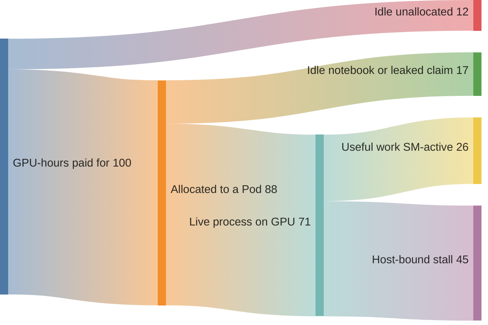

# GPU and AI FinOps

> **Version anchor (2026-08-26).** **FOCUS 1.4** was ratified **2026-06-04**, adding the Invoice Detail and Billing Period datasets (47 columns, 6 attributes) that bridge usage to invoice reconciliation; **1.5 is in development**. **FOCUS 1.3** (2025-12-05) added split and shared cost allocation, contract commitments, and recency/completeness fields. **AWS Data Exports currently supports FOCUS 1.2** (GA 2025-11-19) and has not yet shipped 1.3 or 1.4 — the gap between the spec and what AWS actually exports is a live planning constraint. The **2026 FinOps Framework** keeps four domains and adds an **Executive Strategy Alignment** capability; **AI is a dedicated Technology Category** alongside Public Cloud, SaaS, Data Center and Data Cloud Platforms. **AWS's Customer Carbon Footprint Tool is being retired on 2026-06-30**, replaced by the standalone **AWS Sustainability console** launched March 2026. **OpenCost is CNCF Incubating** (since October 2024) and **v1.121.0 (2026-08-05) added Kubernetes inference cost tracking** tied to the vLLM token stream. **Kepler remains CNCF Sandbox.**

> **Pricing anchor (checked 2026-08-26).** On-Demand, `us-east-1`, Linux, shared tenancy, pulled from **AWS's own Price List Bulk API** (`pricing.us-east-1.amazonaws.com/offers/v1.0/aws/AmazonEC2/current/us-east-1/index.json`, publication timestamp 2026-08-25T21:32:33Z) rather than any reseller: **`p5.48xlarge` $55.0400/hr**, **`p6-b200.48xlarge` $113.9328/hr**, **`g6e.xlarge` $1.8610/hr**, **`g6e.12xlarge` $10.49264/hr**, **`inf2.48xlarge` $12.98127/hr**. **`trn2.48xlarge` has no On-Demand SKU in `us-east-1` at all** — it exists only in `us-east-2`, and there only through Capacity Blocks. Every figure below derives from these; if you refresh one, recompute the tables rather than editing them individually.

This page sits under [cloud_cost_optimization_finops](cloud_cost_optimization_finops.md). The parent owns general cloud FinOps — tagging, rightsizing, the Spot/RI/Savings Plan ladder, the commitment break-even identity, showback and chargeback, the Inform-Optimize-Operate lifecycle. All of it still applies. This page owns the ways **accelerated and AI workloads break the parent's assumptions**, which they do in four specific places: the unit of waste is different, the utilization metric everyone reports is misleading, the commitment ladder has an extra rung, and a large part of the spend is not compute at all but per-token inference.

Cross-links: the scheduling and autoscaling levers that turn into savings are [gpu_scheduling_and_inference_ops](../ml_platform_and_gpu_infrastructure/gpu_scheduling_and_inference_ops.md); the fleet's operational model is [ml_platform_and_gpu_infrastructure](../ml_platform_and_gpu_infrastructure/ml_platform_and_gpu_infrastructure.md); device allocation is [device_scheduling_and_dra](../kubernetes_scheduling_and_autoscaling/device_scheduling_and_dra.md).

---

## 1. Concept Overview

Ordinary cloud FinOps assumes the resource is divisible, the waste is visible, and the price is per hour. Accelerated computing breaks all three.

**The unit of waste is a whole card, not a percentage.** A CPU instance at 20% utilization wastes 80% of something you can partly reclaim by rightsizing down a size. A GPU held by a Pod using 8% of it is not 92% wasted in a reclaimable sense — the card is *allocated*, and no rightsizing exists because there is no smaller instance with three-eighths of a GPU. Reclaiming it requires MIG, sharing, or a different scheduling decision. This is why the parent module's rightsizing chapter, which is its strongest content, has the least purchase here.

**The utilization number everyone reports is the wrong one.** `DCGM_FI_DEV_GPU_UTIL` measures whether *any* kernel was resident, so a GPU running one small stalled kernel in a loop reports near 100%. Fleets get defended in budget meetings with a number that does not measure work. The honest metrics are `DCGM_FI_PROF_SM_ACTIVE` and, for tensor workloads, `DCGM_FI_PROF_PIPE_TENSOR_ACTIVE`.

**The commitment ladder has a rung the parent does not cover.** EC2 Capacity Blocks for ML are neither a discount nor On-Demand: they are a **reservation product priced per accelerator-hour**, bought for a future window. They can price *below* On-Demand while also guaranteeing contiguous placement, which makes the parent's break-even identity insufficient on its own — a Block has no break-even because there is no prepayment to amortise, only an unused-capacity risk.

**A large share of AI spend is not compute.** Managed inference — Bedrock and its peers — is billed per token, with its own optimisation levers (batch, prompt caching, provisioned throughput) that have nothing to do with instances. A FinOps practice built entirely around EC2 will not see it, and the FinOps Foundation's 2026 framework recognises this by making **AI its own Technology Category**, driven by an observed ~15x GPU-to-CPU cost differential.

The single organising number is **cost per unit of useful work** — per token, per training step, per inference — because it is the only metric that improves when you make the workload more efficient rather than when you simply buy less.

Cost per token and per request as a product metric is covered in [AI Cost Engineering and Unit Economics](../../mlops/ai_cost_engineering_and_unit_economics/ai_cost_engineering_and_unit_economics.md).

---

## 2. Intuition

> A CPU fleet is a **buffet**: you take what you need, and leftovers are visible on the plate. A GPU fleet is a **chartered aircraft**: you pay for the whole plane whether you fill it or not, and "we used 20% of the seats" is not a discount, it is the bill.

**Mental model.** GPU cost accounting is closer to capital-equipment utilization than to cloud elasticity. The question is never "how much did we consume" — you consumed the card the moment it was allocated. It is "how much useful work did we extract per card-hour we paid for," which makes the denominator the thing under management.

**Why it matters.** The dominant failure is optimising the wrong side of the fraction. Teams negotiate discounts, chase Spot, and compare instance prices — all of which reduce the numerator — while the denominator sits at 20% because of batching, fragmentation, and idle notebooks. A 15% discount on a fleet running at 20% efficiency is worth far less than getting to 60% efficiency at list price.

**Key insight.** **Allocated, running, and actually working are three different numbers, and under-managed GPU fleets show large gaps between all three.** Cards can be allocated to Pods that are idle; Pods can be running processes that are host-bound and doing nothing on the GPU. Each gap has a distinct cause and a distinct fix, and reporting a single "GPU utilization" figure collapses all three into a number that cannot drive any decision.

---

## 3. Core Principles

1. **Report `SM_ACTIVE`, never `GPU_UTIL`,** in anything that informs spend. The latter measures residency, not work.
2. **Measure cost per token or per step**, not cost per hour. Hourly cost tells you what you bought; unit cost tells you what you got.
3. **Reconcile three numbers, not one:** cards allocated, cards backing a live process, mean SM-active.
4. **Idle is the largest line item and the least visible.** Notebooks, finished-but-lingering Pods, and leaked device claims all present as healthy utilization.
5. **Match the purchase instrument to the interruption tolerance,** not to the discount depth. Spot's discount is worthless on a workload that cannot restart.
6. **Managed inference is a separate cost model** with its own levers. Batch and caching discounts are larger than most compute discounts.
7. **Normalise across providers with FOCUS** — but check which version your provider actually exports, which is behind the spec.
8. **Efficiency and carbon are the same lever.** A card at 60% SM-active does roughly three times the work per gram of CO2e as the same card at 20%.

---

## 4. Types / Architectures / Strategies

### The purchase instruments, with the GPU-specific rung

| Instrument | AWS's stated discount | Commitment | Interruption | Right for |
|---|---|---|---|---|
| On-Demand | baseline | none | none | Serving baseline, unpredictable work |
| **Spot** | **up to 90%** | none | 2-minute notice | Checkpointed training, batch inference |
| **Reserved Instances** | **up to 72%** | 1 or 3 yr, family-bound | none | Steady, known instance type |
| **Compute Savings Plans** | **up to 66%** | 1 or 3 yr, $/hr | none | Steady spend, flexible across families |
| **EC2 Instance Savings Plans** | **up to 72%** | 1 or 3 yr, family in Region | none | Stable family usage |
| **SageMaker Savings Plans** | **up to 64%** | 1 or 3 yr | none | SageMaker-hosted training and inference |
| **EC2 Capacity Blocks for ML** | **not a discount** — a reservation priced per accelerator-hour | the booked window | none inside the block | Scheduled training with a deadline |

**Savings Plans do cover P6-B200** — coverage was extended in June 2025, alongside list-price reductions of up to 45% on P5, 26% on P5en and 33% on P4d/P4de. This is worth stating because a persistent belief holds that the newest GPU generation is commitment-ineligible, which leads teams to run large steady GPU fleets entirely On-Demand.

**Capacity Blocks priced per accelerator-hour** (from AWS's Capacity Blocks pricing page, checked 2026-08-26; AWS states the next scheduled price update is **October 2026**): P5 $5.191, P5e $5.97, P5en $6.241–$6.865 by region, **P6-B200 $12.355**, P6-B300 $14.04, P6e-GB200 $10.582. Compare P6-B200's Block rate of $12.355/GPU-hr against On-Demand's $113.9328 ÷ 8 = **$14.2416/GPU-hr** — the Block is roughly 13% *cheaper* while also guaranteeing contiguous placement. The cost is flexibility: you pay for the booked window whether you use it or not, and the purchase is non-cancelable and non-modifiable.

### Why the parent's break-even identity does not cover Blocks

The parent module's commitment arithmetic — an all-upfront commitment at discount `d` for term `T` breaks even at `(1-d) x T` months — assumes a prepayment amortised across a term during which the resource is available continuously. A Capacity Block is different in kind: there is no prepayment to amortise and no term to survive. The risk is **unused hours inside a window you already bought**.

```
  Capacity Block risk model -- utilization, not duration:

    booked         = instances x GPUs x hours in the block
    effective rate = block rate / fraction of booked hours actually used

    P6-B200 Block at $12.355/GPU-hr:
      100% used  ->  $12.355 per useful GPU-hour   (13% under On-Demand)
       80% used  ->  $15.44                        ( 8% over  On-Demand)
       50% used  ->  $24.71                        (73% over  On-Demand)

    break-even against On-Demand at $14.2416/GPU-hr:
      12.355 / 14.2416 = 0.868  ->  you must use ~87% of the booked hours
```

**Eighty-seven percent is a demanding number** for a training schedule with any slack in it, which is the honest reason to be cautious with Blocks: the headline rate is genuinely below On-Demand, and the realised rate usually is not.

### What managed inference costs, and its levers

| Lever | Effect | Terms |
|---|---|---|
| **Batch inference** | **50% below On-Demand** for eligible models | Asynchronous, no latency guarantee |
| **Prompt caching** | Cache reads priced far below the input rate | Applies to repeated prefixes |
| **Provisioned Throughput** | Model units at a committed rate | **No commitment / 1 month / 6 months** — deeper discount with longer term |

A concrete price point, from the Bedrock pricing page (Claude 3.5 Sonnet, standard tier, effective 2025-12-01, checked 2026-08-26): **input $6.00 / 1M tokens, output $30.00 / 1M**, cache write $7.50 / 1M, **cache read $0.60 / 1M**. Batch halves the first two to $3.00 and $15.00. Note the cache-read rate is **10x below the input rate** — for a workload with a long shared system prompt, caching is the single largest lever available and it requires no commitment at all.

**Provisioned Throughput per-model-unit pricing is not published for most models** — AWS directs you to your account manager. Any model of committed inference spend has to be built on a quote, not on a public rate card.

### FOCUS, and the version gap that matters

| Version | Ratified | Added |
|---|---|---|
| 1.2 | — | the version **AWS Data Exports currently supports** (GA 2025-11-19) |
| 1.3 | 2025-12-05 | split and shared cost allocation, contract commitments, recency and completeness |
| **1.4** | **2026-06-04** | Invoice Detail and Billing Period datasets — usage-to-invoice reconciliation |
| 1.5 | in development | — |

Providers publishing FOCUS today sit mostly at 1.2 (AWS, Azure, GCP, Oracle, IBM Cloud, Nebius, Grafana Cloud, Redis), with Snowflake, Databricks, MongoDB and Vercel at 1.3. **The practical consequence: shared-cost allocation, the 1.3 feature most relevant to a multi-tenant GPU cluster, is not yet available in AWS's FOCUS export.** Until it is, splitting a shared GPU fleet's cost across teams remains a job for Kubernetes-level allocation — OpenCost or Kubecost — rather than for the billing export.

---

## 5. Architecture Diagrams

Where the money actually goes on an under-managed fleet — the three-number reconciliation:



*Every stage looks healthy from the stage above it. Allocation is 88%, which is the number that reaches the budget meeting; useful work is 26%, which is the number that determines cost per token. The largest single loss is host-bound stall inside processes that are genuinely running.*

The metric ladder, and why the top rung is the one that gets quoted:


*Each rung down is a stricter definition of work and a smaller number. The red rung is the one dashboards default to and the one that cannot support a spend decision.*

---

## 6. How It Works — Detailed Mechanics

### The reconciliation query

This is the single most valuable thing in this page. Run it weekly.

```promql
# 1. Cards ALLOCATED -- what you are paying for, per namespace.
sum by (namespace) (
  kube_pod_container_resource_requests{resource="nvidia_com_gpu"}
  * on(pod, namespace) group_left kube_pod_status_phase{phase="Running"}
)

# 2. Cards with a LIVE PROCESS on them. A gap against (1) is idle
#    notebooks, lingering finished Pods, or leaked DRA ResourceClaims.
count by (namespace) (DCGM_FI_DEV_FB_USED > 1024)   # >1 GiB framebuffer in use

# 3. Mean USEFUL WORK. The honest denominator for every unit-cost figure.
avg by (namespace) (DCGM_FI_PROF_SM_ACTIVE)

# 4. The number people quote, shown alongside so the gap is visible.
avg by (namespace) (DCGM_FI_DEV_GPU_UTIL)
```

```promql
# The alert that finds idle money. A card allocated, with almost no
# framebuffer in use, for an hour, is a notebook someone forgot.
- alert: GpuAllocatedButIdle
  expr: |
    (DCGM_FI_DEV_FB_USED < 512) and (DCGM_FI_PROF_SM_ACTIVE < 0.02)
  for: 60m
  labels: {severity: ticket}
  annotations:
    summary: "GPU on {{ $labels.kubernetes_node }} allocated and idle 60m -- $14.24/hr"
```

### Cost per million tokens, from measured throughput

The inputs split cleanly into facts and assumptions, and mixing them is how bogus unit-cost figures get published.

```
  FACTS (verified list prices):
    p6-b200.48xlarge   $113.9328 / hr  /  8 GPUs  =  $14.2416 per GPU-hour
    g6e.12xlarge       $ 10.49264 / hr /  4 GPUs  =  $ 2.6232 per GPU-hour

  ASSUMPTION (must come from YOUR benchmark, at YOUR context length):
    T = measured output tokens/sec/GPU

  cost per 1M output tokens = (GPU-hourly / 3600) / T * 1e6

    on B200:   (14.2416 / 3600) / T * 1e6  =  3956 / T
    on L40S:   ( 2.6232 / 3600) / T * 1e6  =   729 / T

  the crossover: the B200 is cheaper per token only when its measured
  throughput exceeds the L40S's by more than 3956/729 = 5.43x
```

**That ratio is the whole instance-selection decision**, and it is decided by measurement rather than by specification sheets. The corresponding vLLM counters are `vllm:generation_tokens_total` and `vllm:prompt_tokens_total`:

```promql
# Measured output tokens/sec/GPU -- the T above, from production.
sum(rate(vllm:generation_tokens_total[30m]))
  / sum(kube_pod_container_resource_requests{resource="nvidia_com_gpu"})

# Live cost per million output tokens, at the anchored B200 rate.
14.2416 / 3600 * 1e6
  / (
      sum(rate(vllm:generation_tokens_total[30m]))
      / sum(kube_pod_container_resource_requests{resource="nvidia_com_gpu"})
    )
```

### The utilization multiplier, stated plainly

```
  effective cost per useful GPU-hour = list rate / SM-active fraction

    $14.2416 at 20% SM-active  =  $71.21 per useful GPU-hour
    $14.2416 at 40% SM-active  =  $35.60
    $14.2416 at 60% SM-active  =  $23.74
    $14.2416 at 90% SM-active  =  $15.82

  going 20% -> 60% is a 3x cost reduction.
  the deepest commitment discount available (72%) is a 3.6x reduction.

  so: doubling-and-a-half your efficiency is worth roughly as much as the
  best commitment discount AWS sells -- and unlike the commitment, it
  costs nothing, locks in nothing, and compounds with the discount.
```

This is the argument to bring to a budget conversation. Discounts and efficiency multiply; efficiency is the free one and is usually the larger opportunity.

### Which GPU metric to trust

| Metric | Measures | Use for |
|---|---|---|
| `DCGM_FI_DEV_GPU_UTIL` | Was **any** kernel resident in the window | Nothing that informs spend. Saturates near 100% under trivial load |
| `DCGM_FI_PROF_SM_ACTIVE` | Fraction of cycles with at least one warp resident per SM, averaged over SMs | Breadth of use — the default honest metric |
| `DCGM_FI_PROF_PIPE_TENSOR_ACTIVE` | Fraction of cycles the tensor pipe was active | Whether you are extracting value from a *tensor* GPU. Can be near zero while `GPU_UTIL` reads 100% |
| `DCGM_FI_DEV_FB_USED` | Framebuffer bytes in use | Detecting allocated-but-idle cards |

### Rightsizing that actually exists for GPUs

**AWS Compute Optimizer does support GPU rightsizing**, using `GPUUtilization`, `GPUMemoryUtilization` and `GPUEncoderStatsSessionCount` to classify G and P family instances. Its **idle threshold is strict**: GPU inactive for more than 99% of a 14-day window and GPU memory below 5%, among five required conditions. That strictness is deliberate and worth understanding — it will find the genuinely abandoned instances and will not find the far larger population running at 20%. Cost Optimization Hub consolidates the recommendations with commitment-aware "after discount" estimates.

The practical reading: **Compute Optimizer finds abandoned GPUs; the Prometheus reconciliation above finds under-used ones, and there are far more of the second.**

---

## 7. Real-World Examples

- **OpenCost v1.121.0** (2026-08-05) shipped first-of-a-kind Kubernetes **inference cost tracking**, tying infrastructure cost to the vLLM token stream — the exact join that was previously hand-built in every organisation running LLM serving on Kubernetes. OpenCost has been **CNCF Incubating since October 2024**.
- **Kubecost** was acquired by **IBM in September 2024**; Kubecost 3.0 now ships under IBM Apptio, built on OpenCost's allocation engine with multi-cluster federation and Turbonomic integration.
- **The AWS Customer Carbon Footprint Tool is being retired on 2026-06-30**, superseded by the standalone **AWS Sustainability console** (March 2026). CCFT had grown to report Scope 1, 2 and 3 on both location-based and market-based methods, with Scope 3 added in October 2025. Any carbon dashboard built on CCFT needs migrating.
- **The Green Software Foundation's SCI specification is now an ISO standard — ISO/IEC 21031:2024**, published March 2024. That matters for procurement and reporting: a software carbon intensity claim can now reference a standard rather than a project.
- **Kepler remains CNCF Sandbox** (accepted 2023-05-17), and underwent a ground-up rearchitecture starting at v0.10.0 in 2026. Useful, but not yet the foundation for a compliance-grade number.
- **The 2026 FinOps Framework** keeps four domains — Optimize Usage & Cost, Manage the FinOps Practice, Understand Usage & Cost, Quantify Business Value — adds **Executive Strategy Alignment**, and renames Cloud Sustainability to **Sustainability** and Workload Optimization to **Usage Optimization**. **AI is a Technology Category in its own right**, justified by a roughly 15x GPU-to-CPU cost differential.

---

## 8. Tradeoffs

| Decision | Option A | Option B | How to choose |
|---|---|---|---|
| Training capacity | Spot + checkpoints | Capacity Block | Spot unless there is a deadline. Blocks need ~87% booked-hour utilization to beat On-Demand |
| Serving capacity | On-Demand | Savings Plan | Savings Plan once the baseline is genuinely steady — and note P6-B200 **is** covered |
| Serving hardware | `p6-b200.48xlarge` | `g6e.12xlarge` | The B200 wins per token only above a **5.43x** measured throughput ratio |
| Managed vs self-hosted | Bedrock per token | vLLM on EC2 | Bedrock below the crossover volume and for spiky traffic; self-host once utilization is sustainably high |
| Inference discount | Batch (50% off) | Real-time | Batch wherever latency is not user-facing — it is a larger discount than most compute commitments |
| Prompt handling | Cache repeated prefixes | Send in full | Cache: reads are ~10x below the input rate and require no commitment |
| Cost allocation | FOCUS billing export | Kubernetes-level (OpenCost) | OpenCost for shared GPU clusters — AWS's FOCUS export is still at **1.2**, without 1.3's shared-cost allocation |
| Utilization metric | `GPU_UTIL` | `SM_ACTIVE` | `SM_ACTIVE`, always, for anything financial |
| Rightsizing | Compute Optimizer | Prometheus reconciliation | Both — Optimizer finds abandoned instances, reconciliation finds the far larger under-used population |

---

## 9. When to Use / When NOT to Use

**Run a dedicated GPU FinOps practice when** accelerated spend exceeds roughly a tenth of the cloud bill, when more than one team shares a GPU cluster, or when anyone is being asked to justify a GPU purchase. The 15x cost differential means GPU spend reaches material size at a small fraction of the resource count, so the threshold arrives sooner than teams expect.

**Do NOT start with commitments.** Discounts multiply with efficiency and efficiency is free, so the first pass is always the reconciliation query and the idle-card alert. Committing to a fleet running at 20% SM-active locks in the waste for one to three years.

**Use Capacity Blocks when** the training schedule is firm enough to fill roughly 87% of the booked window and the deadline is real. **Do not use them** for exploratory work, where slack in the schedule turns a below-list rate into an above-list one.

**Self-host inference when** utilization is sustainably high and predictable. **Use managed per-token inference when** traffic is spiky, when the workload is early enough that utilization is unknown, or when the operational cost of running an inference platform exceeds the margin — which for small volumes it usually does.

**Do not build carbon reporting on CCFT** — it retires 2026-06-30. **Do not build a compliance-grade carbon number on Kepler** — it is still CNCF Sandbox and was recently rearchitected.

---

## 10. Common Pitfalls

**1. Reporting `GPU_UTIL` as utilization.**

```promql
# BROKEN: this is the number that reaches the budget meeting, and it reads
# 94% on a fleet doing 19% of the work it is paid for. GPU_UTIL asks "was
# any kernel resident", so a small stalled kernel in a loop saturates it.
avg(DCGM_FI_DEV_GPU_UTIL)
```

```promql
# FIX: report the work metric, and show the misleading one beside it so the
# gap is visible and the conversation happens once rather than every quarter.
avg(DCGM_FI_PROF_SM_ACTIVE)               # breadth of use -- the honest number
avg(DCGM_FI_PROF_PIPE_TENSOR_ACTIVE)      # tensor value extraction
avg(DCGM_FI_DEV_GPU_UTIL)                 # shown only for contrast
```

**2. Optimising the numerator while the denominator sits at 20%.** Chasing a 15% discount on a fleet at 20% SM-active is worth a fraction of what moving to 60% is worth — and unlike the discount, the efficiency gain compounds with any discount you later negotiate. Efficiency first, commitment second.

**3. Assuming Capacity Blocks are cheap because the rate is below On-Demand.** At $12.355/GPU-hr against On-Demand's $14.2416, a P6-B200 Block undercuts list by 13% — but only if you use roughly **87%** of the booked hours. At 50% utilization the effective rate is $24.71, which is 73% *above* On-Demand. The instrument is a bet on your own scheduling discipline.

**4. Believing the newest GPUs are commitment-ineligible.** **Savings Plans cover P6-B200**, extended in June 2025 alongside list-price cuts of up to 45% on P5, 26% on P5en and 33% on P4d/P4de. Teams that assume otherwise run large steady GPU fleets entirely On-Demand and leave a substantial discount on the table.

**5. Building a cost-per-token figure on a vendor throughput number.** Throughput varies by more than an order of magnitude across model, quantisation, context length and batch size. A unit-cost figure is only as good as its throughput input, and the only defensible input is your own benchmark. Cite the measurement, and cite the conditions it was measured under.

**6. Expecting AWS's FOCUS export to carry 1.3 features.** **AWS Data Exports supports FOCUS 1.2**; 1.3's shared and split cost allocation — precisely what a multi-tenant GPU cluster needs — is not there. Allocate at the Kubernetes layer with OpenCost until it lands, and do not design a chargeback model around a column that does not exist in your export.

**7. Trusting Compute Optimizer to find under-used GPUs.** Its idle classification requires GPU inactivity for **more than 99% of a 14-day window** with memory below 5%. That finds abandoned instances and nothing else. The much larger population running at 20% is invisible to it and requires the Prometheus reconciliation.

**8. Leaving carbon reporting on CCFT.** It retires **2026-06-30**. The replacement is the AWS Sustainability console, launched March 2026.

**9. Citing an unsourced GPU-utilization industry statistic.** Numbers of the form "the average GPU runs at X%" circulate widely with no traceable primary report behind them. Measure your own fleet — the reconciliation query above takes an afternoon and produces a number you can defend, which an industry average never is.

---

## 11. Technologies & Tools

| Tool | Category | Role | Note |
|---|---|---|---|
| **OpenCost** v1.121.0 | K8s cost allocation | Namespace and workload cost; **inference cost tied to the vLLM token stream** since 2026-08-05 | CNCF **Incubating** since Oct 2024 |
| **Kubecost 3.0** | K8s cost allocation | Multi-cluster federation, Turbonomic integration | IBM since Sept 2024, under Apptio |
| **DCGM / dcgm-exporter** | Telemetry | `SM_ACTIVE`, `PIPE_TENSOR_ACTIVE`, `FB_USED` | `GPU_UTIL` is the misleading one |
| **vLLM counters** | Unit-cost input | `vllm:generation_tokens_total`, `vllm:prompt_tokens_total` | The denominator for cost per token |
| **FOCUS 1.4** | Billing normalisation | Cross-provider schema; 1.4 adds invoice reconciliation | **AWS exports 1.2** — mind the gap |
| **AWS Data Exports** | Billing | FOCUS 1.2 export, GA 2025-11-19 | Not yet 1.3 or 1.4 |
| **Compute Optimizer** | Rightsizing | GPU idle and under-utilization classification | Idle threshold is >99% inactive over 14 days |
| **Cost Optimization Hub** | Rightsizing | Consolidated, commitment-aware estimates | Pairs with Compute Optimizer |
| **EC2 Capacity Blocks** | Capacity | Per-accelerator-hour reservation | P6-B200 $12.355/GPU-hr as of 2026-07-01 |
| **AWS Sustainability console** | Carbon | Replaces CCFT | CCFT retires **2026-06-30** |
| **GSF SCI** | Carbon standard | Software carbon intensity | **ISO/IEC 21031:2024** |
| **Kepler** | Carbon telemetry | Per-workload energy attribution | CNCF **Sandbox**; rearchitected in 2026 |
| **Cloud Carbon Footprint** | Carbon | Multi-cloud estimation | Thoughtworks OSS, actively maintained |

---

## 12. Interview Questions with Answers

**Q: Why is `DCGM_FI_DEV_GPU_UTIL` the wrong metric for a cost conversation?**
**Short:** It reports whether any kernel was resident, so a GPU running one trivial stalled kernel in a loop reads near 100% while doing almost no work.

`GPU_UTIL` is a residency measure, not a work measure — it answers "was something scheduled on the device" rather than "how much of the device did useful work." The consequence is a fleet that reports 94% utilization while `DCGM_FI_PROF_SM_ACTIVE` sits at 19%, and since the first number is the one dashboards default to, it is the one that reaches the budget meeting and forecloses the conversation. `SM_ACTIVE` — the fraction of cycles with at least one warp resident per SM — is the honest breadth-of-use metric, and `DCGM_FI_PROF_PIPE_TENSOR_ACTIVE` goes further for tensor workloads, where it can sit near zero while `GPU_UTIL` reads 100% because the process is host-bound. Report the work metric, and show the misleading one beside it so the gap is visible.

**Q: A GPU fleet reports 88% allocation and engineers still cannot get cards. What are the three numbers you would check?**
**Short:** Cards allocated, cards with a live process on them, and mean SM-active — the gaps between them each have a different cause and a different fix.

Allocation says a Pod holds the card, and that is the number that reaches finance. The first gap is allocated-but-not-running: idle notebooks, Pods that finished but linger, and under DRA, leaked `ResourceClaim` objects holding an allocation with no consumer — detectable as `DCGM_FI_DEV_FB_USED` near zero on an allocated card, and fixable with idle reaping. The second gap is running-but-not-working: processes that are genuinely alive but host-bound or badly batched, visible as low `SM_ACTIVE` on a card with framebuffer in use, and fixable with batching, data-pipeline work, or MIG for the small tenants. Collapsing all three into one "GPU utilization" figure is what makes the problem invisible, because each gap is separately actionable and the single number moves for reasons you cannot attribute.

**Q: Are EC2 Capacity Blocks a discount?**
**Short:** No — they are a reservation priced per accelerator-hour, and they only beat On-Demand if you actually use about 87% of the booked window.

The headline rate is genuinely attractive: P6-B200 Capacity Blocks were $12.355 per GPU-hour as of 2026-07-01, against On-Demand's $113.9328 ÷ 8 = $14.2416 per GPU-hour, so the Block undercuts list by roughly 13% while also guaranteeing contiguous placement — which is often the real reason to buy one, since P6 capacity is not reliably available on demand. But you pay for the booked window whether you use it or not, and the purchase is non-cancelable and non-modifiable, so the effective rate is the block rate divided by your realised utilization. The break-even is 12.355 ÷ 14.2416 = 0.868, meaning about 87% of booked hours must be productive. At 50% utilization the effective rate is $24.71 — 73% *above* On-Demand. It is a bet on your own scheduling discipline, not a discount.

**Q: What is the single largest cost lever on a GPU fleet, and why is it not the discount?**
**Short:** Utilization — moving from 20% to 60% SM-active is a 3x cost reduction, comparable to the deepest commitment discount AWS sells, and it is free.

Effective cost per useful GPU-hour is the list rate divided by the fraction of the card doing work, so at $14.2416 per GPU-hour a fleet at 20% SM-active is really paying $71.21 per useful hour, and at 60% it pays $23.74. That 3x improvement is close to the 3.6x implied by the best available commitment discount of 72% — except that the efficiency gain requires no commitment, locks in nothing, and **multiplies with** any discount you subsequently negotiate rather than competing with it. The ordering that follows is the practical point: run the utilization work first, then commit, because committing to a fleet at 20% efficiency locks in the waste for one to three years and makes it harder to shrink the fleet later.

**Q: Is the biggest GPU instance the cheapest place to serve a model?**
**Short:** Only above a measured 5.43x throughput ratio — `p6-b200.48xlarge` is $14.24 per GPU-hour against `g6e.12xlarge` at $2.62.

At verified list prices, `p6-b200.48xlarge` is $113.9328/hr across 8 B200s and `g6e.12xlarge` is $10.49264/hr across 4 L40S, giving $14.2416 and $2.6232 per GPU-hour respectively. Cost per million output tokens is (GPU-hourly ÷ 3600) ÷ T × 1e6, so it comes to 3956/T on the B200 and 729/T on the L40S — and the B200 is cheaper per token only when its measured throughput exceeds the L40S's by more than 3956 ÷ 729 = 5.43x. Whether it does depends entirely on your model, quantisation, context length and batch size, which is why this is a benchmarking question rather than a specification-sheet question. The general principle is that cost per hour is not the decision variable and cost per token is, and the two frequently point in opposite directions.

**Q: Which FOCUS version does AWS actually export, and why does the gap matter?**
**Short:** AWS Data Exports supports FOCUS 1.2, while the spec is at 1.4 — so 1.3's shared and split cost allocation is not available in the export.

FOCUS 1.4 was ratified 2026-06-04 and 1.3 on 2025-12-05, but AWS Data Exports GA'd FOCUS 1.2 on 2025-11-19 and has not shipped the later versions. The consequential gap is 1.3's shared and split cost allocation, which is exactly the capability a multi-tenant GPU cluster needs to divide one expensive shared fleet across teams — so a chargeback model designed around those FOCUS columns would be designing against something that does not exist in the export yet. Until it lands, do the allocation at the Kubernetes layer with OpenCost or Kubecost, which see the Pod-to-team mapping the billing export never will. More generally: always check which version your provider publishes rather than which version the spec has reached, because the lag runs to several quarters.

**Q: What are the levers on managed per-token inference spend?**
**Short:** Batch inference at 50% off, prompt caching with cache reads about 10x below the input rate, and Provisioned Throughput on 1- or 6-month commitments.

Batch inference runs asynchronously with no latency guarantee and prices at 50% below On-Demand for eligible models — for Claude 3.5 Sonnet that takes input from $6.00 to $3.00 and output from $30.00 to $15.00 per million tokens. Prompt caching is often larger: cache reads at $0.60 per million against an input rate of $6.00 is a 10x reduction on the cached portion, and it applies to any workload with a long shared prefix such as a system prompt or a RAG context, requiring no commitment at all. Provisioned Throughput buys model units at a committed rate with terms of no-commitment, one month, or six months. One honest caveat for planning: **per-model-unit pricing is not published for most models** — AWS directs you to your account manager — so any committed-inference model has to be built on a quote rather than a public rate card.

**Q: Why does the parent module's commitment break-even formula not apply to Capacity Blocks?**
**Short:** That identity amortises a prepayment across a term; a Block has no prepayment to amortise, only unused-hour risk inside a window you already bought.

The parent's model says an all-upfront commitment at discount `d` for term `T` breaks even at `(1-d) × T` months, and the risk it captures is the workload disappearing before the term completes. A Capacity Block is a different instrument: there is no discount off a rate you would otherwise pay over a long horizon, and no term to survive — there is a booked window, a per-accelerator-hour price, and hours that either get used or do not. So the right model is utilization-based: effective rate equals block rate divided by the fraction of booked hours used, and the comparison is against the On-Demand per-GPU-hour rate rather than against a break-even month. Applying the parent's formula here produces a confident answer to the wrong question, which is worse than having no model.

**Q: Compute Optimizer says your GPU fleet has no rightsizing opportunities. Do you believe it?**
**Short:** Only for abandoned instances — its idle threshold requires GPU inactivity for more than 99% of a 14-day window, so a fleet at 20% utilization is invisible to it.

AWS Compute Optimizer does support GPU rightsizing, using `GPUUtilization`, `GPUMemoryUtilization` and `GPUEncoderStatsSessionCount` to classify G and P family instances, and its idle classification requires more than 99% GPU inactivity across a 14-day window with GPU memory below 5%, among five required conditions. That is a deliberately conservative bar designed to avoid false positives, and it does what it says: it finds genuinely abandoned instances. What it cannot find is the far larger population running continuously at low efficiency, because those instances are active by every measure it uses. So a clean Compute Optimizer report means "nothing is abandoned," not "nothing is wasted" — and the Prometheus reconciliation of allocated versus live versus SM-active is what surfaces the rest.

**Q: How would you build a defensible cost-per-token metric?**
**Short:** Divide a verified GPU-hourly rate by measured tokens per second per GPU from your own production traffic, and state the measurement conditions alongside the number.

The verified list price is the only input that is a fact; everything else is measurement. Take the GPU-hourly rate from the provider's own price list — $14.2416 for a B200 at current us-east-1 On-Demand — and divide by throughput measured from `rate(vllm:generation_tokens_total[30m])` over the GPUs actually allocated, which gives cost per million output tokens as (rate ÷ 3600) ÷ T × 1e6. The reason to derive T from production rather than a benchmark harness is that throughput varies by an order of magnitude with context length, batch size and quantisation, and production traffic is the only distribution that matches what you actually bill for. Publish the conditions with the number — model, quantisation, mean context length, time window — because a cost-per-token figure without them cannot be compared to anything, including its own value next quarter.

**Q: What changed for AWS carbon reporting, and what would you build on now?**
**Short:** The Customer Carbon Footprint Tool retires 2026-06-30, replaced by the standalone AWS Sustainability console launched March 2026.

CCFT had matured considerably, reporting Scope 1, 2 and 3 emissions on both location-based and market-based methods, filterable by region, service and scope, with Scope 3 added in October 2025. It is nonetheless being retired on 2026-06-30 in favour of the AWS Sustainability console, so any dashboard, report or automated pull built against CCFT needs migrating on that deadline. For a standard to anchor claims against, the Green Software Foundation's Software Carbon Intensity specification is now **ISO/IEC 21031:2024**, which makes an SCI figure citable in procurement and reporting contexts. For per-workload attribution inside Kubernetes, Kepler is the obvious candidate but remains **CNCF Sandbox** and was rearchitected during 2026 — useful for engineering insight, not yet a foundation for a compliance-grade number.

**Q: Where does GPU FinOps sit in the 2026 FinOps Framework?**
**Short:** AI is a Technology Category in its own right, alongside Public Cloud, SaaS, Data Center and Data Cloud Platforms, justified by a roughly 15x GPU-to-CPU cost differential.

The 2026 framework retains its four domains — Optimize Usage & Cost, Manage the FinOps Practice, Understand Usage & Cost, and Quantify Business Value — and adds an **Executive Strategy Alignment** capability, while renaming Cloud Sustainability to Sustainability and Workload Optimization to Usage Optimization. Promoting AI to a Technology Category rather than treating it as a workload type inside public cloud is the substantive change, and the reasoning is the cost differential: accelerated resources reach material spend at a small fraction of the resource count, so the practices that work for a large CPU estate do not transfer. The practical implication for a platform team is that GPU cost needs its own allocation model, its own unit metrics and its own reporting cadence, rather than being a line inside general compute.

**Q: Are Savings Plans available for the newest GPU instances?**
**Short:** Yes — coverage was extended to P6-B200 in June 2025, alongside list-price reductions of up to 45% on P5, 26% on P5en and 33% on P4d/P4de.

A persistent belief holds that the newest accelerator generation is commitment-ineligible, and it leads teams to run large, steady GPU fleets entirely On-Demand while assuming there is no alternative. Compute Savings Plans advertise up to 66% and EC2 Instance Savings Plans up to 72%, with SageMaker Savings Plans at up to 64% for SageMaker-hosted work, and P6-B200 falls within Savings Plan coverage. The caveat is the ordering argument: a commitment on a fleet running at low SM-active locks in the inefficiency for one to three years and makes it harder to shrink later, so do the utilization work first and size the commitment against the *post-optimisation* baseline. Commit to the floor you are confident about and leave the variable portion On-Demand or Spot.

**Q: A team wants to self-host inference instead of using a managed per-token API. How would you frame the decision?**
**Short:** As a utilization question — managed pricing is per token with no idle cost, self-hosting is per GPU-hour whether or not requests arrive.

Managed inference charges only for tokens processed, so its effective cost tracks demand exactly and spiky or low-volume traffic costs almost nothing when idle. Self-hosting converts that into a fixed per-GPU-hour cost that runs whether requests arrive or not, which is cheaper per token above some crossover volume and much more expensive below it. So the framing is: estimate steady-state token throughput, compute self-hosted cost per million tokens from a verified GPU rate divided by measured throughput, and compare against the managed rate net of batch and caching discounts — remembering that batch at 50% off and cache reads about 10x below the input rate move the managed side substantially. Then add the operational cost, which is real: running an inference platform means autoscaling on the right signals, node health, capacity strategy and an on-call rotation, and for small volumes that exceeds the margin.

**Q: What single query would you run first on an unfamiliar GPU cluster?**
**Short:** The reconciliation — cards allocated, cards with framebuffer in use, and mean SM-active, side by side per namespace.

Everything else follows from the shape of those three numbers, and the gaps localise the problem before any optimisation work starts. If allocation is high and framebuffer use is low, the problem is idle holders — notebooks, lingering Pods, leaked device claims — and the fix is reaping, which is cheap and immediate. If framebuffer use is high but SM-active is low, the problem is inside the workloads — batching, data pipeline stalls, host-bound processes — and the fix is engineering work on the applications. If all three are high and people still cannot get cards, the fleet is genuinely too small and the answer is to buy, which is the only one of the three that costs money. Running this first also produces the number you will need to defend any subsequent request, and it takes an afternoon rather than a quarter.

---

## 13. Best Practices

- **Report `SM_ACTIVE`, and show `GPU_UTIL` beside it** so the gap is visible once instead of relitigated quarterly.
- **Reconcile allocated, live, and working weekly.** Each gap is a different problem with a different owner.
- **Alert on allocated-but-idle** — framebuffer under 512 MiB with SM-active under 2% for an hour is money on the floor.
- **Efficiency before commitment.** Committing to a fleet at 20% SM-active locks in the waste for the term.
- **Derive cost per token from production throughput**, and publish the conditions with the number.
- **Model Capacity Blocks on utilization, not on break-even** — the bar is roughly 87% of booked hours.
- **Size commitments against the post-optimisation baseline**, and leave the variable portion on Spot or On-Demand.
- **Use batch inference and prompt caching before negotiating anything.** Both are larger than most compute discounts and need no commitment.
- **Allocate shared GPU cost in Kubernetes, not in the billing export**, until AWS ships FOCUS 1.3.
- **Check which FOCUS version your provider exports**, not which version the spec has reached.
- **Migrate carbon reporting off CCFT before 2026-06-30.**
- **Measure your own fleet rather than citing an industry utilization average.** Yours is defensible; the average is not.

---

## 14. Case Study

### Scenario: a $2.1M annual GPU bill, and the 40% that was never being used

A company runs a shared GPU cluster for six ML teams: 16x `p6-b200.48xlarge` on-demand, 128 B200s, running continuously. At $113.9328/hr the fleet lists at **$1,330,000 a year** in compute alone, and total accelerated spend including Bedrock experimentation is about $2.1M. Finance asks for 30%.

**The reported position.** The platform dashboard showed 91% GPU utilization and 94% allocation. On that basis the team's proposal was to negotiate a three-year Savings Plan and buy four more nodes to relieve the queue.

**What the reconciliation showed.** They ran the three-number query for the first time:

```
                                            cards    % of 128
  allocated to a running Pod                  120        94%
  with >1 GiB framebuffer in use               99        77%
  mean SM-active across those                  --        23%
  mean GPU_UTIL (the dashboard number)         --        91%
```

Three separate problems, none visible in the single number:

```
  128 cards paid for
  -  8  never allocated at all (fragmentation: 8-GPU nodes, 6-GPU jobs)
  - 21  allocated to Pods with no live GPU process
  ------
   99  running something
        of which, at 23% mean SM-active, roughly 23 cards' worth of work

  effective cost per USEFUL GPU-hour:
    $113.9328 / 8 = $14.2416 list
    $14.2416 / 0.23 = $61.92 per useful GPU-hour
```

They were paying for 128 cards to get about 23 cards of work.

**Where the 21 idle-but-allocated cards went.** A one-off audit found:

```
  Jupyter notebooks idle >7 days, holding whole cards      13
  Completed Jobs whose Pods had not been reaped             5
  Leaked DRA ResourceClaims -- allocation set,
    reservedFor empty, no owning Pod                        3
  ------
                                                           21  = $2,620/day
```

**Fix 1 — reap the idle.** A controller cordoning notebooks idle for 4 hours, TTL on finished Jobs, and the leaked-claim alert from [device_scheduling_and_dra](../kubernetes_scheduling_and_autoscaling/device_scheduling_and_dra.md):

```yaml
# BROKEN: no TTL. Completed Jobs' Pods lingered indefinitely, and their
# GPU requests still counted against allocation, so the scheduler treated
# 5 cards as taken while nothing ran on them.
apiVersion: batch/v1
kind: Job
spec:
  template: {spec: {containers: [{name: train, resources: {limits: {nvidia.com/gpu: 8}}}]}}
```

```yaml
# FIX: reap on completion. One field.
apiVersion: batch/v1
kind: Job
spec:
  ttlSecondsAfterFinished: 600
  template: {spec: {containers: [{name: train, resources: {limits: {nvidia.com/gpu: 8}}}]}}
```

**Fix 2 — MIG for the small tenants.** Of the 99 running cards, 34 served inference models needing under 20 GB. Partitioning those into `2g.20gb` slices let three workloads share a card. 34 cards became 12.

**Fix 3 — the metric that started the argument.** The dashboard was rewritten to lead with `SM_ACTIVE` and show `GPU_UTIL` only in a footnote labelled "kernel residency, not work." That change made every subsequent conversation shorter.

**Fix 4 — commit against the new baseline, not the old one.**

```
  the proposal they nearly executed:
    3-yr Savings Plan sized on 128 cards, plus 4 more nodes
    -> locks in the 23% efficiency for three years, and adds to it

  what they did instead, in order:
    1. reap idle                   128 -> 107 cards needed
    2. MIG the small tenants       107 ->  85
    3. fix batching on 2 services   85 ->  71   (SM-active 23% -> 54%)
    4. THEN size the commitment on 72 cards, not 128
```

The ordering is the entire lesson. A Savings Plan on 128 cards would have been a three-year commitment to waste, and it would have been extremely difficult to unwind — the discount would have made the marginal cost of the idle cards look small, which is precisely how inefficiency becomes permanent.

**Result.**

```
  before:  128 B200 On-Demand, 23% SM-active
           $14.2416 / 0.23  =  $61.92 per useful GPU-hour
           $1,330,000 / yr compute

  after:    72 B200, 54% SM-active, 1-yr Compute Savings Plan on the
             60-card steady floor, remainder On-Demand
           $14.2416 / 0.54  =  $26.37 per useful GPU-hour
           roughly $610,000 / yr compute before the commitment discount

  cost per useful GPU-hour fell 57%.
  the fleet shrank 44%.
  no team lost capacity -- the queue got SHORTER, because
  fragmentation and idle holders had been the constraint all along.
```

The queue shortening is the counter-intuitive part and the most useful thing to carry into an interview: the cluster had felt capacity-constrained, and the constraint was not capacity.

### Discussion questions

1. The team nearly bought a three-year commitment on 128 cards. What in their reporting made that look like the obvious move, and what would have caught it earlier?
2. Fixing batching on two services moved SM-active from 34% to 54% — the largest single gain. Why is that work usually done last, and who should own it?
3. The 13 idle notebooks were the easiest win and the most politically difficult. How would you introduce a 4-hour idle reap without the platform team becoming the enemy?
4. After these fixes the fleet sits at 54% SM-active. What would you go after next, and at what point does further optimisation stop being worth the engineering time?
