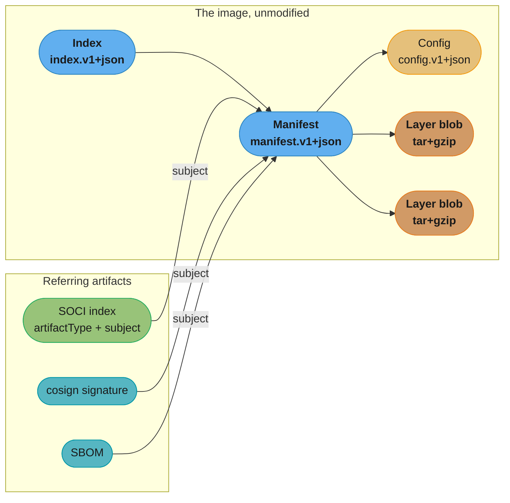
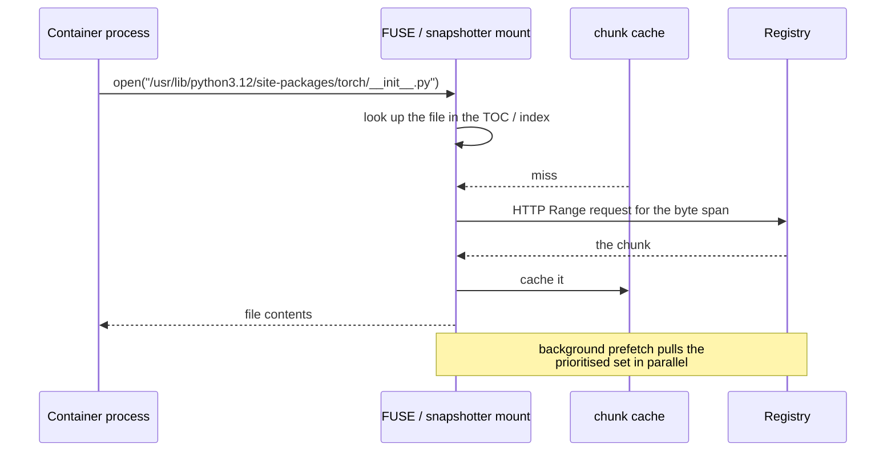

# OCI Image Formats and Lazy Pulling

> **Version anchor (2026-08-27).** **OCI Image Spec v1.1.1** (2025-03), **Runtime Spec v1.3.0** (2025-11), **Distribution Spec v1.1.1** (2025-01). **containerd v2.3.0** (2026-04-30); Kubernetes 1.35 is the last release supporting containerd 1.x. **SOCI** (`awslabs/soci-snapshotter`) is on Index Manifest v2; v1 has been disabled since SOCI v0.10.0, and ECS/Fargate support requires Linux platform version 1.4.0. **Nydus** (v2.4.0) is a sub-project of **Dragonfly**, which **graduated from the CNCF in January 2026**. **Docker Content Trust / Notary v1 is being retired outright: `notary.docker.io` shuts down on 2026-12-08**; the replacements are Notation (Notary v2) and Sigstore cosign.

---

## 1. Concept Overview

[container_runtimes_and_oci](container_runtimes_and_oci.md) establishes the runtime stack — CRI, containerd, runc, and the snapshotter that assembles layers into a rootfs. It names stargz twice, in passing, as a thing that exists. This page is about the layer *format* itself and the single operational problem it creates: **a container cannot start until every byte of every layer has been downloaded and decompressed, and for a modern image most of those bytes are never read.**

The measured shape of that waste is stark. Published analyses of container startup consistently find that pulling dominates cold start, and that only a small fraction of an image's bytes are touched before the workload is serving. An ML inference image built on `pytorch/pytorch` with CUDA is several gigabytes compressed — the `2.1.0-cuda11.8-cudnn8-runtime` tag is roughly 3.5 GB compressed on Docker Hub and the `devel` variants are roughly twice that — and the process that starts is a Python interpreter that opens a few hundred megabytes of it.

The reason is structural, not incidental, and it lives in the format. An OCI layer is a **tar archive, gzip-compressed, addressed by the digest of the compressed blob**. Tar has no index: to find one file you read from the beginning. Gzip is a single stream: to decompress byte 900,000,000 you must decompress the 899,999,999 before it. So the format makes random access impossible by construction, and "pull the whole thing first" is the only thing a runtime *can* do with it.

**Lazy pulling** is the family of techniques that fixes this by making layers seekable — either by choosing a seekable compression format, or by shipping a separate index that says where each file lives inside the blob — so the snapshotter can mount the filesystem immediately and fetch chunks on demand.

Packaging model weights as OCI artifacts is covered in [Model Registry and Packaging](../../mlops/model_registry_and_packaging/model_registry_and_packaging.md).

---

## 2. Intuition

**One-line analogy.** A gzipped tar layer is a cassette tape: to hear track nine you spool through tracks one to eight. eStargz, SOCI and Nydus are the same music on a CD — an index at the front says where each track starts, so you drop the needle where you want.

**Mental model.** Two things are stapled together in an OCI layer and lazy pulling is about separating them: *what the layer contains* (a set of files, with their paths, modes and contents) and *how the layer is encoded* (one gzip stream over one tar archive). The content is inherently random-access; the encoding destroys that. Every lazy-pull technique restores random access without changing the content, which is why they can stay compatible with registries and runtimes that know nothing about them.

**Why it matters.** Cold start is the dominant cost in three places that all grew in 2026: serverless containers, autoscaling from zero, and GPU nodes whose images carry CUDA, cuDNN and a model runtime. If pulling a 4 GB image takes 90 seconds, then your scale-out latency is 90 seconds no matter how fast your scheduler is, and your GPU sits idle at full cost for a minute and a half per node.

**Key insight.** The whole design space collapses to one question: **where does the index live?** eStargz puts it *inside* the layer blob (in a gzip footer, so ordinary tools still see a valid tar.gz). SOCI puts it *beside* the image, as a separate OCI artifact linked by the Referrers API, so the image is not modified at all. zstd:chunked puts it in the compression stream's own framing. Nydus replaces the format entirely with its own filesystem image. Each choice trades compatibility against efficiency, and knowing which one a given tool made tells you its whole tradeoff profile.

---

## 3. Core Principles

- **Content addressing is the foundation.** Every blob is named by the digest of its bytes. That gives deduplication, integrity, and cacheability for free — and it also means changing a layer changes its name, which is why any format change is a re-push, not a rewrite.
- **The manifest is a list of descriptors, not data.** A descriptor is `{mediaType, digest, size}` plus optional annotations. Everything in OCI is descriptors pointing at blobs; the media type is what tells a client how to interpret the bytes.
- **The index is a manifest of manifests.** Multi-platform images are an `application/vnd.oci.image.index.v1+json` whose entries carry `platform` fields. The same mechanism now carries attestations and SBOMs.
- **Compression is negotiable, structure is not.** gzip and zstd are both first-class layer encodings; the tar-inside-a-compressed-stream structure is fixed. Lazy pulling works inside that constraint rather than replacing it.
- **Backward compatibility is a design goal, not an accident.** eStargz is a *valid* tar.gz — an old runtime pulls and uses it normally, just without the laziness. SOCI does not touch the image at all. This is why these techniques can be adopted per-node instead of per-organisation.
- **Layers deduplicate; files do not.** OCI addresses whole compressed blobs, so two images sharing 99% of a layer's *files* but differing in one share nothing if that difference is inside the same layer. There is no content-defined chunking in the spec today.
- **The snapshotter is the extension point.** containerd's snapshotter interface is where every one of these techniques plugs in, which is why they can be swapped per node without changing Kubernetes, the CRI, or the registry.

---

## 4. Types / Architectures / Strategies

### The media types you have to know

```
application/vnd.oci.image.index.v1+json          multi-platform / referrer index
application/vnd.oci.image.manifest.v1+json       one image (or one artifact)
application/vnd.oci.image.config.v1+json         the config blob: env, entrypoint, rootfs diff IDs
application/vnd.oci.image.layer.v1.tar           uncompressed layer
application/vnd.oci.image.layer.v1.tar+gzip      the ubiquitous one
application/vnd.oci.image.layer.v1.tar+zstd      zstd layer, official since the 1.1 line
application/vnd.oci.empty.v1+json                the empty descriptor, `{}` — added in 1.1
```

Docker's `application/vnd.docker.distribution.manifest.v2+json` and its layer types are structurally parallel and the layer blobs are byte-identical; only the strings differ, which is why registries and tools handle both. **Docker schema 1** is deprecated and disabled by default in Docker Engine since 2024-11-04 — treat it as gone in practice, but note it is a deprecation with a long tail rather than a spec removal.

### What Image Spec 1.1 and Distribution Spec 1.1 added

| Addition | What it is | Why it exists |
|---|---|---|
| `artifactType` | a manifest-level type field | lets a manifest describe something that is not an image — an SBOM, a signature, a Helm chart, a SOCI index |
| `subject` | a descriptor pointing at another manifest | "this artifact is *about* that image" |
| empty descriptor | `application/vnd.oci.empty.v1+json`, the two bytes `{}` | an artifact manifest still needs a config field; this is the canonical placeholder |
| `GET /v2/<name>/referrers/<digest>` | Distribution Spec endpoint | ask a registry "what artifacts declare this image as their subject?" |

This quartet is what makes SOCI possible without touching the image, and it is the same mechanism carrying signatures and SBOMs — worth recognising as one feature with several uses rather than three unrelated ones.

### The lazy-pull families

| Technique | Where the index lives | Image modified? | Registry needs | Runtime |
|---|---|---|---|---|
| **eStargz** | inside the layer blob, in a gzip footer (the TOC) | **yes** — re-built and re-pushed | nothing special | containerd + `stargz-snapshotter` |
| **SOCI** | a separate OCI artifact, linked via `subject`/Referrers | **no** | Referrers API (or the tag fallback) | containerd + `soci-snapshotter` |
| **zstd:chunked** | in the zstd stream's own framing | yes — pushed as zstd | zstd layer support | Podman / CRI-O via `containers/storage` |
| **Nydus / RAFS** | its own filesystem image format, with a separate metadata blob | yes — converted | nothing special | containerd + `nydus-snapshotter` |

### containerd snapshotters in the 2.x line

`overlayfs` (default), `native`, `devmapper`, `blockfile`, `btrfs`, `zfs`, `erofs`. `aufs` was **removed in containerd 2.0**. Remote/lazy snapshotters attach through the stable **proxy plugin** gRPC interface rather than being compiled in, which is what lets you run `soci-snapshotter` on the GPU node pool and plain `overlayfs` everywhere else.

---

## 5. Architecture Diagrams

What a pull actually costs, and where each technique cuts:

```
CLASSIC PULL  ------------------------------------------------------------
  |<---- download all layers ---->|<- decompress ->|<- unpack ->| start |
  |============================================================|=======|
   nothing runs for this entire span                            here

LAZY PULL (eStargz / SOCI / Nydus) ---------------------------------------
  |<- fetch index ->| mount |============ run, fetching chunks on demand
  |=================|=======|
   kilobytes         here    background prefetch fills the rest

  The win is not "faster download". It is that the download stops
  being on the critical path at all.
```

*Same total bytes may still transfer; what changes is that the container is serving while it happens. For an image whose working set is a fraction of its size, most of those bytes never transfer at all.*

How the four object kinds relate, and where a SOCI index attaches:



*One mechanism, three uses. `GET /v2/<name>/referrers/<digest>` returns all three, which is why a registry that supports the Referrers API gets SOCI, signatures and SBOM discovery from the same feature.*

The on-demand read path:



---

## 6. How It Works — Detailed Mechanics

### Reading an image the way a runtime does

```bash
# The index: what platforms exist
crane manifest ghcr.io/example/api:1.4 | jq '.mediaType, .manifests[].platform'
# "application/vnd.oci.image.index.v1+json"
# { "architecture": "amd64", "os": "linux" }
# { "architecture": "arm64", "os": "linux" }

# One platform's manifest: the layer descriptors
crane manifest --platform linux/amd64 ghcr.io/example/api:1.4 \
  | jq '.layers[] | {mediaType, size, digest}'
# { "mediaType": "application/vnd.oci.image.layer.v1.tar+gzip",
#   "size": 29154827,
#   "digest": "sha256:9b1..." }

# What artifacts refer to this image
oras discover --format tree ghcr.io/example/api:1.4
```

`size` is the compressed blob size. The uncompressed rootfs is typically two to three times larger and is what actually consumes node disk — a distinction that bites when you size ephemeral storage from `crane manifest` output.

### eStargz: the index inside the blob

eStargz reorders a layer's tar entries so that prioritised files land at the front, appends a **TOC** (table of contents) recording every file's offset and size, and compresses each file into its own gzip stream so that individual entries are independently decompressible. The result is still a valid `tar.gz` — an ordinary runtime pulls it and never notices.

```bash
# Convert an existing image in place on the registry
ctr-remote image optimize --oci \
  ghcr.io/example/api:1.4 ghcr.io/example/api:1.4-esgz

# Node side: run the snapshotter and point containerd at it
# /etc/containerd/config.toml
#   [proxy_plugins.stargz]
#     type = "snapshot"
#     address = "/run/containerd-stargz-grpc/containerd-stargz-grpc.sock"
```

The prioritised-file list is the interesting knob. `ctr-remote image optimize` runs the container and records which files are actually opened during startup, then puts those first — so the prefetch is derived from a real profile rather than a guess. That also means a converted image is only as good as the workload profile it was converted against.

### SOCI: the index beside the image

SOCI takes the opposite position: **do not modify the image**. It builds a separate index — a zTOC per layer, recording enough gzip checkpoint state to decompress from an arbitrary offset — and pushes it as an OCI artifact whose `subject` is the image manifest.

```bash
# Build and push an index for an image you did not build
soci create ghcr.io/example/api:1.4
soci push --user "$USER:$PASS" ghcr.io/example/api:1.4

# What got pushed: an artifact, not a new image tag
oras discover ghcr.io/example/api:1.4
# Discovered 1 artifact referencing 1.4
# Digest: sha256:4f2...   ArtifactType: application/vnd.amazon.soci.index.v2+json
```

That property — indexing an image you do not own and cannot rebuild — is the practical reason SOCI exists. Vendor images, base images from a third party, anything under a digest you must not change: SOCI works, eStargz does not.

Two hard operational facts. The current format is **Index Manifest v2**; **v1 has been disabled since SOCI v0.10.0**, so an index built by an older toolchain is simply ignored by a current snapshotter — silently, with the pod falling back to a full pull. And on **ECS/Fargate**, lazy loading requires **Linux platform version 1.4.0**; AWS's own launch write-up reports roughly **50% faster container launches** for the workloads they measured.

### zstd:chunked and Nydus: the other two positions

**zstd:chunked** (Podman, CRI-O, via `containers/storage`) puts the chunk metadata in the zstd stream's own framing rather than in a separate TOC or artifact. Because zstd frames are independently decompressible by design, it needs no gzip checkpoint trickery — and because the metadata rides in the compression format, it can also deduplicate identical chunks across *different* layers on the same host, which none of the gzip-based approaches do.

**Nydus** goes furthest: it converts the image into RAFS, its own filesystem image with metadata and data separated into distinct blobs, so file-level deduplication works across images and the metadata can be verified independently. It is a sub-project of **Dragonfly**, which graduated from the CNCF in January 2026, and it pairs naturally with Dragonfly's P2P distribution — the combination that large fleets reach for when the registry itself becomes the bottleneck.

### What has not been solved

There is **no content-defined chunking in the OCI spec** today. Deduplication is still per compressed blob, so two images differing by one file in a shared layer share none of that layer. Proposals have circulated since 2020; none has been accepted. If you need file-level dedup across images now, Nydus is the answer that exists.

### Verifying an image, currently

```bash
cosign sign --yes ghcr.io/example/api@sha256:9b1...
cosign verify ghcr.io/example/api@sha256:9b1... \
  --certificate-identity-regexp 'https://github.com/example/.*' \
  --certificate-oidc-issuer https://token.actions.githubusercontent.com
```

Signatures attach as referring artifacts, exactly like SOCI indexes. **Docker Content Trust / Notary v1 is not merely deprecated — `notary.docker.io` shuts down on 2026-12-08.** Anything still relying on DCT has a hard date. The replacements are Sigstore cosign (keyless, transparency-log backed) and Notation, the CNCF Notary v2 project.

---

## 7. Real-World Examples

- **AWS Fargate + SOCI.** AWS's own launch post reports about **50% faster container launches** using Seekable OCI on Fargate; support requires Linux platform version **1.4.0**, and Fargate added **Index Manifest v2** support in a 2025 update explicitly framed as a reliability improvement over v1.
- **Amazon ECR** supports the OCI 1.1 Referrers API across all commercial and GovCloud regions plus ECR Public, and its pull-through cache now discovers and syncs referrers automatically — which matters because a SOCI index that does not follow its image through a cache is an index nobody uses.
- **Azure Container Registry** was the first cloud registry to announce OCI 1.1 support, with one carve-out: CMK-encrypted registries fall back to the tag-based referrers schema rather than the API.
- **Dragonfly + Nydus** is the pattern at fleet scale: Nydus makes layers seekable, Dragonfly distributes chunks peer-to-peer so a 500-node rollout does not hammer the registry. Dragonfly graduated from the CNCF in January 2026.
- **eStargz in the containerd project itself** — `stargz-snapshotter` is a containerd sub-project, which is why its integration path is the plain proxy-plugin interface rather than a fork.
- **Podman and CRI-O** ship the zstd:chunked path through `containers/storage`, so the Red Hat ecosystem's answer to this problem is a different one from the containerd ecosystem's, and images converted for one are not lazily pullable by the other.

---

## 8. Tradeoffs

| | eStargz | SOCI | zstd:chunked | Nydus |
|---|---|---|---|---|
| Modifies the image | yes, re-push | **no** | yes, re-push | yes, convert |
| Works on a vendor image you cannot rebuild | no | **yes** | no | no |
| Registry requirement | none | Referrers API (tag fallback) | zstd layers | none |
| Runtime | containerd + stargz-snapshotter | containerd + soci-snapshotter | Podman / CRI-O | containerd + nydus-snapshotter |
| Cross-image file dedup | no | no | partial, host-local | **yes** |
| Old runtimes still work | yes (valid tar.gz) | yes (image untouched) | needs zstd support | no, needs the snapshotter |
| Extra artifact in the registry | no | yes | no | yes (metadata blob) |

| Choice | You gain | You pay |
|---|---|---|
| Any lazy pull | container starts in seconds instead of minutes | a FUSE mount in the read path; a registry outage now degrades *running* containers, not just new pulls |
| Conversion (eStargz, Nydus) | best-case prefetch ordering | a second image to build, sign, scan and garbage-collect |
| Index-beside (SOCI) | zero image changes, works on third-party images | a registry feature dependency, and a silent fallback when the index is missing or stale |
| zstd over gzip | faster decompression, better ratios | older tooling that predates zstd layer support cannot read it |
| P2P distribution (Dragonfly) | registry stops being the bottleneck at fleet scale | another distributed system to operate |

---

## 9. When to Use / When NOT to Use

**Use lazy pulling when:**
- Images are **large relative to their working set** — ML/CUDA images, JVM images with a full JDK, anything above roughly a gigabyte where the process reads a fraction of it.
- **Cold start is on the user-visible path**: scale-from-zero, serverless containers, burst autoscaling, or GPU nodes where every idle minute is billed at GPU rates.
- The same image is pulled by **many nodes at once** and the registry or the NAT gateway is the bottleneck — pair with P2P distribution.
- You are on **Fargate**, where SOCI is a supported first-class path with a documented platform-version requirement.

**Do NOT use it when:**
- Images are **small** (tens of megabytes). The index fetch, the FUSE mount and the operational surface cost more than the pull you are avoiding.
- The workload **reads most of the image immediately anyway** — a batch job that walks a dataset baked into the layer gets nothing except a slower first read.
- The node has **no registry connectivity after start**. Lazy pulling converts a start-time dependency into a *runtime* dependency; an air-gapped or intermittently connected node is exactly wrong for it.
- Nobody will own **keeping the index in step with the image**. A stale or missing SOCI index does not error, it silently falls back to a full pull, and your "we have lazy pulling" claim quietly becomes false.
- The real problem is a **bloated image**. Multi-stage builds, a smaller base, and not shipping build tooling into the runtime image are cheaper and reduce cost everywhere — registry storage, transfer, scan time, attack surface. Fix that first; lazy pulling is for images that are legitimately large.

---

## 10. Common Pitfalls

**The index that silently was not used.** A platform team enables SOCI, measures a 20-second improvement on the first image, and rolls it out. Months later cold starts are back to baseline. The cause: the build pipeline was rebuilding and re-pushing images without regenerating the SOCI index, so every image after the pilot had no index. Nothing errored — the snapshotter finds no referring artifact and does a normal full pull. **Fix:** generate the index in the same pipeline step that pushes the image, and alert on the snapshotter's lazy-vs-full pull ratio rather than on pull errors.

**The v1 index that a current snapshotter ignores.** Same silence, different cause: **SOCI Index Manifest v1 has been disabled since v0.10.0**. An index built by an older `soci` binary, or copied from an archive, is discovered and then discarded. **Fix:** pin the `soci` version in the build image and assert the artifact's `artifactType` after push.

**Fargate on the wrong platform version.** A task definition uses SOCI and sees no improvement because the service is pinned to a Fargate Linux platform version below **1.4.0**. **Fix:** platform version is part of the lazy-pull configuration, not an unrelated infrastructure detail.

**The registry outage that took down running pods.** A node running lazily-pulled containers loses registry access. Classic pulls would have been unaffected — the bytes were already local. With lazy pulling, a process opening a not-yet-fetched file blocks or fails at *runtime*, hours after start, and the failure looks like an application bug. **Fix:** understand that you have created a runtime dependency; use a pull-through cache or P2P distribution on the same failure domain, and prefetch aggressively enough that the steady state is local.

**Converting to eStargz and profiling the wrong thing.** `ctr-remote image optimize` orders the prioritised set from an observed startup profile. Convert against a smoke test that exits after a health check and the prefetch list is the health-check path, not the serving path — so real traffic pays the on-demand cost for everything. **Fix:** profile against a realistic startup, and re-profile when the entrypoint changes.

**Disk sizing from the compressed manifest.** A node pool is sized from `crane manifest` layer sizes. Those are *compressed* blob sizes; the unpacked rootfs is typically two to three times larger, and with lazy pulling the on-disk footprint also grows over the node's life as the chunk cache fills. Nodes hit `DiskPressure` days after a deploy that looked fine. **Fix:** size from the unpacked size plus a cache budget, and set an eviction policy on the chunk cache.

**Assuming Docker Content Trust has time left.** A team plans a two-year migration off DCT. `notary.docker.io` **shuts down on 2026-12-08** — this is a dated retirement, not an open-ended deprecation. **Fix:** move to cosign or Notation now, and treat the date as a hard deadline in the plan.

---

## 11. Technologies & Tools

| Tool | Purpose |
|---|---|
| `crane` (go-containerregistry) | inspect, copy and mutate images without a daemon |
| `oras` | push, pull and discover OCI artifacts; `oras discover` lists referrers |
| `regctl` (regclient) | registry inspection and manipulation, including referrers |
| `skopeo` | copy and inspect images across transports; no daemon |
| `stargz-snapshotter` | containerd sub-project: eStargz conversion and lazy-pull snapshotter |
| `soci-snapshotter` | AWS project: index-beside-image lazy pulling, Index Manifest v2 |
| `nydus` / `nydus-snapshotter` | RAFS filesystem image format with cross-image dedup; Dragonfly sub-project |
| Dragonfly | P2P image and file distribution; CNCF Graduated, January 2026 |
| `containers/storage`, `containers/image` | the Podman/CRI-O stack implementing zstd:chunked |
| Sigstore `cosign` | keyless signing and verification, attached as referring artifacts |
| Notation | CNCF Notary v2 signing, the successor to Docker Content Trust |
| `syft` / `trivy` | SBOM generation and scanning; SBOMs attach via `subject` like everything else |
| BuildKit / `buildx` | produces OCI images, indexes, attestations and provenance in one build |

---

## 12. Interview Questions with Answers

**Q: Why can't a container runtime start a container before the whole image is downloaded?**
**Short:** Because a layer is a tar archive inside a single gzip stream — tar has no index and gzip is not seekable, so no byte can be read without processing everything before it.
The format forbids it. An OCI layer is a tar archive compressed as one gzip stream and addressed by the digest of that compressed blob. Tar has no index, so finding a file means reading from the beginning; gzip is a single stream, so decompressing byte N requires decompressing every byte before it. Random access is impossible by construction, which leaves "download everything, decompress everything, unpack everything, then start" as the only option a runtime has. Lazy pulling does not make the download faster — it restores random access so the download stops being on the critical path.

**Q: What is the essential difference between eStargz and SOCI?**
**Short:** eStargz puts the index inside the layer blob so the image must be rebuilt and re-pushed; SOCI puts it in a separate OCI artifact linked by `subject`, leaving the image untouched.
Where the index lives. eStargz reorders the tar and appends a TOC in a gzip footer — the layer is still a valid `tar.gz`, but its digest changed, so the image must be converted and re-pushed. SOCI builds a zTOC per layer and pushes it as a *separate* OCI artifact whose `subject` field points at the original manifest, so the image is bit-for-bit unchanged. That difference decides the practical question: SOCI can index a vendor image you cannot rebuild or a digest you must not change, and eStargz cannot. In exchange SOCI depends on the registry's Referrers API and fails silently to a full pull when the index is missing.

**Q: What did OCI Image Spec 1.1 add, and why is it more than an image-format change?**
**Short:** It added `artifactType`, `subject`, and the empty descriptor, which together let any manifest declare itself as an artifact *about* another image — the mechanism behind SOCI indexes, signatures and SBOMs alike.
Three fields and one endpoint, and they are one feature. `artifactType` lets a manifest describe something that is not a runnable image; `subject` points at the manifest it is about; the empty descriptor `application/vnd.oci.empty.v1+json` fills the mandatory config slot when there is nothing to put there. Distribution Spec 1.1 adds `GET /v2/<name>/referrers/<digest>` so a client can ask "what refers to this image". The result is that SOCI indexes, cosign signatures and SBOMs all attach through the same mechanism and are discovered by the same call, which is why registry support for "OCI 1.1" unlocks all three at once.

**Q: You enable SOCI, cold starts improve, and six months later they are back to baseline with no errors anywhere. What happened?**
**Short:** The build pipeline is pushing images without regenerating the index, and a missing index does not error — the snapshotter silently falls back to a full pull.
Almost certainly the index stopped being generated. A SOCI index is a separate artifact, so it does not follow the image automatically: a pipeline that rebuilds and re-pushes without running `soci create`/`soci push` produces images with no index, and the snapshotter's behaviour in that case is to do an ordinary full pull. No error, no warning. The same silence covers two neighbouring causes — an index in the retired **Index Manifest v1** format, disabled since SOCI v0.10.0, and a pull-through cache that does not carry referrers. The fix is structural: generate the index in the same pipeline step as the push, and monitor the lazy-vs-full pull ratio, because pull *errors* will never tell you.

**Q: What new failure mode does lazy pulling introduce that classic pulling does not have?**
**Short:** It converts a start-time dependency on the registry into a runtime one — a process opening a not-yet-fetched file can block or fail hours after the container started.
A runtime dependency on the registry. With classic pulling, once a container is running the bytes are on local disk and a registry outage cannot touch it. With lazy pulling, a file that has not been fetched yet is fetched on first open — so a registry or network failure can break a container that has been serving for hours, and the symptom looks like an application bug (a slow or failing file read) rather than an infrastructure failure. Mitigations are prefetching aggressively, running a pull-through cache or P2P distribution in the same failure domain, and being explicit that air-gapped or intermittently connected nodes are the wrong place for this.

**Q: Is `application/vnd.oci.image.layer.v1.tar+zstd` official, and does zstd solve the seekability problem on its own?**
**Short:** The zstd layer media type is official in the 1.1 line, and zstd frames are independently decompressible — which is what zstd:chunked exploits, though gzip-based images still need an external index.
Yes, zstd is a first-class OCI layer encoding. And it does help structurally, because zstd's format is framed and individual frames are independently decompressible, so chunk metadata can ride in the compression stream itself — that is exactly what **zstd:chunked** in the Podman/CRI-O stack does, with the added benefit of host-local chunk dedup across different layers. It is not automatic: an ordinary zstd layer with no chunk metadata is no more seekable in practice than a gzip one. And the gzip-based world is not helped at all, which is why eStargz and SOCI carry gzip checkpoint state so they can restart decompression mid-stream.

**Q: Does OCI deduplicate at the file level across images?**
**Short:** No — deduplication is per compressed layer blob, so two images differing by one file inside a shared layer share none of that layer.
No. Content addressing operates on whole compressed blobs, so sharing is all-or-nothing per layer: two images whose layers are 99% identical but differ by one file share nothing for that layer, because the compressed bytes differ and therefore the digest differs. There is **no content-defined chunking in the spec today** — proposals have circulated since around 2020 and none has been accepted. If cross-image file-level dedup is a hard requirement now, **Nydus/RAFS** is the format that provides it, at the cost of a full conversion and a snapshotter dependency; zstd:chunked gives a partial, host-local version of the same idea.

**Q: What is Nydus and how does it relate to Dragonfly?**
**Short:** Nydus is a filesystem image format (RAFS) separating metadata from data for lazy loading and cross-image dedup; it is a sub-project of Dragonfly, which graduated from the CNCF in January 2026.
Nydus replaces the tar-in-gzip layer with **RAFS**, its own filesystem image format that keeps metadata in one blob and file data in another, giving lazy loading, file-level deduplication across images, and independently verifiable metadata. It plugs into containerd through `nydus-snapshotter`. It is a sub-project of **Dragonfly**, the P2P image-distribution project that **graduated from the CNCF in January 2026**, and the two are usually deployed together: Nydus makes layers seekable, Dragonfly stops 500 nodes pulling the same chunks from the registry simultaneously. That combination is the fleet-scale answer, and it is also the heaviest — you are adopting a new image format and a distributed distribution system at once.

**Q: What is the status of Docker Content Trust, and what replaces it?**
**Short:** DCT/Notary v1 is being retired on a hard date — `notary.docker.io` shuts down on 2026-12-08 — with Sigstore cosign and Notation as the replacements.
This one is a **dated retirement, not an open-ended deprecation**: Docker has announced that `notary.docker.io` shuts down on **2026-12-08**. Anything still depending on DCT stops working then. The two replacements are **Sigstore cosign**, which supports keyless signing tied to an OIDC identity with a public transparency log, and **Notation**, the CNCF Notary v2 project. Both attach signatures as referring artifacts through the `subject` mechanism, so they are discovered with the same Referrers API call as SOCI indexes and SBOMs. The reason to be precise about the word: "deprecated" invites a two-year migration plan, and there is not two years.

**Q: Which registries support the Referrers API today, and what breaks without it?**
**Short:** ECR supports it across commercial and GovCloud regions plus ECR Public, and ACR supports it except on CMK-encrypted registries; without it, clients fall back to a tag-based schema.
**Amazon ECR** supports OCI 1.1 referrers in all commercial regions, GovCloud and ECR Public, and its pull-through cache now discovers and syncs referrers automatically. **Azure Container Registry** announced support early, with the carve-out that CMK-encrypted registries fall back to the tag schema. The Distribution Spec defines that fallback — clients push and list referrers under a predictable tag when the API is absent — so nothing breaks outright, but discovery becomes a tag listing rather than a query, and features that assume the API (notably a pull-through cache carrying referrers along with the image) may not work. Verify per registry rather than assuming; support here is genuinely uneven.

**Q: How do you decide whether a workload is a candidate for lazy pulling at all?**
**Short:** Compare image size against the bytes actually read before the workload serves — a large image with a small working set is the candidate, and a small image never is.
Measure the ratio of image size to startup working set. A 4 GB CUDA image whose Python process opens a few hundred megabytes before serving is the ideal case; a 60 MB Go binary is not, because the index fetch, the FUSE mount and the operational surface cost more than the pull you avoid. Then check three qualifiers: is cold start actually user-visible (scale-from-zero, serverless, burst autoscaling), does the node keep registry connectivity for its whole life, and is there an owner for keeping the index in step with the image. If the honest answer is "our image is 4 GB because we ship the build toolchain in it", fix the Dockerfile first — a smaller image is cheaper in registry storage, transfer, scan time and attack surface, and lazy pulling is for images that are legitimately large.

**Q: Which snapshotters ship with containerd 2.x, and how does a lazy-pull snapshotter attach?**
**Short:** overlayfs (default), native, devmapper, blockfile, btrfs, zfs and erofs ship in-tree; lazy-pull snapshotters attach out-of-tree through the stable proxy-plugin gRPC interface.
containerd 2.x ships `overlayfs` as the default plus `native`, `devmapper`, `blockfile`, `btrfs`, `zfs` and `erofs`; `aufs` was **removed in containerd 2.0**. Lazy-pull snapshotters are not compiled in — they run as separate processes and register through the **proxy plugin** gRPC interface, configured with a `[proxy_plugins.<name>]` block in `config.toml`. That indirection is the whole reason this technology is adoptable: you can run `soci-snapshotter` on the GPU node pool and plain `overlayfs` everywhere else, per node, with no change to Kubernetes, the CRI, the registry, or the images used elsewhere.

**Q: Your team sizes node disk from `crane manifest` layer sizes and nodes hit DiskPressure a week after deploy. Why?**
**Short:** Manifest sizes are compressed blob sizes; the unpacked rootfs is typically two to three times larger, and a lazy-pull chunk cache grows over the node's life on top of that.
Two compounding errors. The `size` in a manifest descriptor is the **compressed** blob size, while what consumes node disk is the unpacked rootfs — commonly two to three times larger. And with lazy pulling there is a second, growing consumer: the chunk cache, which fills over the node's lifetime as more of the image is actually read, so the footprint at day seven is not the footprint at boot. Size from unpacked size plus an explicit cache budget, set an eviction policy on the cache, and remember that image garbage collection is a kubelet setting with its own thresholds that must be consistent with the disk you provisioned.

**Q: Is Docker image manifest schema 1 removed?**
**Short:** It is deprecated and disabled by default in Docker Engine since 2024-11-04 — treat it as gone in practice, but it was not removed from any spec.
Deprecated and disabled by default, not removed. Docker Engine has disabled schema 1 by default since **2024-11-04**, and modern registries and tooling do not produce it. But it was never "removed from the spec" in the way `aufs` was removed from containerd — it is a long-tailed deprecation, and you can still encounter it in an old private registry or an archived artifact. The practically useful position is: never produce it, expect it to fail if you consume it, and if a migration surfaces one, convert it rather than trying to keep a path that supports it. The word matters because "removed" would tell someone the conversion problem cannot exist, and it does.

**Q: How would you cut cold start for a fleet of GPU nodes pulling a 5 GB inference image, in priority order?**
**Short:** Shrink the image first, then cache or pre-bake it near the nodes, and only then reach for lazy pulling and P2P distribution.
Cheapest first. **One**: shrink the image — multi-stage build, a runtime base rather than a devel base, no build toolchain or test fixtures in the final layer. That reduces registry storage, transfer, scan time and attack surface at the same time, and it is often a 2-3x win for a day's work. **Two**: get the bytes closer — a pull-through cache in the same region or VPC, or bake the base layers into the node image so only the thin application layer is pulled at boot. **Three**: lazy pulling — SOCI if you cannot rebuild the image, eStargz or Nydus if you can and want the best prefetch ordering. **Four**: P2P distribution with Dragonfly, once the registry itself is the bottleneck because 500 nodes scale out together. Doing four before one is the common mistake: it adds a distributed system to work around an image nobody trimmed.

---

## 13. Best Practices

- **Shrink the image before making it lazy.** Multi-stage builds and a runtime base beat every technique on this page for effort-to-payoff, and the win applies to storage, transfer, scanning and attack surface too.
- Generate the lazy-pull index in the **same pipeline step** that pushes the image. An index generated anywhere else eventually stops being generated.
- Alert on the **lazy-vs-full pull ratio**, not on pull errors. Every failure mode in this area is silent.
- Pin the `soci` / `ctr-remote` version in the build image and assert the pushed artifact's `artifactType`. Index format versions have already broken once.
- Use **digests, not tags**, wherever a lazy-pull index or a signature is attached. Both bind to a manifest digest, and a moved tag silently detaches them.
- Size node disk from the **unpacked** rootfs plus an explicit chunk-cache budget, and set an eviction policy — not from manifest `size` fields.
- Treat lazy pulling as creating a **runtime** registry dependency. Put a cache or a P2P layer in the same failure domain, and do not deploy it to nodes that can lose connectivity.
- Profile eStargz conversions against a **realistic startup**, and re-profile when the entrypoint changes. A prefetch list derived from a smoke test is worse than useless.
- Adopt per node pool through the **proxy-plugin** interface. Turn it on for the GPU or serverless pool; leave `overlayfs` everywhere else until it has earned the change.
- Verify Referrers API support **per registry**, including through pull-through caches. Support is uneven and the fallback changes behaviour.
- Migrate off Docker Content Trust against the **2026-12-08** date, not against a vague deprecation.
- Prefer **zstd** layers on new builds where your whole toolchain supports it — better ratios, much faster decompression, and it is the direction the format is going.

---

## 14. Case Study

### Scenario: a model-serving fleet where the GPU was idle for 40% of every scale-out

A recommendations team runs inference on `p5`-class nodes behind a request-driven autoscaler. The container image is 5.8 GB compressed: CUDA runtime, cuDNN, PyTorch, the serving framework, and a 900 MB model baked into the final layer. Scaling out one node took **just over four minutes** from `Pending` to `Ready`, of which roughly three were image pull. During a traffic ramp the autoscaler added nodes faster than they became ready, so it over-provisioned, and the team was paying GPU rates for nodes that were downloading a tar file.

**What made it worse than it looked.** Fifty nodes scaling out together pulled the same 5.8 GB from the same regional registry through the same NAT gateway. Per-node pull time during a ramp was not three minutes, it was closer to seven — the pull was self-congesting, so the *worst* case happened exactly when capacity was most needed.

**The broken configuration:**

```dockerfile
# BROKEN — one stage, devel base, model baked into the image.
# Every scale-out downloads the compiler toolchain and the model.
FROM pytorch/pytorch:2.1.0-cuda11.8-cudnn8-devel

RUN apt-get update && apt-get install -y build-essential git cmake
COPY requirements.txt .
RUN pip install -r requirements.txt          # pulls build deps, keeps them
COPY . /app
COPY models/recommender-v7.safetensors /app/models/   # 900 MB, changes weekly
WORKDIR /app
CMD ["python", "serve.py"]
```

Three separate mistakes in eleven lines: the `devel` base ships a compiler nobody runs; the build dependencies stay in the final layer; and the model — the one thing that changes weekly — sits in the *last* layer of an image whose other 4.9 GB are stable, so a model update invalidates nothing above it but still forces a fresh 900 MB pull that could have been a volume mount.

**Step one, the fix that did the most:**

```dockerfile
# FIXED — multi-stage, runtime base, model out of the image entirely.
FROM pytorch/pytorch:2.1.0-cuda11.8-cudnn8-devel AS build
RUN apt-get update && apt-get install -y --no-install-recommends build-essential
COPY requirements.txt .
RUN pip install --prefix=/install -r requirements.txt

FROM pytorch/pytorch:2.1.0-cuda11.8-cudnn8-runtime
COPY --from=build /install /usr/local
COPY serve.py /app/serve.py
WORKDIR /app
# The model is mounted from a shared volume, not baked in:
# it changes weekly and the image does not.
CMD ["python", "serve.py"]
```

Image size fell from 5.8 GB to about 2.1 GB compressed — the `runtime` base instead of `devel`, no compiler in the final layer, and the model out of the image. Pull time roughly halved on its own, and weekly model updates stopped being image pushes at all.

**Step two: stop pulling from the region.** A pull-through cache in the same VPC removed the NAT gateway from the path and made the fifty-node case behave like the one-node case. This is where the self-congestion went away, and it required no image change.

**Step three: lazy pulling, finally.** With the image at 2.1 GB and a measured startup working set of roughly 600 MB, the ratio justified it. The images were built in-house, so eStargz conversion was available — but the team chose **SOCI** anyway, for an operational reason rather than a technical one: SOCI leaves the image untouched, so the same digest runs on the lazy-pull GPU pool and on the plain CPU pool used for CI, and there is exactly one artifact to sign and scan. `soci create`/`soci push` went into the same GitHub Actions step as the image push, and `soci-snapshotter` was enabled through a proxy-plugin block only on the GPU node pool.

**The pitfall they hit.** Three weeks in, cold starts regressed on one service. Its pipeline had been forked before the SOCI step was added, so it pushed images with no index — and nothing errored, because a missing index falls back to a full pull. The monitoring fix was to export the snapshotter's lazy-vs-full ratio and alert when it dropped below a threshold per node pool, which is the only signal that ever exists for this class of failure.

**Where it landed.** `Pending` to `Ready` went from just over four minutes to under forty seconds, and — more importantly — stopped degrading during a ramp. The autoscaler's over-provisioning disappeared with it, because the feedback loop that caused it was "nodes take too long to become ready".

**What they would do differently.** Do step one first and alone, and measure. The Dockerfile fix was a day of work and delivered more than the two infrastructure changes combined; had they started with SOCI, they would have added a snapshotter, a build step and a monitoring surface in order to lazily pull a compiler that should never have been in the image.

### Discussion questions

- The team chose SOCI over eStargz for a fleet-composition reason, not a performance one. When would the eStargz prefetch-ordering advantage be worth carrying two image variants?
- Lazy pulling made the registry a runtime dependency. What is the blast radius of a registry outage on this fleet now, and what would you put in the same failure domain to bound it?
- The model was moved out of the image to a shared volume. What did that cost in reproducibility, and how would you keep image digest and model version pinned together?
- The failure mode that cost three weeks was silent by design. What other silent fallbacks does your platform have, and which of them would you convert into a hard failure?
