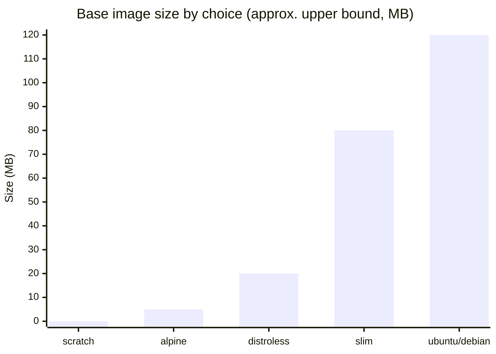
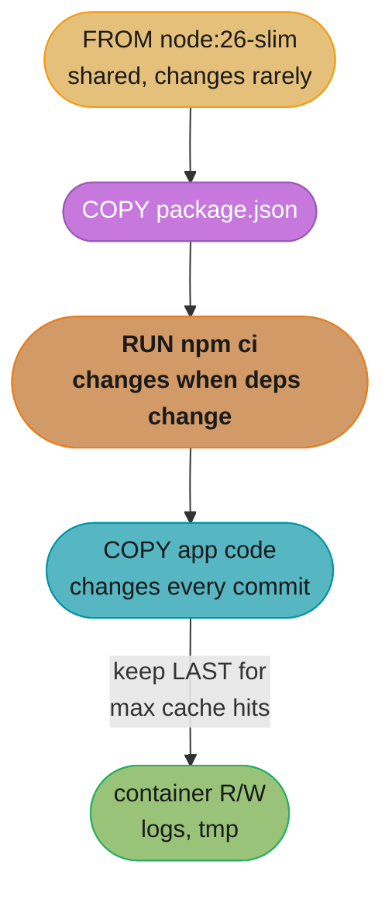
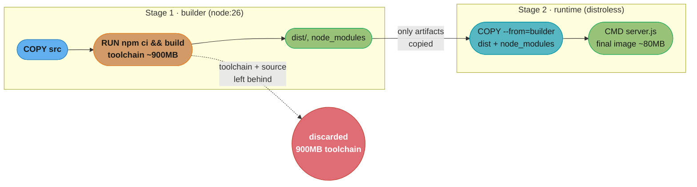
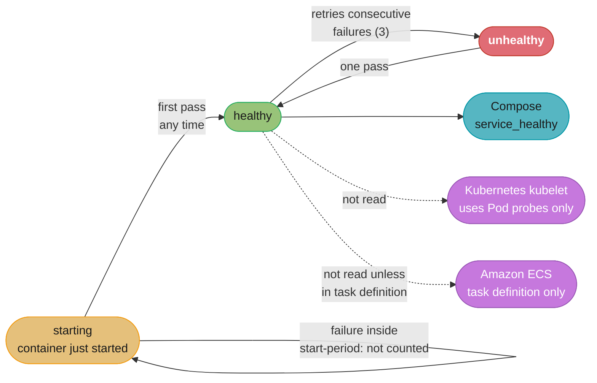
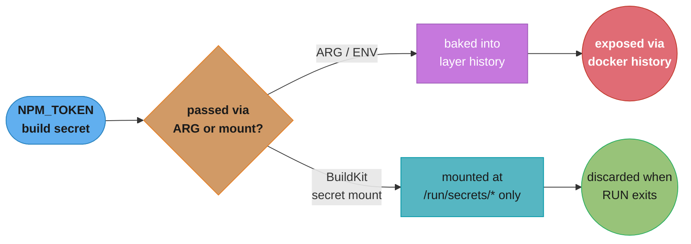

# Containers & Docker

> Phase 2 — Containers & Kubernetes · Difficulty: Intermediate

> **Version anchor (2026-11-25).** **Node.js 26 ("Lithium") became the active LTS line on 2026-10-28** (v26.13.0; latest v26.13.1, 2026-11-10), so every example here uses `node:26-slim` and `gcr.io/distroless/nodejs26-debian13`, which the distroless README lists next to the Node 22 and 24 images. Docker Hub sizes for the amd64 images on the same day: `node:26` about 445 MB compressed, `node:26-slim` about 86 MB compressed. **Docker Hardened Images** are free under Apache 2.0 in the Community tier; FIPS/STIG variants and SLA-backed CVE fixes are in the paid Select and Enterprise tiers. Dockerfile `HEALTHCHECK` defaults (interval 30s, timeout 30s, start-period 0s, start-interval 5s, retries 3) and the ENTRYPOINT/CMD table are from the Dockerfile reference; Compose `depends_on.condition: service_healthy` and `profiles` from the Compose file reference. `--start-interval` needs Docker Engine 25.0 or later. Port publishing, bridge, host, overlay and macvlan behaviour is from the Docker Engine networking docs; the Amazon ECS health-check rules are from the ECS developer guide.

Containers package an application with its dependencies into a portable, immutable image that runs identically on a laptop, in CI, and in production. Docker popularized the workflow, but the value is in understanding what an image *is* (layered, content-addressed), how builds cache, and how to produce small, secure, reproducible images — the artifacts every Kubernetes pod ultimately runs.

> The kernel primitives (namespaces, cgroups) are covered in [linux_and_os_fundamentals](../linux_and_os_fundamentals/linux_and_os_fundamentals.md); the runtime that actually executes images (containerd/runc) is in [container_runtimes_and_oci](../container_runtimes_and_oci/container_runtimes_and_oci.md). This module is about *images and the build*.

---

## 1. Concept Overview

A **container image** is a stack of read-only **layers** plus a JSON config (entrypoint, env, exposed ports). Each layer is a tarball of filesystem changes, content-addressed by digest. At runtime the engine stacks the layers via a union filesystem (overlayfs) and adds a thin writable layer on top — that's the running **container**.

Key properties:
- **Immutable + layered** — layers are shared and cached across images; pulling a new image only fetches layers you don't already have.
- **Content-addressed** — `sha256:...` digests make images reproducible and verifiable.
- **OCI-standard** — the image and runtime formats are open standards, so images built by Docker run on containerd, Podman, etc.

The build is driven by a **Dockerfile**: each instruction (`RUN`, `COPY`, `ADD`) produces a layer; the build cache reuses unchanged layers, making instruction *ordering* the single biggest determinant of build speed.

---

## 2. Intuition

> **One-line analogy**: An image is like a stack of transparent sheets — a base OS sheet, a dependencies sheet, an app-code sheet — laid on top of each other; you only reprint the sheets that changed, and many apps can share the same base sheet underneath.

**Mental model**: Think of the Dockerfile as a recipe where each step bakes a layer. Docker caches each baked layer keyed by the instruction *and* the state of its inputs. Change an early step and every later layer's cache is invalidated (cache busting). The runtime just stacks these baked layers read-only and gives your process a writable scratch layer on top.

**Why it matters**: Image size and build time directly affect deploy speed, registry cost, cold-start latency, and attack surface. A 1.2 GB image with a full OS and build toolchain pulls slowly, costs more to store, and ships hundreds of CVEs; a 30 MB distroless image pulls fast and has almost nothing to exploit. The difference is entirely in how you write the Dockerfile.

**Key insight**: Layer ordering is a caching strategy. Put rarely-changing things (base image, dependency installs) *early* and frequently-changing things (your source code) *late*, so a code change only rebuilds the last cheap layer — not a 5-minute `npm install`.

---

## 3. Core Principles

1. **Images are immutable, layered, content-addressed.** Tag for humans, pin by digest for reproducibility.
2. **Order layers by change frequency.** Stable first (deps), volatile last (code), to maximize cache hits.
3. **Multi-stage builds separate build-time from run-time.** Compile in a fat builder, copy only artifacts into a lean runtime image.
4. **Smaller is better.** Less to pull, store, scan, and exploit. Prefer slim/distroless/scratch bases.
5. **Run as non-root, read-only where possible.** Reduce blast radius of a compromise.
6. **One concern per container.** A container runs one main process; orchestration composes them.

---

## 4. Types / Architectures / Strategies

### Base image choices

| Base | Size (approx) | Pros | Cons |
|------|---------------|------|------|
| `ubuntu` / `debian` | 70–120 MB | Familiar, full toolset, shell | Large, many packages = CVEs |
| `*-slim` | 30–80 MB | Smaller, still has package manager | Some tools missing |
| `alpine` | ~5 MB base | Tiny, musl libc | musl vs glibc bugs (DNS, Python wheels) |
| `distroless` (Google) | ~2–20 MB | No shell/package manager, minimal CVEs | Hard to debug (no shell) |
| Docker Hardened Images (DHI) | distroless-class runtime variants | Free under Apache 2.0 since 2025-12-17; 1,000+ Debian- and Alpine-based images, non-root by default, each with an SBOM and SLSA Build L3 provenance; `-dev` variants for build stages | FIPS/STIG variants, SLA-backed CVE fixes and extended lifecycle support are the paid Select and Enterprise tiers |
| `scratch` | 0 | Absolute minimum (static binaries) | Only for fully static apps (Go) |



*Scratch ships nothing extra; ubuntu/debian ships 70–120 MB of packages before your app even starts — that gap is almost entirely attack surface and pull time, not functionality your app uses.*

### Multi-stage build (the standard pattern)

Compile/build in a stage with the full toolchain, then `COPY --from=builder` only the final artifact into a minimal runtime image. The toolchain, source, and intermediate files never ship.

### ENTRYPOINT and CMD together

`ENTRYPOINT` is the executable; `CMD` supplies default arguments (or the whole command when there is no `ENTRYPOINT`). Exec form is a JSON array and runs the binary directly as PID 1; shell form is a plain string wrapped in `/bin/sh -c`, which makes the shell PID 1. From the Dockerfile reference:

| | No `ENTRYPOINT` | `ENTRYPOINT exec_entry p1` (shell form) | `ENTRYPOINT ["exec_entry", "p1"]` (exec form) |
|---|---|---|---|
| No `CMD` | error, not allowed | `/bin/sh -c exec_entry p1` | `exec_entry p1` |
| `CMD ["exec_cmd", "p1_cmd"]` | `exec_cmd p1_cmd` | `/bin/sh -c exec_entry p1` (CMD ignored) | `exec_entry p1 exec_cmd p1_cmd` |
| `CMD exec_cmd p1_cmd` | `/bin/sh -c exec_cmd p1_cmd` | `/bin/sh -c exec_entry p1` (CMD ignored) | `exec_entry p1 /bin/sh -c exec_cmd p1_cmd` |

Two rules fall out of it. A shell-form `ENTRYPOINT` swallows `CMD` and any `docker run` arguments, so use exec form whenever `CMD` should be overridable. And a shell at PID 1 does not forward SIGTERM, which is the signal-handling pitfall in §12. Setting `ENTRYPOINT` also resets any `CMD` inherited from the base image. In Kubernetes, `command` overrides `ENTRYPOINT` and `args` overrides `CMD`.

### Docker networking modes

| Driver | What the container gets | Use |
|--------|-------------------------|-----|
| `bridge` (default network) | Private IP on `docker0`, NAT to the host; containers reach each other **by IP only** | Quick single containers |
| User-defined `bridge` | Same, plus **automatic DNS by container name or alias** and isolation from unrelated containers | Every multi-container app; what Compose creates per project |
| `host` | The host's network namespace directly; no port mapping, no isolation | Network-heavy agents that need the host stack |
| `none` | Loopback only; not available for Swarm services | Batch jobs that must have no network |
| `overlay` | A network spanning several Docker hosts; hosts must be in a Swarm, even for standalone containers (`--attachable`). Needs `2377/tcp`, `4789/udp`, `7946/tcp` and `7946/udp` open between hosts | Multi-host Swarm services |
| `macvlan` | Its own MAC address per container, so it looks like a physical host on the LAN. Linux only, no rootless, usually blocked by cloud providers; needs a NIC and switch that accept several MACs (promiscuous mode) | Legacy apps that expect to sit directly on the physical network |
| `ipvlan` | Like macvlan, but every container shares the parent interface's MAC address | Switch ports that cap the number of MAC addresses |

The default `bridge` network has no name resolution, so `web` cannot reach `db` by name there; a user-defined bridge resolves names through Docker's embedded DNS. Kubernetes does not use any of these drivers: Pod networking comes from the CNI plugin (see [kubernetes_networking](../kubernetes_networking/kubernetes_networking.md)).

Four details decide most real incidents:

- **Published ports are open to the world by default.** `-p 8080:80` binds every host address. Only `-p 127.0.0.1:8080:80` limits the port to the Docker host. Docker diverts published-port traffic in the `nat` table before it reaches the `INPUT` chain that `ufw` manages, so a `ufw deny` rule does not protect a published port. Unpublished ports are blocked from outside the host.
- **Containers on one user-defined bridge reach each other on every port**, published or not. Publishing is only for traffic that crosses a network boundary.
- **`host` mode ignores `-p`.** The container has no IP of its own and Docker prints `WARNING: Published ports are discarded when using host network mode`. It skips NAT and the per-port userland proxy, which is why it suits large port ranges, but two containers cannot bind the same port on one host.
- **A macvlan container cannot talk to its own host.** This is a Linux kernel restriction; attach the container to a bridge as well, or give the host a macvlan interface on the same parent.

Docker creates no firewall rules for `host`, `macvlan` or `ipvlan` networks; only bridge networks get them.

### Storage mounts and restart policies

| Mount | Lifetime | Use |
|-------|----------|-----|
| Writable container layer | Dies with the container | Scratch only; data cannot be moved easily |
| Volume | Survives container removal; managed by the daemon | Databases, anything that must persist |
| Bind mount | The host path; host processes and the container can both modify it | Source code in dev, host config files |
| `tmpfs` | RAM only; lost on stop or reboot | Secrets and scratch that must never touch disk |

A restart policy (`no` default, `on-failure[:max-retries]`, `always`, `unless-stopped`) only applies after a container has been up for at least 10 seconds, which stops a container that cannot start from looping. A container you stopped by hand stays stopped until the daemon restarts or you restart it; with `unless-stopped` it also stays stopped across a daemon restart. By default a container has no memory limit, so one runaway container can trigger the host's OOM killer; set `--memory` (minimum `6m`) on every container you run outside an orchestrator.

---

## 5. Architecture Diagrams



*Image = read-only layers (cached, shared) plus one writable layer per running container. Layers stack bottom-to-top by change frequency, so the volatile app-code layer sits right before the writable layer, never at the base.*



*Multi-stage build: the builder's 900 MB toolchain and source are discarded when the stage ends — only `dist/` and `node_modules` cross into the ~80 MB runtime image that actually ships.*



*Docker's health status is a three-state machine; only Docker itself and Compose read the image's `HEALTHCHECK`. Kubernetes never reads it and ECS reads only a health check written into the task definition.*

---

## 6. How It Works — Detailed Mechanics

### Cache-optimized multi-stage Dockerfile

```dockerfile
# ---- build stage: has the full toolchain ----
FROM node:26-slim AS builder
WORKDIR /app

# Copy ONLY manifests first so the expensive install layer caches across code changes.
COPY package.json package-lock.json ./
RUN npm ci                                   # cached unless package*.json changes

COPY . .                                     # source changes often -> later layer
RUN npm run build                            # produces /app/dist

# ---- runtime stage: minimal, no toolchain, no source ----
FROM gcr.io/distroless/nodejs26-debian13 AS runtime
WORKDIR /app
COPY --from=builder /app/dist        ./dist
COPY --from=builder /app/node_modules ./node_modules
USER nonroot                                 # distroless ships a nonroot user
EXPOSE 3000
CMD ["dist/server.js"]
```

Why this order: editing source busts only `COPY . .` and `npm run build`, reusing the cached `npm ci` (often the slowest step). Copying everything first would re-run `npm ci` on every code change.

### Inspecting layers and size

```bash
docker history myimg:latest          # per-layer size + the instruction that created it
docker image inspect myimg:latest --format '{{.RootFS.Layers}}'   # layer digests
dive myimg:latest                    # interactive layer/wasted-space explorer
```

### BuildKit features (BuildKit is the default builder)

```dockerfile
# syntax=docker/dockerfile:1
# Cache mount: persist the package cache across builds without baking it into a layer.
RUN --mount=type=cache,target=/root/.npm npm ci

# Secret mount: use a token at build time WITHOUT it landing in any layer.
RUN --mount=type=secret,id=npmtoken \
    NPM_TOKEN=$(cat /run/secrets/npmtoken) npm ci
```

```bash
# Multi-arch build (amd64 + arm64) in one command:
docker buildx build --platform linux/amd64,linux/arm64 -t myimg:1.0 --push .
```

### .dockerignore matters

```
# Without it, "COPY . ." sends node_modules, .git, secrets, and 500MB of junk
# into the build context -> slow builds, fat images, leaked files.
node_modules
.git
.env
*.log
```

### Reproducibility: tag vs digest

```bash
# Tags are mutable (someone can re-push :latest). Digests are immutable.
FROM node:26-slim                                   # mutable
FROM node:26-slim@sha256:abc123...                  # pinned, reproducible
```

### Sharing the build cache across CI runners

A cache mount lives on one builder. Ephemeral CI runners start empty, so export the layer cache to the registry and import it on the next run:

```bash
docker buildx build \
  --cache-from type=registry,ref=registry.example.com/orders:buildcache \
  --cache-to   type=registry,ref=registry.example.com/orders:buildcache,mode=max \
  -t registry.example.com/orders:$GIT_SHA --push .
# mode=max also exports the intermediate builder-stage layers, which is where
# the expensive npm ci layer lives; the default (min) exports only final-image layers.
```

### HEALTHCHECK

```dockerfile
# Defaults if you omit the flags: interval 30s, timeout 30s, start-period 0s,
# start-interval 5s, retries 3.
HEALTHCHECK --interval=10s --timeout=3s --start-period=20s --retries=3 \
  CMD ["node", "dist/healthcheck.js"]
```

`docker ps` then shows `healthy` or `unhealthy`, and Docker Compose can gate start order on it. The mechanics, from the Dockerfile reference:

- **States.** A container with a healthcheck starts as `starting`, becomes `healthy` the moment any check passes, and becomes `unhealthy` after `retries` consecutive failures. One later pass flips it back to `healthy`.
- **Timing.** The first check runs `interval` after start, then `interval` after each previous check *completes*. A check that runs longer than `timeout` counts as a failure and is killed with SIGKILL.
- **Start period.** During `start-period` checks run every `start-interval` (default 5s, needs Docker Engine 25.0 or later) and failures are not counted toward `retries`. The first success ends the grace period, and every failure after that counts. With the defaults and `start-period=0s`, a service that needs 120 s to boot fails the checks at about 30 s, 60 s and 90 s and is marked `unhealthy` at about 90 s (3 retries, 30 s interval, checks that fail fast), before it ever served a request. Size `start-period` to the slowest realistic boot.
- **Exit codes.** `0` is healthy, `1` is unhealthy, and `2` is reserved (do not use it). The first 4096 bytes of stdout and stderr are kept for `docker inspect`, and each status change emits a `health_status` event.
- **Inheritance.** Only the last `HEALTHCHECK` in a Dockerfile counts, and `HEALTHCHECK NONE` disables one inherited from the base image.

Two things it does not do: plain Docker never restarts an unhealthy container because of it (a restart policy reacts to the process exiting), and **Kubernetes ignores `HEALTHCHECK` entirely** — the kubelet only runs the Pod's `livenessProbe`, `readinessProbe` and `startupProbe`. Amazon ECS also ignores a `HEALTHCHECK` that exists only in the image; it monitors only the `healthCheck` written into the task definition, which overrides the image's. When an essential container there turns `UNHEALTHY` the service replaces the task, after the service's own `healthCheckGracePeriodSeconds` (a separate setting from the health check's `startPeriod`). Distroless images have no shell or `curl`, so the check must be an exec-form command the image already contains, like the small Node script above.

### Docker Compose for a local stack

```yaml
# compose.yaml -- the app waits for a HEALTHY database, not just a started one
services:
  api:
    build: .
    ports: ["3000:3000"]
    environment:
      DATABASE_URL: postgres://app:app@db:5432/app   # "db" resolves via Compose's network DNS
    depends_on:
      db:
        condition: service_healthy
  db:
    image: postgres:17
    environment: {POSTGRES_USER: app, POSTGRES_PASSWORD: app, POSTGRES_DB: app}
    healthcheck:
      test: ["CMD-SHELL", "pg_isready -U app -d app"]
      interval: 5s
      timeout: 3s
      retries: 10
    volumes: ["pgdata:/var/lib/postgresql/data"]
  adminer:
    image: adminer
    profiles: ["debug"]          # only starts with: docker compose --profile debug up
volumes:
  pgdata: {}
```

Compose puts every service of a project on one user-defined network, so `api` reaches `db` by name. Plain `depends_on: [db]` waits only for the `db` container to *start*; Postgres then needs several more seconds before it accepts connections, and an API that connects at boot crashes in that window. `condition: service_healthy` waits for the healthcheck to pass. Compose is a local-development and single-host tool; production orchestration on Kubernetes expresses the same intent with readiness probes and retries in the client.

**`depends_on` conditions.** The long form takes `service_started` (the short-form behaviour), `service_healthy` (the dependency's healthcheck has passed) and `service_completed_successfully` (a one-shot service, such as a migration job, has exited 0). `restart: true` restarts the dependent when Compose updates the dependency (Compose 2.17+), and `required: false` downgrades a missing dependency to a warning (2.20+). Compose also removes services in reverse dependency order.

**Networks.** One default network, named `<project>_default`, is created per project, and each service is reachable by its service name. Container IPs change on every recreate, so always use the name. To segment, declare several networks and attach each service only to the ones it needs:

```yaml
services:
  proxy: {build: ./proxy, networks: [frontend]}
  api:   {build: ./api,   networks: [frontend, backend]}
  db:    {image: postgres:17, networks: [backend]}
networks:
  frontend: {}
  backend:
    internal: true     # no gateway: db cannot reach the internet
```

`proxy` cannot see `db`, and `internal: true` removes the external gateway (a service that is also on a non-internal network can still reach the internet through that one). `network_mode: host` has no service-name DNS and ignores `ports`. `external: true` attaches to a network you created with `docker network create`, which is how two Compose projects talk to each other; the network must exist before `up`.

**Volumes.** A top-level named volume outlives `docker compose down` (only `down -v` removes it). Bind-mount source code in development, never in production, so the code stays inside the image.

**Override files.** Compose reads `compose.yaml` and, if present, `compose.override.yaml` automatically; `-f a.yaml -f b.yaml` or `COMPOSE_FILE` merges explicit files in order. The merge rules:

| Attribute type | Rule |
|----------------|------|
| Single values (`image`, `mem_limit`) | Later file replaces |
| `command`, `entrypoint`, `healthcheck.test` | Later file replaces, never appended |
| `ports`, `expose`, `dns`, `tmpfs` | Concatenated |
| `environment`, `labels` | Merged by key, later wins |
| `volumes`, `secrets`, `configs` | Merged by container `target` path |

Paths in every file resolve relative to the first (base) file. `docker compose config` prints the merged result, so check it before trusting an override. The `!reset` tag clears an inherited value, and the top-level `include:` element loads another Compose application as a unit, warning on name conflicts instead of merging them. Put production differences in `compose.production.yaml`: no source bind mounts, a `restart` policy, different host ports.

**Process hygiene.** `init: true` runs a small init as PID 1 that forwards signals and reaps zombies. `stop_grace_period` is the time Compose waits after SIGTERM before SIGKILL, default 10 s, which is shorter than Kubernetes' 30 s; raise it for slow-draining services. `restart: unless-stopped` gives single-host auto-recovery.

**Compose or Kubernetes.** Compose runs one project on one Docker host: no scheduling across nodes, no rolling updates with traffic gating, no autoscaling, no self-healing when the host dies. It fits laptops, CI integration tests, and small single-server deployments (Docker documents running it against a remote host through `DOCKER_HOST`, or on Swarm to scale out). Move to Kubernetes when you need multi-node scheduling, zero-downtime rollouts, autoscaling, or policy. The service definitions translate almost one to one: a Compose service becomes a Deployment plus Service, `healthcheck` becomes a probe, a named volume becomes a PersistentVolumeClaim, and `depends_on` has no Kubernetes equivalent (clients retry and readiness gates traffic).

---

## 7. Real-World Examples

- **Distroless at Google**: production services ship on `gcr.io/distroless/*` — no shell, no package manager — cutting image CVEs to near zero and shrinking attack surface.
- **Go `scratch` images**: a statically linked Go binary in a `FROM scratch` image is often 10–20 MB total, with literally nothing else to exploit.
- **GitHub Actions / CI build caching**: `docker buildx` with registry or GHA cache backends reuses layers across pipeline runs, turning 6-minute builds into 40-second ones on code-only changes.
- **Multi-arch images** (Apple Silicon dev, Graviton/ARM prod): one manifest list serves both `amd64` and `arm64`, so the same tag runs on x86 CI and ARM nodes.

---

## 8. Tradeoffs

| Decision | Option A | Option B | Key factor |
|----------|----------|----------|-----------|
| Base image | Alpine (tiny, musl) | Debian-slim (compatible, glibc) | Compatibility vs size; musl can break DNS/wheels |
| Final image | Distroless/scratch (secure, small) | Full distro (debuggable) | Security vs ease of debugging |
| Build secret | Build-arg (LEAKS into layer) | BuildKit secret mount (safe) | Never use ARG for secrets |
| Image reference | Tag (convenient) | Digest (reproducible) | Reproducibility/supply-chain needs |
| Layers | Few big (simple) | Ordered by change frequency | Cache efficiency |
| Process model | One process/container | Multiple (supervisor) | Orchestration vs legacy apps |
| Container network | Default `bridge` (IP only) | User-defined bridge (DNS by name, isolated) | Any multi-container setup wants the user-defined network |
| Start ordering | `depends_on` (start order only) | `depends_on.condition: service_healthy` | Whether the dependency must be ready, not just running |
| Multi-container runtime | Compose (one host, no scheduler, no rollouts) | Kubernetes (scheduling, rollouts, autoscaling) | Single host and dev/CI versus a fleet that must survive node loss |
| Persistent data | Named volume (daemon-managed, survives container removal) | Bind mount (host path, editable from both sides) | Production data versus dev source code |
| LAN presence | Bridge plus published ports (NAT) | macvlan or ipvlan (own address on the LAN) | Legacy apps that need a real LAN address, at the cost of switch and kernel constraints |
| Published port scope | `-p 5432:5432` (every host address) | `-p 127.0.0.1:5432:5432` or no publish | Whether anything outside the host needs to connect |

---

## 9. When to Use / When NOT to Use

**Containers fit when:** you want environment parity (dev/CI/prod), fast horizontal scaling, immutable deploys, and orchestration via Kubernetes/ECS.

**Containers are a poor fit when:** the workload needs a full GUI desktop, kernel modules/specialized hardware drivers not exposed to containers, or strong isolation of untrusted code (use microVMs/gVisor — see [container_runtimes_and_oci](../container_runtimes_and_oci/container_runtimes_and_oci.md)). Stateful databases *can* be containerized but often run better as managed services.

---

## 10. Common Pitfalls

**Pitfall 1 — Baking a secret into a layer via `ARG`.**

```dockerfile
# BROKEN: the token is permanently recorded in image history; anyone with the image
# can run `docker history --no-trunc` / extract the layer and read it.
ARG NPM_TOKEN
RUN npm config set //registry.npmjs.org/:_authToken=$NPM_TOKEN && npm ci
```

```dockerfile
# FIX: BuildKit secret mount — available only during that RUN, never stored in a layer.
# syntax=docker/dockerfile:1
RUN --mount=type=secret,id=npmtoken \
    npm config set //registry.npmjs.org/:_authToken="$(cat /run/secrets/npmtoken)" && npm ci
# build: docker build --secret id=npmtoken,env=NPM_TOKEN .
```



*`ARG`/`ENV` bakes the secret into permanent layer history (recoverable forever via `docker history --no-trunc`); a BuildKit secret mount exists only inside that one `RUN` and is gone the moment it exits.*

**Pitfall 2 — Cache-busting layer order.** Putting `COPY . .` before `RUN npm ci` means every source edit re-runs the full dependency install (minutes per build). FIX: copy manifests, install, *then* copy source (see §6).

**Pitfall 3 — Running as root.** The default container user is root; a container escape or RCE then has root on the namespace (and with a host mount, potentially worse).

```dockerfile
# FIX: create and switch to a non-root user.
RUN useradd -r -u 10001 appuser
USER 10001
# In Kubernetes also set securityContext: runAsNonRoot: true, readOnlyRootFilesystem: true
```

**Pitfall 4 — `depends_on` without a health condition.** A Compose stack starts the API and Postgres together. `depends_on: [db]` only orders container *start*, so the API boots while Postgres is still initialising, its connection pool fails, and the process exits. On a fast laptop it usually works; on a loaded CI runner it fails intermittently, which is how it gets mislabelled as a flaky test.

```yaml
# BROKEN: starts after the db container starts, not after Postgres accepts connections
depends_on: [db]
```

```yaml
# FIX: wait for the healthcheck, and give db a real one (pg_isready, see §6)
depends_on:
  db:
    condition: service_healthy
```

The same lesson applies in Kubernetes, where there is no `depends_on` at all: make the client retry with backoff and gate traffic with a readiness probe, rather than relying on start order.

**Pitfall 5 — A published database port that `ufw` does not protect.** A developer runs Postgres with `-p 5432:5432` on a cloud VM and adds `ufw deny 5432`. Docker routes published-port traffic through the `nat` table before it reaches the `INPUT` chain that `ufw` manages, so the deny rule never sees the packets and the database answers anyone who can reach the host's address on that port.

```bash
# BROKEN: binds 0.0.0.0, and ufw cannot block it
docker run -d --name pg -p 5432:5432 -e POSTGRES_PASSWORD=app postgres:17
```

```bash
# FIX 1: bind to loopback so only the Docker host can connect
docker run -d --name pg -p 127.0.0.1:5432:5432 -e POSTGRES_PASSWORD=app postgres:17
# FIX 2 (better): do not publish at all; put the app and db on one user-defined
# network and reach the db by name. Unpublished ports are blocked from outside the host.
docker network create app
docker run -d --name pg --network app -e POSTGRES_PASSWORD=app postgres:17
```

---

## 11. Technologies & Tools

| Tool | Purpose |
|------|---------|
| Docker / `buildx` | Build/run; BuildKit, multi-arch, registry cache export |
| Docker Compose | Multi-container local stacks: shared network with DNS, `depends_on` health conditions, profiles, override files; `docker compose config` prints the merged model |
| `docker network` / `docker inspect` | Create bridge, overlay, macvlan and ipvlan networks; `docker inspect` shows health status and the last health-check output |
| Podman / Buildah | Daemonless, rootless builds |
| `dive` | Inspect layers, find wasted space |
| Trivy / Grype / Docker Scout | Image CVE scanning; Docker Scout builds an SBOM and matches it against a vulnerability database from the Docker CLI or Hub (see [devsecops](../devsecops_and_supply_chain_security/devsecops_and_supply_chain_security.md)) |
| distroless / Chainguard images / Docker Hardened Images | Minimal, low-CVE base images; Chainguard and DHI ship an SBOM and signed provenance with each image |
| Rootless BuildKit / Buildah | In-cluster, daemonless image builds (CI) |
| SlimToolkit (`slim`) | Auto-minify images |
| cosign | Sign/verify images |

---

## 12. Interview Questions with Answers

**Q: What is a container image, structurally?**
**Short:** A container image is an ordered stack of read-only, content-addressed layers plus a JSON config, unioned at runtime with a thin writable layer added on top.
It's an ordered stack of read-only filesystem layers (each a content-addressed tarball of changes) plus a JSON config holding the entrypoint, env, and metadata. At runtime the engine unions the layers (overlayfs) and adds a thin writable layer for the running container. Layers are shared and cached across images, so pulling a new image only downloads layers you don't already have.

**Q: How does the build cache work and how do you exploit it?**
**Short:** Each Dockerfile instruction caches a layer keyed on itself and its inputs, so ordering from least- to most-frequently-changing lets a code edit rebuild only the cheap final layers.
Each Dockerfile instruction produces a layer cached by the instruction plus the state of its inputs (e.g., the files a `COPY` references). If an early layer's inputs change, all subsequent layers are rebuilt. You exploit this by ordering instructions from least- to most-frequently-changing: base image and dependency installs early, source code copy and build late — so a code edit rebuilds only the cheap final layers.

**Q: What does a multi-stage build buy you?**
**Short:** A multi-stage build compiles in a fat builder stage then copies only the final artifact into a minimal runtime image, so the toolchain and source never ship.
It separates the build environment from the runtime environment. You compile in a fat "builder" stage with the full toolchain, then `COPY --from=builder` only the final artifact into a minimal runtime image. The toolchain, source code, and intermediate files never ship — yielding a much smaller, more secure final image (e.g., a 900 MB builder producing an 80 MB runtime).

**Q: Why is running as root in a container dangerous, and how do you avoid it?**
**Short:** Root in the container is root in its namespaces, so combined with a kernel escape or host mount it escalates the blast radius, avoided with a non-root user.
Root in the container is root in its namespaces; combined with a kernel container-escape vulnerability or a host mount, it escalates the blast radius of any compromise. Avoid it by creating a non-root user (`USER 10001`) in the image and enforcing `runAsNonRoot: true` plus `readOnlyRootFilesystem: true` in the Kubernetes `securityContext`.

**Q: Tag vs digest: why pin by digest?**
**Short:** A tag is a mutable pointer that can be re-pushed to different content, while a digest is immutable and content-verified, guaranteeing exactly the bits you tested.
A tag (`node:26`) is a mutable pointer — the same tag can be re-pushed to point at different content, so builds aren't reproducible and a supply-chain attacker could swap it. A digest (`node:26@sha256:...`) is immutable and content-verified, guaranteeing you get exactly the bits you tested. Pin by digest for reproducible builds and supply-chain integrity.

**Q: Alpine vs Debian-slim: what's the catch with Alpine?**
**Short:** Alpine's tiny size comes from musl libc instead of glibc, causing DNS quirks and glibc-wheel recompilation, which is why many teams choose Debian-slim for reliability instead.
Alpine is tiny (~5 MB) but uses musl libc instead of glibc. This causes real problems: different DNS resolution behavior, Python packages that ship glibc wheels needing recompilation (slower builds), and occasional subtle runtime bugs. Debian-slim is larger but glibc-compatible and avoids these surprises — many teams choose slim for reliability over Alpine's size.

**Q: You added a `HEALTHCHECK` to the Dockerfile. Does Kubernetes use it?**
**Short:** No; the kubelet ignores Dockerfile `HEALTHCHECK` and acts only on the Pod's liveness, readiness and startup probes, so health must be declared in the Pod spec.
Docker records the `HEALTHCHECK` result as the container's `healthy`/`unhealthy` status, and Docker Compose can wait on it with `depends_on.condition: service_healthy`, but Kubernetes never reads it. The kubelet runs only the probes in the Pod spec: `readinessProbe` to gate traffic, `livenessProbe` to restart, `startupProbe` to hold off liveness during boot. Even on plain Docker an unhealthy container is not restarted automatically, because restart policies react to the process exiting. So a team that relies on `HEALTHCHECK` alone ships an image that Kubernetes will happily route traffic to while it is broken. Keep the Dockerfile check for local and Compose use, and declare the real probes in the Deployment.

**Q: Two containers on the same host cannot reach each other by name, only by IP. Why?**
**Short:** They are on the default `bridge` network, which has no name resolution; a user-defined bridge network gives containers DNS by name or alias.
Containers started without `--network` join the default `bridge` network, where Docker provides no name resolution, so `db` does not resolve and only the IP works (or the legacy `--link` flag). On a user-defined bridge (`docker network create app`), Docker's embedded DNS resolves every container by name and alias, and only containers attached to that network can talk to each other, which is also better isolation. Docker Compose creates one user-defined network per project automatically, which is why `db` just works there. Create a network for any multi-container setup instead of relying on the default bridge.

**Q: Your image sets `ENTRYPOINT ["python", "app.py"]` and `CMD ["--port", "8080"]`. What runs, and what does `docker run img --port 9090` change?**
**Short:** The container runs `python app.py --port 8080`; arguments after the image name replace `CMD`, so it becomes `python app.py --port 9090`.
With both in exec form, Docker appends `CMD` to `ENTRYPOINT`, so the process is `python app.py --port 8080`, running directly as PID 1. Arguments given after the image name on `docker run` replace `CMD` only, giving `python app.py --port 9090`; replacing the executable itself needs `--entrypoint`. If `ENTRYPOINT` were shell form (`ENTRYPOINT python app.py`), Docker would run `/bin/sh -c "python app.py"` and ignore `CMD` and any run arguments entirely, and the shell would be PID 1 and swallow SIGTERM. Kubernetes maps the same pair: `command` replaces `ENTRYPOINT`, `args` replaces `CMD`. Use exec form for both, with `ENTRYPOINT` as the fixed binary and `CMD` as overridable defaults.

**Q: How do you keep build secrets out of the final image?**
**Short:** Never put secrets in `ARG` or `ENV` since they persist in image layers; use BuildKit's `--mount=type=secret`, which exposes the secret only during one `RUN` and never writes it to a layer.
Never use `ARG` or `ENV` for secrets — they persist in image history/layers. Use BuildKit's `--mount=type=secret`, which exposes the secret only during a specific `RUN` and never writes it to a layer. For the image itself, inject runtime secrets via the orchestrator (env from a Secret, mounted file), not baked in.

**Q: Why is `.dockerignore` important?**
**Short:** Without a `.dockerignore`, the build context defaults to the whole directory, so `COPY . .` ships `node_modules`, `.git`, and secrets into the image.
The build "context" (everything sent to the daemon for `COPY`) defaults to the whole directory. Without `.dockerignore`, `COPY . .` ships `node_modules`, `.git`, `.env`, and logs into the image — bloating size, slowing builds, and leaking secrets/history. `.dockerignore` excludes them, keeping the context and image lean and safe.

**Q: What is distroless and what's the tradeoff?**
**Short:** Distroless images contain only the app and its runtime dependencies with no shell or package manager, minimizing attack surface at the cost of `kubectl exec` shell access.
Distroless images contain only your app and its runtime dependencies: no shell, no package manager, no busybox. This minimizes attack surface and CVE count dramatically. The tradeoff is debuggability: you can't `kubectl exec … sh` into them, so you debug via ephemeral debug containers, host-side `nsenter`, or by reproducing locally. Google distroless, Chainguard Images, and Docker Hardened Images (free and Apache 2.0 since December 2025) all follow this model; Chainguard and DHI also ship an SBOM and signed SLSA provenance with each image, so an admission policy can verify the base image's origin as well as your own build (see [devsecops](../devsecops_and_supply_chain_security/devsecops_and_supply_chain_security.md)).

**Q: How do multi-arch images work and why care?**
**Short:** A multi-arch image is a manifest list mapping each platform to a platform-specific image, so one tag serves Apple Silicon dev machines, x86 CI, and ARM Graviton prod nodes alike.
A multi-arch image is a manifest list mapping each platform (`linux/amd64`, `linux/arm64`) to a platform-specific image; the runtime pulls the one matching its CPU. `docker buildx build --platform ...` builds them in one command. It matters because devs run Apple Silicon (arm64), CI may be x86, and prod may use ARM nodes (AWS Graviton) — one tag serves all.

**Q: What's the difference between an image and a container?**
**Short:** An image is the immutable, layered build artifact, while a container is a running or stopped instance of that image with its own writable layer and namespaces.
An image is the immutable, layered template (build artifact); a container is a running (or stopped) instance of an image — the read-only layers plus a writable scratch layer and a process with its own namespaces/cgroups. Many containers can run from one image; deleting a container doesn't affect the image.

**Q: How do you reduce a 1.2 GB image to under 100 MB?**
**Short:** A multi-stage build dropping the toolchain, a minimal runtime base, cache-ordered layers, a `.dockerignore`, and combined `RUN` steps together shrink a 1.2 GB image under 100 MB.
Use a multi-stage build (drop the toolchain and source), choose a minimal runtime base (distroless, a hardened image such as Chainguard or Docker Hardened Images, slim, or scratch), order layers for caching, add a `.dockerignore`, combine and clean `RUN` steps (remove apt caches in the same layer), and avoid installing unnecessary packages. The biggest win is usually multi-stage + a minimal base.

**Q: Why might a container ignore `docker stop` and hang until it's force-killed?**
**Short:** Shell-form `CMD` makes `/bin/sh` PID 1 instead of the app, so it never forwards SIGTERM, while exec-form runs the process directly as PID 1 so it receives and can handle the signal.
Shell-form `CMD`/`ENTRYPOINT` makes `/bin/sh` PID 1 instead of your app, so it never forwards the SIGTERM that `docker stop` sends. Exec-form (`CMD ["node", "server.js"]`) runs your process directly as PID 1 so it receives signals itself and can shut down cleanly. Kubernetes sends SIGTERM then waits `terminationGracePeriodSeconds` (30s by default) before SIGKILL, so a process that never sees SIGTERM always takes the hard, ungraceful path out. Always use exec-form `CMD`/`ENTRYPOINT` (per this module's Best Practices) and handle SIGTERM in your application code.

**Q: Why do CI pipelines prefer rootless, daemonless builders over Docker-in-Docker (DinD)?**
**Short:** DinD needs a privileged container with daemon-socket access that a compromised build step can use to escape to the host, while rootless BuildKit or Buildah build images entirely in userspace.
Docker-in-Docker needs a privileged container with access to a Docker daemon socket, which is a serious CI security risk. A compromised build step — say, a malicious `npm ci` postinstall script — can use that socket or `--privileged` access to escape to the host, since privileged mode disables most container isolation. Rootless BuildKit (`buildkitd` running as an unprivileged user, driven by `docker buildx` or `buildctl`) and Buildah build OCI images from a Dockerfile entirely in userspace without a daemon or elevated privileges, so a compromised build stays contained (Podman offers the same daemonless model outside CI). Prefer a rootless builder over DinD for any pipeline that builds untrusted or dependency-heavy code.

**Q: How does a BuildKit cache mount differ from the normal image layer cache?**
**Short:** A cache mount persists a directory like `/root/.npm` across builds outside any image layer, so it survives layer-cache invalidation and lets package managers reuse downloaded packages.
A cache mount persists a directory like `/root/.npm` across builds without ever becoming part of an image layer. The normal layer cache is invalidated the instant `COPY . .`'s input changes, forcing `RUN npm ci` to reinstall from scratch on every code edit; a cache mount survives that invalidation because it lives outside the layer entirely, so npm/pip/apt still reuse already-downloaded packages. This is why `RUN --mount=type=cache,target=/root/.npm npm ci` in the case study's fixed Dockerfile cut code-only rebuilds from a 6-minute cold build down to about 40 seconds. Add a cache mount for your package manager's cache directory whenever dependency installs rerun needlessly on code-only changes.

**Q: How do you find out which layer is actually bloating a large image?**
**Short:** `docker history` lists each layer's size and creating instruction, while `dive` interactively surfaces wasted space like a file added then deleted in a later layer that still costs space.
Run `docker history` to list each layer's size and the instruction that created it, or `dive` for an interactive explorer that also flags wasted space. `dive myimg:latest` surfaces cases the size number alone hides, like a file added in one layer and deleted in a later one — it still costs space permanently because layers are immutable and additive. This turns "why is my image 1.2 GB" from guesswork into a targeted fix: reorder an instruction, add a `.dockerignore` entry, or move a step into the discarded stage of a multi-stage build. Run `dive` before optimizing an image so you fix the layer that's actually heavy instead of guessing.

**Q: A service takes 2 minutes to boot but its `HEALTHCHECK` marks it `unhealthy` after about 90 seconds. How do `interval`, `retries` and `start-period` interact, and how do you fix it?**
**Short:** Failures count toward `retries` from the first check unless `start-period` covers the boot; set `start-period` to the slowest boot so early failures are ignored and the first pass ends the grace period.
A container starts in `starting` and becomes `unhealthy` after `retries` consecutive failed checks. With the defaults (30 s interval, 3 retries, `start-period` 0 s) checks at about 30, 60 and 90 s fail while the app is still booting, so the status flips before it ever served traffic. During `start-period` failures are not counted toward `retries`, and checks run every `start-interval` (5 s default, Docker Engine 25.0+) so a fast boot is noticed quickly; the first success ends the grace period, and every failure after that counts. A check slower than `timeout` is killed with SIGKILL and counts as a failure, so keep the check cheap and local. Set `start-period` to the slowest realistic boot (here 120 s or more), keep `retries` at 3 or higher to ride out one slow response, and remember that nothing in plain Docker restarts the container on `unhealthy`.

**Q: Your image has a `HEALTHCHECK` and you deploy it to Amazon ECS. Does ECS act on it?**
**Short:** No; ECS monitors only a `healthCheck` defined in the task definition, which overrides the image's, and a service replaces a task when an essential container turns UNHEALTHY.
The ECS agent does not monitor a Docker health check that is embedded in the image but absent from the container definition, so the image's `HEALTHCHECK` is silently ignored. A `healthCheck` in the task definition (command, interval, timeout, retries, `startPeriod`) overrides it. If an essential container becomes `UNHEALTHY`, a task in a service is replaced; standalone tasks are not stopped. The service has its own `healthCheckGracePeriodSeconds`, separate from the container's `startPeriod`, during which the service ignores health checks. The command runs inside the container, so the binary it needs must be in the image. Kubernetes behaves the same way: it ignores `HEALTHCHECK` and uses only Pod probes. Treat the Dockerfile check as a local and Compose convenience, and declare health in each orchestrator's own spec.

**Q: How does Compose merge `compose.yaml` with `compose.override.yaml`, and which attributes replace instead of append?**
**Short:** Single values and `command`, `entrypoint` and `healthcheck.test` are replaced, `ports` and `expose` are concatenated, and `environment`, `labels` and `volumes` merge by key or container path.
Compose automatically reads `compose.yaml` plus an optional `compose.override.yaml`; `-f` flags or `COMPOSE_FILE` select other files and merge them in order. Mappings merge key by key. Single-value options (`image`, `mem_limit`) are replaced. `command`, `entrypoint` and `healthcheck.test` are replaced by the last file and never appended, so an override cannot add one argument to an inherited command. `ports`, `expose`, `dns` and `tmpfs` are concatenated, which is how an override accidentally publishes an extra host port. `environment` and `labels` merge by variable or label name; `volumes`, `secrets` and `configs` merge by container `target` path, so `./local:/bar` replaces `./original:/bar`. Paths resolve relative to the first file. Run `docker compose config` to see the merged result, use `!reset` to drop an inherited value, and use `include:` to pull in another Compose application without merging.

**Q: When is Docker Compose enough, and when must you move to Kubernetes?**
**Short:** Compose suffices for dev, CI and a single host; move to Kubernetes when you need multi-node scheduling, zero-downtime rollouts, autoscaling or self-healing after node loss.
Compose manages one project on one Docker host: it creates the network, volumes and containers, orders startup with `depends_on`, and restarts crashed containers with a restart policy. It has no scheduler across machines, no rolling update that gates traffic on readiness, no autoscaler, and nothing that reschedules containers when the host dies. That is fine for laptops, CI integration tests and small single-server deployments (Docker documents `compose.production.yaml` overrides and running against a remote host with `DOCKER_HOST`). Kubernetes becomes the right tool when availability must survive node failure, deployments must roll without downtime, or capacity must scale with load. The model carries over: a service becomes a Deployment plus Service, `healthcheck` becomes probes, a named volume becomes a PersistentVolumeClaim, and `depends_on` disappears in favour of client retries and readiness gates. Start with Compose and move when one of those requirements appears, not before.

**Q: When would you use `macvlan` or `ipvlan` instead of a bridge, and what are the traps?**
**Short:** Use macvlan or ipvlan when a container must appear as its own host on the physical LAN; traps are no host-to-container traffic, switch MAC limits, and cloud providers that block it.
A bridge NATs containers behind the host's address and exposes them only through published ports. `macvlan` gives each container its own MAC and LAN address, which suits legacy software or network monitors that expect to sit directly on the physical network. Traps: it works only on Linux hosts (not Docker Desktop, not rootless mode), most cloud providers block it, and the switch must tolerate several MAC addresses on one port. Too many MACs can cause "VLAN spread" and IP exhaustion. A macvlan container cannot reach its own Docker host, a Linux kernel restriction; attach it to a bridge as well or add a host-side macvlan interface. `ipvlan` in L2 mode avoids the MAC problem because containers share the parent's MAC address, at the cost of every container looking like the host at layer 2. If a bridge on one host or an overlay across hosts works, prefer them. Docker creates no firewall rules for macvlan or ipvlan networks.

**Q: You published a database with `-p 5432:5432` and denied the port in `ufw`, yet it is reachable from the internet. Why?**
**Short:** Docker routes published-port traffic through the `nat` table before `ufw`'s INPUT chain sees it, so ufw rules are bypassed; bind to 127.0.0.1 or do not publish the port.
`-p 5432:5432` binds every host address and Docker adds NAT and forwarding rules to the firewall. Those packets are rewritten and forwarded before they reach the `INPUT` and `OUTPUT` chains that `ufw` manages, so the Docker documentation notes the traffic effectively ignores the ufw configuration. Unpublished ports are blocked from outside the host by default, and containers on one user-defined bridge reach each other on every port without publishing. So the fix is to not publish a port that no outside client needs, or to bind it to loopback with `-p 127.0.0.1:5432:5432` (note: in Docker releases older than 28.0.0, hosts on the same L2 segment could still reach ports published to localhost). Do not disable Docker's iptables handling to "fix" this; that breaks container egress while leaving container ports reachable on the LAN.

---

## 13. Best Practices

- Use **multi-stage builds**; ship a minimal runtime base (distroless/slim/scratch).
- **Order layers by change frequency**; copy dependency manifests before source.
- Add a **`.dockerignore`**; never `COPY` `.git`/secrets/`node_modules`.
- **Run as non-root**, read-only rootfs, drop capabilities.
- **Pin base images by digest** for reproducibility; scan every image (Trivy) in CI.
- Use **BuildKit secret/cache mounts**; never bake secrets via `ARG`/`ENV`.
- One main process per container; use exec-form `CMD`/`ENTRYPOINT` (signals — see [linux_and_os_fundamentals](../linux_and_os_fundamentals/linux_and_os_fundamentals.md)).
- Build **multi-arch** images when dev/prod CPU architectures differ.
- Use exec-form `ENTRYPOINT` for the fixed binary and exec-form `CMD` for overridable defaults.
- Put multi-container local stacks on a **user-defined network** (Compose does this) and gate start order on `condition: service_healthy`.
- Treat `HEALTHCHECK` as a Docker/Compose feature only; declare **Kubernetes probes** in the Pod spec.
- Export the BuildKit cache to the registry (`--cache-to type=registry,mode=max`) so ephemeral CI runners start warm.
- Publish only the ports that outside clients need, and bind databases to `127.0.0.1` or do not publish them; a `ufw` rule does not stop a published port.
- Set `start-period` on every `HEALTHCHECK` to the slowest realistic boot, and never rely on the image's check for ECS or Kubernetes.
- Set `--memory` on containers that run outside an orchestrator, and pick a restart policy (`unless-stopped` for single-host services).
- Run `docker compose config` after adding an override file, and keep production differences in a separate `-f` file.

---

## 14. Case Study

### Scenario: 6-minute CI builds and a 1.4 GB image slowing every deploy

A Node.js service's image is 1.4 GB and rebuilds take ~6 minutes on every commit, throttling the team's deploy frequency. Registry storage and pull times at scale (200 nodes) are also painful.

```
Original Dockerfile (single stage, bad order)
  FROM node:26            # full Debian image, ~445 MB compressed on Docker Hub
  COPY . .                # source FIRST -> any code change busts cache below
  RUN npm install         # full devDependencies + build toolchain shipped
  CMD npm start           # shell-form, root user, dev deps in prod image
   -> 1.4GB, 6min builds, runs as root, hundreds of CVEs
```

```dockerfile
# FIX: the §6 multi-stage Dockerfile, with the two lines that made the difference here.
# syntax=docker/dockerfile:1
# ... builder stage exactly as in §6, except:
RUN --mount=type=cache,target=/root/.npm npm ci      # npm cache survives code-only changes
RUN npm run build && npm prune --omit=dev            # devDependencies never reach the runtime stage
# ... runtime stage exactly as in §6: distroless nodejs26-debian13, USER nonroot, exec-form CMD
```

In CI the cache mount alone is not enough, because each ephemeral runner starts with an empty builder; the team also added the `--cache-to`/`--cache-from type=registry` flags from §6 so the `npm ci` layer is pulled from the registry instead of rebuilt.

**Outcome metrics:**

| Metric | Before | After |
|--------|--------|-------|
| Image size | 1.4 GB | 95 MB |
| Cold build | 6 min | 5 min (deps changed) |
| Code-only rebuild | 6 min | ~40 s (deps cached) |
| Image CVEs (high/critical) | ~180 | ~3 |
| Runs as | root | nonroot |
| Pull time across 200 nodes | minutes | seconds |

**Discussion questions:**
1. Why did the `npm ci` cache mount cut code-only rebuilds from 6 min to ~40 s?
2. What debugging capability did moving to distroless cost, and how do you get it back? (Ephemeral debug containers, `kubectl debug`.)
3. How would pinning the base by digest and scanning in CI fit the supply-chain story (see [devsecops_and_supply_chain_security](../devsecops_and_supply_chain_security/devsecops_and_supply_chain_security.md))?

---

**Cross-references:** [linux_and_os_fundamentals](../linux_and_os_fundamentals/linux_and_os_fundamentals.md) (namespaces/cgroups, PID 1, signals), [container_runtimes_and_oci](../container_runtimes_and_oci/container_runtimes_and_oci.md) (how images execute), [kubernetes_workloads_and_objects](../kubernetes_workloads_and_objects/kubernetes_workloads_and_objects.md) (pods run these images), [devsecops_and_supply_chain_security](../devsecops_and_supply_chain_security/devsecops_and_supply_chain_security.md) (scanning, signing, SBOM).

**From first principles:** [cs_fundamentals/virtualization_and_containers_from_first_principles](../../cs_fundamentals/virtualization_and_containers_from_first_principles/virtualization_and_containers_from_first_principles.md) (why a container is a process with namespaces and cgroups, and how that differs from a VM).
