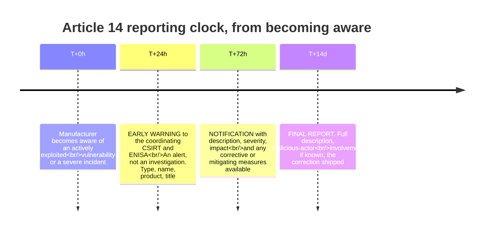
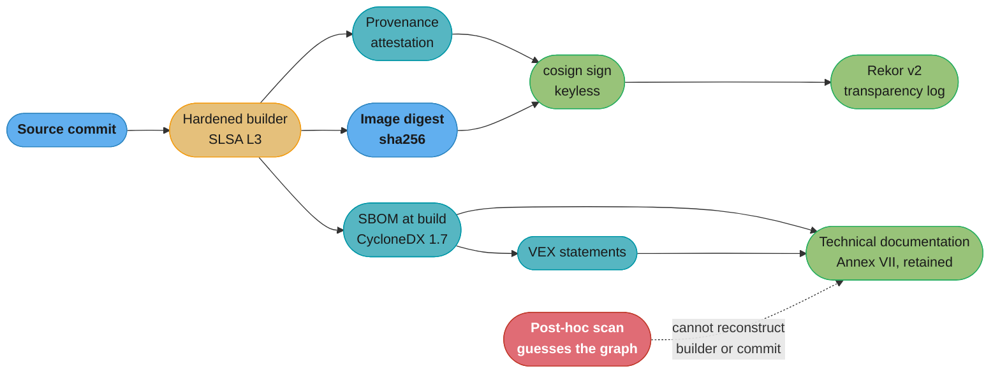

# Regulated Supply Chain — the CRA and Compliance as a Pipeline Property

> **Regulatory anchor (2026-08-26).** **Regulation (EU) 2024/2847**, the Cyber Resilience Act, entered into force **2024-12-10**. Article 71(2) staggers application in three steps: **Chapter IV (Articles 35–51, notified bodies) from 2026-06-11**; **Article 14 (reporting) from 2026-09-11 — sixteen days from today**; and the **full regulation from 2027-12-11**. The reporting clock is **24h early warning / 72h notification / 14-day final report** to the coordinating CSIRT and ENISA. ENISA's **Single Reporting Platform is not yet live** — onboarding instructions were published 2026-07-31 and it is scheduled to go live on 2026-09-11, the same day the obligation starts. **No CRA harmonised standard has been published in the Official Journal yet**; standardisation request M/606 was accepted in April 2025 and CEN/CENELEC JTC 13's first two targets are dated 2026-08-30.

> **Tooling anchor (checked 2026-08-26).** **Syft v1.51.0** and **Grype v0.117.0** (both 2026-08-10), **Trivy v0.74.0** (2026-08-14), **Dependency-Track v5.0** (GA 2026-06-09), **GUAC v1.1.0** (2026-03), **cosign v3.1.3** (2026-06-09). **Rekor v2** reached GA in December 2025 on a tile-based backend, sharded by year; **Rekor v1 is not sunset** and its eventual freeze carries a year's notice. **CycloneDX v1.7** is ratified as **ECMA-424, 2nd Edition** (December 2025); **SPDX 3.0.1** (December 2024) is current with 3.1 at release candidate. **OpenVEX v0.2.0**; **CSAF 2.0** remains the ratified version — **CSAF 2.1 is still a draft**.

This page sits under [devsecops_and_supply_chain_security](devsecops_and_supply_chain_security.md). The parent owns the *engineering* of supply-chain security — the scanning categories, keyless signing with Sigstore, SLSA Build levels, provenance, admission policy. This page owns what changes when those controls stop being good practice and become **a legal obligation with a date, a clock, and a fine**. The pipeline is largely the same; the artefacts it must produce, retain and be able to hand over are not.

Related: the pipeline mechanics themselves are [supply_chain_security_pipeline](../case_studies/cross_cutting/supply_chain_security_pipeline.md); admission enforcement is [policy_as_code_and_compliance](../policy_as_code_and_compliance/policy_as_code_and_compliance.md); registry and artefact retention is [artifact_and_registry_management](../artifact_and_registry_management/artifact_and_registry_management.md).

---

## 1. Concept Overview

Every control in the parent module is voluntary. You adopt Sigstore because unsigned artefacts are a risk you chose not to take; you generate an SBOM because you would like to know what Log4Shell did to you. Nobody audits you for it and nothing happens if you stop.

The Cyber Resilience Act changes the category. It is a **product regulation** — the same legal shape as CE marking for a toaster — applied to "products with digital elements" placed on the EU market. It does not ask whether your security practice is thoughtful. It imposes duties with deadlines, evidence that must exist and be producible on request, and administrative fines up to **€15,000,000 or 2.5% of worldwide annual turnover**.

Three consequences reshape how a platform team builds pipelines:

1. **The SBOM becomes evidence rather than documentation.** An SBOM you generate at scan time, read once, and discard satisfies curiosity. An SBOM that must be produced to a market surveillance authority for a version you shipped three years ago must be *generated at build*, *bound to the artefact*, and *retained*. Those are different systems.
2. **Vulnerability response acquires a clock.** Under Article 14 an actively exploited vulnerability triggers a 24-hour early warning. Twenty-four hours is shorter than most organisations' triage-to-decision path, which means the reporting decision cannot be invented during the incident.
3. **Compliance becomes a property of the pipeline, not of a document.** You cannot retrofit provenance for an artefact already shipped. Either the build recorded what went into it, or the evidence does not exist.

**The date that matters right now is 2026-09-11**, when Article 14 starts applying. That is sixteen days from this page's anchor, and it is more than a year ahead of the rest of the regulation — the EU deliberately front-loaded reporting because it wanted visibility into actively exploited vulnerabilities before the full conformity regime arrives in December 2027.

---

## 2. Intuition

> An SBOM used to be a **photograph** you took because you were curious what the room looked like. Under the CRA it is the **flight recorder** — it exists to be read by someone else, after something has gone wrong, about a flight that happened years ago.

**Mental model.** Think of it as the difference between a personal diary and accounting records. Both record what happened. Only one has a statutory retention period, a defined format, an authority entitled to demand it, and a penalty for its absence. The engineering effort is not in *producing* the artefact — `syft` does that in seconds — it is in producing it at the right moment, binding it immutably to the thing it describes, and being able to retrieve it years later for a version nobody runs any more.

**Why it matters.** The failure mode is not "we do not have an SBOM." It is "we have SBOMs for everything currently deployed, and the authority asked about v2.3.1, which we sunset eighteen months ago." Scanning produces present-tense knowledge. Regulation asks past-tense questions.

**Key insight.** **You cannot generate evidence retroactively.** A scan of a shipped image tells you what is in it today, not what the build consumed or who authorised it. The moment of truth is build time, and every control the CRA effectively requires — SBOM, provenance, signature, transparency-log entry — has to be emitted then or not at all. This is the same insight SLSA encodes; the CRA just attaches a fine to it.

---

## 3. Core Principles

1. **Generate at build, never at scan.** The build is the only moment that knows the true dependency graph, the source commit, and the builder identity. A post-hoc scan reconstructs a guess.
2. **Bind evidence to the digest, not the tag.** Tags move. `myrepo/api@sha256:...` is the only stable identity, and it is the one an authority will be given.
3. **Retention is a requirement, not a cost optimisation.** Technical documentation must remain available for products you no longer sell.
4. **The reporting decision is pre-made.** Who decides "actively exploited," who submits, and to which CSIRT — settled in a runbook before the 24-hour clock ever starts.
5. **VEX is how you survive the CVE count.** A 400-component SBOM will match hundreds of CVEs; a claim that a vulnerability is `not_affected` must be machine-readable and justified, or triage consumes the whole team.
6. **Know your role.** Manufacturer, importer, distributor and open-source steward carry materially different obligations. Getting this wrong in either direction is expensive.
7. **The scanner is part of the supply chain too.** Trivy shipped a malicious release in March 2026. Tools that inspect your dependencies are themselves dependencies.

---

## 4. Types / Architectures / Strategies

### Who you are under the CRA

| Role | Who it is | Core duties |
|---|---|---|
| **Manufacturer** | Develops or has developed a product with digital elements and places it on the EU market under its own name | The full weight: Annex I essential requirements, conformity assessment, CE marking, technical documentation, Article 13 obligations, Article 14 reporting, security updates for the support period |
| **Importer / Distributor** | Places on, or makes available on, the EU market a product from a third-country manufacturer | Verify the manufacturer did the work — CE marking, documentation present, no known non-conformity |
| **Open-source steward** | A **legal person** that systematically provides sustained support for developing specific FOSS intended for commercial activities, ensuring the product's viability (Article 3) | A materially lighter regime under Article 24: a documented cybersecurity policy, fostering voluntary reporting, cooperating with market surveillance authorities. No CE marking, no conformity assessment |

**Individual unpaid contributors are explicitly out of scope.** A natural person maintaining a package in their spare time is not a steward and not a manufacturer. This was the single most contested point during the CRA's passage and the exemption is real — but note it turns on being a *natural person* and on the absence of commercial activity, not on the project's size or popularity.

### Product classes and the assessment route

| Class | Examples | Conformity assessment |
|---|---|---|
| **Default** (most products) | The large majority of software and connected products | Self-assessment |
| **Annex III Class I** (important) | Identity and privileged-access management, standalone browsers, password managers, VPN products, network management systems, SIEM, PKI and certificate-issuance software, operating systems, routers, switches, modems | Self-assessment **if** a harmonised standard is applied in full; otherwise third-party |
| **Annex III Class II** (important) | **Hypervisors and container runtime systems**, firewalls, intrusion detection and prevention systems, tamper-resistant microprocessors and microcontrollers | **Mandatory third-party** assessment by a notified body |
| **Annex IV** (critical) | Hardware devices with security boxes for secure cryptoprocessing, smart meter gateways, smartcards and secure elements | Third-party, and the Commission may mandate European cybersecurity certification |

Class II is the one that surprises platform teams: **hypervisors and container runtimes are Annex III Class II**, so a company shipping a commercial Kubernetes distribution or a container runtime is in mandatory third-party assessment territory, not self-assessment.

### Four frameworks, one pipeline

The pipeline you already have serves several regimes at once. The interesting question is where each stops.

| Framework | Legal force | What it demands | Where it stops |
|---|---|---|---|
| **EU CRA** | **Binding law**, fines to €15M / 2.5% | SBOM in technical documentation, vulnerability handling, coordinated disclosure policy, security updates for the support period, Article 14 reporting | Says almost nothing about *how* you build — it specifies outcomes and evidence, not controls |
| **NIST SSDF (SP 800-218 v1.1)** | Voluntary; contractually binding for US federal suppliers | ~40 practices across prepare/protect/produce/respond | Descriptive practices, no levels, no attestation format of its own. SP 800-218A overlays generative-AI development |
| **SLSA v1.2** | Voluntary industry spec | Build track L1–L3 provenance integrity; separate Source track L1–L4 | **The Build track has no L4** — L3 is the top. It says nothing about vulnerabilities, disclosure, or reporting |
| **PCI DSS 4.0.1** | Contractually binding for card handling | Req 6.3.2: an inventory of bespoke and third-party software components | An SBOM in all but name, scoped only to the cardholder data environment |

The practical reading: **SLSA gives you build integrity, SSDF gives you a practice checklist, PCI gives you an inventory obligation, and the CRA gives you a deadline.** One pipeline emitting SBOM plus provenance plus signature plus VEX satisfies the evidence needs of all four; only the CRA will fine you for its absence.

---

## 5. Architecture Diagrams

The Article 14 clock — the diagram to internalise before 2026-09-11:



*The 24-hour step is deliberately cheap to satisfy — it is an alert, not a report. The failure mode is treating it as a report and missing the deadline while assembling detail that is not due until 72 hours.*

Where evidence has to be emitted, and why retrofitting is impossible:



*Everything on the solid path is emitted once, at build, bound to a digest. The dashed path is what teams reach for when the authority asks — and it cannot produce builder identity or source provenance, because that information existed only while the build was running.*

---

## 6. How It Works — Detailed Mechanics

### Emitting the full evidence set in one job

```yaml
# .github/workflows/release.yml
name: release
on:
  push:
    tags: ["v*"]

permissions:
  contents: read
  id-token: write        # keyless signing: the OIDC token IS the identity
  packages: write
  attestations: write

jobs:
  build:
    runs-on: ubuntu-24.04
    steps:
      - uses: actions/checkout@v5

      # 1. BUILD, and capture the DIGEST. The tag is not the artefact.
      - id: build
        uses: docker/build-push-action@v6
        with:
          push: true
          tags: ghcr.io/${{ github.repository }}:${{ github.ref_name }}
          provenance: mode=max        # SLSA provenance from the builder itself
          sbom: true

      # 2. SBOM AT BUILD TIME. syft reads the build context, not a shipped image.
      #    CRA Annex I Part II point 1 requires a machine-readable SBOM covering
      #    AT LEAST the top-level dependencies. Going deeper is allowed and wise.
      - name: Generate SBOM
        run: |
          syft "ghcr.io/${{ github.repository }}@${{ steps.build.outputs.digest }}" \
            -o cyclonedx-json=sbom.cdx.json
          # CycloneDX 1.7 == ECMA-424 2nd Edition. SPDX 3.0.1 is equally acceptable:
          # the CRA requires "a commonly used, machine-readable format" and names
          # NEITHER format. Anyone telling you the CRA mandates CycloneDX or SPDX
          # specifically is reporting industry consensus as regulation.

      # 3. ATTACH the SBOM to the DIGEST and sign it. Keyless: Fulcio issues a
      #    10-minute cert bound to this workflow's OIDC identity, and the entry
      #    lands in Rekor v2 (tile-backed, sharded by year since GA in Oct 2025).
      - name: Sign and attest
        run: |
          IMG="ghcr.io/${{ github.repository }}@${{ steps.build.outputs.digest }}"
          cosign attest --predicate sbom.cdx.json --type cyclonedx --yes "$IMG"
          cosign sign --yes "$IMG"

      # 4. RETAIN. This is the step teams skip, and it is the one the CRA cares
      #    about. Technical documentation must survive the product's support
      #    period -- long after this pipeline, this registry and this repo change.
      - name: Archive to evidence store
        run: |
          aws s3 cp sbom.cdx.json \
            "s3://cra-evidence/${{ github.repository }}/${{ steps.build.outputs.digest }}/sbom.cdx.json"
```

The four steps map onto four different obligations, and only the first is what most teams mean by "we do supply-chain security."

### VEX — how you avoid drowning in CVEs

A 400-component SBOM will match hundreds of CVEs, most of which do not apply: the vulnerable function is never called, the affected code path is compiled out, the component ships but is not executed. Saying so in prose does not scale. **VEX** says it in a machine-readable statement.

```json
{
  "@context": "https://openvex.dev/ns/v0.2.0",
  "@id": "https://acme.example/vex/2026-08-26-api",
  "author": "Acme Security <psirt@acme.example>",
  "timestamp": "2026-08-26T09:00:00Z",
  "version": 1,
  "statements": [
    {
      "vulnerability": {"name": "CVE-2026-31337"},
      "products": [
        {"@id": "pkg:oci/api@sha256:9f2c...", "identifiers": {"purl": "pkg:oci/api@sha256:9f2c..."}}
      ],
      "status": "not_affected",
      "justification": "vulnerable_code_not_in_execute_path",
      "impact_statement": "libxyz is linked for its parser only. The affected TLS handler is never reached."
    }
  ]
}
```

The four VEX statuses are **`not_affected`**, **`affected`**, **`fixed`**, and **`under_investigation`**. A `not_affected` claim requires a justification from a fixed vocabulary — this is what makes the assertion auditable rather than a shrug. `under_investigation` is the honest status during the Article 14 window, and it is a legitimate thing to publish.

### The gate that actually blocks a release

```rego
package supplychain

import rego.v1

# Deny any image lacking a signed SBOM attestation bound to its digest.
deny contains msg if {
    input.request.kind.kind == "Pod"
    some c in input.request.object.spec.containers
    not has_signed_sbom(c.image)
    msg := sprintf("image %v has no signed SBOM attestation", [c.image])
}

# Deny a tag reference outright -- evidence binds to digests, and a tag
# can be repointed after the evidence was produced.
deny contains msg if {
    input.request.kind.kind == "Pod"
    some c in input.request.object.spec.containers
    not contains(c.image, "@sha256:")
    msg := sprintf("image %v referenced by tag, not digest", [c.image])
}
```

The second rule is the one that matters legally. Signing a tag and deploying a digest lets them diverge — the parent module's §14 covers this failure — and under a regulatory regime the divergence means your evidence describes an artefact you did not ship.

### The reporting runbook, written before you need it

```yaml
# runbooks/cra-article-14.yaml
trigger:
  - an actively exploited vulnerability in a product we placed on the EU market
  - a severe incident having an impact on the security of such a product

clock_starts: when the manufacturer becomes AWARE. Log the timestamp immediately.

T_plus_24h:
  action: early warning to the coordinating CSIRT and ENISA
  channel: ENISA Single Reporting Platform
  contains: notification type, our name, the product, a title. Nothing more is due.
  decision_owner: Head of Security (deputy: VP Engineering). Pre-named, not chosen live.
  note: |
    This is an ALERT. Do not delay it to assemble detail that is not due for 48
    more hours. The most common failure is treating T+24h as a report.

T_plus_72h:
  action: notification with description, severity, impact, corrective or
          mitigating measures taken or available
  inputs: SBOM for the affected digest, VEX statement, patch status

T_plus_14d:
  action: final report -- full description, malicious-actor involvement if
          known, the correction shipped, mitigating measures

pre_staged:
  - evidence store queryable by digest AND by released version
  - PSIRT contact registered with the coordinating CSIRT
  - SRP onboarding completed (instructions published 2026-07-31)
```

---

## 7. Real-World Examples

- **The Trivy compromise, March 2026.** A malicious **Trivy v0.69.4** was published and disclosed around 2026-03-19. The scanner used to inspect the supply chain was itself a supply-chain attack. Under a regulatory regime this is not merely embarrassing — a compromised scanner can emit an SBOM that omits exactly what an attacker wants omitted, and that SBOM becomes your legal evidence. Pin and verify your security tooling with the same discipline you apply to application dependencies.
- **Rekor v2, GA December 2025.** Sigstore's transparency log was rebuilt on a tile-based backend, sharded by year (`log2026-1.rekor.sigstore.dev`) and fully CDN-cacheable. Rekor v1 continues running in parallel and its eventual freeze carries a year's notice — so there is no urgent migration, only a client-version floor (cosign v2.6.0+ / v3.0.1+).
- **Dependency-Track v5.0** (GA 2026-06-09, "Hyades") — a rearchitecture with a CEL policy engine and portfolio access control. This is the class of tool the CRA implicitly requires: something that holds SBOMs for *every version ever shipped* and can answer "which released products contain this component" rather than "what is in production now."
- **CycloneDX as ECMA-424** — CycloneDX 1.7 is a ratified ECMA standard, which matters for a regulation that asks for "a commonly used, machine-readable format." It is evidence of common use, not a legal designation.
- **The harmonised-standards gap.** M/606 was accepted in April 2025 and targets roughly 41 standards. **None has been published in the Official Journal.** For Annex III Class I products this is consequential: the self-assessment route is conditional on applying a harmonised standard in full, and until one exists that route is not actually available.

---

## 8. Tradeoffs

| Decision | Option A | Option B | How to choose |
|---|---|---|---|
| SBOM format | CycloneDX 1.7 (ECMA-424) | SPDX 3.0.1 | Either satisfies the CRA — it names neither. CycloneDX has richer VEX integration; SPDX has stronger licence modelling. Pick one and be consistent |
| SBOM depth | Top-level only | Full transitive | Annex I requires **at least** top-level. Full transitive is more useful and more work — and vastly more CVE noise, so it obliges you to run VEX |
| SBOM publication | Publish openly | Technical documentation only | The CRA **does not require publication** — it is provided on reasoned request. Publishing is a choice with its own risk profile |
| Signing | Keyless (Fulcio/Rekor) | KMS long-lived key | Keyless for CI-built artefacts; KMS where an air-gapped or offline verification path is required |
| Vulnerability triage | Fix everything | VEX the inapplicable | VEX, unavoidably, once the SBOM is transitive |
| Evidence store | Registry attestations | Separate archive | Both. The registry is convenient and mutable-ish; the archive survives registry migration and meets retention |
| Timing | Prepare now | Wait for harmonised standards | Article 14 applies 2026-09-11 regardless of whether any standard exists |

**The one asymmetry worth naming:** producing evidence is cheap and continuous; producing it *retroactively* is impossible. Every month you defer, you accumulate shipped artefacts for which the evidence can never exist. That makes this unusual among compliance workstreams — the cost of delay is not linear, it is a permanently missing back-catalogue.

---

## 9. When to Use / When NOT to Use

**You are in scope when** you place a product with digital elements on the EU market under your own name or trademark — including SaaS where the software is supplied to the customer, and including free products offered in the course of commercial activity. Non-EU vendors are in scope if their product reaches the EU market.

**You are probably a steward rather than a manufacturer when** you are a legal person (a foundation, a company) systematically supporting FOSS intended for commercial use without placing it on the market yourself. Article 24's obligations are real but far lighter: a documented cybersecurity policy, fostering voluntary reporting, cooperating with authorities.

**You are out of scope when** you are a natural person contributing to open source outside commercial activity; when the product is covered by an equivalent sectoral regime (medical devices, aviation, motor vehicles); or when the product is purely a service with no digital element supplied to the user.

**Do NOT build the full evidence pipeline when** you ship exclusively to non-EU markets with no realistic EU distribution *and* have no PCI, FedRAMP or customer-contractual driver. Even then, SBOM-plus-provenance is cheap enough that "we might sell into the EU in two years" usually settles it — because of the retroactivity problem above.

**Do NOT treat this as a security project.** The controls are security controls; the deliverable is evidence with a retention period and a named accountable person. A team that builds it as a security initiative produces excellent scanning and no archive.

---

## 10. Common Pitfalls

**1. Generating the SBOM at scan time instead of build time.**

```yaml
# BROKEN: SBOM produced by scanning a shipped image in a nightly job.
# It reports what is IN the image. It cannot report what the build CONSUMED,
# which commit produced it, or which builder identity authorised it -- that
# information existed only while the build ran. When an authority asks about a
# version sunset 18 months ago, there is no image left to scan and no evidence.
- name: nightly sbom
  run: syft registry:myrepo/api:latest -o cyclonedx-json=sbom.json
```

```yaml
# FIX: emit at build, bind to the digest, attest it, archive it.
- name: sbom at build
  run: |
    syft "myrepo/api@${DIGEST}" -o cyclonedx-json=sbom.cdx.json
    cosign attest --predicate sbom.cdx.json --type cyclonedx --yes "myrepo/api@${DIGEST}"
    aws s3 cp sbom.cdx.json "s3://cra-evidence/api/${DIGEST}/sbom.cdx.json"
```

**2. Treating the 24-hour early warning as a report.** It is four fields: notification type, your name, the product, a title. Teams miss the deadline while assembling severity analysis and impact assessment that are not due until T+72h. Send the alert, then investigate.

**3. Believing the CRA mandates CycloneDX or SPDX.** It requires "a commonly used, machine-readable format" and names neither. Vendor material asserting otherwise is reporting industry consensus as legal text. The practical consequence is that a format migration is not a compliance event.

**4. Publishing the SBOM because you assume it is required.** It is not — it lives in technical documentation and is provided to market surveillance authorities on **reasoned request**. Publishing may still be right for customer trust, but it is a business decision with an attack-surface cost, not an obligation.

**5. EOL transitive dependencies you cannot patch inside the clock.** This is the genuinely hard one. An actively exploited CVE in an abandoned transitive dependency starts a 24-hour clock, and there is no upstream fix coming. The 72-hour notification asks for "corrective or mitigating measures **taken or available**" — mitigation counts. But the mitigation has to be identifiable in hours, which means knowing your EOL exposure *before* the incident. Run an EOL audit against the SBOM as a scheduled job, not as an incident-response step.

**6. Assuming self-assessment is available for an Annex III Class I product.** It is conditional on applying a harmonised standard in full, and **no CRA harmonised standard has been published in the Official Journal**. Plan for a third-party route until one is cited.

**7. Missing that hypervisors and container runtimes are Class II.** Shipping a commercial Kubernetes distribution or container runtime puts you in **mandatory** third-party conformity assessment. Teams reason by product size and get this wrong; the classification is by function.

**8. Trusting your scanner implicitly.** Trivy shipped a malicious v0.69.4 in March 2026. Pin security tooling to digests, verify its signatures, and remember that a compromised SBOM generator produces evidence that is both wrong and legally binding on you.

**9. An evidence store keyed only by digest.** Authorities ask about *released versions* — "v2.3.1" — not about `sha256:9f2c...`. Index both ways, or the archive is technically complete and practically unusable under time pressure.

---

## 11. Technologies & Tools

| Tool | Version (2026-08-26) | Role | Note |
|---|---|---|---|
| Syft | v1.51.0 | SBOM generation | CycloneDX and SPDX output; run at build |
| Grype | v0.117.0 | Vulnerability matching against an SBOM | Pairs with Syft; consumes VEX |
| Trivy | v0.74.0 | Scanning — image, filesystem, IaC, SBOM | Pin and verify: a malicious v0.69.4 shipped in March 2026 |
| Dependency-Track | v5.0 (2026-06-09) | SBOM repository and continuous analysis | Answers "which shipped versions contain X" — the CRA question |
| GUAC | v1.1.0 | Graph over SBOM, provenance and VEX | OpenSSF incubating |
| cosign | v3.1.1 | Signing and attestation | Keyless via Fulcio, logged to Rekor |
| Rekor | v2 (GA Oct 2025) | Transparency log | Tile-backed, sharded by year; v1 still running |
| CycloneDX | 1.7 / ECMA-424 2nd Ed | SBOM + VEX format | Ratified standard; strong VEX integration |
| SPDX | 3.0.1 (3.1 at RC) | SBOM format | Stronger licence modelling |
| OpenVEX | v0.2.0 | VEX statements | Four statuses, fixed justification vocabulary |
| CSAF | **2.0** ratified | Security advisory format with a VEX profile | **2.1 is still a draft** — do not build on it |
| ENISA Single Reporting Platform | Not yet live | Article 14 submissions | Onboarding published 2026-07-31, live 2026-09-11 |

---

## 12. Interview Questions with Answers

**Q: What changes on 11 September 2026, and what does not?**
**Short:** Article 14's reporting obligations start — the 24h/72h/14-day clock for actively exploited vulnerabilities — while the rest of the CRA waits until 11 December 2027.

Article 71(2) of Regulation (EU) 2024/2847 staggers application deliberately. Chapter IV, covering notified bodies, applied from 11 June 2026 so that assessment capacity exists before it is needed. **Article 14 applies from 11 September 2026**, obliging manufacturers to report actively exploited vulnerabilities and severe incidents on a 24-hour early warning, 72-hour notification and 14-day final report cadence to the coordinating CSIRT and ENISA. Everything else — the Annex I essential requirements, conformity assessment, CE marking, the SBOM in technical documentation — applies from 11 December 2027. The EU front-loaded reporting because it wanted visibility into exploitation before the full regime landed. The practical consequence is that a team can be fully liable for reporting more than a year before it is liable for the product requirements the report would describe.

**Q: Why can't you generate CRA evidence retroactively?**
**Short:** A scan reports what is in a shipped artefact, but provenance — which commit, which builder, which identity authorised it — existed only while the build ran.

An SBOM produced by scanning an image is a reconstruction: it inspects installed packages and infers a dependency graph. It cannot recover the source commit, the build environment, the builder's identity, or the parameters the build consumed, because none of that is present in the artefact. Those are exactly the facts provenance attestations exist to record, and they are recordable only at build time. Compounding it, the artefact itself may be gone — an authority asking about a version sunset eighteen months ago is asking about something no longer in any registry. This makes deferral unusually costly: the cost is not linear delay but a permanently missing back-catalogue, since every month without build-time evidence produces shipped artefacts whose evidence can never exist.

**Q: Does the CRA require you to publish your SBOM?**
**Short:** No. It must exist in the technical documentation and be provided to market surveillance authorities on reasoned request — publication is a choice, not an obligation.

Annex I Part II requires the manufacturer to identify and document components, including a machine-readable SBOM covering **at least the top-level dependencies**, and Annex VII places it in the technical documentation. The regulation is explicit that manufacturers are not obliged to make the SBOM public; it is disclosed to authorities on a reasoned request. This is widely misreported, and the misreading has a real cost — teams either over-engineer a public SBOM portal they did not need, or conclude the requirement is too exposing and do nothing. Publishing can still be right for customer trust or contractual reasons, but treat it as a business decision with its own attack-surface implications rather than as compliance.

**Q: Which SBOM format does the CRA mandate?**
**Short:** Neither CycloneDX nor SPDX — it requires "a commonly used, machine-readable format" and names no specific one.

The regulation's language is deliberately format-neutral, which means both CycloneDX (v1.7, ratified as ECMA-424 2nd Edition in December 2025) and SPDX (3.0.1, with 3.1 at release candidate) satisfy it, as would any other format meeting the common-use test. Vendor material asserting that the CRA mandates one is reporting industry consensus as legal text, and that misreading matters because it turns a routine tooling choice into a perceived compliance event — teams have delayed pipelines over a format migration that carries no regulatory weight. Choose on engineering merit: CycloneDX has tighter VEX integration, SPDX has richer licence modelling. Then be consistent, because mixed formats across a back-catalogue are what actually make the archive hard to query.

**Q: What are the CRA's fine tiers?**
**Short:** €15M or 2.5% of worldwide turnover for essential requirements and Articles 13–14; €10M or 2% for most other obligations; €5M or 1% for misleading information.

Article 64 sets three bands, each "whichever is higher." The top band — **€15,000,000 or 2.5% of total worldwide annual turnover** — covers non-compliance with the Annex I essential cybersecurity requirements and with the manufacturer obligations in Articles 13 and 14, which is where the reporting duty sits. The middle band of €10,000,000 or 2% covers the other operator obligations. The lowest, €5,000,000 or 1%, covers supplying incorrect, incomplete or misleading information to notified bodies or market surveillance authorities — worth noting separately, because it means a sloppy response to a request is independently sanctionable even where the underlying product was compliant. Turnover-based ceilings mean the exposure scales with the company, not with the product.

**Q: What is an open-source steward, and how is it different from a manufacturer?**
**Short:** A legal person systematically providing sustained support for commercial-intent FOSS, carrying a much lighter Article 24 regime with no CE marking or conformity assessment.

Article 3 defines a steward as a **legal person** — a foundation or company, never a natural person — whose purpose is to systematically provide support on a sustained basis for developing specific free and open-source products intended for commercial activities, ensuring their viability. Article 24 gives them a deliberately reduced set of duties: put in place and document a cybersecurity policy fostering secure development and vulnerability handling, encourage voluntary reporting, and cooperate with market surveillance authorities on request. There is no CE marking, no conformity assessment, and no Article 14 reporting in the manufacturer's sense. **Individual unpaid contributors are explicitly out of scope** — this was the most contested point in the CRA's passage and the exemption is genuine, but it turns on being a natural person outside commercial activity, not on the project's size.

**Q: Your product is a commercial Kubernetes distribution. What conformity route applies?**
**Short:** Container runtime systems and hypervisors are Annex III Class II, which means mandatory third-party assessment by a notified body — not self-assessment.

Annex III Class II names hypervisors and container runtime systems alongside firewalls, intrusion detection and prevention systems, and tamper-resistant microprocessors. Class II is the mandatory-third-party tier: unlike Class I, applying a harmonised standard does not buy you a self-assessment route. Teams get this wrong by reasoning about company size or perceived risk rather than reading the functional classification, and the error is expensive because notified-body capacity is finite and the assessment has lead time. The related trap is Class I, where self-assessment *is* available but only if a harmonised standard is applied in full — and since **no CRA harmonised standard has yet been published in the Official Journal**, that route is currently theoretical. Plan for third-party assessment in both classes until a standard is cited.

**Q: A critical CVE lands in an abandoned transitive dependency with no upstream fix. What do you do inside 24 hours?**
**Short:** Send the early warning on time regardless, then report mitigating measures — Article 14 accepts measures "taken or available," not only fixes.

The 24-hour early warning is four fields and does not require a remediation plan, so nothing about an unfixable dependency justifies missing it. By 72 hours you owe a description plus corrective **or mitigating** measures taken or available, and mitigation genuinely counts: disabling the code path, network-level blocking, configuration changes, a compensating control. The hard part is that mitigation must be identifiable within hours, which is a preparation problem rather than an incident problem. Run an EOL and abandonment audit against your SBOM on a schedule so you already know which components have no upstream, and pre-write the mitigation options for the ones that matter. Publish `under_investigation` as a VEX status in the interim — it is a legitimate, honest state to be in.

**Q: What are the four VEX statuses, and why does VEX become mandatory in practice?**
**Short:** `not_affected`, `affected`, `fixed`, `under_investigation` — and a transitive SBOM matches so many inapplicable CVEs that prose triage does not scale.

A 400-component SBOM will match hundreds of CVEs, and the large majority will not apply: the vulnerable function is never called, the affected path is compiled out, the component ships but never executes. Asserting that in a spreadsheet does not survive contact with a regulator or a customer questionnaire. VEX makes the assertion machine-readable, and critically, a `not_affected` claim requires a justification drawn from a fixed vocabulary — `vulnerable_code_not_in_execute_path` and its siblings — which is what turns "we looked at it" into an auditable statement. OpenVEX v0.2.0 is the lightweight option; CSAF's VEX profile is the heavier one, and note that **CSAF 2.0 is the ratified version while 2.1 remains a draft**, so do not build on 2.1 yet.

**Q: Does SLSA have a Build track Level 4?**
**Short:** No — the Build track tops out at L3. The Source track, reintroduced in SLSA v1.2, does have an L4, and conflating the two is a common error.

SLSA organises requirements into independent tracks, and a level in one says nothing about another. The **Build track runs L0 through L3**, where L3 means a hardened builder whose runs are isolated from one another and whose signing material is unreachable from user build steps — that is the top, and "SLSA L3" is the realistic production target rather than a waypoint. L4 was deferred in v1.0 and has not returned to the Build track. The **Source track**, reintroduced in v1.2, does define L1 through L4, with L4 requiring two-party review of every change to a protected branch. So "we are SLSA L4" is meaningful only if the speaker means the Source track, and in interviews the answer that distinguishes the tracks is the one that demonstrates having read the spec rather than a summary.

**Q: How do the CRA, SSDF, SLSA and PCI DSS relate in one pipeline?**
**Short:** SLSA gives build integrity, SSDF gives a practice checklist, PCI gives a component inventory — and only the CRA carries a fine and a deadline.

They overlap on artefacts and diverge on force. SLSA v1.2 specifies provenance integrity and says nothing about vulnerabilities, disclosure or reporting. NIST SP 800-218 v1.1 is a descriptive set of roughly forty practices with no levels and no attestation format, becoming binding only through US federal contract terms; SP 800-218A overlays generative-AI development. PCI DSS 4.0.1 requirement 6.3.2 mandates an inventory of bespoke and third-party components — an SBOM in all but name — but only within the cardholder data environment. The CRA is actual law with fines to €15M or 2.5% of turnover, and it specifies outcomes and evidence rather than controls. One pipeline emitting SBOM, provenance, signature and VEX serves all four; the sequencing driver is the CRA, because it is the only one with a date.

**Q: What is the ENISA Single Reporting Platform, and is it live?**
**Short:** It is ENISA's Article 16 platform for Article 14 submissions — not yet live as of late August 2026, scheduled to go live on 11 September 2026.

Article 16 obliges ENISA to establish and operate a single reporting platform so manufacturers submit once rather than to each national authority separately. As of this page's anchor it is not publicly live: ENISA published step-by-step onboarding instructions and a factsheet on 2026-07-31, with functional and security testing under way, and it is scheduled to go live on **the same day the obligation starts**. Two consequences follow. First, complete onboarding now rather than during an incident, because the first 24-hour clock you face is not the moment to discover an account provisioning delay. Second, the list of designated national CSIRT coordinators was still pending publication, so identify your coordinating CSIRT as part of the runbook rather than assuming it is obvious.

**Q: Why bind evidence to a digest rather than a tag?**
**Short:** Tags are mutable — signing a tag and deploying a digest lets them diverge, so your evidence would describe an artefact you did not actually ship.

A tag is a pointer that can be repointed at any time, including after evidence was produced against it. The classic failure is a pipeline that signs `myrepo/api:v2.3.1` and a deployment that resolves that tag independently at rollout: a later push overwrites the tag, the deployment pulls a different, unsigned image, and every signature and SBOM in the archive now describes something else. Under a voluntary regime that is a security gap; under the CRA it means the technical documentation is wrong about a product placed on the market, which is precisely the "incorrect or misleading information" Article 64's third band sanctions. Capture the digest at build, sign and attest that digest, and enforce digest-only references at admission so a tag reference cannot reach production at all.

**Q: Your SBOM archive is complete but unusable during an incident. What went wrong?**
**Short:** It is probably keyed only by digest, while authorities and customers ask about released versions like "v2.3.1."

An evidence store indexed by `sha256:...` is technically correct and operationally useless under a 24-hour clock, because nobody outside the pipeline thinks in digests. The request will name a product and a version, and mapping that to a digest requires a second system — one that may itself have been lost in a registry migration or a CI platform change. Index both ways from the start: digest to evidence, and released version to digest. The same argument extends to retention scope, since the question is usually about a version you no longer run: an archive covering only currently deployed artefacts fails exactly the case it exists for. This is what tools like Dependency-Track are for — answering "which shipped versions contain this component" rather than "what is in production now."

**Q: The scanner you rely on shipped a malicious release. What does that imply for a regulated pipeline?**
**Short:** Security tooling is part of the supply chain — a compromised SBOM generator produces evidence that is both wrong and legally attributable to you.

Trivy shipped a malicious v0.69.4, disclosed around 19 March 2026, which is the clean illustration: the tool used to inspect the supply chain was the attack. In a voluntary regime this yields a bad scan you might catch. Under the CRA the output becomes technical documentation you are accountable for, and a compromised generator can omit precisely the component an attacker wants omitted — producing an SBOM that is complete-looking, wrong, and signed by you. So apply to security tooling the same controls you apply to application dependencies: pin to digests rather than floating tags, verify release signatures, keep tooling versions in the same review path as production dependencies, and treat a tooling CVE as a potential evidence-integrity incident rather than only a scanning outage.

---

## 13. Best Practices

- **Emit SBOM, provenance and signature at build, bound to the digest.** Everything else in this page is downstream of that one habit.
- **Archive outside the registry.** Registries get migrated, repos get deleted, CI platforms get replaced. Retention outlives all three.
- **Index the evidence store by released version as well as by digest.** The question will arrive in version form.
- **Write the Article 14 runbook now**, with the decision owner named. The 24-hour clock is not when you choose who decides.
- **Complete ENISA SRP onboarding before 2026-09-11.** Account provisioning during an incident is an avoidable delay.
- **Run VEX from day one** if your SBOM is transitive. Retrofitting justifications across hundreds of CVEs is far harder than producing them as you go.
- **Audit for EOL and abandoned dependencies on a schedule**, so the unfixable ones are known before they are urgent.
- **Enforce digest-only image references at admission.** It closes the sign-a-tag-deploy-a-digest divergence structurally.
- **Pin and verify your security tooling** to digests with signature verification.
- **Classify your product against Annex III deliberately**, by function rather than by intuition — hypervisors and container runtimes are Class II.
- **Do not wait for harmonised standards.** None is published, and Article 14 applies regardless.

---

## 14. Case Study

### Scenario: a first CRA-reportable exploit, sixteen days after the obligation starts

A 200-person vendor ships a self-hosted API gateway to EU customers. It is an Annex III Class I product (network management), placed on the EU market under their own name, so they are a manufacturer. They have a good pipeline by the parent module's standards: Trivy in CI, cosign keyless signing, SLSA L3 provenance from GitHub Actions, admission policy verifying signatures.

On a Tuesday morning a customer reports active exploitation of their gateway through a deserialisation flaw in a transitive dependency. The dependency was archived by its maintainer in 2024.

**Hour 0 — the clock starts, and nobody knows it.** The report arrived in a support queue. It reached security four hours later. **Awareness is when the manufacturer becomes aware**, and the support queue is the manufacturer. Four of the twenty-four hours were spent before anyone knew a clock was running.

**Hour 4 to 9 — the evidence problem.** Security needs the SBOM for the affected released version, v4.2.0. What they have:

```
  what existed                          what was needed
  ------------------------------------  -----------------------------------
  nightly Trivy scan of :latest         SBOM for the v4.2.0 artefact
  SBOMs in GH Actions artifacts,        retained evidence, indexed by version
    90-day retention -- v4.2.0 shipped
    7 months ago, artifacts expired
  cosign signatures in Rekor            (these were fine, and were the ONLY
                                         thing that survived)
```

They rebuilt v4.2.0 from the tag to generate an SBOM. The rebuild produced a **different** dependency set — a floating minor constraint had resolved forward in the intervening seven months. So the reconstructed SBOM described software they had never shipped, which is worse than having none: had they submitted it, they would have supplied incorrect information to an authority, independently sanctionable under Article 64's €5M / 1% band.

**Hour 9 to 22 — the early warning.** They pulled the true component list from the shipped image layers by hand, confirmed the vulnerable version, and submitted the early warning at T+22h. It contained four fields. The thirteen hours of forensics produced nothing the early warning actually required.

**What they fixed, in the order it mattered.**

```yaml
# BROKEN: SBOM as a CI artifact. 90-day retention, indexed by run ID,
# unrelated to the released version. Gone before the product was.
- uses: actions/upload-artifact@v4
  with: {name: sbom, path: sbom.cdx.json, retention-days: 90}
```

```yaml
# FIX: durable evidence store, dual-indexed, written at build.
- name: Archive evidence
  run: |
    DIGEST="${{ steps.build.outputs.digest }}"
    VERSION="${{ github.ref_name }}"
    BASE="s3://cra-evidence/api-gateway"
    aws s3 cp sbom.cdx.json  "$BASE/by-digest/${DIGEST}/sbom.cdx.json"
    aws s3 cp provenance.json "$BASE/by-digest/${DIGEST}/provenance.json"
    # The index an authority's question actually arrives in:
    echo "$DIGEST" | aws s3 cp - "$BASE/by-version/${VERSION}/digest"
    # Object Lock: retention is a compliance control, not a lifecycle policy.
```

Plus the change that would have saved thirteen hours on its own:

```yaml
# The support queue is the manufacturer. Awareness starts there, not in security.
# A keyword trigger on inbound reports pages security and STARTS THE CLOCK
# with a recorded timestamp -- which is also the evidence that you met it.
- alert: PossibleActiveExploitation
  match: {queue: support, body_matches: "(exploit|actively exploited|in the wild|0day)"}
  action: [page_security, create_incident, record_awareness_timestamp]
```

And the preparation that turned an unfixable dependency into a 72-hour answer:

```
  scheduled monthly, against the archived SBOM -- not during an incident:

    for each component in sbom:
        if upstream archived / no release in 24 months / EOL flagged:
            record: component, affected products, PRE-WRITTEN mitigation

  for the deserialisation dependency this would have read:
    mitigation available: disable the legacy config-import endpoint via
    feature flag GATEWAY_LEGACY_IMPORT=false. Removes the only call path
    reaching the vulnerable deserializer. No upstream fix expected.
```

That paragraph is what Article 14's 72-hour notification means by "mitigating measures available." Written in advance it is a lookup; written during the incident it competes with the clock.

**Outcome.** The early warning landed at T+22h — inside the window, with two hours to spare and no margin for anything going wrong. The 72-hour notification carried the feature-flag mitigation. The final report at 14 days documented the removal of the dependency entirely.

The lasting change was not a security control. Every security control they needed was already in place; **the signatures in Rekor were the only artefact that survived seven months**, precisely because they were written to a durable external log rather than to CI storage. What was missing was retention, indexing, and a definition of awareness that matched where reports actually arrive.

### Discussion questions

1. The rebuild produced a different dependency set than the original release. What in the build should have prevented that, and would it have been worth the constraint?
2. Awareness legally began in the support queue. Where else in your organisation could a report land first, and how would you know?
3. They submitted at T+22h with two hours of margin. What single change buys the most margin back, and why is it probably not "respond faster"?
4. The pre-written mitigation depended on knowing the call path into the vulnerable code. What would it take to know that for every EOL dependency, and is that a reasonable standing cost?
