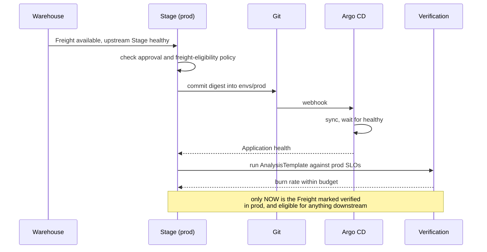

# Environment Promotion in GitOps

> **Version anchor (2026-09-04).** **Kargo** reached **1.0 GA on 2024-10-22** and is on the 1.x line; its CRD kinds are `Project`, `Warehouse`, `Freight`, `Stage` and `Promotion`. **Argo CD 3.5.x** is current (v3.5.2, 2026-08-27), and **ApplicationSet is GA and bundled** into Argo CD, with the `git`, `cluster`, `matrix`, `merge`, `pull request`, `SCM provider` and `plugin` generators. **GitOps Promoter** is a real project but lives under **`argoproj-labs`**, not core Argo CD. **Flux v2.9.5** (2026-08-31) is current and its `ImageUpdateAutomation` / image-reflector controllers are current, not superseded; Flux **graduated from the CNCF in 2022**. **Argo Rollouts 1.10.x** (v1.10.0, 2026-08-27) routes Gateway API traffic through the `argoproj-labs/rollouts-plugin-trafficrouter-gatewayapi` plugin.

---

## 1. Concept Overview

[gitops_argocd_flux](gitops_argocd_flux.md) teaches **sync**: a controller reconciles a cluster toward the state in a Git repository, continuously, with drift detection. That is the part GitOps is genuinely excellent at, and the part every tutorial covers.

**Promotion** is the part it is worst at, and the part every GitOps interview probes. Sync answers "make this cluster match this directory". It says nothing about the actual question a delivery pipeline has to answer: *this exact artifact passed its tests in dev — how does it get to staging, and then to production, with the right approvals, in the right order, with a record of who authorised it and the ability to put it back?*

The gap is structural. A GitOps controller is a reconciler with no notion of *sequence*. It cannot express "apply this to staging, wait for the soak to pass, then apply the same thing to production" because it has no concept of "then". Every GitOps organisation ends up building promotion out of something else — a directory convention plus CI, an image-update controller, a Helm value hierarchy, or a purpose-built promotion controller — and which one they picked is usually the most revealing thing about their platform.

The unit being promoted is worth naming precisely: **an immutable artifact reference plus its configuration delta**. Promoting a tag is not promotion, because a tag can move; promoting a digest is. And promoting *only* the digest is incomplete, because staging and production differ in replica counts, resource limits, feature flags and endpoints — so promotion is always "carry this digest forward, and reconcile it against the target environment's own configuration".

---

## 2. Intuition

**One-line analogy.** Sync is a thermostat: it drives the room toward the number on the dial and never asks how the number got there. Promotion is the person who decides to change the number, in which room, after checking that the last room did not catch fire.

**Mental model.** Draw the pipeline as two orthogonal axes and every promotion design becomes legible:

- **What varies by environment** — replicas, limits, endpoints, flags. This is configuration, it is *different* in each environment by design, and it must never be copied between them.
- **What is identical across environments** — the container image digest, the chart version, the migration set. This is the artifact, it must be *bit-identical* everywhere, and copying it forward is exactly what promotion means.

Every promotion disaster comes from confusing the two: copying a whole directory from staging to production (which drags staging's configuration along), or rebuilding the image per environment (which means production runs bytes nobody tested).

**Why it matters.** The GitOps promise is that Git is the record of what is deployed. Without a promotion model, that record is a series of commits saying "bump image" with no link to what was tested, who approved it, or what the previous state was. You have reproducible deploys and unauditable releases — which fails the audit question that matters: *what exactly was running at 14:32 on Tuesday, and who put it there?*

**Key insight.** **Promotion is a write to Git, and everything else is a policy about that write.** Who may make it, what must be true first, what must be true after, and what happens if it is not. Once you see it that way, the design space is small: the tools differ in *where the policy lives* — in CI, in a controller, or in a branch protection rule — not in what they fundamentally do.

---

## 3. Core Principles

- **Promote a digest, never a tag.** `app:v1.4.2` can be repointed; `app@sha256:9b1c...` cannot. If the thing you promote is mutable, you have not promoted anything.
- **Build once, deploy many.** The artifact that reached production must be byte-identical to the one that passed tests. Rebuilding per environment silently invalidates every test that ran before it.
- **Configuration is per environment, artifact is not.** Never copy an environment's directory to another environment. Copy the artifact reference into the target's own configuration.
- **Promotion is a Git write; policy is the guard on it.** CODEOWNERS, branch protection, a signed commit, a controller's admission check — all are ways of saying who may write and when.
- **A gate is an assertion, not a pause.** "Wait 30 minutes" is not a gate. "The error-budget burn rate stayed below X for 30 minutes" is. A timer is a proxy for a measurement you did not take.
- **Rollback is a promotion backwards.** If rolling back means anything other than promoting the previous known-good artifact through the same path, you have two mechanisms and the emergency one is the untested one.
- **The pipeline is a DAG, not a line.** dev → stage → prod is the tutorial. Reality is dev → {stage-eu, stage-us} → canary-prod → {prod-eu, prod-us, prod-ap}, with different approvals on different edges.

---

## 4. Types / Architectures / Strategies

### The four patterns, and what each actually costs

| Pattern | How promotion happens | Good | Bad |
|---|---|---|---|
| **Directory per environment** | CI opens a PR editing `envs/prod/kustomization.yaml` | dead simple; the diff is the whole story; works with any tooling | duplication across directories drifts; nothing enforces that stage and prod carry the same digest |
| **Branch per environment** | merge `stage` → `prod` | uses branch protection and PR review you already have | merges drag *every* difference along, including config that should not move; long-lived branches diverge |
| **Image-update automation** (Flux `ImageUpdateAutomation`, Argo CD Image Updater) | a controller watches the registry and commits the new digest | zero human effort for dev/stage | it promotes on *availability*, not on *evidence*; wire it to production and you have continuous deployment nobody chose |
| **Promotion controller** (Kargo, GitOps Promoter) | a Stage's health and verification gates trigger the next Stage's Git write | the pipeline is a declared object; gates, order and approvals are all visible | another controller to run; a new model to learn |

### Kargo's model

Kargo is the purpose-built answer, and its five CRDs map onto the mental model directly:

| Kind | What it is |
|---|---|
| `Project` | the boundary — a namespace-scoped workspace for one pipeline |
| `Warehouse` | subscribes to artifact sources (container repos, Git repos, Helm charts) and produces Freight when they change |
| `Freight` | an immutable, versioned **set** of artifact references — the thing that gets promoted |
| `Stage` | one environment, with upstream sources, promotion steps, and verification |
| `Promotion` | one attempt to move a specific Freight into a specific Stage; a real object with status and history |

Freight is the piece worth dwelling on. It is a **set**, not a single image — so "the app image, the sidecar image, and the chart version that were tested together" travel as one unit. Promoting them separately is how you get a combination in production that nothing ever tested.

### Where the other tools fit

- **Argo CD ApplicationSet** (GA, bundled) generates Applications from generators — `git`, `cluster`, `matrix`, `merge`, `pull request`, `SCM provider`, `plugin`. It is how you get one Application per environment or per cluster without writing them out, but it generates *structure*, not *sequence*: it will happily create dev, stage and prod Applications that all sync immediately.
- **Flux `ImageUpdateAutomation`** plus the image reflector and policy controllers watch a registry and commit updates back to Git. Current and actively developed in the 2.7 line — not superseded. Excellent for dev; wire it to production and you have removed the decision, not automated it.
- **Argo Rollouts** owns the *within*-environment question: once the artifact has arrived, how does traffic move to it? Canary and blue-green, with Gateway API routing via the `argoproj-labs` traffic-router plugin. Promotion gets the manifest there; Rollouts decides who sees it.
- **GitOps Promoter** is a genuine Argo-ecosystem project for exactly this problem, but it is in **`argoproj-labs`** — say that plainly rather than "Argo CD has promotion built in", which it does not.

---

## 5. Architecture Diagrams

The two axes, and what each promotion pattern actually moves:

```
                 image digest (IDENTICAL everywhere)
                 |
   dev  ---------+--------->  stage  ---------+--------->  prod
    |            |                |           |              |
  replicas: 1    |            replicas: 3     |         replicas: 30
  debug: on      |            debug: off      |         debug: off
  db: dev-rds    |            db: stage-rds   |         db: prod-rds
                 |                            |
    ^ configuration (DIFFERENT by design, never copied)

   PROMOTION moves along the horizontal axis only.
   Copying a directory moves both -- and that is the outage.
```

Kargo's object flow:

```mermaid
flowchart LR
    classDef io      fill:#61afef,stroke:#2e86c1,color:#1a1a1a,font-weight:bold
    classDef base    fill:#e5c07b,stroke:#f39c12,color:#1a1a1a
    classDef req     fill:#56b6c2,stroke:#0097a7,color:#1a1a1a
    classDef train   fill:#98c379,stroke:#27ae60,color:#1a1a1a
    classDef mathOp  fill:#d19a66,stroke:#e67e22,color:#1a1a1a,font-weight:bold

    REG(["Container registry<br/>new digest"])
    WH(["Warehouse<br/>subscribes"])
    FR(["Freight<br/>immutable artifact set"])
    SD(["Stage: dev<br/>auto-promote"])
    SS(["Stage: stage<br/>verify: soak + e2e"])
    SP(["Stage: prod<br/>manual approval"])
    GIT(["Git commit<br/>per Stage"])
    CD(["Argo CD syncs"])

    REG --> WH
    WH --> FR
    FR --> SD
    SD -->|"verified"| SS
    SS -->|"verified + approved"| SP
    SD --> GIT
    SS --> GIT
    SP --> GIT
    GIT --> CD

    class REG io
    class WH base
    class FR mathOp
    class SD,SS,SP req
    class GIT,CD train
```



*The Stage-to-Stage arrows are the thing plain Argo CD cannot express. Everything to the right of `Git commit` is ordinary sync, unchanged.*

Where a promotion can fail, drawn as a sequence:



---

## 6. How It Works — Detailed Mechanics

### The directory-per-environment baseline

```
apps/checkout/
  base/
    deployment.yaml            # image placeholder, no replicas, no env values
    service.yaml
    kustomization.yaml
  overlays/
    dev/kustomization.yaml     # replicas 1, debug on, dev endpoints
    stage/kustomization.yaml   # replicas 3
    prod/kustomization.yaml    # replicas 30, PDB, topology spread
```

```yaml
# apps/checkout/overlays/prod/kustomization.yaml
# The ONLY thing promotion writes here is the digest. Everything else is
# production's own configuration and must never arrive from another env.
apiVersion: kustomize.config.k8s.io/v1beta1
kind: Kustomization
resources:
  - ../../base
images:
  - name: ghcr.io/example/checkout
    digest: sha256:9b1c7f0e2d4a6b8c1e3f5a7d9b0c2e4f6a8d0b2c4e6f8a0d2b4c6e8f0a2d4b6c
replicas:
  - name: checkout
    count: 30
patches:
  - path: pdb.yaml
  - path: topology-spread.yaml
```

Promotion is then a CI job that reads the digest from the stage overlay and writes it into the prod overlay, opening a PR. Fifty lines of shell, no new controller, and it is genuinely the right answer for a small number of services.

### The broken promotion everyone writes first

```bash
# BROKEN — copies the whole environment directory. This carries stage's
# replica count, stage's database endpoint, and stage's debug flag into
# production. It "works" in testing because dev and stage are similar,
# and it takes prod down the first time they are not.
cp -r apps/checkout/overlays/stage/* apps/checkout/overlays/prod/
git commit -am "promote checkout to prod"
```

```bash
#!/usr/bin/env bash
# FIXED — extract ONLY the digest and write it into prod's own overlay.
# Nothing else crosses the boundary.
set -euo pipefail

DIGEST=$(yq '.images[] | select(.name == "ghcr.io/example/checkout") | .digest' \
           apps/checkout/overlays/stage/kustomization.yaml)

# Refuse to promote something that is not immutable.
[[ "$DIGEST" == sha256:* ]] || { echo "not a digest: $DIGEST" >&2; exit 1; }

yq -i "(.images[] | select(.name == \"ghcr.io/example/checkout\")).digest = \"$DIGEST\"" \
      apps/checkout/overlays/prod/kustomization.yaml

git checkout -b "promote/checkout-${DIGEST:7:12}"
git commit -am "promote checkout ${DIGEST:7:12} to prod

Promoted from: stage
Verified by:   e2e-suite run 4471, soak 30m
Approved by:   handled by CODEOWNERS on this PR"
gh pr create --fill --base main
```

The digest check on line 8 is the load-bearing line. Without it, someone promoting from a tag-based overlay silently ships a mutable reference, and "what was running at 14:32" becomes unanswerable.

### The same thing declared, with Kargo

```yaml
apiVersion: kargo.akuity.io/v1alpha1
kind: Warehouse
metadata:
  name: checkout
  namespace: checkout
spec:
  subscriptions:
    - image:
        repoURL: ghcr.io/example/checkout
        discoveryLimit: 20
        imageSelectionStrategy: SemVer
---
apiVersion: kargo.akuity.io/v1alpha1
kind: Stage
metadata:
  name: prod
  namespace: checkout
spec:
  requestedFreight:
    - origin: { kind: Warehouse, name: checkout }
      sources:
        stages: [stage]        # only Freight already verified in stage
  promotionTemplate:
    spec:
      steps:
        - uses: git-clone
          config:
            repoURL: https://github.com/example/deploy.git
            checkout: [{ branch: main, path: ./src }]
        - uses: kustomize-set-image
          config:
            path: ./src/apps/checkout/overlays/prod
            images: [{ image: ghcr.io/example/checkout }]
        - uses: git-commit
          config: { path: ./src, message: "promote checkout to prod" }
        - uses: git-push
          config: { path: ./src }
        - uses: argocd-update
          config:
            apps: [{ name: checkout-prod, sources: [{ repoURL: https://github.com/example/deploy.git }] }]
  verification:
    analysisTemplates:
      - name: prod-slo-guard
```

`sources.stages: [stage]` is the whole promotion order, declared. Freight that has not been verified in `stage` is not eligible for `prod` — not by convention, but because the controller will not create the Promotion.

### A gate that measures instead of waiting

```yaml
apiVersion: argoproj.io/v1alpha1
kind: AnalysisTemplate
metadata:
  name: prod-slo-guard
  namespace: checkout
spec:
  metrics:
    - name: error-budget-burn
      # 10 measurements, 3 minutes apart -> a 30 minute soak that
      # actually asserts something for the whole 30 minutes.
      interval: 3m
      count: 10
      failureLimit: 0
      successCondition: result[0] < 2.0
      provider:
        prometheus:
          address: http://prometheus.monitoring:9090
          query: |
            (
              sum(rate(http_requests_total{job="checkout",env="prod",code=~"5.."}[5m]))
              /
              sum(rate(http_requests_total{job="checkout",env="prod"}[5m]))
            ) / 0.001
    - name: latency-p99
      interval: 3m
      count: 10
      failureLimit: 1
      successCondition: result[0] < 0.4
      provider:
        prometheus:
          address: http://prometheus.monitoring:9090
          query: |
            histogram_quantile(0.99,
              sum(rate(http_request_duration_seconds_bucket{job="checkout",env="prod"}[5m])) by (le))
```

`failureLimit: 0` on the burn rate and `1` on latency is a deliberate asymmetry: a single latency blip is noise, a single error-budget breach is not.

### Rollback as a backwards promotion

```bash
# Rollback is not a special mechanism. It is promoting the previous
# verified Freight through the same gates, so the emergency path is the
# path you exercise every day.
kargo promote --project checkout --stage prod \
  --freight "$(kargo get freight --project checkout \
                 --stage prod --verified -o name | sed -n 2p)"
```

If your rollback is `kubectl rollout undo`, you have a second mechanism that bypasses every gate, leaves Git describing something that is not running, and gets used exactly once a year under maximum stress.

---

## 7. Real-World Examples

- **Kargo** is the reference implementation of this pattern, GA since **2024-10-22**, built by Akuity (the Argo CD maintainers' company) specifically because promotion is the gap Argo CD leaves. Its `Warehouse`/`Freight`/`Stage`/`Promotion` vocabulary is worth knowing by name in an interview.
- **GitOps Promoter** solves the same problem from a different angle, using PRs between environment branches with commit-status gates. It is real and actively versioned, and it is an **`argoproj-labs`** project — not a core Argo CD feature.
- **Flux's image automation** (`ImageUpdateAutomation` plus the reflector and policy controllers) is the mature auto-promotion path, still current in the 2.7 line and still gaining features. The common production pattern is auto for dev, marker-scoped policies for stage, and no automation at all for prod.
- **Argo CD ApplicationSet** with the `matrix` generator crossed against a cluster generator is how large fleets express "this app, in these environments, on these clusters" without writing hundreds of Applications — and it is also where teams discover that generating structure is not the same as ordering deploys.
- **Argo Rollouts** with the Gateway API traffic-router plugin covers the within-environment half: the plugin gained header-based routing parity with the native Istio integration in 2026 and works with any conformant Gateway API implementation.

---

## 8. Tradeoffs

| Dimension | Directory + CI | Branch per env | Image automation | Kargo / promotion controller |
|---|---|---|---|---|
| New components | none | none | one controller | one controller + CRDs |
| Order enforced by | your CI script | branch protection | nothing | the Stage graph |
| Config leakage risk | low (if you copy only the digest) | **high** — merges drag everything | none | low |
| Multi-artifact promotion | manual coordination | manual | per-image, uncoordinated | **Freight is a set** |
| Auditability | commit history + PR | merge history | bot commits, thin context | Promotion objects with status |
| Rollback | revert the commit | revert the merge | fight the controller | backwards promotion, same path |
| Fits 5 services | **yes** | yes | yes | overkill |
| Fits 200 services | scripts become a product | unmanageable | no gates, no order | **yes** |

| Choice | You gain | You pay |
|---|---|---|
| Digest over tag | reproducibility; the audit answer exists | uglier diffs, and tooling that must resolve digests |
| Auto-promote to dev | tight feedback loop | dev is never stable enough to demo from |
| Manual approval on prod | a human accountable per release | the approval becomes a rubber stamp unless it shows a diff worth reading |
| Measured gates over timers | the gate means something | you must have the metrics, and a wrong threshold blocks good releases |
| One pipeline object (Kargo) | order, gates and history are declared and visible | a controller on the release path; its outage stops promotions |

---

## 9. When to Use / When NOT to Use

**Use a promotion controller when:**
- More than a handful of services share a multi-environment pipeline and the promotion scripts have started growing features.
- Several artifacts must move **together** — app image, sidecar, chart version, migration — and promoting them independently has already bitten you.
- An auditor needs to see who approved what, when, and against which evidence, and "the commit history" is not a satisfying answer.
- The pipeline is genuinely a DAG — multiple regions, a canary environment, different approvals on different edges.

**Use directory-per-environment with a CI script when:**
- You have a small number of services and a linear dev → stage → prod path. This is the lazy answer and it is usually the correct one. Do not adopt a controller to promote three services.

**Do NOT wire image-update automation to production.** It promotes on *availability* — a new digest exists — not on *evidence*. That is continuous deployment, which is a legitimate choice, but it should be a choice someone made rather than a side effect of installing a controller.

**Do NOT use branch-per-environment for promotion.** Merging `stage` into `prod` drags along every difference between them, including the configuration that is supposed to differ. It looks tidy because it reuses branch protection, and it is the most common source of "production got staging's database endpoint".

**Do not build any of this** if the actual problem is that nobody trusts the tests. A promotion pipeline with gates that always pass is a slower deploy button, and the gates are the only part that matters.

---

## 10. Common Pitfalls

**Promoting a tag.** The pipeline promotes `checkout:v1.4.2`. Someone repushes that tag with a hotfix and never tells the release manager. Staging and production now run different bytes under the same name, and no diff anywhere shows it. **Fix:** promote digests, and fail the promotion job if the reference does not start with `sha256:`. One line of shell prevents a whole class of unanswerable incidents.

**Rebuilding per environment.** CI builds the image in the promotion job "to make sure it is fresh". Base image layers have moved since the test run, so production runs bytes nothing tested. **Fix:** build once, in one job, and promote the reference. If the base image needs updating, that is a new build entering the pipeline at dev, not a change made at the last step.

**Copying the environment directory.** Covered in §6 because it is the single most expensive mistake here. Production inherits staging's replica count and endpoints. **Fix:** promotion writes exactly one field.

**The gate that is a timer.** A "30-minute soak" that does nothing but sleep. It converts a fast bad deploy into a slow bad deploy, and everyone learns to trust it because it has never failed — which it never can. **Fix:** an assertion over the window (burn rate, p99, saturation), evaluated repeatedly, with an explicit failure threshold. If you do not have the metric, that is the finding.

**Partial promotion of a multi-artifact release.** The app image is promoted, its sidecar is not, because they are separate automation rules. Production runs a combination that no environment ever tested. **Fix:** promote a set — Kargo's `Freight` is exactly this — or, without a controller, promote all references in one commit and let the whole commit be the unit.

**Auto-promotion into production by accident.** Flux image automation is enabled cluster-wide "for convenience" and the image policy's tag filter matches production's path. Every registry push becomes a production deploy. **Fix:** scope image policies by path and by marker, and keep production's manifests outside any automation policy's reach — the file layout is the safety mechanism.

**Rollback down a different path.** `kubectl rollout undo` under pressure. Git now describes something that is not running, the next sync reverts the rollback, and the incident gets a second act. **Fix:** rollback is a backwards promotion of the previous verified artifact, exercised often enough to be boring.

**The approval that shows nothing.** A manual gate presents "Approve promotion to prod?" and a Freight ID. Nobody can evaluate that, so everybody clicks approve. **Fix:** the approval must render the manifest diff and the verification evidence. An approval nobody can refuse informedly is theatre with an audit trail.

---

## 11. Technologies & Tools

| Tool | Purpose |
|---|---|
| Kargo | purpose-built promotion controller: `Project`, `Warehouse`, `Freight`, `Stage`, `Promotion` |
| GitOps Promoter (`argoproj-labs`) | PR-based promotion between environment branches with commit-status gates |
| Argo CD | the sync engine promotion writes for; 3.5.x current |
| Argo CD ApplicationSet | generates per-environment/per-cluster Applications (`git`, `cluster`, `matrix`, `merge`, `pull request`, `SCM provider`, `plugin`) |
| Argo CD Image Updater | writes new image references back to Git |
| Flux `ImageUpdateAutomation` + image reflector/policy | Flux's registry-watching auto-promotion, current in 2.7 |
| Argo Rollouts | within-environment progressive delivery; Gateway API via the `argoproj-labs` traffic-router plugin |
| `AnalysisTemplate` (Argo Rollouts) | the measured gate; reused by Kargo for Stage verification |
| Kustomize / Helm | the per-environment configuration layer promotion writes into |
| `yq`, `kustomize edit set image` | the two commands most hand-rolled promotion scripts are built from |
| CODEOWNERS + branch protection | where the "who may promote" policy lives when there is no controller |
| Sigstore cosign + policy admission | asserts the promoted digest is the one CI signed, closing the loop |

---

## 12. Interview Questions with Answers

**Q: Why is promotion the thing GitOps is worst at?**
**Short:** A GitOps controller is a reconciler with no notion of sequence — it can drive a cluster to a desired state but cannot express "do this, then, if it is healthy, do that".
Because a GitOps controller is a reconciler, and reconciliation has no concept of "then". Argo CD and Flux each answer "make this cluster match this directory", continuously and independently per environment. Neither has a primitive for "apply to staging, wait for the soak, then apply the same artifact to production", because that is a statement about *ordering* and the controller's model has no ordering in it. So every GitOps organisation builds promotion out of something else — a CI script, an image-update controller, branch protection, or a purpose-built promotion controller — and which one they chose is the most informative thing about their delivery platform.

**Q: What exactly is being promoted between environments?**
**Short:** An immutable artifact reference — a digest, ideally a coordinated set of them — written into the target environment's own configuration, never the configuration itself.
An **immutable artifact reference**, written into the target environment's existing configuration. Concretely a container image digest, and usually a *set*: the app image, its sidecar, the chart version, the migration set — everything that was tested together. What is explicitly not promoted is configuration: replica counts, resource limits, endpoints and feature flags differ by environment by design, and copying them forward is the single most common cause of a promotion outage. So the mental model is two axes — the artifact moves horizontally and is identical everywhere, the configuration is vertical and never moves.

**Q: Why promote a digest rather than a tag?**
**Short:** A tag is mutable, so promoting one promotes a name that can be repointed later — meaning staging and production can run different bytes with no diff anywhere showing it.
Because a tag is a mutable pointer. `checkout:v1.4.2` can be re-pushed at any time, so promoting it promotes a *name*, not an artifact: staging and production can end up running different bytes under identical references, with nothing in Git showing a difference. A digest is content-addressed and cannot be repointed. The practical guard is one line in the promotion job — refuse anything that does not start with `sha256:` — and the payoff is that "what exactly was running at 14:32 on Tuesday" has an answer. Signature verification builds on the same property: cosign binds to a digest, so a tag-based pipeline cannot meaningfully verify what it deployed.

**Q: What is Kargo and what problem do its five CRDs solve?**
**Short:** Kargo is a promotion controller whose Project, Warehouse, Freight, Stage and Promotion objects turn the promotion pipeline into declared, gated, auditable state rather than CI scripts.
Kargo, GA since **2024-10-22**, makes the promotion pipeline a first-class Kubernetes object graph. A **`Warehouse`** subscribes to artifact sources and emits **`Freight`** — an immutable, versioned *set* of artifact references, which is what makes coordinated multi-artifact promotion possible. A **`Stage`** is an environment with declared upstream sources, promotion steps and verification; a **`Promotion`** is one attempt to move specific Freight into a specific Stage, with status and history. **`Project`** is the workspace boundary. The upstream constraint is the important part: a Stage declares which Stages Freight must have passed through, so promotion order is enforced by the controller rather than by everyone remembering the runbook.

**Q: A team promotes by merging the `stage` branch into `prod`. What goes wrong?**
**Short:** A merge carries every difference between the branches, including the per-environment configuration that is supposed to differ — so production inherits staging's replica counts and endpoints.
A merge is not selective. It carries every difference between the branches, which includes exactly the configuration that is meant to differ: replica counts, resource limits, database endpoints, feature flags. It looks attractive because it reuses branch protection and PR review, and it works for a while because dev and stage resemble each other — then someone changes staging's database endpoint and production gets it. The secondary problem is that long-lived environment branches diverge, so the merge accumulates unrelated changes and the diff stops being reviewable. The fix is that promotion writes exactly one field into the target's own configuration, whether by script or by controller.

**Q: What makes a promotion gate meaningful, and why is a soak timer not one?**
**Short:** A gate must assert something measurable over the window, evaluated repeatedly with an explicit failure threshold — a timer only converts a fast bad deploy into a slow one.
A gate is an **assertion**, not a pause. "Wait 30 minutes" only delays the bad outcome; nobody is watching, and the gate has never failed and structurally cannot, so everyone learns to trust it. A real gate evaluates a metric repeatedly across the window with an explicit failure threshold: error-budget burn rate below X, p99 below Y, saturation below Z, sampled every few minutes with a `failureLimit`. Asymmetric limits are worth knowing — a single latency blip is noise, a single error-budget breach is not. And if you cannot express the gate because the metric does not exist, that is the finding: the timer was hiding the absence of a signal.

**Q: Should image-update automation be wired to production?**
**Short:** Only as a deliberate choice — it promotes on availability rather than on evidence, so wiring it to production turns every registry push into a production deploy.
Usually not. Flux's `ImageUpdateAutomation` and Argo CD Image Updater promote on **availability**: a new digest exists in the registry, so they commit it. That is not the same as evidence that it works. Wiring it to production means every registry push becomes a production deploy — which is a legitimate model if you have the test and rollback maturity for continuous deployment, but it should be a decision someone made, not a side effect of enabling a controller. The common shape is auto for dev, marker-scoped policies for stage, and no automation touching production's path. And scope by file path, not just by tag filter, because path is the safety mechanism you can see in a review.

**Q: How should rollback work in a GitOps promotion pipeline?**
**Short:** As a backwards promotion of the previous verified artifact through the same gates and the same Git write — never as an out-of-band `kubectl rollout undo`.
Rollback should be a **promotion backwards**: take the previous verified artifact and move it through the same path, the same Git write, the same gates. That way the emergency mechanism is the one you exercise every day rather than the one nobody has run in a year. The anti-pattern is `kubectl rollout undo` under pressure — it works for about ninety seconds, then Git still describes the broken version, the next reconciliation reverts your rollback, and the incident gets a second act. The corollary is that if reverting a Git commit is your rollback, the commit must be revertible in isolation: one artifact reference per commit, not a commit that also changed three unrelated values.

**Q: Does Argo CD have promotion built in?**
**Short:** No — ApplicationSet generates per-environment Applications but not sequence; GitOps Promoter addresses promotion and lives in argoproj-labs, not core Argo CD.
No, and the precision matters. **ApplicationSet is GA and bundled**, with `git`, `cluster`, `matrix`, `merge`, `pull request`, `SCM provider` and `plugin` generators — but it generates *structure*, not *sequence*: it will happily create dev, stage and prod Applications that all sync as soon as their source changes. **Argo CD Image Updater** writes references back to Git but has no notion of ordering or gates. **GitOps Promoter** is a genuine project addressing promotion with PR-based flows and commit-status gates, and it is an **`argoproj-labs`** project rather than a core Argo CD feature. Saying "Argo CD does promotion" in an interview is the kind of imprecision that invites a follow-up you cannot answer.

**Q: Why does promoting artifacts individually cause outages, and what is the fix?**
**Short:** Independent promotion produces a combination in production that no environment ever tested; promoting a coordinated set — Kargo's Freight, or one atomic commit — prevents it.
Because environments test *combinations*, not components. If the app image and its sidecar are promoted by separate automation rules on separate schedules, production eventually runs a pairing that no environment ever ran, and the failure is an integration failure that no single artifact's tests could have caught. The fix is to make the promotion unit a **set**: Kargo's `Freight` is exactly this, bundling every artifact reference that was verified together. Without a controller, the equivalent is putting every reference in one atomic commit and treating that commit as the unit — which also makes rollback a single revert instead of a coordination exercise.

**Q: How do promotion and progressive delivery differ?**
**Short:** Promotion moves an artifact between environments; progressive delivery moves traffic within one environment — Argo Rollouts owns the second and Kargo the first.
They answer adjacent questions and are frequently confused. **Promotion** is *between* environments: getting this digest from staging's Git directory into production's. **Progressive delivery** is *within* one environment: now that production's manifest has changed, how does traffic shift to the new version — canary at 5% then 25%, or blue-green with a switch? Argo Rollouts owns the second, including Gateway API routing via the `argoproj-labs` traffic-router plugin. Kargo owns the first. They compose: promotion writes the manifest, Rollouts controls exposure, and Rollouts' `AnalysisTemplate` is often reused as the promotion's verification gate — which is why the two get conflated.

**Q: How do you make a manual production approval mean something?**
**Short:** The approval must render the manifest diff and the verification evidence — an approval that shows only an opaque identifier becomes a rubber stamp nobody can informedly refuse.
By giving the approver something they can act on. An approval that presents "Approve promotion to prod?" and an opaque Freight ID is theatre: nobody can evaluate it, so everybody approves, and you have added latency and an audit trail to a decision that is not being made. A meaningful approval renders the **rendered manifest diff** — what actually changes in the cluster, not what changes in the source — alongside the verification evidence: which gates passed, over what window, at what values. And it names an accountable approver via CODEOWNERS rather than "anyone with merge rights". The test is simple: could a reviewer plausibly *reject* this? If not, it is not a gate.

**Q: When is a promotion controller overkill?**
**Short:** When you have a handful of services on a linear dev-stage-prod path, where a CI job that copies one digest into the target overlay is fifty lines and no new component.
When the pipeline is small and linear. A handful of services going dev → stage → prod need a CI job that reads one digest and writes it into the target's overlay, opening a PR — fifty lines of shell, no new controller, no new CRDs, and the whole thing is legible to anyone who reads the script. Adopt a controller when the scripts have started growing features: multiple artifacts moving together, a DAG with regional stages and different approvals per edge, an auditor wanting a queryable history, or enough services that the scripts have become an unowned internal product. The tell is when someone proposes adding a feature flag to the promotion script — that is the point at which the declarative model is cheaper.

**Q: If promotion only moves the digest, how do you stop the environment directories drifting apart?**
**Short:** Promote the digest but share the config — one base plus thin per-environment overlays, and a CI check that diffs the rendered manifests so any non-digest divergence is deliberate.
Promotion moves one field; everything else in `envs/prod/` is edited by hand and nothing forces it to match `envs/stage/`. That is how you get a staging environment that has quietly stopped predicting production — the replica count, a resource limit, a feature flag, an annotation on the Service — and a "promotion" that ships a digest already validated against different config. The structural fix is to make the shared part shared: one base, and per-environment overlays that carry only what genuinely differs (replica counts, hostnames, resource sizes), so a change to common config cannot land in one environment only. The behavioural fix is a CI job that renders every environment and diffs them, failing on any divergence not on an explicit allowlist — the same rendered-manifest output the approver reads in the previous answer. Both are cheap; skipping them is what turns "we tested this in staging" into a claim nobody can support.

**Q: What is the auditor's question, and why does an unstructured GitOps repo fail it?**
**Short:** "What was running at 14:32, and who authorised it?" — a repo of `bump image` commits records what changed but not what was tested or who approved it.
The question is: *what exactly was running in production at 14:32 on Tuesday, who authorised it, and what evidence did they have?* A GitOps repo answers the first part only if references are digests — with tags, the commit records a name that may since have moved. The second and third parts need the promotion to carry provenance: which upstream environment the artifact came from, which verification passed and with what values, and which named human approved. A history of "bump image" commits from a bot has none of that. Kargo's `Promotion` objects carry it natively; a script-based pipeline can carry it in a structured commit message plus PR metadata, which is cheaper and works, as long as it is enforced rather than conventional.

---

## 13. Best Practices

- **Promote digests. Fail the job on anything that is not `sha256:`.** One line, and it prevents the whole class of unanswerable incidents.
- **Build once.** The bytes in production are the bytes that were tested, or nothing before this step meant anything.
- **Write exactly one field.** Never copy an environment directory, never merge an environment branch.
- **Promote a coordinated set**, not individual artifacts — Freight, or one atomic commit containing every reference.
- **Make every gate an assertion** over a window with an explicit failure threshold. If the metric does not exist, that is the work.
- **Make rollback the same path backwards**, and run it often enough that it is boring.
- **Scope image automation by file path**, and keep production's manifests out of every automation policy's reach.
- **Render the manifest diff in the approval.** An approval nobody could refuse is not a gate.
- **Keep promotion order in one declared place** — a Stage graph, or one script everyone reads — not distributed across five CI workflows.
- **Verify the signature at admission**, so the digest that arrives is provably the one CI built and signed.
- **Start with the script.** Adopt a controller when the script grows its second feature flag, not before.

---

## 14. Case Study

### Scenario: forty services, three environments, and a promotion nobody could explain

A retail platform runs about forty services on Argo CD across dev, stage and prod. Promotion is forty variations of a GitHub Actions workflow, each written by whichever team owned the service. After an incident in which production ran a payment service against staging's fraud-check endpoint for eleven hours, an audit asked one question — *how does a change reach production?* — and the honest answer was that it depended on the service.

**What the eleven hours actually were.** The payments team's workflow copied `overlays/stage/*` into `overlays/prod/`. It had done so for two years without incident, because the two overlays had happened to differ only in replica count. Then someone repointed staging at a new fraud-check service for a test, and the next promotion carried that endpoint to production. Argo CD synced it faithfully and reported `Healthy` throughout, because from the cluster's point of view nothing was wrong: the manifest matched Git and the pods were running.

That is the part worth sitting with. **Every GitOps health check was green for eleven hours.** Sync status cannot detect a promotion that moved the wrong thing, because it has no idea what should have moved.

**The audit of the forty workflows found:**

- 12 promoted mutable tags; 9 of those also rebuilt the image in the promotion job.
- 6 copied directories wholesale, the payments one among them.
- 31 had a "soak" step that was a `sleep`.
- 3 promoted an app image without its sidecar, on separate schedules.
- 0 recorded who approved a production promotion — the workflows ran on merge, and merge required one review from anyone with write access.

**Step one, and it was not the tooling.** A single shared reusable workflow replaced all forty, doing exactly two things: extract the digest from the upstream overlay, refuse anything not starting with `sha256:`, write it into the target overlay, open a PR. Two weeks of work, no new components, and it closed the directory-copy and mutable-tag classes outright. The `sleep` steps were deleted rather than replaced, because a gate that cannot fail is worse than no gate — at least the absence is visible.

**Step two: gates that assert.** Argo Rollouts `AnalysisTemplate`s per service, querying the error-budget burn rate and p99 the SRE team already had dashboards for. This was the slow part, and not for technical reasons: eight services had no usable SLI, and defining one meant a conversation with the owning team about what "working" meant. Those conversations were the most valuable output of the whole project.

**Step three: Kargo, for the services that needed it.** Twelve services had multi-artifact releases or regional pipelines that the shared workflow modelled badly — one had six production stages across three regions with different approvers per region, expressed as a nest of conditional job steps nobody could read. Those twelve moved to Kargo, where the DAG is a set of `Stage` objects and Freight carries all their artifacts as one unit. **The other twenty-eight stayed on the shared workflow**, deliberately: a linear three-stage pipeline for a single-image service does not need a controller, and running two models was cheaper than migrating services that had no problem.

**The pitfall they hit during the migration.** The first Kargo pipeline auto-promoted into prod because the Stage had no approval configured and the upstream verification passed. Nothing broke — the artifact was fine — but nobody had decided that production was automatic. The fix was a policy check in CI that rejects any `Stage` named `prod*` without an explicit approval requirement, which is the general lesson: the dangerous default is the one that does something, and the guard belongs in the pipeline that defines the pipeline.

**Where it landed.** One promotion path per service instead of forty, digests everywhere, gates that can fail and occasionally do, and a Promotion or PR record naming a human for every production change. The audit question has one answer now, and it fits in a paragraph.

**What they would do differently.** Do the digest and directory-copy fix on day one as a standalone change — it was two weeks, it closed the actual incident's cause, and it was delayed six weeks by an argument about whether to adopt Kargo. The tooling debate was interesting; the two-line digest check was the fix.

### Discussion questions

- Every health check was green for eleven hours. What signal would have caught a promotion that carried the wrong configuration, and where would it live?
- Twenty-eight services deliberately stayed on the script. What would have to change for you to migrate the twenty-ninth?
- The eight services with no usable SLI blocked the gate work. Would you have shipped ungated promotions for them, or blocked their releases until the SLI existed?
- The first Kargo pipeline auto-promoted to prod because nothing said not to. What other "safe by default" assumptions does your delivery platform make that are actually conventions?
