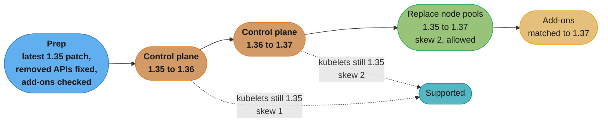
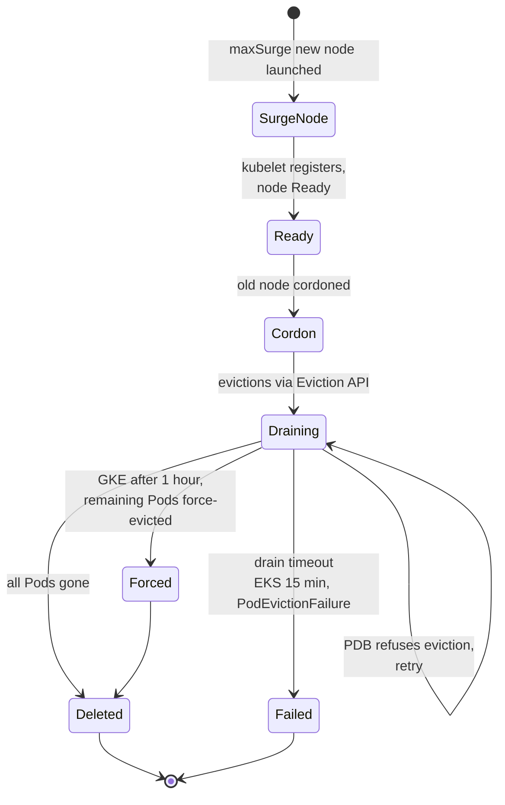
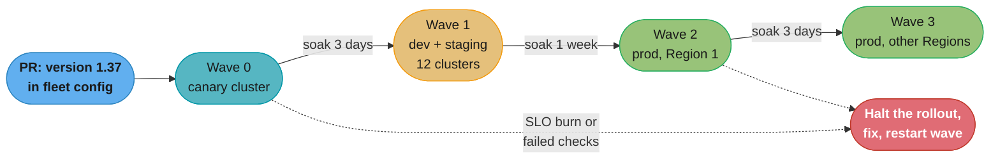

# Cluster Lifecycle and Fleet Upgrades

> Phase 2 — Containers & Kubernetes · Difficulty: Advanced

> **Version anchor (2026-11-25).** **Kubernetes 1.37** is the current minor (latest patch 1.37.2, 2026-10-13); the project maintains release branches for the three newest minors (1.37, 1.36, 1.35), each with about one year of patch support (1.37 reaches end of life 2027-10-28), and 1.38 is scheduled for 2026-12-16. The **version-skew policy** used throughout: HA `kube-apiserver` instances within one minor of each other; `kube-controller-manager`, `kube-scheduler` and `cloud-controller-manager` never newer than the API server and at most one minor older; `kubelet` and `kube-proxy` never newer and at most **three** minors older; `kubectl` within one minor either way; and the API server must not skip a minor. The Kubernetes **deprecated API migration guide** lists no built-in API removals after **v1.32** (the last was `flowcontrol.apiserver.k8s.io/v1beta3`), so on current jumps removed versions mostly come from add-on CRDs. **Amazon EKS**: standard support for 14 months after the EKS release, then 12 months of extended support at **$0.60 per cluster-hour instead of $0.10**; versions in standard support today are 1.37, 1.36, 1.35, 1.34; in-place upgrades can be **rolled back within 7 days**; managed node group drains fail with `PodEvictionFailure` after **15 minutes**; EKS **upgrade insights** refresh every 24 hours. **GKE** surge upgrades default to `maxSurge=1, maxUnavailable=0` and honour PodDisruptionBudgets for **up to one hour** before force-evicting; blue-green and autoscaled blue-green are the alternatives. **Cluster API v1.14.4** (2026-11-03) and **Pluto v5.24.6** are the current releases of the fleet and deprecated-API tools named here.

This page sits under [kubernetes_architecture](kubernetes_architecture.md). The parent explains how the control plane works and states the version-skew rules; this page is what you do with them: how a cluster moves from one minor to the next, how a node pool is replaced without dropping traffic, how a team finds the API removals that will break it before the upgrade does, and how the same process runs across a fleet of clusters. Multi-cluster *networking* is in [multi_cluster_networking](../case_studies/cross_cutting/multi_cluster_networking.md); the fleet platform design is in [design_kubernetes_platform](../case_studies/design_kubernetes_platform.md).

---

## 1. Concept Overview

A Kubernetes cluster is never "installed and done". Upstream ships a new minor version roughly every four months, three a year, and supports each one with patch releases for about a year. A managed provider adds a buffer (EKS gives 14 months of standard support), but the arithmetic does not change: **a cluster that is not upgraded at least three times a year falls out of support**, and on EKS falling out of standard support costs money every hour.

An upgrade is not one operation. It is an ordered sequence across components that tolerate different amounts of version skew:

1. **Preparation**: move to the latest patch of the current minor, find and fix uses of APIs the target minor removes, check that every add-on (CNI, CSI drivers, CoreDNS, the Gateway or Ingress controller, cert-manager, operators) supports the target, and check that admission webhooks can handle any new API versions.
2. **Control plane**: `kube-apiserver` first, one minor at a time; then the controller manager, scheduler and cloud controller manager.
3. **Data plane**: kubelets and kube-proxy, which may lag the API server by up to three minors. On managed clusters this means replacing node pools with new nodes, because an in-place minor kubelet upgrade is not supported: nodes are drained first.
4. **Add-ons and workloads**: bump add-ons to versions matched to the new minor, then lift any temporary pins.

**Fleet upgrades** apply the same sequence to tens or hundreds of clusters in waves (a canary cluster, then non-production, then production Region by Region), with the version of every cluster declared in Git and the rollout driven by Cluster API, the provider's API, or Terraform.

---

## 2. Intuition

> **One-line analogy:** Upgrading a cluster is like replacing the engine of a ship while it is sailing. You can only swap one engine part at a time, the bridge (control plane) must always be at least as new as the engine room (nodes), and you replace the engine rooms one compartment at a time so the ship never loses power.

**Mental model.** The API server is the ceiling. Everything else is allowed to be at most as new as it and some fixed distance behind it: one minor for the controllers, three for kubelets. So the control plane climbs one step at a time, and the nodes can stay behind for up to three steps and then jump straight to the top by being replaced.

**Why it matters.** Most cluster outages blamed on an upgrade are not caused by Kubernetes itself. They come from an API the cluster still used being removed, an add-on that does not support the new minor, a PodDisruptionBudget that blocks every drain, or an admission webhook that rejects the new API server's requests. All four can be found before the upgrade starts.

**Key insight.** The cheapest upgrade is the one you do often. A team that upgrades every four months deals with one minor's worth of removals at a time; a team that waits two years faces six minors of removals, six control-plane steps, and on EKS an extended-support bill while it catches up.

---

## 3. Core Principles

1. **The API server goes first and never skips a minor.** 1.35 to 1.37 is two control-plane upgrades, 1.35 to 1.36 and then 1.36 to 1.37.
2. **Nodes may lag, then jump.** Kubelets may be up to three minors older than the API server, so node pools can be replaced once, straight to the target, after the control plane has stepped up.
3. **Find removed APIs before the upgrade, not during it.** Scan manifests in Git, scan live objects, and read the API server's deprecated-API metric.
4. **Every drain is a PodDisruptionBudget negotiation.** A PDB that allows zero disruptions turns a node upgrade into a stuck node.
5. **Patch first, then minor.** Move to the newest patch of the current minor, then to the newest patch of the target minor; most upgrade bugs are already fixed in a patch.
6. **Upgrade often, in waves.** A canary cluster finds the problem; production Regions follow after a soak period.
7. **Declare versions as data.** The target version of every cluster and node pool lives in Git, so an upgrade is a reviewed change, not a console click.

---

## 4. Types / Architectures / Strategies

### Node pool upgrade strategies

| Strategy | How it works | Capacity cost | Rollback | Use when |
|---|---|---|---|---|
| **Surge (rolling)** | Add `maxSurge` new nodes, cordon and drain old ones, delete them, repeat | `maxSurge` extra nodes at a time | Slow: roll forward again with the old image | Default for stateless node pools |
| **Minimal (EKS) / `maxSurge=0`** | Cordon and drain first, then replace | None beyond the pool size | Same as surge | Capacity-constrained pools, such as GPUs or reserved instances |
| **Blue-green node pool** | Create a full new pool, cordon the old one, drain in batches with soak time, delete the old pool when done | Up to 2x the pool for the duration | Fast: uncordon the old pool | Large or sensitive pools where you want an instant way back |
| **Blue-green cluster** | Build a new cluster at the target version, deploy everything via GitOps, shift traffic, retire the old cluster | A whole second cluster | Fast: shift traffic back | Several minors behind, CNI or major add-on changes, or a control plane you cannot roll back |

### Control-plane upgrade by deployment model

| Model | Who upgrades the control plane | Rollback |
|---|---|---|
| EKS | `aws eks update-cluster-version`, one minor at a time | In-place upgrades can be rolled back to the previous minor within 7 days |
| GKE | Release channel (Rapid, Regular, Stable, Extended) upgrades automatically inside maintenance windows, or you trigger it | Via the channel and maintenance exclusions, not a downgrade button |
| AKS | `az aks upgrade` for the control plane, then node pools | No downgrade |
| kubeadm / self-managed | `kubeadm upgrade plan`, `kubeadm upgrade apply` on the first control-plane node, `kubeadm upgrade node` on the rest | No supported control-plane downgrade: restore from an etcd snapshot |
| Cluster API | Change `spec.version` on the `KubeadmControlPlane` (or on the `Cluster` topology with ClusterClass) and the controller rolls control-plane machines | Roll forward, or restore |

### Fleet rollout shapes

| Shape | Description | Fits |
|---|---|---|
| **Waves by environment** | Canary cluster, then dev, staging, then production | Every fleet; the minimum |
| **Waves by Region** | Production clusters upgraded one Region at a time with a soak between | Multi-Region fleets where a bad upgrade must stay regional |
| **Cluster replacement** | New clusters at the target version, old ones drained of traffic and deleted | Immutable fleets with GitOps-deployed workloads |

---

## 5. Architecture Diagrams

**Upgrade order and the skew that allows it.** The control plane steps up one minor at a time; nodes stay within three minors and are replaced once.



*Two control-plane steps, one node replacement. Nodes left at 1.35 stay inside the three-minor kubelet skew the whole time, so the expensive part (draining every node) happens once instead of twice.*

**What happens to one node in a surge upgrade.**



*The drain is the only step that can stall, and what happens at the timeout differs by provider: EKS fails the upgrade unless you pass the force flag, GKE force-evicts after an hour. Either way a PodDisruptionBudget that allows zero disruptions is what puts the node into the retry loop.*

**A fleet upgrade in waves.**



*Each wave is a merge to the fleet configuration, not a manual action, so the version of every cluster is visible in Git and a halted rollout is just an unmerged PR.*

---

## 6. How It Works — Detailed Mechanics

### Step 1: find removed APIs before the upgrade

Three sources, because each misses something the others catch:

```bash
# 1. What the live API server has been asked for, by clients you may not know about.
#    The gauge is 1 for every deprecated group/version/resource requested since the API server started.
kubectl get --raw /metrics | grep apiserver_requested_deprecated_apis
# apiserver_requested_deprecated_apis{group="...",removed_release="<minor>",resource="...",version="v1beta1"} 1

# 2. What is in Git, before it is applied (Helm charts rendered, Kustomize built).
pluto detect-files -d ./manifests --target-versions k8s=v1.37.0
helm template ./charts/api | pluto detect - --target-versions k8s=v1.37.0

# 3. On EKS: upgrade insights, refreshed every 24 hours.
aws eks list-insights --cluster-name prod-eu-1 --filter categories=UPGRADE_READINESS
```

The metric catches CI jobs and operators that create objects at runtime; the Git scan catches charts that have not been applied since the last upgrade; the provider check catches control-plane-side problems such as add-on versions. Fix by moving manifests to the served version, then confirm the metric stays at 0 for a full day of normal traffic, since the gauge reflects requests since the API server last started.

### Step 2: add-on compatibility

```bash
# Every EKS add-on publishes the versions that support a Kubernetes minor.
aws eks describe-addon-versions --kubernetes-version 1.37 --addon-name vpc-cni \
  --query 'addons[].addonVersions[].addonVersion'
aws eks describe-addon-versions --kubernetes-version 1.37 --addon-name coredns \
  --query 'addons[].addonVersions[0].addonVersion'
```

For self-installed add-ons (Gateway controller, cert-manager, external-dns, operators with CRDs), read each project's compatibility matrix. The usual order: upgrade add-ons that already support both the current and target minor **before** the control plane, and only bump to target-only versions after it.

### Step 3: the control plane, one minor at a time

```bash
# Managed (EKS)
aws eks update-cluster-version --name prod-eu-1 --kubernetes-version 1.36
aws eks wait cluster-active --name prod-eu-1
aws eks update-cluster-version --name prod-eu-1 --kubernetes-version 1.37

# Self-managed (kubeadm), first control-plane node, then `kubeadm upgrade node` on the others
kubeadm upgrade plan
kubeadm upgrade apply v1.37.2
```

Before the API server step, check admission webhooks: their configurations must either list any new resource versions the target minor serves or use `matchPolicy: Equivalent`, and the webhook servers must handle the new fields. A webhook with `failurePolicy: Fail` that cannot parse the new API server's requests blocks writes cluster-wide.

### Step 4: node pools, with PDB arithmetic

```yaml
# EKS managed node group update settings (Terraform)
resource "aws_eks_node_group" "general" {
  cluster_name    = "prod-eu-1"
  node_group_name = "general"
  version         = "1.37"            # nodes jump straight from 1.35: skew 2 is allowed
  # ...
  update_config {
    max_unavailable_percentage = 10   # nodes replaced in parallel; quota is 100 nodes
  }
}
```

Drain time is bounded by the slowest PodDisruptionBudget. For each Deployment, `ALLOWED DISRUPTIONS = healthy Pods - required healthy Pods`, and a drain of a node holding a Pod of a workload with 0 allowed disruptions waits until another replica becomes healthy elsewhere. With EKS's default strategy, each node's drain must finish in 15 minutes or the update fails with `PodEvictionFailure`:

```
  30-node pool, maxUnavailable 3, each node drains in ~4 min, plus 60 s wait after eviction
  batches          = ceil(30 / 3)            = 10
  per batch        ~ new node Ready (~3 min) + drain (4) + wait (1) = ~8 min
  total            ~ 10 x 8                  = ~80 min
  with one PDB at 0 allowed disruptions on any node: that batch fails at 15 min
```

### Step 5: GPU and other capacity-constrained pools

A surge upgrade needs spare capacity for `maxSurge` extra nodes; for a pool of reserved or scarce GPU instances that capacity may not exist, and the new node never launches. EKS's **minimal** update strategy drains and terminates first and creates the replacement after, so total capacity never exceeds the configured size; GKE and AKS reach the same result with `maxSurge=0` and `maxUnavailable` above zero. Pair it with a checkpoint before the window, because a training job on a drained node restarts from its last checkpoint (see [gpu_node_lifecycle](../case_studies/cross_cutting/gpu_node_lifecycle.md)).

### Step 6: the cost of falling behind on EKS

```
  standard support   $0.10 per cluster-hour
  extended support   $0.60 per cluster-hour  (+$0.50)
  hours per month    730

  premium per cluster per month = 0.50 x 730   = $365
  40 clusters, 6 months behind  = 40 x 365 x 6 = $87,600
```

The extended-support premium is a direct price on deferred upgrades. Extended support is on by default; if it is disabled, EKS auto-upgrades the cluster at the end of standard support instead, which is the worst time to discover a removed API.

### Step 7: fleets with Cluster API

```yaml
# Cluster API with ClusterClass: the version is one field on the topology.
apiVersion: cluster.x-k8s.io/v1beta2
kind: Cluster
metadata: {name: prod-eu-1, namespace: fleet}
spec:
  topology:
    classRef: {name: standard-aws}
    version: v1.37.2                 # a PR changes this; the controllers roll
    controlPlane: {replicas: 3}      # control-plane machines first,
    workers:                         # then each MachineDeployment
      machineDeployments:
        - {class: general, name: md-general, replicas: 12}
```

The topology controller upgrades the control plane first and the worker `MachineDeployment`s after it, replacing machines rather than mutating them. A fleet repository then holds one such object per cluster, and each wave in §5 is a PR that changes `version` for a set of clusters. Without Cluster API, the same pattern works with the provider's API driven from Terraform, as long as the version is data in Git.

---

## 7. Real-World Examples

- **Amazon EKS** publishes a calendar per minor: 1.37 was released on EKS on 2026-10-01, ends standard support on 2027-12-01 and extended support on 2028-12-01. Its upgrade insights flag deprecated API usage and add-on incompatibilities before the upgrade, and rollback-readiness insights exist for the 7 days after an in-place upgrade.
- **GKE release channels** move clusters automatically within maintenance windows, which turns the upgrade cadence into a policy decision (which channel, which windows, which exclusions) rather than a project.
- **Cluster API** is the upstream SIG Cluster Lifecycle project for declarative cluster lifecycle; providers exist for AWS, Azure, GCP, vSphere and bare metal, and ClusterClass lets a fleet share one cluster template.
- **The Ingress-API removal of 1.22** (`extensions/v1beta1` and `networking.k8s.io/v1beta1` Ingress) is the canonical example of why deprecated-API scanning exists: clusters upgraded without it found their Ingress objects could no longer be applied.

---

## 8. Tradeoffs

| Decision | Option A | Option B | Key factor |
|---|---|---|---|
| Node pool strategy | Surge (cheap, slow rollback) | Blue-green pool (2x capacity, fast rollback) | Pool size and how badly you need an instant way back |
| Capacity-constrained pool | Surge (needs spare capacity) | Minimal / `maxSurge=0` (needs a maintenance window) | Whether extra GPUs or reserved instances exist |
| Cluster upgrade | In place | Blue-green cluster | How many minors behind, and whether the change touches the CNI or other core add-ons |
| Cadence | Every minor (3 a year) | Every second minor | Removal volume per upgrade and support-window cost |
| Control | Provider auto-upgrade (GKE channels) | Manually triggered | Predictability versus staying current without effort |
| Fleet tooling | Cluster API | Provider API via Terraform | Multi-cloud or on-prem fleets favour Cluster API |

---

## 9. When to Use / When NOT to Use

**Use blue-green node pools when** the pool runs stateful or latency-critical workloads and an instant way back matters more than double capacity for an hour. **Do not** use them on scarce GPU pools: there is no second pool's worth of GPUs to create.

**Use a blue-green cluster when** the cluster is two or more minors behind, the upgrade also swaps the CNI or another core add-on, or regulation requires a rollback you cannot get from the control plane. **Do not** use it when workloads are not fully reproducible from Git: a cluster you cannot rebuild cannot be blue-greened.

**Use provider auto-upgrades (GKE channels, EKS auto-upgrade at end of support) as a backstop, not a plan.** An automatic upgrade still breaks on a removed API; it only chooses the time for you.

---

## 10. Common Pitfalls

**Pitfall 1 — A removed API discovered during the upgrade.** The classic case was the 1.25 upgrade, which stopped serving `batch/v1beta1` CronJobs. A CI template still rendered them; the control-plane upgrade succeeded, and the next morning every pipeline that applied a CronJob failed with `no matches for kind "CronJob" in version "batch/v1beta1"`. The deprecation guide lists no built-in API removals after 1.32 through 1.37, so on today's jumps the same failure usually comes from an add-on's CRD instead: Kueue v0.20, for example, stopped serving `kueue.x-k8s.io/v1beta1`.

```bash
# BROKEN: upgrade first, discover later
aws eks update-cluster-version --name prod-eu-1 --kubernetes-version 1.25
```

```bash
# FIX: block the upgrade on three clean checks (target version as a variable)
TARGET=1.25
kubectl get --raw /metrics \
  | grep "apiserver_requested_deprecated_apis{.*removed_release=\"${TARGET}\"" \
  && { echo "deprecated APIs still requested"; exit 1; }
pluto detect-files -d ./manifests --target-versions k8s=v${TARGET}.0 || exit 1
aws eks list-insights --cluster-name prod-eu-1 --filter categories=UPGRADE_READINESS
```

**Pitfall 2 — A PodDisruptionBudget that allows zero disruptions.** A single-replica admin service with `minAvailable: 1` sits on one of 30 nodes. Every other node drains in minutes; that node waits 15 minutes and the EKS update fails with `PodEvictionFailure`. FIX: two replicas and `maxUnavailable: 1`, or accept the brief outage for genuinely single-instance services; audit with `kubectl get pdb -A` for `ALLOWED DISRUPTIONS 0` before every upgrade. Forcing the drain hides the problem until the next one.

**Pitfall 3 — An admission webhook that rejects the new API server.** A policy webhook with `failurePolicy: Fail` matches all resources, and its server was built against an old client library. After the API server upgrade it receives a resource version it cannot decode and rejects every matching write. FIX: upgrade policy engines to versions that support the target minor before the control plane step, use `matchPolicy: Equivalent`, and scope webhook rules to the resources they actually validate.

**Pitfall 4 — Surge capacity that does not exist.** A 16-node `p5.48xlarge` pool on a capacity reservation sized exactly to 16 is upgraded with the default surge strategy. The surge node never launches, and the update fails on node creation. FIX: the minimal strategy (or `maxSurge=0`), scheduled with the training team, after a checkpoint.

**Pitfall 5 — Falling two years behind.** A team skips upgrades for eight minors. Catching up is now eight control-plane steps, eight sets of removals, and on EKS months of extended-support charges. FIX: build a new cluster at the current minor, deploy from Git, and shift traffic, then commit to upgrading every minor.

---

## 11. Technologies & Tools

| Tool | Purpose |
|---|---|
| `kubeadm upgrade plan / apply / node` | Self-managed control-plane and node upgrades |
| `aws eks update-cluster-version`, managed node group `updateConfig` | EKS control plane and node pool upgrades |
| EKS upgrade insights | Deprecated API usage, add-on and node readiness before an upgrade |
| GKE release channels and maintenance windows | Automatic, scheduled upgrades |
| `az aks upgrade`, node pool `--max-surge` | AKS upgrades |
| `apiserver_requested_deprecated_apis` metric | Live deprecated-API usage, labelled with `removed_release` |
| Pluto (Fairwinds), kube-no-trouble (`kubent`) | Scan manifests, Helm releases and live objects for deprecated APIs |
| Cluster API (v1.14), ClusterClass | Declarative cluster and fleet lifecycle |
| Karmada, Open Cluster Management | Multi-cluster placement and policy across a fleet |
| Argo CD ApplicationSet | Deploy the same workloads to a new (blue-green) cluster |

---

## 12. Interview Questions with Answers

**Q: Can you upgrade a cluster from 1.35 straight to 1.37?**
**Short:** Not the control plane, which must step through 1.36; the nodes can, because kubelets may run up to three minors behind the API server and are replaced once at the end.
The API server must not skip a minor, even on a single-instance cluster, so the control plane goes 1.35 to 1.36 and then 1.36 to 1.37. Kubelets and kube-proxy may be up to three minors older than the API server and never newer, so 1.35 nodes stay supported through both control-plane steps (skew 1, then 2). That lets you replace the node pools once, directly to 1.37, after the control plane is done, instead of draining every node twice. Two cautions: kubelet minor upgrades are never done in place, nodes are drained and replaced; and nodes that already sit three minors behind must be upgraded before the control plane can move again.

**Q: In what order are the components of a cluster upgraded, and why?**
**Short:** kube-apiserver first, then the controller manager, scheduler and cloud controller manager, then kubelets and kube-proxy, because every component must be no newer than the API server.
The version-skew policy makes the API server the ceiling: the controller manager, scheduler and cloud controller manager must not be newer than it and may be one minor older; kubelets and kube-proxy must not be newer and may be three minors older. So the API server is upgraded first (in an HA cluster all instances, keeping them within one minor of each other), then the controllers, then the nodes. Add-ons that support both minors are upgraded before the control plane; target-only versions after. Before all of it, move to the latest patch of the current minor, because known upgrade bugs are fixed there.

**Q: An EKS node group upgrade fails with `PodEvictionFailure`. What happened?**
**Short:** A Pod on a node could not be evicted within 15 minutes, almost always because a PodDisruptionBudget allows zero disruptions, so the drain kept being refused.
EKS drains each old node through the Eviction API, which refuses any eviction that would breach a PodDisruptionBudget; if the node's Pods are not gone within 15 minutes and no force flag was set, the update fails with `PodEvictionFailure`. The usual culprits are a single-replica workload with `minAvailable: 1`, a PDB with `maxUnavailable: 0`, or a Deployment already short a replica so its allowed disruptions are 0. Find them with `kubectl get pdb -A` and the `ALLOWED DISRUPTIONS` column. Fix the budget (two replicas, `maxUnavailable: 1`) rather than reaching for the force flag, which deletes the Pods and turns a stuck upgrade into an outage. GKE handles the same case differently: it honours the PDB for up to an hour, then force-evicts.

**Q: How do you find out, before upgrading, that something still uses an API the target version removes?**
**Short:** Read the API server's `apiserver_requested_deprecated_apis` metric, scan rendered manifests in Git with a tool like Pluto, and check the provider's upgrade insights.
Each source sees a different slice. The `apiserver_requested_deprecated_apis` gauge (since 1.19) is set to 1 for every deprecated group, version and resource the API server has been asked for, with a `removed_release` label, so it catches operators and CI jobs creating objects at runtime. Scanning rendered Helm charts and Kustomize builds in Git with Pluto or kubent catches manifests that have not been applied since the last upgrade. Provider checks such as EKS upgrade insights refresh every 24 hours and also flag add-on and node readiness. Gate the upgrade on all three being clean, and watch the metric for at least a day of normal traffic, because it reflects only requests since the API server last restarted.

**Q: What does falling behind on Kubernetes versions cost on EKS?**
**Short:** Extended support raises the price from $0.10 to $0.60 per cluster-hour, about $365 extra per cluster per month, and ends in a forced upgrade 12 months later.
EKS gives each minor 14 months of standard support from its EKS release, then 12 months of extended support at $0.60 per cluster-hour instead of $0.10. The $0.50 premium over 730 hours is $365 per cluster per month, so 40 clusters six months behind pay $87,600 for the privilege. When extended support ends, EKS upgrades the cluster automatically to the oldest version still in extended support, which is the worst moment to find a removed API. Extended support is on by default; turning it off only moves the forced upgrade earlier. The cheaper path is upgrading every minor.

**Q: Surge upgrade or blue-green node pool: how do you choose?**
**Short:** Surge adds a few nodes at a time and is cheap but slow to undo; blue-green builds a whole new pool, costs up to double capacity, and rolls back by uncordoning the old pool.
A surge upgrade (GKE's default is `maxSurge=1, maxUnavailable=0`) adds new nodes a few at a time, drains old ones and deletes them, so it needs little extra capacity but rolling back means rolling forward again with the old image. A blue-green node pool creates the full new pool, cordons the old one, drains in batches with a soak time, and keeps the old pool until you are satisfied, so rollback is uncordoning it. Choose surge for large stateless pools where cost matters, and blue-green for sensitive or stateful pools where an immediate way back is worth an hour of double capacity. Neither works on a pool where spare capacity does not exist; that needs the minimal strategy.

**Q: How do you upgrade a node pool of GPUs that has no spare capacity?**
**Short:** Use a drain-first strategy (EKS minimal, or `maxSurge=0` with `maxUnavailable` above zero), scheduled after a checkpoint, because surge needs extra nodes that do not exist.
A surge upgrade launches the new node before removing the old one, which assumes there is capacity for it; a pool sized exactly to a capacity reservation or a scarce GPU type has none, so the surge node never launches and the update fails. EKS's minimal strategy cordons, drains and terminates first and only then creates the replacement, so total capacity never exceeds the configured size; GKE and AKS do the same with `maxSurge=0`. The cost is reduced capacity during the window, so schedule it with the workload owners, take a checkpoint before it, and set `maxUnavailable` to how many GPU nodes the jobs can lose at once.

**Q: When would you replace a cluster instead of upgrading it in place?**
**Short:** When it is several minors behind, the upgrade also swaps core add-ons like the CNI, or you need a rollback the control plane cannot give; it requires workloads fully deployable from Git.
An in-place upgrade is cheapest when the cluster is one minor behind. Several minors behind means several control-plane steps and several sets of removals; changing the CNI or another core add-on at the same time multiplies the risk; and upstream Kubernetes has no supported control-plane downgrade. Building a new cluster at the target version, deploying everything from Git (for example with an Argo CD ApplicationSet), and shifting traffic gives a clean rollback: shift traffic back. The precondition is that the cluster is reproducible: state lives outside it or is migrated, and nothing was configured by hand.

**Q: How many cluster upgrades a year should a platform team plan for, and why that number?**
**Short:** Three per cluster, because upstream ships a minor about every four months and each is supported for roughly a year, so skipping more than one quickly leaves supported versions.
Upstream releases three minors a year and maintains branches for the newest three, each with about a year of patches (1.37 was released 2026-08-26 and reaches end of life 2027-10-28). Managed providers add a few months but follow the same cadence. So a cluster upgraded once a year is always one or two minors behind and regularly out of support. Planning three upgrades per cluster per year, each a single minor, keeps the removal list short and lets the fleet process become routine. For a fleet, multiply by the cluster count: 30 clusters means 90 cluster upgrades a year, which is why fleets automate waves.

**Q: Can you roll back a Kubernetes control-plane upgrade?**
**Short:** Upstream has no supported control-plane downgrade, so you restore from an etcd snapshot; EKS now allows rolling an in-place upgrade back to the previous minor within 7 days.
Once the API server at the new minor has written objects in new storage versions, an older API server may not read them, which is why upstream does not support downgrading the control plane; the recovery path on self-managed clusters is restoring an etcd snapshot taken before the upgrade, losing every write since. EKS added a rollback for in-place upgrades to the previous minor within 7 days, with rollback-readiness insights during that window; clusters auto-upgraded at the end of extended support cannot be rolled back. The design lesson is to make rollback unnecessary: canary clusters, deprecated-API gates, and blue-green node pools or clusters where an instant way back matters.

**Q: Why can an admission webhook break a control-plane upgrade?**
**Short:** After the upgrade the API server may send the webhook new resource versions or fields; a webhook that cannot handle them, with `failurePolicy: Fail`, rejects every matching write.
The version-skew policy lists webhooks as an upgrade prerequisite: their configurations must include any new versions of resources the target minor serves (or use `matchPolicy: Equivalent`, which sends the request converted to a version the webhook registered for), and the webhook servers must handle new fields. A policy engine built against an old client library can fail to decode the new request and, with `failurePolicy: Fail` on a broad rule, block writes across the cluster, including the writes the upgrade itself needs. Upgrade policy engines and other webhooks to versions that support the target minor first, and keep webhook rules scoped to the resources they really validate.

**Q: How would you upgrade a fleet of 50 clusters safely?**
**Short:** In waves driven from Git: a canary cluster, then non-production, then production one Region at a time, with soak periods and automatic halts on SLO burn or failed checks.
Declare each cluster's target version in a fleet repository, through Cluster API `Cluster` objects or Terraform variables, so each wave is a reviewed PR. Wave 0 is a canary cluster that runs representative workloads; wave 1 is development and staging; later waves are production Regions one at a time, so a bad upgrade stays regional. Gate every wave on the same checks (no deprecated APIs requested, add-ons at supported versions, no PDB with zero allowed disruptions) and soak it before the next, halting automatically if error-budget burn or upgrade insights turn red. Measure lead time from upstream release to the last production cluster, because that number is what decides whether the fleet stays inside support windows.

**Q: What does Cluster API change about cluster upgrades?**
**Short:** It makes the Kubernetes version a field on a declarative object; changing it makes controllers replace control-plane machines first and then worker machines, so upgrades become Git changes.
Cluster API represents clusters, control planes and machine pools as Kubernetes objects managed from a management cluster. With ClusterClass, a `Cluster` has a `topology.version`; changing it causes the topology controller to roll the control-plane machines to the new version first and then each `MachineDeployment`, replacing machines rather than mutating them, which matches the skew rules. The same object shape works across infrastructure providers (AWS, Azure, GCP, vSphere, bare metal), so a multi-cloud or on-prem fleet gets one upgrade mechanism. The cost is operating the management cluster itself, which becomes the most critical cluster in the fleet.

**Q: Why move to the latest patch of the current minor before upgrading to the next minor?**
**Short:** Because upgrade bugs and skew fixes are backported to patches, and the Kubernetes project explicitly recommends upgrading from the newest patch of the current minor to the newest patch of the target.
The project's upgrade guidance is to make sure components are on the most recent patch of the current minor, then upgrade to the most recent patch of the target minor, to pick up regression and bug fixes. Upgrade-path bugs, for example in how a new API server handles objects written by an older one, are fixed in patch releases of both branches. Patches ship roughly monthly (1.37.2 shipped 2026-10-13), so the cost is low. It also shortens the jump when something does go wrong, since the difference between the two versions is exactly one minor and nothing else.

**Q: What breaks in an upgrade besides your own manifests?**
**Short:** Add-ons: the CNI, CSI drivers, CoreDNS, kube-proxy, the Gateway or Ingress controller, cert-manager and operators each support specific minors and must be checked and sequenced.
Your manifests are only part of what talks to the API server. The CNI and CSI drivers run on every node and interact with kubelet behaviour; CoreDNS and kube-proxy are versioned with the cluster; Gateway or Ingress controllers, cert-manager, policy engines and operators watch APIs that change between minors and may use removed versions. Managed add-ons publish compatible versions per minor (on EKS, `aws eks describe-addon-versions --kubernetes-version 1.37`), and self-installed ones publish compatibility matrices. Upgrade add-ons that support both minors before the control plane and the rest after, and include them in the canary wave.

**Q: What is the kubectl version-skew rule, and why does it matter in CI?**
**Short:** kubectl is supported within one minor of the API server, older or newer, so a CI image with a pinned kubectl must be bumped as the fleet moves.
The skew policy supports `kubectl` one minor older or newer than `kube-apiserver`; with a 1.37 API server that is 1.36, 1.37 and 1.38. During a fleet upgrade some clusters are on 1.36 and some on 1.37, so a single kubectl version must fit both; 1.36 or 1.37 does. A CI runner image that pinned kubectl two years ago falls outside the window and starts failing on new fields or behaviour without any change in the pipeline. Pin kubectl in the CI image to the fleet's current minor and bump it in the same change that starts each fleet upgrade.

---

## 13. Best Practices

- Upgrade **every minor**, about every four months, so each upgrade carries one minor's worth of removals.
- Move to the **latest patch** of the current minor before upgrading, and target the latest patch of the next.
- Gate every upgrade on **no deprecated APIs requested** (metric), **no deprecated APIs in Git** (Pluto or kubent) and the provider's **upgrade insights**.
- Audit PodDisruptionBudgets for **`ALLOWED DISRUPTIONS 0`** before every node upgrade.
- Step the control plane, then **replace node pools once** to the target, using the three-minor kubelet skew.
- Use **minimal / `maxSurge=0`** on capacity-constrained pools and blue-green pools where an instant rollback matters.
- Declare cluster and node pool versions **in Git** and roll fleets in **waves** with soak periods and automatic halts.
- Keep a **reproducible cluster** (everything deployable from Git) so a blue-green cluster is always an option.

---

## 14. Case Study

### Scenario: 40 EKS clusters, three minors behind, and an extended-support bill

A platform team runs 40 EKS clusters on 1.34. 1.34 leaves standard support on 2026-12-02 and the current minor is 1.37. Finance has noticed that every cluster will start billing extended support in a week, and the last upgrade attempt, on a staging cluster, failed on a node group after the control plane had already moved.

**What went wrong on staging.**

```bash
# BROKEN: the control plane moved, then the node group failed and the team stopped there
aws eks update-cluster-version --name staging-1 --kubernetes-version 1.35   # succeeded
aws eks update-nodegroup-version --cluster-name staging-1 --nodegroup-name general
# -> PodEvictionFailure after 15 minutes: a single-replica admin tool with minAvailable: 1
# -> the same week: the planned Kueue bump to v0.20 rejected every queue manifest in Git,
#    which still used kueue.x-k8s.io/v1beta1
```

Two separate problems, both discoverable in advance: a PodDisruptionBudget with zero allowed disruptions, and an add-on CRD version that the add-on's new release stops serving. The Kubernetes deprecation guide lists no built-in API removals between 1.33 and 1.37, which is exactly why the team had stopped looking; the removal that bit was in an add-on.

**The fix: gates first, then a fleet process.**

```bash
# FIX, per cluster, in CI, before any version change is merged
kubectl get pdb -A -o json \
  | jq -e '[.items[] | select(.status.disruptionsAllowed == 0)] | length == 0'
pluto detect-files -d ./manifests --target-versions k8s=v1.37.0
kubectl get --raw /metrics | grep 'apiserver_requested_deprecated_apis' || true
aws eks list-insights --cluster-name "$CLUSTER" --filter categories=UPGRADE_READINESS
```

The admin tool got a second replica and `maxUnavailable: 1`; the queue manifests moved to `kueue.x-k8s.io/v1beta2` and the stored objects were migrated with Kueue's migration script before the Kueue bump. Then the team ran the skew-aware plan from §5: three control-plane steps (1.34 to 1.35, 1.36, 1.37) with node groups left at 1.34 throughout (skew 1, 2, then 3, all inside the policy), followed by one node-group replacement straight to 1.37.

**The arithmetic that made the case.**

```
  extended support if they did nothing, per month:
    40 clusters x $0.50 premium x 730 h          = $14,600 / month

  upgrade work, old plan (control plane AND nodes at every step):
    3 steps x 40 clusters x 2 operations          = 240 operations, 120 node-pool drains
  skew-aware plan:
    3 control-plane steps x 40 + 1 drain x 40     = 160 operations, 40 node-pool drains
```

Draining every node pool once instead of three times removed two thirds of the riskiest operations. The fleet ran in four waves (1 canary, 11 non-production, then two production Region groups), each a PR to the fleet repository, with a one-week soak before production. All 40 clusters reached 1.37 in five weeks, before most of the extended-support charges accrued, and the gates now run on every cluster weekly so the next upgrade starts clean.

**Discussion questions.**

1. The plan left nodes three minors behind for a period. What would have stopped the team from moving the control plane to 1.38 while nodes were still on 1.34?
2. Which of the deprecated-API checks would have caught the Kueue manifests in Git, and would the API server's deprecated-API metric have seen them before the add-on bump?
3. When would replacing the 40 clusters with new 1.37 clusters have been the better plan?
