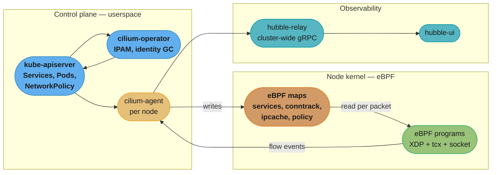
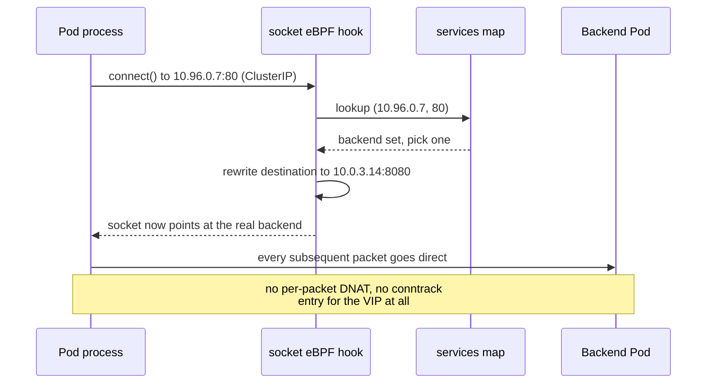

# Cilium and the eBPF Dataplane

> **Version anchor (2026-08-27).** **Cilium 1.20** is the current minor line (1.20.1, 2026-08-18); 1.20, 1.19 and 1.18 are the three maintained branches, on a roughly six-month minor cadence. Cilium **graduated from the CNCF on 2023-10-11**. Minimum kernel is **5.10**; `tcx` needs **6.6** and `netkit` needs **6.8**. **Tetragon 1.7.1** (2026-08-25) and **Hubble** are Cilium sub-projects, not separately graded CNCF projects. On the Kubernetes side, kube-proxy's **nftables mode went GA in 1.33** and its **IPVS mode was deprecated in 1.35** (KEP-5495) with the feature gate flipping default-off in 1.40 and the code slated for deletion in 1.43 — deprecated, not removed.

---

## 1. Concept Overview

[kubernetes_networking](kubernetes_networking.md) establishes *what* the cluster network must do: every Pod gets a routable IP, Services get a stable VIP, NetworkPolicy segments the traffic. It names Cilium fifteen times as the CNI that does this with eBPF and stops there. This page is the *how* — what an eBPF dataplane actually is, why replacing kube-proxy changes the scaling curve rather than the constant factor, and what you are signing up for operationally when you take iptables out of the packet path.

**eBPF** (extended Berkeley Packet Filter) is a virtual machine inside the Linux kernel. You compile a small, restricted C program to eBPF bytecode, the kernel's **verifier** proves it terminates and touches only memory it is allowed to touch, a JIT compiles it to native instructions, and it is attached to a hook — a socket, a network device, a tracepoint, a kernel function. It then runs at native speed on every event at that hook, with no context switch to userspace and no kernel module to maintain across kernel upgrades.

**Cilium** is a CNI plugin that uses this to implement the entire Kubernetes network dataplane in the kernel: Pod connectivity, Service load balancing (replacing kube-proxy outright), NetworkPolicy enforcement at L3/L4 and L7, encryption, multi-cluster routing, and — through **Hubble** — flow-level observability that comes free because the enforcement point already sees every packet.

The single structural claim worth internalising: **iptables encodes Service state as rules and eBPF encodes it as data.** A rule chain must be traversed; a hash map is looked up. That is not a tuning difference, it is a different complexity class, and it is why the conversation about kube-proxy modes is really a conversation about how many Services you expect to have in three years.

---

## 2. Intuition

**One-line analogy.** iptables is a paper checklist stapled to the door — the guard reads down it until a line matches, and a longer list means a slower door. eBPF is a keycard reader — one lookup, and the number of registered cards does not change how long the beep takes.

**Mental model.** Every packet entering a node has to answer three questions: where is this going (routing), am I allowed to send it (policy), and who should actually receive it (Service load balancing). Classic Kubernetes answers all three by walking kernel rule tables that userspace agents rewrite whenever anything changes. Cilium answers all three with eBPF programs reading eBPF **maps** — key/value tables shared between the kernel programs and the userspace agent. The agent's job stops being "regenerate a rule set" and becomes "keep a map up to date", which is an incremental write rather than a full rewrite.

**Why it matters.** The kube-proxy iptables mode re-evaluates a chain that grows with the Service count on every packet, and a rewrite on every EndpointSlice change gets slower as the ruleset grows — so both the data path and the control path degrade with scale. nftables mode fixes the data path with an O(1) verdict map and is the recommended in-tree mode today. Cilium goes further: it deletes kube-proxy, does the lookup in eBPF, and reuses the same enforcement point for identity-based policy and observability.

**Key insight.** Cilium's real departure is not eBPF, it is **identity**. It stops thinking about policy in terms of IP addresses — which churn on every deploy — and assigns each distinct set of security-relevant labels a numeric **security identity**. Policy is expressed between identities, the identity travels with the packet, and a rolling deploy that replaces every Pod IP in a namespace changes nothing about the policy state. IP-based policy is a cache keyed on the one thing in Kubernetes that is guaranteed to be ephemeral.

---

## 3. Core Principles

- **The verifier is the contract.** Anything attached to a kernel hook must be proven safe before it loads: bounded loops, no unchecked pointer arithmetic, no unreachable code. Since kernel 5.2 the budget is **1,000,000 instructions** for both program size and verifier complexity analysis (before 5.2 it was 4,096 instructions and a 128k complexity budget). This is why eBPF is safe to run where a kernel module would be reckless — a rejected program simply fails to load.
- **Programs are code, maps are state.** An eBPF program is small and static; everything that changes at runtime — the Service backend table, the conntrack table, the policy verdicts, the IP-to-identity mapping — lives in maps the agent writes and the program reads. Upgrading Cilium replaces programs; it does not have to rebuild state.
- **Identity, not address.** A security identity is derived from a workload's security-relevant labels. Every endpoint with the same label set shares one identity. Identities are `uint32`; cluster-local identities occupy a 16-bit range (1–65535) with **1–255 reserved** for well-known identities such as `world`, `host` and `remote-node`.
- **Attach as early as the hardware allows.** XDP runs in the driver before an `sk_buff` is even allocated, which is where you drop a DDoS flood for almost nothing. `tc`/`tcx` runs after, where you have the full socket buffer and can do the work that needs it. Cilium uses both, for different jobs.
- **Enforcement and observability are the same code path.** The program that decides whether to forward a packet already knows the source identity, destination identity, verdict and reason. Emitting that as an event costs a ring-buffer write, which is why Hubble gives you a per-flow allow/deny log without a sidecar, a span, or an application change.
- **Kernel version is a feature gate.** Cilium's feature matrix is a kernel-version matrix. 5.10 is the floor; `tcx` needs 6.6, `netkit` needs 6.8, IPv6 BIG TCP needs 5.19 and IPv4 BIG TCP needs 6.3. "Cilium supports X" is always really "Cilium supports X on kernel Y or later."

---

## 4. Types / Architectures / Strategies

### Where the programs attach

| Hook | When it runs | What Cilium does there | Cost |
|---|---|---|---|
| **XDP** (native / driver mode) | in the NIC driver, before `sk_buff` allocation | DDoS drop, Service load-balancing acceleration on the node's ingress path | cheapest possible; needs driver support |
| **XDP** (generic / SKB mode) | after `sk_buff` allocation, software fallback | same programs on a NIC whose driver lacks native XDP | works everywhere, much of the win is gone |
| **tc / tcx** ingress+egress | on the veth or netkit device, both host and Pod side | policy enforcement, Service translation, encapsulation, identity tagging | full `sk_buff` available; `tcx` (kernel 6.6+) adds atomic replace and explicit ordering between programs |
| **socket (cgroup) hooks** | at `connect()`/`sendmsg()` in the process | translates the Service VIP to a backend at connect time, so the datapath never sees the VIP | eliminates per-packet DNAT for east-west traffic entirely |

The socket-level hook is the one people miss. For a Pod talking to a ClusterIP, Cilium can rewrite the destination *once, at connect time*, so no per-packet translation happens at all. That is not "faster iptables"; that is removing the work.

### Dataplane modes

| Mode | How a Pod reaches another node's Pod | Use when |
|---|---|---|
| **Native routing** | the underlying network routes Pod CIDRs directly | the fabric already knows your Pod CIDRs (VPC-native, BGP) |
| **Encapsulation** (VXLAN / Geneve) | Pod traffic is tunnelled node-to-node | the fabric will not route Pod CIDRs; simplest to bring up |
| **BPF host routing** | bypasses the host's network stack between the veth and the physical NIC | native routing, when you want the extra hop cost gone |
| **netkit** (kernel 6.8+) | a purpose-built device replacing veth, with the eBPF datapath built into the device | new clusters on a recent kernel |

### Identity allocation backends

| Backend | Where identities live | Choose when |
|---|---|---|
| **CRD** (default since Cilium 1.9) | `CiliumIdentity` objects in the Kubernetes API | almost always — one less system to run |
| **kvstore** | an external etcd cluster | very large clusters where identity churn is heavy enough to matter to the API server |

### kube-proxy replacement

`kubeProxyReplacement` takes **`true` or `false`** and nothing else. The old `strict` / `partial` / `disabled` strings were deprecated in January 2023 and **removed in Cilium 1.16.0** — they are refused by current charts, not merely discouraged. The raw Helm chart defaults to `false`; managed offerings set it themselves.

---

## 5. Architecture Diagrams

Where each component sits, and which of them a packet actually touches:



*The agent never sits in the packet path. It writes maps; the programs read them. That separation is why an agent restart does not drop traffic — the programs and their maps survive it.*

The scaling difference, drawn as what happens per packet as the Service count grows:

```
Service count:        10          1,000        10,000

iptables mode     [==]         [==============================]   walk the chain
                  ~10 rule      ~10,000 rule evaluations,
                  evaluations   worst case, per packet

nftables mode     [=]          [=]            [=]                 one verdict-map lookup
                  O(1) dispatch regardless of Service count

eBPF (Cilium)     [=]          [=]            [=]                 one hash-map lookup
                  O(1), and for east-west it happens ONCE at
                  connect() rather than once per packet
```

*The bars are the shape of the cost, not measured latencies. What the picture is claiming is the exponent, not the constant: iptables evaluates a structure whose length grows with the Service count, nftables and eBPF index a structure whose lookup does not. Treat any specific percentage you read as needing its own measurement on your kernel and NIC.*

The connect-time translation that makes east-west traffic cheap:



---

## 6. How It Works — Detailed Mechanics

### Installing without kube-proxy

```bash
# Kubernetes was bootstrapped with kube-proxy disabled, e.g. kubeadm with
#   --skip-phases=addon/kube-proxy
helm install cilium cilium/cilium --version 1.20.1 \
  --namespace kube-system \
  --set kubeProxyReplacement=true \
  --set k8sServiceHost=<API_SERVER_IP> \
  --set k8sServicePort=6443 \
  --set routingMode=native \
  --set ipv4NativeRoutingCIDR=10.0.0.0/8 \
  --set bpf.masquerade=true \
  --set hubble.relay.enabled=true \
  --set hubble.ui.enabled=true
```

`k8sServiceHost`/`k8sServicePort` are not optional here and the reason is a genuine bootstrap paradox: with kube-proxy gone, nothing has yet programmed the `kubernetes` Service VIP, so the agent cannot reach the API server through it to learn how to program it. You hand it the real endpoint once, and it programs its way out.

Verify what actually loaded — never assume the flag took:

```bash
kubectl -n kube-system exec ds/cilium -- cilium-dbg status --verbose
# KubeProxyReplacement:   True   [eth0 10.0.1.23 (Direct Routing)]
# Host Routing:           BPF
# Masquerading:           BPF   [eth0]   10.0.0.0/8
# Device Mode:            netkit
# Clock Source for BPF:   ktime

kubectl -n kube-system exec ds/cilium -- cilium-dbg service list | head
kubectl -n kube-system exec ds/cilium -- cilium-dbg bpf lb list | head
```

If `KubeProxyReplacement: False` appears while you believe you set it, the chart value did not apply — and the cluster is quietly running with no Service dataplane at all if you also removed kube-proxy.

### Identity: what a label change actually costs

```bash
kubectl -n kube-system exec ds/cilium -- cilium-dbg identity list | head
# ID       LABELS
# 1        reserved:host
# 2        reserved:world
# 4        reserved:health
# 12457    k8s:app=checkout
#          k8s:io.kubernetes.pod.namespace=shop
#          k8s:tier=backend
```

Every Pod matching that exact label set shares identity 12457. Scale the Deployment from 3 to 300 replicas and no identity is created and no policy entry changes — only the ipcache map gains 297 IP-to-identity rows. Add one label to the Pod template and you have created a *new* identity, and a policy written against the old one no longer selects those Pods. That is the single most common Cilium outage: a label added to a Deployment for a dashboard, and traffic dropped on the next rollout because the policy was written against the identity, not against the label the operator was thinking of.

Watch the ipcache resolve an IP to an identity:

```bash
kubectl -n kube-system exec ds/cilium -- cilium-dbg bpf ipcache get 10.0.3.14
# 10.0.3.14 maps to identity identity=12457 encryptkey=0 tunnelendpoint=10.0.1.23
```

### Policy at L3/L4 and L7 in one object

```yaml
apiVersion: cilium.io/v2
kind: CiliumNetworkPolicy
metadata:
  name: checkout-ingress
  namespace: shop
spec:
  endpointSelector:
    matchLabels:
      app: checkout
  ingress:
    # L3/L4: only the gateway identity, only this port
    - fromEndpoints:
        - matchLabels:
            app: gateway
      toPorts:
        - ports:
            - port: "8080"
              protocol: TCP
          # L7: and only these two HTTP routes on it
          rules:
            http:
              - method: GET
                path: "/api/v1/cart.*"
              - method: POST
                path: "/api/v1/checkout$"
  egress:
    # DNS visibility is what makes the FQDN rule below enforceable
    - toEndpoints:
        - matchLabels:
            io.kubernetes.pod.namespace: kube-system
            k8s-app: kube-dns
      toPorts:
        - ports:
            - port: "53"
              protocol: UDP
          rules:
            dns:
              - matchPattern: "*"
    - toFQDNs:
        - matchName: "api.stripe.com"
      toPorts:
        - ports:
            - port: "443"
              protocol: TCP
```

The L3/L4 half is pure eBPF. The L7 half is not, and this is the part worth being precise about: **an L7 rule transparently redirects the flow to a per-node Envoy proxy**, because parsing HTTP requires a parser and a parser is not something the verifier will accept in the datapath. So an L7 rule costs a userspace hop that an L4 rule does not. Use L7 where you need method/path granularity; do not blanket every policy with it and then be surprised by the latency profile.

`toFQDNs` works only because the DNS egress rule above lets Cilium's DNS proxy observe the resolution and populate the ipcache with the answer. Write the FQDN rule without the DNS rule and it silently matches nothing — a very common first-day mistake.

### The maps, and why their sizing is an operational decision

The conntrack, NAT, policy and neighbour tables are all eBPF maps with fixed capacities, tunable with `--bpf-ct-global-tcp-max`, `--bpf-ct-global-any-max`, `--bpf-nat-global-max`, `--bpf-neigh-global-max` and `--bpf-policy-map-max`, or sized as a fraction of host memory with `--bpf-map-dynamic-size-ratio` (the docs' worked example uses `0.0025`, i.e. 0.25% of RAM). Two constraints matter:

- The NAT table must not exceed **two-thirds** of the combined TCP + ANY conntrack table size. Cilium enforces this; set it higher and the agent corrects you.
- The NAT map is an **LRU_HASH**, which means it does not fail when full — it *evicts the oldest entry*. A node under connection-tracking pressure therefore does not log "table full"; it silently drops the return path of somebody's long-lived connection. Alert on the map-pressure metric, not on errors, because there will not be errors.

### Hubble: the observability that falls out of enforcement

```bash
cilium hubble port-forward &
hubble observe --namespace shop --verdict DROPPED --last 20
# Jul 14 09:12:03.221: shop/gateway-7d4b:41522 -> shop/checkout-5f9c:8080
#   http-request FORWARDED (HTTP/1.1 GET http://checkout:8080/api/v1/cart/9)
# Jul 14 09:12:04.118: shop/report-6b21:52140 -> shop/checkout-5f9c:8080
#   Policy denied DROPPED (TCP Flags: SYN)
```

The second line is the answer to "why can't service A reach service B" in one command, with the identity of both ends and the reason. Getting that from an iptables cluster means correlating a `-j DROP` counter with a tcpdump and a guess.

---

## 7. Real-World Examples

- **GKE Dataplane V2** is Cilium and eBPF, shipped as the `anetd` DaemonSet, replacing kube-proxy and iptables on those clusters. Google's own networking write-ups describe the path from kubenet to eBPF/Cilium explicitly.
- **EKS Anywhere** ships Cilium as its default CNI, installed automatically; from EKS Anywhere v0.24.0 the default build moved from Isovalent's distribution to AWS's own first-party supported Cilium build.
- **AKS** offers "Azure CNI Overlay powered by Cilium". Be precise about the default: it is the default **on AKS Automatic clusters**; on a standard AKS cluster it is opt-in via `--network-dataplane cilium`. Writing "Cilium is the default on AKS" unqualified is wrong.
- **Cluster Mesh in production** connects up to **255 clusters** by default, raisable to **511** via `maxConnectedClusters` at the cost of a smaller per-cluster identity space — the setting must match across every member and is fixed at install time.
- **Tetragon** (1.7.1) extends the same eBPF substrate from network flows to process execution, file access and capability use, with in-kernel enforcement — the "what did the compromised Pod actually do" layer above the "what did it talk to" layer that Hubble covers.
- **OpenTelemetry eBPF Instrumentation (OBI)** shows the technique escaping networking entirely: Grafana donated the Beyla codebase to OpenTelemetry, the SIG launched in May 2025, and OBI reached **v0.8.0 on 2026-04-16**, producing zero-code traces and metrics from eBPF uprobes. Grafana Beyla now continues as a *downstream distribution* of OBI. The dataplane and the observability plane are converging on the same kernel machinery.

---

## 8. Tradeoffs

| Dimension | kube-proxy (iptables) | kube-proxy (nftables, GA 1.33) | Cilium eBPF |
|---|---|---|---|
| Per-packet Service lookup | walks a chain that grows with Service count | one verdict-map dispatch, O(1) | one hash-map lookup, O(1); east-west resolved at `connect()` |
| Control-plane update cost | full ruleset regeneration, worsens with size | incremental | incremental map writes |
| Kernel floor | any | 5.13+ for the mode | **5.10**, higher for individual features |
| NetworkPolicy | needs a separate CNI to enforce it | same | native, identity-based, plus L7 and FQDN |
| Observability | rule counters and tcpdump | same | Hubble flow log with identities and verdict reasons |
| Debuggability | `iptables-save`, universally understood | `nft list ruleset`, less familiar | `cilium-dbg` subcommands; you must learn a new toolchain |
| Operational blast radius | a broken rule affects one node | same | the CNI, the Service dataplane, the policy engine and the observability stack are now one component |
| Encryption | none | none | WireGuard or IPsec, transparent |

| Cilium feature | Cost you are accepting |
|---|---|
| `kubeProxyReplacement=true` | there is no kube-proxy to fall back to; a bad upgrade is a cluster-wide Service outage |
| L7 policy rules | a per-node Envoy hop for those flows; L4 rules stay in the kernel |
| `toFQDNs` | a DNS proxy in the resolution path, and a hard dependency on the DNS egress rule that feeds it |
| netkit / BPF host routing | a kernel-version floor (6.8 for netkit) that constrains your node images |
| Cluster Mesh | a fixed, install-time `maxConnectedClusters` that must match across every cluster |
| Hubble at full flow rate | real CPU and memory per node; sample or filter in large clusters |

---

## 9. When to Use / When NOT to Use

**Use Cilium with `kubeProxyReplacement=true` when:**
- The cluster is heading past a few thousand Services or has heavy endpoint churn, and you can see the iptables curve in your own node CPU graphs.
- You need identity-based policy that survives rolling deploys, or L7/FQDN rules, and you do not want a service mesh for it.
- "Why can't A reach B" is a recurring, expensive question, and Hubble's flow log pays for the migration on its own.
- You are already on a managed offering that ships it (GKE Dataplane V2, EKS Anywhere), in which case you are running it whether you chose it or not — learn the debugging surface.
- Multi-cluster east-west service discovery is a requirement and you would otherwise reach for a mesh.

**Do NOT use it when:**
- Your nodes run kernels below 5.10 and you cannot change the node image. This is a hard floor, not a degradation.
- The team has no one who can debug an eBPF dataplane at 3am. `iptables-save | grep` is a skill every SRE has; `cilium-dbg bpf lb list` is not, and the failure mode of "nobody can diagnose it" is worse than a slower dataplane.
- You have a few dozen Services, no policy requirements, and a working cluster. Switching kube-proxy to **nftables mode** gets you the O(1) data path for one flag and no new component. Take that first — it is the lazy answer and it is usually the right one.
- Your compliance posture requires an auditable, human-readable ruleset that a non-Kubernetes auditor can read. An eBPF map dump is not that.

**Skip the CNI question entirely** when the platform team does not own the node image. Cilium's feature set is a kernel-version function, and a CNI decision you cannot back with a kernel decision is not a decision.

---

## 10. Common Pitfalls

**The label that deleted the policy.** A team adds `version: v2` to a Deployment's Pod template for a Grafana dashboard. Cilium derives identity from the security-relevant label set, so every new Pod gets a *new* identity, and the `CiliumNetworkPolicy` written against `app=checkout` still selects them — but a policy written against a full label match, or a `fromEndpoints` referencing a stale set, does not. Half the fleet is reachable and half is not, and the split follows the rollout. **Fix:** write `endpointSelector`/`fromEndpoints` against the minimum stable label set, exclude cosmetic labels from identity with `--labels`, and diff `cilium-dbg identity list` before and after a template change in staging.

**`toFQDNs` that matches nothing.** An egress policy allows `api.stripe.com` and the calls fail. The FQDN rule depends on Cilium's DNS proxy observing the resolution, which only happens if the policy *also* permits DNS egress to kube-dns with a `rules.dns` block. Without it there is no observed answer, so no ipcache entry, so no match. **Fix:** every `toFQDNs` policy carries a DNS egress rule; treat them as one object.

**The `strict` value that no longer exists.** A runbook, a Terraform module or a blog post from 2022 sets `kubeProxyReplacement=strict`. Deprecated in January 2023, **removed in 1.16.0** — a current chart refuses it. The failure is at install time and loud, which is the good case; the bad case is the module setting it conditionally so the cluster comes up with `false` and no kube-proxy. **Fix:** `true`/`false` only, and assert on `cilium-dbg status` output in the install pipeline rather than on the Helm exit code.

**The conntrack map that evicts instead of erroring.** A node running a connection-heavy proxy exceeds the NAT map's capacity. Because it is an `LRU_HASH`, nothing errors — the oldest entries are evicted, and the return traffic for long-lived idle connections stops arriving. The symptom is intermittent hung connections on a subset of nodes, and it does not correlate with anything in the application logs. **Fix:** alert on eBPF map pressure metrics, size with `--bpf-map-dynamic-size-ratio` rather than defaults on high-connection nodes, and remember that the NAT map is capped at two-thirds of the conntrack tables.

**L7 policy applied everywhere.** A platform team standardises on `CiliumNetworkPolicy` with HTTP rules for "consistency". Every matched flow now transits a per-node Envoy. The p99 moves, nobody connects it to the policy change, and the team spends a sprint profiling the application. **Fix:** L7 only where method/path granularity is a real requirement; keep the rest at L4 in the kernel.

**Assuming the benchmark.** Somebody quotes a percentage improvement from an aggregator blog in a design doc. Cilium's own published benchmarks exist, but the numbers are specific to a kernel, a NIC, a driver, and a traffic profile that is almost certainly not yours. **Fix:** the defensible claim is structural — a chain traversal grows with Service count, a map lookup does not. Measure your own node CPU at your own Service count before promising anybody a number.

---

## 11. Technologies & Tools

| Tool | Purpose |
|---|---|
| Cilium | eBPF CNI: connectivity, Service load balancing, policy, encryption |
| `cilium` CLI | install, status, connectivity test, `hubble port-forward` |
| `cilium-dbg` | in-agent debugging: `status`, `service list`, `bpf lb list`, `identity list`, `bpf ipcache get` |
| Hubble (`hubble-relay`, `hubble-ui`) | cluster-wide flow observability, service map, verdict reasons |
| Tetragon | eBPF runtime security: process, file and capability events with in-kernel enforcement |
| Cluster Mesh | cross-cluster service discovery and load balancing, up to 255 (511) clusters |
| `bpftool` | kernel-side inspection of loaded programs and maps, independent of Cilium |
| `bpftrace` | ad-hoc eBPF tracing for the questions Hubble does not answer |
| Cilium Gateway API | Gateway API implementation in the same dataplane; conformance version tracks the Cilium release |
| OpenTelemetry eBPF Instrumentation (OBI) | zero-code eBPF auto-instrumentation, upstream of Grafana Beyla |
| kube-proxy nftables mode | the in-tree O(1) alternative when you do not want a new component |

---

## 12. Interview Questions with Answers

**Q: Why does replacing iptables with eBPF change the scaling curve rather than just the constant factor?**
**Short:** iptables encodes Service state as rules that must be traversed, so cost grows with Service count, while eBPF encodes it as a hash map whose lookup cost does not.
Because the two encode Service state differently. iptables mode expresses every Service and endpoint as rules in a chain, and the kernel evaluates that chain sequentially per packet — so per-packet cost grows with the number of Services, and the userspace rewrite on every EndpointSlice change also gets slower as the ruleset grows. eBPF stores the same state in a hash map that the program looks up in constant time regardless of size, and the agent updates it incrementally. For east-west traffic Cilium goes further and resolves the ClusterIP once at `connect()` via a socket hook, so the per-packet translation disappears entirely. That is a complexity-class change, not a tuning win.

**Q: What are the valid values of `kubeProxyReplacement` today, and what happened to `strict`?**
**Short:** Only `true` and `false` are valid; `strict`, `partial` and `disabled` were deprecated in 2023 and removed in Cilium 1.16.0, so current charts refuse them.
`true` or `false`, and nothing else. The `strict`, `partial` and `disabled` strings were deprecated in January 2023 and **removed in v1.16.0** — a current chart rejects them outright rather than warning. This matters because a lot of surviving documentation, Terraform modules and runbooks still use `strict`, and the dangerous variant is a module that sets it conditionally, leaves the value unset, and brings up a cluster with `kubeProxyReplacement=false` after kube-proxy has already been removed. Always assert on `cilium-dbg status` output, not on the install command's exit code.

**Q: What is a Cilium security identity, and why is identity-based policy better than IP-based policy in Kubernetes?**
**Short:** An identity is a number derived from a workload's security-relevant labels, so policy survives the Pod-IP churn that IP-based rules break on.
Cilium hashes a workload's security-relevant labels into a numeric identity; every endpoint with the same label set shares one. Policy is expressed between identities and the identity travels with the packet, so scaling a Deployment from 3 to 300 replicas creates no new identity and changes no policy state — only the ipcache gains IP-to-identity rows. IP-based policy is keyed on the single most ephemeral thing in Kubernetes: a rolling deploy replaces every Pod IP, so IP rules are a cache that is invalidated by the normal operation of the system. The tradeoff is that a change to the Pod template's labels creates a *new* identity, which is how policies break in ways that look like a network fault.

**Q: A `toFQDNs` egress policy for `api.stripe.com` blocks all traffic. What is almost certainly wrong?**
**Short:** The policy has no DNS egress rule, so Cilium's DNS proxy never observes the resolution and never populates the ipcache with the resolved addresses.
FQDN matching is not magic — Cilium can only allow an IP it has seen a DNS answer for. That requires the policy to *also* permit egress to kube-dns with a `rules.dns` block, which routes the resolution through Cilium's DNS proxy so the answer lands in the ipcache. Without it, nothing populates the mapping, the FQDN rule matches no address, and the default-deny that the policy itself created drops the traffic. Treat the DNS rule and the FQDN rule as one inseparable object, and note the corollary: an application that caches DNS answers longer than the observed TTL can outlive its ipcache entry.

**Q: Cilium is an eBPF dataplane, so why does an L7 HTTP policy involve Envoy?**
**Short:** Parsing HTTP needs a real parser, which the eBPF verifier will not accept, so L7-matched flows are transparently redirected to a per-node Envoy proxy.
The verifier requires bounded, provably terminating programs, and an HTTP parser is neither. So when a policy carries L7 rules, Cilium transparently redirects the matched flows to a per-node Envoy that does the parsing and enforcement. The practical consequence is a cost asymmetry that is easy to miss: an L4 rule is pure kernel, an L7 rule adds a userspace hop for every matched flow. Teams that apply L7 rules everywhere "for consistency" move their p99 and then spend a sprint profiling the application. Use L7 where method/path granularity is a genuine requirement and keep everything else at L4.

**Q: What does the eBPF verifier actually check, and what are its current limits?**
**Short:** It proves a program terminates and touches only permitted memory, within a 1,000,000-instruction budget for both program size and complexity analysis since kernel 5.2.
Before a program is attached, the verifier walks all reachable paths and proves the program terminates, that every pointer dereference is bounds-checked, that no uninitialised memory is read, and that helper calls get well-typed arguments. Since kernel 5.2 the budget is **1,000,000** for both maximum instructions and the complexity-analysis limit; before 5.2 it was 4,096 instructions with a 128k complexity budget. There is also a **32-tail-call** limit per initial invocation — 33 programs in a chain — and each chained program gets its own 1M budget, which is how large datapaths are decomposed. A program that fails verification simply does not load, which is exactly why running this code in the kernel is defensible where a kernel module would not be.

**Q: Is kube-proxy's IPVS mode removed? And what is the current recommended in-tree mode?**
**Short:** IPVS is deprecated as of Kubernetes 1.35, not removed — nftables mode went GA in 1.33 and is the recommended replacement for both iptables and IPVS.
IPVS mode was **deprecated in Kubernetes 1.35** under KEP-5495, with a published glide path: the `KubeProxyIPVS` gate stays on by default through 1.37, flips to default-off in 1.40, and the code is slated for deletion in 1.43. It still works today. **nftables mode reached GA in 1.33** and is the recommended Linux mode, giving O(1) verdict-map dispatch without any new component. The precision matters because "IPVS was removed" would tell an operator to schedule an emergency migration that is not due, and "nftables is experimental" would talk them out of the cheapest available fix.

**Q: Where does Cilium attach its programs, and why more than one hook?**
**Short:** XDP in the driver for the cheapest possible drop, tc/tcx on the pod devices for full-packet policy work, and socket hooks at connect time to remove per-packet DNAT.
Three hooks, three jobs. **XDP** runs in the NIC driver before an `sk_buff` is allocated, which is where a DDoS flood should die because dropping there costs almost nothing — but you have almost no context. **tc/tcx** runs on the veth or netkit device with the full socket buffer available, which is where policy, Service translation and encapsulation happen; `tcx` (kernel 6.6+) is the modern attachment, adding atomic replacement and explicit ordering between programs. **Socket/cgroup hooks** run inside `connect()`, translating a ClusterIP to a backend once so no per-packet DNAT is ever needed for east-west traffic. Earlier is cheaper but blinder; the design is to do each job at the earliest hook that has enough context for it.

**Q: What is netkit and why would you use it instead of veth?**
**Short:** netkit is a purpose-built kernel device, merged in 6.8, with the eBPF datapath built into the device rather than bolted onto a veth pair.
netkit is a network device designed for this use case rather than a repurposed veth pair, merged for **kernel 6.8**. The pod-namespace switch is done by eBPF logic inside the device itself instead of by programs attached after the fact, which removes a layer of the per-packet path and also enables BIG TCP. Independent benchmarking generally shows higher throughput and lower latency than veth, with the caveat that it can be *less* CPU-efficient at very high parallelism — so the win is not unconditional. The hard constraint is the kernel floor: netkit is simply unavailable below 6.8, which makes it a node-image decision before it is a Cilium decision.

**Q: How does Hubble give you a per-flow allow/deny log without any sidecar or application change?**
**Short:** The eBPF program that already decides the verdict knows both identities and the reason, so emitting a flow event costs only a ring-buffer write on a path the packet was taking anyway.
Because enforcement and observation are the same code. The program deciding whether to forward a packet already has the source identity, the destination identity, the port, the verdict and the reason in registers — emitting that as an event is a ring-buffer write on a path the packet was already taking. The per-node agent reads that ring buffer, `hubble-relay` aggregates every node's stream into one cluster-wide gRPC endpoint, and `hubble-ui` renders it. There is no sidecar, no proxy, and no instrumentation. The cost is not zero — at full flow rate it is real CPU and memory per node — so large clusters filter or sample rather than exporting everything.

**Q: A node starts intermittently hanging long-lived connections and nothing is logged. What Cilium-specific cause should you check?**
**Short:** The NAT map is an LRU hash, so at capacity it silently evicts the oldest entries rather than erroring, breaking the return path of idle long-lived connections.
Check eBPF map pressure. Cilium's conntrack and NAT tables are fixed-capacity eBPF maps, and the NAT map is an **LRU_HASH** — when it fills it evicts the least recently used entry instead of failing. So a connection-heavy node does not log "table full"; it quietly discards the state for the oldest idle connections and their return traffic stops arriving. The symptom is intermittent hangs on a subset of nodes with no application-side signal, which is why it is usually misdiagnosed as an application bug. Size the maps with `--bpf-ct-global-tcp-max`/`--bpf-nat-global-max` or `--bpf-map-dynamic-size-ratio`, remember the NAT table is capped at two-thirds of the combined conntrack tables, and alert on map pressure rather than on errors.

**Q: Which managed Kubernetes offerings ship Cilium by default, and where is the common overstatement?**
**Short:** GKE Dataplane V2 and EKS Anywhere ship it by default; on AKS it is the default only for AKS Automatic clusters and is opt-in elsewhere.
**GKE Dataplane V2** is Cilium and eBPF, shipped as the `anetd` DaemonSet. **EKS Anywhere** installs Cilium as its default CNI automatically, switching from Isovalent's build to AWS's first-party build in v0.24.0. **AKS** offers "Azure CNI Overlay powered by Cilium", and this is where people overstate: it is the default on **AKS Automatic** clusters, but on a standard AKS cluster it is opt-in via `--network-dataplane cilium`. The general point for an interview is that on managed platforms you often inherit this dataplane rather than choosing it, so the debugging surface is a skill you need whether or not you made the decision.

**Q: What is the minimum kernel for Cilium, and why is "does Cilium support X" the wrong question?**
**Short:** 5.10 is the floor, but each feature has its own kernel requirement — tcx needs 6.6, netkit 6.8, IPv4 BIG TCP 6.3 — so support is a kernel-version matrix.
The floor is **kernel 5.10** (or a distro kernel with the equivalent backports). But the feature set is a kernel matrix, not a version number: `tcx` needs **6.6**, `netkit` needs **6.8**, IPv6 BIG TCP needs **5.19**, IPv4 BIG TCP needs **6.3**. So "does Cilium support netkit" has no answer without a kernel version, and a Cilium adoption plan that does not include a node-image plan is incomplete. In an interview this is the difference between having read the feature list and having run it: the first thing an experienced operator asks about an eBPF feature is which kernel it landed in.

**Q: What operational risk are you accepting when you set `kubeProxyReplacement=true`?**
**Short:** Cilium becomes the CNI, the Service dataplane, the policy engine and the observability stack at once, with no kube-proxy left to fall back to.
You have collapsed four concerns into one component and removed the fallback. With kube-proxy gone there is nothing else programming Service VIPs, so a bad Cilium upgrade is a cluster-wide Service outage rather than a degraded feature. Installation also has a bootstrap dependency — `k8sServiceHost`/`k8sServicePort` must be set, because the agent cannot reach the API server through the `kubernetes` Service it has not yet programmed. And the debugging toolchain changes: `iptables-save | grep` is a skill everyone has, `cilium-dbg bpf lb list` is not. The mitigation is unglamorous — canary the upgrade on one node pool, assert on `cilium-dbg status` in CI, and make sure more than one person on the rota can read a map dump.

**Q: When would you deliberately not adopt Cilium?**
**Short:** When the kernel is below 5.10, when no one can debug an eBPF dataplane at 3am, or when switching kube-proxy to nftables mode already solves the problem for one flag.
Three cases. Kernels below 5.10 are a hard stop, not a degradation. A team with nobody able to debug an eBPF dataplane under pressure is trading a measurable dataplane cost for an unbounded incident cost — that is a bad trade regardless of the benchmark. And if the actual problem is Service-lookup cost at a few thousand Services, switching kube-proxy to **nftables mode** buys the O(1) data path for a single flag with no new component; take that first. Adopt Cilium for what only it does — identity-based and L7 policy, Hubble, Cluster Mesh, transparent encryption — not for a dataplane number you have not measured.

**Q: How would you migrate an existing iptables-mode cluster to Cilium without a maintenance window?**
**Short:** Install Cilium alongside kube-proxy with replacement off, migrate node pools one at a time by draining and re-imaging, then remove kube-proxy last.
Do it in stages and never remove the fallback first. Install Cilium with `kubeProxyReplacement=false` so kube-proxy still owns Services and Cilium only handles CNI and policy on nodes as they are replaced. Roll a new node pool with the target kernel, cordon and drain the old nodes a few at a time, and verify each new node with `cilium-dbg status` and a connectivity test before continuing. Then flip `kubeProxyReplacement=true` on a single canary pool and watch Service latency and error rate. Only once the whole fleet is converted and stable do you delete the kube-proxy DaemonSet — that is the irreversible step. Policies migrate separately: run existing `NetworkPolicy` objects unchanged first, and only convert to `CiliumNetworkPolicy` for identity, L7 or FQDN features once the dataplane change has settled.

---

## 13. Best Practices

- Take **kube-proxy nftables mode** first if the only problem is Service-lookup cost. It is one flag and no new component; reach for Cilium when you want what only Cilium does.
- Pin the Helm chart version and assert on `cilium-dbg status --verbose` in the install pipeline. The install command's exit code does not tell you whether `kubeProxyReplacement` actually took.
- Set `k8sServiceHost`/`k8sServicePort` whenever kube-proxy is absent — the bootstrap paradox is not optional to solve.
- Keep `endpointSelector` and `fromEndpoints` on the **minimum stable label set**, and treat any Pod-template label change as a policy change until proven otherwise.
- Always pair `toFQDNs` with a DNS egress rule in the same policy. Never write one without the other.
- Reserve L7 rules for flows that genuinely need method/path granularity; everything else stays at L4 in the kernel.
- Size conntrack and NAT maps deliberately on connection-heavy nodes and alert on **map pressure**, not on errors — the LRU maps evict silently.
- Decide the node kernel before deciding the feature set. `netkit` (6.8) and `tcx` (6.6) are node-image commitments.
- Fix `maxConnectedClusters` before the first Cluster Mesh member is installed; it must match everywhere and cannot be changed later.
- Filter or sample Hubble in large clusters. Full flow export is a real per-node cost, and the value is in the drops, not in every allowed packet.
- Do not quote a benchmark you did not run. The structural argument — chain traversal grows, map lookup does not — is defensible without a number.
- Train more than one person on `cilium-dbg` and `hubble observe` before the migration, not after the first incident.

---

## 14. Case Study

### Scenario: an iptables cluster that got slow in a way nobody could name

A payments platform runs a 400-node cluster with roughly 6,000 Services, most of them from per-branch preview environments that are created and destroyed continuously. Over six months, two things drift: node CPU rises about 8 points with no change in request volume, and the p99 for east-west calls develops a long tail that appears and disappears over minutes. Application profiling finds nothing, because nothing is wrong with the application.

**What was actually happening.** Two separate iptables costs compounding. On the data path, each packet to a ClusterIP walked a rule chain proportional to the Service count, and the Service count had quadrupled. On the control path, every preview-environment create/destroy triggered an EndpointSlice change, and kube-proxy's rewrite of a ruleset that size took long enough that changes queued — so during a burst of preview churn, some nodes were running a *stale* Service table for tens of seconds. That is the long tail: not slower packets, but packets going to backends that had already gone away, timing out and retrying.

The diagnosis came from a `kube-proxy` sync-duration metric nobody had been graphing, correlated against the preview-environment creation rate.

**The broken configuration:**

```yaml
# BROKEN — kube-proxy iptables mode at 6,000 Services with heavy churn.
# Two costs, compounding: O(n) chain traversal per packet, and a full
# ruleset regeneration whose duration grows with n on every endpoint change.
apiVersion: kubeproxy.config.k8s.io/v1alpha1
kind: KubeProxyConfiguration
mode: "iptables"
iptables:
  syncPeriod: 30s
  minSyncPeriod: 1s      # cannot help: the rewrite itself is the cost
```

**The first fix, which was the right first move.** Switching to nftables mode is one field, needs no new component, and kills the per-packet chain traversal outright:

```yaml
# FIXED (step 1) — nftables mode, GA since Kubernetes 1.33.
# O(1) verdict-map dispatch regardless of Service count, and incremental
# updates instead of a full regeneration.
apiVersion: kubeproxy.config.k8s.io/v1alpha1
kind: KubeProxyConfiguration
mode: "nftables"
```

That recovered most of the node CPU and shortened the sync-duration tail. If the story ended at "Services are slow", it should have ended here — and for most clusters it does.

**Why they went further.** Two requirements nftables does not address. First, the preview environments needed egress restricted to a named set of third-party APIs, which is an FQDN policy problem, and their existing `NetworkPolicy` objects could only express CIDRs that the vendors kept changing. Second, "why can't preview-4471 reach the payments mock" was consuming an engineer a week, and the only available answer was a tcpdump.

**The migration.** Cilium was installed with `kubeProxyReplacement=false` alongside the now-nftables kube-proxy, so Services stayed where they were and Cilium only handled CNI and policy. A new node pool on a 6.8 kernel was added to make `netkit` available; old nodes were drained a handful at a time over three weeks, each new node verified with `cilium-dbg status` and a connectivity test. Only after the whole fleet was converted was `kubeProxyReplacement=true` enabled on one canary pool, then the rest, and the kube-proxy DaemonSet deleted last.

**The pitfall they hit anyway.** The first FQDN policy for the vendor APIs blocked everything, because it had no DNS egress rule — Cilium's DNS proxy never saw the resolutions, so nothing populated the ipcache. Twenty minutes lost, one `hubble observe --verdict DROPPED` to find it, and the DNS rule became part of the policy template.

**What changed.** The long tail went away with nftables, and the preview churn stopped mattering at all once map updates replaced ruleset regeneration. The FQDN policies replaced a hand-maintained CIDR allowlist that had been wrong three times that year. And the recurring connectivity question became a one-line Hubble query, which is the change the team actually noticed day to day.

**What they would do differently.** Graph kube-proxy's sync duration from day one — the metric that explained six months of drift was already being emitted and nobody was looking at it. And decide the node kernel first: the migration was gated for two weeks on an AMI change that should have been the first task, not the fourth.

### Discussion questions

- The nftables switch fixed most of the measurable problem for one line. What would have to be true for you to stop there and never adopt Cilium?
- Identity-based policy survives Pod-IP churn but breaks on Pod-*label* churn. Which of those does your organisation do more often, and does your CI catch it?
- Removing kube-proxy removes the fallback. What canary and rollback would you need before you were willing to delete that DaemonSet?
- Hubble at full flow rate costs real CPU per node. At 400 nodes, what would you sample, and which drops would you refuse to sample?
