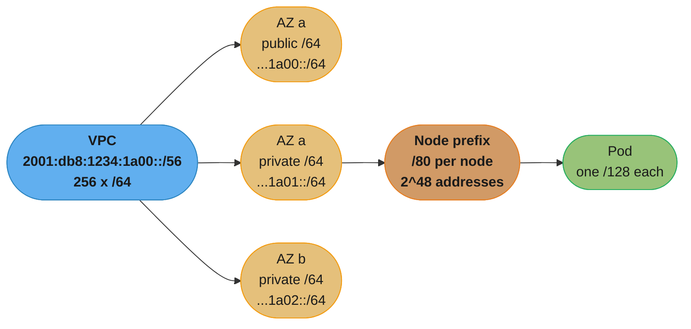
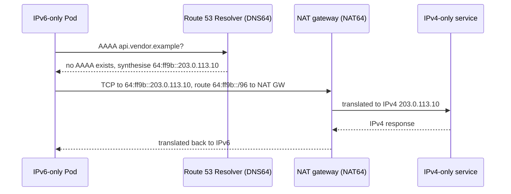

# IPv6 and Dual-Stack Networking

> Phase 2 — Containers & Kubernetes · Difficulty: Advanced

> **Version anchor (2026-11-25).** **Kubernetes IPv4/IPv6 dual-stack is stable since v1.23** (on by default since 1.21): one IPv4 and one IPv6 address per Pod, Services choosing their families with `spec.ipFamilyPolicy` (`SingleStack`, `PreferDualStack`, `RequireDualStack`) and `spec.ipFamilies`, and per-node Pod CIDRs defaulting to **/24 for IPv4 and /64 for IPv6**. **AWS VPC**: one IPv4 CIDR is mandatory; an Amazon-provided IPv6 block is a **/56**, and subnet IPv6 CIDRs range from **/44 to /64** in /4 steps, with 5 addresses reserved per subnet; private IPv6 ranges are available through VPC IPAM. **NAT64** is built into every NAT gateway and pairs with **DNS64** on the Route 53 Resolver using the `64:ff9b::/96` prefix. Every public IPv4 address costs **$0.005 per hour** (since 2024-02-01). **Amazon EKS** supports either an IPv4 or an IPv6 cluster, chosen at creation and fixed for life, and **does not support dual-stack Pods or Services**; IPv6 clusters need Nitro instances, VPC CNI 1.10.1 or later in prefix mode (a **/80 per node**), and AWS Load Balancer Controller 2.3.1 or later in IP mode.

This page sits under [kubernetes_networking](kubernetes_networking.md). The parent covers the Kubernetes network model, Services, kube-proxy and Gateway API; [networking_for_devops](../networking_for_devops/networking_for_devops.md) covers IPv4 CIDR and subnetting. This page is the IPv6 half of both: how IPv6 addresses are planned in a VPC, how a dual-stack Kubernetes cluster allocates and exposes addresses, and how IPv6-only workloads still reach the IPv4 internet.

---

## 1. Concept Overview

IPv6 addresses are 128 bits, written as eight groups of four hex digits with leading zeros dropped and one run of zero groups shortened to `::` (`2001:db8:1234:1a00::1`). Three properties change how a network is designed:

1. **The space is effectively unlimited.** A single /64 subnet holds 2^64 addresses, so the IPv4 habit of rationing addresses (small subnets, NAT everywhere, secondary CIDRs when a cluster runs out of Pod IPs) disappears.
2. **Addresses are globally unique and routable by default.** Cloud IPv6 blocks come from public (global unicast) space, so there is no NAT between a workload and the internet. Isolation comes from routing and firewall rules (security groups, an egress-only internet gateway), not from private addressing.
3. **The world is still partly IPv4.** Many external services have no AAAA record, so an IPv6-only workload needs a translation path (NAT64/DNS64, or a node-level IPv4 SNAT) to reach them.

Kubernetes supports three modes: **IPv4 single-stack** (the default), **IPv6 single-stack**, and **dual-stack**, where each Pod gets one address of each family and each Service chooses one or both. Managed providers differ in which modes they offer: EKS offers IPv4 or IPv6 single-stack only, chosen when the cluster is created.

The usual drivers for IPv6 are Pod IP exhaustion in large IPv4 VPCs, the per-hour charge for every public IPv4 address, overlapping private CIDRs between networks that must be connected, and customer or regulatory requirements to serve IPv6.

---

## 2. Intuition

> **One-line analogy:** IPv4 is a city with too few street addresses, so everyone shares the building's front-desk number (NAT) and you have to know the extension. IPv6 gives every room its own permanent street address, so you stop sharing numbers and start putting locks on the doors instead.

**Mental model.** In IPv4 the address plan is a scarcity problem: how to fit Pods, nodes and load balancers into a /16. In IPv6 the address plan is a structure problem: which bits mean Region, which mean subnet, which mean node, so routes stay short and summarised. Security moves from "it has a private address so nobody can reach it" to "the route and the security group say who can reach it".

**Why it matters.** A cluster on the AWS VPC CNI uses one VPC IP per Pod; at a few thousand Pods a /16 is gone, and the fixes (secondary CIDRs, custom networking, prefix delegation) all fight for the same small space. An IPv6 cluster gives each node a /80 and never runs out. Separately, every public IPv4 address now has a price, and a fleet with hundreds of them pays thousands of dollars a year just to hold them.

**Key insight.** Dual-stack is a migration tool, not a destination. It lets IPv4 and IPv6 clients reach the same Service while things move, but it doubles what must be correct: two address plans, two sets of firewall rules, two sets of DNS records.

---

## 3. Core Principles

1. **Plan on nibble boundaries.** IPv6 prefixes are easiest to read and summarise on 4-bit steps (/48, /52, /56, /60, /64); AWS only allows subnet sizes on those steps.
2. **A subnet is a /64.** Hosts and SLAAC expect it, AWS's smallest IPv6 subnet is /64, and there is no reason to go smaller.
3. **Public addressing is not public exposure.** Use security groups and an egress-only internet gateway to allow outbound-only traffic; there is no NAT hiding the address.
4. **Every firewall rule exists twice.** A rule for `0.0.0.0/0` does not cover `::/0`; security groups, NACLs, NetworkPolicy `ipBlock`s and WAF rules each need the IPv6 version.
5. **Translate at the edge, not in the app.** IPv6-only workloads reach IPv4 services through NAT64/DNS64 or a node-level SNAT, not through application changes.
6. **Applications must listen on IPv6.** A server bound to `0.0.0.0` accepts IPv4 only; bind to `::` (or the dual-stack equivalent for the runtime) or the IPv6 address is reachable and nothing answers.

---

## 4. Types / Architectures / Strategies

### Kubernetes IP family modes

| Mode | Pod addresses | Service ClusterIPs | Where it runs |
|---|---|---|---|
| IPv4 single-stack | One IPv4 | IPv4 | Default everywhere |
| IPv6 single-stack | One IPv6 (EKS adds a host-local IPv4 used only for egress SNAT) | IPv6 | EKS IPv6 clusters, self-managed |
| Dual-stack | One IPv4 and one IPv6 | Per Service: `SingleStack`, `PreferDualStack` or `RequireDualStack` | Self-managed (kubeadm) and providers that support it; **not EKS** |

### Service `ipFamilyPolicy`

| Value | Behaviour on a dual-stack cluster | On a single-stack cluster |
|---|---|---|
| `SingleStack` (default) | One ClusterIP from the **first** configured Service range | One ClusterIP |
| `PreferDualStack` | Both families | Falls back to one family silently |
| `RequireDualStack` | Both families | Creation fails |

`spec.ipFamilies` sets the order, for example `[IPv6, IPv4]`; the first family is what appears in the legacy `spec.clusterIP` field. You can add or remove the secondary family later, but not change the primary family of an existing Service. Headless Services without selectors default to `RequireDualStack` when the policy is unset.

### Reaching IPv4 from IPv6-only workloads

| Mechanism | How | Where |
|---|---|---|
| NAT64 + DNS64 | DNS64 synthesises an AAAA record `64:ff9b::<ipv4>` for IPv4-only names; the subnet routes `64:ff9b::/96` to a NAT gateway, which translates to IPv4 | IPv6-only subnets on AWS |
| Node-level SNAT (EKS IPv6) | Each Pod also has a host-local IPv4 address, not reported to Kubernetes; IPv4 egress is SNATed to the node's primary IPv4 | EKS IPv6 clusters; no NAT64 needed |
| Dual-stack | Each workload has a real IPv4 address too | Dual-stack clusters |

---

## 5. Architecture Diagrams

**An IPv6 address plan for a VPC.** The prefix grows by four bits at each level; each level is one hex digit.



*A /56 gives 2^(64-56) = 256 subnets of /64; on EKS each node then takes a /80 from its subnet, which holds 2^48 (about 2.8 x 10^14) Pod addresses. Address exhaustion stops being a design constraint.*

**How an IPv6-only Pod reaches an IPv4-only API.**



*DNS64 and NAT64 together let an IPv6-only workload call an IPv4-only endpoint with no application change. EKS IPv6 clusters take a different path: the Pod's hidden host-local IPv4 address is SNATed to the node's IPv4, so NAT64 is not needed there.*

---

## 6. How It Works — Detailed Mechanics

### Address arithmetic

```
  prefix   addresses           /64 subnets inside
  /48      2^80                65,536
  /52      2^76                4,096
  /56      2^72                256          <- one Amazon-provided VPC block
  /60      2^68                16
  /64      2^64 = 1.8 x 10^19  1            <- one subnet
  /80      2^48 = 2.8 x 10^14  -            <- one EKS node's Pod prefix

  IPv4 for comparison: a /16 VPC holds 65,536 addresses in total.
```

A /56 is the VPC-level unit on AWS, so a multi-Region plan usually reserves a /48 or a set of /56s per Region from IPAM and hands one /56 to each VPC. Inside the VPC, give each subnet a /64 and encode the purpose in the subnet nibbles (`...1a00` public, `...1a01` private app, `...1a02` private data), so a route or firewall rule can match a whole tier with one prefix.

### A dual-stack VPC in Terraform

```hcl
resource "aws_vpc" "main" {
  cidr_block                       = "10.40.0.0/16"   # IPv4 is still mandatory
  assign_generated_ipv6_cidr_block = true             # Amazon-provided /56
}

resource "aws_subnet" "private_a" {
  vpc_id                          = aws_vpc.main.id
  availability_zone               = "us-east-1a"
  cidr_block                      = "10.40.16.0/20"
  ipv6_cidr_block                 = cidrsubnet(aws_vpc.main.ipv6_cidr_block, 8, 1)   # /56 + 8 = /64
  assign_ipv6_address_on_creation = true
  enable_dns64                    = true              # synthesize AAAA for IPv4-only names
}

resource "aws_egress_only_internet_gateway" "eigw" {
  vpc_id = aws_vpc.main.id                            # outbound IPv6 only, no inbound
}

resource "aws_route" "private_ipv6_out" {
  route_table_id              = aws_route_table.private.id
  destination_ipv6_cidr_block = "::/0"
  egress_only_gateway_id      = aws_egress_only_internet_gateway.eigw.id
}

resource "aws_route" "private_nat64" {
  route_table_id              = aws_route_table.private.id
  destination_ipv6_cidr_block = "64:ff9b::/96"         # NAT64 prefix to the NAT gateway
  nat_gateway_id              = aws_nat_gateway.a.id
}
```

The egress-only internet gateway is the IPv6 equivalent of "private subnet behind NAT": instances can open connections out, nothing outside can open connections in. It is a routing control, not address hiding, so the security group still needs rules for both families.

### Dual-stack Kubernetes (self-managed)

```bash
# kube-apiserver
--service-cluster-ip-range=10.96.0.0/16,fd00:10:96::/112
# kube-controller-manager
--cluster-cidr=10.244.0.0/16,fd00:10:244::/56 \
--service-cluster-ip-range=10.96.0.0/16,fd00:10:96::/112 \
--node-cidr-mask-size-ipv4=24 --node-cidr-mask-size-ipv6=64
# kube-proxy
--cluster-cidr=10.244.0.0/16,fd00:10:244::/56
# kubelet on bare metal (cloud providers usually set this)
--node-ip=192.0.2.10,2001:db8::10
```

Pod-CIDR arithmetic: a /56 cluster range with /64 per node gives 2^(64-56) = 256 nodes, and the IPv4 /16 with /24 per node also gives 256, so the two families run out of node blocks together. Size the IPv6 range for the node count you expect (a /48 gives 65,536 node blocks). The `fd00::/8` ranges above are unique local addresses (RFC 4193); generate a random 40-bit global ID rather than reusing `fd00:10::`, so two clusters never collide.

```yaml
apiVersion: v1
kind: Service
metadata: {name: api}
spec:
  ipFamilyPolicy: PreferDualStack
  ipFamilies: [IPv6, IPv4]          # IPv6 first: .spec.clusterIP will be the IPv6 address
  selector: {app: api}
  ports: [{port: 443, targetPort: 8443}]
---
# NetworkPolicy ipBlock rules are per family: allow both, or IPv6 clients are dropped
apiVersion: networking.k8s.io/v1
kind: NetworkPolicy
metadata: {name: api-from-partners}
spec:
  podSelector: {matchLabels: {app: api}}
  policyTypes: [Ingress]
  ingress:
    - from:
        - ipBlock: {cidr: 198.51.100.0/24}
        - ipBlock: {cidr: 2001:db8:abcd::/48}
```

### EKS IPv6 clusters

An EKS cluster created with `ipFamily: ipv6` gives Pods and Services IPv6 addresses only; Services get unique local addresses from a range EKS assigns and you cannot choose. The VPC CNI runs in prefix mode and assigns each node an IPv6 /80, so Pod density is limited by the instance's CPU and memory and `maxPods`, never by addresses. Each Pod also gets a host-local IPv4 address that Kubernetes never sees; outbound IPv4 traffic is SNATed to the node's primary IPv4, and outbound IPv6 leaves with the Pod's own address through an internet gateway or egress-only internet gateway. Load balancers reach Pods in IP target mode only. The choice is permanent: an existing IPv4 EKS cluster cannot be converted, so the migration path is a new cluster.

### The IPv4 bill as a migration driver

```
  public IPv4 price      $0.005 / hour / address
  hours per month        730
  per address            0.005 x 730      = $3.65 / month
  fleet with 400 addresses (load balancer nodes, NAT gateways, bastions, public instances)
                         400 x 3.65       = $1,460 / month = $17,520 / year
```

IPv6 addresses carry no such charge. Moving internet-facing endpoints to dual-stack does not remove the IPv4 charge by itself (the IPv4 side still exists); the saving comes from removing IPv4 where it is not needed: public IPs on instances that only make outbound calls, and IPv4 on internal services.

---

## 7. Real-World Examples

- **Amazon EKS IPv6 clusters** exist mainly to end Pod IP exhaustion: AWS's EKS best-practices guide describes IPv6 mode as solving IPv4 exhaustion in large clusters and avoiding CIDR overlap between networks.
- **AWS's public IPv4 charge** (from 2024-02-01) was announced explicitly as encouragement to adopt IPv6, alongside a Public IP Insights tool to find which resources hold public IPv4 addresses.
- **Kubernetes dual-stack** is used in self-managed clusters during migrations so that existing IPv4 clients and new IPv6 clients reach the same Services.

---

## 8. Tradeoffs

| Decision | Option A | Option B | Key factor |
|---|---|---|---|
| Cluster IP family | IPv4 single-stack (familiar) | IPv6 single-stack (no exhaustion) | Pod count versus how much IPv4-only tooling you run |
| Migration | Dual-stack cluster | New IPv6 cluster plus traffic shift | Provider support (EKS has no dual-stack Pods) |
| Reaching IPv4 | NAT64/DNS64 | Node-level SNAT (EKS) or dual-stack | What the platform offers |
| Pod ULA vs global | Unique local addresses | Global unicast | Whether Pods must be reachable from outside the cluster without a proxy |
| Outbound-only IPv6 | Egress-only internet gateway | Internet gateway plus security groups | Defence in depth versus simplicity |

---

## 9. When to Use / When NOT to Use

**Use IPv6 single-stack when** Pod IP exhaustion is a real constraint, when you must connect many networks whose IPv4 ranges overlap, or when the public IPv4 charge is material, and when the workloads, add-ons and observability tools have been tested on IPv6.

**Use dual-stack when** both IPv4 and IPv6 clients must reach the same Services during a migration, on a platform that supports it.

**Do not** move a cluster to IPv6 because it is newer: if the cluster is small, every address fits, and critical tools assume IPv4, the change buys nothing and adds a second set of rules to get right. Do not plan a dual-stack EKS cluster; EKS does not support dual-stack Pods or Services.

---

## 10. Common Pitfalls

**Pitfall 1 — The service has an AAAA record and nothing answers on IPv6.** A Service is switched to `PreferDualStack`, DNS starts returning AAAA records, and IPv6 clients time out, because the application binds `0.0.0.0:8080`, which is IPv4 only.

```python
# BROKEN: IPv4 only
server = HTTPServer(("0.0.0.0", 8080), Handler)
```

```python
# FIX: bind the IPv6 wildcard; with IPV6_V6ONLY off (the Linux default),
# one socket accepts IPv4 too, as IPv4-mapped addresses.
import socket
class DualStackServer(HTTPServer):
    address_family = socket.AF_INET6
server = DualStackServer(("::", 8080), Handler)
```

Test both families explicitly (`curl -4` and `curl -6`) before publishing AAAA records.

**Pitfall 2 — Firewall rules written for one family.** A security group allows `0.0.0.0/0` on 443 and nothing for `::/0`; IPv6 clients are dropped. The reverse also happens: a NetworkPolicy that allow-lists partner IPv4 ranges silently blocks the same partners when they arrive over IPv6. FIX: write each rule for both families, and alert on a rule that names only one.

**Pitfall 3 — "It has a public address, so it is exposed."** Or the opposite: "it has no NAT, so it is safe". IPv6 addresses in a VPC are globally routable; whether anything can reach them is decided by the route table and security groups. FIX: put outbound-only workloads behind an egress-only internet gateway, keep security groups default-deny, and review them for `::/0`.

**Pitfall 4 — Planning a dual-stack EKS cluster.** A design assumes EKS Pods get both families. EKS supports only IPv4 or IPv6 clusters, chosen at creation. FIX: on EKS, build a new IPv6 cluster and shift traffic; dual-stack belongs at the load balancer and VPC level, not the Pod level.

**Pitfall 5 — ULA ranges that collide.** Two self-managed clusters both use `fd00:10:244::/56` for Pods, and when their networks are connected the routes overlap, the same mistake as two `10.0.0.0/16` VPCs. FIX: generate a random 40-bit global ID for each ULA /48, per RFC 4193, and record it in IPAM.

---

## 11. Technologies & Tools

| Tool | Purpose |
|---|---|
| Amazon VPC IPAM | Allocate IPv6 (and private IPv6) pools per Region and VPC |
| Egress-only internet gateway | Outbound-only IPv6 for private subnets |
| NAT gateway (NAT64) + Route 53 Resolver (DNS64) | IPv6-only workloads reaching IPv4 services |
| Amazon VPC CNI (prefix mode) | EKS IPv6 clusters, /80 per node |
| AWS Load Balancer Controller (IP mode) | ALB/NLB to IPv6 Pods |
| Cilium, Calico | Dual-stack and IPv6 Pod networking on self-managed clusters |
| `kubectl get svc -o wide`, `dig AAAA`, `curl -6` | Verify families end to end |

---

## 12. Interview Questions with Answers

**Q: A VPC gets an IPv6 /56. How many /64 subnets is that, and how many addresses does each hold?**
**Short:** 256 subnets, because 64 - 56 = 8 bits gives 2^8; each /64 holds 2^64, about 1.8 x 10^19 addresses.
The subnet count is 2 raised to the difference between the subnet and VPC prefix lengths: 2^(64-56) = 256 /64 subnets. Each /64 has 64 host bits, 2^64 addresses, roughly 1.8 x 10^19, which is why IPv6 planning is about structure rather than scarcity. On AWS an Amazon-provided VPC block is a /56, subnet IPv6 CIDRs can be /44 to /64 in /4 steps, and each subnet reserves 5 addresses (the first four and the last). Use the nibbles below the /56 to encode tier and zone, so one prefix can describe a whole tier in a route or firewall rule.

**Q: What do `ipFamilyPolicy` and `ipFamilies` do on a Kubernetes Service?**
**Short:** `ipFamilyPolicy` chooses single-stack, prefer dual-stack or require dual-stack, and `ipFamilies` sets the order, with the first family becoming the primary `clusterIP`.
On a dual-stack cluster, `SingleStack` (the default) gets one ClusterIP from the first configured Service range, `PreferDualStack` gets both families and falls back to one on a single-stack cluster, and `RequireDualStack` gets both or fails creation. `ipFamilies`, for example `[IPv6, IPv4]`, orders them, and the first is what the legacy `spec.clusterIP` field shows. The primary family cannot be changed on an existing Service; the secondary can be added or removed. Enabling dual-stack on a cluster leaves existing Services `SingleStack` until each one opts in.

**Q: Can an EKS cluster run dual-stack Pods?**
**Short:** No; EKS clusters are IPv4 or IPv6, chosen at creation and fixed for life, and EKS does not support dual-stack Pods or Services even though Kubernetes does.
EKS lets you pick the IP family once, when the cluster is created. In an IPv6 cluster Pods and Services get IPv6 addresses only; each Pod also gets a host-local IPv4 address, not visible to Kubernetes, used only to SNAT outbound IPv4 traffic to the node's IPv4 address. Nodes themselves have both families. An existing IPv4 cluster cannot be converted, so the migration is a new IPv6 cluster plus a traffic shift. Dual-stack on AWS lives at the VPC, subnet and load balancer level, not inside the EKS Pod network.

**Q: How does an IPv6-only workload reach an IPv4-only API?**
**Short:** Through DNS64 and NAT64: DNS64 synthesises an AAAA record in `64:ff9b::/96` for the IPv4 address, and a NAT gateway translates that traffic to IPv4.
When the name has no AAAA record, the Route 53 Resolver with DNS64 enabled on the subnet returns a synthesised address made of the `64:ff9b::/96` prefix plus the IPv4 address. The subnet's route table sends `64:ff9b::/96` to a NAT gateway, which has NAT64 built in: it rewrites the packet to IPv4, sends it out, and translates the replies back. No application change is needed. EKS IPv6 clusters use a different path, SNATing a hidden per-Pod IPv4 address at the node, so they do not need NAT64.

**Q: An IPv6 VPC address is globally routable. Does that mean every instance is exposed to the internet?**
**Short:** No; reachability is decided by route tables and security groups, and an egress-only internet gateway lets private subnets connect out while blocking connections in.
IPv6 removes NAT, so the address no longer hides the host, but exposure was never really a property of the address. A subnet whose IPv6 default route points to an egress-only internet gateway can open outbound connections and accepts no inbound ones; security groups stay default-deny for inbound traffic in both families. The real risk is the reverse habit: assuming a host is private because it has a 10.x address, and then adding IPv6 without reviewing security groups for `::/0`. Treat routing and security groups as the boundary for both families.

**Q: Why would a team move an EKS cluster to IPv6?**
**Short:** To end Pod IP exhaustion, since the VPC CNI gives each node a /80 instead of drawing every Pod IP from a small IPv4 subnet, and to avoid CIDR overlap between networks.
On the IPv4 VPC CNI every Pod takes a VPC address, so a few thousand Pods exhaust a /16 and the workarounds (secondary CIDRs, custom networking, prefix delegation) all compete for scarce space. In an IPv6 cluster the CNI runs in prefix mode and assigns each node a /80, about 2.8 x 10^14 addresses, so Pod density depends only on CPU, memory and `maxPods`. IPv6 also sidesteps overlapping private IPv4 ranges when networks must be connected. The costs: Nitro instances only, no Windows Pods, load balancers in IP mode only, every add-on tested on IPv6, and a new cluster because the family cannot be changed.

**Q: What does every public IPv4 address cost on AWS, and how does that change a network design?**
**Short:** $0.005 per hour, about $3.65 a month per address since February 2024, so a fleet holding 400 addresses pays roughly $17,520 a year just to keep them.
AWS charges $0.005 per hour for every public IPv4 address, attached or not, including load balancer and NAT gateway addresses; IPv6 addresses have no such charge. At 730 hours a month that is $3.65 per address, and 400 addresses come to $1,460 a month or $17,520 a year. The design change is to remove IPv4 where it is not needed: instances that only make outbound calls can use IPv6 plus an egress-only internet gateway (or NAT64 for IPv4 destinations), and internal services can drop public IPv4 entirely. Dual-stack endpoints alone do not save money, because their IPv4 side still holds an address.

**Q: A Service gets an AAAA record and IPv6 clients time out while IPv4 clients work. What is the likely cause?**
**Short:** The application listens only on the IPv4 wildcard `0.0.0.0`; it must bind `::` (or both families) before AAAA records are published.
A server bound to `0.0.0.0` accepts IPv4 connections only. Once the Service is dual-stack and DNS returns AAAA records, clients that prefer IPv6 connect to an address where nothing listens, and they time out or wait for their fallback to IPv4. Binding the IPv6 wildcard `::` fixes it; on Linux, with `IPV6_V6ONLY` off by default, one IPv6 socket also accepts IPv4 as IPv4-mapped addresses. Also check the other layers that might be single-family: security groups, NetworkPolicy `ipBlock`s, the load balancer's IP address type, and health checks. Test with `curl -6` before publishing AAAA.

**Q: What Kubernetes control-plane settings enable dual-stack on a self-managed cluster?**
**Short:** Dual CIDRs on the API server's `--service-cluster-ip-range`, the controller manager's `--cluster-cidr` and Service range, kube-proxy's `--cluster-cidr`, and dual `--node-ip` on bare-metal kubelets.
Each flag takes an IPv4 and an IPv6 CIDR separated by a comma: `--service-cluster-ip-range` on kube-apiserver and kube-controller-manager, `--cluster-cidr` on kube-controller-manager and kube-proxy, and per-node mask sizes `--node-cidr-mask-size-ipv4` and `--node-cidr-mask-size-ipv6`, which default to /24 and /64. On bare metal the kubelet needs `--node-ip` with both addresses; cloud providers usually set node IPs themselves. The CNI must support dual-stack too. The first family listed in the Service range becomes the default family for Services that set no policy.

**Q: How many nodes can a dual-stack cluster with a /56 IPv6 Pod range hold?**
**Short:** 256 with the default /64 per node, since 2^(64-56) = 256, the same as a /16 IPv4 range at /24 per node, so both families must be sized for the node count.
The node controller carves one Pod CIDR per node from each family's cluster range: with an IPv6 /56 and the default /64 node mask that is 2^8 = 256 blocks, and with an IPv4 /16 and /24 per node it is also 256. A dual-stack node needs a block from both, so whichever range runs out first caps the cluster. IPv6 has no reason to be the constraint: a /48 gives 65,536 node blocks. Pick the IPv6 range from the node count you plan for, and size the IPv4 range honestly, because it will be the limit.

**Q: Do security groups and NetworkPolicies cover IPv6 automatically?**
**Short:** No; each rule matches one family, so `0.0.0.0/0` does not cover `::/0` and an IPv4 `ipBlock` does nothing for the same client arriving over IPv6.
Security group rules, NACLs, WAF IP sets and NetworkPolicy `ipBlock`s all match on a CIDR of one family. Adding IPv6 to a subnet or a Service without adding the matching rules either drops IPv6 clients (if the default is deny) or, worse, leaves IPv6 open where IPv4 was restricted (if someone added a broad `::/0` rule to make things work). Write every rule as a pair, review for single-family rules in code review, and test both families from outside.

**Q: What are unique local IPv6 addresses, and when would a cluster use them?**
**Short:** ULAs are `fd00::/8` addresses (RFC 4193) that are routable only inside your networks, used for Pod or Service ranges that must not be reachable from the internet.
ULAs play the role of RFC 1918 space in IPv6: they are not routed on the internet, so a Service or Pod range taken from them is reachable only through your own routing. EKS assigns IPv6 cluster Services from a ULA range it chooses; self-managed clusters often use ULAs for Service CIDRs. The rule that makes them safe to connect later is the random 40-bit global ID in each /48: two clusters that both pick `fd00:10::/48` will collide exactly like two `10.0.0.0/16` networks. Generate the global ID randomly and record it in IPAM.

**Q: How does an EKS IPv6 Pod reach an IPv4 address on the internet without NAT64?**
**Short:** Each Pod also has a host-local IPv4 address that Kubernetes never sees; the VPC CNI SNATs its IPv4 traffic to the node's primary IPv4 address.
In an EKS IPv6 cluster a host-local CNI plugin, chained with the VPC CNI, gives every Pod an IPv4 address that is not reported to the control plane. When the Pod connects to an IPv4 destination, the VPC CNI SNATs the traffic to the IPv4 address of the node's primary ENI, and the node's IPv4 route (internet gateway or NAT gateway) takes it from there. IPv6 traffic leaves with the Pod's own IPv6 address, which is preserved outside the VPC. The result is IPv4 reachability with no DNS64 or NAT64 configuration.

**Q: Why should IPv6 subnets be /64, and why plan prefixes on 4-bit boundaries?**
**Short:** A /64 is the standard host subnet (and AWS's smallest IPv6 subnet), and 4-bit steps align with hex digits, so prefixes stay readable and summarise cleanly.
IPv6 hosts and SLAAC assume a 64-bit interface identifier, so a subnet is a /64; AWS allows IPv6 subnets only from /44 to /64 in /4 steps, which makes /64 the smallest. Planning on nibble boundaries (/48, /52, /56, /60, /64) means each level of the hierarchy is exactly one hex digit, so `2001:db8:1234:1a01::/64` can be read as "VPC 1a, subnet 01" and a whole tier can be matched by one shorter prefix. Off-nibble prefixes work but turn every route and firewall review into binary arithmetic.

**Q: When is dual-stack the right migration strategy, and when is a new IPv6 cluster better?**
**Short:** Dual-stack suits platforms that support it and clients of both families during a gradual move; a new IPv6 cluster suits providers like EKS that fix the family at creation.
Dual-stack lets each Service add IPv6 while keeping IPv4, so clients move at their own pace and rollback is removing the secondary family. It doubles the surface to get right (two address plans, two sets of rules, two DNS record types) for as long as it lasts. Where the platform fixes the family at cluster creation, as EKS does, the path is a new IPv6 cluster deployed from Git, with traffic shifted at the load balancer or DNS, which is also a clean way to retire IPv4-era workarounds such as custom networking. Choose by what the provider supports and how long you can afford to run both families.

---

## 13. Best Practices

- Allocate IPv6 from **IPAM**: a /48 or set of /56s per Region, one /56 per VPC, **/64 per subnet**, on nibble boundaries.
- Write every security group, NACL, WAF and NetworkPolicy rule **for both families**.
- Use an **egress-only internet gateway** for outbound-only IPv6 subnets, and **NAT64/DNS64** for IPv6-only workloads that call IPv4 services.
- Make applications **listen on `::`** and test with `curl -6` before publishing AAAA records.
- On EKS, decide the IP family **at cluster creation**; plan IPv6 as a new cluster, not a conversion.
- Use **random ULA global IDs** for private ranges so clusters can be connected later.
- Track the **public IPv4 count** (and its $0.005 per hour cost) and remove IPv4 where workloads only need outbound access.

---

## 14. Case Study

### Scenario: an EKS fleet out of Pod IPs, and a $17,000 IPv4 bill

A platform team runs 12 IPv4 EKS clusters in /16 VPCs on the VPC CNI. The largest cluster has run out of Pod IPs twice in a quarter; a secondary CIDR and custom networking bought time but made the network harder to reason about. Finance also flags 400 public IPv4 addresses across the fleet.

**The first attempt.**

```text
BROKEN plan: "enable dual-stack on the existing clusters"
  - EKS has no dual-stack Pods and no in-place family change: the plan cannot be executed
  - meanwhile a test Service was switched to PreferDualStack on a kubeadm staging cluster,
    AAAA records appeared, and IPv6 clients timed out: the app bound 0.0.0.0
```

**The fix.**

```text
FIX plan
  1. VPCs: add an Amazon-provided /56 to each VPC, /64 per subnet, DNS64 on private subnets,
     egress-only internet gateway for IPv6 egress, 64:ff9b::/96 routed to the NAT gateway
  2. Apps: bind "::", test curl -4 and curl -6 in CI; security groups and NetworkPolicies
     reviewed for paired IPv4/IPv6 rules
  3. Clusters: new IPv6 EKS clusters (ipFamily: ipv6, VPC CNI prefix mode, Load Balancer
     Controller in IP mode), workloads deployed from Git, traffic shifted at the ALB per service
  4. IPv4 cleanup: remove public IPv4 from instances that only make outbound calls
```

**The numbers.**

```
  Pod addresses per node      IPv4 VPC CNI: limited by ENIs, IPs per ENI and the subnet
                              IPv6: a /80 per node = 2.8 x 10^14
  public IPv4 before          400 x $3.65/month = $1,460/month ($17,520/year)
  public IPv4 after           150 x $3.65/month = $  548/month ($ 6,570/year)
  saving                      $10,950/year
```

The 150 remaining addresses are internet-facing load balancers that still serve IPv4 clients. The Pod-IP exhaustion problem ended with the first cluster migration, and the custom-networking configuration was deleted with the old clusters.

**Discussion questions.**

1. Which workloads on the new IPv6 clusters still depend on the hidden per-Pod IPv4 address, and how would you find them?
2. What would have to be true for the team to remove IPv4 from the internet-facing load balancers too?
3. If the platform had been self-managed Kubernetes, would dual-stack have been the better path? What would it have cost in rules and testing?
