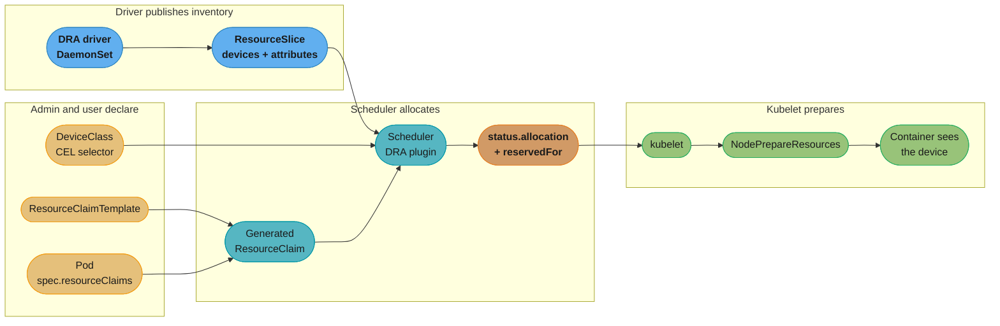
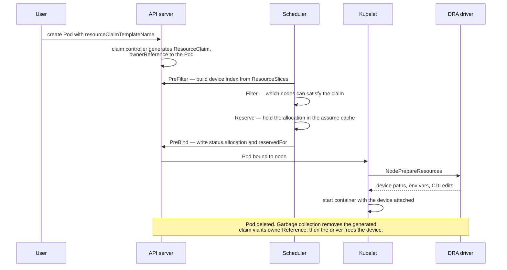
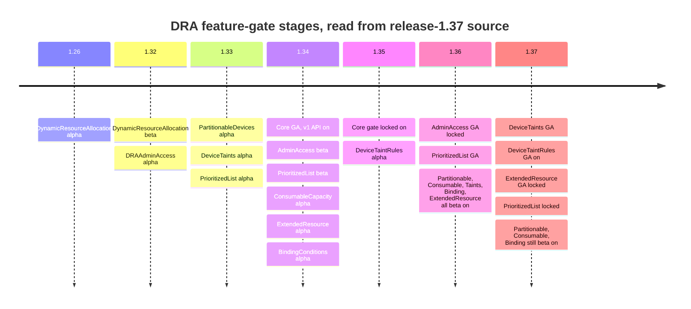

# Device Scheduling and Dynamic Resource Allocation

> **Version anchor (2026-09-04).** **Kubernetes 1.37 "Garhwal"** (2026-08-26) is the current release; **1.36 "Haru"** (2026-04-22) is the prior minor. **DRA graduated to GA in 1.34** with the stable **`resource.k8s.io/v1`** API on by default, and the `DynamicResourceAllocation` gate was **locked to enabled in 1.35** (`LockToDefault: true`) — it can no longer be turned off. Sub-feature stability as of 1.37, read from `pkg/features/kube_features.go` on the `release-1.37` branch rather than from release prose: **`DRAAdminAccess` GA and locked since 1.36** (removal scheduled for 1.39), **`DRAPrioritizedList` GA since 1.36, locked in 1.37**, **`DRADeviceTaints` GA in 1.37**, **`DRADeviceTaintRules` GA and ON by default in 1.37** (it was Beta but off by default in 1.36), **`DRAExtendedResource` GA and locked in 1.37**, **`DRAResourceClaimDeviceStatus` GA and locked in 1.37**, while **`DRAPartitionableDevices`, `DRAConsumableCapacity` and `DRADeviceBindingConditions` are still Beta, on by default**. The **device plugin API is not deprecated** — `nvidia.com/gpu: 1` still works in 1.37 and nothing has announced its removal.

This page sits under [kubernetes_scheduling_and_autoscaling](kubernetes_scheduling_and_autoscaling.md). The parent owns *scheduling in general* — requests and limits, affinity, the three autoscalers, gang scheduling, PodDisruptionBudgets — and introduces DRA in one section because you cannot discuss GPU placement without it. This page owns the *device-allocation mechanism*: the four object kinds and who writes each, the exact API shapes that a summarised doc page will get wrong, the allocation-versus-binding split inside the scheduler, the sub-features that decide whether DRA is worth adopting at all, and the migration off integer counting. What the devices cost and how the fleet is operated belongs to [ml_platform_and_gpu_infrastructure](../ml_platform_and_gpu_infrastructure/ml_platform_and_gpu_infrastructure.md); node bring-up and GPU health belong to [gpu_node_lifecycle](../case_studies/cross_cutting/gpu_node_lifecycle.md).

---

## 1. Concept Overview

For most of Kubernetes' history a GPU was an **extended resource**: a vendor device plugin registered a name like `nvidia.com/gpu` with the kubelet, the kubelet advertised an integer count in `node.status.allocatable`, and the scheduler did arithmetic. `nvidia.com/gpu: 1` meant "one of whatever those are."

That model has exactly one expressive primitive — a non-negative integer — and three things it cannot say:

1. **Which one.** A node with four A100-40GB cards and four H100-80GB cards advertises `nvidia.com/gpu: 8`. A job that needs 80 GB of HBM has no way to ask for it. The industry workaround was node labels plus `nodeAffinity`, which moves the constraint from the device to the machine and breaks the moment a machine is heterogeneous.
2. **Shared by whom, and how much.** An integer is decremented or it is not. Two Pods sharing one physical card through MIG, MPS, or time-slicing had to be modelled as separate fake resources (`nvidia.com/mig-1g.10gb: 56`), reconfigured by draining the node.
3. **Together with what.** "Eight GPUs in the same NVLink domain" is a constraint *across* the allocated set. Counting has no vocabulary for it.

**Dynamic Resource Allocation replaces the count with a claim.** The shape is deliberately the one Kubernetes already uses for storage: a driver publishes what exists, an admin defines categories, a workload asks for one, and the control plane binds a specific instance to a specific consumer.

| Storage | Devices | Who writes it |
|---|---|---|
| `PersistentVolume` | `ResourceSlice` | the **driver**, per node, automatically |
| `StorageClass` | `DeviceClass` | the **cluster admin**, cluster-scoped |
| `PersistentVolumeClaim` | `ResourceClaim` | the **workload owner**, namespaced |
| (`volumeClaimTemplates`) | `ResourceClaimTemplate` | the **workload owner**, one claim generated per Pod |

The payoff is that the scheduler contains **no vendor-specific code**. It reads attributes and capacities out of `ResourceSlice` objects and evaluates a CEL expression from the `DeviceClass` against them. A vendor shipping an FPGA, a SmartNIC, a QAT accelerator, or a Gaudi card writes a driver that publishes slices and implements a kubelet hook; it does not patch the scheduler and does not invent a fake integer resource.

The cost is a genuinely larger surface: four object kinds instead of one number, a driver DaemonSet per vendor, and an allocation lifecycle with its own leak mode (§10). DRA earns that cost when devices are heterogeneous, shareable, or topologically constrained. It does not earn it when the whole story is "one whole card per Pod, all cards identical."

---

## 2. Intuition

> A device plugin hands out **tickets**: you get one, they are all the same, and the usher counts them. DRA hands out **reserved seats**: you say what you need — aisle, front section, next to my colleague — and the box office binds a specific seat to your name before you walk in.

**Mental model.** `nvidia.com/gpu: 1` is `int`. A `ResourceClaim` is a *query* plus a *lease*. The query (`DeviceClass` selector plus the claim's own selectors) says what would satisfy you; the lease (`status.allocation` plus `status.reservedFor`) records which concrete device you got and who is allowed to use it.

**Why it matters.** Every workaround the extended-resource era produced — labelling nodes by GPU model, pre-partitioning cards into fixed MIG profiles at boot, inventing `nvidia.com/mig-1g.10gb` as a separate resource, draining a node to reshape it — exists because a count cannot express a constraint. DRA does not make GPUs cheaper. It makes the *stranded* ones schedulable, which is where the money actually is: a 40 GB card idle because the only pending job asked for "a GPU" and landed on the 80 GB one is pure waste that counting cannot see.

**Key insight.** Allocation and binding are **separate steps, and the gap between them is where the interesting failures live.** A claim can be allocated (a device is reserved for it) while no Pod is running, which is what makes a stray `ResourceClaim` capable of pinning a GPU indefinitely. Understanding DRA is mostly understanding who deletes the claim.

---

## 3. Core Principles

1. **The driver owns inventory; the scheduler owns choice.** A driver publishes `ResourceSlice` objects describing devices with typed attributes and capacities. It never decides who gets one. That split is why the scheduler stays vendor-neutral.
2. **Selection is CEL over device attributes, not string matching on node labels.** `device.attributes["gpu.nvidia.com"].productName == "NVIDIA-H100"` is evaluated per device, so a heterogeneous node is expressible.
3. **A claim is allocated to a *set*, and constraints apply across the set.** `matchAttribute` on a claim's `constraints` is what makes "all four devices in the same NVLink domain" a schedulable requirement rather than a hope.
4. **Lifetime is ownership.** A `ResourceClaimTemplate`-generated claim carries an `ownerReference` to the Pod and dies with it. A hand-written `ResourceClaim` does not, and outlives everything.
5. **Reservation is explicit and bounded.** `status.reservedFor` lists the consumers permitted to use the allocation, capped at **256** entries. It is not a refcount you can ignore.
6. **The migration path is a bridge, not a cliff.** `DRAExtendedResource` (GA and locked in 1.37; Beta and on by default in 1.36) lets the scheduler satisfy a legacy `nvidia.com/gpu: 2` request out of DRA-published devices, so manifests migrate on their own schedule.

---

## 4. Types / Architectures / Strategies

### The four object kinds

| Kind | Scope | Written by | Purpose |
|---|---|---|---|
| `ResourceSlice` | cluster (node-associated) | **driver**, continuously | Publishes the devices in a pool, their attributes and capacities |
| `DeviceClass` | cluster | **admin** | A named category with CEL selectors and default config — the `StorageClass` analogue |
| `ResourceClaim` | namespace | workload owner, or generated | A request for devices; the object the scheduler allocates against |
| `ResourceClaimTemplate` | namespace | workload owner | A factory producing one Pod-owned `ResourceClaim` per Pod |

### Request forms

A claim's `spec.devices.requests[]` entry sets **exactly one** of two fields — this is a `oneOf` in the API, and getting it wrong is the single most common authoring error against `resource.k8s.io/v1`:

| Form | Field | Meaning |
|---|---|---|
| Exact | `exactly` | One concrete requirement — `deviceClassName`, optional `selectors`, `allocationMode`, `count` |
| Prioritized | `firstAvailable` | An ordered list of subrequests; the scheduler takes the first that can be satisfied |

`firstAvailable` (gate `DRAPrioritizedList`, **GA in 1.36**) is how you express "an H100 if you have one, otherwise two A100s, otherwise fail" without writing a scheduling controller. Note the API's own caveat: **DRA does not implement scoring**, so the scheduler takes the first satisfiable option rather than the best one.

`allocationMode` takes `ExactCount` (with `count`, default 1) or `All` — the latter meaning every matching device in the pool, which is how you say "this node's whole GPU complement" without hardcoding a number.

### Sharing and partitioning

| Strategy | Gate (1.37) | What it does |
|---|---|---|
| **Partitionable devices** | `DRAPartitionableDevices` — Beta, on | The driver publishes overlapping devices (a full card *and* its MIG slices) plus the counter sets that make them mutually exclusive. The scheduler picks a valid non-overlapping combination, so partitioning becomes a scheduling decision instead of a node-drain-and-reconfigure ritual. |
| **Consumable capacity** | `DRAConsumableCapacity` — Beta, on | A device advertises divisible capacity (memory, compute fraction) that several claims draw down concurrently. This is what makes genuine multi-tenant sharing of one card a first-class allocation rather than a lie told by time-slicing. |
| **Admin access** | `DRAAdminAccess` — **GA and locked**, removal in 1.39 | `adminAccess: true` on a request grants read-only inspection of a device already allocated to someone else, for monitoring and debugging. Restricted to namespaces labelled `resource.kubernetes.io/admin-access: "true"`. |

### Fencing and lifecycle

| Strategy | Gate (1.37) | What it does |
|---|---|---|
| **Device taints and tolerations** | `DRADeviceTaints` — GA in 1.37 | Taint an individual *device*, not the node. A card throwing ECC errors is fenced while its seven healthy siblings keep scheduling. `NoExecute` evicts Pods already holding it. |
| **DeviceTaintRule** | `DRADeviceTaintRules` — GA and **on by default in 1.37** | Lets an admin or an external health controller taint devices declaratively, without the driver republishing slices. On a 1.36 cluster it is Beta and off by default, so it must be enabled explicitly there. |
| **Binding conditions** | `DRADeviceBindingConditions` — Beta, on | Delays committing the Pod to the node until an external resource (a fabric-attached device, a composable-infrastructure allocation) reports ready, instead of binding and then failing to start. |
| **Extended resource bridge** | `DRAExtendedResource` — GA in 1.37 | A legacy `nvidia.com/gpu: 2` request is satisfied from DRA devices when the DeviceClass opts in. The migration lever. |

---

## 5. Architecture Diagrams

The allocation path, from what the driver publishes to what the container sees:



*The scheduler is the only component that sees both sides, and it sees them as data — attributes on one side, a CEL expression on the other. No vendor code runs inside it.*

The allocation-versus-binding split, which is where the lifecycle bugs live:



*Note the ordering: the allocation is persisted at PreBind, before the kubelet has done anything. A device is spoken for the moment the scheduler commits, not the moment a container starts.*

Sub-feature maturity, because "DRA is GA" and "the feature you need is GA" are different claims:



*Read this before promising a capability. The core has been GA since 1.34, but consumable capacity — the feature most people actually mean when they say "share a GPU" — only reached on-by-default Beta in 1.36.*

---

## 6. How It Works — Detailed Mechanics

### The exact API shapes

These are the shapes that matter, and they are worth writing out because summarised documentation gets them wrong in three specific ways: it drops the `devices` level, it drops the `exactly` wrapper, and it resurrects the `source` field that was tombstoned in 1.31. All three produce YAML that reads plausibly and is rejected by the API server.

```yaml
# 1. ADMIN: a category of devices. Cluster-scoped.
apiVersion: resource.k8s.io/v1
kind: DeviceClass
metadata:
  name: gpu-80gb
spec:
  selectors:
    - cel:
        expression: |
          device.driver == "gpu.nvidia.com" &&
          device.capacity["gpu.nvidia.com"].memory.compareTo(quantity("80Gi")) >= 0
---
# 2. USER: a factory producing one Pod-owned claim per Pod.
apiVersion: resource.k8s.io/v1
kind: ResourceClaimTemplate
metadata:
  name: one-big-gpu
  namespace: training
spec:
  spec:                          # <- ResourceClaimSpec, nested inside the template spec
    devices:                     # <- REQUIRED level. Not spec.spec.requests.
      requests:
        - name: gpu              # DNS label, referenced from the container below
          exactly:               # <- REQUIRED wrapper. oneOf(exactly, firstAvailable).
            deviceClassName: gpu-80gb
            allocationMode: ExactCount
            count: 1
---
# 3. USER: the Pod.
apiVersion: v1
kind: Pod
metadata:
  name: trainer
  namespace: training
spec:
  resourceClaims:
    - name: gpu                          # pod-local name
      resourceClaimTemplateName: one-big-gpu   # OR resourceClaimName for a shared claim.
                                               # `source:` was tombstoned in 1.31 -- these
                                               # fields are inlined now.
  containers:
    - name: train
      image: myrepo/trainer:1.4
      resources:
        claims:
          - name: gpu          # matches spec.resourceClaims[].name
                               # optional `request:` narrows to one request within the claim
```

There is no integer anywhere. The claim *is* the request.

### Asking for a topologically coherent set

Constraints apply across the whole allocated set, which is the thing counting could never express:

```yaml
apiVersion: resource.k8s.io/v1
kind: ResourceClaimTemplate
metadata: {name: nvlink-octet, namespace: training}
spec:
  spec:
    devices:
      requests:
        - name: gpus
          exactly:
            deviceClassName: gpu-80gb
            allocationMode: ExactCount
            count: 8
      constraints:
        # All 8 devices must report the SAME value for this attribute.
        # Without it you can get 8 GPUs spread over two NVLink domains and
        # a training job that runs at a third of the expected throughput.
        - requests: [gpus]
          matchAttribute: "gpu.nvidia.com/nvlinkDomain"
```

### Prioritized alternatives — GA in 1.36

```yaml
      requests:
        - name: accel
          firstAvailable:                   # ordered; first satisfiable wins
            - name: prefer-h100
              deviceClassName: gpu-80gb
              count: 1
            - name: fallback-a100-pair
              deviceClassName: gpu-40gb
              count: 2
```

A job that would otherwise sit Pending behind H100 scarcity runs on two A100s instead. The scheduler does not compare the options for quality — it takes the first that fits.

### Inspecting what actually happened

```bash
# What the driver says exists on each node.
kubectl get resourceslices
# NAME                    NODE          DRIVER            POOL          AGE
# ip-10-0-3-14-gpu-xxxx   ip-10-0-3-14  gpu.nvidia.com    ip-10-0-3-14  6d

# The claim generated for a Pod: name is <pod>-<claimname>-<random>.
kubectl -n training get resourceclaims
# NAME                 STATE                AGE
# trainer-gpu-k7x2p    allocated,reserved   40s

# Who holds it, and which physical device they got.
kubectl -n training get resourceclaim trainer-gpu-k7x2p \
  -o jsonpath='{.status.reservedFor[*].name}{"\n"}{.status.allocation.devices.results[*].device}'
# trainer
# gpu-3

# The Pod records the generated claim's name -- this is the link back.
kubectl -n training get pod trainer -o jsonpath='{.status.resourceClaimStatuses}'
```

When a Pod stays Pending, the DRA plugin names the claim as the blocking reason in the scheduling event, exactly as an unsatisfiable `nodeAffinity` would.

### Where it runs inside the scheduler

The DRA plugin occupies four extension points, and each does something you can observe:

| Extension point | What DRA does |
|---|---|
| **PreFilter** | Builds an index over all `ResourceSlice` objects and in-flight allocations once per scheduling cycle, rather than re-reading them per node |
| **Filter** | Per node, decides whether the node's published devices can satisfy every request in the claim, including cross-request `constraints` |
| **Reserve** | Records the chosen allocation in an in-memory assume cache so concurrent scheduling cycles do not double-allocate the same device |
| **PreBind** | Writes `status.allocation` and appends to `status.reservedFor` through the API server — the first durable record — and evaluates binding conditions if `DRADeviceBindingConditions` is on |

Then the kubelet calls the driver's `NodePrepareResources` gRPC hook, which returns CDI device edits — device nodes, mounts, environment variables — that the runtime applies before the container starts. `NodeUnprepareResources` runs on teardown.

`status.reservedFor` is capped at **256** consumers. That is not arbitrary: it was raised from 32 specifically for GB200-class NVLink domains and large TPU slices, where a single allocation legitimately backs a great many Pods.

---

## 7. Real-World Examples

- **NVIDIA DRA Driver for GPUs** — the reference implementation, and the reason most clusters meet DRA at all. It publishes GPUs, MIG slices and IMEX channels as devices, and supports dynamic MIG (reshaping a card as a scheduling outcome, not a node-drain), MPS, time-slicing, and **ComputeDomain** objects for GB200-class multi-node NVLink. ComputeDomain is the clearest illustration of why DRA exists: "these 72 GPUs form one coherent memory fabric" is a statement about a *set*, and `nvidia.com/gpu: 72` cannot make it.
- **Intel resource drivers for Kubernetes** — one repository covering **GPU, Gaudi and QAT** accelerators through the same API. That a single vendor ships three unrelated device families against one unmodified scheduler is the whole architectural argument.
- **Kueue** — quota and gang admission on top of DRA claims, with a sharp caveat covered in §10.
- **Volcano 1.15** — adds DRA-aware queue quota in its capacity plugin, so a batch queue can be capped in devices rather than in fake integer resources.
- **Managed distributions** — GKE, EKS and AKS all run 1.34+ control planes, which means the DRA gate is locked on and the API is present whether or not you have installed a driver. An empty `kubectl get resourceslices` on a modern cluster means no driver, not no DRA.

---

## 8. Tradeoffs

| Dimension | Device plugin (`nvidia.com/gpu: N`) | DRA (`ResourceClaim`) |
|---|---|---|
| Expressiveness | One non-negative integer | Typed attributes, capacities, CEL selectors, cross-device constraints |
| Heterogeneous nodes | Node labels plus `nodeAffinity` — the constraint moves to the machine | Per-device selection; a mixed node is normal |
| Sharing a card | Fake resource names, fixed at node boot | Partitionable devices and consumable capacity, decided at schedule time |
| Topology (NVLink, rack) | Not expressible | `constraints[].matchAttribute` across the allocated set |
| Objects to reason about | 1 (a number in `allocatable`) | 4 kinds plus a driver DaemonSet |
| Failure mode when it goes wrong | Pod Pending, obvious | A stray claim silently pins a device (§10) |
| Scheduler cost | Integer subtraction | CEL evaluation over the slice index; `DRASchedulerFilterTimeout` exists because it can be slow |
| Ecosystem maturity | Universal, a decade old | GA since 1.34; several key sub-features only reached on-by-default Beta in 1.36 |
| Vendor coupling | Vendor-specific resource names | Vendor-neutral scheduler, vendor-specific driver |

| Sharing mechanism | Memory isolation | Fault isolation | Reshape without drain |
|---|---|---|---|
| Whole device | Total | Total | n/a |
| MIG via fixed node config | Hardware | Hardware | No — drain and reconfigure |
| MIG via DRA partitionable devices | Hardware | Hardware | **Yes** |
| MPS | None (shared address space) | Weak | Yes |
| Time-slicing | None | None | Yes |
| DRA consumable capacity | Depends on the device's own mechanism | Depends likewise | Yes |

---

## 9. When to Use / When NOT to Use

**Use DRA when:**
- Nodes are **heterogeneous** — mixed GPU generations or memory sizes in one pool. This is the single strongest signal.
- You need **topology**: same NVLink domain, same rack, same PCIe root complex.
- You want **partitioning as a scheduling decision** rather than a node-lifecycle event.
- The device is **not a GPU** — FPGAs, SmartNICs, QAT, Gaudi. There is no other vendor-neutral path.
- You need **fine-grained fencing**: taint the one bad card, not the eight-card node.
- You are on **1.34 or later** and the vendor ships a driver you would run anyway.

**Do NOT use DRA when:**
- Every node is identical and every Pod wants **one whole card**. Counting expresses that perfectly and costs you nothing.
- Your cluster is **below 1.34** — you would be adopting a beta API for a production fleet.
- No **vendor driver** exists for your hardware. DRA without a driver is four empty CRDs.
- Your team cannot yet answer "who deletes this `ResourceClaim`" — adopt `ResourceClaimTemplate` discipline first (§10).
- You are chasing **scheduling quality**. DRA does not implement scoring; it finds a satisfying allocation, not the best one. If you need bin-packing quality, that is Kueue's or Volcano's job.

---

## 10. Common Pitfalls

**1. The ResourceClaim leak — a stray claim pins a GPU forever.**

This is the defining DRA failure and it is invisible in every dashboard that watches Pods.

```yaml
# BROKEN: a hand-written, shared ResourceClaim.
# Nothing owns it. Delete the Pod and the claim survives, still holding
# status.allocation on a physical GPU. The card is unschedulable and
# `kubectl get pods` shows nothing running on it. A team "loses" GPUs
# one at a time and blames capacity.
apiVersion: resource.k8s.io/v1
kind: ResourceClaim
metadata:
  name: shared-gpu
  namespace: training
spec:
  devices:
    requests:
      - name: gpu
        exactly: {deviceClassName: gpu-80gb}
---
apiVersion: v1
kind: Pod
metadata: {name: trainer, namespace: training}
spec:
  resourceClaims:
    - name: gpu
      resourceClaimName: shared-gpu     # no ownership relationship whatsoever
  containers:
    - {name: train, image: myrepo/trainer:1.4, resources: {claims: [{name: gpu}]}}
```

```yaml
# FIX: use a ResourceClaimTemplate. The generated claim carries an
# ownerReference to the Pod, so garbage collection reclaims the device
# when the Pod goes. This is the default choice; a direct ResourceClaim
# is only correct when the claim genuinely outlives every consumer AND
# something owns its deletion.
apiVersion: resource.k8s.io/v1
kind: ResourceClaimTemplate
metadata: {name: one-big-gpu, namespace: training}
spec:
  spec:
    devices:
      requests:
        - name: gpu
          exactly: {deviceClassName: gpu-80gb}
---
apiVersion: v1
kind: Pod
metadata: {name: trainer, namespace: training}
spec:
  resourceClaims:
    - name: gpu
      resourceClaimTemplateName: one-big-gpu   # ownerReference -> this Pod
  containers:
    - {name: train, image: myrepo/trainer:1.4, resources: {claims: [{name: gpu}]}}
```

The detection query is worth having as a standing alert: a claim with `status.allocation` set and `status.reservedFor` empty for more than a few minutes is a leaked device.

```bash
kubectl get resourceclaims -A -o json | jq -r '
  .items[] | select(.status.allocation != null)
           | select((.status.reservedFor // []) | length == 0)
           | "\(.metadata.namespace)/\(.metadata.name)"'
```

**2. Writing `deviceClassName` directly under the request.** The `resource.k8s.io/v1` `DeviceRequest` has exactly three fields: `name`, `exactly`, `firstAvailable`. A flat `deviceClassName` was valid in `v1beta1` and is rejected by `v1`. Every stale tutorial and most doc summarisers still emit the flat form, so this fails in the most demoralising way — copied from something that looks official.

**3. Assuming "DRA is GA" means your feature is GA.** The core has been GA since 1.34, but even in 1.37 partitionable devices, consumable capacity and binding conditions are still *Beta* (device taints, `DRADeviceTaintRules` and the extended-resource bridge only reached GA in 1.37, and on 1.36 the taint rule is Beta and **off by default**). A platform team that promised dynamic MIG on a 1.34 cluster promised an alpha feature.

**4. Kueue's topology-aware scheduling does not account for DRA devices.** Kueue's own documentation is explicit that DRA resources are not counted in TAS capacity calculations and that combining the two can produce incorrect topology assignments. Teams enable both because both sound like "topology" and get placements that violate the constraint they thought they had bought. Pick one per workload class until this converges.

**5. Treating the device-plugin path as removed.** It is not deprecated. Migrating a working fleet on the theory that `nvidia.com/gpu` is about to stop working is self-inflicted risk. Migrate because you need heterogeneity or topology, not because of a deadline that does not exist.

**6. Forgetting that `reservedFor` is bounded at 256.** A shared claim backing a very large fan-out hits a hard cap, not a soft one. Pods beyond it fail to bind with an error that does not obviously say "you have too many consumers."

**7. Ignoring scheduler latency.** CEL evaluation across a large slice index is not free, and a `DRASchedulerFilterTimeout` exists precisely because pathological selectors can blow the scheduling cycle. Keep `DeviceClass` expressions cheap — attribute comparisons, not string gymnastics.

---

## 11. Technologies & Tools

| Tool | Category | Role | Note |
|---|---|---|---|
| NVIDIA DRA Driver for GPUs | Driver | Publishes GPUs, MIG slices, IMEX channels; dynamic MIG, MPS, ComputeDomain | The reference implementation; required for GB200 multi-node NVLink |
| Intel resource drivers for Kubernetes | Driver | GPU, Gaudi and QAT through one API | Proof the vendor-neutral contract works |
| NVIDIA GPU Operator | Node lifecycle | Installs driver, toolkit, DCGM, and the DRA driver | Owns node bring-up; see [gpu_node_lifecycle](../case_studies/cross_cutting/gpu_node_lifecycle.md) |
| Kueue | Quota and gang admission | Queues DRA-backed jobs, enforces per-team quota | TAS does **not** account for DRA devices — §10 |
| Volcano 1.15 | Batch scheduler | DRA queue quota in the capacity plugin | Replaces the default scheduler for its Pods |
| `kubectl get resourceslices` | Inspection | Ground truth for what the driver published | Empty output means no driver, not no DRA |
| CDI (Container Device Interface) | Runtime | The format `NodePrepareResources` returns | Applied by containerd/CRI-O before container start |
| `DeviceTaintRule` | Fencing | Declarative device-level taints from a health controller | GA and on by default in 1.37; Beta and **off by default** in 1.36 |

---

## 12. Interview Questions with Answers

**Q: Why did Kubernetes need DRA when device plugins already worked?**
**Short:** An extended resource is a single integer, which cannot express which device you want, how it is shared, or what must be true across the allocated set.

The device plugin API advertises a count in `node.status.allocatable`, so the only question a Pod can ask is "how many." That breaks in three ways. It cannot select — a node with A100-40GB and H100-80GB cards advertises one fused number, and a job needing 80 GB has to fall back to node labels and `nodeAffinity`, which moves the constraint from the device to the machine. It cannot share — MIG had to be modelled as separate invented resource names fixed at node boot. And it cannot constrain across devices — "eight GPUs in the same NVLink domain" is a property of the set, and arithmetic has no vocabulary for it. DRA replaces the count with a claim carrying typed attributes, CEL selectors and cross-request constraints, which is why the scheduler needs no vendor code. Reach for it when devices are heterogeneous, shareable or topologically constrained; keep counting when every card is identical and every Pod wants a whole one.

**Q: A Pod's ResourceClaim is deleted but a GPU stays unavailable. What happened?**
**Short:** A directly created ResourceClaim has no owner, so it survives its Pod and keeps `status.allocation` on a physical device indefinitely.

Only a claim generated from a `ResourceClaimTemplate` carries an `ownerReference` back to the Pod, so only that claim is garbage-collected when the Pod dies. A hand-written `ResourceClaim` referenced through `resourceClaimName` is an independent object: deleting the Pod removes the entry from `status.reservedFor` but leaves `status.allocation` intact, and the device stays spoken for. Nothing surfaces this — `kubectl get pods` is clean and the node still reports the device as existing, so the symptom is a slow, unexplained loss of capacity that gets blamed on the cloud provider. The standing detection is a claim with a non-nil `status.allocation` and an empty `status.reservedFor`; the standing fix is to default to `ResourceClaimTemplate` and treat a bare `ResourceClaim` as requiring a named owner for its deletion.

**Q: Is the device plugin API deprecated now that DRA is GA?**
**Short:** No. `nvidia.com/gpu: 1` still works in 1.37 and no removal has been announced; DRA is an additional model, not a replacement deadline.

DRA reached GA in 1.34 and its feature gate locked on in 1.35, but neither event deprecated the device plugin API, which continues to function normally. The `DRAExtendedResource` gate (GA and locked in 1.37, Beta and on by default in 1.36) actually goes the other way: it lets the scheduler satisfy a legacy integer request out of DRA-published devices, so existing manifests keep working against a DRA driver without being rewritten. This matters because "GA" is routinely misread as "the old thing is going away," which turns an optional architectural improvement into a manufactured migration emergency. Migrate when you need heterogeneous selection, topology constraints or dynamic partitioning — not because of a deadline that does not exist.

**Q: What is wrong with `requests: [{name: gpu, deviceClassName: gpu-80gb}]`?**
**Short:** In `resource.k8s.io/v1` a DeviceRequest has only `name`, `exactly` and `firstAvailable` — `deviceClassName` must sit inside `exactly`.

The v1 API restructured `DeviceRequest` into a `oneOf`: either `exactly`, holding a single concrete requirement (`deviceClassName`, `selectors`, `allocationMode`, `count`), or `firstAvailable`, holding an ordered list of subrequests. The flat form with `deviceClassName` as a sibling of `name` was valid in `v1beta1` and is rejected by v1. This is a high-frequency error because most tutorials, and several documentation summarisers, still emit the beta shape — so the manifest is copied from something that appears authoritative. The related trap in the same manifest is nesting: a claim spec is `spec.devices.requests[]`, not `spec.requests[]`, and inside a `ResourceClaimTemplate` that becomes `spec.spec.devices.requests[]`. When in doubt, run `kubectl explain resourceclaim.spec.devices.requests` against the live cluster rather than trusting a rendered doc.

**Q: Walk through what happens between creating a Pod with a claim and the container seeing the device.**
**Short:** The claim controller generates the claim, the scheduler allocates it at PreBind, then the kubelet calls the driver's NodePrepareResources to attach the device.

The claim controller sees `spec.resourceClaims[].resourceClaimTemplateName` and creates a `ResourceClaim` owned by the Pod. The scheduler's DRA plugin then runs at four extension points: PreFilter builds an index over all `ResourceSlice` objects once per cycle; Filter decides per node whether the published devices satisfy every request plus any cross-request constraints; Reserve holds the chosen allocation in an in-memory assume cache so concurrent cycles cannot double-allocate; and PreBind writes `status.allocation` and `status.reservedFor` through the API server, which is the first durable record. Only then is the Pod bound, and the kubelet calls the driver's `NodePrepareResources` gRPC hook, which returns CDI edits — device nodes, mounts, environment variables — applied by the runtime before the container starts. The practical consequence is that a device is committed at PreBind, well before any container runs, which is exactly why an orphaned claim can hold hardware with nothing executing.

**Q: How do you ask for eight GPUs that are all in the same NVLink domain?**
**Short:** Request the count, then add a `constraints` entry with `matchAttribute` naming the topology attribute the driver publishes.

Set `allocationMode: ExactCount` with `count: 8` on the request, then add `constraints: [{requests: [gpus], matchAttribute: "gpu.nvidia.com/nvlinkDomain"}]`. The constraint says every device in the allocated set must report the same value for that attribute, so the scheduler will not hand back eight cards spread across two domains. This is the capability that has no analogue at all under extended resources: `nvidia.com/gpu: 8` gets you eight cards and says nothing about their relationship, and a distributed training job that lands across a domain boundary runs at a fraction of expected throughput while looking perfectly healthy to Kubernetes. The attribute name is driver-defined, so read it out of a real `ResourceSlice` with `kubectl get resourceslices -o yaml` rather than assuming.

**Q: What does `firstAvailable` do, and what does the scheduler NOT do with it?**
**Short:** It tries an ordered list of alternatives and takes the first that fits — it does not compare them, because DRA implements no scoring.

`firstAvailable` holds subrequests in priority order, so you can express "one H100, or failing that two A100s" in a single claim without writing a controller. It graduated to GA in 1.36. The critical limitation, stated in the API's own documentation, is that DRA does not implement scoring: the scheduler stops at the first satisfiable option and, when several nodes could satisfy the claim, other scheduling features decide which node wins. So the allocated set is *a* valid set, not the optimal one — you will not get "the least fragmented" or "the cheapest" placement out of it. If allocation quality is what you need, that belongs to a queueing layer like Kueue or Volcano sitting above the scheduler, not to DRA.

**Q: DRA is GA. Can I rely on dynamic MIG partitioning in production?**
**Short:** Only on 1.36 or later — partitionable devices reached on-by-default Beta in 1.36, several releases after the core went GA.

"DRA is GA" refers to the `DynamicResourceAllocation` gate, which reached GA in 1.34 and locked on in 1.35. The sub-features shipped on their own schedules: reading the 1.37 source, `DRAAdminAccess`, `DRAPrioritizedList`, `DRADeviceTaints`, `DRADeviceTaintRules`, `DRAExtendedResource` and `DRAResourceClaimDeviceStatus` are GA, while `DRAPartitionableDevices`, `DRAConsumableCapacity` and `DRADeviceBindingConditions` are still Beta-and-on. On 1.36 that list is shorter still — device taints, the extended-resource bridge and binding conditions were all Beta, and `DRADeviceTaintRules` was Beta and **off by default** because it depends on an off-by-default beta API. Dynamic partitioning specifically — carving a card into MIG slices as a scheduling outcome instead of a node-drain — is `DRAPartitionableDevices`, which was alpha in 1.33 and only became on-by-default Beta in 1.36. Check the gate for the capability you are promising, not the headline for the feature family.

**Q: What is `status.reservedFor`, and why is it capped?**
**Short:** It lists the consumers permitted to use an allocated claim, capped at 256 entries — a hard limit, not a soft one.

`status.allocation` records which devices a claim received; `status.reservedFor` records who may use them. The scheduler appends to it at binding and the ResourceClaim controller removes entries as Pods terminate, which is what makes a shared claim usable by several Pods at once. The cap is 256, raised from an earlier 32 specifically to accommodate GB200-class NVLink domains and large TPU slices where one allocation legitimately backs many Pods. Exceeding it is a bind failure, and the error does not obviously read as "too many consumers," so a very wide fan-out over a single shared claim fails in a confusing way. It is also the field that makes leak detection possible: allocation set plus reservedFor empty means a device held by nobody.

**Q: Who creates a ResourceSlice, and what does an empty `kubectl get resourceslices` mean?**
**Short:** The DRA driver publishes ResourceSlices continuously; empty output means no driver is installed, not that DRA is unavailable.

`ResourceSlice` is the driver's inventory declaration — for each pool it owns, the devices that exist and their typed attributes and capacities. It is the only one of the four kinds a human never writes. Because the DRA gate has been locked on since 1.35, every modern cluster has the `resource.k8s.io/v1` API present and every `kubectl get resourceslices` succeeds, so an empty list is easy to misread as "this cluster does not support DRA." It means the CRDs are there and nothing is publishing into them: no driver DaemonSet, or one that is crash-looping. That is also the first thing to check when a claim sits Pending forever, because a claim against an empty inventory can never be satisfied and the scheduler has nothing interesting to say about it.

**Q: How does DRA let you fence one bad GPU without draining the node?**
**Short:** Device taints apply to an individual device rather than the node, so a failing card is fenced while its healthy siblings keep scheduling.

With extended resources the granularity of fencing is the node: the count is per-node, so a single card throwing uncorrectable ECC errors means cordoning an eight-GPU machine and losing seven healthy cards. `DRADeviceTaints` (GA in 1.37, Beta and on by default in 1.36) puts the taint on the device in the `ResourceSlice`, and claims carry tolerations the same way Pods do for node taints, including `NoExecute` to evict a Pod already holding the device. The declarative half is `DeviceTaintRule`, which lets an admin or an external health controller taint a device without the driver republishing its slices — but that is gated behind `DRADeviceTaintRules`, which only reached GA and on-by-default in 1.37 — on 1.36 it is Beta and **off by default**, so it must be enabled explicitly there. Pair this with DCGM-driven health signals rather than kubelet readiness, since a GPU can fail while the node stays Ready.

**Q: What is admin access, and why is it namespace-restricted?**
**Short:** `adminAccess: true` grants read-only inspection of a device already allocated to another workload, and is confined to explicitly labelled namespaces.

Monitoring and debugging tools need to see a device that someone else holds — a DCGM exporter reading counters off a card a training job is using, for instance. Under normal allocation semantics that is impossible, because an allocation is exclusive. `adminAccess: true` on a request grants that inspection path. Because it deliberately bypasses the exclusivity guarantee, it is restricted to namespaces carrying the `resource.kubernetes.io/admin-access: "true"` label, so an ordinary tenant cannot grant it to themselves. The gate reached **GA and locked-to-default in 1.36**, with removal of the gate itself scheduled for 1.39 — meaning this is settled behaviour you can build on, not a preview.

**Q: You enabled Kueue's topology-aware scheduling and DRA together and got bad placements. Why?**
**Short:** Kueue does not account for DRA devices in its TAS capacity calculations, so combining the two can produce incorrect topology assignments.

Kueue's documentation states this explicitly: DRA resources are not counted in topology-aware-scheduling capacity, and using both features together may produce incorrect topology assignments for DRA devices. Teams enable both because both are described as "topology" features and reasonably assume they compose — the failure is silent, showing up as jobs placed across a boundary they believed was enforced, with throughput as the only symptom. Until the accounting converges, pick one mechanism per workload class: DRA `constraints[].matchAttribute` when the topology requirement is about the devices themselves, or Kueue TAS when it is about node-level network blocks and the devices are still integer-counted. Do not assume a green deploy means the constraint held; verify against `status.allocation.devices.results` on a real claim.

**Q: What is the `DRAExtendedResource` bridge, and when would you use it?**
**Short:** It lets the scheduler satisfy a legacy `nvidia.com/gpu: 2` request out of DRA-published devices, so manifests migrate independently of the driver.

`DRAExtendedResource` (alpha in 1.34, Beta and on by default in 1.36, GA and locked in 1.37) maps an extended-resource request onto DRA devices when the `DeviceClass` opts in. That decouples two migrations that would otherwise have to happen together: you can switch the *node* to a DRA driver while thousands of existing Deployments still ask for `nvidia.com/gpu`, and rewrite them into claims at whatever pace the owning teams can manage. Without it, installing a DRA driver would be a hard cutover requiring every manifest in the cluster to change on the same day, which for most organisations means the migration never starts. Use it as the first step of a phased migration, and treat the bridge as transitional — new workloads should be authored as claims so the bridge is shrinking, not growing.

**Q: How is a DeviceClass different from a StorageClass, and how is it the same?**
**Short:** Both are admin-authored, cluster-scoped categories that a namespaced claim references — but a DeviceClass selects with CEL over device attributes rather than naming a provisioner.

The structural analogy is exact and worth leaning on: `ResourceSlice` is to `PersistentVolume` as `DeviceClass` is to `StorageClass` as `ResourceClaim` is to `PersistentVolumeClaim`, with `ResourceClaimTemplate` playing the `volumeClaimTemplates` role. In both cases an admin defines the category once, a workload references it by name, and the control plane binds a concrete instance. The difference is how selection works. A `StorageClass` names a provisioner and passes it opaque parameters, so the provisioner decides. A `DeviceClass` carries CEL selector expressions evaluated by the *scheduler* against attributes the driver published, which is precisely what keeps vendor logic out of the scheduler. That is also why a bad CEL expression is a scheduling-latency problem rather than a provisioner problem.

**Q: What does the scheduler do at Reserve that it could not do at Filter?**
**Short:** Reserve holds the chosen allocation in an in-memory assume cache so two concurrent scheduling cycles cannot hand the same device to different Pods.

Filter is a pure predicate: given this node's published devices, could this claim be satisfied? It is evaluated per node and it does not commit to anything. But the scheduler processes Pods in a pipeline, and a device that Filter judged available for Pod A is still nominally available when Pod B is evaluated moments later — the API server has not been written to yet. Reserve closes that window by recording the in-flight allocation locally, so subsequent cycles see the device as taken before PreBind makes it durable. This is the same assume-cache pattern the scheduler uses for volume binding, and it is why the durable write happens at PreBind rather than Filter: the scheduler wants exactly one API round-trip, placed as late as possible, after every decision is final.

**Q: A Pod with a claim is stuck Pending. How do you debug it?**
**Short:** Check that ResourceSlices exist, then read the scheduling event, which names the claim as the blocking reason exactly like an unsatisfiable affinity rule.

Work outward from inventory. `kubectl get resourceslices` first — an empty list means no driver is publishing and no claim can ever be satisfied, which is the most common cause and the least obvious one. If slices exist, `kubectl get resourceclaims -n <ns>` shows whether the claim was generated at all and whether it reached `allocated`; a claim stuck at pending allocation means the CEL selector matched nothing, so dump a real slice with `-o yaml` and compare attribute names against your `DeviceClass` expression — a typo in an attribute key silently matches zero devices rather than erroring. Then `kubectl describe pod`, where the DRA plugin names the claim in the scheduling event just as it would an unsatisfiable `nodeAffinity`. Finally check for leaks: allocated claims with an empty `reservedFor` are holding devices your pending Pod is waiting for.

**Q: What would make you recommend AGAINST adopting DRA on a GPU cluster?**
**Short:** Homogeneous nodes where every Pod wants one whole card — counting expresses that perfectly and DRA adds four object kinds and a leak mode for nothing.

The honest answer is that DRA buys expressiveness, and expressiveness you do not need is pure operational cost. If every node has eight identical cards and every workload requests one whole card, `nvidia.com/gpu: 1` is a complete and correct description; adopting DRA replaces one integer with four object kinds, a driver DaemonSet, a CEL surface that can slow scheduling, and a failure mode where an orphaned claim silently pins hardware. The other disqualifiers are structural: a control plane below 1.34, where you would be putting a production fleet on a beta API; and hardware with no vendor driver, where DRA is four empty CRDs. Recommend it when heterogeneity, topology, partitioning or non-GPU accelerators are real requirements today — and when they are not, say so, because the strongest platform decision here is usually the one not to adopt.

---

## 13. Best Practices

- **Default to `ResourceClaimTemplate`.** A direct `ResourceClaim` is the exception and needs a named owner responsible for deleting it. This one rule prevents the section's worst failure mode.
- **Alert on leaked claims** — `status.allocation` set with `status.reservedFor` empty for more than a few minutes. Nothing else detects a device pinned by nobody.
- **Read attribute names from a live `ResourceSlice`**, never from a tutorial. `kubectl get resourceslices -o yaml` is the ground truth for what your driver actually publishes; a mistyped attribute key in a CEL selector matches zero devices silently.
- **Keep `DeviceClass` expressions cheap.** Attribute and capacity comparisons, not elaborate string manipulation — CEL runs per device per node per scheduling cycle, and `DRASchedulerFilterTimeout` exists for a reason.
- **Express topology as a `constraint`, not as node labels.** `matchAttribute` is the whole point; falling back to `nodeAffinity` re-imports the limitation you adopted DRA to escape.
- **Check the gate, not the headline.** Before promising partitioning, sharing or declarative device taints, confirm the specific sub-feature's stage on your actual minor version.
- **Migrate with `DRAExtendedResource`, not with a flag day.** Switch nodes to the driver first, let the bridge serve legacy manifests, convert workloads incrementally.
- **Do not combine Kueue TAS with DRA-allocated devices** until the capacity accounting converges — pick one topology mechanism per workload class.
- **Fence devices, not nodes.** Device taints driven by DCGM health keep seven good cards working when one fails.
- **Verify allocation, do not assume it.** `status.allocation.devices.results` tells you which physical devices a job actually got; a green deploy proves only that something was satisfiable.

---

## 14. Case Study

### Scenario: migrating a 240-GPU fleet off integer counting without a maintenance window

A platform team runs 30 GPU nodes on Kubernetes 1.36. Two years of procurement left them heterogeneous: 18 nodes with 8x A100-40GB, 12 nodes with 8x H100-80GB, all advertising the same `nvidia.com/gpu` resource. Roughly 400 Deployments and Jobs across 22 namespaces request integer counts.

Two problems drove the migration, and neither was solvable by counting:

1. **Stranded 40 GB cards.** Large-model jobs need 80 GB. They asked for `nvidia.com/gpu: 1`, landed on A100 nodes, and OOMed at load time. The workaround — `nodeAffinity` on a `gpu-class=h100` label — worked but meant every workload author had to know the fleet's hardware inventory, and it made the A100 nodes unschedulable for anything that had copied the affinity block without thinking.
2. **Split NVLink domains.** Eight-GPU training jobs occasionally landed across two nodes' worth of cards. Kubernetes considered this a success. Throughput told a different story, and nobody could reproduce it on demand because it depended on fragmentation.

**Phase 1 — publish inventory, change nothing.** Install the NVIDIA DRA driver via the GPU Operator alongside the existing device plugin. Both run; the device plugin keeps advertising `nvidia.com/gpu` and every existing workload is untouched. Verify:

```bash
kubectl get resourceslices -o custom-columns=\
NODE:.spec.nodeName,DRIVER:.spec.driver,DEVICES:'.spec.devices[*].name' | head
```

**Phase 2 — DeviceClasses that describe reality.** Two classes, selecting on published capacity rather than on a node label the platform team has to maintain by hand:

```yaml
apiVersion: resource.k8s.io/v1
kind: DeviceClass
metadata: {name: gpu-80gb}
spec:
  selectors:
    - cel:
        expression: |
          device.driver == "gpu.nvidia.com" &&
          device.capacity["gpu.nvidia.com"].memory.compareTo(quantity("80Gi")) >= 0
---
apiVersion: resource.k8s.io/v1
kind: DeviceClass
metadata: {name: gpu-any}
spec:
  selectors:
    - cel: {expression: 'device.driver == "gpu.nvidia.com"'}
```

**Phase 3 — turn on the bridge.** With `DRAExtendedResource` Beta-and-on in 1.36, legacy `nvidia.com/gpu: N` requests are satisfied from DRA-published devices. The 400 existing manifests keep working with no edit, which is what makes the migration incremental rather than a flag day.

**Phase 4 — convert by value, not alphabetically.** The two workload classes with a real problem go first: large-model jobs get `gpu-80gb` claims and stop OOMing; distributed training gets the NVLink constraint. Everything else migrates opportunistically.

```yaml
apiVersion: resource.k8s.io/v1
kind: ResourceClaimTemplate
metadata: {name: nvlink-octet, namespace: training}
spec:
  spec:
    devices:
      requests:
        - name: gpus
          exactly: {deviceClassName: gpu-80gb, allocationMode: ExactCount, count: 8}
      constraints:
        - requests: [gpus]
          matchAttribute: "gpu.nvidia.com/nvlinkDomain"
```

**What went wrong in week three.** A data-science team read a blog post and hand-wrote shared claims:

```yaml
# BROKEN: a bare ResourceClaim owned by nothing.
# Notebook pods came and went all day; each one referenced this claim by name.
# When the last pod was deleted, reservedFor emptied -- but status.allocation
# stayed. The H100 was held by an object with no owner and no expiry.
# Six of twelve H100 nodes lost one card each over nine days. Capacity
# dashboards showed 66 of 96 H100s "in use" while 42 pods were running.
apiVersion: resource.k8s.io/v1
kind: ResourceClaim
metadata: {name: notebook-gpu, namespace: research}
spec:
  devices:
    requests:
      - name: gpu
        exactly: {deviceClassName: gpu-80gb}
```

```yaml
# FIX: a template, so every generated claim is owned by its pod and dies with it.
apiVersion: resource.k8s.io/v1
kind: ResourceClaimTemplate
metadata: {name: notebook-gpu, namespace: research}
spec:
  spec:
    devices:
      requests:
        - name: gpu
          exactly: {deviceClassName: gpu-80gb}
```

Plus a standing alert, because the fix only prevents new leaks:

```yaml
- alert: DraResourceClaimLeaked
  expr: |
    kube_resourceclaim_status_allocated == 1
    unless on(namespace, resourceclaim) kube_resourceclaim_status_reserved == 1
  for: 10m
  labels: {severity: page}
  annotations:
    summary: "ResourceClaim {{ $labels.namespace }}/{{ $labels.resourceclaim }} holds a device with no consumer"
```

**Where the six lost cards came from.** The arithmetic is worth walking, because it is the shape of every DRA capacity mystery:

```
  12 H100 nodes x 8 cards            =  96 H100 GPUs total
  leaked claims found (one per node
  that ran a notebook that week)     =   6 claims, 1 GPU each
  GPUs held by leaked claims         =   6

  dashboard "in use"                 =  66   (allocations, incl. leaks)
  GPUs backing a running pod         =  60   (reservedFor non-empty)
  difference                         =   6   <- exactly the leak
```

The dashboard was counting **allocations**; the team was reasoning about **pods**. Under extended resources those two numbers are the same thing, which is why nobody thought to check. Under DRA they diverge exactly when something has gone wrong, so the gap between them is the metric worth alerting on.

**Outcome.** Large-model OOMs went to zero once jobs could ask for 80 GB directly instead of inheriting a node label. The NVLink constraint made split-domain placement impossible rather than unlikely. The `nodeAffinity` blocks came out of 400 manifests over the following quarter, which returned the A100 nodes to general scheduling. The device plugin stayed installed throughout — there was never a cutover, and there was never a deadline.

### Discussion questions

1. The team kept the device plugin installed permanently. What would justify removing it, and what would you check first?
2. The leak alert fires on allocation-without-consumer. What legitimate workload would trip it, and how would you exclude that case without blinding the alert?
3. `gpu-any` selects on driver alone. What happens to it when the fleet adds a third GPU generation, and would you rather it be broad or explicit?
4. If this cluster were 1.34 rather than 1.36, which parts of this migration would you have to defer, and would you still start it?
