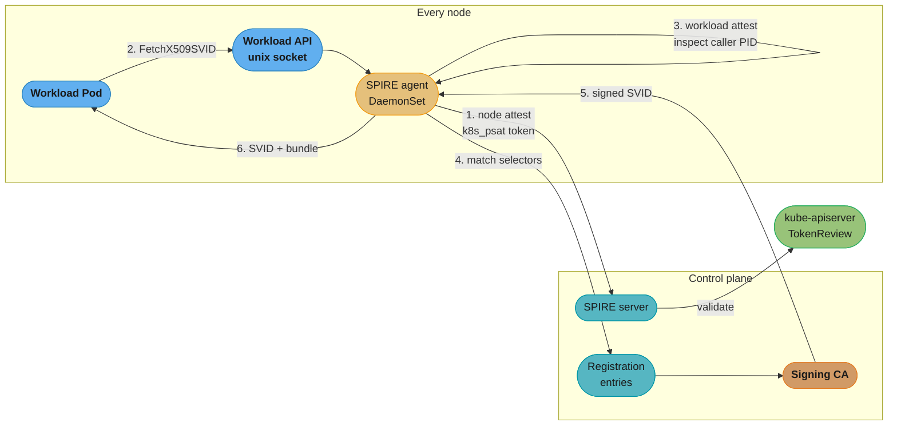
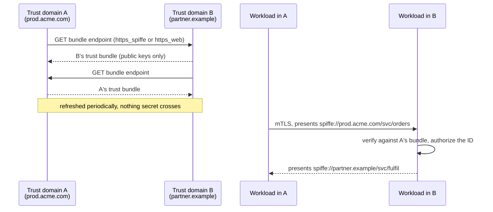

# Workload Identity and Federation

> **Version anchor (2026-08-27).** **SPIFFE and SPIRE are CNCF Graduated projects** (graduated August 2022, announced 2022-09-20); **SPIRE v1.15.3** (2026-08-21) is current. Kubernetes projected ServiceAccount tokens enforce a **600-second minimum TTL**, and the kubelet rotates at **80% of the token's lifetime or 24 hours, whichever comes first**. Auto-generation of legacy non-expiring ServiceAccount Secrets stopped being the default (GA in **1.26**, gate removed in **1.27**) — stopped, not removed: you can still create one deliberately. The `LegacyServiceAccountTokenCleanUp` controller **went GA in 1.30**, and node-bound token creation (`ServiceAccountTokenNodeBinding`) is **GA from 1.33**. On the cloud side, **EKS Pod Identity does not support Fargate or Windows EC2 pods**; GKE's feature is now named **Workload Identity Federation for GKE**; and Azure's **AAD Pod Identity was deprecated 2022-10-24, archived September 2023, with the AKS add-on supported only through September 2025** — its replacement is **Microsoft Entra Workload ID**.

---

## 1. Concept Overview

[kubernetes_security](kubernetes_security.md) tells you to use IRSA or GKE Workload Identity instead of static cloud keys, which is correct and is where most treatments stop. This page is about the primitive underneath that advice, because the same primitive answers a question the cloud bindings do not: **how does service A prove to service B that it is service A, when neither of them is a cloud API?**

The cloud bindings solve one direction — a Pod proving itself to AWS, GCP or Azure. They do nothing for Pod-to-Pod, Pod-to-database, Pod-to-on-prem, or Pod-to-another-company's-service. For those, the industry converged on **SPIFFE** (Secure Production Identity Framework For Everyone): a specification for what a workload identity document looks like and how a workload gets one, and **SPIRE**, its reference implementation. Both graduated from the CNCF in 2022.

The core move is the same one Kubernetes made with projected ServiceAccount tokens and the same one the cloud bindings make: **replace a shared secret with a short-lived, cryptographically verifiable, automatically rotated document that is issued only after the platform has independently attested what the workload is.** A password proves you know a string. An SVID proves the platform observed you being started, on that node, in that namespace, from that image — and the proof expires in minutes.

The word doing the work in the title is **federation**: two independently operated trust domains — two clusters, two clouds, two companies — exchanging trust bundles so a workload in one can verify a workload in the other without either side issuing the other credentials.

---

## 2. Intuition

**One-line analogy.** A static access key is a house key: whoever holds it is you, forever, and you find out it was copied when the house is empty. An SVID is a hotel keycard the front desk re-issues every hour after looking at your face — copying it buys an hour, and only for that room.

**Mental model.** Three questions, and every workload-identity system answers all three:

1. **Attestation** — what *is* this process? Not what does it claim to be; what can the platform prove about it independently? SPIRE answers this in two stages: the *node* attestor proves which machine the agent is on (a cloud instance identity document, a TPM, a projected Kubernetes token), and the *workload* attestor proves which process on that machine is asking (its namespace, ServiceAccount, container image, UID).
2. **Issuance** — given the answer, which identity does it get? A registration entry maps an attested selector set to a SPIFFE ID.
3. **Verification** — how does the other end check it? Standard mTLS against a trust bundle, or standard JWT validation against a JWKS.

**Why it matters.** Static credentials are the most exfiltrated thing in a breach, and they do not expire, do not identify who used them, and do not stop being valid when the workload is deleted. Every control you build on top of a static key — rotation policy, vaulting, scanning — is compensating for a design that assumed a secret could stay secret.

**Key insight.** **The workload never holds a secret it could leak, because it never holds a secret at all.** It holds a certificate whose private key was generated locally, never transmitted, and is replaced every few minutes. What it *proves* is not knowledge of a string but a property the platform observed — and that property, unlike a string, cannot be copied out of a log, a heap dump, or an environment variable.

---

## 3. Core Principles

- **Identity is attested, not asserted.** The workload does not tell the system who it is. The system determines it from properties it can verify independently, and the workload's only input is "here I am, ask me nothing".
- **Two-stage attestation is the security boundary.** Node attestation establishes the machine; workload attestation establishes the process on it. Collapse them and a compromised process on a legitimate node can request any identity that node hosts.
- **Short lifetimes replace revocation.** Certificate revocation at scale does not work — CRLs go stale and OCSP adds a dependency to the hot path. A five-minute SVID makes the question moot: the blast radius of a stolen credential is its remaining lifetime.
- **The name is a URI, and it is structured.** `spiffe://trust-domain/path` — the trust domain is the administrative boundary, the path is yours to design. `spiffe://prod.example.com/ns/payments/sa/checkout` encodes the policy you will write against it.
- **The document is boring on purpose.** An X.509-SVID is an ordinary X.509 certificate carrying the SPIFFE ID as its **sole URI SAN**. A JWT-SVID is an ordinary JWT. Anything that speaks mTLS or validates JWTs consumes them with no changes.
- **Federation is bundle exchange, not credential exchange.** Two trust domains publish their bundles at an endpoint; each fetches the other's and refreshes it. Neither issues anything to the other, and neither can impersonate the other.
- **The transport is a local socket, not the network.** The Workload API is gRPC over a Unix domain socket, so the attestation of the caller can be done by inspecting the calling process. There is no bearer token to steal because there is no bearer token.

---

## 4. Types / Architectures / Strategies

### The two SVID formats

| | X.509-SVID | JWT-SVID |
|---|---|---|
| What it is | an X.509 certificate | a signed JWT |
| Where the ID lives | the **sole URI SAN** (exactly one) | the `sub` claim |
| Used for | mTLS between workloads | L7 hops that cannot do mTLS — through an ALB, a message body, an API gateway |
| Verification | trust bundle (a set of CA certs) | JWKS from the bundle endpoint |
| Replay risk | none — possession requires the private key | **real** — a JWT is a bearer token; audience-scope it and keep the TTL short |
| Key usage constraints | leaf MUST set `digitalSignature`; MUST NOT set `keyCertSign`/`cRLSign`; SHOULD carry EKU `serverAuth` and `clientAuth` | n/a |

Prefer X.509 wherever mTLS is possible. The JWT-SVID exists because L7 infrastructure sometimes terminates TLS, and its bearer nature is a real downgrade — always bind it to a specific audience.

### SPIRE's attestation plugins

| Stage | Plugin | Proves |
|---|---|---|
| Node | `k8s_psat` | the agent runs on a specific node, via a **projected** ServiceAccount token validated with TokenReview |
| Node | `aws_iid`, `gcp_iit`, `azure_msi` | the machine is a specific cloud instance, via the instance identity document |
| Node | `tpm_devid`, `join_token` | hardware-rooted, or a one-time bootstrap secret |
| Workload | `k8s` | namespace, ServiceAccount, Pod name/UID, container image and image ID |
| Workload | `unix` | UID, GID, binary path and its SHA-256 |
| Workload | `docker`, `systemd` | container labels; systemd unit identity |

`k8s_sat` — the older, non-projected Service Account Token attestor — is **deprecated but not removed**; it survives for clusters without token projection. The official Helm chart defaults to `k8s_psat`. The distinction matters: a plain SA token has no audience binding and, historically, no expiry, so a token scraped from one Pod could attest a different node.

### Federation profiles

| Profile | How the bundle endpoint is authenticated | Use when |
|---|---|---|
| `https_web` | ordinary web PKI — a publicly trusted CA | crossing an organisational boundary where the other side has a normal TLS certificate |
| `https_spiffe` | the endpoint's own SPIFFE ID, via `endpoint_spiffe_id` | both sides already run SPIFFE; stronger, no dependency on the web PKI |

For `https_spiffe` the URL scheme MUST be `https` and MUST NOT carry userinfo.

### The cloud bindings, precisely

| | EKS IRSA | EKS Pod Identity | Workload Identity Federation for GKE | Microsoft Entra Workload ID |
|---|---|---|---|---|
| Mechanism | cluster OIDC issuer + IAM trust policy naming it | `pods.eks.amazonaws.com` principal via the EKS Auth service | project-wide pool `PROJECT_ID.svc.id.goog` | federated credential on an app registration |
| Per-cluster setup | an IAM OIDC provider **per cluster** | none — one association per SA | pool is created automatically per project | per app registration |
| Cross-account / cross-tenant | direct role assumption | supported via **role chaining** | supported | supported |
| Fargate | supported | **not supported** | n/a | n/a |
| Recommended for new work | — | **yes**, on supported node types | yes | yes |

Two precision points people get wrong. **EKS Pod Identity does not work on Fargate** (nor on Windows EC2 pods) — if you run Fargate, IRSA is not legacy, it is your only option. And the **GKE pool outlives the cluster**: `PROJECT_ID.svc.id.goog` is per project and persists after cluster deletion, so a recreated cluster with the same namespace/SA names inherits the old bindings.

---

## 5. Architecture Diagrams

The issuance path, with both attestation stages marked:



*Step 3 is the one that carries the weight: the agent determines the caller's identity by inspecting the process on the other end of the socket, so the workload has no opportunity to lie about who it is.*

What a credential actually costs you when it leaks:

```
STATIC CLOUD KEY
  issued ------------------------------------------------------------> forever
         ^ leaked here
         |<================= attacker window: until someone notices ==>

PROJECTED SA TOKEN (min 600s, kubelet rotates at 80% of TTL)
  issued ---------|---------|---------|---------|---------> rotating
                  ^ leaked
                  |<= <= 1 TTL =>|

X.509-SVID (minutes)
  issued -|-|-|-|-|-|-|-|-|-|-|-|-|-|-|-|-|-|-|-> rotating
              ^ leaked
              |<= minutes =>|

  Short lifetimes are not a weaker form of revocation.
  They are what makes revocation unnecessary.
```

Federation, drawn as what actually crosses the boundary:



---

## 6. How It Works — Detailed Mechanics

### The Kubernetes primitive underneath everything

```yaml
apiVersion: v1
kind: Pod
metadata:
  name: checkout
spec:
  serviceAccountName: checkout
  containers:
    - name: app
      image: ghcr.io/example/checkout:1.9
      volumeMounts:
        - name: sts-token
          mountPath: /var/run/secrets/tokens
          readOnly: true
  volumes:
    - name: sts-token
      projected:
        sources:
          - serviceAccountToken:
              path: sts-token
              audience: sts.amazonaws.com   # NOT the API server
              expirationSeconds: 3600
```

Three fields, each load-bearing:

- **`audience`** binds the token to one consumer. A token minted for `sts.amazonaws.com` is rejected by the API server and by every other audience. Omit it and you get an API-server token — a far more dangerous thing to hand to an external service.
- **`expirationSeconds`** has a **cluster-enforced minimum of 600**. The TokenRequest API refuses anything shorter; there is no way to ask for a 60-second token.
- The **kubelet rotates** the file at **80% of the lifetime, or 24 hours, whichever comes first**, and rewrites it in place. Applications must therefore **re-read the file**, not cache its contents at startup. This is the single most common bug in this area and it fails on a schedule: everything works for 48 minutes and then breaks.

Legacy Secret-based tokens are **no longer auto-created** (GA in 1.26, gate removed in 1.27) but the type still exists and can be created deliberately. The `LegacyServiceAccountTokenCleanUp` controller, **GA in 1.30**, invalidates and then deletes unused ones — a two-stage process with a default one-year unused window, which is a good reminder to check whether anything in your cluster still depends on one.

### The cluster as an OIDC issuer

`ServiceAccountIssuerDiscovery` **went GA in 1.21 and its gate was removed in 1.23**, which is what makes every cloud binding possible:

```bash
kubectl get --raw /.well-known/openid-configuration | jq
# { "issuer": "https://oidc.eks.eu-west-1.amazonaws.com/id/9F2C...",
#   "jwks_uri": ".../openid/v1/jwks",
#   "response_types_supported": ["id_token"],
#   "id_token_signing_alg_values_supported": ["RS256"] }
```

AWS's STS, Google's STS and Entra all validate the token by fetching that JWKS. Note what this means: your cluster is a public identity provider, and the trust relationship is "IAM trusts anything this issuer signs for this subject". Which is why the trust policy's `sub` condition is not optional.

### IRSA and Pod Identity, side by side

```json
{
  "Version": "2012-10-17",
  "Statement": [{
    "Effect": "Allow",
    "Principal": { "Federated": "arn:aws:iam::111122223333:oidc-provider/oidc.eks.eu-west-1.amazonaws.com/id/9F2C..." },
    "Action": "sts:AssumeRoleWithWebIdentity",
    "Condition": {
      "StringEquals": {
        "oidc.eks.eu-west-1.amazonaws.com/id/9F2C...:aud": "sts.amazonaws.com",
        "oidc.eks.eu-west-1.amazonaws.com/id/9F2C...:sub": "system:serviceaccount:payments:checkout"
      }
    }
  }]
}
```

```yaml
# BROKEN — StringLike with a wildcard on the subject. Every ServiceAccount
# in every namespace of this cluster can now assume this role. The wildcard
# usually arrives as a "temporary" fix for a namespace rename.
"Condition": {
  "StringLike": {
    "oidc.eks.eu-west-1.amazonaws.com/id/9F2C...:sub": "system:serviceaccount:*"
  }
}
```

```yaml
# FIXED — StringEquals on the exact subject, and always pin the audience.
# Without the :aud condition, a token minted for any other audience by the
# same issuer is accepted.
"Condition": {
  "StringEquals": {
    "oidc.eks.eu-west-1.amazonaws.com/id/9F2C...:aud": "sts.amazonaws.com",
    "oidc.eks.eu-west-1.amazonaws.com/id/9F2C...:sub": "system:serviceaccount:payments:checkout"
  }
}
```

**EKS Pod Identity** removes the whole trust-policy surface. The role trusts `pods.eks.amazonaws.com`, and the ServiceAccount-to-role mapping is an EKS association object rather than an IAM condition:

```bash
aws eks create-pod-identity-association \
  --cluster-name prod-euw1 \
  --namespace payments \
  --service-account checkout \
  --role-arn arn:aws:iam::111122223333:role/checkout
```

One role now works across every cluster, because there is no per-cluster OIDC provider ARN baked into the trust policy. The agent is a DaemonSet using host networking, serving credentials on the link-local address `169.254.170.23`. And the constraint that decides the choice for many teams: **it does not work on Fargate or Windows EC2 pods**.

### SPIRE: registration and consumption

```bash
# Node entry: the agent itself, attested by projected SA token
spire-server entry create \
  -spiffeID spiffe://prod.acme.com/ns/spire/sa/spire-agent \
  -selector k8s_psat:cluster:prod-euw1 \
  -node

# Workload entry: selectors are ANDed, and the image digest is the strong one
spire-server entry create \
  -parentID spiffe://prod.acme.com/ns/spire/sa/spire-agent \
  -spiffeID spiffe://prod.acme.com/ns/payments/sa/checkout \
  -selector k8s:ns:payments \
  -selector k8s:sa:checkout \
  -selector k8s:container-image:ghcr.io/example/checkout@sha256:9b1c... \
  -ttl 300
```

```python
# Consumption: the workload holds no secret and configures no endpoint
# beyond a local socket path.
from pyspiffe.workloadapi import default_workload_api_client

with default_workload_api_client() as client:      # SPIFFE_ENDPOINT_SOCKET
    svid = client.fetch_x509_svid()
    print(svid.spiffe_id)     # spiffe://prod.acme.com/ns/payments/sa/checkout
    bundle = client.fetch_x509_bundles()
```

For anything that cannot speak the Workload API, **`spiffe-helper`** fetches SVIDs on the workload's behalf, writes them to the filesystem, and signals the process to reload — the standard adapter for legacy TLS servers.

**Envoy and Istio** consume SVIDs through the same socket via Envoy's **SDS** API: SPIRE Agent implements SDS directly over a Unix domain socket, and Istio 1.14+ documents swapping its own SDS implementation for SPIRE's, which is how you get one identity plane across meshed and unmeshed workloads.

### The authorization step nobody should skip

Verifying an SVID proves *who* the peer is. It does not decide *whether* they may call you:

```go
// BROKEN — authenticates the peer against the trust bundle and stops.
// Any workload in the trust domain, including a compromised one in an
// unrelated namespace, now passes.
tlsConfig := tlsconfig.MTLSServerConfig(source, source, tlsconfig.AuthorizeAny())
```

```go
// FIXED — authenticate AND authorize. Only these two IDs get through.
tlsConfig := tlsconfig.MTLSServerConfig(source, source,
    tlsconfig.AuthorizeOneOf(
        spiffeid.RequireFromString("spiffe://prod.acme.com/ns/payments/sa/gateway"),
        spiffeid.RequireFromString("spiffe://prod.acme.com/ns/payments/sa/reconciler"),
    ))
```

`AuthorizeAny()` is the SPIFFE equivalent of a firewall rule that checks the packet has a source address.

---

## 7. Real-World Examples

- **Uber** runs SPIRE as a single cross-cloud "Production Trust Domain" spanning **over 250,000 nodes**, documented in a CNCF conference talk — the largest publicly described deployment and the usual reference for "does this scale".
- **SPIRE's own `ADOPTERS.md`** lists ByteDance, Duke Energy, GitHub, Netflix, Niantic, Pinterest, Square, Twilio, Uber, Unity Technologies and Z Lab — a citable list, unlike the vendor logo walls.
- **Istio with SPIRE** replaces Istio's built-in identity plane with SPIRE's, via Envoy SDS over a Unix socket, so meshed and unmeshed workloads share one trust domain. Documented from Istio 1.14 onward.
- **EKS Pod Identity** is AWS's own recommendation for new workloads on supported node types, precisely because IRSA's per-cluster OIDC provider ARN in every trust policy does not survive multi-cluster growth.
- **Azure's migration is finished, not pending.** AAD Pod Identity was deprecated **2022-10-24**, the upstream project **archived in September 2023**, and the AKS-managed add-on was patched only through **September 2025**. Anything still on it today is unsupported, not merely deprecated — a distinction worth stating plainly in a migration plan.
- **GKE's rename is not cosmetic.** "Workload Identity" is now "Workload Identity Federation for GKE", reflecting that it is the same federation machinery GCP exposes for non-GKE workloads. The `PROJECT_ID.svc.id.goog` pool is per project and survives cluster deletion.

---

## 8. Tradeoffs

| Approach | Rotation | Works off-cloud | Pod-to-Pod | Operational cost |
|---|---|---|---|---|
| Static key in a Secret | manual, therefore never | yes | yes | low to run, high to survive |
| Vault/ESO-injected secret | scheduled | yes | yes | a secrets system in the critical path |
| Projected SA token + cloud binding | automatic, 80% of TTL | no — one cloud only | no | very low; the cloud runs it |
| SPIFFE/SPIRE | automatic, minutes | yes | **yes** | a highly-available control plane you operate |
| Service mesh mTLS (mesh CA) | automatic | mesh-only | yes | mesh sidecars or ambient dataplane |

| Choice | You gain | You pay |
|---|---|---|
| SPIRE over cloud-native bindings | one identity plane across clouds, on-prem and Pod-to-Pod | a control plane whose outage stops new workloads getting credentials |
| X.509-SVID over JWT-SVID | no bearer-token replay | both ends must do mTLS; L7 termination breaks it |
| Very short SVID TTLs | tiny blast radius | more signing load; a control-plane blip becomes visible sooner |
| Image-digest selectors | an attacker on the node cannot request another workload's identity | every image update is a registration-entry update |
| EKS Pod Identity over IRSA | one role across clusters, no per-cluster OIDC provider | **no Fargate, no Windows EC2** |
| Federation over a shared trust domain | genuine administrative independence | bundle-endpoint availability becomes a cross-org dependency |

---

## 9. When to Use / When NOT to Use

**Use the cloud-native binding (IRSA / Pod Identity / GKE WIF / Entra Workload ID) when:**
- You are on one cloud, the credential's consumer is that cloud's API, and Pod-to-Pod authentication is handled by something else. This is most teams, and it is the right answer for them.
- On EKS specifically: **Pod Identity for new work on supported node types, IRSA when you run Fargate** — the Fargate exclusion decides it, not preference.

**Use SPIFFE/SPIRE when:**
- Workloads must authenticate **to each other**, or to databases, message brokers and internal services rather than to cloud APIs.
- Identity has to span **more than one cloud**, or cloud and on-prem, under one policy language.
- You need **cross-organisation** authentication and neither side will issue credentials to the other — federation is the only clean answer.
- You already run a mesh and want its identity plane to extend to workloads that are not in the mesh.

**Do NOT reach for SPIRE when:**
- One cloud, cloud APIs only. You would be running a highly-available signing service to replicate something the cloud gives you free.
- Nobody will own the control plane. SPIRE is on the critical path for workload startup; an unowned SPIRE server is an outage waiting for a quorum loss.
- The real problem is that **secrets are in Git**. Fix that with a secrets manager first. Workload identity is the next step after basic hygiene, not a substitute for it.
- You want it purely for mesh mTLS and your mesh already issues identities. Adopt SPIRE when you need identity *outside* the mesh boundary.

---

## 10. Common Pitfalls

**The application that cached the token.** A service reads `/var/run/secrets/tokens/sts-token` once at startup. The kubelet rewrites it at 80% of the TTL. With a 3600-second token, everything works for 48 minutes and then every call fails with an expired-token error — long enough that deploys look clean and the failure arrives after the deployer has gone home. **Fix:** re-read the file on every use, or use an SDK that does. Modern AWS SDKs handle this; hand-rolled HTTP clients almost never do.

**The trust policy with a wildcard subject.** A namespace rename breaks IRSA, someone changes `StringEquals` to `StringLike` with `system:serviceaccount:*` to unblock the deploy, and the ticket to tighten it is never done. Every ServiceAccount in the cluster can now assume that role. **Fix:** `StringEquals` on the full subject, always pin `:aud`, and add a policy check in CI that fails on a wildcard in an OIDC condition — this is exactly the class of thing `policy_as_code_and_compliance` exists for.

**`AuthorizeAny()` in production.** A team ships mTLS with SPIFFE, verifies certificates against the trust bundle, and authorizes nothing. Every workload in the trust domain can call every other one. The mTLS handshake makes it *look* locked down in every diagram. **Fix:** authorization is a separate, mandatory step; `AuthorizeAny()` belongs in a tutorial and nowhere else.

**The registration entry that outlived the workload.** A service is deleted; its SPIRE entry is not. Months later a new deployment reuses the namespace and ServiceAccount name and silently inherits an identity with policy attached to it elsewhere. **Fix:** manage entries declaratively via the SPIRE Controller Manager's CRDs so they follow workload lifecycle, and audit for entries with no matching workload.

**Node attestation without workload attestation.** A setup that trusts anything on an attested node — because workload selectors were "too fiddly" — means a compromised sidecar can request the identity of any workload the node hosts. **Fix:** always constrain with `k8s:ns` and `k8s:sa` at minimum; add `k8s:container-image` with a digest where the image is stable enough to maintain.

**The GKE pool that outlived the cluster.** A team deletes and recreates a GKE cluster with the same namespace and ServiceAccount names. Because the `PROJECT_ID.svc.id.goog` pool is per *project* and survives cluster deletion, the new cluster's workloads silently inherit the old bindings — including ones intended for a decommissioned service. **Fix:** treat the pool as project-scoped state and audit bindings as part of cluster teardown, not cluster creation.

**Planning a migration off AAD Pod Identity as if there were time.** It was deprecated 2022-10-24, archived September 2023, and the AKS add-on's support ended September 2025. A "we'll get to it next quarter" plan is a plan to run an unsupported identity system. **Fix:** treat it as an incident with a due date, not a backlog item.

---

## 11. Technologies & Tools

| Tool | Purpose |
|---|---|
| SPIRE (server, agent) | CNCF Graduated reference implementation of SPIFFE; issues and rotates SVIDs |
| SPIRE Controller Manager | declarative registration entries as Kubernetes CRDs |
| `spiffe-helper` | fetches SVIDs for workloads that cannot speak the Workload API; writes files and signals reload |
| `go-spiffe`, `pyspiffe`, `java-spiffe` | Workload API client libraries with mTLS and authorization helpers |
| Kubernetes projected ServiceAccount tokens | the in-cluster primitive every cloud binding is built on |
| EKS Pod Identity / IRSA | AWS Pod-to-IAM bindings; Pod Identity for new work, IRSA for Fargate |
| Workload Identity Federation for GKE | GCP binding via the per-project `svc.id.goog` pool |
| Microsoft Entra Workload ID | Azure binding via federated credentials; replaces AAD Pod Identity |
| Istio / Envoy SDS | consumes SVIDs over a Unix socket, unifying mesh and non-mesh identity |
| External Secrets Operator | for the residual secrets that genuinely cannot become identities |
| cert-manager | X.509 issuance for ingress and non-SPIFFE TLS; complements rather than replaces this |
| OpenBao / HashiCorp Vault | can consume a SPIFFE or Kubernetes identity to broker access to legacy credentials |

---

## 12. Interview Questions with Answers

**Q: What is workload identity, and why is a short-lived credential better than a rotated static one?**
**Short:** Workload identity replaces a shared secret with a short-lived document issued only after the platform independently attested what the workload is, making the blast radius of a leak its remaining lifetime.
Workload identity means a workload proves what it *is* rather than proving it knows a string. The platform attests properties it can verify independently — which node, which namespace, which ServiceAccount, which image — and issues a short-lived document on that basis. The advantage over rotating a static key is not that rotation is faster: it is that the workload never holds a long-lived secret to leak, the private key is generated locally and never transmitted, and the blast radius of a compromise is the remaining lifetime rather than "until somebody notices". It also makes revocation unnecessary at scale, which matters because certificate revocation genuinely does not work at scale.

**Q: What are the two stages of SPIRE attestation and why does collapsing them break the security model?**
**Short:** Node attestation proves which machine the agent runs on, workload attestation proves which process is asking — without the second, any process on a trusted node can request any identity that node hosts.
**Node attestation** proves the machine: the SPIRE agent presents a projected ServiceAccount token (`k8s_psat`), a cloud instance identity document (`aws_iid`, `gcp_iit`, `azure_msi`), or a TPM-backed credential, and the server verifies it against the source of truth. **Workload attestation** proves the process: when something connects to the Workload API socket, the agent inspects the caller — its PID, and from that its namespace, ServiceAccount, container and image. If you only do node attestation, then any compromised process on a legitimate node can ask for, and receive, the identity of any workload that node hosts. The two stages are not defence in depth; they answer two different questions and you need both answers.

**Q: An application authenticates fine for 48 minutes after every deploy and then fails. What is wrong?**
**Short:** It read the projected ServiceAccount token once at startup and cached it, but the kubelet rewrites the file at 80% of the token's lifetime.
It cached the token. Projected ServiceAccount tokens are rotated **in place** by the kubelet at **80% of the token's lifetime, or 24 hours, whichever comes first** — so with a 3600-second token the file changes at 48 minutes, and a process that read it once at startup is now presenting an expired credential. The signature is unmistakable: a fixed delay after every deploy, identical across environments, invisible in any test that runs for less than the interval. The fix is to re-read the file on every use, or use an SDK that does — modern AWS SDKs handle it, hand-rolled HTTP clients almost never do. The same bug appears with SPIRE if a workload fetches an SVID once instead of streaming updates from the Workload API.

**Q: What exactly is the difference between EKS IRSA and EKS Pod Identity, and when can you not use Pod Identity?**
**Short:** IRSA binds through the cluster's OIDC issuer in each role's trust policy; Pod Identity uses an EKS association and one principal, but it does not work on Fargate or Windows EC2 pods.
IRSA works through the cluster's OIDC issuer: each IAM role's trust policy names that cluster's OIDC provider ARN and conditions on the ServiceAccount subject, so a role is bound to one cluster and adding clusters means editing every trust policy. Pod Identity inverts it — the role trusts the single principal `pods.eks.amazonaws.com`, and the ServiceAccount-to-role mapping lives in an EKS association object, so one role works across every cluster with no trust-policy edits. AWS recommends Pod Identity for new workloads on supported node types, and cross-account access is supported via role chaining. The constraint that decides it in practice: **Pod Identity does not support Fargate or Windows EC2 pods**. On Fargate, IRSA is not legacy, it is the only option.

**Q: Two companies need their services to authenticate to each other and neither will issue credentials to the other. How does SPIFFE federation solve this?**
**Short:** Each trust domain publishes its trust bundle at an endpoint and fetches the other's, so only public keys cross the boundary and neither side can issue identities in the other's domain.
Federation is **bundle exchange, not credential exchange**. Each side runs its own trust domain and publishes its trust bundle — public keys only — at a bundle endpoint. Each fetches and periodically refreshes the other's bundle, so a workload in domain A can verify an SVID from domain B and vice versa, while neither can issue an identity in the other's domain. Two authentication profiles for the endpoint itself: **`https_web`**, authenticated by ordinary web PKI, which is the low-friction choice across organisations; and **`https_spiffe`**, authenticated by the endpoint's own SPIFFE ID via `endpoint_spiffe_id`, which is stronger and needs no dependency on public CAs. Authorization stays local: each side decides which foreign SPIFFE IDs it accepts.

**Q: When should you use a JWT-SVID instead of an X.509-SVID, and what do you lose?**
**Short:** Use a JWT-SVID only when the path cannot carry mTLS — through an L7 load balancer or gateway — and accept that it is a bearer token and therefore replayable.
Use X.509-SVIDs by default: mutual TLS, possession proven by holding the private key, nothing replayable. Reach for a JWT-SVID only when mTLS cannot survive the path — an ALB or API gateway that terminates TLS, a message body, an async hop. What you lose is significant: a JWT is a **bearer token**, so anyone who obtains it can replay it until it expires, which is exactly the property X.509 was chosen to avoid. Mitigate by always binding it to a specific `audience` and keeping the TTL short, and treat every JWT-SVID hop as a place where the credential can be logged. Structurally, the X.509-SVID carries the SPIFFE ID as its **sole URI SAN** while the JWT carries it in `sub`.

**Q: What is the minimum TTL for a projected ServiceAccount token, and why can you not just set it to 60 seconds?**
**Short:** The cluster enforces a 600-second minimum and the TokenRequest API refuses anything shorter, because the kubelet's rotation loop and clock skew need headroom.
**600 seconds.** The TokenRequest API rejects a shorter `expirationSeconds` outright, and it also rejects an audience the cluster is not configured for. The floor exists because the kubelet rotates at 80% of the lifetime and the whole system has to tolerate clock skew, API-server latency and pod scheduling delays; a 60-second token would spend a meaningful fraction of its life in flight. The practical consequence for design is that if you want minute-scale credentials, the projected SA token is not the mechanism — it is the *bootstrap*. SPIRE uses it to attest a node and then issues SVIDs with whatever short TTL you choose, because the SVID lifetime is SPIRE's decision, not Kubernetes'.

**Q: Are the old non-expiring ServiceAccount Secrets removed from Kubernetes?**
**Short:** No — they stopped being auto-created (GA in 1.26, gate removed in 1.27) but the Secret type still exists and can be created deliberately.
They are no longer **auto-created**, which is not the same as removed. `LegacyServiceAccountTokenNoAutoGeneration` was default-on from 1.24, went GA in **1.26**, and the gate was removed in **1.27** — but the `kubernetes.io/service-account-token` Secret type still exists and you can still create one by hand for a system that genuinely cannot use a projected token. Kubernetes also added the `LegacyServiceAccountTokenCleanUp` controller, **GA in 1.30**, which invalidates and then deletes legacy tokens unused past a configurable window (default one year). The precision matters both ways: "removed" would tell someone an audit for them is unnecessary, and it is not; "still the default" would tell them their new clusters have them, and they do not.

**Q: How do SPIRE workload selectors work, and what is the strongest one you can use?**
**Short:** Selectors are ANDed properties the agent observes about the calling process, and the strongest is the container image digest, since a compromised process cannot forge it.
A registration entry maps a set of selectors to a SPIFFE ID, and the selectors are **ANDed** — the workload must satisfy all of them. The agent derives them by inspecting the process on the other end of the socket: `k8s:ns`, `k8s:sa`, `k8s:pod-name`, `k8s:container-image`, or for non-container workloads `unix:uid`, `unix:path` and the binary's SHA-256. The strongest is the **image digest**, because it is a property of what is actually running rather than of how it was labelled — a compromised process cannot present a different digest. The cost is real: every image update is a registration-entry update, so you need the entries managed declaratively (the SPIRE Controller Manager CRDs) rather than by hand, or the operational load will push someone into loosening them.

**Q: What is the status of Azure AAD Pod Identity?**
**Short:** Deprecated 2022-10-24, upstream archived September 2023, and the AKS add-on supported only through September 2025 — anything still on it today is unsupported, not merely deprecated.
It is finished, not fading. The open-source project was **deprecated on 2022-10-24**, the repository was **archived in September 2023**, and the AKS-managed add-on was patched only through **September 2025**. As of today it is unsupported software handling authentication. The replacement is **Microsoft Entra Workload ID**, which uses federated credentials on an app registration validated against the cluster's OIDC issuer — the same pattern as IRSA and GKE Workload Identity Federation, and notably free of AAD Pod Identity's IMDS-interception design. The reason to state the dates rather than say "deprecated" is that "deprecated" gets scheduled for next quarter, and this one should not be.

**Q: You have mTLS with SPIFFE everywhere and every certificate verifies. What might still be completely open?**
**Short:** Authorization — verifying an SVID proves who the peer is, but `AuthorizeAny()` lets every workload in the trust domain call every other one.
Authorization. Verifying an SVID against the trust bundle answers "is this a legitimate workload in this trust domain" and nothing else. If the server is configured with `AuthorizeAny()`, then every workload in the domain — including a compromised one in an unrelated namespace — passes the handshake and reaches your endpoint. Every architecture diagram shows mTLS, so it looks locked down, and it is not. Authorization is a separate mandatory step: `AuthorizeOneOf` with an explicit allowlist of SPIFFE IDs, or a policy layer that matches on the ID path. This is the same mistake as a firewall rule that verifies a packet has a source address.

**Q: How does a Kubernetes cluster act as an OIDC provider, and what is the security consequence?**
**Short:** The API server serves `/.well-known/openid-configuration` and a JWKS, so any external system can validate its tokens — which means the trust policy's subject condition is the entire access control.
The API server exposes `/.well-known/openid-configuration` and `/openid/v1/jwks`, a feature that **went GA in 1.21 with the gate removed in 1.23**. AWS STS, Google STS and Entra fetch that JWKS and validate projected tokens against it, which is how a cluster-issued token becomes a cloud credential. The consequence is that your cluster is a public identity provider, and the cloud's trust relationship is "trust anything this issuer signs for this subject". So the `sub` condition in the trust policy *is* the access control — a wildcard there means every ServiceAccount in the cluster can assume that role — and the `aud` condition matters too, because without it a token minted for a different audience by the same issuer is accepted.

**Q: When would you deploy SPIRE, and when is it the wrong answer?**
**Short:** Deploy it when identity must span Pod-to-Pod, multiple clouds, or organisations; skip it when you are on one cloud talking to cloud APIs, where the native binding already does the job.
Deploy it when the identity problem crosses a boundary the cloud bindings do not: workloads authenticating **to each other**, to databases and brokers, across **more than one cloud**, across cloud and on-prem, or across **organisations** where neither side will issue credentials to the other. Skip it when you are on one cloud, the consumer is that cloud's API, and Pod-to-Pod is handled elsewhere — you would be running a highly available signing service to duplicate something free. Skip it when nobody owns the control plane, because SPIRE sits on the critical path for workload startup and an unowned one is an outage with a quorum. And skip it if the actual problem is secrets committed to Git: fix hygiene first, then upgrade the model.

**Q: What operational risk does SPIRE introduce that static credentials do not have?**
**Short:** It puts a control plane on the startup path — if the SPIRE server is unavailable, running workloads survive their current SVID lifetime but new and rotating ones cannot get credentials.
Availability of the issuer becomes availability of the platform. A static key works when everything else is down, which is its only virtue. With SPIRE, if the server loses quorum or its datastore is unreachable, already-running workloads keep working until their current SVID expires — which with a five-minute TTL is five minutes — and new pods cannot start authenticated at all. So the control plane needs the treatment you would give an authentication service: multiple replicas, a highly available datastore, an upstream CA whose key is in an HSM or KMS, and a deliberate decision about TTL, because a shorter TTL is a smaller breach window *and* a shorter tolerance for control-plane downtime. That tension is the design conversation, and picking a number without naming it is the mistake.

**Q: How would you migrate a fleet from static cloud keys in Secrets to workload identity without a big-bang cutover?**
**Short:** Inventory the keys, migrate service by service with the identity path added alongside the key, then remove the key once the credential is proven unused — and use audit logs to prove it.
Inventory first: find every Secret holding a cloud credential and map it to a consuming workload and the permissions it actually exercises, using the cloud's access-analyzer or audit logs rather than the granted policy — grants are always wider than usage. Then migrate one service at a time with **both paths live**: create the role and the association or trust policy, wire the ServiceAccount, deploy, and confirm from audit logs that calls now arrive as the new principal. Only then delete the key, and delete it rather than leaving it dormant — a dormant key is an unmonitored one. Order the fleet by blast radius, doing the widest-permission credentials first, not the easiest. And add the CI check that fails a wildcard subject condition before you start, or you will accumulate them during the migration.

---

## 13. Best Practices

- **Never omit `audience` on a projected token.** A token with no explicit audience is an API-server token, and handing one to an external service is a privilege escalation.
- **Re-read the token file on every use.** The kubelet rewrites it in place at 80% of the TTL; caching it is a bug that fires on a timer.
- **`StringEquals`, never `StringLike`, on an OIDC trust policy subject** — and always pin `:aud` alongside `:sub`. Fail the build on a wildcard.
- **Authorize, do not just authenticate.** `AuthorizeAny()` is a tutorial default; production needs an explicit SPIFFE ID allowlist or a policy layer over the ID path.
- **Attest at both stages, always.** Node attestation alone lets any process on a trusted node request any identity that node hosts.
- **Manage SPIRE registration entries declaratively** with the Controller Manager CRDs so they follow workload lifecycle. Hand-created entries outlive their workloads and get inherited.
- **Prefer X.509-SVIDs.** Use JWT-SVIDs only where mTLS cannot survive the path, and always bind them to a specific audience.
- **Choose EKS Pod Identity for new work, IRSA when you run Fargate.** The Fargate exclusion is a hard constraint, not a preference.
- **Audit the GKE `svc.id.goog` pool at cluster teardown.** It is project-scoped and outlives the cluster, so bindings get silently inherited.
- **Size SVID TTLs as a deliberate tradeoff** between breach window and tolerance for control-plane downtime, and write the reasoning down.
- **Run SPIRE server like an authentication service**: multiple replicas, an HA datastore, the upstream CA key in an HSM or KMS, and alerting on issuance failures.
- **Delete migrated credentials, do not just stop using them.** A dormant key is an unmonitored one, and the cleanup controller only handles Kubernetes' own legacy tokens.

---

## 14. Case Study

### Scenario: 340 static credentials, four clouds, and an audit finding with a date on it

A financial-services platform runs about 200 services across EKS in two AWS accounts, a GKE cluster inherited from an acquisition, and a rack of on-prem VMs running the settlement engine that predates all of it. An audit produced one finding: **340 long-lived credentials across the estate, 61 of them with no recorded rotation and 12 present in more than one repository.** The settlement engine authenticated to the cloud services with a certificate issued in 2021 by an internal CA whose private key was on a laptop.

**Why the obvious fix was not enough.** Moving the EKS workloads to IRSA was straightforward and covered about 40% of the credentials. It did nothing for the other three problems: service-to-service authentication inside the clusters, GKE-to-AWS calls made by the acquired platform, and the on-prem settlement engine, which is not in any cloud's identity plane at all.

**The broken configuration, which had a second problem nobody had noticed:**

```yaml
# BROKEN — a static key pair in a Secret, base64 as if that were a control,
# mounted into eleven Deployments that share one credential. When it leaks,
# nobody can tell which of the eleven leaked it, and rotating it means
# coordinating eleven restarts.
apiVersion: v1
kind: Secret
metadata:
  name: settlement-aws-creds
  namespace: settlement
type: Opaque
data:
  AWS_ACCESS_KEY_ID: QUtJQVJPVEFURU1FUExFQVNF
  AWS_SECRET_ACCESS_KEY: d2UgYWxsIGtub3cgYmFzZTY0IGlzIG5vdCBlbmNyeXB0aW9u
```

Shared credentials are worse than they look. One key across eleven workloads means CloudTrail attributes every call to the same principal, so the audit trail cannot answer "which service did this", and the permission set is the union of what eleven services need — which is how a reporting job ends up able to write to the settlement bucket.

```yaml
# FIXED (step 1) — one identity per workload via EKS Pod Identity.
# One role per service, so CloudTrail attributes calls correctly and the
# permission set is what THIS service needs, not the union of eleven.
apiVersion: v1
kind: ServiceAccount
metadata:
  name: settlement-poster
  namespace: settlement
---
# aws eks create-pod-identity-association \
#   --cluster-name prod-euw1 --namespace settlement \
#   --service-account settlement-poster \
#   --role-arn arn:aws:iam::111122223333:role/settlement-poster
```

Pod Identity was chosen over IRSA specifically because the same role definition had to work in two clusters in two accounts, and IRSA would have meant a trust policy per cluster OIDC provider in every role — the thing that had already made the previous migration attempt stall.

**Step two: SPIRE for everything that is not a cloud API.** A SPIRE server pair per region, backed by a highly available datastore, with the upstream CA key in KMS. Agents as DaemonSets in both EKS clusters and the GKE cluster, plus agents on the on-prem VMs attested by TPM. Trust domain `prod.fin.example`, with SPIFFE IDs shaped `spiffe://prod.fin.example/ns/<namespace>/sa/<serviceaccount>` in Kubernetes and `spiffe://prod.fin.example/host/settlement/<role>` on-prem.

The settlement engine, which could not be modified, was fitted with **`spiffe-helper`** — it fetches the SVID, writes cert and key to disk, and signals the process to reload. A twenty-year-old TLS server got automatic five-minute certificate rotation without a line of application code changing, and that single result is what convinced the team the model was worth the control plane.

**The pitfall that cost them a week.** The first SPIRE rollout used only namespace and ServiceAccount selectors. During a red-team exercise, a deliberately compromised sidecar in the `reporting` namespace requested — and received — the settlement engine's client identity, because the selectors did not distinguish which *container* in the Pod was asking. Adding `k8s:container-image` with a pinned digest closed it, at the cost of making registration entries part of the deploy pipeline. That in turn forced the move from hand-created entries to the SPIRE Controller Manager CRDs, which they should have started with.

**The second pitfall, found by the same exercise.** The Go services verified peer SVIDs against the trust bundle and used `AuthorizeAny()`. Every diagram said mTLS; every service could call every other service. The fix was `AuthorizeOneOf` with an explicit allowlist generated from the same service catalogue that generated the registration entries.

**Cross-organisation.** The clearing partner needed authenticated access in both directions. Rather than issuing the partner credentials in `prod.fin.example`, the two federated: bundle endpoints on both sides using the `https_web` profile, since the partner already had ordinary TLS certificates and did not want a SPIFFE dependency for bootstrap. Each side authorizes a short allowlist of the other's SPIFFE IDs. Nothing secret crosses the boundary in either direction, and either side can revoke by removing the other from its allowlist.

**Where it landed.** 340 static credentials to 11, all of them for third-party SaaS APIs that only accept API keys, all in a secrets manager with a rotation schedule and an owner. Every internal call now carries an attested identity that appears in the audit trail. The settlement engine's 2021 certificate and the laptop it was signed on are both gone.

**What they would do differently.** Start with declarative registration entries; the hand-created ones were tolerable for thirty services and untenable at two hundred, and the migration to CRDs mid-flight was the most disruptive week of the project. And run the red-team exercise at thirty services rather than at a hundred and fifty — both findings were design errors, and both would have been an afternoon's fix early and were a fortnight's fix late.

### Discussion questions

- The team chose a five-minute SVID TTL. What breaks first if the SPIRE control plane is unavailable for ten minutes, and would you have chosen differently?
- `AuthorizeAny()` passed code review because the change that introduced it was labelled "add mTLS". What review or test would have caught it?
- Federation with the clearing partner used `https_web`. What would have to be true about the partner for `https_spiffe` to be worth the extra coupling?
- Eleven credentials survive because the SaaS vendors only accept API keys. What would you require of a vendor before adding a twelfth?
