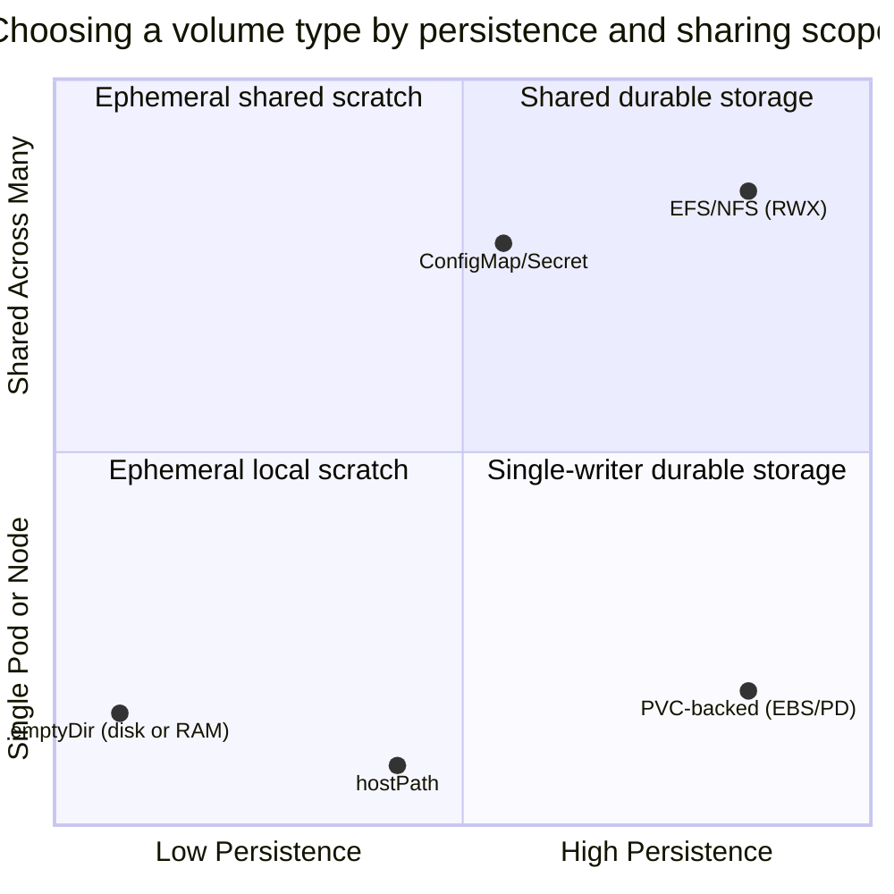
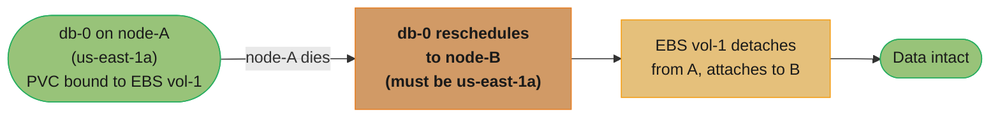
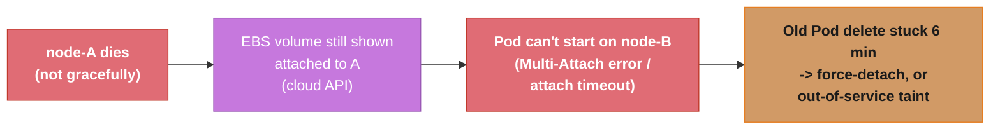
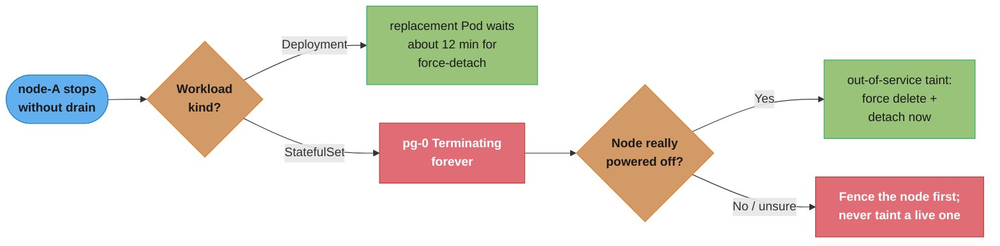
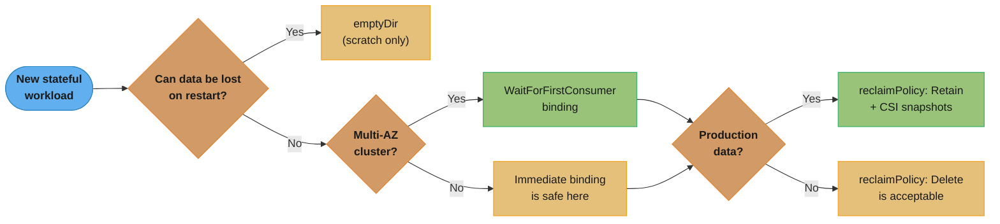

# Kubernetes Storage & State

> Phase 2 — Containers & Kubernetes · Difficulty: Intermediate

> **Version anchor (2026-10-19).** Kubernetes **1.37** is the current minor (1.37.0 "Garhwal" on 2026-08-26, patch 1.37.1 on 2026-09-23). In 1.37, `SELinuxMount`/`SELinuxChangePolicy` are stable, the PVC `Unused` condition (`PersistentVolumeClaimUnusedSinceTime`) is beta and on by default, and `StorageCapacityScoring` and `VolumeLimitScaling` are beta. Older features this page relies on: non-graceful node shutdown (`node.kubernetes.io/out-of-service` taint) GA in 1.28, `fsGroupChangePolicy` GA in 1.23, StatefulSet `persistentVolumeClaimRetentionPolicy` GA in 1.32, and `VolumeAttributesClass` (`storage.k8s.io/v1`) GA in 1.34 with its gate locked on in 1.36. Tools named on this page: **external-snapshotter v8.7.0** (2026-10-13, the VolumeSnapshot CRDs and controller), **Velero v1.18.4** (2026-09-28), **Rook v1.21.0** (2026-10-06), **Longhorn v1.13.0** (2026-09-29) and **CloudNativePG v1.30.1** (2026-09-23).

Containers are ephemeral; their writable layer vanishes on restart. Running stateful workloads (databases, queues, caches) on Kubernetes requires durable storage that survives Pod rescheduling. The abstractions — Volumes, PersistentVolumes (PV), PersistentVolumeClaims (PVC), StorageClasses, and the CSI driver model — decouple "I need 100 GiB of fast SSD" from the specifics of EBS, GCE PD, or Ceph.

---

## 1. Concept Overview

Kubernetes storage separates *requesting* storage from *providing* it:

- **Volume** — storage attached to a Pod for its lifetime (or the container's). `emptyDir` is ephemeral (dies with the Pod); other types persist.
- **PersistentVolume (PV)** — a cluster resource representing a piece of real storage (an EBS volume, an NFS export). Has a lifecycle independent of any Pod.
- **PersistentVolumeClaim (PVC)** — a Pod's *request* for storage ("100 GiB, ReadWriteOnce"). Kubernetes binds it to a matching PV.
- **StorageClass** — defines a "type" of storage (provisioner, parameters, reclaim policy) and enables **dynamic provisioning**: a PVC referencing a StorageClass auto-creates a PV.
- **CSI (Container Storage Interface)** — the standard plugin API; cloud and storage vendors ship CSI drivers (EBS CSI, EFS CSI, etc.) that provision/attach/mount volumes.

**Access modes** govern sharing: `ReadWriteOnce` (RWO — one node), `ReadWriteMany` (RWX — many nodes, needs a shared FS like EFS/NFS), `ReadOnlyMany` (ROX).

Storage and loading of model weights, and the cold start they add to a new replica, are covered in [Model Storage, Loading and Cold Start](../../mlops/model_storage_loading_and_cold_start/model_storage_loading_and_cold_start.md).

---

## 2. Intuition

> **One-line analogy**: A PVC is a storage *order form* ("I need 100 GiB of fast SSD"); a StorageClass is the *catalog* defining what "fast SSD" means and who fulfills it; a PV is the *delivered unit*; CSI is the *supplier* that actually manufactures and ships it. You order against the catalog and the supply chain handles the rest.

**Mental model**: Pods are cattle, but their *data* may be a pet. A PVC outlives the Pod that uses it — when a StatefulSet Pod (`db-0`) is rescheduled to another node, its PVC (and the underlying EBS volume) detaches from the old node and reattaches to the new one, so the data follows. The binding PVC↔PV is sticky; the Pod↔node binding is not.

**Why it matters**: Get storage wrong and you lose data or wedge a workload. The classic failures: an `emptyDir` "database" that loses everything on restart; an RWO volume that can't move because a Pod with `ReadWriteOnce` is stuck on a dead node (volume still attached); a StatefulSet that won't schedule because its zone-locked EBS volume can't attach to a node in another AZ.

**Key insight**: Most cloud block storage (EBS, GCE PD) is **zone-scoped and single-attach (RWO)**. A Pod using it can only run on a node in the volume's availability zone, and only one node can mount it. This constraint shapes every stateful design decision — topology, failover, and why multi-attach needs a shared filesystem.

---

## 3. Core Principles

1. **Separate request from provision.** PVC (request) binds to PV (real storage), often auto-created via StorageClass.
2. **PVCs outlive Pods.** Data persists across rescheduling; the volume follows the Pod.
3. **Access mode dictates sharing.** RWO = one node; RWX needs a shared/networked filesystem.
4. **Topology constrains scheduling.** Zone-scoped volumes pin Pods to that zone.
5. **Reclaim policy decides deletion.** `Retain` keeps data after PVC deletion; `Delete` destroys the underlying volume.
6. **CSI standardizes the plugin layer.** Provision/attach/mount/snapshot via vendor drivers.

---

## 4. Types / Architectures / Strategies

### Volume types

| Type | Lifetime | Use |
|------|----------|-----|
| `emptyDir` | Pod lifetime (dies with Pod) | Scratch, cache, shared dir between containers |
| `emptyDir` (memory) | Pod lifetime, RAM-backed | Fast tmpfs scratch |
| PVC-backed (EBS/PD CSI) | Independent (persists) | Databases, durable state |
| `hostPath` | Node lifetime | Node agents (DaemonSets); risky for apps |
| ConfigMap/Secret volume | Pod lifetime | Config/cert injection (auto-updates) |
| EFS/NFS (RWX) | Independent | Shared read-write across many Pods |

The six types trade off two independent axes — how long the data survives, and how many Pods can share it at once:



`emptyDir` and `hostPath` sit low on persistence — the first dies with the Pod, the second with the node; PVC-backed volumes buy durability but stay single-writer (RWO); only EFS/NFS reaches the top-right quadrant of durable *and* shared.

### Access modes

| Mode | Meaning | Backed by |
|------|---------|-----------|
| ReadWriteOnce (RWO) | One node read-write | EBS, GCE PD (block) |
| ReadWriteOncePod | Exactly one Pod | CSI (stricter than RWO) |
| ReadWriteMany (RWX) | Many nodes read-write | EFS, NFS, CephFS (shared FS) |
| ReadOnlyMany (ROX) | Many nodes read-only | Shared FS, snapshots |

### Reclaim policies

| Policy | On PVC deletion |
|--------|-----------------|
| Delete (default for dynamic) | Underlying volume destroyed |
| Retain | Volume kept (manual cleanup); protects data |

---

## 5. Architecture Diagrams

**Dynamic provisioning flow**

```mermaid
flowchart LR
    classDef io      fill:#61afef,stroke:#2e86c1,color:#1a1a1a,font-weight:bold
    classDef frozen  fill:#c678dd,stroke:#9b59b6,color:#fff
    classDef train   fill:#98c379,stroke:#27ae60,color:#1a1a1a
    classDef mathOp  fill:#d19a66,stroke:#e67e22,color:#1a1a1a,font-weight:bold
    classDef lossN   fill:#e06c75,stroke:#c0392b,color:#fff,font-weight:bold
    classDef req     fill:#56b6c2,stroke:#0097a7,color:#1a1a1a
    classDef base    fill:#e5c07b,stroke:#f39c12,color:#1a1a1a

    pod([Pod]) --> pvc["PVC data<br/>100Gi · RWO<br/>storageClassName: gp3"]
    pvc --> sc["StorageClass gp3<br/>provisioner: ebs.csi.aws.com<br/>reclaimPolicy: Delete"]
    sc -->|"triggers CSI<br/>provision"| csi["EBS CSI driver<br/>creates 100Gi gp3 volume<br/>in Pod's AZ"]
    csi --> pv["PV<br/>bound to PVC"]
    pv -->|"attach / mount"| node([Node where<br/>Pod is scheduled])

    class pod io
    class pvc req
    class sc,pv base
    class csi mathOp
    class node train
```



A Pod's PVC references a StorageClass, which triggers the CSI driver to provision the real volume in the Pod's AZ; the resulting PV then attaches and mounts to the node the Pod was scheduled on.

**StatefulSet storage follows the Pod**



Because EBS volumes are zone-locked, `db-0` can only reschedule to another node still inside `us-east-1a` — the PVC↔PV binding is what lets `vol-1` follow it there with no data loss.

---

## 6. How It Works — Detailed Mechanics

### StorageClass + PVC (dynamic provisioning)

```yaml
apiVersion: storage.k8s.io/v1
kind: StorageClass
metadata: {name: gp3}
provisioner: ebs.csi.aws.com
parameters: {type: gp3, iops: "3000", throughput: "125"}
reclaimPolicy: Retain                 # keep the EBS volume if the PVC is deleted (data safety)
volumeBindingMode: WaitForFirstConsumer  # delay provisioning until a Pod is scheduled (topology-aware)
allowVolumeExpansion: true            # enables online resize
---
apiVersion: v1
kind: PersistentVolumeClaim
metadata: {name: data}
spec:
  accessModes: [ReadWriteOnce]
  storageClassName: gp3
  resources: {requests: {storage: 100Gi}}
```

`volumeBindingMode: WaitForFirstConsumer` is critical in multi-AZ clusters: it defers creating the EBS volume until the scheduler picks a node, so the volume is created in *that node's* AZ — avoiding "volume in 1a, Pod scheduled to 1b, can't attach."

### Expanding a volume online

```bash
# With allowVolumeExpansion: true, just edit the PVC request upward:
kubectl patch pvc data -p '{"spec":{"resources":{"requests":{"storage":"200Gi"}}}}'
# CSI resizes the EBS volume; the filesystem grows (often online). Shrinking is NOT supported.
```

### Volume snapshots (CSI)

```yaml
apiVersion: snapshot.storage.k8s.io/v1
kind: VolumeSnapshot
metadata: {name: db-snap-2026-06-05}
spec:
  volumeSnapshotClassName: ebs-snapclass
  source: {persistentVolumeClaimName: data-db-0}
# Restore: create a new PVC with dataSource referencing this snapshot.
```

### emptyDir vs persistent (the data-loss trap)

```yaml
# emptyDir: scratch only. Survives container restart, DIES on Pod deletion/reschedule.
volumes: [{name: cache, emptyDir: {}}]

# PVC-backed: survives reschedule. Use for ANY data you can't lose.
volumes: [{name: data, persistentVolumeClaim: {claimName: data}}]
```

### Why a Pod can get stuck on a dead node (RWO)



The delay is a chain of fixed timers, and the `VolumeAttachment` object that records "this volume is attached to node-A" is what blocks the new attach:

| Time after the node dies | Component | What happens |
|---|---|---|
| about 50 s | node lifecycle controller (`--node-monitor-grace-period`, default 50s) | Node goes `Unknown`; taint `node.kubernetes.io/unreachable:NoExecute` added |
| about 5 min 50 s | taint manager | the default `tolerationSeconds: 300` that the `DefaultTolerationSeconds` admission plugin adds to every Pod expires; the Pod gets a `deletionTimestamp` but stays `Terminating`, because no kubelet can confirm the unmount |
| about 11 min 50 s | attach-detach controller | `maxWaitForUnmountDuration` (6 minutes, hard-coded) runs out while the node is still unhealthy, so the controller force-detaches and calls the CSI `ControllerUnpublishVolume` |

A Deployment Pod recovers at the end of that chain: its ReplicaSet does not count `Terminating` Pods, so the replacement exists early and attaches once the force-detach lands. A StatefulSet Pod does not recover at all. `pg-0` still exists as a `Terminating` object, so the StatefulSet controller cannot create a second `pg-0`, and the Pod waits until the node returns or the Node object is deleted (on EKS the cloud controller deletes it when the EC2 instance is terminated, not when it is only stopped or hung).

### Non-graceful node shutdown: the `out-of-service` taint

The operator lever for that case is the `node.kubernetes.io/out-of-service` taint (GA in 1.28). Once it is on a Node, Pods without a matching toleration are force-deleted and their volumes detach at once, with no 6-minute wait:

```bash
# 1. Prove the node is really off, not rebooting. Tainting a live node lets two writers mount one volume.
aws ec2 describe-instances --instance-ids i-0abc --query 'Reservations[].Instances[].State.Name'   # "stopped"
# 2. Mark it out of service: Pods are force-deleted, VolumeAttachments removed immediately.
kubectl taint nodes ip-10-0-1-23 node.kubernetes.io/out-of-service=nodeshutdown:NoExecute
# 3. After pg-0 runs elsewhere and the node is repaired, remove the taint yourself; nothing removes it for you.
kubectl taint nodes ip-10-0-1-23 node.kubernetes.io/out-of-service=nodeshutdown:NoExecute-
```

The 6-minute force-detach breaks the CSI rule that `ControllerUnpublishVolume` runs only after `NodeUnpublishVolume` succeeds, so a node that is merely partitioned and still writing can corrupt the volume. A cluster that cannot accept that risk sets `disable-force-detach-on-timeout` on kube-controller-manager; volumes on an unhealthy node then never detach on a timer, and the taint becomes the only recovery path.



### Changing IOPS and throughput on a live PVC: `VolumeAttributesClass`

The StorageClass `parameters` above (`iops: "3000"`, `throughput: "125"`) are read once, at provisioning. Editing the StorageClass changes nothing for existing volumes. A `VolumeAttributesClass` (VAC, `storage.k8s.io/v1`, GA in 1.34) holds the mutable performance attributes instead, and a PVC moves between classes by changing `spec.volumeAttributesClassName`. The external-resizer sidecar sees the change and calls the CSI `ControllerModifyVolume` RPC, which for the EBS CSI driver (v1.19.0 and later) is an EBS Elastic Volumes `ModifyVolume` call that runs while the volume stays attached.

```yaml
apiVersion: storage.k8s.io/v1
kind: VolumeAttributesClass
metadata: {name: gp3-fast}
driverName: ebs.csi.aws.com
parameters: {iops: "12000", throughput: "500"}    # parameters are immutable; make a new class to change them
---
# Raise the database volume from 3000 IOPS / 125 MiB/s to 12000 / 500 without a restart:
# kubectl patch pvc data-pg-0 -p '{"spec":{"volumeAttributesClassName":"gp3-fast"}}'
# Progress shows in .status.currentVolumeAttributesClassName and .status.modifyVolumeStatus
```

Three limits apply. The CSI driver must implement `ModifyVolume`; a driver without it leaves the PVC in a pending modify state. EBS allows four modifications per volume in a rolling 24-hour period and each must reach `completed` before the next, so a VAC is not an autoscaling knob for minute-scale load. A class holds at most 512 parameters and 256 KiB in total.

### StatefulSet PVC lifecycle and `fsGroup` ownership

Two StatefulSet settings decide what happens to volumes outside the failure path.

- **`persistentVolumeClaimRetentionPolicy`** (GA in 1.32) has two fields, `whenDeleted` and `whenScaled`, each `Retain` (default) or `Delete`. With `Delete` the controller puts owner references on the PVCs (the StatefulSet for `whenDeleted`, the condemned Pod for `whenScaled`) and the garbage collector deletes them after the Pod is gone, so the volume unmounts first. A Pod replaced after a node failure keeps its PVC under either policy; the policy applies only to delete and scale-down.
- **`fsGroupChangePolicy`** (GA in 1.23) in the Pod `securityContext`. With `fsGroup` set, the default `Always` makes the kubelet walk the whole volume and `chown`/`chmod` every file on each mount. `OnRootMismatch` checks only the volume root and skips the walk when it already matches. The setting has no effect on `secret`, `configMap` and `emptyDir`, or when the CSI driver applies `fsGroup` itself through the `VOLUME_MOUNT_GROUP` capability.

```yaml
spec:
  persistentVolumeClaimRetentionPolicy:
    whenDeleted: Retain     # deleting the StatefulSet keeps data-pg-*
    whenScaled: Delete      # scaling 3 -> 2 deletes data-pg-2 once pg-2 terminates
  template:
    spec:
      securityContext:
        fsGroup: 999
        fsGroupChangePolicy: OnRootMismatch   # no recursive chown of 50M files on every restart
```

### Finding idle PVCs: the `Unused` condition

A PVC outlives the Deployment or StatefulSet that created it, and with `reclaimPolicy: Retain` nothing ever cleans it up, so deleted apps leave billed volumes behind. Since 1.37 (beta, `PersistentVolumeClaimUnusedSinceTime`, on by default) the PVC protection controller sets condition `Unused=True` (reason `NoPodsUsingPVC`) when the last non-terminal Pod referencing the claim goes away, and flips it to `False` (`PodUsingPVC`) when a Pod uses it again. The condition's `lastTransitionTime` is the idle-since time. Kubernetes deletes nothing; the query is yours:

```bash
# PVCs idle for more than 30 days, across all namespaces
kubectl get pvc -A -o json | jq -r '
  .items[]
  | (.status.conditions // [] | map(select(.type=="Unused" and .status=="True"))[0]) as $c
  | select($c != null and (now - ($c.lastTransitionTime | fromdateiso8601)) > 30*86400)
  | "\(.metadata.namespace)/\(.metadata.name) unused since \($c.lastTransitionTime)"'
```

The timestamp is when the controller observed no Pods, not when the volume unmounted, so the idle time can read slightly short but never long. A CronJob that runs only on its schedule shows `Unused=True` between runs, so set the threshold above the longest schedule interval.

### SELinux volume labels: mount option instead of recursive relabel

On an SELinux node the container runtime used to relabel every file on a volume to the Pod's SELinux context before start. That walk grows with the file count and ran on every Pod start, so a volume with millions of files delayed every start. In 1.37 `SELinuxMount` and `SELinuxChangePolicy` are stable: when the CSI driver opts in with `spec.seLinuxMount: true` on its `CSIDriver` object, the kubelet mounts the volume with `-o context=<label>` and skips the walk. A mount carries one context, so two Pods with different SELinux labels that share a volume on one node, which worked under relabeling, can now fail to start. Set `spec.securityContext.seLinuxChangePolicy: Recursive` on those Pods to keep the old behavior. Clusters without SELinux see no change.

### Capacity and attach limits in scheduling

| Feature (1.37 beta) | Gate | What changes |
|---|---|---|
| Storage capacity scoring | `StorageCapacityScoring` | the VolumeBinding plugin scores nodes from the driver's `CSIStorageCapacity` objects; the default shape prefers the node with the most free capacity, leaving room to expand. Needs `storageCapacity: true` on the `CSIDriver` for dynamic provisioning |
| CSI attach-limit aware autoscaling | `VolumeLimitScaling` | Cluster Autoscaler simulates scale-up against templated `CSINode` objects, so it counts attach limits (for example the per-instance EBS volume limit) on nodes it has not created yet; a `CSIDriver` can set `PreventPodSchedulingIfMissing` to keep Pods off a node until its driver has registered |

---

## 7. Real-World Examples

- **Databases as StatefulSets** (Postgres, MySQL) use `volumeClaimTemplates` so each replica gets its own EBS-backed PVC that follows it across reschedules — though many teams prefer managed RDS to avoid this operational surface.
- **Kafka/Elasticsearch** rely on per-broker persistent volumes with `Retain` reclaim policy so a PVC mistake doesn't destroy data.
- **EFS for shared content** (RWX): CMS uploads, ML datasets, or shared model files mounted read-write by many Pods across nodes/AZs.
- **Velero** backs up PVCs (via CSI snapshots) plus Kubernetes objects for disaster recovery (see [disaster_recovery_and_resilience](../disaster_recovery_and_resilience/disaster_recovery_and_resilience.md)).

---

## 8. Tradeoffs

| Decision | Option A | Option B | Key factor |
|----------|----------|----------|-----------|
| State location | Self-run StatefulSet | Managed service (RDS) | Ops burden vs control/cost |
| Access mode | RWO block (EBS, fast) | RWX shared (EFS, flexible) | Single-writer perf vs multi-node sharing |
| Reclaim policy | Retain (data-safe) | Delete (auto-cleanup) | Data protection vs tidiness |
| Binding mode | WaitForFirstConsumer (topology-aware) | Immediate | Multi-AZ correctness vs speed |
| Scratch | emptyDir (fast, ephemeral) | PVC (durable) | Loss-tolerant vs durable |
| Snapshots | CSI snapshots (fast, cloud-native) | App-level dumps (portable) | Speed vs portability/consistency |

---

## 9. When to Use / When NOT to Use

**Use Kubernetes-native storage when:** you must run stateful workloads in-cluster (no managed equivalent, data locality, cost), need shared RWX storage, or want CSI snapshots integrated with your backup tooling.

**Prefer managed services when:** a cloud database/queue fits (RDS, ElastiCache, MSK) — the operational burden of self-running stateful systems on Kubernetes (failover, backups, upgrades, zonal volume constraints) is high. Never use `emptyDir` or `hostPath` for data you can't lose.

---

## 10. Common Pitfalls

**Pitfall 1 — Using `emptyDir` (or no volume) for a database.**

```yaml
# BROKEN: "stateful" workload with ephemeral storage -> all data lost on reschedule/restart.
spec:
  containers:
    - name: postgres
      image: postgres:18
      volumeMounts: [{name: pgdata, mountPath: /var/lib/postgresql/data}]
  volumes: [{name: pgdata, emptyDir: {}}]      # gone the moment the Pod is rescheduled
```

```yaml
# FIX: StatefulSet with a volumeClaimTemplate -> durable, Pod-following PVC.
spec:
  volumeClaimTemplates:
    - metadata: {name: pgdata}
      spec: {accessModes: [ReadWriteOnce], storageClassName: gp3, resources: {requests: {storage: 100Gi}}}
```

**Pitfall 2 — `Immediate` binding in a multi-AZ cluster.** The PV is provisioned in AZ 1a before scheduling, but the scheduler later places the Pod on a node in 1b; the zonal EBS volume can't attach and the Pod is stuck Pending. FIX: `volumeBindingMode: WaitForFirstConsumer` so provisioning waits for the node choice and lands the volume in the right AZ.

**Pitfall 3 — `reclaimPolicy: Delete` on production data.** Someone deletes a PVC (or a `helm uninstall` does), and the underlying EBS volume — with the only copy of the data — is destroyed. FIX: use `Retain` for stateful production volumes, protect PVCs with finalizers/labels, and keep CSI snapshots/backups.

The three pitfalls above are really one triage flow — durability, then topology, then reclaim safety:



The two green outcomes — `WaitForFirstConsumer` and `Retain` — are exactly the fixes from Pitfalls 2 and 3; skip either gate and you land back in one of the failures above.

**Pitfall 4: scaling a StatefulSet down with `whenScaled: Delete` and expecting the data back.** Scaling from 3 to 2 under `whenScaled: Delete` garbage-collects `data-pg-2`, and with a `Delete` reclaim policy the EBS volume goes with it, so scaling back to 3 starts `pg-2` on an empty volume. FIX: keep `whenScaled: Retain` (the default) for stores whose replicas own unique data, and use `Delete` only where a new replica rebuilds from its peers.

---

## 11. Technologies & Tools

| Tool | Purpose |
|------|---------|
| EBS / GCE PD / Azure Disk CSI | Block storage (RWO) |
| EFS / Filestore / Azure Files CSI | Shared filesystems (RWX) |
| CSI snapshot controller | Volume snapshots/restore |
| Velero | PVC + object backup/restore, DR |
| OpenEBS / Rook-Ceph / Longhorn | Software-defined storage in-cluster |
| `kubectl get pv,pvc,sc` | Inspect storage bindings |
| local-path-provisioner | Simple local PVs (dev) |
| `VolumeAttributesClass` + external-resizer | Change IOPS, throughput or volume type on a bound PVC through CSI `ControllerModifyVolume` |
| `node.kubernetes.io/out-of-service` taint | Force-delete Pods and detach volumes from a node confirmed powered off |

---

## 12. Interview Questions with Answers

**Q: A StatefulSet Pod sits in `Terminating` forever after its node lost power. How do you recover it safely?**
**Short:** Confirm the node is powered off, then add the `node.kubernetes.io/out-of-service` taint so Kubernetes force-deletes its Pods and detaches their volumes at once.
The StatefulSet controller cannot create a new `pg-0` while the old `pg-0` object still exists, and the old one stays `Terminating` because no kubelet answers to confirm the unmount. Deleting the Node object or bringing the node back also works, but the designed lever is the out-of-service taint (GA in 1.28): `kubectl taint nodes NODE node.kubernetes.io/out-of-service=nodeshutdown:NoExecute`. Pods without a matching toleration are force-deleted and their volume detach runs immediately, so `pg-0` reattaches its PVC on another node in seconds. The safety condition is the whole point: taint only a node proven off (stopped instance, IPMI power state), never one that is rebooting or partitioned, because a node still running can keep writing to a volume now attached elsewhere. Remove the taint by hand after the node is repaired.

**Q: Does deleting a StatefulSet or scaling it down delete its PVCs?**
**Short:** No by default: `persistentVolumeClaimRetentionPolicy` defaults to `Retain` for both `whenDeleted` and `whenScaled`; set either to `Delete` to have the PVCs garbage-collected.
`persistentVolumeClaimRetentionPolicy` (GA in 1.32) has two independent fields. `whenDeleted` covers deleting the StatefulSet, `whenScaled` covers reducing `replicas`, and both default to `Retain`, which is why deleted databases leave billed volumes behind. With `Delete`, the controller sets an owner reference on each PVC (the StatefulSet, or the condemned Pod for scale-down) and the garbage collector removes the PVC after the Pod terminates, so the volume unmounts cleanly first. Whether the backing EBS volume is also destroyed then depends on the PV's `reclaimPolicy`. Neither field fires when a Pod is replaced after a node failure; the replacement reuses the existing PVC.

**Q: How do you raise the IOPS of a gp3 PVC that is already bound, without recreating it?**
**Short:** Point the PVC's `spec.volumeAttributesClassName` at a VolumeAttributesClass with the higher `iops`; the resizer calls CSI `ControllerModifyVolume` while the volume stays attached.
Editing the StorageClass does nothing, because its `parameters` apply only at provisioning. A `VolumeAttributesClass` (GA in 1.34) carries mutable attributes such as `iops`, `throughput` and, for EBS, `type`. Create a class like `gp3-fast` with `iops: "12000"` and patch the PVC to reference it; the external-resizer calls `ControllerModifyVolume`, the EBS CSI driver issues an Elastic Volumes modification, and `.status.modifyVolumeStatus` reports progress. Class parameters are immutable, so a different tier means a new class. The cloud's own limits still bind: EBS allows four modifications per volume in a rolling 24 hours, each finishing before the next starts, and the driver must implement `ModifyVolume`.

**Q: Why does a Pod with a large volume take minutes to start once `fsGroup` is set?**
**Short:** The default `fsGroupChangePolicy: Always` recursively chowns every file on each mount; `OnRootMismatch` skips that walk when the volume root already has the right owner.
With `securityContext.fsGroup` set, the kubelet makes the volume group-owned by that GID before the container starts. Under the default `Always` it walks the entire tree on every mount, so a volume with tens of millions of files adds minutes to each restart and can hit the kubelet's volume mount timeout. `fsGroupChangePolicy: OnRootMismatch` (GA in 1.23) checks only the root directory's ownership and permissions and skips the walk when they match, which they do after the first start. If the CSI driver supports `VOLUME_MOUNT_GROUP`, the driver mounts with the group itself and the policy has no effect. The SELinux relabel walk is a separate cost with its own fix, the `SELinuxMount` mount option.

**Q: Explain PV, PVC, and StorageClass.**
**Short:** A PV is real storage with its own lifecycle, a PVC is a Pod's request for storage, and a StorageClass defines a provisioner that dynamically creates a matching PV.
A PersistentVolume (PV) is a cluster resource representing real storage with its own lifecycle. A PersistentVolumeClaim (PVC) is a Pod's request for storage (size, access mode). A StorageClass defines a *type* of storage (provisioner + parameters + reclaim policy) and enables dynamic provisioning — a PVC referencing it auto-creates a matching PV via the CSI driver. The separation lets Pods request abstract storage without knowing the backend.

**Q: Why does a PVC outlive the Pod, and why does that matter?**
**Short:** The PVC-to-PV binding is independent of any Pod, so a rescheduled StatefulSet Pod's volume detaches and reattaches to the new node, letting data survive reschedules.
The PVC↔PV binding is independent of any Pod, so when a (StatefulSet) Pod is rescheduled, its PVC and the underlying volume detach from the old node and reattach to the new one — the data follows the Pod. This is the whole point of persistent storage: Pods are disposable, but their state survives reschedules, node failures, and restarts.

**Q: What's the difference between access modes, and what backs each?**
**Short:** RWO allows one node read-write, ReadWriteOncePod restricts to a single Pod, RWX allows many nodes read-write via shared filesystems, and ROX is many nodes read-only.
ReadWriteOnce (RWO) allows one node read-write (cloud block storage like EBS/PD); ReadWriteOncePod restricts to a single Pod; ReadWriteMany (RWX) allows many nodes read-write (shared filesystems like EFS/NFS/CephFS); ReadOnlyMany (ROX) is many nodes read-only. Block storage is single-attach (RWO); only networked/shared filesystems support RWX.

**Q: Why is `volumeBindingMode: WaitForFirstConsumer` important in multi-AZ clusters?**
**Short:** It delays provisioning a zonal cloud volume until the scheduler picks a node, guaranteeing the volume lands in the same AZ as the Pod.
Cloud block volumes are zone-scoped. With `Immediate` binding, the volume is provisioned (in some AZ) before the Pod is scheduled, and if the scheduler later places the Pod in a different AZ, the volume can't attach and the Pod hangs Pending. `WaitForFirstConsumer` delays provisioning until the scheduler picks a node, then creates the volume in that node's AZ, guaranteeing they match.

**Q: What does the reclaim policy control, and which should production use?**
**Short:** It controls what happens to storage when a PVC is deleted — `Delete` destroys the volume while `Retain` keeps it, and production should use `Retain`.
It controls what happens to the underlying storage when the PVC is deleted: `Delete` destroys the volume (data gone); `Retain` keeps it for manual recovery. Production stateful workloads should use `Retain` so an accidental PVC deletion (or `helm uninstall`) doesn't irrecoverably destroy data — combined with snapshots/backups.

**Q: Why can a Pod using an RWO volume fail to move quickly after a node dies?**
**Short:** Its VolumeAttachment stays on the dead node until the attach-detach controller force-detaches it, 6 minutes after the old Pod's deletion stalls, so a Deployment Pod fails over in about 12 minutes.
The replacement Pod on another node gets a `Multi-Attach` error because the `VolumeAttachment` still binds the RWO volume to the dead node. Three timers run in series: about 50 s for the node lifecycle controller to mark the node `Unknown` (`--node-monitor-grace-period`), 300 s of the default `unreachable` toleration before the old Pod is marked for deletion, then the attach-detach controller's 6-minute `maxWaitForUnmountDuration` before it force-detaches from a still-unhealthy node. That is roughly 12 minutes for a Deployment Pod. A StatefulSet Pod does not recover on that timer at all, because its name is held by the `Terminating` Pod. This is why HA stateful systems replicate data rather than rely on volume re-attach.

**Q: What is CSI and why does it matter?**
**Short:** CSI is a standard plugin API decoupling Kubernetes from storage backends, letting vendors ship drivers implementing provisioning, attach, snapshot, and expansion uniformly.
The Container Storage Interface is a standard plugin API decoupling Kubernetes from storage backends. Vendors ship CSI drivers (EBS, EFS, Ceph) implementing provision/attach/mount/snapshot/expand operations. It means new storage systems integrate without changing Kubernetes core, and features like snapshots and volume expansion are available uniformly across backends that support them.

**Q: How do you safely run a database on Kubernetes — or should you?**
**Short:** Use a StatefulSet with per-Pod volumeClaimTemplates, Retain reclaim, and CSI snapshots if self-hosting — but most teams should prefer a managed database service instead.
If you must: use a StatefulSet with `volumeClaimTemplates` (per-Pod PVCs), `Retain` reclaim policy, `WaitForFirstConsumer` binding, anti-affinity across AZs, PodDisruptionBudgets, and CSI snapshots/Velero backups — ideally via a mature operator (e.g., CloudNativePG). But for most teams a managed service (RDS/Cloud SQL) is preferable, because failover, backups, patching, and zonal-volume constraints are substantial operational burden.

**Q: emptyDir vs persistent volume — when each?**
**Short:** `emptyDir` is scratch space destroyed when the Pod is deleted or rescheduled, fine for caches, while anything you can't lose needs a PVC-backed volume.
`emptyDir` is scratch space tied to the Pod's lifetime — fine for caches, temp files, or sharing data between containers in a Pod, but it's destroyed when the Pod is deleted or rescheduled. Use a PVC-backed volume for anything you can't lose. A frequent incident is someone using `emptyDir` for a database and losing all data on the first reschedule.

**Q: How do volume snapshots and expansion work?**
**Short:** A `VolumeSnapshot` triggers the driver to snapshot the volume, restored via a PVC's `dataSource`, while expansion grows an existing PVC's size upward but never shrinks it.
With a CSI driver supporting them: a `VolumeSnapshot` object triggers the driver to snapshot the underlying volume; you restore by creating a PVC with `dataSource` referencing the snapshot. Expansion requires `allowVolumeExpansion: true` on the StorageClass — you edit the PVC's requested size upward and the driver grows the volume and filesystem (online for many drivers). Shrinking is not supported.

**Q: What's the risk of `hostPath` volumes?**
**Short:** `hostPath` mounts a node's filesystem into the Pod, tying it to that specific node with no portability and letting a compromised Pod touch the host filesystem.
`hostPath` mounts a node's filesystem path into the Pod. It ties the Pod to that specific node's data (no portability), bypasses storage abstraction, and is a security risk (a compromised Pod can read/write the host filesystem). It's appropriate for node-level agents (DaemonSets needing `/var/log` or `/proc`) but not for application data.

**Q: How does storage factor into Kubernetes disaster recovery?**
**Short:** DR backs up both the cluster's object definitions and PVC data — Velero captures both via CSI snapshots and manifest export for restore into a new cluster.
You back up two things: the Kubernetes objects (manifests/etcd) and the PVC data. Velero captures both — taking CSI snapshots of PVCs and exporting object definitions — enabling restore into a new cluster. Reclaim policy `Retain`, cross-region snapshot copies, and tested restores are the pillars; relying on volume re-attach alone is not DR (see [disaster_recovery_and_resilience](../disaster_recovery_and_resilience/disaster_recovery_and_resilience.md)).

**Q: What's the difference between ReadWriteOnce and ReadWriteOncePod, and why is it a common gotcha?**
**Short:** RWO only restricts a volume to a single node, letting multiple Pods on that node mount it, while ReadWriteOncePod is the stricter mode limiting it to exactly one Pod.
ReadWriteOnce (RWO) restricts a volume to a single *node* but does not stop multiple Pods scheduled onto that same node from all mounting it simultaneously. This surprises engineers who assume RWO means "one Pod," when in fact ReadWriteOncePod is the stricter CSI access mode that genuinely limits the volume to exactly one Pod cluster-wide, closing the gap for a single-writer database that would otherwise silently corrupt data. Use ReadWriteOncePod whenever true single-writer semantics matter, not RWO, since RWO's node-level guarantee is weaker than its name implies.

**Q: When would you run in-cluster software-defined storage (Rook-Ceph, OpenEBS, Longhorn) instead of cloud CSI block storage?**
**Short:** Choose it when you need capabilities cloud block storage lacks, like RWX volumes or bare-metal support, accepting the added operational burden of running it.
Choose in-cluster software-defined storage when you need capabilities cloud block storage doesn't offer natively, such as RWX shared volumes or a backend for bare-metal clusters. The tradeoff is real operational cost: Ceph and Longhorn are themselves distributed stateful systems you now run and upgrade, layering storage-cluster operations on top of Kubernetes operations. On a cloud provider with mature CSI drivers, prefer the managed cloud primitive; reach for in-cluster storage mainly for on-prem clusters or sharing needs the cloud CSI driver can't satisfy.

**Q: What does a StatefulSet's `volumeClaimTemplates` give you that a shared PVC on a Deployment doesn't?**
**Short:** It provisions one dedicated PVC per replica bound to its stable ordinal identity, so each Pod always reattaches to its own volume rather than sharing one.
`volumeClaimTemplates` provisions one dedicated PVC per replica, named and bound to that replica's stable ordinal identity, so each Pod always reattaches to *its own* volume across reschedules. A Deployment's Pods are interchangeable and typically share nothing or use RWX for shared state, which is wrong for a database where each replica must own distinct, non-interchangeable data such as its own WAL. This per-identity PVC binding is what makes StatefulSets the correct primitive for self-hosted databases, not Deployments.

**Q: How do you find PVCs left behind by deleted workloads?**
**Short:** On Kubernetes 1.37+, list PVCs whose `Unused` condition is True and read that condition's `lastTransitionTime` as the time the last Pod stopped using the claim.
Deleting a Deployment, a StatefulSet, or a Helm release does not delete its PVCs, and under `reclaimPolicy: Retain` the volume stays billed indefinitely. The PVC protection controller (1.37 beta, `PersistentVolumeClaimUnusedSinceTime`, on by default) sets `Unused=True` with reason `NoPodsUsingPVC` once no non-terminal Pod references the claim, and resets it to `False` when one does. Its `lastTransitionTime` is the idle-since timestamp, so a `kubectl get pvc -A -o json | jq` filter on age gives the cleanup list. Kubernetes never deletes anything on this signal, and the time is when the controller noticed, so it may undercount idle time slightly. Exclude claims owned by infrequent CronJobs by setting the age threshold above their interval, and snapshot before deleting.

**Q: Why isn't spreading StatefulSet replicas across AZs enough for stateful high availability by itself?**
**Short:** Topology spread only guarantees where Pods land, not that data is replicated between them, so real stateful HA needs database-level replication too.
Each replica's PVC is still a single zonal RWO volume, and topologySpreadConstraints only guarantees where the *Pods* land, not that the *data* is replicated between them. Losing the AZ holding the primary's volume still loses that replica's data if nothing has copied it elsewhere, so real HA requires the application or database layer to replicate data across the spread replicas — Postgres streaming replication, or an operator like CloudNativePG — so a failover promotes a replica that already has the data. Combine topology spread for placement with DB-level replication for actual failover; one without the other leaves a gap.

---

## 13. Best Practices

- Never use `emptyDir`/`hostPath` for durable data; use PVC-backed volumes.
- Set `volumeBindingMode: WaitForFirstConsumer` for zonal block storage in multi-AZ clusters.
- Use `reclaimPolicy: Retain` for production stateful volumes; protect PVCs from accidental deletion.
- Enable `allowVolumeExpansion`; plan for growth (you can grow, not shrink).
- Change performance tiers on live volumes with a `VolumeAttributesClass`, not by editing the StorageClass; budget for EBS's four modifications per volume per 24 hours.
- Write a runbook for powered-off nodes: verify power state, apply `node.kubernetes.io/out-of-service`, remove it after repair.
- Set `persistentVolumeClaimRetentionPolicy` explicitly on every StatefulSet, and `fsGroupChangePolicy: OnRootMismatch` on Pods that use `fsGroup` with large volumes.
- Take **CSI snapshots + Velero backups**; test restores regularly.
- Review PVCs whose `Unused` condition has been `True` for longer than your longest job interval (1.37+); delete or snapshot-and-delete them, since a `Retain` volume with no Pod is pure cost.
- Spread stateful replicas across AZs with anti-affinity; add PodDisruptionBudgets.
- Strongly prefer **managed databases** unless you have a clear reason to self-host.
- Use a mature **operator** if you do run stateful systems in-cluster.

---

## 14. Case Study

### Scenario: StatefulSet database Pods stuck "Pending" after a node failure

A self-hosted Postgres StatefulSet (`pg-0..2`) runs across a 3-AZ cluster. A node in `us-east-1a` fails. `pg-0` (which lived there) goes Pending and never recovers; the app loses its primary.

```mermaid
flowchart LR
    classDef io      fill:#61afef,stroke:#2e86c1,color:#1a1a1a,font-weight:bold
    classDef frozen  fill:#c678dd,stroke:#9b59b6,color:#fff
    classDef train   fill:#98c379,stroke:#27ae60,color:#1a1a1a
    classDef mathOp  fill:#d19a66,stroke:#e67e22,color:#1a1a1a,font-weight:bold
    classDef lossN   fill:#e06c75,stroke:#c0392b,color:#fff,font-weight:bold
    classDef req     fill:#56b6c2,stroke:#0097a7,color:#1a1a1a
    classDef base    fill:#e5c07b,stroke:#f39c12,color:#1a1a1a

    setup["Cluster: nodes in 1a/1b/1c<br/>pg-0 PVC bound to EBS vol<br/>in us-east-1a (zonal, RWO)"] --> nodeDies["Node in 1a dies"]
    nodeDies --> reschedAttempt["Scheduler places pg-0<br/>on a node in 1b"]
    reschedAttempt --> cantAttach["EBS vol (1a) can't<br/>attach to a 1b node"]
    cantAttach --> stuckPending["pg-0 stuck Pending<br/>(volume node affinity<br/>conflict)"]

    class setup base
    class nodeDies,cantAttach,stuckPending lossN
    class reschedAttempt mathOp
```



Because the EBS volume is zone-locked, the scheduler's cross-AZ placement is exactly what strands `pg-0` — the fix below makes scheduling and storage topology-aware together.

```yaml
# BROKEN: no AZ spread, Immediate binding, and reliance on volume re-attach for HA.
spec:
  replicas: 3
  volumeClaimTemplates:
    - metadata: {name: data}
      spec:
        accessModes: [ReadWriteOnce]
        storageClassName: gp3-immediate     # Immediate binding, zonal volumes scattered
        resources: {requests: {storage: 100Gi}}
  # no topologySpreadConstraints; HA assumed via volume re-attach (wrong for zonal RWO)
```

```yaml
# FIX: topology-aware binding + spread replicas across AZs + replicate at the DB layer.
# StorageClass:
volumeBindingMode: WaitForFirstConsumer       # volume created in the scheduled node's AZ
---
# StatefulSet:
spec:
  template:
    spec:
      topologySpreadConstraints:               # one replica per AZ
        - maxSkew: 1
          topologyKey: topology.kubernetes.io/zone
          whenUnsatisfiable: DoNotSchedule
          labelSelector: {matchLabels: {app: pg}}
  # + use streaming replication (or an operator like CloudNativePG) so failover promotes
  #   a replica in another AZ -- the data is REPLICATED, not dependent on re-attaching a
  #   single zonal volume.
```

The core lesson: **a single zonal RWO volume is not high availability.** Real HA for stateful systems comes from replicating data across AZs (DB-level replication or an operator that manages failover), not from hoping a zonal volume re-attaches. After the change, an AZ failure promotes a healthy replica in another zone within seconds, and new volumes always provision in the correct AZ.

**Discussion questions:**
1. Why does spreading replicas across AZs require DB-level replication rather than shared storage?
2. When the failed node recovers, what must happen to its old EBS volume, and how do you avoid split-brain?
3. How would a managed RDS Multi-AZ deployment change this calculus entirely? (It handles synchronous standby + failover for you.)

---

**Cross-references:** [kubernetes_workloads_and_objects](../kubernetes_workloads_and_objects/kubernetes_workloads_and_objects.md) (StatefulSets, volumeClaimTemplates), [kubernetes_scheduling_and_autoscaling](../kubernetes_scheduling_and_autoscaling/kubernetes_scheduling_and_autoscaling.md) (topology spread, affinity), [disaster_recovery_and_resilience](../disaster_recovery_and_resilience/disaster_recovery_and_resilience.md) (Velero, snapshots, RPO/RTO), [`../../database/replication_and_high_availability`](../../database/replication_and_high_availability/replication_and_high_availability.md) (DB-level HA).
