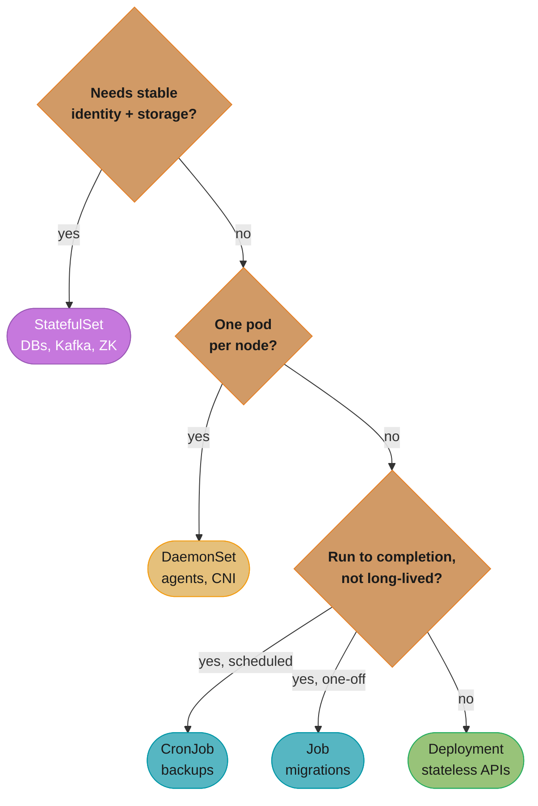
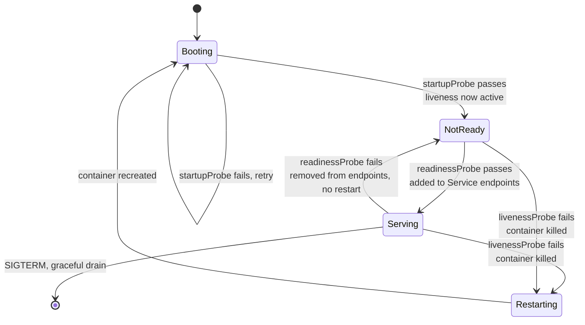
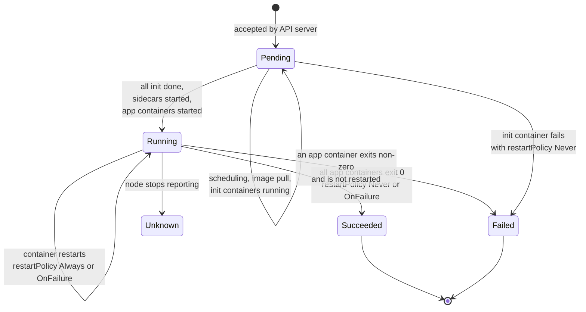
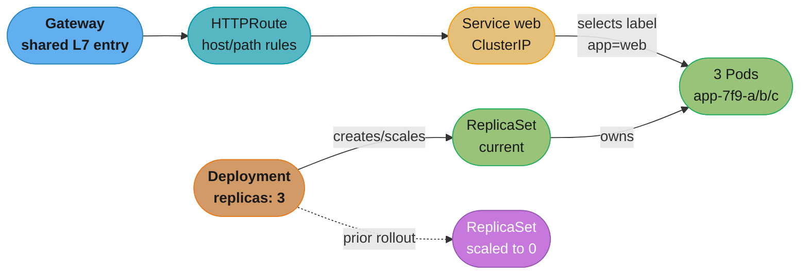
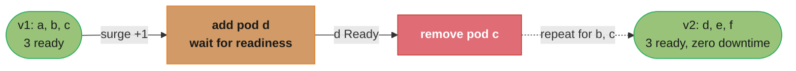
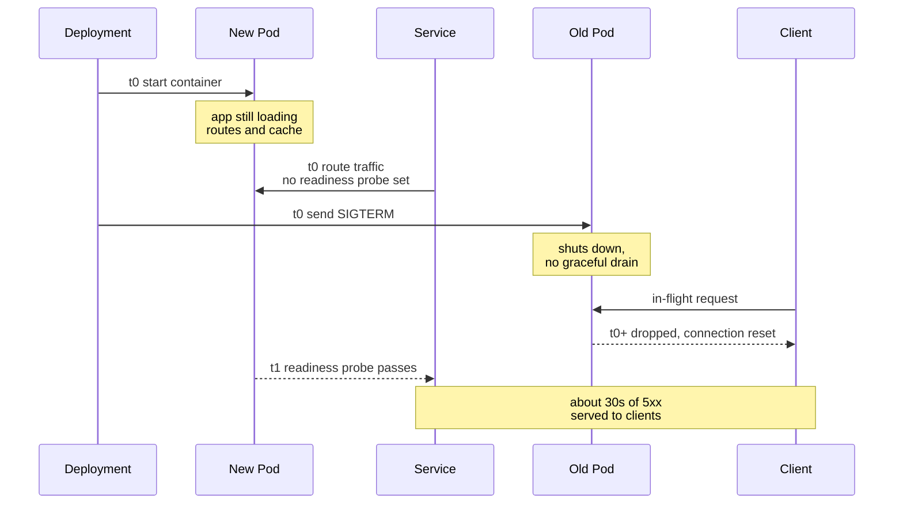

# Kubernetes Workloads & Objects

> Phase 2 — Containers & Kubernetes · Difficulty: Intermediate

> **Version anchor (2026-11-25).** Kubernetes **1.37** is the current minor (1.37.0 "Garhwal" on 2026-08-26; the latest patch was 1.37.2 on 2026-10-13 per kubernetes.io/releases, and patches ship roughly monthly, so check that page rather than this line); 1.36 "Haru" (2026-04-22) is the prior minor. StatefulSet **`maxUnavailable`** (`MaxUnavailableStatefulSet`, Beta) is on by default again in 1.37 after a 1.36 bug (kubernetes#137409), and the StatefulSet **`Recreate`** update strategy is alpha in 1.37 (`StatefulSetRecreateStrategy`, off by default). **Native sidecar containers** (an init container with `restartPolicy: Always`) are stable since **1.33**; Job **`podFailurePolicy`** is stable since **1.31**; **`backoffLimitPerIndex`** and **`successPolicy`** are stable since **1.33**. For L7 entry, **Gateway API v1.7.0** (2026-10-29) is the current Standard channel; the `Ingress` API is still served but feature-frozen, and the community ingress-nginx controller was retired in March 2026. The External Secrets Operator version is pinned in [secrets_management](../secrets_management/secrets_management.md), not here.

If [kubernetes_architecture](../kubernetes_architecture/kubernetes_architecture.md) explains *how* the cluster works, this module covers *what you actually declare*: Pods and the containers inside them (app, init and sidecar), the controllers that manage them (Deployment, StatefulSet, DaemonSet, Job/CronJob), and the objects that connect, protect and configure them (Service, Gateway API routes, PodDisruptionBudget, ConfigMap, Secret). Choosing the right workload object and configuring probes and update strategy correctly is the difference between a self-healing system and one that drops traffic on every deploy.

---

## 1. Concept Overview

The **Pod** is the atomic unit — one or more containers sharing a network namespace (same IP/localhost) and storage volumes, scheduled together. Inside a Pod there are three kinds of container: **app containers** (the workload), **init containers** (run to completion, one at a time, before any app container starts), and **sidecar containers** (init containers with `restartPolicy: Always`, which start before the app and keep running beside it). You almost never create bare Pods; you declare a **controller** that manages Pods for you:

- **Deployment** → manages a **ReplicaSet** → manages stateless Pods, with rolling updates and rollback.
- **StatefulSet** → Pods with stable identity (ordinal names, stable storage, ordered rollout) for databases/brokers.
- **DaemonSet** → exactly one Pod per (matching) node — agents, log shippers, CNI.
- **Job** → run-to-completion Pods, optionally Indexed with per-index retry and success rules; **CronJob** → scheduled Jobs.

Connectivity, protection and config objects:
- **Service** → a stable virtual IP/DNS name load-balancing to a set of Pods (selected by labels).
- **Gateway API** (`Gateway` + `HTTPRoute`) → the L7 entry point: host/path/header routing, traffic splits and retries to Services. The older **Ingress** API is still served but feature-frozen; mechanics are in [kubernetes_networking](../kubernetes_networking/kubernetes_networking.md).
- **PodDisruptionBudget** → how many Pods a voluntary disruption (a node drain, an upgrade) may take down at once.
- **ConfigMap / Secret** → inject configuration / sensitive data as env vars or mounted files; the **Downward API** injects the Pod's own metadata the same way.

**Labels and selectors** are the glue: controllers, Services and PDBs find their Pods by label match, not by name.

---

## 2. Intuition

> **One-line analogy**: A Deployment is a manager who's told "keep 3 of these workers staffed and swap them out gracefully when I hand you a new job description." You don't hire/fire individuals; you tell the manager the target and the replacement policy, and they handle churn, sick days (crashes), and shift changes (rollouts).

**Mental model**: You declare intent at the controller level (`replicas: 3`, this image, this update strategy). The controller creates/deletes Pods to match. Pods are cattle, not pets — disposable and replaceable — *except* under StatefulSet, where each Pod has a stable name and disk (a "pet" with identity). Services decouple clients from individual Pods: clients hit a stable name; the Service routes to whichever Pods are currently ready.

**Why it matters**: Picking Deployment vs StatefulSet, setting readiness/liveness probes, and tuning the rollout strategy directly determine whether deploys are zero-downtime and whether failures self-heal. The most common production incidents — traffic to not-yet-ready pods, restart loops, data loss on a "stateless" database — are workload-object misconfigurations.

**Key insight**: Readiness gates *traffic*; liveness gates *restarts*. Confusing the two causes either dropped requests (no readiness probe) or restart storms (liveness probe that's really a readiness check). They answer different questions: "can it serve now?" vs "is it permanently wedged?"

---

## 3. Core Principles

1. **Pods are ephemeral; manage them with controllers.** Never deploy bare Pods to production.
2. **Match the controller to the workload.** Stateless → Deployment; identity/storage → StatefulSet; per-node → DaemonSet; batch → Job/CronJob.
3. **Labels/selectors are the wiring.** Services and controllers find Pods by labels.
4. **Probes encode health.** Readiness for traffic, liveness for restart, startup for slow boots.
5. **Decouple config from image.** ConfigMap/Secret injected at runtime; one image, many environments.
6. **Declare update strategy explicitly.** `maxUnavailable`/`maxSurge` (Deployment) or partition (StatefulSet) control rollout safety.

---

## 4. Types / Architectures / Strategies

### Choosing a workload controller

| Controller | Pod identity | Storage | Update | Use |
|-----------|--------------|---------|--------|-----|
| Deployment | Interchangeable (random suffix) | Shared/none | Rolling, rollback | Stateless apps, APIs |
| StatefulSet | Stable ordinal (`app-0`, `app-1`) | Per-pod PVC, retained | Ordered, partitioned | DBs, Kafka, Zookeeper |
| DaemonSet | One per node | Per-node host paths | Rolling per node | Log/metrics agents, CNI |
| Job | Run to completion | Ephemeral | N/A | Batch, migrations |
| CronJob | Scheduled Jobs | Ephemeral | N/A | Backups, periodic tasks |

The table above lists each controller's properties; the decision tree below walks the same choice as a sequence of yes/no questions — pick the first branch that matches the workload.



### Service types

There are exactly four values of the `type` field. Headless is not a fifth type — it is a ClusterIP Service with `clusterIP: None`, listed here because it behaves so differently.

| Type | Exposure | Use |
|------|----------|-----|
| ClusterIP (default) | Internal virtual IP | Service-to-service |
| NodePort | Port on every node | Dev, behind external LB |
| LoadBalancer | Cloud LB + external IP | Internet-facing (one per Service) |
| ExternalName | CNAME to external DNS | Aliasing external services |
| *(variant)* Headless — ClusterIP with `clusterIP: None` | DNS to individual pod IPs | StatefulSets, direct pod addressing |

### Probe types

| Probe | Question | On failure |
|-------|----------|------------|
| readiness | "Can it serve traffic now?" | Removed from Service endpoints (no traffic) |
| liveness | "Is it permanently broken?" | Container restarted |
| startup | "Has it finished booting?" | Holds off liveness until boot completes |

A pod's three probes gate different transitions: startup delays liveness until boot finishes, readiness gates Service traffic without a restart, and only a liveness failure triggers one.



### Containers inside one Pod

| Kind | Declared in | Starts | Stops | Typical use |
|------|-------------|--------|-------|-------------|
| Init container | `initContainers`, no `restartPolicy` | One at a time, in order, before anything else; each must exit 0 | When it exits | Schema migration, wait-for-dependency, fetch config, set file permissions |
| Sidecar (native) | `initContainers` with `restartPolicy: Always` | In list order with the init containers; the next one starts once it is *started* (or its `startupProbe` passes) | **After** every app container has exited, in reverse order | Log shipper, service-mesh proxy, secrets agent, metrics exporter |
| App container | `containers` | After every init container has completed and every sidecar has started | On Pod termination | The workload itself |

The old pattern ran a sidecar as a second entry in `containers`. That has no ordering at all: the proxy can start after the app (first requests fail), and in a Job the proxy never exits, so the Pod never completes. Native sidecars fix both and are the default to reach for since they went stable in 1.33.

**Pod phase versus container state.** `kubectl get pods` shows a mix of two things. The Pod **phase** is coarse: `Pending`, `Running`, `Succeeded`, `Failed`, `Unknown`. Each container has its own **state** (`Waiting`, `Running`, `Terminated`) with a reason such as `CrashLoopBackOff` or `OOMKilled`. A Pod can be `Running` while one container is in `CrashLoopBackOff`, which is why the STATUS column shows the worst container reason rather than the phase.



### Job completion and failure controls

| Field | What it controls | Stable since |
|-------|------------------|--------------|
| `completions` / `parallelism` | How many successful Pods finish the Job, and how many run at once | long-standing |
| `completionMode: Indexed` | Each Pod gets `JOB_COMPLETION_INDEX` 0..completions-1 and a stable hostname; one success per index | 1.24 |
| `backoffLimit` | Total failed Pods before the Job fails (default 6) | long-standing |
| `podFailurePolicy` | Per exit code or Pod condition: `FailJob`, `Ignore` (do not count, for example preemption), `Count`, or `FailIndex` | 1.31 |
| `backoffLimitPerIndex` / `maxFailedIndexes` | Retries counted per index, so one bad shard does not eat the whole budget | 1.33 |
| `successPolicy` | Declare success early: specific indexes (a leader) or a count of indexes | 1.33 |

---

## 5. Architecture Diagrams

**Ownership chain (stateless app).** Traffic flows Gateway to HTTPRoute to Service to Pods; management flows Deployment to ReplicaSet to those same Pods. The prior rollout's ReplicaSet is retained at zero replicas so rollback is just scaling it back up.



**Rolling update (`maxUnavailable: 0, maxSurge: 1`).** A replacement pod is surged in and must pass its readiness probe before the corresponding old pod is removed, so ready-pod count never drops below 3 — the same zero-downtime mechanic covered by the rolling-update question in section 12.



---

## 6. How It Works — Detailed Mechanics

### A production-shaped Deployment

```yaml
apiVersion: apps/v1
kind: Deployment
metadata: {name: web, labels: {app: web}}
spec:
  replicas: 3
  selector: {matchLabels: {app: web}}     # MUST match template labels
  strategy:
    type: RollingUpdate
    rollingUpdate: {maxUnavailable: 0, maxSurge: 1}   # zero-downtime: add before removing
  template:
    metadata: {labels: {app: web}}
    spec:
      containers:
        - name: web
          image: registry/web@sha256:...           # pin by digest
          ports: [{containerPort: 8080}]
          resources:
            requests: {cpu: 100m, memory: 128Mi}    # scheduling + QoS
            limits:   {memory: 256Mi}               # hard memory cap
          readinessProbe:                            # gate TRAFFIC
            httpGet: {path: /healthz, port: 8080}
            periodSeconds: 5
            failureThreshold: 3
          livenessProbe:                             # gate RESTART (looser than readiness)
            httpGet: {path: /livez, port: 8080}
            periodSeconds: 10
            failureThreshold: 6                      # tolerate transient blips
          startupProbe:                              # slow boot: hold liveness until ready
            httpGet: {path: /healthz, port: 8080}
            failureThreshold: 30
            periodSeconds: 5                         # allow up to 150s to start
```

### Config and secrets injected at runtime

```yaml
envFrom:
  - configMapRef: {name: web-config}     # all keys as env vars
  - secretRef:    {name: web-secrets}
volumeMounts:
  - {name: tls, mountPath: /etc/tls, readOnly: true}
volumes:
  - name: tls
    secret: {secretName: web-tls}        # mounted as files (auto-updates on change)
```

A Secret is base64-encoded, **not encrypted by default** — see [kubernetes_security](../kubernetes_security/kubernetes_security.md) and [secrets_management](../secrets_management/secrets_management.md) for encryption-at-rest and external secret stores.

### StatefulSet stable identity + storage

```yaml
apiVersion: apps/v1
kind: StatefulSet
metadata: {name: pg}
spec:
  serviceName: pg-headless          # headless Service for stable DNS: pg-0.pg-headless...
  replicas: 3
  selector: {matchLabels: {app: pg}}
  template: { ... }
  volumeClaimTemplates:             # each pod gets its OWN PVC, retained across restarts
    - metadata: {name: data}
      spec: {accessModes: [ReadWriteOnce], resources: {requests: {storage: 100Gi}}}
# pg-0, pg-1, pg-2 keep their names + disks; rollout is ordered (pg-2 -> pg-1 -> pg-0).
```

The default rollout replaces one ordinal at a time. `updateStrategy.rollingUpdate.maxUnavailable` raises that: with `podManagementPolicy: Parallel` and `maxUnavailable: 2`, the controller replaces up to two Pods at once, and they can become Ready out of order. The field defaults to 1, cannot be 0, and a percentage rounds **up** (Deployments round `maxUnavailable` down). Any unavailable Pod in the range counts against it. For a quorum system the ceiling is `(members - 1) / 2`: on this 3-member `pg` set, `maxUnavailable: 2` takes the majority down mid-rollout, so keep it at 1; a 5-member etcd or Kafka KRaft controller set tolerates 2.

### CronJob with sane guards

```yaml
apiVersion: batch/v1
kind: CronJob
metadata: {name: backup}
spec:
  schedule: "0 3 * * *"             # 03:00 daily
  concurrencyPolicy: Forbid        # don't overlap runs
  startingDeadlineSeconds: 300     # skip if missed by >5min (don't pile up after downtime)
  jobTemplate:
    spec:
      backoffLimit: 3              # retry up to 3 times
      template: {spec: {restartPolicy: Never, containers: [...]}}
```

### Rolling-update arithmetic: what `maxSurge` and `maxUnavailable` actually schedule

```
peak Pods      = replicas + maxSurge
floor of ready = replicas - maxUnavailable
batch size     = maxSurge + maxUnavailable
waves          = ceil(replicas / batch size)

percentages resolve as:  maxUnavailable = floor(replicas x pct)
                         maxSurge       = ceil(replicas x pct)
```

**What the formula is telling you.** "You are buying a capacity budget: `maxSurge` is how many extra Pods you will pay for during the rollout, `maxUnavailable` is how much serving capacity you will give up, and their sum is how fast the rollout can move."

The rounding directions are not symmetric, and that asymmetry is deliberate — Kubernetes rounds the *availability* loss down and the *capacity* spend up, so a percentage always errs toward staying available. It also refuses to let both settle at 0, which would make the rollout unable to progress at all.

| Symbol | What it is |
|--------|------------|
| `replicas` | Desired Pod count from the Deployment spec — 3 in the manifest above |
| `maxSurge` | Extra Pods allowed above `replicas` while rolling; costs cluster headroom |
| `maxUnavailable` | Ready Pods you allow to drop below `replicas`; costs serving capacity |
| `batch size` | Pods the controller can be swapping at once — the rollout's step width |
| `waves` | How many readiness-gated steps the whole rollout takes |
| `floor` / `ceil` | Rounding applied to percentages: down for unavailable, up for surge |

**Walk one example.** The manifest's `maxUnavailable: 0, maxSurge: 1` against the Tradeoffs table's `maxUnavailable: 25%`, at two replica counts:

```
  replicas = 3
    0 / surge 1     peak 4   ready floor 3   batch 1   waves ceil(3/1) = 3
    25%             unavail floor(3 x 0.25) = floor(0.75) = 0
                    surge   ceil(3 x 0.25) = ceil(0.75)  = 1
                    -> peak 4, ready floor 3, batch 1, waves 3   IDENTICAL

  replicas = 20
    0 / surge 1     peak 21  ready floor 20  batch 1   waves ceil(20/1) = 20
    25%             unavail floor(5) = 5,  surge ceil(5) = 5
                    -> peak 25, ready floor 15, batch 10, waves ceil(20/10) = 2
```

At 3 replicas the "faster" 25% option is not faster at all — it rounds to exactly the zero-downtime setting, because `floor(0.75)` is 0. The two only diverge once `replicas x pct` clears 1, and by 20 replicas the difference is stark: 2 waves instead of 20, paid for by letting ready Pods fall to 15. Wall-clock follows the wave count, so with the manifest's `periodSeconds: 5` readiness probe, a 20-replica rollout at batch 1 waits on at least 20 readiness checks, versus 2 at batch 10.

**Why `maxUnavailable: 0` needs headroom.** It forces every replacement Pod to be scheduled *before* any old Pod is removed, so the cluster must have room for `replicas + maxSurge` Pods at once — 4 in the manifest above. On a cluster with no spare capacity the surge Pod stays Pending and the rollout stalls indefinitely rather than degrading; that is the tradeoff the "capacity headroom vs availability" row is naming.

### Init containers and a native sidecar

```yaml
apiVersion: apps/v1
kind: Deployment
metadata: {name: orders}
spec:
  replicas: 3
  selector: {matchLabels: {app: orders}}
  template:
    metadata: {labels: {app: orders}}
    spec:
      initContainers:
        - name: wait-for-db                      # plain init: runs once, must exit 0
          image: busybox:1.37
          command: ["sh", "-c", "until nc -z postgres 5432; do sleep 2; done"]
        - name: log-shipper                      # native sidecar: starts here, keeps running
          image: fluent/fluent-bit:5.2
          restartPolicy: Always
          volumeMounts: [{name: logs, mountPath: /var/log/app}]
      containers:
        - name: orders
          image: registry/orders@sha256:...
          volumeMounts: [{name: logs, mountPath: /var/log/app}]
          env:
            - name: POD_NAME                     # Downward API: the Pod's own metadata
              valueFrom: {fieldRef: {fieldPath: metadata.name}}
            - name: NODE_NAME
              valueFrom: {fieldRef: {fieldPath: spec.nodeName}}
            - name: MEM_LIMIT_BYTES              # size heaps from the real limit, not the node
              valueFrom: {resourceFieldRef: {containerName: orders, resource: limits.memory}}
          resources: {limits: {memory: 512Mi}}
      volumes:
        - {name: logs, emptyDir: {}}
```

Order on start: `wait-for-db` runs to completion, then `log-shipper` starts and is marked started, then `orders` starts. On termination the order reverses: `orders` gets SIGTERM first and the kubelet keeps `log-shipper` alive until `orders` has exited, so the last log lines still ship. The Downward API is how a container learns its own Pod name, namespace, node, labels or resource limits without calling the API server, which also means it needs no RBAC.

### An Indexed Job with failure and success policies

```yaml
apiVersion: batch/v1
kind: Job
metadata: {name: reindex}
spec:
  completions: 32                 # 32 shards, one index each (JOB_COMPLETION_INDEX 0..31)
  parallelism: 8
  completionMode: Indexed
  backoffLimitPerIndex: 2         # each shard may fail twice before that index is marked failed
  maxFailedIndexes: 3             # more than 3 failed shards: stop the whole Job
  podFailurePolicy:
    rules:
      - action: FailIndex         # exit 42 = bad input for this shard; retrying will not help
        onExitCodes: {containerName: worker, operator: In, values: [42]}
      - action: Ignore            # preemption, eviction, node drain: do not count it
        onPodConditions: [{type: DisruptionTarget}]
  template:
    spec:
      restartPolicy: Never        # required by podFailurePolicy and backoffLimitPerIndex
      containers:
        - name: worker
          image: registry/reindex@sha256:...
```

The arithmetic matters. With a plain `backoffLimit: 6`, the whole 32-shard Job fails after 6 failed Pods anywhere, so one poisoned shard failing 7 times kills the other 31. With `backoffLimitPerIndex: 2` the bad shard is marked failed after 3 attempts (1 + 2 retries), the other 31 keep going, and the Job ends `Failed` with `status.failedIndexes` naming exactly which shard to look at. The `Ignore` rule stops a node drain from spending retries at all. For a leader-worker job (MPI, a PyTorch launcher), `successPolicy: {rules: [{succeededIndexes: "0", succeededCount: 1}]}` declares success when index 0 succeeds and terminates the remaining workers.

### PodDisruptionBudget: how many Pods a drain may take

```yaml
apiVersion: policy/v1
kind: PodDisruptionBudget
metadata: {name: web}
spec:
  maxUnavailable: 1               # or minAvailable: 2; set exactly one of the two
  selector: {matchLabels: {app: web}}
```

A PDB limits **voluntary** disruptions that go through the Eviction API: `kubectl drain`, cluster-autoscaler and Karpenter scale-down, managed node-pool upgrades. It does nothing for a node crash. `ALLOWED DISRUPTIONS = current healthy - required healthy`. For the 3-replica `web` Deployment, `maxUnavailable: 1` allows 1 eviction when all 3 are healthy and 0 while one is already down; `maxUnavailable: 30%` rounds up to 1 as well. Two settings block every drain: `maxUnavailable: 0` and `minAvailable` equal to the replica count. A 1-replica Deployment with `minAvailable: 1` is the most common way a node upgrade hangs for hours. Prefer `maxUnavailable`, because it follows the replica count when the Deployment scales.

### `externalTrafficPolicy: Local`

```yaml
kind: Service
spec:
  type: LoadBalancer
  externalTrafficPolicy: Local    # Cluster (default) or Local
```

With the default `Cluster`, a node that receives external traffic may forward it to a Pod on another node, and it SNATs the packet, so the Pod sees the node IP instead of the client IP. `Local` sends traffic only to Pods on the receiving node and keeps the client source IP, which allow-lists and rate limiters need. The costs: nodes with no local Pod fail the load balancer's health check and get no traffic, and traffic is balanced per node, not per Pod, so a node with 1 Pod gets the same share as a node with 4.

---

## 7. Real-World Examples

- **Stateless web/API tiers** run as Deployments behind a ClusterIP Service and a Gateway API `HTTPRoute` on a shared `Gateway` — the bread-and-butter pattern. Clusters that predate Gateway API still run the same shape on the frozen `Ingress` API.
- **Kafka, Postgres, Elasticsearch** run as StatefulSets (or operators) for stable identity and per-pod storage; brokers/replicas need predictable names and retained disks.
- **Datadog/Fluent Bit/Cilium agents** run as DaemonSets — one per node to collect logs/metrics or program networking.
- **Database migrations** run as Jobs in CI/CD before the app Deployment rolls; **nightly backups** as CronJobs.
- **Service meshes and log agents** moved to native sidecars: Istio supports running its proxy as a native sidecar, which fixes the two classic failures of the old pattern, an app starting before its proxy and a Job that never completes because the proxy never exits.
- **Sharded batch** (reindexing, ML preprocessing, test sharding) runs as Indexed Jobs, with `backoffLimitPerIndex` so one bad shard is reported instead of failing the whole run.

---

## 8. Tradeoffs

| Decision | Option A | Option B | Key factor |
|----------|----------|----------|-----------|
| App controller | Deployment (simple, fast rollout) | StatefulSet (identity/storage) | Does the workload need stable identity/disk? |
| Rollout | `maxUnavailable: 0, maxSurge: 1` (zero-downtime) | `maxUnavailable: 25%` (faster) | Capacity headroom vs availability |
| StatefulSet rollout | `maxUnavailable: 1` (default, one ordinal at a time) | `maxUnavailable: 2+` with `Parallel` (faster) | Quorum: at most `(members - 1) / 2` down at once |
| Service exposure | LoadBalancer (one per svc, costly) | Shared L7 entry: Gateway API `Gateway` + `HTTPRoute` (or the frozen Ingress API) | Cost + L7 features |
| Helper process | Second entry in `containers` | Native sidecar (`initContainers` + `restartPolicy: Always`) | Ordering on start and stop; Jobs that must complete |
| Job retries | `backoffLimit` (one budget for the whole Job) | `backoffLimitPerIndex` + `podFailurePolicy` | Whether one bad shard should fail all shards |
| PDB | `minAvailable: N` | `maxUnavailable: 1` | `maxUnavailable` follows scaling; `minAvailable` equal to replicas blocks every drain |
| Config | ConfigMap env vars | Mounted files (hot-reload) | Reload-without-restart need |
| Liveness probe | Aggressive | Lenient/none | Restart storms vs slow recovery |
| Secret storage | Native Secret (b64) | External store (Vault/ESO) | Security/compliance |

---

## 9. When to Use / When NOT to Use

**Deployment**: stateless services — the default. **StatefulSet**: only when you genuinely need stable network identity, ordered startup, or per-pod persistent storage (DBs, clustered brokers). **DaemonSet**: node-level agents. **Job/CronJob**: batch and scheduled work.

**Avoid:** bare Pods in prod (no self-healing); StatefulSets for stateless apps (slower, more complex rollouts for no benefit); `LoadBalancer` per service when one shared Gateway would front them all (cost); a sidecar as a plain second container in a Job (the Job never completes); a PDB that allows zero disruptions (node drains hang). Don't run a heavy database as a StatefulSet if a managed service (RDS) fits — operational burden is real.

---

## 10. Common Pitfalls

**Pitfall 1 — Missing readiness probe → traffic to a not-ready pod.**

```yaml
# BROKEN: no readiness probe. During rollout, the new pod joins the Service the instant
# its container starts — before the app has loaded config/warmed caches -> 5xx to users.
containers:
  - name: web
    image: web:2.0
    # (no readinessProbe)
```

```yaml
# FIX: readiness gates Service membership; pod gets traffic only after /healthz passes.
    readinessProbe:
      httpGet: {path: /healthz, port: 8080}
      periodSeconds: 5
      failureThreshold: 3
# Combined with maxUnavailable: 0, the old pod stays in rotation until the new one is ready.
```

**Pitfall 2 — Liveness probe doing a readiness job → restart storm.** A liveness probe that checks a slow dependency (DB) fails during a transient DB blip, Kubernetes restarts the container, the restart makes things worse, and you get a cascading restart loop. FIX: liveness should check only "is the process itself wedged" (e.g., a simple `/livez`), be lenient (`failureThreshold` high), and use a `startupProbe` for slow boots; dependency health belongs in readiness.

**Pitfall 3 — Selector/label mismatch → Service routes to nothing.**

```yaml
# BROKEN: Service selects app=web but Pods are labeled app=webapp -> 0 endpoints -> connection refused.
kind: Service
spec: {selector: {app: web}}        # pods have labels.app: webapp
```

```bash
# FIX: ensure labels match; verify endpoints exist.
kubectl get endpointslices -l kubernetes.io/service-name=web    # should list pod IPs, not be empty
```

**Pitfall 4 — A sidecar declared as a regular container keeps the Job Running forever.** A nightly export Job ships its logs through a Fluent Bit sidecar. The export finishes at 03:12 and exits 0, but the Pod stays `Running`, because a Pod only reaches `Succeeded` when every container in `containers` has exited and the log shipper never does. The Job never completes, `concurrencyPolicy: Forbid` then skips every later run, and nobody notices until the export is a week stale.

```yaml
# BROKEN: the shipper is an ordinary container with no reason to exit.
spec:
  template:
    spec:
      restartPolicy: Never
      containers:
        - name: export
          image: registry/export@sha256:...
        - name: log-shipper
          image: fluent/fluent-bit:5.2
```

```yaml
# FIX: a native sidecar. It starts before export, keeps running beside it, and the
# kubelet stops it after export exits, so the Pod reaches Succeeded and the Job completes.
spec:
  template:
    spec:
      restartPolicy: Never
      initContainers:
        - name: log-shipper
          image: fluent/fluent-bit:5.2
          restartPolicy: Always          # this one line makes it a sidecar
      containers:
        - name: export
          image: registry/export@sha256:...
```

**Pitfall 5 — A PodDisruptionBudget that allows zero disruptions blocks node upgrades.** A single-replica admin service has `minAvailable: 1`. `ALLOWED DISRUPTIONS` is permanently 0, so `kubectl drain` retries the eviction forever and a managed node-group upgrade stalls on that node until its timeout. FIX: run 2 replicas with `maxUnavailable: 1`, or, for a genuinely single-instance service, accept the brief outage and use `maxUnavailable: 1`; never ship a budget whose allowed disruptions are 0 in steady state.

---

## 11. Technologies & Tools

| Tool | Purpose |
|------|---------|
| `kubectl` | Apply/inspect/rollout objects |
| Helm / Kustomize | Template/overlay manifests (see [helm_and_package_management](../helm_and_package_management/helm_and_package_management.md)) |
| `kubectl rollout` | `status`, `undo`, `restart`, `history` |
| Gateway API (Envoy Gateway, Traefik, NGINX Gateway Fabric) | L7 routing (see [kubernetes_networking](../kubernetes_networking/kubernetes_networking.md)) |
| External Secrets Operator | Sync secrets from Vault/cloud (see [secrets_management](../secrets_management/secrets_management.md)) |
| stakater/Reloader | Restart on ConfigMap/Secret change |
| metrics-server | Powers `kubectl top` and HPA |

---

## 12. Interview Questions with Answers

**Q: What is a Pod and why not deploy bare Pods?**
**Short:** A Pod is the smallest deployable unit of co-scheduled containers, and bare Pods lack self-healing, so a controller recreates them to maintain the desired count.
A Pod is the smallest deployable unit: one or more containers sharing a network namespace (same IP, localhost) and volumes, always co-scheduled. You don't deploy bare Pods in production because they have no self-healing — if the node dies, the Pod is gone. A controller (Deployment/StatefulSet) recreates Pods to maintain desired count, giving you self-healing, scaling, and rolling updates.

**Q: Deployment vs StatefulSet — when each?**
**Short:** Use a Deployment for interchangeable stateless Pods, and a StatefulSet when Pods need stable identity, stable per-Pod storage, and ordered startup.
Use a Deployment for stateless workloads: Pods are interchangeable (random name suffixes), share/lack storage, and roll out/back freely. Use a StatefulSet when Pods need stable identity (ordinal names like `db-0`), stable per-Pod persistent storage (via `volumeClaimTemplates`), and ordered startup/rollout — i.e., databases, Kafka, Zookeeper. Using a StatefulSet for a stateless app just adds slower, ordered rollouts for no benefit.

**Q: Readiness vs liveness vs startup probes?**
**Short:** Readiness gates traffic without restarting, liveness restarts a permanently broken container, and startup holds off liveness checks until a slow-booting app is up.
Readiness answers "can this pod serve traffic now?" — failure removes it from Service endpoints (no restart). Liveness answers "is this pod permanently broken?" — failure restarts the container. Startup answers "has it finished booting?" — it holds off liveness checks until the app is up, preventing slow-starting apps from being killed mid-boot. Conflating readiness and liveness causes either dropped traffic or restart storms.

**Q: How does a zero-downtime rolling update work?**
**Short:** With `maxUnavailable: 0, maxSurge: 1`, the controller creates one new ready Pod before terminating an old one, so full capacity keeps serving throughout.
With `strategy: RollingUpdate` and `maxUnavailable: 0, maxSurge: 1`, the controller creates one new Pod (surge), waits for its readiness probe to pass, then terminates one old Pod — repeating until all are new. Because old Pods stay in the Service until new ones are Ready (gated by readiness), there's always the full capacity of ready Pods serving traffic, so no requests are dropped.

**Q: How do Services find their Pods, and what is an EndpointSlice?**
**Short:** A Service's label selector drives the EndpointSlice controller to list ready Pod IPs, and kube-proxy routes the Service's virtual IP to those addresses.
A Service has a label selector; the EndpointSlice controller watches Pods matching that selector and maintains EndpointSlices listing the IPs of *ready* Pods. kube-proxy programs routing from the Service's virtual IP to those Pod IPs. If labels don't match (or no Pods are ready), the EndpointSlice is empty and connections fail — a common "Service routes to nothing" bug.

**Q: What's the difference between a Secret and a ConfigMap, and is a Secret encrypted?**
**Short:** Both inject config, but a Secret's value is base64-encoded, not encrypted, by default, requiring etcd encryption-at-rest or an external store for real protection.
Both inject config (as env vars or mounted files), but Secrets are intended for sensitive data and are base64-*encoded*, not encrypted, by default — anyone with read RBAC or etcd access can decode them. For real protection you enable encryption-at-rest for etcd, restrict RBAC, and/or use an external store (Vault) via the External Secrets Operator. ConfigMaps are for non-sensitive config.

**Q: When do you use a DaemonSet?**
**Short:** Use a DaemonSet when you need exactly one Pod per matching node, like log shippers or node exporters, since coverage tracks the node set automatically.
When you need exactly one Pod per node (or per matching node): log shippers (Fluent Bit), metrics/node exporters, CNI agents, security agents. The DaemonSet controller adds a Pod when a node joins and removes it when the node leaves, so coverage tracks the node set automatically.

**Q: How do CronJobs avoid piling up after downtime or overlapping?**
**Short:** `concurrencyPolicy: Forbid` prevents overlapping runs and `startingDeadlineSeconds` skips runs missed past the deadline instead of firing a backlog after downtime.
`concurrencyPolicy: Forbid` (or `Replace`) prevents overlapping runs; `startingDeadlineSeconds` makes Kubernetes skip runs missed by more than the deadline instead of firing a backlog all at once after the control plane was down; `successfulJobsHistoryLimit`/`failedJobsHistoryLimit` cap retained Job objects. Without these, a control-plane outage can trigger a flood of catch-up Jobs.

**Q: A new pod gets traffic before it's ready and returns 5xx. Why and fix?**
**Short:** A missing or misconfigured readiness probe lets the Pod join Service endpoints before it's warmed up; add a real readiness check with `maxUnavailable: 0`.
There's no readiness probe (or it's misconfigured), so the pod joins the Service's endpoints as soon as the container process starts — before the app has loaded config/warmed up. Add a readiness probe hitting a real health endpoint; combined with `maxUnavailable: 0`, the old pod keeps serving until the new one reports ready, eliminating the gap.

**Q: What do `requests` and `limits` do at the object level?**
**Short:** `requests` reserve resources for scheduling and set QoS class, while `limits` are hard ceilings that throttle CPU or OOM-kill on a memory breach.
`requests` reserve resources for scheduling and determine QoS class (Guaranteed if requests==limits for all containers, else Burstable, else BestEffort), influencing eviction order. `limits` are hard ceilings: a CPU limit throttles, a memory limit triggers an OOM kill on breach. They map directly to cgroup settings on the node (see [linux_and_os_fundamentals](../linux_and_os_fundamentals/linux_and_os_fundamentals.md)).

**Q: How do you roll back a bad Deployment?**
**Short:** `kubectl rollout undo deployment/web` reverts to the previous ReplicaSet, which Kubernetes keeps scaled to zero, making rollback fast and safe.
`kubectl rollout undo deployment/web` reverts to the previous ReplicaSet (Kubernetes keeps old ReplicaSets per `revisionHistoryLimit`). `kubectl rollout history` shows revisions; `--to-revision=N` targets a specific one. Because the old ReplicaSet still exists (scaled to 0), rollback is just scaling it back up and the new one down — fast and safe.

**Q: What is a headless Service and why do StatefulSets use one?**
**Short:** A headless Service returns individual Pod IPs via DNS instead of a virtual IP, giving StatefulSet Pods stable per-Pod names clients can address directly.
A headless Service (`clusterIP: None`) returns the individual Pod IPs via DNS instead of a single virtual IP. StatefulSets pair with one so each Pod gets a stable DNS name (`pg-0.pg-headless.ns.svc`), letting clients address specific members — essential for clustered systems where you must reach a particular replica (e.g., a primary) rather than load-balance across all.

**Q: Can a StatefulSet roll out more than one Pod at a time, and what limit does quorum put on it?**
**Short:** Yes, `updateStrategy.rollingUpdate.maxUnavailable` replaces several Pods at once, but a quorum system must keep it at or below (members - 1) / 2, which is 1 for a 3-member set.
A StatefulSet rolls one ordinal at a time by default, highest first. Setting `spec.updateStrategy.rollingUpdate.maxUnavailable` (Beta, on by default again in 1.37) lets the controller replace up to that many Pods together; with `podManagementPolicy: Parallel` they may also become Ready out of order. Two details differ from a Deployment: the field cannot be 0, because a StatefulSet has no `maxSurge` and 0 would block every update, and a percentage rounds up rather than down. The limit that matters is quorum. A 3-member Raft or Patroni cluster survives one member down, so `maxUnavailable: 2` loses the majority during every rollout; a 5-member set survives two. Any Pod already unavailable counts against the budget, so a crash-looping member plus a 2-wide rollout can be three down. Set it from the replication protocol's fault tolerance, not from how long the rollout takes.

**Q: Why does the case study need a `preStop` hook in addition to a readiness probe and SIGTERM handling?**
**Short:** A `preStop` hook holds the container alive briefly after Terminating so in-flight endpoint removal can propagate, since readiness only gates Pods joining, not leaving.
A `preStop` hook bridges the gap between a Pod being marked Terminating and kube-proxy actually removing it from Service endpoints, which is not instantaneous. Without it, the moment a Pod receives SIGTERM it can stop accepting connections while some nodes haven't yet propagated its removal from the EndpointSlice, so a few in-flight requests get routed to a Pod that's already shutting down and are dropped. The module's fix runs `preStop: sleep 10` to hold the container alive and still finishing requests for 10 seconds after Terminating while endpoint removal propagates, inside a `terminationGracePeriodSeconds: 45` window sized longer than the app's slowest in-flight request. Readiness probes only gate new Pods joining traffic and do nothing for a Pod that's leaving, so always pair a `preStop` drain delay with an app that traps SIGTERM and finishes in-flight work rather than relying on either mechanism alone.

**Q: What are the Kubernetes Service types and how does each expose Pods?**
**Short:** There are four `type` values — ClusterIP, NodePort, LoadBalancer, ExternalName — plus the headless variant, each exposing Pods differently from internal-only to internet-facing.
There are four values of the `type` field — ClusterIP, NodePort, LoadBalancer, ExternalName — plus the headless variant, which is a ClusterIP Service with `clusterIP: None` rather than a type of its own. ClusterIP (the default) gives an internal-only virtual IP for service-to-service calls, and the rest build outward from there for different exposure needs. NodePort opens the same port on every node for simple external access, usually behind an external load balancer; LoadBalancer provisions one cloud load balancer with an external IP per Service; a headless Service skips the virtual IP entirely and returns individual Pod IPs via DNS, which is what StatefulSets use for stable per-Pod addressing; and ExternalName is just a DNS CNAME to an external hostname with no proxying at all. In production, ClusterIP handles internal traffic, a shared Gateway API `Gateway` with `HTTPRoute`s fronting ClusterIP Services (or the frozen Ingress API on older clusters, or occasionally a LoadBalancer directly) handles internet-facing traffic, and NodePort is mostly a dev/debug tool since it exposes a high port on every node. Pick headless only when clients genuinely need to address a specific Pod rather than any ready replica.

**Q: Why front many Services with one shared L7 entry point (Gateway API, or the frozen Ingress API) instead of a LoadBalancer per Service?**
**Short:** One shared Gateway routes many Services by host and path behind a single cloud load balancer, instead of paying for and operating one load balancer per Service.
A `LoadBalancer` Service provisions one external cloud load balancer per Service, while a shared L7 entry point puts one load balancer and one controller in front of many Services and routes by hostname, path or header. Ten services behind ten `LoadBalancer` Services means ten load balancers billed and monitored separately; the same ten behind one Gateway API `Gateway`, with an `HTTPRoute` per team, share one. The L7 layer also adds what a plain Service cannot: host and path routing, TLS termination, weighted traffic splits for canaries, header matching, and, since Gateway API v1.7, portable retries. Use Gateway API for new work: the `Ingress` API is still served but feature-frozen, and its most common controller, community ingress-nginx, was retired in March 2026. Keep raw `LoadBalancer` Services for TCP/UDP workloads the Gateway implementation does not route.

**Q: A Job's main container exits 0 but the Job never completes. What is the usual cause and the fix?**
**Short:** A helper such as a log shipper or mesh proxy runs as a second regular container that never exits; declare it as a native sidecar (init container with `restartPolicy: Always`).
A Pod reaches `Succeeded` only when every container in `containers` has exited, so a log shipper or service-mesh proxy declared there keeps the Pod `Running` after the real work is done, and the Job never records a completion. Native sidecars, stable since Kubernetes 1.33, fix this: an entry in `initContainers` with `restartPolicy: Always` starts before the app containers, runs beside them, and is stopped by the kubelet after the app containers exit, in reverse order of declaration. That also fixes the start-order bug of the old pattern, where the app could start before its proxy and fail its first network calls. The old workarounds (a shared file that tells the proxy to quit, or calling the proxy's quit endpoint from the app) are no longer needed.

**Q: A 32-shard Indexed Job fails after one shard hits bad data. How do you stop one shard from failing all of them?**
**Short:** Use `backoffLimitPerIndex` so retries are counted per shard, plus a `podFailurePolicy` that fails only that index on its known-bad exit code.
With a plain `backoffLimit` (default 6), failures from every Pod count against one budget, so a single poisoned shard that fails 7 times fails the whole Job and the 31 healthy shards stop with it. `backoffLimitPerIndex` (stable since 1.33) counts failures per index: the bad index is marked failed after its retries, the others keep running, and `status.failedIndexes` names it. `maxFailedIndexes` sets how many bad shards you tolerate before stopping everything. A `podFailurePolicy` (stable since 1.31) refines it: `FailIndex` on an exit code that means "bad input, retrying is pointless", and `Ignore` on the `DisruptionTarget` condition so preemption or a node drain does not spend retries at all. Both require `restartPolicy: Never` on the Pod template.

**Q: A node drain hangs for hours on one Pod. What is the likely cause?**
**Short:** A PodDisruptionBudget whose allowed disruptions are 0, such as `minAvailable: 1` on a single replica, so every eviction the drain requests is refused.
`kubectl drain` and managed node upgrades evict Pods through the Eviction API, which refuses any eviction that would breach a PodDisruptionBudget. `ALLOWED DISRUPTIONS` is current healthy Pods minus the required healthy count, so `minAvailable: 1` on one replica, `minAvailable` equal to the replica count, or `maxUnavailable: 0` all give 0, and the drain retries forever. A Deployment already short a replica, for example one Pod stuck in `CrashLoopBackOff`, also drops allowed disruptions to 0 under `maxUnavailable: 1`. Check with `kubectl get pdb -A` and look for `ALLOWED DISRUPTIONS 0`. Fix the budget rather than force the drain: run at least 2 replicas with `maxUnavailable: 1`, which also follows the replica count when the workload scales.

**Q: How does a container find out its own Pod name, node or memory limit without calling the API server?**
**Short:** Through the Downward API, which injects Pod fields and container resource limits as environment variables or files, with no API call and no RBAC.
The Downward API exposes fields of the Pod itself to its containers: `fieldRef` for `metadata.name`, `metadata.namespace`, `metadata.labels`, `spec.nodeName`, `status.podIP` and similar, and `resourceFieldRef` for the container's own `requests` and `limits`. It is delivered as environment variables or as files in a `downwardAPI` volume; the volume form picks up label and annotation changes, while environment variables are fixed when the container starts. The common production use is sizing a runtime from its real limit: a JVM or Node.js process that reads the node's total memory instead of the container's 512 Mi limit sizes its heap too large and gets OOM-killed, so pass `limits.memory` in and size from that. It needs no ServiceAccount token, which keeps the Pod's permissions minimal.

**Q: How does a plain Job differ from a CronJob, and what does `backoffLimit` control?**
**Short:** A Job runs Pods to completion once, a CronJob schedules new Jobs on a cron, and `backoffLimit` caps retries before the Job itself is marked Failed.
A Job runs Pods to completion a single time when created, while a CronJob is a scheduled wrapper that creates a new Job on a cron schedule. `backoffLimit` caps how many times a failed Pod is retried before the Job itself is marked Failed — the module's backup CronJob sets `backoffLimit: 3`, so a flaky backup gets three attempts before it's treated as a real failure instead of retrying forever. `restartPolicy` on the Pod template must be `Never` or `OnFailure`, never the Deployment default `Always`, since a run-to-completion Pod that restarted forever would never let the Job finish. Jobs are the right primitive for one-off work like a CI/CD database migration that must run exactly once to completion before the app Deployment rolls out, so set `backoffLimit` deliberately rather than leaving it unbounded.

---

## 13. Best Practices

- Manage Pods with controllers; never deploy bare Pods.
- Always set **readiness probes**; use **liveness** sparingly and leniently; add **startup probes** for slow boots.
- Use **`maxUnavailable: 0, maxSurge: 1`** for zero-downtime rollouts of critical services.
- Set **requests and (memory) limits**; aim for Guaranteed QoS on latency-critical pods.
- Keep labels/selectors consistent; verify EndpointSlices are non-empty after changes.
- Inject config via ConfigMap/Secret; pin images by digest; one image across environments.
- Prefer one shared **Gateway API** `Gateway` with per-team `HTTPRoute`s over per-Service `LoadBalancer`s; keep existing `Ingress` objects only until they are migrated, since the API is frozen.
- Give every multi-replica workload a **PodDisruptionBudget** with `maxUnavailable: 1` (or a percentage), never one that allows zero disruptions (see [kubernetes_scheduling_and_autoscaling](../kubernetes_scheduling_and_autoscaling/kubernetes_scheduling_and_autoscaling.md)).
- Run helpers (proxies, log shippers, secret agents) as **native sidecars**, and one-time setup as **init containers**.
- For sharded batch, use **Indexed Jobs** with `backoffLimitPerIndex` and a `podFailurePolicy` that ignores `DisruptionTarget`.
- For databases, strongly consider managed services over self-run StatefulSets.

---

## 14. Case Study

### Scenario: Every deploy causes a 30-second burst of 5xx errors

A team's stateless API drops ~2% of requests with 502/504 errors for about 30 seconds during each rolling deploy. Apps are healthy before and after; the errors are purely deploy-correlated.

**Deploy timeline (broken).** With no readiness probe, the Service routes traffic to the new pod the instant its container starts, while the old pod is torn down immediately on SIGTERM with no graceful drain — the gap between the two produces the ~30-second window of 5xx errors.



```yaml
# BROKEN: no readiness gate, aggressive rollout, no graceful shutdown handling.
spec:
  strategy: {type: RollingUpdate, rollingUpdate: {maxUnavailable: 25%}}
  template:
    spec:
      containers:
        - name: api
          image: api:3.1
          # no readinessProbe; no preStop; no terminationGracePeriodSeconds tuning
```

```yaml
# FIX: gate traffic with readiness, surge-don't-shrink, drain on shutdown.
spec:
  strategy:
    type: RollingUpdate
    rollingUpdate: {maxUnavailable: 0, maxSurge: 1}     # add ready pod before removing old
  template:
    spec:
      terminationGracePeriodSeconds: 45                  # > app's max in-flight request time
      containers:
        - name: api
          image: api:3.1
          readinessProbe:                                # only ready pods get traffic
            httpGet: {path: /healthz, port: 8080}
            periodSeconds: 5
            failureThreshold: 3
          lifecycle:
            preStop:
              exec: {command: ["sh","-c","sleep 10"]}    # let LB/endpoints drain before SIGTERM
          # app also traps SIGTERM: stop accepting, finish in-flight, then exit (see linux module)
```

The `preStop sleep` covers the gap between a Pod being marked Terminating and kube-proxy/endpoints actually removing it, so no new requests are routed to a draining pod; readiness ensures the replacement only takes traffic once it's truly up.

**Outcome:** deploy-time 5xx dropped from ~2% to ~0%. The combination — readiness gating, `maxUnavailable: 0`, `preStop` drain, and a SIGTERM-aware app within the grace period — produced genuinely zero-downtime rollouts.

**Discussion questions:**
1. Why is a `preStop` hook needed in addition to SIGTERM handling? (Endpoint removal isn't instantaneous; the sleep bridges the propagation gap.)
2. How does `maxUnavailable: 0` interact with cluster capacity, and when can't you use it? (Needs headroom for the surge pod.)
3. How would you prove zero-downtime in CI before trusting it? (Continuous load during a deploy in staging, asserting 0 5xx.)

---

**Cross-references:** [kubernetes_architecture](../kubernetes_architecture/kubernetes_architecture.md) (controllers that manage these objects), [kubernetes_networking](../kubernetes_networking/kubernetes_networking.md) (Services, Gateway API and the frozen Ingress API, EndpointSlices), [kubernetes_scheduling_and_autoscaling](../kubernetes_scheduling_and_autoscaling/kubernetes_scheduling_and_autoscaling.md) (requests/limits/QoS, PDB), [kubernetes_storage_and_state](../kubernetes_storage_and_state/kubernetes_storage_and_state.md) (PVCs for StatefulSets), [linux_and_os_fundamentals](../linux_and_os_fundamentals/linux_and_os_fundamentals.md) (SIGTERM, grace period).
