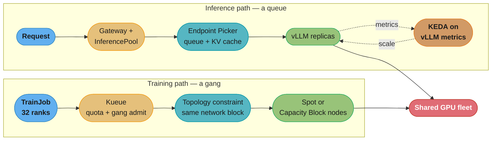
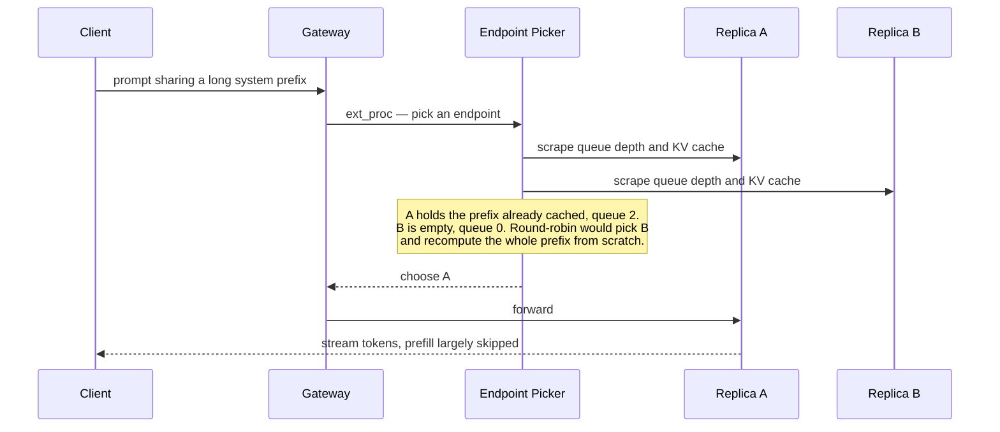
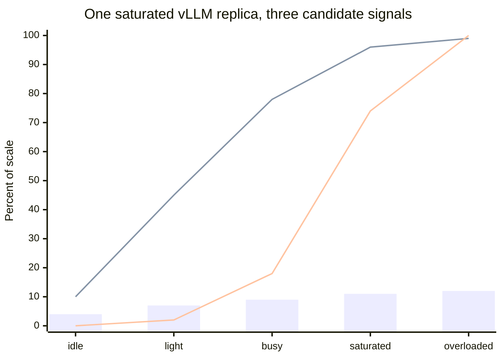
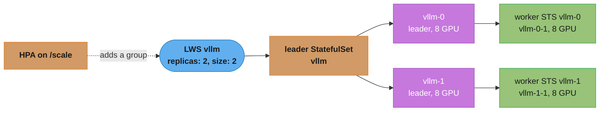

# GPU Scheduling and Inference Operations

> **Version anchor (2026-08-26).** **vLLM v0.27.1** (2026-08-11) is current; its **v1 engine renamed the KV-cache metric to `vllm:kv_cache_usage_perc`** — `vllm:gpu_cache_usage_perc` was the v0 name and is the single most-copied stale metric in autoscaling configs. **Gateway API Inference Extension v1.6.0** (2026-08-10): `InferencePool` is **v1/stable**, and the alpha `InferenceObjective`, `InferenceModelRewrite` and `EndpointPickerConfig` were **REMOVED from GAIE and migrated to `llm-d`** — a manifest naming any of them no longer applies. **Karpenter v1.14.1** supports EC2 Capacity Blocks (since v1.6) via `capacityReservationSelectorTerms` and `karpenter.sh/capacity-type: reserved`. **NVIDIA Dynamo 1.0 went GA 2026-03-16**; Triton is folded into it as Dynamo-Triton. **P6-B200** (8x B200, GA 2025-05-15) and **P6e-GB200 UltraServers** (up to 72 GB200 in one NVLink domain) are the current AWS training generation.

> **Pricing anchor (checked 2026-08-26).** On-Demand, `us-east-1`, Linux, shared tenancy, taken from **AWS's own Price List Bulk API** (`pricing.us-east-1.amazonaws.com/offers/v1.0/aws/AmazonEC2/current/us-east-1/index.json`, publication timestamp 2026-08-25T21:32:33Z) rather than from any reseller or aggregator: **`p5.48xlarge` $55.0400/hr**, **`p6-b200.48xlarge` $113.9328/hr**, **`g6e.xlarge` $1.8610/hr**, **`g6e.12xlarge` $10.49264/hr**, **`inf2.48xlarge` $12.98127/hr**. Every dollar figure below derives from these five and nothing else. (Worth knowing: **`trn2.48xlarge` has no On-Demand SKU in `us-east-1` at all** — it exists only in `us-east-2`, and there only through Capacity Blocks.) If you update one, recompute the tables rather than editing them individually. Throughput figures used in the cost-per-token arithmetic are **stated assumptions from your own benchmark**, never vendor claims — §6 says so explicitly at the point of use.

> **Version anchor (2026-10-19), multi-host serving and schedulers.** **LeaderWorkerSet v1.0.0** (2026-10-16, `leaderworkerset.x-k8s.io/v1`, tested on Kubernetes 1.34 to 1.37); its native gang-scheduling integration is still alpha and opt-in. **KAI Scheduler v0.18.6** (2026-10-15), Apache-2.0, a CNCF Sandbox project, repository moved from `NVIDIA/` to the `kai-scheduler` GitHub org. **Certified Kubernetes AI Conformance** launched 2025-11-11 at KubeCon NA; the v1.37 checklist in `kubernetes-sigs/ai-conformance` has 8 MUST and 7 SHOULD requirements. Kubernetes 1.37 adds the alpha `CompositePodGroup` API, which the release's workload-aware scheduling post names as the path to native scheduling for JobSet and LeaderWorkerSet.

This page sits under [ml_platform_and_gpu_infrastructure](ml_platform_and_gpu_infrastructure.md). The parent owns the *substrate* — the GPU Operator, the device plugin, MIG and time-slicing mechanics, Karpenter GPU NodePools, and what the fleet costs. This page owns the *two workload shapes that substrate has to serve*, because they are different scheduling problems with opposite failure modes: **training is a gang, inference is a queue.**

Deliberately not repeated here: the allocation mechanism is [device_scheduling_and_dra](../kubernetes_scheduling_and_autoscaling/device_scheduling_and_dra.md); node bring-up, XID remediation and drain are [gpu_node_lifecycle](../case_studies/cross_cutting/gpu_node_lifecycle.md); the Gateway API resources themselves are [kubernetes_networking](../kubernetes_networking/kubernetes_networking.md). **Model-side concerns stop at this page's boundary** — PagedAttention internals, continuous-batching algorithms, quantisation and speculative decoding belong to [llm/inference_engines](../../llm/inference_engines/inference_engines.md), and the application architecture of a serving platform to [llm/case_studies/design_gpu_inference_platform.md](../../llm/case_studies/design_gpu_inference_platform.md). The DevOps angle is *the GPU is a claim on a scheduler*; the LLM angle is *the GPU is a throughput budget*.

---

## 1. Concept Overview

A platform team inherits one pool of extremely expensive hardware and two tenants who want opposite things from it.

**Training is a gang.** A 32-GPU distributed job is not 32 independent Pods. Every step performs a collective — an all-reduce across every rank — so the job runs at the speed of its slowest member and produces *nothing* until all ranks are present. Schedule 24 of 32 and you have not made 75% progress; you have made zero progress while occupying 24 GPUs. The scheduling requirements are **all-or-nothing admission**, **topological coherence** (ranks close together on the network fabric), and **tolerance of interruption** through checkpointing, because the job runs for hours or days.

**Inference is a queue.** Each request is independent, arrives unpredictably, and has a latency SLO measured in milliseconds. There is no gang. What there is instead is a **stateful cache** — the KV cache holding attention state for in-flight sequences — which means the replicas are *not* interchangeable the way stateless web backends are, and the cost of a request depends on its token count rather than on a fixed per-request price. The scheduling requirements are **fast scale-up**, **routing that respects cache state**, and **autoscaling on a signal that reflects saturation**.

The consequence is that almost every default is wrong for one of them:

| Default | Right for | Catastrophic for |
|---|---|---|
| Independent Pod scheduling | Inference | Training — partial gangs deadlock and burn GPUs waiting |
| Autoscale on CPU utilization | Neither, really | Inference — a saturated GPU shows low CPU and never scales |
| Round-robin load balancing | Stateless HTTP | Inference — destroys prefix-cache locality |
| Spot capacity | Training with checkpoints | Inference — a 2-minute notice is not a graceful drain for a warm KV cache |
| Scale-to-zero | Batch and dev endpoints | Latency-SLO inference — model load is measured in minutes |
| Aggressive node consolidation | Stateless services | Both — it kills a training job mid-epoch |

The rest of this page is what you do about that.

Multi-GPU inference parallelism and prefill/decode disaggregation are covered in [Distributed Inference and Disaggregation](../../mlops/distributed_inference_and_disaggregation/distributed_inference_and_disaggregation.md).

---

## 2. Intuition

> **Training is a rowing eight; inference is a supermarket checkout.** In the eight, seven rowers and an empty seat is not 87.5% of a boat — it is a boat that does not move. At the checkout, each customer is independent, you open more tills when the queue grows, and the till that already knows this customer's loyalty card serves them fastest.

**Mental model.** Training wants a *reservation for a party of 32, all at one table, for six hours*. Inference wants *a queue with elastic staffing and a memory of who it just served*. A restaurant that seats parties one diner at a time as chairs free up will strand every large party indefinitely — which is exactly what the default Kubernetes scheduler does to a training job.

**Why it matters.** The single most expensive mistake in GPU platform work is not choosing the wrong instance type. It is **autoscaling an LLM endpoint on CPU utilization**, which produces a fleet that is simultaneously saturated and refusing to scale, because the GPU is the bottleneck and the CPU is idle waiting on it. The second most expensive is **partial gang admission**, which converts a scarce resource into a deadlock.

**Key insight.** For inference, the honest saturation signal is **queue depth and KV-cache occupancy**, not utilization of anything. `DCGM_FI_DEV_GPU_UTIL` reports the fraction of time *at least one kernel was resident* — it reads near 100% for a GPU doing almost nothing useful, so it is the wrong number for both autoscaling and cost accounting.

---

## 3. Core Principles

1. **Admit gangs atomically.** A distributed job is admitted in full or not at all. Partial admission is worse than rejection because it consumes the resource it is waiting for.
2. **Placement is topology, not capacity.** Eight free GPUs spread across two network blocks will run a job at a fraction of the throughput of eight adjacent ones, and Kubernetes will report both placements as successes.
3. **Autoscale on the bottleneck's own signal.** For LLM serving that is `vllm:num_requests_waiting` and `vllm:kv_cache_usage_perc`. Never CPU.
4. **Inference replicas are stateful in one dimension.** Prefix-cache locality is real throughput; routing must respect it, which is why round-robin is a downgrade.
5. **Match capacity mode to interruption tolerance.** Spot for checkpointed training, Capacity Blocks for scheduled bulk training, On-Demand or reserved for latency-SLO serving.
6. **Isolation is a choice with a hardware answer.** MIG for multi-tenant, MPS for trusted co-location, time-slicing for dev — and only MIG gives memory and fault isolation.
7. **Health is DCGM-defined, not kubelet-defined**, and that mechanism belongs to [gpu_node_lifecycle](../case_studies/cross_cutting/gpu_node_lifecycle.md) — but every scheduling decision here assumes it is already in place.

---

## 4. Types / Architectures / Strategies

### Who admits the gang

| Layer | What it adds | When to reach for it |
|---|---|---|
| **Kueue** | Job-queueing on top of the default scheduler: quotas, cohort borrowing, fair-share, gang admission, topology-aware scheduling | The common default for multi-team clusters |
| **Volcano 1.15** | Replaces the default scheduler for its Pods: queues, gang, HPC bin-packing, MPI/TF plugins, DRA queue quota | HPC-shaped batch, or when you need scheduler-level bin-packing |
| **KAI Scheduler v0.18** | Replaces the default scheduler for its Pods (`schedulerName: kai-scheduler`): hierarchical queues with quota, over-quota weight and limit, DRF fairness and reclaim, gang via PodGroups, bin-pack or spread, fractional GPUs, topology-aware and hierarchical PodGroups | Many teams sharing one GPU fleet with nested org quotas, or fractional-GPU notebooks next to training. Built on kube-batch, from Run:ai |
| **Native `Workload` API** | All-or-nothing placement and nothing else; Beta in 1.37 (`scheduling.k8s.io/v1beta1`) but off by default behind `GenericWorkload` | Only when the gang primitive is genuinely all you need. See [the parent scheduling module](../kubernetes_scheduling_and_autoscaling/kubernetes_scheduling_and_autoscaling.md) for its exact shape |

### Where the capacity comes from

| Mode | Discount posture | Interruption | Right for |
|---|---|---|---|
| **On-Demand** | List price | None | Latency-SLO inference baseline |
| **Spot** | Deep, uncommitted | 2-minute notice, plus a non-guaranteed earlier rebalance recommendation | Checkpointed training, batch inference |
| **EC2 Capacity Blocks for ML** | Pay for a reserved future window | None inside the block; node drains before it ends | Scheduled bulk training, fine-tuning runs with a deadline |
| **On-Demand Capacity Reservation** | Guaranteed capacity, billed whether used or not | None | Serving floor in a capacity-constrained region |

**Capacity Blocks** are worth knowing precisely because they are the answer to "we cannot get P6 capacity": you reserve 1–64 instances for **1–14 days, or multiples of 7 days up to 182 days**, booked up to **8 weeks ahead**. The purchase is **non-cancelable and non-modifiable**. They are priced **per accelerator-hour** rather than per instance-hour — from AWS's Capacity Blocks pricing page (checked 2026-08-26, next scheduled price update October 2026), **P6-B200 at $12.355/GPU-hr** against an On-Demand equivalent of $14.24/GPU-hr — so a Block is not simply a premium for certainty; it can price *below* On-Demand while also guaranteeing contiguous placement. What you give up is flexibility: you pay for the whole booked window whether you use it or not, and you cannot cancel. Karpenter models them as a form of capacity reservation — `karpenter.sh/capacity-type: reserved`, selected with `capacityReservationSelectorTerms` — and it prioritises reserved over spot over on-demand, draining nodes ahead of the block's end.

### How the card is shared

Mechanism detail lives in the parent module; what matters *for scheduling* is what each one guarantees:

| Mechanism | Memory isolation | Fault isolation | Reshape without drain |
|---|---|---|---|
| Whole GPU | Total | Total | n/a |
| **MIG** (A100, A30, H100, H200, B200/GB200) | **Hardware** | **Hardware** | Only via DRA partitionable devices |
| **MPS** | None — shared address space | Weak | Yes |
| **Time-slicing** | **None** | **None** | Yes |

An A100-80GB partitions as 7x `1g.10gb`, 3x `2g.20gb`, 2x `3g.40gb`, or 1x `7g.80gb`. Time-slicing is the one people reach for by default and the one that should never carry a multi-tenant production SLO: it is temporal interleaving with no isolation of any kind, so one tenant's OOM is everyone's OOM.

### How inference requests are routed

Plain Gateway API treats backends as interchangeable. LLM replicas are not. The **Gateway API Inference Extension** (v1.6.0) adds `InferencePool` (v1/stable), with an **Endpoint Picker (EPP)** — an Envoy `ext_proc` gRPC service — choosing a replica per request on live signals: **queue depth, KV-cache utilization, prefix-cache locality, and LoRA adapter affinity**. As of v1.6.0 the full-featured EPP, body-based routing and latency predictor moved to the separate `llm-d` project, leaving a lightweight reference EPP in-tree. Implementations include Envoy Gateway, GKE Inference Gateway, Istio and kgateway.

---

### How a multi-host model replica is deployed

A model too big for one node (Llama 3.1 405B at tensor-parallel 8 x pipeline-parallel 2 needs 16 GPUs, so two 8-GPU nodes) is one replica made of several Pods. A Deployment or StatefulSet has no notion of that unit: it scales, restarts and rolls out Pods one at a time. **LeaderWorkerSet** (LWS, a SIG Apps subproject) makes the group the unit. `spec.replicas` counts groups, `leaderWorkerTemplate.size` counts Pods per group, and scaling, rolling update, restart and topology placement all act on the whole group. Section 6 shows the manifest.

## 5. Architecture Diagrams

The two paths through one cluster, and where they diverge:



*One fleet, two admission disciplines. The training path gates on the whole gang before anything runs; the inference path gates per request and feeds its own saturation back into replica count.*

Why round-robin costs you throughput — the routing decision the EPP is making:



*The naive load balancer optimises for the shortest queue and pays for it in recomputed prefill. Cache locality usually wins, which is why this decision cannot live in a stateless L7 proxy.*

What the autoscaling signal actually looks like when the wrong one is chosen:



*Bars are CPU utilization — flat and near zero across the whole range, which is why an HPA on CPU never fires. The first line is `DCGM_FI_DEV_GPU_UTIL`, which saturates early and then cannot distinguish busy from overloaded. The second line is `vllm:num_requests_waiting`, the only one of the three that moves when the endpoint starts violating its SLO.*

---

## 6. How It Works — Detailed Mechanics

### Gang admission with topology, in Kueue

```yaml
apiVersion: kueue.x-k8s.io/v1beta1
kind: ClusterQueue
metadata: {name: training}
spec:
  namespaceSelector: {}
  resourceGroups:
    - coveredResources: ["nvidia.com/gpu"]
      flavors:
        - name: b200
          resources:
            - name: "nvidia.com/gpu"
              nominalQuota: 64        # 8 x p6-b200.48xlarge
---
apiVersion: kueue.x-k8s.io/v1beta1
kind: ResourceFlavor
metadata: {name: b200}
spec:
  nodeLabels: {node.kubernetes.io/instance-type: p6-b200.48xlarge}
  topologyName: aws-network-topology
---
apiVersion: kueue.x-k8s.io/v1alpha1
kind: Topology
metadata: {name: aws-network-topology}
spec:
  # EC2's Instance Topology API surfaces as node labels. Layer 1 is the
  # tightest grouping; requiring it keeps all ranks inside one network block.
  levels:
    - nodeLabel: topology.k8s.aws/network-node-layer-3
    - nodeLabel: topology.k8s.aws/network-node-layer-2
    - nodeLabel: topology.k8s.aws/network-node-layer-1
    - nodeLabel: kubernetes.io/hostname
```

```yaml
apiVersion: batch/v1
kind: Job
metadata:
  name: llama-sft
  namespace: training
  labels: {kueue.x-k8s.io/queue-name: training-lq}
spec:
  parallelism: 4                 # 4 nodes x 8 GPUs = 32 ranks
  completions: 4
  completionMode: Indexed        # required for gang semantics
  template:
    metadata:
      annotations:
        # All 4 pods must land inside ONE layer-1 network block, or don't run.
        kueue.x-k8s.io/podset-required-topology: "topology.k8s.aws/network-node-layer-1"
        karpenter.sh/do-not-disrupt: "true"   # consolidation must not kill it mid-epoch
    spec:
      restartPolicy: Never
      containers:
        - name: trainer
          image: myrepo/sft:2026.08
          resources:
            limits: {nvidia.com/gpu: 8, vpc.amazonaws.com/efa: 8}
```

Kueue holds every Pod suspended until all four can be placed inside one block. Without `podset-required-topology`, four nodes scattered across the fabric is a *successful* schedule that quietly runs the all-reduce over the slow path.

### Autoscaling inference on a signal that means something

The broken version first, because it is what ships by default:

```yaml
# BROKEN: HPA on CPU for an LLM endpoint.
# The GPU is the bottleneck; the CPU thread is mostly blocked waiting on it.
# Measured CPU sits near 10% while p99 TTFT triples and requests queue.
# The HPA sees 10% against a 70% target and scales DOWN.
apiVersion: autoscaling/v2
kind: HorizontalPodAutoscaler
metadata: {name: llama-serve}
spec:
  scaleTargetRef: {apiVersion: apps/v1, kind: Deployment, name: llama-serve}
  minReplicas: 2
  maxReplicas: 12
  metrics:
    - type: Resource
      resource: {name: cpu, target: {type: Utilization, averageUtilization: 70}}
```

```yaml
# FIX: KEDA on vLLM's own queue depth, with KV-cache occupancy as a second trigger.
# num_requests_waiting is the honest saturation signal: it is zero until the
# engine cannot keep up, then rises monotonically. kv_cache_usage_perc catches
# the other saturation mode -- long contexts exhausting cache before the queue
# grows -- where the engine starts preempting and latency degrades silently.
apiVersion: keda.sh/v1alpha1
kind: ScaledObject
metadata: {name: llama-serve}
spec:
  scaleTargetRef: {name: llama-serve}
  minReplicaCount: 2
  maxReplicaCount: 12
  cooldownPeriod: 300           # model load is minutes; do not flap
  advanced:
    horizontalPodAutoscalerConfig:
      behavior:
        scaleUp:   {stabilizationWindowSeconds: 30}
        scaleDown: {stabilizationWindowSeconds: 600}
  triggers:
    - type: prometheus
      metadata:
        serverAddress: http://prometheus.monitoring:9090
        query: |
          sum(vllm:num_requests_waiting{service="llama-serve"})
          / count(vllm:num_requests_running{service="llama-serve"})
        threshold: "5"          # mean queued requests per replica
    - type: prometheus
      metadata:
        serverAddress: http://prometheus.monitoring:9090
        query: avg(vllm:kv_cache_usage_perc{service="llama-serve"})
        threshold: "0.85"
```

The metric names are the v1-engine names as of vLLM v0.27.1. **`vllm:gpu_cache_usage_perc` is the v0 name and does not exist any more** — a `ScaledObject` referencing it does not error, it simply evaluates to nothing and the trigger never fires, which is the worst possible failure shape for an autoscaler.

The full current set worth knowing:

| Metric | What it tells you |
|---|---|
| `vllm:num_requests_waiting` | Queue depth — the primary scale trigger |
| `vllm:num_requests_running` | In-flight batch size — denominator for per-replica math |
| `vllm:kv_cache_usage_perc` | KV-cache occupancy — the second saturation mode |
| `vllm:time_to_first_token_seconds` | TTFT histogram — prefill health, the user-visible SLI |
| `vllm:inter_token_latency_seconds` | Decode smoothness |
| `vllm:e2e_request_latency_seconds` | End-to-end, for the SLO |
| `vllm:request_queue_time_seconds` | How long the queue is actually costing you |

### Cache-aware routing

```yaml
apiVersion: inference.networking.k8s.io/v1
kind: InferencePool
metadata: {name: llama-pool, namespace: serving}
spec:
  targetPortNumber: 8000
  selector: {app: llama-serve}
  extensionRef: {name: llama-epp}     # the Endpoint Picker
---
# NOTE: the alpha InferenceObjective CRD that used to carry per-request priority was
# REMOVED in GAIE v1.6.0 and migrated to llm-d. Priority/criticality now lives in the
# Endpoint Picker's own configuration, not in a GAIE CRD.
---
apiVersion: gateway.networking.k8s.io/v1
kind: HTTPRoute
metadata: {name: llama, namespace: serving}
spec:
  parentRefs: [{name: inference-gw}]
  rules:
    - backendRefs:
        - group: inference.networking.k8s.io
          kind: InferencePool
          name: llama-pool
```

The Gateway forwards each request to the EPP over `ext_proc`; the EPP scrapes replica state and returns an endpoint. That is why this cannot be done with `HTTPRoute` weights — the decision is per-request and depends on state the proxy does not have.

### Capacity Blocks in a Karpenter NodePool

```yaml
apiVersion: karpenter.sh/v1
kind: NodePool
metadata: {name: training-reserved}
spec:
  template:
    spec:
      requirements:
        - key: karpenter.sh/capacity-type
          operator: In
          values: ["reserved", "on-demand"]     # reserved is preferred automatically
        - key: node.kubernetes.io/instance-type
          operator: In
          values: ["p6-b200.48xlarge"]
      nodeClassRef: {group: karpenter.k8s.aws, kind: EC2NodeClass, name: gpu}
      taints:
        - {key: nvidia.com/gpu, value: "true", effect: NoSchedule}
  disruption:
    consolidationPolicy: WhenEmpty     # never consolidate a node running a job
    consolidateAfter: 2m
---
apiVersion: karpenter.k8s.aws/v1
kind: EC2NodeClass
metadata: {name: gpu}
spec:
  amiSelectorTerms: [{alias: al2023@latest}]
  capacityReservationSelectorTerms:
    - tags: {purpose: "quarterly-pretrain"}
```

Karpenter drains nodes ahead of a Capacity Block's end — treat that drain as a hard checkpoint deadline, not a suggestion.

### Multi-host inference replicas with LeaderWorkerSet

LWS builds the group out of two tiers of StatefulSets. A leader StatefulSet named `<lws>` has `replicas` Pods (`vllm-0`, `vllm-1`); for each leader the controller creates a worker StatefulSet `<lws>-<i>` with `size - 1` replicas starting at ordinal 1 (`vllm-0-1`). Every Pod gets `LWS_LEADER_ADDRESS`, `LWS_GROUP_SIZE` and `LWS_WORKER_INDEX`, which map straight onto vLLM's `--master-addr`, `--nnodes` and `--node-rank`.

```yaml
apiVersion: leaderworkerset.x-k8s.io/v1
kind: LeaderWorkerSet
metadata:
  name: vllm
  annotations:
    # one group per topology domain, and no other group in it
    leaderworkerset.sigs.k8s.io/exclusive-topology: topology.k8s.aws/network-node-layer-1
spec:
  replicas: 2                        # 2 groups = 2 model replicas; HPA scales this via /scale
  rolloutStrategy:
    type: RollingUpdate
    rollingUpdateConfiguration: {maxUnavailable: 1, maxSurge: 1}   # counted in groups
  leaderWorkerTemplate:
    size: 2                          # leader + 1 worker = 16 GPUs per replica
    restartPolicy: RecreateGroupOnPodRestart   # default: one Pod dies, the group is rebuilt
    leaderTemplate:
      spec:
        containers:
          - name: vllm-leader
            image: vllm/vllm-openai:v0.27.1
            command: [vllm, serve, meta-llama/Llama-3.1-405B-Instruct,
                      --tensor-parallel-size, "8", --pipeline-parallel-size, "2",
                      --nnodes, $(LWS_GROUP_SIZE), --node-rank, $(LWS_WORKER_INDEX),
                      --master-addr, $(LWS_LEADER_ADDRESS), --port, "8080"]
            resources: {limits: {nvidia.com/gpu: "8"}}
    workerTemplate:
      spec:
        containers:
          - name: vllm-worker
            image: vllm/vllm-openai:v0.27.1
            command: [vllm, serve, meta-llama/Llama-3.1-405B-Instruct,
                      --tensor-parallel-size, "8", --pipeline-parallel-size, "2",
                      --nnodes, $(LWS_GROUP_SIZE), --node-rank, $(LWS_WORKER_INDEX),
                      --master-addr, $(LWS_LEADER_ADDRESS), --headless]
            resources: {limits: {nvidia.com/gpu: "8"}}
```



The restart policy is the reason to use LWS for tensor-parallel serving. With `RecreateGroupOnPodRestart` (the default) a crash in any one Pod deletes and recreates the leader and all workers, because the NCCL communicator of the survivors is dead anyway. `None` restarts only the failed Pod and suits loosely coupled workers; `RecreateGroupAfterStart` recreates the group only when no Pod in it is still `Pending`, which stops a slow image pull from causing a restart loop. Gang admission is still a separate concern: LWS's own PodGroup integration is alpha in v1.0.0, so production clusters admit LWS groups through Kueue, whose LeaderWorkerSet integration admits each group as one Workload and scales the set group by group.

### KAI Scheduler: hierarchical GPU queues

KAI Scheduler is NVIDIA's open-sourced Run:ai scheduler, now a CNCF Sandbox project. Like Volcano it is a second scheduler, so a Pod opts in with `schedulerName: kai-scheduler` and a queue label. Only leaf queues accept workloads; parent queues divide capacity among their children.

```yaml
apiVersion: scheduling.run.ai/v2
kind: Queue
metadata: {name: research-nlp}
spec:
  parentQueue: research          # research itself has gpu.quota: 32 for all its teams
  resources:
    gpu: {quota: 8, overQuotaWeight: 2, limit: 24}   # 8 guaranteed, may borrow idle GPUs up to 24
    cpu: {quota: -1, limit: -1}
    memory: {quota: -1, limit: -1}
---
# Pod side
metadata:
  labels: {kai.scheduler/queue: research-nlp}
spec:
  schedulerName: kai-scheduler
```

`quota` is guaranteed, `limit` is a hard cap, and capacity above quota is split by `overQuotaWeight` within a priority level; when the owner of borrowed GPUs submits work, KAI reclaims them using DRF. Fractional GPUs (`gpu-fraction`, `gpu-memory` annotations) run by default in `NonMemoryEnforced` mode, where KAI only does the accounting and a container can still allocate more GPU memory than it asked for. Memory isolation needs the `HamiCore` or `NvFractions` mode. The choice against Kueue is the same as against Volcano: Kueue keeps the default scheduler and adds admission; KAI replaces the scheduler to get fractional GPUs, deep queue trees and its own placement.

### Kubernetes AI Conformance as a platform checklist

The CNCF **Certified Kubernetes AI Conformance** program (launched 2025-11-11) certifies a platform, not a workload. A platform must first be Kubernetes-conformant, then submit a checklist per Kubernetes minor with evidence; from v1.37 the upstream test suite in `kubernetes-sigs/ai-conformance` automates some checks, such as gang scheduling and secure accelerator access. The v1.37 MUST items are what you can rely on from any certified EKS, GKE or AKS cluster:

| Requirement id (v1.37) | Level | What the platform must show |
|---|---|---|
| `ai_inference` | MUST | Gateway API implementation with weighted splits and header routing for inference |
| `gang_scheduling` | MUST | At least one gang solution (Kueue, Volcano) installs and works |
| `cluster_autoscaling` | MUST | Node groups of a given accelerator type scale on pending Pods that request it |
| `pod_autoscaling` | MUST | HPA works for accelerator Pods, including on custom metrics |
| `accelerator_metrics` | MUST | A fine-grained accelerator metrics exporter (for example DCGM) runs |
| `ai_service_metrics` | MUST | Monitoring discovers and scrapes Prometheus-format workload metrics |
| `secure_accelerator_access` | MUST | Accelerator access goes only through a device plugin or DRA, isolated per container |
| `robust_controller` | MUST | A complex AI operator with CRDs and webhooks (Ray, Kubeflow) installs and runs |

The 7 SHOULD items (GPU sharing, Gateway API Inference Extension, disaggregated inference, high-performance networking, workload sandboxing, driver management, vGPU) are optional. Certification therefore says the building blocks install; it does not say MIG is configured, that your queue has topology constraints, or that your HPA targets the right metric.

### Cost per million tokens, done honestly

This is the arithmetic every GPU platform interview eventually reaches, and it is easy to do dishonestly by borrowing a vendor throughput number. Do not. The only inputs you may treat as facts are the prices; **throughput must come from your own benchmark of your own model at your own context length**, because it varies by more than an order of magnitude across those.

```
  inputs (state every one of them):
    instance                     p6-b200.48xlarge, us-east-1, On-Demand
    price                        $113.93 / hour              <- verified list price
    GPUs per instance            8
    price per GPU-hour           113.93 / 8 = $14.24
    measured output throughput   ASSUMPTION from your benchmark, call it T tok/s/GPU

  cost per million output tokens = (price per GPU-hour / 3600) / T * 1e6
                                 = (14.24 / 3600) / T * 1e6
                                 = 3956 / T   dollars per million tokens

  worked at three plausible measured throughputs:
    T =  500 tok/s/GPU  ->  $7.91 per million output tokens
    T = 2000 tok/s/GPU  ->  $1.98 per million output tokens
    T = 5000 tok/s/GPU  ->  $0.79 per million output tokens
```

The spread is the whole point: **a 10x difference in measured throughput is a 10x difference in unit cost on identical hardware**, and it is bought with batching, quantisation, cache-aware routing and context management — not with a different instance type. That is also why the biggest cost lever is usually raising utilization of what you already have.

The same arithmetic sets the actual utilization target:

```
  a replica held at 30% utilization costs 3.3x per token what the same
  replica costs at 100%, because the denominator is what you paid for,
  not what you used:

    effective cost = list cost / utilization
    $14.24/GPU-hr at 30% =  $47.47 per useful GPU-hour
    $14.24/GPU-hr at 90% =  $15.82 per useful GPU-hour
```

---

## 7. Real-World Examples

- **GB200 NVL72** — 72 Blackwell GPUs and 36 Grace CPUs presenting as one NVLink domain with 13.4 TB of unified HBM3e. On AWS this is the **P6e-GB200 UltraServer**, with up to 28.8 Tbps aggregate EFAv4. It is the clearest case for topology-aware scheduling: inside the domain a collective never touches the network; one rank outside it and the job runs at fabric speed.
- **NVIDIA Dynamo 1.0** (GA 2026-03-16) — a distributed inference framework built around **disaggregated prefill and decode**, running them on separate GPU pools because they have opposite hardware profiles (prefill is compute-bound, decode is memory-bandwidth-bound). Triton is folded in as Dynamo-Triton. This is the production answer to the observation that one replica doing both wastes whichever resource it is not currently bound on.
- **NVIDIA NIM** — the opposite bet: a single container packaging an optimized model plus the inference stack. The right choice when disaggregation is not worth the operational surface.
- **EKS node monitoring agent** — detects XID errors from kernel logs and sets `AcceleratedHardwareReady=False`, triggering auto-repair. The managed-service version of the fencing discipline in [gpu_node_lifecycle](../case_studies/cross_cutting/gpu_node_lifecycle.md).
- **KServe with vLLM** — `LLMInferenceService` and the Hugging Face `ServingRuntime`, autoscaled through KEDA's Prometheus scaler on the vLLM metrics above. The standard managed-serving shape on Kubernetes.

---

## 8. Tradeoffs

| Decision | Option A | Option B | How to choose |
|---|---|---|---|
| Gang admission | Kueue (queue on default scheduler) | Volcano (replacement scheduler) | Kueue unless you need scheduler-level bin-packing or MPI plugins |
| Gang admission at org scale | Kueue + default scheduler | KAI Scheduler | KAI when you need nested queue trees and fractional GPUs in one scheduler; Kueue to keep the default scheduler and its plugins |
| Multi-host replica | StatefulSet per model shard | LeaderWorkerSet | LWS whenever one replica spans nodes; it scales, restarts and rolls out the group as a unit |
| Gang primitive | Native `Workload`/`PodGroup` (1.37 Beta, opt-in via `GenericWorkload`) | Kueue | Native only for one team with no quota; Kueue once tenants share GPUs and need quotas, borrowing, or fair-share |
| Scale trigger | `num_requests_waiting` | `kv_cache_usage_perc` | Use both — they catch different saturation modes |
| Routing | Round-robin / least-request | EPP cache-aware | EPP whenever prompts share prefixes; round-robin otherwise |
| Sharing | MIG | Time-slicing | MIG for any multi-tenant SLO; time-slicing only for dev |
| Training capacity | Spot + checkpoints | Capacity Block | Spot when the job tolerates restarts; Blocks when there is a deadline |
| Serving capacity | On-Demand | Spot | On-Demand — a 2-min notice cannot drain a warm KV cache gracefully |
| Scale-to-zero | Yes | Warm floor | Zero only when the cold start fits the SLO; otherwise keep one warm |
| Serving hardware | `p6-b200.48xlarge` | `g6e.12xlarge` | The big card only if the model needs the memory or the batch fills it |
| Serving stack | NIM (one container) | Dynamo (disaggregated) | Dynamo at scale where prefill/decode imbalance is measurable |

**The instance-size trap, in numbers.** `p6-b200.48xlarge` at $113.93/hr is $14.24/GPU-hr; `g6e.12xlarge` at $10.49/hr across 4 L40S is $2.62/GPU-hr — **5.4x cheaper per GPU-hour**. For a model that fits in 48 GB and does not saturate a B200's batch, the small card wins decisively. The B200 earns its price only when the model genuinely needs the memory or the throughput per card is proportionally higher. Benchmark before assuming the expensive card is the cheap one per token.

---

## 9. When to Use / When NOT to Use

**Gang scheduling — use when** the job performs collectives across ranks (any `torchrun`, DeepSpeed, Megatron, or MPI workload). **Skip it when** workers are embarrassingly parallel — hyperparameter trials, batch inference shards — where partial progress is real progress and gang admission only adds queueing latency.

**Topology constraints — use when** the job is multi-node and communication-bound. **Skip them when** the job is single-node (the constraint is vacuous) or when the cluster is small enough that any placement is adjacent — an over-tight constraint on a small fleet produces Pending jobs and no benefit.

**Cache-aware routing — use when** requests share long prefixes: system prompts, RAG contexts, few-shot templates, multi-turn chat. **Skip it when** prompts are short and unrelated, where the EPP adds a hop for no cache benefit.

**Spot GPUs — use for** checkpointed training and batch inference. **Never for** latency-SLO serving: the 2-minute notice does not drain a warm cache gracefully, and high-end GPU spot pools are materially tighter than general-purpose ones.

**Scale-to-zero — use for** dev endpoints, internal tools, and genuinely bursty batch. **Do not use for** anything with a latency SLO — loading tens of gigabytes of weights and rebuilding a cache is minutes, so "scale to zero with a p99 SLO" is a promise the platform cannot keep. Keep a warm floor of one and scale the rest.

**MIG — use for** multi-tenant inference where a tenant must not be able to OOM a neighbour. **Skip for** single-tenant training, where you want the whole card and partitioning only fragments it.

---

## 10. Common Pitfalls

**1. Autoscaling an LLM endpoint on CPU.** Covered in §6 with the broken and fixed manifests. The failure is not merely "it doesn't scale up" — the HPA reads low CPU against its target and actively scales **down** a saturated fleet, so load increases turn into outages rather than into latency.

**2. Referencing `vllm:gpu_cache_usage_perc`.** The v1 engine renamed it to `vllm:kv_cache_usage_perc`. A Prometheus trigger on a metric that does not exist returns an empty vector, KEDA treats that as no signal, and the trigger silently never fires. Verify a scale trigger by querying it in Prometheus before trusting it, not by reading the YAML.

```promql
# Run this before shipping any ScaledObject. An empty result is the bug.
sum(vllm:num_requests_waiting{service="llama-serve"})
```

**3. Partial gang admission.** Submitting a 32-rank job without a queueing layer means 24 Pods start, occupy 24 GPUs, and block indefinitely on ranks that cannot schedule because the GPUs are held by their own siblings. The cluster is fully utilized and doing nothing. `parallelism` in a plain `Job` does not give gang semantics; a queueing layer does.

**4. Ignoring topology because the schedule succeeded.** Four nodes across two network blocks is a green deploy and a slow job. There is no error, no event, and no metric in Kubernetes that says "your all-reduce is crossing a fabric boundary" — only your step time knows, and only if someone is watching it against a baseline.

**5. Letting consolidation kill a training job.** Karpenter's default disruption policy will remove an underutilized node — and a node running a 6-hour training job with checkpoints every 2 hours looks underutilized on CPU. Set `karpenter.sh/do-not-disrupt: "true"` on training Pods and `consolidationPolicy: WhenEmpty` on the training NodePool. This is the parent module's documented war story and it recurs because both defaults are individually reasonable.

**6. Treating a Capacity Block's end as soft.** Karpenter drains ahead of the block ending. A job checkpointing every 2 hours against a block that ends at a known time will lose up to 2 hours of work at the boundary. The checkpoint interval must divide the remaining block time, which means it is a scheduling parameter and not a training hyperparameter.

**7. Reporting GPU utilization from `DCGM_FI_DEV_GPU_UTIL`.** It reports the fraction of time at least one kernel was resident, so a GPU running one tiny kernel in a loop reads near 100%. Use `DCGM_FI_PROF_SM_ACTIVE` (fraction of cycles with at least one warp active) for anything that informs a cost or capacity decision. A fleet "at 95% utilization" that is actually at 20% SM-active is the most common way GPU spend gets defended with a number that means nothing.

**8. Round-robin in front of a prefix-heavy workload.** Every request lands on a cold replica and recomputes a prefix that was already resident somewhere else. The symptom is TTFT that is high and, more tellingly, *uniform* — cache-aware routing produces a bimodal TTFT distribution, and a suspiciously smooth one means the cache is doing nothing.

**9. Serving a multi-node model with a StatefulSet.** Two 8-GPU Pods form one tensor/pipeline-parallel replica. One Pod OOMs and restarts alone; the survivor's NCCL communicator is gone, so it hangs on its next collective while its readiness probe still passes, and the load balancer keeps sending it traffic. FIX: deploy as a LeaderWorkerSet with `restartPolicy: RecreateGroupOnPodRestart`, so the whole group is rebuilt, and probe readiness on the leader's HTTP port.

---

## 11. Technologies & Tools

| Tool | Category | Role | Note |
|---|---|---|---|
| Kueue | Gang admission, quota | Suspends jobs until the whole gang plus topology fits | The default choice; TAS is beta and on since v0.14 |
| Volcano 1.15 | Batch scheduler | Gang, queues, HPC bin-packing, DRA queue quota | Replaces the default scheduler for its Pods |
| vLLM v0.27.1 | Inference engine | Continuous batching, paged KV cache, the metrics above | Engine internals belong to [llm/inference_engines](../../llm/inference_engines/inference_engines.md) |
| Gateway API Inference Extension v1.6.0 | Routing | `InferencePool` (v1), Endpoint Picker | The alpha `InferenceObjective`/`InferenceModelRewrite`/`EndpointPickerConfig` CRDs and the full EPP both moved to `llm-d` |
| KEDA | Autoscaling | Prometheus scaler on vLLM metrics; scale-to-zero | The bridge from engine metrics to replica count |
| KServe | Serving control plane | `LLMInferenceService`, vLLM `ServingRuntime` | Pairs with KEDA for custom-metric autoscaling |
| NVIDIA Dynamo 1.0 | Distributed serving | Disaggregated prefill/decode at scale | GA 2026-03-16; absorbs Triton as Dynamo-Triton |
| NVIDIA NIM | Packaged serving | One container, model plus optimized stack | Lower operational surface than Dynamo |
| DCGM / dcgm-exporter | Telemetry | `DCGM_FI_PROF_SM_ACTIVE`, `DCGM_FI_DEV_FB_USED`, XID counters | `GPU_UTIL` is the misleading one |
| Karpenter v1.14.1 | Node provisioning | GPU NodePools, Capacity Blocks via `capacityReservationSelectorTerms` | Reserved > spot > on-demand priority |
| EC2 Capacity Blocks for ML | Capacity | 1–64 instances, 1–14 days or 7-day multiples to 182 days | Non-cancelable; book up to 8 weeks ahead |
| LeaderWorkerSet v1.0.0 | Workload API | One model replica = leader + workers; group-level scale, rollout, restart, exclusive topology | `leaderworkerset.x-k8s.io/v1`; built on two tiers of StatefulSets |
| KAI Scheduler v0.18.6 | Batch scheduler | Hierarchical queues, DRF reclaim, gang, fractional GPUs, topology-aware PodGroups | CNCF Sandbox; fractional GPU memory is not enforced in the default mode |
| Kubernetes AI Conformance | Certification | CNCF checklist per Kubernetes minor: 8 MUST, 7 SHOULD in v1.37 | Certifies building blocks are installable, not that they are configured |
| EFA + NCCL | Interconnect | Up to 3,200 Gbps on P6-B200; 28.8 Tbps aggregate on GB200 UltraServers | Requires `vpc.amazonaws.com/efa` in limits |

---

## 12. Interview Questions with Answers

**Q: An LLM endpoint is at p99 latency triple its SLO and the HPA is scaling it DOWN. What is wrong?**
**Short:** It is autoscaling on CPU, which stays near idle while the GPU saturates, so the HPA reads under-utilization and removes replicas.

In an LLM server the CPU thread mostly blocks waiting on GPU kernels, so measured CPU utilization sits around 10% regardless of how saturated the accelerator is. An HPA with a 70% CPU target sees 10%, concludes the fleet is over-provisioned, and scales down — actively making the incident worse, which is why this presents as a cliff rather than as slow degradation. The fix is to autoscale on the engine's own saturation signals: `vllm:num_requests_waiting` for queue depth and `vllm:kv_cache_usage_perc` for cache exhaustion, wired through KEDA's Prometheus scaler. Use both, because they catch different modes — long contexts can exhaust the cache and trigger preemption before the queue ever grows. And set a long scale-down stabilization window, since model load time means flapping is expensive.

**Q: A 405B model runs as two 8-GPU Pods in a StatefulSet. One Pod restarts and the replica serves errors until someone deletes the other. Why, and what fixes it?**
**Short:** The survivor's NCCL group died with its peer and a StatefulSet restarts Pods singly; a LeaderWorkerSet with `RecreateGroupOnPodRestart` rebuilds the whole group.
Tensor- and pipeline-parallel ranks share one communicator. When one Pod restarts, the other keeps its process but its collectives can never complete, and a TCP readiness probe on the port still passes, so traffic keeps arriving. A StatefulSet manages Pods individually and has no concept of "these two are one replica". LeaderWorkerSet makes the group the unit: `replicas` counts groups, `size` counts Pods per group, `RecreateGroupOnPodRestart` (the default) deletes and recreates the leader and all workers when any one fails, rolling updates replace whole groups, and the HPA scales groups through the `/scale` subresource. Add `leaderworkerset.sigs.k8s.io/exclusive-topology` so each group lands in one network block, and admit groups through Kueue's LeaderWorkerSet integration for all-or-nothing placement.

**Q: You enable KAI Scheduler fractional GPUs and two notebooks with `gpu-fraction: "0.5"` OOM each other. Why?**
**Short:** KAI's default fractional mode, `NonMemoryEnforced`, only accounts for the fraction; it does not limit GPU memory, so one container can take the whole card.
KAI Scheduler places two half-GPU Pods on one card based on the requested fraction, but in the default `NonMemoryEnforced` mode nothing in the container runtime caps CUDA allocations. A notebook that loads a model larger than half the memory, or a framework that preallocates (JAX takes 75% by default), takes memory its neighbour was promised. Turn on the `HamiCore` mode (HAMi-core intercepts CUDA allocation) or `NvFractions`, or use MIG where the hardware supports it, which gives hardware memory and fault isolation. Treat any fractional-GPU scheme as a scheduling hint until you have confirmed its enforcement mode.

**Q: A vendor says its Kubernetes service is Certified Kubernetes AI Conformant. What does that tell you, and what does it not?**
**Short:** It shows the platform can install and run the AI building blocks, such as gang scheduling, accelerator autoscaling, metrics and Gateway API; it does not show your cluster is configured to use them.
The CNCF program (launched 2025-11-11) requires base Kubernetes conformance plus a per-minor checklist. In the v1.37 checklist the MUSTs are Gateway API inference routing, at least one working gang scheduler, accelerator-aware cluster autoscaling, HPA on custom metrics for accelerator Pods, an accelerator metrics exporter, Prometheus-format service metrics, accelerator access only via device plugin or DRA, and a working complex AI operator. GPU sharing, the Inference Extension, disaggregated serving and sandboxing are only SHOULD. Evidence is largely self-attested documentation, with automated tests recommended from v1.37. It is a portability floor for workloads, so it tells you which manifests should carry over; topology constraints, MIG layout, queue quotas and scale triggers remain your job.

**Q: Why is partial gang admission worse than not scheduling the job at all?**
**Short:** The 24 scheduled ranks occupy the exact GPUs the remaining 8 need, so the job consumes the resource it is blocked on and makes zero progress.

A distributed training job performs a collective every step, so it produces nothing until every rank is present — 24 of 32 ranks is not 75% of a job, it is 0% of a job holding 75% of the hardware. Worse, those 24 Pods are frequently blocking the very capacity the missing 8 would need, so the deadlock is self-sustaining and the cluster reports full utilization while doing no work. Plain `Job` parallelism gives you none of this protection; you need a queueing layer — Kueue for quota and fair-share on top of the default scheduler, or Volcano as a replacement scheduler — that keeps every Pod suspended until the whole gang fits. The native `Workload` API offers the same all-or-nothing primitive, Beta in 1.37 but still off by default, and gives you nothing else.

**Q: Your scale trigger references `vllm:gpu_cache_usage_perc` and never fires. Why?**
**Short:** That is the v0 engine's name; the v1 engine renamed it to `vllm:kv_cache_usage_perc`, and a query on a non-existent metric returns empty rather than erroring.

vLLM's v1 engine renamed the KV-cache occupancy gauge, and because Prometheus returns an empty vector for an unknown metric rather than an error, KEDA interprets it as "no signal" and the trigger silently never contributes to the scaling decision. Nothing in the deploy fails; the `ScaledObject` reports healthy. This is the worst failure shape an autoscaler can have, and it survives review because the YAML looks correct and was probably copied from a blog post written against v0. The discipline is to verify every scale trigger by running its exact query against Prometheus and confirming a non-empty result before shipping it — a config check that catches renamed metrics, wrong label selectors and typo'd service names all at once.

**Q: What is the Endpoint Picker, and why can't a normal load balancer do its job?**
**Short:** It chooses an inference replica per request using live queue depth and KV-cache state, which a stateless proxy cannot see.

The EPP is an Envoy `ext_proc` gRPC service that the Gateway consults for every request in an `InferencePool`. It scrapes replica-level state — queue depth, KV-cache utilization, prefix-cache locality, LoRA adapter affinity — and returns the endpoint that will serve this specific request most cheaply. A standard load balancer routes on host, path and headers, and treats every backend as interchangeable, which is exactly wrong for LLM serving: a replica that already holds this prompt's system prefix in cache can skip most of prefill, while an idle replica must recompute it from scratch. Least-request routing actively picks the wrong one, because the idle replica has the shortest queue. Use it whenever prompts share long prefixes; skip it for short unrelated prompts, where it is a hop for no benefit.

**Q: Why is `DCGM_FI_DEV_GPU_UTIL` the wrong metric for capacity and cost decisions?**
**Short:** It measures the fraction of time at least one kernel was resident, so a GPU running one trivial kernel in a loop reports near 100%.

`DCGM_FI_DEV_GPU_UTIL` is a residency measure, not a work measure. It answers "was something running" rather than "how much of the machine was doing useful work," which means a badly batched inference server can present a 95% utilization dashboard while the streaming multiprocessors sit almost idle. `DCGM_FI_PROF_SM_ACTIVE` — the fraction of cycles with at least one warp active on an SM — is the honest signal, and `DCGM_FI_PROF_PIPE_TENSOR_ACTIVE` goes further for tensor-core work. This matters in interviews and in budget meetings for the same reason: a fleet defended as "95% utilized" that is actually 20% SM-active is a fleet with a 4x efficiency opportunity being argued away by the wrong metric. Report SM-active for anything that informs spend.

**Q: When would you use EC2 Capacity Blocks instead of Spot for training?**
**Short:** When the run has a deadline — Blocks guarantee capacity for a booked window, while Spot offers a discount with no availability guarantee at all.

Spot is the right default for checkpointed training because the discount is deep and costs no commitment, only interruption risk. But Spot cannot promise you will get 64 P6 instances at all, and high-end GPU spot pools are materially tighter than general-purpose ones — so a quarterly pretrain with a delivery date cannot be built on it. Capacity Blocks reserve 1–64 instances for 1–14 days, or multiples of 7 days up to 182 days, bookable up to 8 weeks ahead. The tradeoffs are that the purchase is non-cancelable and non-modifiable, and that the block *ends*: Karpenter drains nodes ahead of the boundary, so your checkpoint interval has to divide the remaining window or you lose work at the edge. That makes checkpoint frequency a scheduling parameter, not a training hyperparameter.

**Q: Why should you not run latency-SLO inference on Spot GPUs?**
**Short:** A 2-minute interruption notice cannot gracefully drain a warm KV cache and reload tens of gigabytes of weights elsewhere.

Spot gives a 2-minute termination notice, plus an earlier rebalance recommendation that is explicitly not guaranteed. For a stateless web service that is ample — drain connections, let the load balancer shift traffic, done. For an inference replica it is not: in-flight sequences hold KV-cache state that cannot be migrated, and the replacement replica needs minutes to load weights and warm up before it can absorb the traffic. So the interruption converts directly into SLO violations, and it does so at whatever moment AWS chooses rather than at a moment you chose. Spot is genuinely right for checkpointed training and batch inference, where the unit of loss is bounded by the checkpoint interval. For serving, run On-Demand as the floor and, in capacity-constrained regions, back it with an On-Demand Capacity Reservation.

**Q: Four training nodes scheduled successfully but the job runs at a third of expected throughput. What would you check?**
**Short:** Whether the ranks landed inside one network block — a placement spread across the fabric is a green schedule and a slow all-reduce.

Kubernetes reports a placement as successful when the Pods fit; it has no concept of whether the resulting set is communication-coherent. A multi-node job whose ranks straddle a network-block boundary runs every all-reduce over the slower path, and nothing in the cluster surfaces this — no event, no failed condition, no metric. Only step time against a known baseline reveals it, which is why a throughput baseline is a prerequisite for running distributed training at all. The fix is to make topology a scheduling constraint: EC2's Instance Topology API surfaces as `topology.k8s.aws/network-node-layer-1/2/3` node labels, and Kueue's topology-aware scheduling with `podset-required-topology` will hold the job Pending rather than place it badly. Note the sharp edge: Kueue's TAS does not account for DRA-allocated devices, so do not combine the two for the same workload.

**Q: Training and inference share one GPU fleet. What actually has to differ between them?**
**Short:** Admission discipline, capacity mode, disruption policy and scale signal — essentially every scheduling default, because one is a gang and the other is a queue.

Training needs all-or-nothing admission, topological coherence, Spot or Capacity Block capacity, and protection from consolidation via `karpenter.sh/do-not-disrupt`; its unit of loss on interruption is the checkpoint interval. Inference needs per-request admission, fast scale-up, On-Demand capacity, cache-aware routing, and autoscaling on queue depth; its unit of loss on interruption is in-flight requests. In practice this means separate NodePools with separate disruption policies, separate taints, and separate autoscaling machinery on the same underlying instance types — not one pool with one policy. The mistake to avoid is applying a single "GPU node" configuration to both, because every default that is correct for one is actively harmful to the other.

**Q: What is disaggregated prefill and decode, and why does it save money?**
**Short:** Prefill is compute-bound and decode is memory-bandwidth-bound, so running them on one replica wastes whichever resource the current phase is not using.

Processing a prompt (prefill) is a large parallel matrix operation that saturates compute; generating tokens one at a time (decode) is dominated by streaming weights and KV cache out of memory. A single replica alternating between them leaves compute idle during decode and bandwidth idle during prefill, so neither resource is fully paid for. Disaggregation runs the two phases on separate GPU pools sized independently, each of which can then be driven near saturation on its own bottleneck — this is the architecture NVIDIA Dynamo (GA 2026-03-16) is built around. The tradeoff is real operational complexity: you now transfer KV cache between pools, and you have two things to scale instead of one. Reach for it when your fleet is large enough that the prefill/decode imbalance is a measurable line item; use a single-container runtime like NIM when it is not.

**Q: Is the biggest GPU instance the cheapest place to serve a model?**
**Short:** Usually not — `g6e.12xlarge` is about $2.62 per GPU-hour against `p6-b200.48xlarge` at $14.24, so the big card only wins if the model needs the memory.

At verified us-east-1 On-Demand list prices, `p6-b200.48xlarge` is $113.93/hr across 8 B200s, or $14.24 per GPU-hour; `g6e.12xlarge` is $10.49/hr across 4 L40S, or $2.62 per GPU-hour — a 5.4x difference. The B200 earns that premium only when the model genuinely requires the memory, or when measured throughput per card is proportionally higher for your context length and batch size. For a model that fits comfortably in 48 GB and does not fill a B200's batch, the smaller card wins decisively on cost per token. The general rule is that cost per token, not cost per hour, is the decision variable, and it can only be established by benchmarking your model at your context length — which is exactly why any cost-per-token figure quoting a vendor throughput number should be distrusted.

**Q: Why is scale-to-zero usually wrong for a latency-SLO inference endpoint?**
**Short:** Cold start means loading tens of gigabytes of weights and rebuilding the cache — minutes, not seconds — so the first request after idle blows any p99 SLO.

Scale-to-zero is genuinely attractive on GPUs because idle capacity is the most expensive idle capacity you own. But the cold path is node provisioning, image pull (multi-gigabyte inference images), weight load into HBM, and engine warm-up, and that totals minutes even when everything goes right. Any request arriving in that window either times out or eats the entire latency budget, so "scale to zero with a p99 SLO" is a promise the platform structurally cannot keep. The workable pattern is a warm floor: `minReplicaCount: 1` with the rest scaling on queue depth, which caps idle cost at one replica while keeping the SLO honest. Reserve true scale-to-zero for dev endpoints, internal tools, and batch work whose SLO is throughput rather than latency.

**Q: How do you express "these 8 GPUs must be in the same NVLink domain" to Kubernetes?**
**Short:** As a topology constraint — a DRA claim `constraints[].matchAttribute`, or a Kueue required-topology annotation over the AWS network-layer node labels.

There are two levels and they solve different halves. Within a node or a device fabric, DRA expresses it directly: a `ResourceClaim` with `constraints[].matchAttribute` naming the driver's NVLink-domain attribute, so the scheduler will not return devices spanning domains — see [device_scheduling_and_dra](../kubernetes_scheduling_and_autoscaling/device_scheduling_and_dra.md). Across nodes, EC2's Instance Topology API surfaces as `topology.k8s.aws/network-node-layer-1/2/3` labels, and Kueue's topology-aware scheduling with `kueue.x-k8s.io/podset-required-topology` holds the job Pending until every Pod fits inside one block. The critical caveat is that Kueue's TAS does not account for DRA-allocated devices in its capacity math, so combining both mechanisms for one workload can produce placements that satisfy neither — pick one per workload class.

**Q: What does MIG give you that time-slicing does not, and when does the difference matter?**
**Short:** MIG provides hardware memory and fault isolation; time-slicing provides none, so one tenant's OOM takes down every co-located tenant.

MIG partitions the card in hardware — an A100-80GB into 7x `1g.10gb`, 3x `2g.20gb`, 2x `3g.40gb` or 1x `7g.80gb` — giving each slice its own memory and fault domain. Time-slicing is temporal interleaving of the same undivided card: no memory isolation, no fault isolation, and no admission control on total allocation, so tenants can collectively over-commit memory and discover it at load time. MPS sits between them with spatial partitioning but a shared address space, making it acceptable only for mutually trusted processes. The difference matters the moment more than one tenant shares a card under an SLO: use MIG for multi-tenant inference, MPS for trusted co-located processes, and confine time-slicing to development and notebooks where a noisy neighbour is an annoyance rather than an incident.

**Q: How do you set an inference SLO on an LLM endpoint, and which metrics back it?**
**Short:** Split it — TTFT for responsiveness and inter-token latency for smoothness — because a single end-to-end number hides which half is broken.

End-to-end latency on a streaming endpoint conflates two different user experiences and two different bottlenecks. Time to first token (`vllm:time_to_first_token_seconds`) is prefill-bound and is what the user perceives as responsiveness; inter-token latency (`vllm:inter_token_latency_seconds`) is decode-bound and determines whether the stream feels smooth. A single `vllm:e2e_request_latency_seconds` SLO can be violated by either and tells you neither, and it also varies with output length in a way that makes the percentile meaningless across mixed traffic. Set separate objectives on TTFT and inter-token latency, keep `vllm:request_queue_time_seconds` alongside them to show how much of the violation is queueing rather than compute, and alert on queue time first — it is the earliest signal and the one autoscaling can actually act on.

**Q: A training job silently dies every night around the same time. Where do you look first?**
**Short:** Node consolidation — a long-running training Pod looks underutilized on CPU, so the node autoscaler removes the node it is running on.

Karpenter's default disruption behaviour consolidates underutilized nodes, and a node running a multi-hour training job presents as underutilized on the CPU-and-memory heuristics that drive consolidation, since the work is on the GPU. The node is removed, the job restarts from its last checkpoint, and if checkpoints are hours apart the loss is enormous — and it recurs nightly because consolidation runs continuously and low-traffic hours are when it finds room to act. The fix is two-sided: annotate training Pods `karpenter.sh/do-not-disrupt: "true"` so consolidation skips them, and set the training NodePool to `consolidationPolicy: WhenEmpty` so it only reclaims genuinely idle nodes. Then shorten the checkpoint interval anyway, because Spot reclaim and Capacity Block expiry produce the same loss from causes you cannot annotate away.

**Q: Your GPU fleet reports 95% utilization but engineers say they cannot get GPUs. What is going on?**
**Short:** The utilization number is probably `GPU_UTIL` residency rather than SM-active work, and the scarcity is probably fragmentation rather than genuine exhaustion.

Two independent illusions usually stack here. First, the metric: `DCGM_FI_DEV_GPU_UTIL` reports residency, so a fleet at 95% by that measure can be at 20% by `DCGM_FI_PROF_SM_ACTIVE` — the dashboard is defending spend with a number that does not measure work. Second, the allocation: GPUs can be *allocated* without being *used*, by idle notebook Pods holding whole cards, by jobs that finished but whose Pods linger, or under DRA by leaked `ResourceClaim` objects with an allocation and no consumer. So the diagnostic is to compare three numbers that should agree and rarely do — cards allocated, cards backing a running process, and mean SM-active — and treat every gap as its own problem. The remediation is usually idle-reaping plus MIG for the small tenants, not more hardware.

**Q: What would make you say a workload does NOT need gang scheduling?**
**Short:** When workers make independent progress — hyperparameter trials or sharded batch inference — where partial admission is real progress and gang admission only adds queueing delay.

Gang semantics exist to protect jobs whose ranks perform collectives, because those produce nothing until all ranks are present. A hyperparameter sweep is the opposite: 40 independent trials where 12 running now is genuinely 30% of the work done, and any trial that finishes is a result you keep. Forcing gang admission on that pattern makes it strictly worse — the whole sweep waits for capacity for all 40 when it could have been making progress, and a single unschedulable trial blocks the rest. The same applies to sharded batch inference and to data-preprocessing fan-out. The test is simply whether workers communicate during execution: if they do, gang; if they only write results independently, queue them normally and let quota rather than gang admission bound their footprint.

---

## 13. Best Practices

- **Never autoscale an LLM endpoint on CPU.** Use `vllm:num_requests_waiting` and `vllm:kv_cache_usage_perc` together; they catch different saturation modes.
- **Verify every scale trigger by running its query in Prometheus.** An empty result is the bug, and it does not raise an error anywhere.
- **Report `DCGM_FI_PROF_SM_ACTIVE`, not `DCGM_FI_DEV_GPU_UTIL`,** in anything that informs a capacity or spend decision.
- **Make topology a constraint, not a hope.** A multi-node job without a required-topology constraint will eventually land badly and never tell you.
- **Separate NodePools for training and serving,** with different disruption policies, taints and capacity types. One "GPU node" config cannot serve both.
- **Annotate training Pods `karpenter.sh/do-not-disrupt`** and set the training pool to `consolidationPolicy: WhenEmpty`.
- **Set the checkpoint interval from the disruption horizon** — Spot reclaim, Capacity Block end, consolidation — not from training convenience.
- **Keep a warm floor of one replica** on any endpoint with a latency SLO. Scale-to-zero and p99 are incompatible.
- **Benchmark cost per token before choosing an instance size.** Cost per hour is not the decision variable, and the big card is frequently the expensive one per token.
- **Use MIG for multi-tenant serving; confine time-slicing to dev.** Only MIG gives memory and fault isolation.
- **Deploy any model that spans nodes as a LeaderWorkerSet,** with group recreation on failure and exclusive topology per group.
- **Check the enforcement mode before trusting fractional GPUs.** KAI's default fractional mode does not cap memory.
- **Read an AI Conformance badge as a floor.** It covers installability of gang scheduling, autoscaling and metrics, not their configuration.
- **Reconcile allocated, running and SM-active** as three separate numbers. Every gap between them is a distinct problem with a distinct fix.

---

## 14. Case Study

### Scenario: halving cost per token without touching the model

A platform team serves one 70B chat model behind a public API. Traffic is diurnal, peaking at roughly 6x the overnight trough. The bill is $214,000 a month and finance has asked for a 40% reduction without a latency regression or a model change.

**Starting configuration.** 12 replicas of `p6-b200.48xlarge`, each replica pinned to 8 B200s, fronted by a plain `HTTPRoute` doing least-request load balancing, autoscaled by an HPA on CPU with `minReplicas: 12` — which is to say, not autoscaled at all, because the CPU target never fired in either direction and somebody had set the floor to peak capacity to stop the outages.

The three numbers that should have agreed did not:

```
  GPUs allocated                        96   (12 replicas x 8)
  GPUs backing a running vLLM process   96
  mean DCGM_FI_PROF_SM_ACTIVE          19%   <- the actual work being done

  reported "GPU utilization"           94%   <- DCGM_FI_DEV_GPU_UTIL, residency only
```

The fleet was sized for peak, ran at peak-sized all night, and the dashboard defending it was measuring the wrong thing.

**Fix 1 — an autoscaler that fires.** Replace the CPU HPA with KEDA on the engine's own signals, keeping a warm floor of 2 rather than 12.

```yaml
# BROKEN: min 12 replicas because the CPU HPA could not be trusted to scale up.
# Overnight traffic needs 2. Ten replicas x 8 GPUs x $14.24/GPU-hr run idle
# for roughly 10 hours a night.
metrics:
  - type: Resource
    resource: {name: cpu, target: {type: Utilization, averageUtilization: 70}}
```

```yaml
# FIX: scale on queue depth and cache occupancy, with a long scale-down window
# so model-load cost does not cause flapping.
triggers:
  - type: prometheus
    metadata:
      serverAddress: http://prometheus.monitoring:9090
      query: sum(vllm:num_requests_waiting) / count(vllm:num_requests_running)
      threshold: "5"
  - type: prometheus
    metadata:
      serverAddress: http://prometheus.monitoring:9090
      query: avg(vllm:kv_cache_usage_perc)
      threshold: "0.85"
advanced:
  horizontalPodAutoscalerConfig:
    behavior:
      scaleUp:   {stabilizationWindowSeconds: 30}
      scaleDown: {stabilizationWindowSeconds: 600}
```

**Fix 2 — cache-aware routing.** Every request carried a ~1,800-token system prompt. Least-request routing spread them across cold replicas, so nearly every request paid full prefill. Moving to an `InferencePool` with the Endpoint Picker routed on prefix-cache locality instead.

**Fix 3 — right-size the serving hardware.** Benchmarking showed the model, quantised and batched, fit and ran well on L40S. The per-GPU-hour arithmetic is decisive:

```
  p6-b200.48xlarge   $113.93 / hr  /  8 GPUs  =  $14.24 per GPU-hour
  g6e.12xlarge       $10.49  / hr  /  4 GPUs  =  $ 2.62 per GPU-hour
                                                  ---------------------
  ratio                                          5.4x cheaper per GPU-hour
```

That ratio is only a saving if throughput per GPU does not fall by more than 5.4x — which is exactly the measurement that has to be made rather than assumed, and is why the team benchmarked before migrating rather than after.

**What went wrong in the first week.** The KEDA rollout used the metric name from a tutorial:

```yaml
# BROKEN: v0 metric name. Prometheus returns an empty vector, KEDA reads it as
# "no signal", and the trigger silently contributes nothing. The fleet scaled on
# the queue-depth trigger alone and never reacted to cache exhaustion, so long-
# context traffic drove preemption and p99 TTFT spiked with no scale-up event.
query: avg(vllm:gpu_cache_usage_perc)
```

```yaml
# FIX: the v1 engine name, verified by running the query against Prometheus
# and confirming a non-empty result BEFORE shipping.
query: avg(vllm:kv_cache_usage_perc)
```

**Result.**

```
  before:  12 replicas x 8 B200 held 24h/day
           96 GPU x $14.24/GPU-hr x 730 hr        = $998,000/mo list
           (actual invoice $214,000/mo under an existing commitment)

  after:   L40S serving fleet, autoscaled 2-9 replicas,
           mean 4.1 replicas x 4 GPU = 16.4 GPU-equivalents
           16.4 GPU x $2.62/GPU-hr x 730 hr       = $ 31,400/mo list

  mean SM-active rose 19% -> 61% (cache-aware routing + real batching)
  p99 TTFT fell, because prefill was being skipped rather than recomputed
```

The headline is that cost per token fell by roughly two thirds while latency *improved* — and not one of the three changes touched the model. Autoscaling that fires, routing that respects cache state, and hardware matched to the workload were the whole intervention.

### Discussion questions

1. The team kept a warm floor of 2 rather than scaling to zero overnight. What would have to be true about the traffic and the SLO for zero to be defensible?
2. Cache-aware routing raised SM-active from 19% to 61%. What is the ceiling, and what would you change next to approach it?
3. The L40S migration was justified by a 5.4x price ratio. What measurement would have made you abandon it, and at what point in the process should that measurement have happened?
4. The team's dashboard reported 94% utilization while the fleet did 19% of the work. Who should have caught that, and what would make it structurally harder to repeat?
