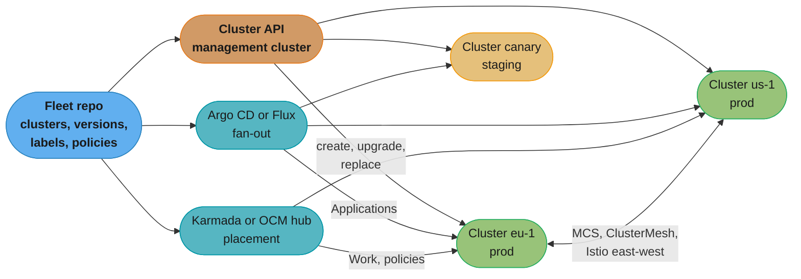
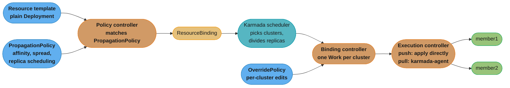
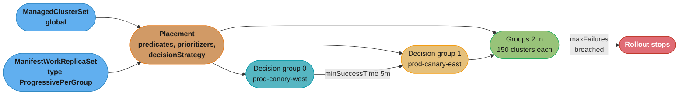
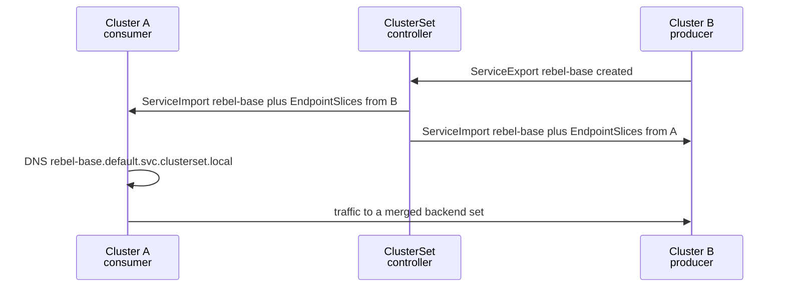

# Multi-Cluster and Fleet Management

> Phase 2 — Containers & Kubernetes · Difficulty: Advanced

> **Version anchor (2026-11-25).** **Kubernetes 1.37** (latest patch 1.37.3, 2026-11-25) is designed for at most 5,000 nodes, 110 Pods per node, 150,000 Pods and 300,000 containers per cluster. **Cluster API v1.14.4** (2026-11-03; v1.15.0-rc.0 is a pre-release): the `v1beta2` API is the supported one, a new minor ships about every four months, the two newest minors (N, N-1) are actively supported, each minor lives roughly 12 months (8 standard plus 4 maintenance), skip-upgrades are supported at most n-3, and downgrades are not supported; provider releases named here are CAPA v2.13.1, CAPZ v1.28.1 and CAPG v1.13.1. **Karmada v1.19.1** (2026-10-31; v1.20.0-beta.0 is a pre-release; a CNCF incubation project; policy APIs are `policy.karmada.io/v1alpha1`). **Open Cluster Management v1.4.0** (2026-10-07; a CNCF sandbox project; `Placement` is `v1beta1`, `ManifestWorkReplicaSet` is alpha). **KubeFleet v0.3.2** (2026-10-21; CNCF sandbox). **MCS API** `mcs-api` v0.5.2 (2026-07-13) and **ClusterProfile / Cluster Inventory API** `cluster-inventory-api` v0.2.0 (2026-10-14). **Cilium 1.20.5** (2026-11-17): ClusterMesh connects 255 clusters by default (511 with `maxConnectedClusters`), and the Cilium versions of connected clusters may differ by at most one minor. **Istio 1.32.0** (2026-11-09; supports Kubernetes 1.33 to 1.37): ambient multi-network multicluster is beta. **Argo CD v3.6.3** (2026-11-24): ApplicationSet progressive syncs are beta since v3.3.0 and must be enabled explicitly. **Flux v2.10.1** (2026-11-20).

This page owns the *fleet* layer: why a platform ends up with many clusters, how clusters are created and replaced declaratively, how workloads are placed across them, how they are connected, and how the whole set is observed and governed. The mechanics of upgrading one cluster (version skew, drains, API-removal scanning, the EKS extended-support bill) are in [cluster_lifecycle_and_fleet_upgrades](../kubernetes_architecture/cluster_lifecycle_and_fleet_upgrades.md) and are not repeated here; this page adds the wave orchestration on top. The packet-level view of multi-cluster networking (overlapping CIDRs, ClusterMesh identity, DNS failover) is in [multi_cluster_networking](../case_studies/cross_cutting/multi_cluster_networking.md); this page adds the service-discovery API and the fleet-level choices. Single-cluster GitOps is in [gitops_argocd_flux](../gitops_argocd_flux/gitops_argocd_flux.md). The platform that owns the clusters is designed in [design_kubernetes_platform](../case_studies/design_kubernetes_platform.md), and the end-to-end quarterly upgrade program in [design_kubernetes_fleet_upgrade_program](../case_studies/design_kubernetes_fleet_upgrade_program.md).

---

## 1. Concept Overview

A **fleet** is a set of Kubernetes clusters that one team operates as a single product. It exists because one cluster is the wrong size for almost every organisation past a certain point: a cluster is a failure domain, a tenancy boundary, a regional object, a unit of cloud quota, and a scale-limited system (5,000 nodes and 150,000 Pods for Kubernetes 1.37), and each of those pressures pushes towards more, smaller clusters. The price is that every operation that used to happen once now happens N times, and the interesting problems move from "how do I run a Pod" to "how do I make 60 clusters stay identical, upgrade in order, and find each other".

Four problems, four layers, and the tools that own each:

| Layer | Question it answers | Tools on this page |
|---|---|---|
| **Cluster lifecycle** | How are clusters created, scaled, upgraded and deleted declaratively? | Cluster API (CAPI): `Cluster`, `ClusterClass`, `MachineDeployment`, providers |
| **Inventory and placement** | Which clusters exist, and which workload runs on which of them? | Karmada, Open Cluster Management (OCM), KubeFleet, the ClusterProfile API |
| **Delivery fan-out** | How do manifests get from Git to N clusters, in waves? | Argo CD ApplicationSets, Flux, Karmada/OCM propagation |
| **Connectivity and service discovery** | How does a Pod in cluster A call a Service in cluster B? | MCS API, Cilium ClusterMesh, Istio multi-cluster, Gateway API |

Two more concerns cut across all four: **fleet observability** (one query across every cluster, with a `cluster` label on everything) and **fleet policy** (the same admission and quota rules everywhere, with drift visible). The cloud providers wrap pieces of all four in products (GKE fleets, AKS Fleet Manager, EKS Capabilities), covered briefly in §6.9.

The principle that ties them together: a fleet is only manageable if **clusters are cattle**. Every cluster is created from a template, holds no unique state, and can be replaced; the inventory (which clusters exist, with which labels) is data in an API, not knowledge in someone's head.

---

## 2. Intuition

> **One-line analogy:** A single cluster is one aircraft you can fly by hand; a fleet is an airline. The airline does not tune each aircraft individually: it has a maintenance schedule (upgrade waves), standard configurations (ClusterClass), a dispatch system that decides which aircraft flies which route (placement), and a rule that the first aircraft to get a new part is the one with the fewest passengers (canary).

**Mental model.** Draw two planes. The *management plane* (a Cluster API management cluster, a Karmada or OCM hub, an Argo CD instance) holds desired state about other clusters and never runs customer traffic. The *workload plane* (the clusters themselves) runs the Pods. Everything in this module is either a controller on the management plane reconciling towards the workload plane (push), or an agent in the workload plane pulling from the management plane (pull). The management plane is therefore the most dangerous place in the system: a bad change there reaches every cluster.

**Why it matters.** Most fleet incidents are not caused by a cluster failing. They are caused by an operation that was applied to all clusters at once: a template edited in place, an `ApplicationSet` pointed at `main`, a policy that denies a resource every cluster needs. The cluster is the blast-radius unit; the fleet tools are the thing that either contains the blast to one wave or removes the containment.

**Key insight.** Multiple clusters do not make a platform more reliable by themselves. They make it more reliable only if changes roll through them in waves, with a halt condition, and if each cluster can survive without the management plane for as long as it takes to repair it. Everything else is bookkeeping.

---

## 3. Core Principles

1. **Use as few clusters as the requirements allow.** Each extra cluster adds a control plane to patch, an add-on set to keep identical, and a network path to secure. Start from the requirement (isolation, location, scale) and count the clusters it forces.
2. **Clusters are replaceable.** Create them from a template (a `ClusterClass`, a Terraform module) and keep all state outside them. A cluster that cannot be rebuilt cannot be upgraded by replacement or recovered after loss.
3. **Declare the fleet in Git.** The cluster list, each cluster's version and labels, and the workload-to-cluster mapping are reviewed data. An upgrade of 40 clusters is 40 lines in a PR, not 40 console sessions.
4. **Roll changes in waves with a halt condition.** Canary cluster, then non-production, then production by Region, each with a soak period and an automatic stop on failure. This applies to Kubernetes versions, add-ons, policies and templates equally.
5. **Prefer pull for scale and for hard networks.** An agent that dials in works behind NAT and firewalls, and moves reconciliation work off the management plane. Push is simpler when every API server is reachable.
6. **The management plane must be less critical than the workload plane.** Clusters keep running if the hub is down. Back it up, upgrade it first and most carefully, and never put a workload on it.
7. **Same name, same namespace, same meaning.** Cross-cluster service discovery relies on *namespace sameness*: a namespace named `payments` has the same permissions and purpose in every cluster that has it.
8. **Label everything with the cluster.** Metrics, logs, traces and policy reports carry a `cluster` identifier from the first signal, because it cannot be added later.

---

## 4. Types / Architectures / Strategies

### 4.1 Why multiple clusters

The GKE fleet documentation sorts the reasons into three categories, and a fourth effect follows from them.

| Category | Typical drivers | What it forces |
|---|---|---|
| **Isolation** | Environment separation (dev, staging, prod), workload tiering, limiting blast radius of an operator mistake, regulatory separation, tenant separation | A cluster boundary at the line where a mistake or a tenant must not cross |
| **Location** | Latency to users, availability across zones or providers, data residency, data gravity, legacy infrastructure, edge sites | A cluster in each place the workload must run |
| **Scale** | One cluster hitting practical limits (5,000 nodes, 150,000 Pods, 300,000 containers; cloud quotas such as load balancers and subnets) | A second cluster before the first one saturates |
| **Reliability** (effect) | Replaceable, interchangeable clusters; traffic steered to healthy clusters in a regional outage | Automation so that a failed cluster is replaced, not debugged |

The same documentation recommends using as few clusters as possible and warns that a cluster-per-team or cluster-per-service model carries a heavy management burden. Arithmetic makes the point: an EKS control plane at $0.10 per cluster-hour is $73 a month, so 200 team clusters cost $14,600 a month in control planes alone, and the larger cost is the 200 clusters' worth of upgrades, add-ons and on-call.

### 4.2 Cluster topologies

| Topology | Cluster count | Strength | Weakness |
|---|---|---|---|
| **Per environment** (dev, staging, prod) | 3 | Simple; protects production from experiments | One production cluster is still one blast radius |
| **Per Region per environment** | 3 x R | Regional failure stays regional; residency met | Fleet size grows with R; needs placement and traffic steering |
| **Per tenant** (hard multi-tenancy, one customer or one regulated team per cluster) | T | Strongest isolation, per-tenant upgrade timing and cost | Cluster count scales with tenants; needs automation to be viable |
| **Per tier** (stateful vs stateless, critical vs best-effort) | 2 to 4 | Different upgrade cadence and policy per tier | Cross-tier traffic needs connectivity |
| **Cell-based** (identical cells, each a full copy serving a slice of users) | N identical | A bad change or failure hits one cell; capacity added by adding cells | Needs routing in front and a fleet tool to keep cells identical |

The Kubernetes multi-tenancy documentation describes the two tenancy shapes (multiple teams, multiple customers) and notes that Kubernetes has no first-class tenant concept, so namespaces, RBAC, quotas and network policies approximate it inside one cluster, while a separate cluster per tenant is the strong boundary. See [design_multi_tenant_platform](../case_studies/design_multi_tenant_platform.md) for the tenancy trade study.

### 4.3 Fleet control-plane architectures

| Architecture | How the management plane reaches clusters | Examples |
|---|---|---|
| **Push hub** | The hub holds credentials for each member cluster and applies resources directly | Karmada push mode, Argo CD with remote cluster secrets, Flux `Kustomization` with `spec.kubeConfig` |
| **Pull hub (hub and agent)** | An agent in each member cluster dials the hub, pulls its prescriptions and reports status | OCM klusterlet, Karmada pull mode (`karmada-agent`), `argocd-agent` |
| **Per-cluster GitOps** | No hub: each cluster runs its own controller that pulls from Git | Flux bootstrapped per cluster, Argo CD per cluster |
| **Cloud-managed fleet** | The provider's control plane reaches clusters and exposes fleet APIs | GKE fleets, AKS Fleet Manager |

### 4.4 Tool comparison

| Tool | Primary job | Placement model | Maturity (2026-11-25) |
|---|---|---|---|
| **Cluster API** | Create, scale, upgrade and delete clusters | None: it creates clusters, it does not place workloads | Kubernetes SIG Cluster Lifecycle sub-project, `v1beta2` API |
| **Karmada** | Run Kubernetes-native workloads across clusters unchanged | `PropagationPolicy` plus `OverridePolicy`, with a scheduler | CNCF incubation, policy APIs `v1alpha1` |
| **OCM** | Hub-and-agent multi-cluster orchestration, modular | `Placement` / `PlacementDecision` plus `ManifestWork` | CNCF sandbox |
| **KubeFleet** | Multi-cluster resource placement and progressive rollout | Cluster resource placement with rollout | CNCF sandbox |
| **Argo CD ApplicationSets** | Generate one Application per cluster from a template | Generators (cluster, git, list, cluster decision resource) | Part of Argo CD |
| **Flux** | Per-cluster GitOps, or remote-cluster apply | Repository layout, `Kustomization` per cluster | Part of the Flux toolkit |

Karmada, OCM and KubeFleet answer *placement*; Argo CD and Flux answer *delivery from Git*; they combine rather than compete (Argo CD can consume OCM `PlacementDecision` objects and can target a Karmada control plane as a cluster). Cluster API sits underneath all of them.

### 4.5 Cluster API object model

| Object | Role |
|---|---|
| **Management cluster** | The cluster where Cluster API and its providers run; it holds the objects that describe workload clusters |
| **`Cluster`** | One workload cluster; common fields (network CIDRs) plus `infrastructureRef` and `controlPlaneRef`, or `spec.topology` when a `ClusterClass` is used |
| **`ClusterClass`** | A reusable template for the control plane, infrastructure and worker shapes of many clusters |
| **`Machine`** | One host and its Node; immutable once created (replaced, not edited) |
| **`MachineDeployment` / `MachineSet`** | The Deployment/ReplicaSet analogue for worker Machines; rolls out changes by replacing Machines |
| **`MachinePool`** | A group of Machines managed by an infrastructure-specific primitive |
| **`MachineHealthCheck`** | Defines when a Node counts as unhealthy and triggers remediation |
| **`KubeadmControlPlane`** | The kubeadm-based control plane provider: a set of control-plane Machines |
| **Infrastructure provider** | Creates the VMs, networks and load balancers (AWS, Azure, GCP, vSphere, bare metal, others) |
| **Bootstrap provider** | Turns a host into a node (kubeadm is the default) |
| **Control plane provider** | Self-provisioned (kubeadm), Pod-based (needs a hosting cluster), or external/managed (EKS, AKS, GKE) |

---

## 5. Architecture Diagrams

**The fleet in two planes.** The management plane holds desired state; the workload plane runs traffic. Cluster API creates clusters, a hub places workloads, and a GitOps controller fans out manifests.



*The three management-plane tools have different jobs: Cluster API owns cluster existence, the hub owns which workload goes where, the GitOps controller owns getting manifests there. The east-west path between clusters is data-plane traffic and does not depend on any of them being up.*

**How Karmada turns one policy into per-cluster objects.** A policy selects resources and clusters; three controllers and the scheduler turn that into a `Work` object per cluster.



*The Deployment is an ordinary Kubernetes object; everything fleet-specific lives in the policies. That is Karmada's "no changes to your applications" claim, and it is also why a mis-scoped policy is the usual source of surprises.*

**An OCM wave rollout.** `Placement` selects clusters and groups them into decision groups; a `ManifestWorkReplicaSet` rolls the workload through the groups.



*Decision groups are the wave definition: the canary groups are chosen by label, the rest are chunked by size. The rollout controller stops when failures exceed `maxFailures`, so a halted wave is a state of the `ManifestWorkReplicaSet`, not an operator decision.*

**Blast radius of one ClusterClass change across a 60-cluster fleet.** Each cluster has 3 control-plane and 20 worker Machines, 23 in total; 60 x 23 = 1,380.

```
  Edit the ClusterClass in place (all 60 clusters roll at once)
  in flight  1,380  [#######################################]

  Rebase wave by wave (1 canary, 14 non-prod, 3 x 15 prod)
  wave 0  canary           23  [#]
  wave 1  non-prod        322  [#########]
  wave 2  prod Region 1   345  [##########]
  wave 3  prod Region 2   345  [##########]
  wave 4  prod Region 3   345  [##########]

  23 + 322 + 3 x 345 = 1,380 machines in total; at most 345 in flight at once.
  One # is about 35 machines.
```

*The total work is identical; what changes is the largest number of machines in flight (1,380 against 345) and the fact that the first 23 replacements happen in a cluster where failure is cheap. The Cluster API documentation recommends exactly this: create a new ClusterClass and rebase clusters onto it incrementally, which it compares to a canary deployment.*

---

## 6. How It Works — Detailed Mechanics

### 6.1 Cluster API: the management cluster, a ClusterClass and a Cluster

Cluster API runs on a **management cluster** and turns objects in that cluster into other clusters. A `ClusterClass` is the shared template; a `Cluster` with a `spec.topology` is one instance of it. Template names carry the ClusterClass name and a version suffix, which the project recommends so a cluster can later be *rebased* to a new class version (the API group below is `v1beta2`).

```yaml
# The shared shape: control plane, infrastructure and one worker class.
apiVersion: cluster.x-k8s.io/v1beta2
kind: ClusterClass
metadata: {name: standard-aws-v1, namespace: fleet}
spec:
  controlPlane:
    templateRef:
      apiVersion: controlplane.cluster.x-k8s.io/v1beta2
      kind: KubeadmControlPlaneTemplate
      name: standard-aws-v1-control-plane
    machineInfrastructure:
      templateRef:
        apiVersion: infrastructure.cluster.x-k8s.io/v1beta2
        kind: AWSMachineTemplate
        name: standard-aws-v1-control-plane
  infrastructure:
    templateRef:
      apiVersion: infrastructure.cluster.x-k8s.io/v1beta2
      kind: AWSClusterTemplate
      name: standard-aws-v1
  workers:
    machineDeployments:
      - class: general
        bootstrap:
          templateRef:
            apiVersion: bootstrap.cluster.x-k8s.io/v1beta2
            kind: KubeadmConfigTemplate
            name: standard-aws-v1-general
        infrastructure:
          templateRef:
            apiVersion: infrastructure.cluster.x-k8s.io/v1beta2
            kind: AWSMachineTemplate
            name: standard-aws-v1-general
```

```yaml
# One cluster of that shape. This object is the whole per-cluster configuration.
apiVersion: cluster.x-k8s.io/v1beta2
kind: Cluster
metadata:
  name: prod-eu-1
  namespace: fleet
  labels: {wave: "3", region: eu-west-1}
spec:
  topology:
    classRef: {name: standard-aws-v1}
    version: v1.37.3
    controlPlane: {replicas: 3}
    workers:
      machineDeployments:
        - {class: general, name: md-general, replicas: 20}
```

What each part buys the fleet:

- **`spec.topology` is the single point of control.** Upgrading the version, scaling the control plane, scaling a `MachineDeployment`, adding a `MachineDeployment` and rebasing to another ClusterClass are all edits to this one object, so each is a one-line Git diff. Without a ClusterClass the same operations touch `KubeadmControlPlane`, each `MachineDeployment` and every template separately.
- **Providers are swappable.** The infrastructure provider creates machines, networks and load balancers (AWS, Azure, GCP, vSphere, bare metal, among others), the bootstrap provider (kubeadm by default) turns a host into a node, and the control plane provider is self-provisioned (kubeadm static Pods), Pod-based (hosted in another cluster) or external and managed (EKS, AKS, GKE). Only the infrastructure and control-plane references differ between a self-managed and a managed-cloud cluster; the lifecycle verbs stay the same.
- **Machines are immutable.** A Machine is replaced, never edited (only labels, annotations and status change), exactly like Pods under a Deployment. A change to a `MachineDeployment` template rolls Machines through two `MachineSet`s, old and new.
- **`MachineHealthCheck`** defines when a Node counts as unhealthy and for how long; after that, it initiates remediation. This is what turns a failed node into an automated repair instead of a ticket.
- **`ClusterResourceSet`** applies a set of resources once to new and existing clusters. "Once" is the operative word: use it for bootstrap (a CNI), and GitOps for anything that must keep converging. The `cluster-api-addon-provider-helm` project (CAAPH, v0.6.6) manages add-ons as Helm charts through the same API.

### 6.2 Cluster API: upgrades, rollouts, in-place updates and pivoting

**Upgrading a managed-topology cluster is a one-field change**, and the controller rolls the control plane and then the workers machine by machine, removing an old machine only after a healthy new one is up:

```bash
kubectl patch cluster prod-eu-1 -n fleet --type json \
  --patch '[{"op": "replace", "path": "/spec/topology/version", "value": "v1.37.3"}]'
```

A jump of two minor versions in `spec.topology.version` is **rejected**, matching the `KubeadmControlPlane` rule: from 1.35 to 1.37 is two edits (1.36, then 1.37). Image-based providers also need a machine image for the target version, and the Cluster API version running on the management cluster must support the target Kubernetes version (check the project's version support matrix before the edit). The skew and drain mechanics of each step are in [cluster_lifecycle_and_fleet_upgrades](../kubernetes_architecture/cluster_lifecycle_and_fleet_upgrades.md).

**Rolling out machine changes** follows four rules:

1. **Rotate templates, do not edit them.** Machine templates are immutable: copy the existing one, change the instance type or image, create it, and point the `KubeadmControlPlane` or `MachineDeployment` (or the ClusterClass) at the new one. That triggers a rolling update. When a provider image must match the Kubernetes version, change the template reference and the version in one transaction so only one rollout happens.
2. **Pick the rollout strategy.** `MachineDeployment` supports `RollingUpdate` (honouring `maxUnavailable` and `maxSurge`, each an integer or a percentage such as `5%`) and `OnDelete` (a new Machine appears only after an old one is deleted by a person or another controller).
3. **Schedule a rollout without a change.** `spec.rollout.after` on a `KubeadmControlPlane` or `MachineDeployment` takes an RFC 3339 timestamp after which a rollout happens even with no spec change; it triggers, it does not delay. `clusterctl alpha rollout restart machinedeployment/<name>` does the same on demand. Use it for certificate rotation or to pick up a new base image.
4. **In-place updates are opt-in.** Since Cluster API v1.12, extensions can change an existing Machine instead of replacing it, behind the `InPlaceUpdates` feature flag and three runtime hooks (`CanUpdateMachine`, `CanUpdateMachineSet`, `UpdateMachine`). Cluster API falls back to a normal rollout when the extensions cannot cover the whole change, treats a Machine updating in place as unavailable, and will not use in-place on the control plane if it could hurt control-plane health. The user experience is unchanged: you still declare the desired state.

**Changing a ClusterClass** is a fleet operation, because every cluster using the class reconciles toward it. The documentation names two strategies. The **recommended** one is to create a *new* ClusterClass with the change and rebase clusters onto it one at a time (a canary pattern: it limits the blast radius to the clusters already rebased). The other edits the ClusterClass in place, which is faster but pushes the change to every cluster using it at once, and "can impact heavily on the underlying infrastructure" when it triggers machine rollout across the whole fleet. Reusing one template across several ClusterClasses is discouraged for the same reason: nobody can reason about the impact of editing it.

**The management cluster is a cluster too.**

```bash
# Bootstrap and pivot: a temporary kind cluster creates the real management cluster,
# then hands the objects over.
clusterctl init --infrastructure aws                      # on the kind bootstrap cluster
clusterctl generate cluster mgmt --kubernetes-version v1.37.3 \
  --control-plane-machine-count 3 --worker-machine-count 3 | kubectl apply -f -
clusterctl init --kubeconfig mgmt.kubeconfig --infrastructure aws   # target must run >= the source's provider versions
clusterctl move --to-kubeconfig mgmt.kubeconfig           # sets Cluster.spec.paused on the source first
```

Three properties matter for operations. `clusterctl move` pauses reconciliation of each moved `Cluster` in the source and never restores `status` (controllers rebuild it); it was designed and tested for the bootstrap case and is **not** a backup mechanism (`clusterctl move --to-directory` and `--from-directory` exist and carry the same limitations). Upgrading Cluster API itself is limited to skipping at most n-3 minors and **cannot be downgraded**, so the management cluster's upgrade is the one you rehearse. And the manifests in Git must follow the supported API version: `v1beta1` is deprecated since v1.11 and stops being served in v1.16 (April 2027), the project advises using `Patch` instead of `Update` when clients lag, and warns about server-side apply in environments serving several API versions.

### 6.3 Karmada: placement and propagation

Karmada is a control plane that speaks the Kubernetes API, so an unmodified `Deployment` created in it can run in many clusters. Its components are the Karmada API server (with its own etcd), the controller manager and the scheduler. The controller manager runs the chain from §5: the policy controller matches a `PropagationPolicy` to resources and creates a `ResourceBinding`, the scheduler picks clusters, the binding controller creates one `Work` per cluster, and the execution controller delivers it.

**Joining clusters** has two modes. **Push**: the control plane holds credentials and talks to each member's API server (`karmadactl join member1 ...`), which suits clusters it can reach with low latency. **Pull**: a `karmada-agent` in the member cluster registers the cluster, reports status and watches its execution namespace `karmada-es-<cluster name>`; it costs one agent per cluster but offloads the control plane and works for members behind NAT or gateways. Registration uses `karmadactl register` with a bootstrap token whose default TTL is 24 hours. Argo CD, Flux and PipeCD integrations are documented; in the Argo CD one, the Karmada API server is registered in Argo CD as a cluster and `PropagationPolicy` objects live in the Git repository beside the manifests.

```yaml
# Place checkout in two regions, one cluster each, dividing replicas by free capacity.
apiVersion: policy.karmada.io/v1alpha1
kind: PropagationPolicy
metadata: {name: checkout, namespace: shop}
spec:
  resourceSelectors:
    - {apiVersion: apps/v1, kind: Deployment, name: checkout}
  propagateDeps: true                  # ConfigMaps and Secrets the Deployment references travel with it
  placement:
    clusterAffinity:                   # the CANDIDATE set, not the chosen set
      labelSelector:
        matchLabels: {tier: prod}
    spreadConstraints:                 # how many groups are actually chosen
      - {spreadByField: region,  maxGroups: 2, minGroups: 2}
      - {spreadByField: cluster, maxGroups: 2, minGroups: 2}
    replicaScheduling:
      replicaSchedulingType: Divided
      replicaDivisionPreference: Weighted
      weightPreference:
        dynamicWeight: AvailableReplicas
```

```yaml
# Specialise per cluster without touching the Deployment: EU clusters pull from the EU registry.
apiVersion: policy.karmada.io/v1alpha1
kind: OverridePolicy
metadata: {name: eu-registry, namespace: shop}
spec:
  resourceSelectors:
    - {apiVersion: apps/v1, kind: Deployment, name: checkout}
  overrideRules:
    - targetCluster:
        fieldSelector:
          matchExpressions:
            - {key: region, operator: In, values: [eu-west-1]}
      overriders:
        imageOverrider:
          - {component: Registry, operator: replace, value: registry.eu.example.com}
```

Key behaviours of the scheduler, all from the propagation policy reference:

- **`clusterAffinity` is a candidate set, not a selection.** Filters are `labelSelector`, `fieldSelector` (keys `provider`, `region`, `zone`), `clusterNames` and `exclude`, combined with AND. To force exactly N clusters add `spreadConstraints`. `spreadByField` supports `cluster` and `region`; `zone` and `provider` are not yet implemented, and a region constraint must be paired with a cluster constraint.
- **`replicaScheduling`** is `Duplicated` (every selected cluster gets the full replica count) or `Divided`. `Divided` takes `Aggregated` (as few clusters as possible, which ignores `spreadConstraints`) or `Weighted` (static weights, or `dynamicWeight: AvailableReplicas` computed from free capacity). Static weights ignore spread constraints too. With `--enable-scheduler-estimator=true` and one `karmada-scheduler-estimator` per member cluster, the scheduler stops assigning more replicas than a cluster can hold.
- **`clusterAffinities` (plural)** lists ordered groups with fallback: try the first group, move to the next only if it cannot satisfy scheduling. `overflowAffinities` inside a term fills the primary group first and overflows only the remainder, for example from an on-premises GPU cluster to cloud GPU clusters, reclaiming from the cloud first when load falls. Overflow needs capacity awareness, so `Duplicated` and static weights are not supported with it.
- **Cluster taints.** `karmadactl taint clusters foo dedicated=special-user:NoSchedule`, with `clusterTolerations` in the policy, works like node taints for clusters.

**Failure handling has a gap people miss.** Karmada marks a cluster `Ready=False` after `--cluster-failure-threshold` (default 30 s) of unreachability or an unhealthy endpoint, and `Unknown` when it has not heard from a pull-mode cluster for `--cluster-monitor-grace-period` (default 40 s); status is refreshed every 10 s by default. When `Ready` is `False` or `Unknown`, Karmada adds `cluster.karmada.io/not-ready` or `cluster.karmada.io/unreachable` with effect **`NoSchedule`**, which stops *new* scheduling there. It does **not** add `NoExecute` on its own: eviction and rescheduling of what is already running starts only when a `NoExecute` taint exists that the policy does not tolerate, and you add one with the cluster taint management feature. Rescheduled workloads still obey `clusterAffinity` and `spreadConstraints`, and a `Duplicated` workload reschedules only if the number of new candidate clusters is at least the number of failed ones.

**Fleet-wide quota.** `FederatedResourceQuota` sets one namespace budget across clusters and tracks usage per cluster:

```yaml
apiVersion: policy.karmada.io/v1alpha1
kind: FederatedResourceQuota
metadata: {name: test, namespace: test}
spec:
  overall: {cpu: 100}
  staticAssignments:
    - {clusterName: member1, hard: {cpu: 20}}
    - {clusterName: member2, hard: {cpu: 50}}
    - {clusterName: member3, hard: {cpu: 30}}   # 20 + 50 + 30 = 100
```

Enforcement of the quota at the Karmada control plane (rejecting scheduling that would exceed the aggregate) is a separate alpha feature gate, `FederatedQuotaEnforcement`, off by default. The user guide also covers `FederatedHPA` and `CronFederatedHPA` autoscaling, a descheduler, a workload rebalancer, multi-cluster services and ingress, and Kyverno and Gatekeeper integration; those are out of scope here.

### 6.4 Open Cluster Management: hub, klusterlet, Placement and ManifestWork

OCM is built on a **hub and agent** model, deliberately modelled on kubelet: the hub cluster persists prescriptions declaratively, and a **klusterlet** in each managed cluster *pulls* them and reconciles the real cluster. The hub never calls the member API server, so it is not buried in events from managed clusters, any cluster that can reach the hub endpoint can join (even a kind cluster on a laptop), and each klusterlet keeps managing its cluster if the hub is unreachable. The project documentation states that a hub can accept and manage thousands of clusters.

Registration is a **double opt-in handshake**: the hub admin and the managed-cluster admin must each approve, so a cluster owned by another team cannot be enrolled or controlled without its consent, and either side can cut the connection (the hub by denying certificate rotation, the managed side by deleting the agent or revoking its RBAC). The klusterlet runs as an ordinary Pod ("white box"), which is the audit story for the managed-cluster admin.

The objects fall into four groups:

| Group | Objects | Role |
|---|---|---|
| **Inventory** | `ManagedCluster`, `ManagedClusterSet`, `ManagedClusterSetBinding`, `ClusterClaim` | Which clusters exist, their labels and claims; sets scope what a namespace may place onto |
| **Placement** | `Placement`, `PlacementDecision` | Select clusters (predicates, then prioritizers); decisions are published as paginated `PlacementDecision` objects |
| **Work** | `ManifestWork`, `ManifestWorkReplicaSet` | Deliver manifests to one cluster, or to every cluster in a placement with a rollout strategy |
| **Add-ons** | `ManagedClusterAddOn` and friends (policy framework, cluster-proxy, managed-serviceaccount) | Extend the agent; `cluster-proxy` manages a reverse tunnel through konnectivity |

`Placement` works like the Kubernetes scheduling framework: **predicates** are hard requirements (labels, `ClusterClaim`s, or CEL expressions over `ManagedCluster` fields), **prioritizers** score the survivors (built-ins `Balance`, `Steady`, `ResourceAllocatableCPU`, `ResourceAllocatableMemory`, or an add-on-supplied `AddOnPlacementScore`; each scores a cluster from -100 to 100 and weights range from -10 to 10). Taints on a `ManagedCluster` with effect `NoSelect` repel placements unless tolerated, and a toleration with `tolerationSeconds: 300` on the `cluster.open-cluster-management.io/unreachable` taint moves a workload to another cluster after five minutes.

```yaml
# Select every stable-channel cluster in the prod set and cut them into waves.
apiVersion: cluster.open-cluster-management.io/v1beta1
kind: Placement
metadata: {name: platform-addons, namespace: fleet}
spec:
  clusterSets: [prod]
  predicates:
    - requiredClusterSelector:
        labelSelector:
          matchLabels: {channel: stable}
  decisionStrategy:
    groupStrategy:
      clustersPerDecisionGroup: 150
      decisionGroups:
        - groupName: prod-canary-west
          groupClusterSelector:
            labelSelector:
              matchExpressions: [{key: prod-canary-west, operator: Exists}]
        - groupName: prod-canary-east
          groupClusterSelector:
            labelSelector:
              matchExpressions: [{key: prod-canary-east, operator: Exists}]
```

The named groups are built first, and the remaining clusters are chunked into groups of at most `clustersPerDecisionGroup`; each `PlacementDecision` carries the labels `...decision-group-name` and `...decision-group-index`. A `ManifestWorkReplicaSet` then rolls a workload through them:

```yaml
apiVersion: work.open-cluster-management.io/v1alpha1
kind: ManifestWorkReplicaSet
metadata: {name: mwrset, namespace: fleet}
spec:
  placementRefs:
    - name: platform-addons
      rolloutStrategy:
        type: Progressive            # All | Progressive | ProgressivePerGroup
        progressive:
          mandatoryDecisionGroups: [{groupName: prod-canary-west}, {groupName: prod-canary-east}]
          maxConcurrency: 25%
          minSuccessTime: 5m         # wait after success before the next cluster
          progressDeadline: 10m      # a cluster not successful by then counts as failed
          maxFailures: 2             # default 0: no failures tolerated
  manifestWorkTemplate:
    workload:
      manifests:
        - apiVersion: apps/v1
          kind: Deployment
          metadata: {name: hello, namespace: default}
          spec:
            selector: {matchLabels: {app: hello}}
            template:
              metadata: {labels: {app: hello}}
              spec: {containers: [{name: hello, image: "busybox", command: ["sh", "-c", "sleep 36000"]}]}
    manifestConfigs:
      - resourceIdentifier: {group: apps, resource: deployments, namespace: default, name: hello}
        conditionRules:
          - condition: Progressing
            type: CEL
            celExpressions:
              - |
                !(
                  (object.metadata.generation == object.status.observedGeneration) &&
                  has(object.status.conditions) &&
                  object.status.conditions.exists(c, c.type == 'Progressing' && c.status == 'True' && c.reason == 'NewReplicaSetAvailable')
                )
            messageExpression: 'result ? "Applying" : "Completed"'
          - condition: Degraded
            type: CEL
            celExpressions:
              - |
                (object.metadata.generation == object.status.observedGeneration) &&
                (has(object.status.readyReplicas) && has(object.status.replicas) && object.status.readyReplicas < object.status.replicas)
            messageExpression: 'result ? "Degraded" : "Healthy"'
```

The three rollout types: **All** applies to every selected cluster at once; **Progressive** advances cluster by cluster and does not move on until one current cluster succeeds without breaching `maxFailures`; **ProgressivePerGroup** advances group by group and moves on only when every cluster in the current group has succeeded. The controller reads three conditions on each `ManifestWork`: `Applied` (built in, set by the work agent), and **`Progressing`** and `Degraded`, which are *not* built in and must be defined with CEL in `manifestConfigs`. If `Progressing` is undefined the rollout treats the work as still progressing and **never advances to the next cluster**, which is the most common reason a first progressive rollout appears hung.

The inventory is also exposed through the SIG Multicluster `ClusterProfile` API (since OCM v0.15.0, refactored in v1.2.0), and `Placement` plugs into Argo CD (§6.5). The OCM policy framework (`Policy`, `PolicySet`, `PlacementBinding`, with a propagator on the hub and a framework add-on on each managed cluster) distributes governance policies and reports compliance back (§6.8).

### 6.5 GitOps fan-out: Argo CD ApplicationSets and Flux

**Argo CD** keeps every managed cluster as a `Secret` labelled `argocd.argoproj.io/secret-type: cluster` in its namespace, and the ApplicationSet **cluster generator** reads those Secrets: it exposes `name`, `nameNormalized`, `server`, `project`, and every Secret label and annotation as template parameters. A label selector narrows the target set, so waves are just labels on cluster Secrets.

```yaml
apiVersion: argoproj.io/v1alpha1
kind: ApplicationSet
metadata: {name: platform-addons, namespace: argocd}
spec:
  goTemplate: true
  goTemplateOptions: ["missingkey=error"]
  generators:
    - clusters:
        selector:
          matchLabels:
            argocd.argoproj.io/secret-type: cluster   # excludes the unnamed in-cluster entry
            tier: prod
  template:
    metadata:
      name: '{{.nameNormalized}}-platform-addons'
      labels: {wave: '{{index .metadata.labels "wave"}}'}
    spec:
      project: platform
      source:
        repoURL: https://github.com/example/fleet.git
        targetRevision: main
        path: 'addons/overlays/{{index .metadata.labels "region"}}'
      destination: {server: '{{.server}}', namespace: platform}
      syncPolicy: {syncOptions: [CreateNamespace=true]}
```

Setting `argocd.argoproj.io/auto-label-cluster-info: "true"` on a cluster Secret makes the controller label it with the cluster's Kubernetes version (`argocd.argoproj.io/kubernetes-version`), so a generator can select, say, "all clusters still on 1.36". The default local cluster has no Secret and is skipped by any selector on the secret-type label. The `clusterDecisionResource` generator is a duck-typed generator that reads a list from any resource's status; the OCM integration uses it to turn a `PlacementDecision` into Applications:

```yaml
apiVersion: v1
kind: ConfigMap
metadata: {name: ocm-placement-generator, namespace: argocd}
data:
  apiVersion: cluster.open-cluster-management.io/v1beta1
  kind: placementdecisions
  statusListKey: decisions
  matchKey: clusterName
# ApplicationSet generator: clusterDecisionResource {configMapRef: ocm-placement-generator,
#   labelSelector: {matchLabels: {cluster.open-cluster-management.io/placement: my-placement}},
#   requeueAfterSeconds: 30}   ->  template parameter {{.clusterName}}
```

**Scaling one hub Argo CD** has documented levers: the application controller's `--status-processors` (default 20) and `--operation-processors` (default 10) queues, with the project's own reference of 50 and 25 for 1,000 applications; `argocd-repo-server --parallelismlimit` to avoid out-of-memory kills during manifest generation, a 90 s default tool timeout (`ARGOCD_EXEC_TIMEOUT`), and a Git poll every 3 minutes by default; and **cluster sharding** across controller replicas by raising the `StatefulSet` replicas and setting `ARGOCD_CONTROLLER_REPLICAS` to the same number. The shard algorithm is `legacy` (UID-based, non-uniform), `round-robin` or `consistent-hashing`; the documentation marks the last two experimental. A cluster can be pinned to a shard with `shard:` in its Secret. **`argocd-agent`** inverts the topology: agents on workload clusters connect to a central hub and application controllers run where the workloads live, which targets clusters behind NATs, firewalls or air gaps; the project describes it as under active development with a stable core.

**Flux** has no central fleet object; the idiomatic fleet is **one Flux per cluster**, bootstrapped from a repository whose `clusters/<name>` directory defines that cluster, with `apps` and `infrastructure` split so cluster add-ons reconcile before applications. When one Flux must manage another cluster, a `Kustomization` accepts `spec.kubeConfig`:

```yaml
apiVersion: kustomize.toolkit.fluxcd.io/v1
kind: Kustomization
metadata: {name: apps-prod-eu-1, namespace: fleet}
spec:
  interval: 10m
  path: ./apps/prod
  prune: true
  sourceRef: {kind: GitRepository, name: fleet}
  kubeConfig:
    secretRef: {name: prod-eu-1-kubeconfig}   # Cluster API publishes a <cluster>-kubeconfig Secret per cluster
```

`secretRef` carries a static kubeconfig (reloaded on every reconcile, so tokens can rotate; it must be self-contained, with no exec plugins or `cmd-path` binaries). `configMapRef` is the recommended alternative: secret-less authentication through workload identity, with `provider` set to `aws` (EKS), `azure` (AKS), `gcp` (GKE) or `generic` (OIDC between clusters). If `serviceAccountName` is also set, Flux impersonates that ServiceAccount in the remote cluster, and the Kustomization's namespace must exist there too. Multi-tenant lock-down uses `--no-cross-namespace-refs=true`, `--no-remote-bases=true` and `--default-service-account` on the controllers.

### 6.6 Fleet upgrade waves

The upgrade of a single cluster is covered in [cluster_lifecycle_and_fleet_upgrades](../kubernetes_architecture/cluster_lifecycle_and_fleet_upgrades.md); the fleet problem is **ordering and halting** across clusters. Four parts have to line up: a wave label on every cluster, a mechanism that applies a version change one wave at a time, a health signal that decides when a wave is "done", and a stop. Here is one concrete wiring with Cluster API and Argo CD progressive syncs: each cluster is a file in the fleet repository, an ApplicationSet renders one Application per cluster that applies that cluster's `Cluster` object to the management cluster, and `RollingSync` walks the waves.

```json
{"name": "prod-eu-1", "wave": "3", "version": "v1.37.3"}
```

```yaml
apiVersion: argoproj.io/v1alpha1
kind: ApplicationSet
metadata: {name: fleet-clusters, namespace: argocd}
spec:
  goTemplate: true
  goTemplateOptions: ["missingkey=error"]
  generators:
    - git:
        repoURL: https://github.com/example/fleet.git
        revision: main
        files: [{path: "clusters/*.json"}]
  strategy:
    type: RollingSync
    rollingSync:
      steps:
        - matchExpressions: [{key: wave, operator: In, values: ["0"]}]
        - matchExpressions: [{key: wave, operator: In, values: ["1"]}]
          maxUpdate: 50%
        - matchExpressions: [{key: wave, operator: In, values: ["2", "3", "4"]}]
          maxUpdate: 20%
  template:
    metadata:
      name: 'cluster-{{.name}}'
      labels: {wave: '{{.wave}}'}
    spec:
      project: fleet
      source:
        repoURL: https://github.com/example/fleet.git
        targetRevision: main
        path: 'clusters/{{.name}}'          # holds the CAPI Cluster object for that cluster
      destination: {name: capi-management, namespace: fleet}
```

Rules this wiring depends on, from the progressive sync documentation: the feature is **beta** and must be switched on (`--enable-progressive-syncs`, or `applicationsetcontroller.enable.progressive.syncs: "true"` in `argocd-cmd-params-cm`); `RollingSync` **forces autosync off** on generated Applications and triggers syncs the way the UI or CLI does, so sync windows are respected; the controller waits for every Application in a step to be **Healthy** before the next step; `maxUpdate` caps simultaneous updates in a step (default 100%); and an Application matched by no step is **never synced** by the strategy.

The health signal is the part to build deliberately. Argo CD cannot judge the health of a custom resource unless a health check exists for it, so the CAPI `Cluster` kind needs one, and it should include `observedGeneration` to avoid reporting Healthy before the controller has seen the new version:

```yaml
# argocd-cm
resource.customizations.health.cluster.x-k8s.io_Cluster: |
  hs = {status = "Progressing", message = "Waiting for the Cluster controller"}
  if obj.status ~= nil and obj.status.conditions ~= nil
     and obj.status.observedGeneration == obj.metadata.generation then
    local available, upToDate = false, false
    for _, c in ipairs(obj.status.conditions) do
      if c.type == "Available" and c.status == "True" then available = true end
      if c.type == "MachinesUpToDate" and c.status == "True" then upToDate = true end
    end
    if available and upToDate then
      hs.status = "Healthy"
      hs.message = "Available and all Machines up to date"
    end
  end
  return hs
```

Condition names come from the Cluster API release you run (`Available`, `MachinesUpToDate` and `TopologyReconciled` in the v1beta2 `Cluster` status of v1.14), so verify them against your version.

The same shape exists in each tool, which is the point of describing the pattern rather than the product:

| Tool | Wave definition | Advance rule | Stop rule |
|---|---|---|---|
| Argo CD `RollingSync` | `steps` matching Application labels | Every Application in the step is Healthy | A step never turns Healthy; `maxUpdate` limits width |
| OCM `Placement` + `ManifestWorkReplicaSet` | `decisionGroups` plus `clustersPerDecisionGroup` | `Progressing` condition false and `minSuccessTime` elapsed | `maxFailures` breached or `progressDeadline` exceeded |
| AKS Fleet Manager update runs | Update strategy of stages and groups (up to 50 groups per stage) | Stage and group completion, optional approval and scheduled-start gates | Maximum allowed failures (preview), approval withheld |
| Hand-rolled (CI over PRs) | A wave label in the cluster file | A merged PR per wave, gated on SLO and add-on checks | The next PR is simply not merged |

Two ordering constraints belong in every plan. First, **everything in the data path that spans clusters has its own skew rule**: Cilium ClusterMesh requires the Cilium versions of connected clusters to differ by at most **one minor**, so upgrading Cilium must walk the mesh (1.19 to 1.20 on every cluster, a cluster at a time, never leaving two clusters two minors apart) and cannot follow the arbitrary wave order that suits Kubernetes itself. Second, **upgrade the management plane first and alone**: the management cluster, then the hub, then Argo CD or Flux, then the workload clusters, because the Cluster API release running on the management cluster must support the target Kubernetes version before any cluster can move to it.

### 6.7 Connectivity and service discovery

The packet path (routable or tunnelled Pod CIDRs, identity propagation, DNS failover) is in [multi_cluster_networking](../case_studies/cross_cutting/multi_cluster_networking.md) and the eBPF dataplane in [cilium_and_ebpf_dataplane](../kubernetes_networking/cilium_and_ebpf_dataplane.md). What a fleet adds is the **naming and discovery contract**, and three ways to get it.

**The Multi-Cluster Services (MCS) API** (KEP-1645, from SIG Multicluster) extends Services across clusters using **namespace sameness**: a namespace with the same name has the same permissions and characteristics in every cluster that has it. It specifies the API and behaviour only and has no reference implementation. Two resources do the work:

```yaml
# In every cluster that serves the backend:
apiVersion: multicluster.x-k8s.io/v1beta1
kind: ServiceExport
metadata: {name: rebel-base, namespace: default}
spec:
  exportedLabels: {app.kubernetes.io/name: rebel-base}
  exportedAnnotations: {service.cilium.io/affinity: local}   # Cilium-specific preference, passed through
```



*The consumer only ever reads local objects, which is why a hub outage does not break resolution: the ServiceImport and EndpointSlices already exist in the consuming cluster.*

A `ServiceExport` is name-mapped to the Service it exports; exports with the same namespaced name from several clusters become **one combined service**. The domain is `<name>.<namespace>.svc.clusterset.local`, and an `EndpointSlice` per exporting cluster, marked as managed by the ClusterSet controller, is created in every cluster of the set. Properties that must agree across clusters (session affinity, the union of ports, the type, traffic policies) are merged, and in Cilium's implementation a conflict sets a condition on the `ServiceExport` and is resolved in favour of the oldest export, which may not be the one you intended. A per-cluster DNS name such as `<cluster>.<svc>.<ns>.svc.clusterset.local` is deliberately **not** allowed; if you need cluster-specific targeting, create and export separate Services (`mysvc-eu`, `mysvc-us`). Gateway API can route to a `ServiceImport` as a backend (GEP-1748) where the implementation supports it.

Known MCS implementations (status from the SIG Multicluster tracker): Google Cloud MCS (GA), **Cilium ClusterMesh (stable, conformance-tested against `mcs-api` v0.5.2)**, Submariner, the AWS Cloud Map MCS controller (alpha) and Antrea Multi-cluster (alpha).

**Cilium ClusterMesh** provides a flat Pod IP space across clusters, cluster-aware network policy, and global services with locality control. Fleet-relevant prerequisites: the same datapath mode in every cluster; unique, non-overlapping PodCIDRs; node-to-node IP connectivity; Cilium versions at most one minor apart; at most 255 clusters by default, or 511 by setting `maxConnectedClusters` **once at install** (it trades cluster-local identities, 65,535 at 255 against 32,767 at 511, and changing it on a live cluster can disrupt connections and mis-enforce policy). Locality is set per Service with `service.cilium.io/affinity: none|local|remote`: with `local`, the global service load-balances across healthy local backends and uses remote ones only when all local backends are unavailable. To enable the MCS API, set `clustermesh.mcsapi.enabled=true` (CoreDNS 1.12.2 or later).

**Istio multicluster** has four independent dimensions: single or multiple clusters, single or multiple networks, single or multiple control planes, single or multiple meshes. The installation choices are **multi-primary** (an `istiod` in every cluster; each API server must be reachable by the others) and **primary-remote** (remote clusters use a primary's control plane), each on one or two networks (cross-network traffic goes through east-west gateways). Services are shared by default under namespace sameness. The sharp edge is DNS: Kubernetes DNS is per cluster, so a client cluster must contain a Kubernetes `Service` (or a `ServiceEntry` with DNS proxying) for any service it calls, **even when no backing Pods run there**. For ambient mode, multi-network multicluster is **beta**, with documented limits: multi-network only (single-network is untested), **multi-primary only** (primary-remote does not work), waypoints must be named identically across clusters and kept in sync by Flux or Argo CD, service scope must match across clusters, and mixing with existing sidecar deployments is not recommended.

| Question | MCS API | Cilium global services | Istio multicluster |
|---|---|---|---|
| What is the contract? | `ServiceExport` / `ServiceImport` / `clusterset.local` | Annotation `service.cilium.io/global: "true"` on a Service | Shared mesh, namespace sameness, per-cluster `Service` for DNS |
| Portable across CNIs and clouds? | Yes, by design; implementations vary | Cilium only (and Cilium implements MCS too) | Istio only |
| L7 routing, mTLS identity | No | Cilium policy and identity | Yes, mesh-wide |
| Control-plane coupling | Light: local objects in each cluster | Cilium ClusterMesh control path (see the networking page) | `istiod` per cluster or shared |

### 6.8 Fleet observability and policy

**A fleet inventory API.** The SIG Multicluster **ClusterProfile** (Cluster Inventory API, KEP-4322) is a namespaced object describing one member cluster; a *cluster manager* (OCM since v0.15.0, KubeFleet, GKE fleet sync in preview) publishes one per cluster, a namespace forms an *inventory*, and consumers read them to discover and reach clusters. `status.accessProviders` standardises how to reach a cluster (server, CA, proxy URL) but never stores credentials: consumers obtain them through an exec credential plugin (KEP-5339). Consumers on the tracker include Argo CD (via a labs integration), Kueue's MultiKueue (alpha, behind the `MultiKueueClusterProfile` gate; scheduler policy is in [gpu_cluster_scheduling_and_quotas](../../mlops/gpu_cluster_scheduling_and_quotas/gpu_cluster_scheduling_and_quotas.md)), `multicluster-runtime`, Project Sveltos, Headlamp and the Knative Operator. The point: one inventory, many tools, instead of each tool keeping its own cluster list.

**Observability.** The rule is a `cluster` identity on every signal at the source. For Prometheus that is `global.external_labels` (they are attached to series leaving the server, to alerts and to remote-write), so a central store can answer "which clusters run which Kubernetes version" in one query:

```promql
# Clusters per control-plane version (each cluster's Prometheus adds an external cluster label).
count by (git_version) (kubernetes_build_info{job="apiserver"})

# Clusters not yet on the fleet target minor; 0 means the last wave is done.
count(count by (cluster) (kubernetes_build_info{job="apiserver", git_version!~"v1\\.37\\..*"})) or vector(0)
```

`kubernetes_build_info` is a constant `1` metric labelled with major, minor and git version. Per-cluster cardinality and remote-write cost are in [prometheus_cardinality_and_scale](../case_studies/cross_cutting/prometheus_cardinality_and_scale.md). Beyond version, a fleet needs four standing views: **drift** (clusters whose Argo CD or Flux sources are out of sync), **skew** (the version histogram above, per add-on as well), **wave status** (which wave is in flight and its failures), and **management-plane health** (controller queue depth, reconcile errors, agent heartbeat age: Karmada's cluster status refresh is 10 s by default, and an agent silent for 40 s turns `Unknown`).

**Policy.** Two models. *Distribute and evaluate locally:* the same Kyverno or Gatekeeper policies are delivered by GitOps to every cluster and evaluated by each cluster's admission controller (see [policy_as_code_and_compliance](../policy_as_code_and_compliance/policy_as_code_and_compliance.md)); this keeps admission available when the hub is down. *Hub-managed:* OCM's governance framework distributes `Policy` objects with `PlacementBinding`s and collects compliance back to the hub, and Karmada documents Kyverno and Gatekeeper integrations plus `FederatedResourceQuota` for budgets. Roll out a new deny policy as a wave in audit mode first; a policy that rejects a resource every cluster needs is the fastest way to break a whole fleet.

### 6.9 Cloud fleet products, briefly

| Product | What it provides | Notes verified in the provider documentation |
|---|---|---|
| **GKE fleets** | A fleet is a logical grouping of clusters (on Google Cloud, other clouds or on premises) managed from one fleet host project; Connect gateway and Connect Agent give identity and reachability through NATs and proxies; multi-cluster Gateway and Ingress steer traffic to healthy clusters; MCS (GA) | Fleet management features are part of GKE, with Multi Cluster Ingress and Cloud Service Mesh at additional cost; ClusterProfile sync is in preview |
| **AKS Fleet Manager** | Member AKS clusters across Regions and subscriptions, plus Arc-enabled clusters; update runs with strategies, stages, groups, gates and auto-upgrade profiles; a hub cluster for resource placement; managed fleet namespaces | Up to 50 update groups per stage; update runs honour maintenance windows; node image choice is `Latest` or consistent; some features (automated deployments, DNS load balancing, identity binding) are in preview |
| **Amazon EKS** | No fleet-wide cluster-orchestration product in the sources reviewed; **EKS Capabilities** run managed Argo CD, ACK and kro outside your worker nodes, and Argo CD deploys to multiple clusters from one instance | For cluster lifecycle across EKS and others, Cluster API (CAPA) or Terraform driven from Git fills the gap |

Treat these as **implementations of the same four layers**: a fleet inventory, an update orchestrator with stages and gates, a placement API, and cross-cluster networking. The tool-neutral design in this page maps onto each.

---

## 7. Real-World Examples

These are reference setups from the projects' and providers' own documentation, not company claims.

- **GKE's own arithmetic for fleets.** The GKE documentation pictures an organisation with ten Google Cloud projects and two GKE clusters in each, 20 clusters in all. Without a fleet, a production-wide change is 20 per-cluster changes across 10 projects and observing them means switching project context; a fleet host project gives one place to view and manage them. GKE also notes that its clusters scale to more than 5,000 nodes, so cluster count is usually driven by isolation and location rather than scale limits.
- **Karmada driven by Argo CD.** The documented walkthrough uses a Karmada environment with three member clusters (`member1` and `member2` in push mode, `member3` in pull mode), registers the Karmada API server in Argo CD as a cluster, and keeps the application and its `PropagationPolicy` together in the Git repository. Git remains the source of truth, Karmada does the placement.
- **OCM driven by Argo CD.** An OCM `Placement` in the `argocd` namespace selects up to 10 clusters; a `ConfigMap` tells the ApplicationSet cluster decision resource generator to read `placementdecisions` with `statusListKey: decisions` and `matchKey: clusterName`; and `requeueAfterSeconds: 30` makes Argo CD re-read the decisions so the target set follows the placement as it changes.
- **Karmada on-premises plus cloud GPU overflow.** The scheduling guide's third use case fills an on-premises GPU cluster first and overflows the remainder of an inference `Deployment` to two cloud GPU clusters with `overflowAffinities` and `dynamicWeight: AvailableReplicas`, reclaiming replicas from the cloud clusters first when traffic falls. It is the clearest published example of "own the base load, rent the peak" at the cluster level; the scheduling policy side of GPU fleets is in [gpu_cluster_scheduling_and_quotas](../../mlops/gpu_cluster_scheduling_and_quotas/gpu_cluster_scheduling_and_quotas.md).
- **AKS Fleet Manager update runs.** A strategy of stages (test clusters first, production second), groups of clusters per stage (up to 50 groups per stage), maximum concurrency per stage or group, approval gates before or after a stage, scheduled-start gates, and an auto-upgrade profile that starts a run when AKS publishes a new Kubernetes or node image version; every run honours maintenance windows. It is the cloud-managed form of the wave pattern in §6.6.
- **EKS Capabilities.** A managed Argo CD runs outside your worker nodes and deploys to multiple clusters, accounts and Regions from one control point, paired with ACK for AWS resources, which gives an EKS fleet the hub-and-GitOps shape without operating the hub.
- **Cilium ClusterMesh with the MCS API.** Cilium 1.20 is a listed, conformance-tested MCS API implementation (reports against `mcs-api` v0.5.2) and reuses its Global Services machinery for the derived Services behind each `ServiceImport`.

---

## 8. Tradeoffs

**Cluster count.**

| Decision | Fewer, larger clusters | More, smaller clusters | Key factor |
|---|---|---|---|
| Blast radius | One failure or bad change hits more workloads | Failure stays in a cluster or a cell | Whether you can contain a change with waves |
| Per-cluster overhead | One control plane, one add-on set | N of each (EKS: $73 per cluster-month at $0.10 per hour) | Automation maturity: Cluster API and GitOps make N cheap, manual ops make it ruinous |
| Tenant isolation | Namespaces, RBAC, quotas, network policy (soft) | Cluster boundary (hard) | Whether tenants are mutually untrusted |
| Scale | Hits 5,000 nodes and 150,000 Pods eventually | Each cluster stays well inside limits | Whether one cluster would saturate |
| Networking | In-cluster Services, no cross-cluster path | Needs MCS, ClusterMesh or a mesh | Whether workloads must talk across the boundary |

**Push or pull.**

| Axis | Push (Karmada push, Argo CD remote, Flux `kubeConfig`) | Pull (OCM klusterlet, Karmada agent, `argocd-agent`) |
|---|---|---|
| Hub needs member API reachability | Yes | No: agents dial out |
| Credentials stored on the hub | A credential per cluster | No member credentials on the hub; agents hold credentials to reach the hub |
| Works behind NAT or firewalls | Poorly | Yes |
| Hub load | Grows with cluster count and events | Offloaded to agents |
| Failure when the hub is down | New changes stop | Agents keep reconciling the last state; new changes stop |
| Operational cost | Simplest | One agent per cluster to upgrade and monitor |

**Placement tool.**

| Need | Pick | Why |
|---|---|---|
| "Run this unmodified Deployment on N clusters with weights and failover" | Karmada | Native API plus scheduler, divide or duplicate replicas |
| Heterogeneous owners, clusters behind NAT, consent per cluster | OCM | Hub-agent pull, double opt-in, modular add-ons |
| Waves with groups, gates and a progressive rollout API | OCM or KubeFleet | `decisionGroups` and rollout strategy, or KubeFleet's progressive rollout |
| Git-driven app delivery with simple label targeting | Argo CD ApplicationSets | No new control plane; cluster Secrets are the inventory |
| One repo per cluster, Flux already in use | Flux, one per cluster | No hub to scale or secure |
| Fully cloud-managed on one provider | GKE fleets, AKS Fleet Manager | Provider runs the hub |

**ClusterClass change strategy.**

| | New class, rebase cluster by cluster | Edit the class in place |
|---|---|---|
| Blast radius | Only rebased clusters | Every cluster using the class, at once |
| Speed | Slower, a PR per wave | One change |
| Rollback | Rebase the cluster back | Revert the edit, which rolls the fleet again |
| When | Default | A change that only affects new clusters, or a fleet of one |

---

## 9. When to Use / When NOT to Use

**Adopt Cluster API when** you run more than a handful of self-managed or multi-provider clusters and want create, upgrade and delete to be Git operations, or when you need one lifecycle API across AWS, Azure, GCP, vSphere and bare metal. **Do not** adopt it for two or three clusters on a single managed cloud where the provider's own API and Terraform are simpler; its goals explicitly exclude managing a single cluster across several providers and clusters it did not provision.

**Adopt Karmada, OCM or KubeFleet when** one logical workload must run on several clusters with a scheduling decision (spread, weights, failover, overflow), or when you need an inventory with labels and a rollout API over hundreds of clusters. **Do not** when the need is "the same manifests on every cluster": an Argo CD ApplicationSet or Flux per cluster does that without a second control plane.

**Use pull when** member clusters are behind NAT, owned by different teams, or numerous enough that the hub would carry their event load. **Use push when** every API server is reachable, the fleet is small, and fewer moving parts matters more than hub scale.

**Use the MCS API or a mesh when** services in one cluster must call services in another by stable name and failover matters. **Do not** when cross-cluster calls are rare or asynchronous: a message queue or a public API behind a global load balancer is cheaper than a flat network and shared identity.

**Do not build a fleet to solve a quota or tenancy problem a namespace could solve.** Namespaces with RBAC, quotas and network policy cover many multi-team cases; clusters are for requirements those cannot meet.

---

## 10. Common Pitfalls

**Pitfall 1: editing a ClusterClass in place.** A platform team changes the worker instance type by pointing the shared ClusterClass at a new machine template. Every cluster using it reconciles at once, 60 clusters rolling 1,380 machines, with instance requests hitting provider rate limits and quota.

```bash
# BROKEN: change the class every cluster uses, in place
kubectl edit clusterclass standard-aws-v1 -n fleet   # point the worker infrastructure template at a new one
# -> all 60 clusters start a machine rollout immediately
```

```bash
# FIX: create standard-aws-v2 with the change, then rebase one cluster at a time (canary first)
kubectl apply -f standard-aws-v2.yaml
kubectl patch cluster canary-1 -n fleet --type json \
  --patch '[{"op":"replace","path":"/spec/topology/classRef/name","value":"standard-aws-v2"}]'
# soak, then rebase the next wave by changing classRef.name in the fleet repo
```

**Pitfall 2: assuming `clusterAffinity` picks N clusters.** A `PropagationPolicy` lists 10 `clusterNames` and the team expects 2 copies. The list is only the *candidate set*; nothing pins how many of the candidates are chosen, so the workload can end up on more than 2.

```yaml
# BROKEN: 10 candidates, no cap
placement:
  clusterAffinity: {clusterNames: [m1, m2, m3, m4, m5, m6, m7, m8, m9, m10]}
  replicaScheduling: {replicaSchedulingType: Duplicated}
```

```yaml
# FIX: cap the chosen set with a spread constraint
placement:
  clusterAffinity: {clusterNames: [m1, m2, m3, m4, m5, m6, m7, m8, m9, m10]}
  spreadConstraints:
    - {spreadByField: cluster, maxGroups: 2, minGroups: 2}
  replicaScheduling: {replicaSchedulingType: Duplicated}
```

**Pitfall 3: the cluster went dark and nothing moved.** A member cluster loses connectivity. Karmada marks it `Ready=False`, adds a `NoSchedule` taint, and stops scheduling new work there, but the workload that was already on it is **not** evicted because no `NoExecute` taint exists and Karmada does not add one itself. Nothing has moved away from the cluster that stopped reconciling.

```bash
# BROKEN: wait for automatic failover that never starts (only NoSchedule is added)
kubectl get cluster member2        # READY False, workloads still assigned to member2
```

```bash
# FIX: decide the failover rule. Taint NoExecute (a policy that does not tolerate it is rescheduled)
karmadactl taint clusters member2 failed=true:NoExecute
# and for OCM-style delay, tolerate the unreachable taint for a bounded time:
#   tolerations: [{key: cluster.open-cluster-management.io/unreachable, operator: Exists, tolerationSeconds: 300}]
```

**Pitfall 4: an OCM progressive rollout that never advances.** A `ManifestWorkReplicaSet` with `type: Progressive` and `maxConcurrency: 1` applies the first cluster and stops. The rollout needs a `Progressing` condition on each `ManifestWork`; if none is defined it is treated as still progressing, so the second cluster is never started.

```yaml
# BROKEN: progressive strategy, no conditionRules
manifestWorkTemplate:
  workload: {manifests: [ ... ]}
```

```yaml
# FIX: define Progressing (and Degraded) with CEL on the workload
manifestWorkTemplate:
  workload: {manifests: [ ... ]}
  manifestConfigs:
    - resourceIdentifier: {group: apps, resource: deployments, namespace: default, name: hello}
      conditionRules:
        - condition: Progressing
          type: CEL
          celExpressions:
            - "!((object.metadata.generation == object.status.observedGeneration) && has(object.status.conditions) && object.status.conditions.exists(c, c.type == 'Progressing' && c.status == 'True' && c.reason == 'NewReplicaSetAvailable'))"
          messageExpression: 'result ? "Applying" : "Completed"'
```

**Pitfall 5: a cluster that no wave touches.** With Argo CD `RollingSync`, an Application that matches no step is excluded from the rolling sync, and autosync is forced off on every generated Application. A cluster file added without a `wave` value is therefore never upgraded, and nothing fails: the version histogram just keeps one straggler for a year. FIX: make `wave` a required, validated field of the cluster file (a CI check on `clusters/*.json`) and alert on the "clusters not at the fleet target minor" query from §6.8.

**Pitfall 6: two minors of Cilium between clusters in a mesh.** Upgrading cluster A from 1.18 to 1.20 while cluster B stays on 1.18 breaks the one-minor rule for connected clusters. FIX: walk the mesh through every minor: all clusters to 1.19 (one at a time), then all to 1.20, never leaving two connected clusters two minors apart; do the same for `maxConnectedClusters`, which must be identical everywhere and fixed at install.

**Pitfall 7: Istio DNS for a service with no local Pods.** A client in cluster 2 calls `checkout.shop.svc.cluster.local`, and the lookup fails because cluster 2 has no `Service` named `checkout`, even though the mesh knows the endpoints. FIX: create the Kubernetes `Service` (or a `ServiceEntry` with DNS proxying) in every cluster that consumes the service, automated by the same GitOps that deploys the rest, or use the MCS API's `clusterset.local` name.

**Pitfall 8: treating the management cluster as a pet.** The Cluster API management cluster is the only place that holds the objects for 60 clusters, it was built by hand, and the "backup" is a nightly `clusterctl move --to-directory`. `move` was designed for the bootstrap-and-pivot case, never restores `status`, and assumes the cluster is stable. FIX: keep every `Cluster`, `ClusterClass` and template in Git and applied by GitOps so the management cluster is rebuildable, back up its etcd like any control plane, and rehearse the restore, since Cluster API cannot be downgraded.

---

## 11. Technologies & Tools

| Tool | Purpose |
|---|---|
| Cluster API (`clusterctl`), CAPA, CAPZ, CAPG, CAPV, Metal3 | Declarative cluster lifecycle across AWS, Azure, GCP, vSphere, bare metal |
| `ClusterClass`, `MachineDeployment`, `MachineHealthCheck`, `ClusterResourceSet` | Cluster templates, worker rollouts, auto-remediation, one-time add-on bootstrap |
| Cluster API Add-on Provider for Helm (CAAPH) | Install and manage add-ons as Helm charts through the Cluster API |
| Karmada (`karmadactl`) | Multi-cluster placement, overrides, failover, federated quota and autoscaling |
| Open Cluster Management (`clusteradm`) | Hub and klusterlet, `Placement`, `ManifestWork`, add-ons, governance policy |
| KubeFleet | Multi-cluster resource placement with progressive rollout |
| Argo CD ApplicationSets, `argocd-agent` | Per-cluster Application generation, progressive syncs, pull-based agent |
| Flux (`Kustomization` `spec.kubeConfig`) | Per-cluster or remote-cluster GitOps |
| MCS API (`ServiceExport`, `ServiceImport`) | Portable cross-cluster Service discovery |
| ClusterProfile / Cluster Inventory API | Common cluster inventory for tools |
| Cilium ClusterMesh, Submariner, Antrea Multi-cluster | Cross-cluster connectivity and MCS implementations |
| Istio (multi-primary, primary-remote, ambient multi-network) | Mesh-wide identity, L7 routing and failover across clusters |
| Kyverno, Gatekeeper, OCM governance policy framework | Policy distribution and compliance reporting |
| Prometheus `external_labels`, remote write | A `cluster` identity on every metric |
| GKE fleets, AKS Fleet Manager, EKS Capabilities | Provider-managed fleet features |
| Kueue MultiKueue | Dispatch batch jobs across clusters (see the mlops page) |

---

## 12. Interview Questions with Answers

**Q: When is one cluster not enough, and how do you decide how many to run?**
**Short:** Add a cluster only for a requirement a namespace cannot meet: isolation, location or scale. Start from that requirement and count the clusters it forces, since every cluster adds a control plane, add-ons and upgrades.
The GKE fleet guidance sorts the reasons into isolation (environments, tiers, regulatory or tenant separation, limiting an operator mistake), location (latency, availability, data residency, data gravity, edge) and scale (Kubernetes 1.37 is designed for 5,000 nodes, 150,000 Pods and 300,000 containers per cluster). It also recommends as few clusters as possible. The cost shows in simple arithmetic: 200 team clusters at $0.10 per cluster-hour is $14,600 a month in EKS control planes, before upgrades and on-call. A useful default is one cluster per environment per Region, with extra clusters only where trust, regulation or blast radius demands a hard boundary. Before adding one, check whether namespaces with RBAC, quotas and network policy already meet the requirement.

**Q: Why is editing a shared ClusterClass in place dangerous, and what do you do instead?**
**Short:** Every cluster using the class reconciles to the edit at once, rolling machines across the whole fleet. Create a new ClusterClass and rebase clusters onto it wave by wave instead.
Cluster API documents two strategies for a ClusterClass change. Changing the class in place propagates immediately to all clusters using it, and the project warns that an operation involving many clusters at once has intrinsic risk and "can impact heavily on the underlying infrastructure" when it triggers machine rollout across the fleet. The recommended strategy is to create a new class with the change (a version suffix in the name helps) and change `spec.topology.classRef.name` on one cluster at a time, which limits the blast radius to the rebased clusters, similar to a canary deployment. In a 60-cluster fleet with 23 machines per cluster, in place means 1,380 machines at once; with a 1, 14, 15, 15, 15 wave plan the peak is 345. Reusing one template across several ClusterClasses is discouraged for the same reason.

**Q: How do you upgrade the Kubernetes version of a Cluster API cluster that uses a ClusterClass?**
**Short:** Change `spec.topology.version`. The topology controller rolls the control plane and then the workers machine by machine, and a jump of two minors is rejected.
The Cluster object is the single point of control: one patch to `/spec/topology/version` (a PR in a GitOps fleet). Machines are replaced, never edited, with an old Machine removed only after a healthy new one is available. A +2 minor jump in a managed topology is not allowed, matching the `KubeadmControlPlane` rule, so 1.35 to 1.37 is two edits. For image-based providers the machine image must match the target version, and the Cluster API release on the management cluster must support the target Kubernetes version, so check the version matrix first. The skew and drain details are in the cluster lifecycle page; the fleet-level concern is ordering across clusters, which waves handle.

**Q: Push or pull for a multi-cluster control plane, and what changes operationally?**
**Short:** Pull (an agent in each cluster dials the hub) works behind NAT and offloads the hub, at the cost of one agent per cluster; push is simpler when every API server is reachable.
In push, the hub holds credentials and talks to each member API server (Karmada push mode, Argo CD remote cluster Secrets, Flux `kubeConfig`). In pull, an agent registers the cluster, pulls its prescriptions and reports status (the OCM klusterlet, the Karmada agent, `argocd-agent`). Pull needs no inbound path to members, keeps reconciling the last known state if the hub is down, lets the member's admin audit a white-box agent, and spreads the event load, which is how OCM documents hubs managing thousands of clusters. The costs are an agent to upgrade and monitor per cluster and a registration handshake. Karmada supports both modes in one fleet.

**Q: A Karmada `PropagationPolicy` lists 10 clusters but you wanted 2. Why can it select more?**
**Short:** `clusterAffinity` only defines the candidate set. The count and topology of chosen clusters come from `spreadConstraints`, so add a cluster constraint with `maxGroups` and `minGroups` of 2.
Cluster affinity (label selector, field selector on provider, region or zone, `clusterNames`, `exclude`) filters which clusters are eligible. With `Duplicated` replica scheduling the full replica count goes to every selected cluster, so you need `spreadConstraints` to bound the selection. A region constraint requires a paired cluster constraint, because `spreadByField` supports `cluster` and `region` and `zone` and `provider` are not yet implemented. Remember that `Aggregated` division ignores spread constraints, and static weights disable them. Always read the resulting `ResourceBinding` to confirm what the scheduler chose.

**Q: A member cluster is down, Karmada shows it not ready, and the workloads did not move. What is missing?**
**Short:** Karmada adds only a `NoSchedule` taint for not-ready or unreachable clusters, which blocks new placement; eviction needs a `NoExecute` taint that the policy does not tolerate.
After 30 s of failure (default `--cluster-failure-threshold`) the cluster becomes `Ready=False`, or `Unknown` after 40 s of silence for pull-mode clusters, and a `cluster.karmada.io/not-ready` or `unreachable` taint with `NoSchedule` is added. Karmada does not add `NoExecute` on its own; you apply one with the cluster taint management feature (`karmadactl taint clusters member2 failed=true:NoExecute`), after which affected resources are rescheduled subject to the policy's affinity and spread constraints. A `Duplicated` workload reschedules only when there are at least as many fresh candidate clusters as failed ones. Decide this rule deliberately, because automatic failover of stateful or capacity-heavy workloads is not always what you want.

**Q: An OCM `ManifestWorkReplicaSet` with a Progressive rollout stops after the first cluster. Why?**
**Short:** The rollout controller needs a `Progressing` condition on each ManifestWork, and it is not built in; without a CEL `conditionRules` entry it is treated as still progressing and never advances.
`Applied` is set by the work agent, but `Progressing` and `Degraded` must be defined in `manifestConfigs` with CEL expressions. The controller maps conditions to a status: `Applied=False` is ToApply, `Progressing=True` with `Degraded=True` is Failed, `Progressing=True` otherwise is Progressing, and `Progressing=False` is Succeeded; an undefined or stale `Progressing` blocks progress. Then `minSuccessTime`, `progressDeadline` (a cluster not successful by then counts as failed), `maxFailures` (default 0, none tolerated) and `maxConcurrency` govern the pace. For a Deployment, base `Progressing` on `observedGeneration` and the `NewReplicaSetAvailable` reason, and `Degraded` on ready versus desired replicas.

**Q: Karmada, OCM, or just Argo CD ApplicationSets: how do you choose?**
**Short:** ApplicationSets deliver the same manifests to labelled clusters; Karmada schedules a workload across clusters with weights and failover; OCM gives a pull-based inventory with Placement and rollout groups.
If every cluster should get the same set of manifests, an ApplicationSet cluster generator with label selectors is enough and adds no control plane. If one workload must be divided, duplicated, spread or failed over by a scheduler, Karmada's `PropagationPolicy` and `OverridePolicy` do that with native objects. If clusters are owned by different teams, sit behind NAT, or you need staged rollouts over groups, OCM's hub-agent model, double opt-in and `Placement` decision groups fit; KubeFleet is a CNCF sandbox alternative with progressive rollout. The tools compose: Argo CD can consume OCM `PlacementDecision` objects through the cluster decision resource generator, and Karmada's API server can be an Argo CD destination.

**Q: How do you implement fleet upgrade waves, and what stops a bad wave?**
**Short:** Put a wave label on every cluster, apply the version change one wave at a time with a rollout tool, gate each wave on a real health signal, and stop on failure; Argo CD RollingSync, OCM groups or AKS update runs all fit.
In the Cluster API plus Argo CD wiring, each cluster is a file with a `wave` value, an ApplicationSet renders an Application per cluster applying that cluster's `Cluster` object, and `RollingSync` steps match the wave label with `maxUpdate` limiting width; it waits for every Application in a step to be Healthy. That is only as good as the health check: Argo CD needs a custom check for the CAPI `Cluster` kind that reads `observedGeneration` and conditions, or the step completes instantly. RollingSync forces autosync off, an Application matching no step never syncs, and the feature is beta and must be enabled. OCM expresses the same with decision groups, `minSuccessTime`, `progressDeadline` and `maxFailures`. Add soak time between prod waves and a SLO-burn gate.

**Q: How do you scale Argo CD to many clusters, and when should you stop using a central hub?**
**Short:** Raise the controller's processor counts, shard clusters across controller replicas, size the repo-server, and move to per-cluster agents or GitOps when reachability or hub load becomes the limit.
The documented levers: `--status-processors` (default 20) and `--operation-processors` (default 10), with 50 and 25 as the project's setting for 1,000 applications; repo-server `--parallelismlimit` to avoid OOM kills and a 90 s default tool timeout; and controller sharding by raising the `StatefulSet` replicas and `ARGOCD_CONTROLLER_REPLICAS` together, with `legacy`, `round-robin` and `consistent-hashing` algorithms (the latter two documented as experimental). A 60-cluster fleet with 80 ApplicationSets, each generating one Application per cluster, is 4,800 Applications, so measure queue depth and reconcile latency rather than copying the 1,000-application figure. Past that, or when clusters are behind NAT or air-gapped, `argocd-agent` (agents dial a central hub, controllers run where workloads live) or one Flux per cluster removes the central bottleneck.

**Q: How does Flux manage many clusters?**
**Short:** Usually one Flux per cluster, bootstrapped from a `clusters/<name>` directory in a shared repo; for a central Flux, a `Kustomization` with `spec.kubeConfig` applies to a remote cluster.
The repository-structure guidance uses `apps`, `infrastructure` and `clusters/<env>` directories so cluster add-ons reconcile before applications and each cluster's state lives in its own directory. For remote apply, `spec.kubeConfig.secretRef` points at a self-contained kubeconfig Secret (reloaded each reconcile so tokens can rotate; no exec plugins), and `configMapRef` is the recommended secret-less option using workload identity with providers `aws`, `azure`, `gcp` or `generic`. With `serviceAccountName` also set, Flux impersonates that account in the remote cluster. Multi-tenant lock-down adds `--no-cross-namespace-refs`, `--no-remote-bases` and a default service account on the controllers. Choose per-cluster Flux when you want no hub to scale or secure.

**Q: How does the Multi-Cluster Services API work, and what does a consumer see?**
**Short:** Export a Service with a `ServiceExport`; a controller creates a `ServiceImport` and `EndpointSlice`s in every cluster of the set, and consumers resolve `<svc>.<ns>.svc.clusterset.local` using only local data.
It builds on namespace sameness: same-named namespaces behave the same across clusters. A `ServiceExport` is name-mapped to a Service; exports with the same namespaced name from several clusters combine into one service. The controller creates a `ServiceImport` plus one or more `EndpointSlice`s per exporting cluster in each cluster, marked as managed by the ClusterSet controller. Conflicting properties (ports, type, session affinity, traffic policies) are reconciled, and Cilium resolves conflicts toward the oldest export and records a condition on the `ServiceExport`. Per-cluster DNS names are deliberately not offered; export separate Services (`mysvc-eu`, `mysvc-us`) if you need to target a cluster. The API is a spec with several implementations (Google Cloud MCS GA, Cilium stable, Submariner, AWS Cloud Map alpha, Antrea alpha) and no reference implementation.

**Q: MCS API, Cilium global services or Istio multicluster for cross-cluster calls?**
**Short:** The MCS API is the portable naming contract; Cilium ClusterMesh gives a flat network, identity and locality affinity; Istio adds mesh-wide mTLS and L7 routing and requires a local Service per consumer cluster for DNS.
Pick by what you already run and need. With Cilium, enable the MCS API (`clustermesh.mcsapi.enabled=true`, CoreDNS 1.12.2 or later) to get the standard objects on top of the mesh, and use `service.cilium.io/affinity` (`local` prefers local backends and uses remote ones only when all local backends are unavailable). With Istio, choose multi-primary or primary-remote and single or multi-network, and note that the clients' clusters need a `Service` for DNS to resolve. The MCS names do not give you L7 routing or mTLS by themselves. Whatever you choose, plan overlapping CIDRs and identity first (see the multi-cluster networking page).

**Q: What are the hard prerequisites and limits of Cilium ClusterMesh that affect a fleet?**
**Short:** Unique non-overlapping PodCIDRs, the same datapath mode, node IP connectivity, Cilium versions at most one minor apart, and at most 255 clusters (511 with `maxConnectedClusters`, set at install).
The setup guide also requires cross-cluster firewall access and, for native routing, a native routing CIDR that covers every connected cluster's PodCIDRs. `maxConnectedClusters` trades cluster count for identity space (65,535 cluster-local identities at 255, 32,767 at 511), must match across all clusters, and should not be changed on a live cluster because it can disrupt connections and mis-enforce policy. The one-minor version rule makes Cilium upgrades a coordinated walk of the mesh, not a free-order fleet wave. Allocate PodCIDRs from a registry and validate non-overlap in CI before connecting any cluster.

**Q: Why does a service with no Pods in the local cluster fail to resolve in a multi-cluster Istio mesh?**
**Short:** Kubernetes DNS is per cluster and Istio only learns names from Services or ServiceEntries, so each consuming cluster needs a `Service` (or ServiceEntry plus DNS proxying) even with no local backends.
Istio is multicluster-aware but Kubernetes is not: a client's DNS lookup happens in its own cluster, then Istio load-balances across all known endpoints using the returned virtual IP. Deploy a `Service` for the callee in every consuming cluster (GitOps makes this routine), or use `ServiceEntry` with DNS proxying, or the MCS API names. Multi-primary needs every API server reachable by the others, and trust must be established with a common root of trust across clusters. Ambient multi-network multicluster is beta with documented limits: multi-primary only, matching waypoint names, uniform service scope, and caution mixing with sidecar mode.

**Q: What is the Cluster API management cluster's blast radius, and how do you protect it?**
**Short:** It holds the desired state of every workload cluster and cannot be downgraded, so keep its objects in Git, back up its etcd, upgrade it first and rehearse; `clusterctl move` is a pivot tool, not a backup.
Losing it does not stop running clusters, but it stops creating, upgrading and healing them, and a bad change there reaches all of them. Cluster API supports skipping at most n-3 minor releases and no downgrades, with the two newest minors actively supported and roughly a 12-month life per minor, so schedule management upgrades like a major event. `clusterctl move` pauses the source `Cluster` objects, requires equal or newer provider versions in the target, never restores `status`, and was designed and tested for bootstrap and pivot only. Use GitOps to re-create the objects, snapshot etcd like any control plane, and keep the management cluster off customer workloads.

**Q: What is the ClusterProfile (Cluster Inventory) API for?**
**Short:** It is a standard namespaced object describing one member cluster, so cluster managers publish an inventory once and tools such as Argo CD or MultiKueue consume it instead of keeping private cluster lists.
A cluster manager (OCM since v0.15.0, KubeFleet, GKE fleet sync in preview) creates a `ClusterProfile` per member cluster and keeps its status current; a namespace of profiles is an inventory, and namespace RBAC controls which consumer sees which. `status.accessProviders` standardises reachability (server, CA data, proxy URL) but stores no credentials, which consumers obtain through an exec credential plugin (KEP-5339). Consumers on the tracker include Argo CD, Kueue MultiKueue (alpha, behind a feature gate), multicluster-runtime, Sveltos, Headlamp and the Knative Operator. Because the API and its consumers are young (`cluster-inventory-api` v0.2.0), treat it as a convergence point to design toward rather than a dependency to bet a fleet on.

**Q: What does fleet observability need beyond per-cluster monitoring?**
**Short:** A `cluster` label on every signal from the source, a central place to query across clusters, and standing views for version skew, drift, wave status and management-plane health.
Set Prometheus `external_labels` (a `cluster` identity) so series, alerts and remote-write carry it; adding it later means relabelling history. With it, one query answers fleet questions, for example `count by (git_version) (kubernetes_build_info{job="apiserver"})` for control-plane version spread and a count of clusters not on the target minor for upgrade progress. Track Argo CD or Flux sync state for drift, the wave in flight and its failures, and the management plane itself: reconcile errors, queue depth, agent heartbeat age (Karmada's status refresh defaults to 10 s and an agent silent for 40 s becomes `Unknown`). Watch cardinality: a per-cluster label multiplies series.

**Q: How should policy and quota be governed across a fleet?**
**Short:** Deliver the same admission policies to every cluster by GitOps and evaluate them locally, roll new deny rules out in audit mode as a wave, and use federated quota or hub policy for global budgets.
Local evaluation (Kyverno or Gatekeeper per cluster) keeps admission working when the hub is down. OCM's governance framework distributes `Policy` objects through `PlacementBinding`s and reports compliance to the hub; Karmada documents Kyverno and Gatekeeper integrations and offers `FederatedResourceQuota`, which sets an `overall` budget with per-cluster `staticAssignments` (20 + 50 + 30 = 100 CPU) and tracks usage per cluster, with control-plane enforcement as an alpha feature gate. Policies are the highest-leverage fleet change, so wave them like any other and watch for a deny that blocks something every cluster needs. See the policy-as-code page for the engines.

**Q: How do the cloud fleet products differ, and when do you use them over open source?**
**Short:** AKS Fleet Manager orchestrates updates with stages, groups and gates plus placement; GKE fleets group clusters for identity, networking and features; EKS offers Capabilities (managed Argo CD), not a fleet orchestrator.
AKS Fleet Manager joins AKS and Arc-enabled clusters, runs update runs (up to 50 groups per stage, concurrency, approval and scheduled-start gates, auto-upgrade profiles), and offers a hub for resource placement. GKE fleets register clusters, including non-Google ones, in a fleet host project with Connect gateway, MCS and multi-cluster Gateway and Ingress. EKS Capabilities runs Argo CD, ACK and kro outside your nodes and manages multiple clusters from one Argo CD. Choose the provider product when most clusters live on that provider and the product covers upgrades and inventory; choose Cluster API plus a hub plus GitOps for multi-cloud or on-premises fleets, accepting that you operate the control plane.

**Q: When do you run a cluster per tenant, and what does it cost?**
**Short:** Only where tenants are mutually untrusted, have different upgrade or compliance needs, or need performance and cost isolation namespaces cannot give; otherwise namespaces with quotas and policy are cheaper.
Kubernetes has no first-class tenant, and namespaces plus RBAC, quotas and network policy provide "soft" isolation suited to teams that trust each other; "hard" multi-tenancy for mutually untrusting customers is a separate control plane and data plane. The price: an EKS control plane is $73 a month per cluster, so 200 tenant clusters are $14,600 a month, and the dominant cost is operating 200 upgrade and add-on lifecycles, which is only viable with Cluster API or a managed fleet, GitOps and waves. A common compromise is cells or tiers: a handful of clusters, each hosting a bounded set of tenants.

**Q: What are Cluster API in-place updates, and should a fleet use them?**
**Short:** Since v1.12, extensions can change an existing Machine instead of replacing it, behind the `InPlaceUpdates` flag and three hooks; Cluster API falls back to a normal rollout when they cannot cover the change.
The hooks are `CanUpdateMachine`, `CanUpdateMachineSet` and `UpdateMachine`, and only one extension can be registered for each. A Machine updating in place counts as unavailable, a control plane will not use in-place if it could hurt control-plane health, and `OnDelete` worker rollouts never use it. The user experience is unchanged: you declare the desired state and Cluster API picks the strategy. Runtime extensions are an advanced feature that can block updates if poorly implemented, so a fleet should adopt in-place only for a measured cost or latency problem (for example, very slow node image pulls on large pools) and canary it like any other change.

---

## 13. Best Practices

- **Count clusters from requirements**, and write down the isolation, location or scale driver for each one; review the list at least yearly.
- **Template every cluster** (a ClusterClass or a Terraform module) and keep clusters free of unique state, so replacement is always an option.
- **Declare the fleet in Git**: cluster files with name, version, wave and labels, validated in CI (wave present, versions within policy, PodCIDRs unique).
- **Never change a shared template in place.** Version the ClusterClass (`standard-aws-v2`) and rebase clusters in waves.
- **Roll every fleet-wide change in waves** (canary, non-production, production by Region) with soak time, a health signal that is a real check, and an automatic stop.
- **Prefer pull** for large, remote or NAT-bound fleets; keep push for small fleets where reachability is simple.
- **Upgrade the management plane first and alone**, back it up, and keep it off customer workloads.
- **Treat connectivity as a fleet-wide contract**: unique PodCIDRs and cluster IDs from a registry, one Cilium minor of skew, matching `maxConnectedClusters`.
- **Use the MCS API names (or a Service per consumer cluster for Istio)** so callers do not depend on which cluster hosts a backend.
- **Put a `cluster` label on every metric, log and trace** at the source, and keep standing dashboards for version skew, drift and wave status.
- **Roll out policies in audit mode first**, as a wave.
- **Keep per-cluster overrides small and declared** (an `OverridePolicy`, a Kustomize overlay), not edited by hand in a cluster.

---

## 14. Case Study

### Scenario: 60 clusters, three Regions, and one instance-type change

A platform team runs 60 Cluster API clusters from one ClusterClass: 1 canary, 14 non-production and 45 production in three Regions of 15. Each cluster has 3 control-plane and 20 worker Machines, 23 in all. A change to the worker instance type, meant to cut cost, has to reach every cluster. The first attempt edits the ClusterClass in place.

**What went wrong.**

```bash
# BROKEN: the shared class is edited, so all 60 clusters reconcile at once
kubectl edit clusterclass standard-aws-v1 -n fleet
# -> 60 clusters x 23 machines = 1,380 machines scheduled for replacement together
# -> new-instance requests hit provider rate limits and quota in all three Regions at the same moment
# -> no canary: the first signal that the new type fails a driver check comes from production
```

The control-plane replacement is the part that cannot go wrong at fleet scale, and it went wrong everywhere simultaneously. The Kubernetes large-cluster guidance notes that some cloud providers rate-limit instance creation and recommends bringing nodes up in batches with pauses; a fleet-wide edit does the opposite.

**The fix: version the class, define waves in data, gate on health.**

```bash
# FIX 1: standard-aws-v2 carries the new instance type. standard-aws-v1 stays untouched.
kubectl apply -f classes/standard-aws-v2.yaml

# FIX 2: the rebase is a one-line change per cluster in the fleet repo
#   clusters/canary-1/cluster.yaml      spec.topology.classRef.name: standard-aws-v2
# A PR per wave. The Argo CD RollingSync steps (waves 0, 1, then 2-4 with maxUpdate 20%)
# apply them, and a custom health check on cluster.x-k8s.io/Cluster holds the next step
# until Available is True and MachinesUpToDate is True.
```

**The arithmetic.**

```
  machines per cluster      : 3 control plane + 20 workers = 23
  fleet                     : 60 clusters x 23             = 1,380 machines

  in place, all at once     : 1,380 machines in flight (60 clusters x 23)
  wave plan 1 / 14 / 15 / 15 / 15 clusters
                            :   23 /  322 /  345 /  345 /  345 machines
  largest wave              : 345 machines   (15 x 23)
  extra instances at peak with maxSurge 1 on one worker MachineDeployment per cluster:
      in place              : 60 clusters x 1 = 60
      wave of 15 clusters   : 15 clusters x 1 = 15

  calendar (soak between waves): canary 2 days, non-prod 3 days, then 3 production
  waves of 3 days each = 2 + 3 + 3 x 3 = 14 days to reach all 60 clusters
```

Total work is unchanged at 1,380 machines, but the worst moment is a quarter of the size and the first 23 machines are in a cluster nobody pages for. Waves 2 to 4 are three Regions, so a Region-specific quota failure stops that Region only. The per-wave stop condition is the health check plus a SLO burn alert; a halted wave is simply a step that never turns Healthy.

**Two traps the team hit on the way.**

```yaml
# BROKEN: no custom health check for the CAPI Cluster kind, so RollingSync cannot tell when a wave is done
# (Argo CD can only judge CRD health when a check exists)
```

The first run of the new ApplicationSet advanced through all steps within minutes because the `Cluster` kind had no health check. The fix is the Lua check in §6.6, reading `status.observedGeneration` and the `Available` and `MachinesUpToDate` conditions.

The second trap was a cluster file added during the migration without a `wave` value: `RollingSync` never touched it. The fleet-version query from §6.8 caught it a week later as the single cluster still on `standard-aws-v1`, and CI now rejects cluster files without a wave.

**Discussion questions.**

1. The ClusterClass rebase changes a worker template, which triggers a worker rollout in each cluster. Which settings on the `MachineDeployment` (strategy, `maxSurge`, `maxUnavailable`) bound the per-cluster blast radius, and how do they interact with the wave width?
2. Why is the management cluster upgrade ordered before the wave, and what does the Cluster API n-3 skip-upgrade limit imply for how often it must be upgraded?
3. If the fleet also ran Cilium ClusterMesh across these clusters, how would the one-minor version rule change the wave plan for a Cilium upgrade compared with this Kubernetes-side change?
4. When would you replace the Argo CD wiring with OCM `Placement` decision groups and a `ManifestWorkReplicaSet`, and what would you have to define to make a progressive rollout advance?

