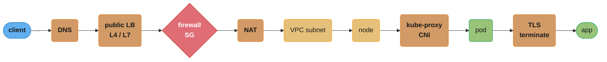
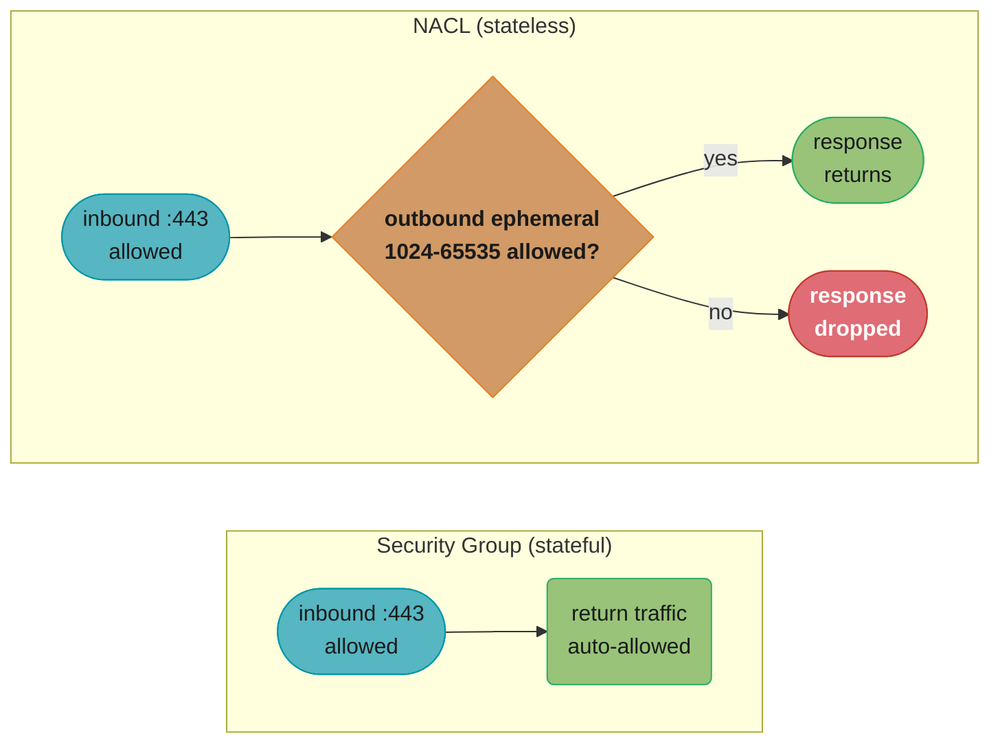
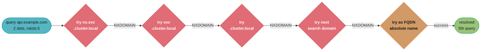
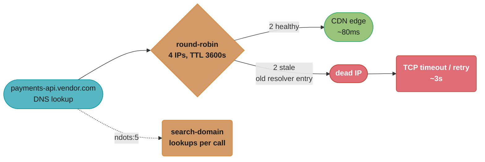

# Networking for DevOps

> Phase 1 — Foundations · Difficulty: Intermediate

> **Version anchor (2026-10-19).** Kubernetes **1.37.1** (2026-09-23) is the current patch release. Cluster DNS and certificate tools named on this page: **CoreDNS v1.14.7** (2026-08-19) and **cert-manager v1.21.2** (2026-09-11). Public TLS certificate limits follow CA/Browser Forum ballot SC-081v3 (passed 2025-04-11): maximum validity 200 days for certificates issued from 2026-03-15, 100 days from 2027-03-15 and 47 days from 2029-03-15. Let's Encrypt's default `classic` profile moves to 64-day certificates on 2027-02-10 and 45-day certificates on 2028-02-16. ACME Renewal Information (ARI) is RFC 9773 (June 2025).

Networking is where "it works locally" goes to die. DNS resolution, CIDR planning, NAT, firewall rules, load-balancer health checks, and TLS termination are the layers a DevOps engineer debugs daily. This module covers the operational networking knowledge that underpins VPCs, Kubernetes Services, ingress, and service mesh — focused on *what breaks and how to find it*.

> For the protocol theory (TCP handshake, congestion control, HTTP/2 vs 3), see [`../../backend/tcp_ip_deep_dive`](../../backend/tcp_ip_deep_dive/tcp_ip_deep_dive.md) and [`../../backend/osi_model_and_networking`](../../backend/osi_model_and_networking/osi_model_and_networking.md). This module is the *operations* view.

---

## 1. Concept Overview

A packet's journey from client to your container crosses many layers DevOps owns:



Each arrow above is a place a request can silently die — a caching DNS answer, a firewall dropping the port, a NAT exhausting source ports — which is why hop-by-hop diagnosis (Section 6) walks this exact chain.

The operational primitives:
- **DNS** — name → IP resolution; the most common "intermittent" failure source.
- **CIDR / subnetting** — how you carve IP space; over/under-sizing a VPC subnet is a one-way door.
- **NAT** — private hosts reaching the internet via a gateway; SNAT/DNAT and port exhaustion.
- **Firewalls / Security Groups** — stateful allow/deny at instance and subnet level.
- **Load balancing** — L4 (transport, IP:port) vs L7 (application, HTTP-aware); health checks decide what's "in rotation".
- **TLS / mTLS** — encryption and identity; termination point matters for cost, latency, and security.

RDMA fabrics and the storage paths that feed GPU training and inference are covered in [AI Networking and Storage Fabric](../../mlops/ai_networking_and_storage_fabric/ai_networking_and_storage_fabric.md).

---

## 2. Intuition

> **One-line analogy**: Networking is the postal system — DNS is the address book, CIDR is how cities/streets are numbered, NAT is the mailroom that rewrites return addresses, firewalls are the security desk, and the load balancer is the receptionist routing visitors to whichever clerk is free.

**Mental model**: Every connection is a 4-tuple (src IP, src port, dst IP, dst port). Each hop may rewrite parts of it (NAT changes src; a load balancer changes dst), inspect it (firewall/SG), or terminate it (TLS, L7 LB). Debugging connectivity means asking, at each hop: *does the packet arrive, is it allowed, and does the return path exist?*

**Why it matters**: Roughly half of "the service is down" incidents are networking: a DNS TTL caching a dead endpoint, a security group missing a port, a health check failing so the LB pulls all targets, a NAT gateway exhausting source ports, an expired TLS cert. None show up in application logs.

**Key insight**: Connectivity is bidirectional. A request arriving doesn't mean the response can return. Asymmetric routing, missing egress rules, and stateful-vs-stateless firewall confusion cause "the request reaches the server but the client times out" — the single most confusing class of network bug.

---

## 3. Core Principles

1. **Name, then number.** Clients resolve DNS first; DNS caching/TTL governs how fast changes propagate.
2. **Plan CIDR for growth.** Subnet sizing and non-overlapping ranges across VPCs/clusters are decided up front and painful to change.
3. **Default deny, explicit allow.** Security groups and NetworkPolicies should allow only what's needed.
4. **Health checks are the source of truth for routing.** An LB only sends traffic to targets passing health checks; a bad check empties the pool.
5. **Terminate TLS deliberately.** Edge termination is simplest; end-to-end/mTLS is most secure; re-encrypt is the middle ground.
6. **Statefulness matters.** Security groups are stateful (return traffic auto-allowed); NACLs are stateless (you must allow both directions).

---

## 4. Types / Architectures / Strategies

### L4 vs L7 load balancing

| Dimension | L4 (e.g., AWS NLB) | L7 (e.g., AWS ALB) |
|-----------|--------------------|--------------------|
| Operates on | IP + port (TCP/UDP) | HTTP/HTTPS (paths, headers, host) |
| Routing | Connection-level | Content-based (path/host rules) |
| TLS | Pass-through or terminate | Terminate, inspect, re-encrypt |
| Latency | Lower (no parsing) | Slightly higher (parses HTTP) |
| Features | Raw speed, static IP, any protocol | Path routing, WAF, sticky sessions, redirects |
| Use | gRPC/TCP, ultra-low-latency, non-HTTP | Web APIs, microservice routing |

### TLS termination strategies

| Strategy | Where TLS ends | Pros | Cons |
|----------|----------------|------|------|
| Edge termination | At the LB | Simple, offloads CPU, central cert mgmt | Plaintext inside the network |
| Pass-through | At the backend | End-to-end encryption | LB can't inspect/route on content |
| Re-encryption | LB terminates, re-encrypts to backend | Inspect + encrypt internally | Double crypto cost |
| mTLS (mesh) | Both ends authenticate | Zero-trust identity | Cert lifecycle complexity |

The table's "Where TLS ends" column is really a question of *where the plaintext segment lives* — visualizing the same client-to-backend path for all four strategies makes that placement immediate:

```mermaid
flowchart TD
    classDef io      fill:#61afef,stroke:#2e86c1,color:#1a1a1a,font-weight:bold
    classDef frozen  fill:#c678dd,stroke:#9b59b6,color:#fff
    classDef train   fill:#98c379,stroke:#27ae60,color:#1a1a1a
    classDef mathOp  fill:#d19a66,stroke:#e67e22,color:#1a1a1a,font-weight:bold
    classDef lossN   fill:#e06c75,stroke:#c0392b,color:#fff,font-weight:bold
    classDef req     fill:#56b6c2,stroke:#0097a7,color:#1a1a1a
    classDef base    fill:#e5c07b,stroke:#f39c12,color:#1a1a1a

    subgraph edge["Edge termination"]
        direction LR
        c1(["client"]) -->|"TLS"| lb1("LB")
        lb1 -->|"plaintext"| be1[["backend"]]
    end

    subgraph pass["Pass-through"]
        direction LR
        c2(["client"]) -->|"TLS"| lb2("LB")
        lb2 -->|"TLS unmodified"| be2[["backend"]]
    end

    subgraph reenc["Re-encryption"]
        direction LR
        c3(["client"]) -->|"TLS"| lb3("LB")
        lb3 -->|"TLS re-encrypted"| be3[["backend"]]
    end

    subgraph mtls["mTLS mesh"]
        direction LR
        c4(["client"]) -->|"mTLS"| lb4("LB")
        lb4 -->|"mTLS"| be4[["backend"]]
    end

    class c1,c2,c3,c4 io
    class lb1,lb2,lb3,lb4 mathOp
    class be1 lossN
    class be2 frozen
    class be3 train
    class be4 base
```



Only edge termination leaves a plaintext hop (red) inside the network — every other strategy keeps the LB-to-backend leg encrypted, which is exactly the "plaintext inside the network" con called out in the table above.

### Certificate lifetime limits and ACME renewal

Every publicly trusted TLS server certificate is bound by the CA/Browser Forum Baseline Requirements, and ballot SC-081v3 cuts both the certificate validity and how long a CA may reuse a past domain-control check (DCV):

| Issued on or after | Max validity | Max DCV reuse | Renewals per year at 2/3 of lifetime |
|---|---|---|---|
| before 2026-03-15 | 398 days | 398 days | about 1.4 |
| 2026-03-15 | 200 days | 200 days | about 2.7 |
| 2027-03-15 | 100 days | 100 days | about 5.5 |
| 2029-03-15 | 47 days | 10 days | about 11.6 |

The last column is the operational point: at 47 days a certificate renews about once a month, and with 10-day DCV reuse nearly every renewal needs a fresh HTTP-01 or DNS-01 challenge. A manual renewal process that worked once a year now has to work twelve times a year per name, so the only workable answer is ACME (RFC 8555) end to end. Internal PKI is not covered: certificates from a private CA, service-mesh mTLS certificates and Kubernetes client certificates keep whatever lifetime you set.

```yaml
apiVersion: cert-manager.io/v1
kind: Certificate
metadata: {name: api-tls, namespace: prod}
spec:
  secretName: api-tls
  dnsNames: [api.example.com]
  issuerRef: {name: letsencrypt-dns01, kind: ClusterIssuer}
  renewBeforePercentage: 33     # renew with a third of the lifetime left, whatever the CA issues
```

Hard-coded intervals are the failure mode. A cron job that renews every 60 days worked for 90-day certificates, leaves 4 days of margin on Let's Encrypt's 64-day certificates from 2027-02-10, and lets every 45-day certificate expire from 2028-02-16. A fixed cert-manager `renewBefore: 720h` (30 days) renews a 45-day certificate after 15 days, and on a certificate of 30 days or less cert-manager ignores it and falls back to the two-thirds default without warning. Use a percentage (cert-manager defaults to renewing two-thirds of the way through the duration) or ARI (RFC 9773), where the CA tells the client its renewal window and can pull it forward before a mass revocation. Alert on renewal that did not happen, not on a fixed day count:

```promql
# cert-manager: the planned renewal time passed more than a day ago and no new cert was issued
time() > certmanager_certificate_renewal_timestamp_seconds + 86400
# blackbox exporter: what the public endpoint actually serves, in case the LB never reloaded
probe_ssl_earliest_cert_expiry - time() < 7 * 86400
```

### DNS record types you operate

| Record | Purpose |
|--------|---------|
| A / AAAA | Name → IPv4 / IPv6 |
| CNAME | Alias to another name |
| ALIAS / ANAME (cloud) | CNAME-like at the zone apex (points to ELB) |
| SRV | Service host+port (used by some discovery) |
| TXT | Verification, SPF, ACME challenges |
| NS / SOA | Delegation + zone authority |

---

## 5. Architecture Diagrams

Request path with edge TLS termination and L7 routing:

```mermaid
flowchart LR
    classDef io      fill:#61afef,stroke:#2e86c1,color:#1a1a1a,font-weight:bold
    classDef frozen  fill:#c678dd,stroke:#9b59b6,color:#fff
    classDef train   fill:#98c379,stroke:#27ae60,color:#1a1a1a
    classDef mathOp  fill:#d19a66,stroke:#e67e22,color:#1a1a1a,font-weight:bold
    classDef lossN   fill:#e06c75,stroke:#c0392b,color:#fff,font-weight:bold
    classDef req     fill:#56b6c2,stroke:#0097a7,color:#1a1a1a
    classDef base    fill:#e5c07b,stroke:#f39c12,color:#1a1a1a

    client(["client"]) -->|"DNS: api.example.com<br/>to 203.0.113.10 (ALIAS)<br/>TTL 60s"| alb("ALB L7<br/>terminates TLS")
    alb -->|"/v1/* to TG-A, /v2/* to TG-B<br/>health check /healthz 15s<br/>SG: 8080 from ALB only"| nodes("EC2 / EKS nodes<br/>private subnet")
    nodes -->|"kube-proxy / CNI<br/>routes to pod IP"| pod("pod")
    pod -->|"plaintext in VPC,<br/>or re-encrypt"| app(["app"])
    pod -.->|"egress"| nat("NAT gateway<br/>public subnet")
    nat -->|"SNAT to NAT's EIP,<br/>port pool is finite"| internet(["internet"])

    class client io
    class alb,nat mathOp
    class nodes base
    class pod,app train
    class internet frozen
```



The main request path (solid) ends at the pod; the NAT egress branch (dotted) is a separate flow whose source-port pool — finite per Section 6 — is what exhausts under heavy outbound volume.

---

## 6. How It Works — Detailed Mechanics

### CIDR math (the part interviews probe)

```
10.0.0.0/16   -> 65,536 addresses (10.0.0.0 - 10.0.255.255), mask 255.255.0.0
10.0.1.0/24   -> 256 addresses    (10.0.1.0 - 10.0.1.255)
10.0.1.0/28   -> 16 addresses     (usable fewer: network + broadcast + cloud-reserved)

# /N: the first N bits are the network; 32-N bits are host.
# addresses = 2^(32 - N).  AWS reserves 5 per subnet: the FIRST FOUR and the LAST one,
# whatever the prefix length (in 10.0.1.0/28 that is .0 .1 .2 .3 and .15).
```

A Kubernetes pitfall: pods need IPs from the VPC (with the AWS VPC CNI). A `/24` per subnet = 256 IPs ≈ ~250 pods. Large clusters exhaust subnet space fast — size for peak pod count, not node count.

#### Decoding `addresses = 2^(32 - N)`

**What the formula is telling you.** "An IPv4 address is 32 bits; a `/N` freezes the first N of them as the network's identity, so every one of the remaining `32 - N` bits is free to vary — and that is your address count."

The lever is that N moves the count by *powers of two*, not linearly. Going from `/24` to `/23` does not add a few addresses, it doubles them. Equally, every step up in N halves your space, which is why an undersized subnet cannot be nudged — you must renumber.

| Symbol | What it is |
|--------|------------|
| `32` | Total bits in an IPv4 address (4 octets x 8 bits) |
| `N` | The prefix length — how many leading bits are pinned to the network |
| `32 - N` | Host bits, the ones left free to enumerate |
| `2^(32-N)` | Total addresses in the block, including unusable ones |
| AWS reserve `5` | First four of the block — network, VPC router, VPC DNS, reserved for future use — plus the block's last address (broadcast). Not tied to `.0`/`.255`; in a `/28` the last one is `.15` |

**Walk one example.** Every block from the code above, plus the two sizes you actually pick between:

```
  prefix   host bits   2^(32-N)   AWS usable   how many fit in a /16
   /16        16        65,536      65,531              1
   /20        12         4,096       4,091             16
   /24         8           256         251            256
   /26         6            64          59          1,024
   /28         4            16          11          4,096

  10.0.1.0/28 spans 10.0.1.0 through 10.0.1.15 -> 16 - 5 = 11 pods could actually get an IP.
```

The `/28` row is the one that bites. Sixteen addresses sounds like room for a dozen pods; after the 5 AWS reservations you get **11**, a 31% tax that is invisible in the formula and never shows up until pods sit Pending with no CNI address.

**Why "size for pods, not nodes" is a real constraint.** Push the numbers through for a 200-node cluster running 30 pods per node:

```
  peak pod IPs needed   =  200 nodes x 30 pods       =  6,000
  /24 subnets required  =  ceil(6,000 / 251)         =     24 subnets
  a whole /16 provides  =  256 x 251 usable          = 64,256 pod IPs
```

Twenty-four `/24`s is a lot of subnets to hand-manage across three AZs, and it is why teams carve `/20`s (4,091 usable each) instead. Note that the node count barely matters — the multiplier is pods per node, so raising density from 30 to 60 doubles the IP bill without adding a single instance.

#### Health-check thresholds are a multiplication

The Section 10 fix sets `HealthCheckIntervalSeconds: 15`, `UnhealthyThresholdCount: 3`, `HealthyThresholdCount: 2`. Those three numbers are not independent knobs — they multiply into your failover time:

```
  time to eject a bad target   = interval x unhealthyThreshold = 15 x 3 = 45 s
  time to re-admit a fixed one = interval x healthyThreshold   = 15 x 2 = 30 s
```

**In plain terms.** "A target must fail the check three times in a row before the LB believes it, so you are blind to a dead backend for up to 45 seconds."

Asymmetry is deliberate: eject slowly (3 strikes) so a single GC pause or transient blip does not drain the pool, but re-admit quickly (2 passes) so recovered capacity comes back fast. Set `UnhealthyThresholdCount: 1` and one hiccup empties your target group — which is exactly the Pitfall 1 failure mode, reached by a different route.

### Diagnosing DNS

```bash
dig +short api.example.com            # the A/ALIAS answer
dig api.example.com | grep -A1 'ANSWER SECTION'   # TTL + record
dig @8.8.8.8 api.example.com          # bypass local resolver to test authoritative
# Inside Kubernetes:
kubectl exec pod -- nslookup my-svc.my-ns.svc.cluster.local
cat /etc/resolv.conf                  # search domains, ndots (the K8s ndots:5 trap)
```

### Tracing connectivity hop by hop

```bash
nc -zv db.internal 5432               # is the port open + reachable? (TCP)
ss -tlnp                              # what's listening locally + which PID
traceroute api.example.com            # where does the path die
curl -v https://api.example.com/      # TLS handshake + headers + timing
openssl s_client -connect api:443 -servername api.example.com </dev/null \
  | openssl x509 -noout -dates        # cert validity window (expiry!)
```

### NAT and source-port exhaustion

A NAT gateway SNATs many private hosts behind one public IP. Every outbound connection needs its own source port out of the 1024–65535 range the gateway draws from, and each IPv4 address on the gateway supports **55,000 simultaneous connections to each unique destination** — where "unique destination" means a distinct combination of destination IP, destination port, and protocol. Thousands of connections to the *same* external endpoint (e.g., one S3 regional endpoint, one payment API) exhaust that one pool, causing `connection timed out` on new egress while bandwidth sits idle.

```bash
# Symptom: rising egress errors; CloudWatch ErrorPortAllocation > 0 on the NAT GW.
# Fix: VPC endpoints (PrivateLink) for AWS services to bypass NAT, add secondary
#      IPv4 addresses to the gateway, or split clients across per-AZ NAT gateways.
```

#### Why 55,000 per unique destination is the number that matters

```
portRange      = 1024 - 65535                        what a NAT gateway draws source ports from
uniqueDest     = (dstIP, dstPort, protocol)          NOT the full 5-tuple
connLimit      = 55,000 simultaneous connections per uniqueDest, per IPv4 address

  headroom to ONE destination endpoint = 55,000 x (IPv4 addresses on the gateway)
  addresses per NAT gateway            = up to 8 (1 primary + 7 secondary)
  absolute ceiling to one destination  = 55,000 x 8 = 440,000
```

**What it means.** "The NAT can rewrite every private host to its own IP, but each of its addresses gets only 55,000 live connections to any one destination it is talking to."

The reason this surprises people is the *per-destination* scoping. Fan-out traffic to a thousand different endpoints never exhausts anything, because each destination gets its own fresh 55,000-connection pool. It is the concentrated case — every pod hammering one S3 regional endpoint or one payment API — that collapses the whole fleet onto a single pool.

| Symbol | What it is |
|--------|------------|
| `1024 - 65535` | The source-port range a NAT gateway allocates from; note NACLs on the NAT subnet must permit it |
| `55,000` | Simultaneous connections per unique destination, per IPv4 address on the gateway |
| unique destination | `dstIP + dstPort + protocol`. Change any one and it is a separate 55,000 pool |
| secondary IPv4s | Up to 7 can be added (8 total), multiplying the ceiling linearly |
| `TIME_WAIT` | Linux pins a closing socket for a fixed 60 s (`TCP_TIMEWAIT_LEN`, not sysctl-tunable), so the pool drains slower than it refills |

**Walk one example.** A fleet opening short-lived connections to a single external API through a one-address NAT gateway. What matters is not "time to exhaust" but the *steady-state* occupancy, since every closed socket stays pinned for 60 s:

```
  new conns/sec   pinned for 60 s   vs the 55,000 pool   observed symptom
        100             6,000              11%           fine, ports recycle
      1,000            60,000             109%           ErrorPortAllocation climbs
      5,000           300,000             545%           egress timeouts, bandwidth idle
```

The middle row is the classic incident, and the arithmetic is the whole story: at 1,000 conn/s the fleet burns the 55,000-port pool in 55 seconds, but each of those sockets stays in `TIME_WAIT` for 60 s, so the pool never refills faster than it drains and errors are permanent rather than bursty. Bandwidth graphs stay flat and healthy the entire time, which is why the fix is counterintuitive — a VPC endpoint removes the destination from NAT's books entirely, taking the pool pressure to zero rather than adding capacity.

### Stateful SG vs stateless NACL (the asymmetric-bug source)



This is exactly where the "request reaches the server but the client times out" bug from section 12 hides: a security group auto-allows the return leg, but a NACL silently drops it unless you add the explicit outbound ephemeral-port rule.

---

## 7. Real-World Examples

- **AWS ALB + ACM + Route 53**: the canonical web stack — Route 53 ALIAS to an ALB, ACM cert for edge TLS, path/host rules to target groups, health checks gating membership.
- **Kubernetes CoreDNS + `ndots:5`**: in-cluster DNS appends search domains; a non-FQDN lookup triggers up to 5 queries before the real one, causing latency — fixed by FQDNs or tuning `ndots`. (See [kubernetes_networking](../kubernetes_networking/kubernetes_networking.md).)
- **Cloudflare / CloudFront** at the edge for DNS, CDN, TLS, and DDoS protection before traffic reaches origin.
- **VPC endpoints (PrivateLink)** to reach S3/DynamoDB/ECR without traversing the NAT gateway — both a cost and a port-exhaustion fix.

The `ndots:5` amplification is easier to see than to describe: a 2-dot name is tried against every search domain, in order, before the real lookup ever fires.



Four wasted NXDOMAIN round trips (red) precede the one query that actually succeeds — the exact "several failed lookups before the real one" cost the `ndots:5` question in section 12 asks about, fixed by a trailing-dot FQDN that skips straight to the last node.

---

## 8. Tradeoffs

| Decision | Option A | Option B | Key factor |
|----------|----------|----------|-----------|
| LB layer | L4 (speed, any protocol) | L7 (content routing, WAF) | Need HTTP-aware routing? |
| TLS termination | Edge (simple, fast) | End-to-end/mTLS (secure) | Data sensitivity, compliance |
| ACME challenge | HTTP-01 (no DNS credentials) | DNS-01 (wildcards, private hosts) | Wildcard or non-public name needs DNS-01; HTTP-01 needs port 80 reachable from the CA |
| Egress to AWS services | NAT gateway (simple) | VPC endpoint (cheaper, no port exhaustion) | Volume + cost |
| DNS TTL | Low (fast failover) | High (fewer queries, cheaper) | Failover speed vs query load |
| Subnet sizing | Large /16 (room) | Tight /24 (conservation) | Pod density, future growth |
| Firewall model | SG (stateful, simple) | NACL (stateless, subnet-wide) | Granularity vs simplicity |

---

## 9. When to Use / When NOT to Use

**Apply network reasoning when:** diagnosing intermittent connectivity, planning VPC/subnet layout, choosing LB type, debugging TLS/cert issues, or seeing "request arrives but client times out".

**Defer to platform defaults when:** a managed ingress controller and cloud LB already handle routing/health checks well; don't hand-build what the platform provides unless you have a specific need (e.g., non-HTTP protocols, special routing).

---

## 10. Common Pitfalls

**Pitfall 1 — Health check misconfigured; the LB drains the entire pool.**

```yaml
# BROKEN: health check hits "/" which requires auth -> returns 401 -> all targets "unhealthy"
# -> ALB has zero healthy targets -> 503 to every client, even though apps are fine.
HealthCheckPath: /
Matcher: 200
```

```yaml
# FIX: dedicated unauthenticated health endpoint that reflects real readiness.
HealthCheckPath: /healthz
Matcher: 200
HealthCheckIntervalSeconds: 15
HealthyThresholdCount: 2
UnhealthyThresholdCount: 3   # tolerate transient blips before draining
```

**Pitfall 2: Expired TLS certificate.** Manual certs expire silently; the site goes hard-down at midnight UTC. Shrinking public lifetimes (200 days from 2026-03-15, 47 days from 2029-03-15) multiply the number of renewals that can fail. FIX: automate issuance/renewal (ACM renews the certificates it issues, not imported ones; cert-manager + an ACME issuer in Kubernetes), renew by percentage of lifetime or ARI instead of a fixed interval, and **alert when a renewal time passes without reissue**. A fixed "< 21 days to expiry" alert fires on every healthy 47-day certificate, which renews with about 16 days left.

**Pitfall 3 — NACL asymmetry.** Someone adds a stateless NACL allowing inbound `:443` but forgets outbound on ephemeral ports; responses are dropped and connections hang with no log. FIX: prefer stateful security groups; if NACLs are required, always allow the ephemeral return range.

---

## 11. Technologies & Tools

| Tool | Purpose |
|------|---------|
| `dig` / `nslookup` | DNS resolution debugging |
| `ss` / `lsof -i` | Listening sockets, connection states |
| `nc` (netcat) | Port reachability test |
| `curl -v` / `httpie` | HTTP + TLS handshake inspection |
| `openssl s_client` | TLS cert/chain/expiry inspection |
| `traceroute` / `mtr` | Path discovery + loss/latency per hop |
| `tcpdump` / Wireshark | Packet capture (last resort, ground truth) |
| ACM / cert-manager | Automated TLS issuance + renewal |
| Route 53 / Cloud DNS | Managed DNS |
| AWS VPC Reachability Analyzer | Path "why is this blocked" analysis |

---

## 12. Interview Questions with Answers

**Q: A team renews its public TLS certificates with a job that runs every 60 days. Why will that cause outages?**
**Short:** Public lifetimes shrink to 100 days in 2027 and 47 days in 2029, and Let's Encrypt moves to 64- then 45-day certificates, so a 60-day interval outlives the certificate.
CA/Browser Forum ballot SC-081v3 caps public TLS certificates at 200 days from 2026-03-15, 100 days from 2027-03-15 and 47 days from 2029-03-15. Let's Encrypt moves its default profile to 64 days on 2027-02-10, leaving a 60-day job 4 days of margin, and to 45 days on 2028-02-16, after which every certificate expires 15 days before the job runs. Renewal has to follow the certificate, not the calendar: renew at a fixed fraction of the actual lifetime (cert-manager's `renewBeforePercentage`, default two-thirds through) or use ARI (RFC 9773), where the CA publishes the renewal window per certificate.

**Q: Which certificates do the CA/Browser Forum lifetime limits apply to, and what does the DCV reuse cut change?**
**Short:** Only publicly trusted TLS server certificates; private-CA, mesh and client certs are unaffected. DCV reuse falls to 10 days in 2029, so nearly every renewal needs a fresh ACME challenge.
The Baseline Requirements bind CAs that browsers trust, so they cover certificates for public names served to browsers and public clients. Certificates from a private CA (AWS Private CA, Vault PKI, cert-manager CA issuer), Istio or Linkerd workload certificates and Kubernetes client certificates are outside them. The second change is domain-control validation reuse: a CA could reuse a successful challenge for 398 days, falling to 200, 100 and finally 10 days on 2029-03-15. With 47-day certificates and 10-day reuse, almost every issuance requires a live HTTP-01 or DNS-01 challenge, so the challenge path (port 80 reachable from the CA, or DNS API credentials for DNS-01) becomes a production dependency that must be monitored like the certificate itself.

**Q: How should certificate-expiry alerting change as lifetimes shrink?**
**Short:** Alert on a missed renewal or on the fraction of lifetime used, not a fixed day count; a "< 21 days left" rule fires on every healthy 47-day cert, which renews with about 16 days left.
A fixed threshold encodes an assumption about lifetime. Renewing at two-thirds of a 47-day certificate leaves about 16 days, so a 21-day alert pages on every healthy certificate, while a 7-day alert on a 398-day certificate gives too little time. Alert instead when the planned renewal time has passed and the certificate was not reissued (`certmanager_certificate_renewal_timestamp_seconds` in the past by more than a day), or when a certificate passes 75% of its lifetime. Keep an external probe (`openssl s_client`, a blackbox exporter `probe_ssl_earliest_cert_expiry`) on the public endpoint too, because a renewed Secret that the load balancer never reloaded still serves the old certificate.

**Q: A service is intermittently unreachable. Walk through your diagnosis.**
**Short:** Diagnose hop by hop — DNS resolution, port reachability, LB health, security group/NACL rules, then TLS — since intermittent failures often mean unhealthy targets.
Go hop by hop: `dig` the name (is DNS resolving, is the TTL caching a dead IP?), `nc -zv host port` (is the port reachable?), check the LB's healthy target count (is a failing health check draining the pool?), check security groups/NACLs (is the port and return path allowed?), and `curl -v`/`openssl s_client` for TLS/cert issues. "Intermittent" often means a load balancer with *some* unhealthy targets, or DNS round-robin including a dead endpoint.

**Q: L4 vs L7 load balancer — when each?**
**Short:** L4 load balancers route on IP:port with lowest latency for TCP/gRPC, while L7 parses HTTP for path/host routing, WAF, and sticky sessions.
L4 (NLB) routes on IP:port, is protocol-agnostic, lowest latency, gives a static IP — use for gRPC/TCP, non-HTTP, or ultra-low-latency. L7 (ALB) parses HTTP, enabling path/host routing, header-based rules, WAF, redirects, and sticky sessions — use for web APIs and microservice routing. You often have both: NLB for raw ingress, L7 (ingress controller) inside.

**Q: Explain CIDR `/24` vs `/16` and a Kubernetes implication.**
**Short:** A `/N` CIDR gives `2^(32-N)` addresses, so a `/24` supports far fewer pod IPs than a `/16` under the AWS VPC CNI, making subnet sizing a one-way door.
`/N` means N network bits, so `2^(32-N)` addresses: `/24` = 256, `/16` = 65,536. With the AWS VPC CNI, each pod takes a real subnet IP, so a `/24` subnet supports ~250 pods. Large clusters exhaust subnet space — you size subnets for peak pod count, and subnet sizing is hard to change later (a one-way door).

**Q: Why does "the request reaches the server but the client times out"?**
**Short:** The inbound path is allowed but the return path isn't, often from a stateless NACL missing outbound ephemeral-port rules or asymmetric routing.
Asymmetric connectivity: the inbound path is allowed but the return path isn't. Common causes — a stateless NACL allowing inbound but not outbound ephemeral ports, a missing egress rule, or asymmetric routing where responses take a path with no return route. Security groups avoid this because they're stateful (return traffic is auto-allowed).

**Q: Stateful security group vs stateless NACL?**
**Short:** A security group is stateful, auto-allowing return traffic, while a NACL is stateless and requires explicit rules for both inbound and outbound.
A security group is stateful: allow inbound on a port and the response is automatically permitted. A NACL is stateless and subnet-wide: you must explicitly allow both inbound *and* the outbound ephemeral-port return traffic. NACLs are coarse-grained guardrails; SGs are the primary instance-level control.

**Q: Where should you terminate TLS, and what are the tradeoffs?**
**Short:** Edge TLS termination is simplest but leaves internal traffic plaintext, while end-to-end mTLS encrypts the whole path at the cost of certificate lifecycle complexity.
Edge termination (at the LB) is simplest, offloads crypto, and centralizes cert management, but traffic is plaintext inside the network. End-to-end/mTLS encrypts the whole path and provides identity (zero-trust) at the cost of cert lifecycle complexity. Re-encryption terminates at the edge for inspection/routing then re-encrypts to the backend — the compliance-friendly middle ground.

**Q: What is NAT source-port exhaustion and how do you fix it?**
**Short:** A NAT gateway's 55,000-connection-per-destination limit per IP gets exhausted by many connections to one endpoint, fixed with VPC endpoints or connection pooling.
A NAT gateway SNATs many hosts behind one IP, and each of its IPv4 addresses supports only 55,000 simultaneous connections to a given unique destination (destination IP + port + protocol). Thousands of connections to the *same* endpoint exhaust that pool — and because Linux holds each closed socket in `TIME_WAIT` for 60 s, sustained churn never lets it refill — so new egress connections time out while bandwidth is unused; `ErrorPortAllocation` on the NAT gateway is the giveaway. Fixes: VPC endpoints (PrivateLink) to reach AWS services without NAT, connection pooling/reuse, secondary IPv4 addresses on the gateway (up to 8), or a NAT gateway per AZ with clients split across them.

**Q: How does DNS TTL affect failover, and what's the tradeoff?**
**Short:** Low TTL propagates failover quickly but raises query volume, while high TTL reduces load but leaves clients hitting a dead IP longer after a change.
TTL is how long resolvers cache a record. Low TTL (e.g., 30–60s) means failover/changes propagate quickly but generates more queries (and cost); high TTL reduces query load but means clients keep hitting a dead/old IP after a change. For failover-critical records, keep TTL low; for stable records, keep it higher.

**Q: What's the `ndots:5` problem in Kubernetes?**
**Short:** `ndots:5` retries any name with fewer than 5 dots against every search domain first, so external names trigger several wasted lookups before the real one.
CoreDNS injects a `search` list and `ndots:5` into pod `/etc/resolv.conf`. A name with fewer than 5 dots and no trailing dot is tried against each search domain first, so `api.example.com` triggers several failed lookups (`api.example.com.ns.svc.cluster.local`, …) before the real one — adding latency and DNS load. Fix: use FQDNs (trailing dot) for external names or tune `ndots`.

**Q: How do you debug a TLS handshake failure?**
**Short:** `openssl s_client -connect host:443 -servername host` reveals the certificate chain, protocol, and expiry, exposing failures like an expired cert or SNI mismatch.
`openssl s_client -connect host:443 -servername host` shows the presented chain, negotiated protocol/cipher, and validity dates; `openssl x509 -noout -dates` checks expiry. Common failures: expired cert, missing intermediate (incomplete chain), SNI mismatch (`-servername` matters), or protocol/cipher mismatch (old client vs TLS 1.3-only server).

**Q: What does a health check actually control, and what's a safe configuration?**
**Short:** A health check controls which targets the LB routes to, and a too-strict check can drain the whole pool into a self-inflicted outage.
The LB only routes to targets passing the health check; a failing check removes a target from rotation. A too-strict check (auth-required path, 1 failure = drain) can empty the whole pool and cause a self-inflicted outage. Safe config: a dedicated unauthenticated `/healthz` that reflects real readiness, a sane interval (10–15s), and an unhealthy threshold > 1 to tolerate transient blips.

**Q: Why prefer VPC endpoints over routing AWS traffic through a NAT gateway?**
**Short:** VPC endpoints keep AWS traffic on the AWS backbone without the NAT gateway, avoiding its data-processing cost and source-port exhaustion.
VPC endpoints (Gateway for S3/DynamoDB, Interface/PrivateLink for others) keep traffic on the AWS network without traversing the NAT gateway. Benefits: lower cost (NAT data-processing charges avoided), no source-port exhaustion against high-volume AWS endpoints, and traffic that never leaves the AWS backbone (security/compliance).

**Q: Why can't you put a CNAME record at a zone's apex (e.g., example.com itself), and how do cloud DNS providers work around it?**
**Short:** DNS specs forbid a CNAME from coexisting with the NS/SOA records the apex must hold, so providers use a proprietary ALIAS or ANAME type instead.
DNS specs forbid a CNAME from coexisting with other record types at the same name, but the zone apex must also hold NS and SOA records, so a bare CNAME there is invalid. Cloud providers solve this with a proprietary apex-safe alias — AWS's ALIAS, or an ANAME-equivalent — which behaves like a CNAME to the resolver's client but is resolved server-side by the DNS provider, letting you point the naked domain at an ALB or CloudFront distribution. Using a real CNAME at the apex instead breaks under strict resolvers or during zone validation, a classic "works until it doesn't" DNS trap. Reserve CNAME for subdomains and use your provider's ALIAS/ANAME type whenever you need to alias the zone apex itself.

**Q: What is the 4-tuple, and how does each networking hop act on it?**
**Short:** The 4-tuple of source/destination IP and port uniquely identifies a connection, and each networking hop either rewrites, inspects, or terminates it.
The 4-tuple — source IP, source port, destination IP, destination port — uniquely identifies a connection, and every hop either rewrites it, inspects it, or terminates it. NAT rewrites the source IP/port (SNAT) so a private host appears as the gateway's public IP; a load balancer rewrites the destination by routing to a backend; a firewall or security group inspects the tuple against allow/deny rules without changing it; and TLS/L7 termination ends the connection entirely and starts a new one to the backend. Framing a network bug as "which hop touched the tuple, and did it break in a way I can see" turns a vague timeout into a specific, checkable hypothesis at each layer. Use this framing before reaching for tcpdump, since most connectivity bugs resolve to one hop mishandling the tuple.

**Q: When do you reach for tcpdump/Wireshark instead of curl -v or dig?**
**Short:** Reach for tcpdump only after curl, dig, and openssl fail to explain a symptom, since it shows ground-truth wire bytes but needs more setup to interpret.
Reach for tcpdump only after application-level tools (curl -v, dig, openssl s_client) fail to explain the symptom — it shows ground-truth bytes on the wire but needs more setup to interpret. curl -v tells you what your own client saw (DNS answer, TLS handshake, headers), which covers most failures; tcpdump is needed when something between client and server is silently mangling packets — asymmetric routing, a misbehaving NAT, or a device dropping specific flags — that no single endpoint's own logs would reveal. It's also the only tool that can prove a packet left the host at all, which matters when a firewall drop looks identical to an application timeout from the client's point of view. Treat tcpdump as the last-resort, ground-truth layer, not the first diagnostic step.

**Q: In the payments-API case study, why did switching to a pooled HTTP client reduce exposure to the stale DNS entries?**
**Short:** A pooled client reuses warm connections instead of re-resolving DNS every call, structurally reducing how often a request re-samples the stale round-robin set.
A pooled client resolves DNS once and reuses warm, already-connected sockets, so once a request lands on one of the two healthy IPs it keeps reusing that connection instead of re-rolling the DNS dice on every call. The broken code created a new client per request, forcing a fresh DNS lookup and TCP connect each time, so roughly half of all calls had an even chance of landing on one of the two stale IPs and paying the full ~3s timeout. Pooling doesn't fix the underlying stale-DNS problem, but it structurally reduces how often a request re-samples the round-robin set, and the added explicit 1s connect timeout capped the worst case regardless. Pair connection reuse with a short connect timeout, since pooling alone still leaves the first connection per pool member exposed to a stale IP.

---

## 13. Best Practices

- Use a dedicated, unauthenticated `/healthz` for LB health checks; threshold > 1.
- Automate TLS with ACME (ACM / cert-manager); renew by percentage of lifetime or ARI, and alert on a missed renewal rather than a fixed day count, since public lifetimes fall to 47 days by 2029-03-15.
- Prefer stateful security groups; if NACLs are needed, allow return ephemeral ports.
- Size subnets for peak pod/host count up front; avoid overlapping CIDRs across VPCs you may peer.
- Use VPC endpoints for AWS-service egress to dodge NAT cost and port exhaustion.
- Keep failover-critical DNS TTLs low (30–60s); use FQDNs in clusters to dodge `ndots`.
- Default-deny egress where compliance requires; document every allow rule's purpose.

---

## 14. Case Study

### Scenario: Microservice latency spikes to seconds, intermittently, after a DNS change

A service calling an external payments API sees P99 latency jump from 80 ms to 3 s for ~30% of requests. App code, CPU, and memory are unchanged. The payments vendor migrated their endpoint behind a new CDN the day before.



Two of the four round-robin IPs are stale; every request that lands on one of them burns a full 3 s TCP timeout before it can retry — and `ndots:5` (dotted branch) piles on extra search-domain lookups for every single call, healthy or not.

**Diagnosis:**

```bash
dig payments-api.vendor.com               # TTL 3600, includes 2 dead IPs
kubectl exec caller -- nc -zv <dead-ip> 443   # times out
kubectl exec caller -- cat /etc/resolv.conf   # ndots:5, search list adds lookups
```

```python
# BROKEN: a new HTTP client per request -> fresh DNS lookup + connect each time,
# so every call rolls the dice on hitting a stale IP and pays full DNS cost.
import httpx
def charge(payload):
    return httpx.post("https://payments-api.vendor.com/charge", json=payload)  # new conn each call
```

```python
# FIX: reuse a pooled client (keep-alive avoids per-call reconnect + re-resolve),
# add an explicit timeout, and let connection reuse stick to healthy edges.
import httpx
_client = httpx.Client(
    base_url="https://payments-api.vendor.com",
    timeout=httpx.Timeout(2.0, connect=1.0),        # fail fast, don't hang 3s
    limits=httpx.Limits(max_keepalive_connections=50),
)
def charge(payload):
    return _client.post("/charge", json=payload)    # reuses warm conns to healthy IPs
```

Operationally, the team also lowered their resolver cache reliance, used FQDNs to kill the `ndots` amplification, and added a short connect timeout so a dead IP fails in 1 s and retries a healthy one instead of hanging.

**Outcome:** P99 returned to ~90 ms; the connect-timeout + pooling change capped worst-case at ~1.1 s even when a stale IP was hit, and connection reuse naturally favored the healthy edges.

**Discussion questions:**
1. Why did connection pooling reduce the chance of hitting a stale IP? (Warm connections stick to an already-resolved healthy edge.)
2. How would you have caught the stale-IP problem proactively? (Per-destination connect-error metrics, DNS-answer monitoring.)
3. What's the tradeoff of a 1 s connect timeout vs the default? (Faster failover vs risk of clipping a legitimately slow-but-healthy connect.)

---

**Cross-references:** [`../../backend/tcp_ip_deep_dive`](../../backend/tcp_ip_deep_dive/tcp_ip_deep_dive.md) (handshake, TIME_WAIT), [`../../backend/osi_model_and_networking`](../../backend/osi_model_and_networking/osi_model_and_networking.md) (layer theory), [kubernetes_networking](../kubernetes_networking/kubernetes_networking.md) (CNI, CoreDNS, Services), [cloud_networking_and_cdn](../cloud_networking_and_cdn/cloud_networking_and_cdn.md) (VPC, PrivateLink, CDN), [secrets_management](../secrets_management/secrets_management.md) (TLS cert storage).
