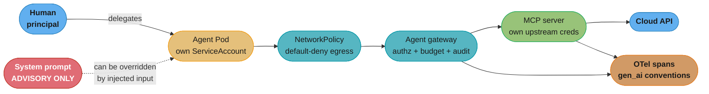
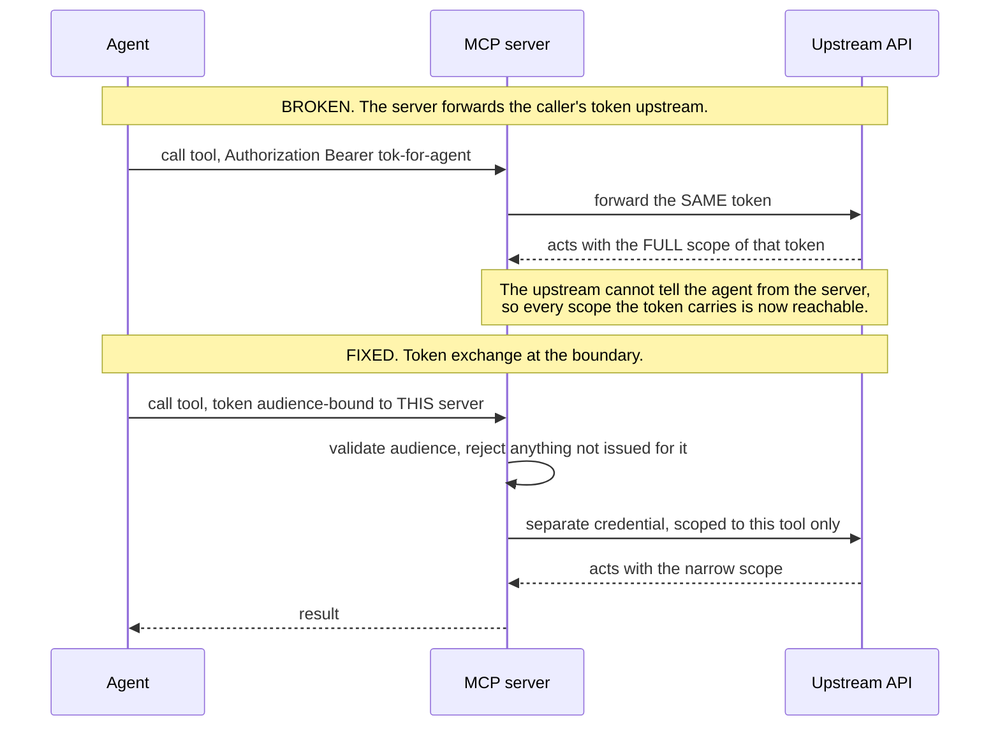

# AI Workloads and Agent Operations

> **Version anchor (2026-08-26).** The **Model Context Protocol spec revision is `2026-07-28`** — a structural rewrite, not a point bump: MCP is now a **stateless** request/response protocol with no `initialize` handshake and no protocol-level sessions, method and tool names travel in `Mcp-Method` / `Mcp-Name` HTTP headers for gateway routing, server-initiated requests are replaced by **Multi Round-Trip Requests** (`resultType: "input_required"`), and list/read responses carry `ttlMs` / `cacheScope`. Two current transports: **stdio** and **Streamable HTTP**; the older HTTP+SSE transport is **deprecated, not removed** — the changelog's Deprecated section states such features "remain part of the specification", under a **minimum twelve-month deprecation window**. Authorization builds on **OAuth 2.1** (`draft-ietf-oauth-v2-1-13`), **RFC 9728** Protected Resource Metadata (servers MUST), **RFC 8707** Resource Indicators (clients MUST) and **RFC 9207** issuer identification (clients MUST validate); **RFC 7591 Dynamic Client Registration is now deprecated**, superseded by OAuth Client ID Metadata Documents. **OpenTelemetry's GenAI semantic conventions are entirely at "Development" stability — none are Stable** — and now live in the separate `open-telemetry/semantic-conventions-genai` repository. **`MutatingAdmissionPolicy` reached GA in Kubernetes 1.36**; `ValidatingAdmissionPolicy` has been GA since 1.30. **`AdminNetworkPolicy` is still `v1alpha1`** and must not be described as settled.

This page sits under [platform_engineering_and_idp](platform_engineering_and_idp.md). The parent owns the IDP as a product — the catalog, the scaffolder, golden paths, Crossplane, Team Topologies. This page owns what happens when a **non-human, non-deterministic principal** becomes a tenant of that platform: an AI agent that holds credentials, calls APIs, spends money, and retries.

The framing that makes this tractable is that an agent is **a workload class with a blast radius**, not a new kind of software. Everything the platform already does for tenants — identity, least privilege, egress control, quota, audit, a kill switch — applies. What is new is that the workload's behaviour is not enumerable in advance, so controls that assume a reviewable code path do not hold.

Model-side concerns are out of scope here and cross-linked, not restated: agent architectures and tool-calling design belong to [llm/agentic_frameworks](../../llm/agentic_frameworks/agentic_frameworks.md), and GenAI-specific observability to [llm/llm_observability_and_monitoring](../../llm/llm_observability_and_monitoring/llm_observability_and_monitoring.md). The DevOps angle is *what the agent is allowed to do and how you prove what it did*.

---

## 1. Concept Overview

A platform team's controls are calibrated, mostly implicitly, against a workload whose behaviour is fixed at deploy time. You can read a service's code, enumerate the APIs it calls, and give it exactly those permissions. Review catches what static analysis does not.

An agent breaks that assumption in four specific ways:

1. **The action set is not enumerable.** An agent decides at runtime which tool to call with which arguments. There is no code path to review, because the "code path" is a model's output conditioned on inputs you do not control.
2. **Untrusted input reaches the decision.** A support ticket, a web page, a log line, a code comment — anything the agent reads can attempt to steer it. This is prompt injection, and its platform-level consequence is that **the boundary between data and instruction is gone inside the agent**.
3. **Cost is unbounded per action.** A conventional service's cost scales with request volume. An agent's cost scales with how many times it decides to think, which is not the same thing and is not bounded by anything the platform sets by default.
4. **Retries are semantic, not mechanical.** An agent that fails does not back off; it reasons about the failure and tries a different approach. A destructive operation retried "differently" 400 times is a real incident shape, and no client-side retry budget prevents it.

The platform response is not a new category of control. It is **applying existing controls at a boundary the agent cannot argue with** — because anything enforced inside the agent's own reasoning can be talked out of.

**The single load-bearing principle:** an agent gets **its own identity**, never a human's. The moment an agent runs with a person's token, every audit trail becomes a lie, every permission becomes that person's full permission set, and revocation means disabling a human.

---

## 2. Intuition

> A conventional service is an **employee with a job description**: you know what they do, and you give them keys to those rooms. An agent is a **contractor with initiative** — genuinely useful, occasionally brilliant, and liable to interpret "sort out the billing problem" in a way nobody anticipated. You do not manage that with a better job description. You manage it with which doors the badge opens.

**Mental model.** Every control that lives inside the agent — a system prompt saying "never delete production data", a tool description saying "only use this for reads" — is **advisory**. Untrusted input can override it, because it is competing with other text in the same context window. Every control that lives outside the agent — RBAC, NetworkPolicy, admission policy, quota — is **enforcement**. Design so that the advisory layer failing completely is survivable.

**Why it matters.** The common failure is a well-governed agent framework on top of an ungoverned service account. The prompts are careful, the tool definitions are thoughtful, and the ServiceAccount has `cluster-admin` because that was the fastest way to make the demo work. The framework is the part that can be talked out of; the RoleBinding is the part that cannot.

**Key insight.** **Attribution is the requirement that forces everything else.** If you can answer "which principal did this, on whose behalf, under what authorisation, and can I prove it" — you necessarily have per-agent identity, scoped credentials, structured audit, and a revocation path. Teams that start from "how do we make the agent safe" produce prompts. Teams that start from "how do we attribute every action" produce a platform.

---

## 3. Core Principles

1. **One identity per agent, never a human's.** A ServiceAccount, a SPIFFE ID, an IAM role — something that can be scoped, audited and revoked without affecting a person.
2. **Never pass a token through.** MCP's own spec makes this normative: *"MCP servers MUST NOT accept any tokens that were not explicitly issued for the MCP server."* Token passthrough turns every downstream service into a confused deputy.
3. **Enforce at the boundary, advise in the prompt.** Assume the prompt layer is fully compromised and check whether the blast radius is acceptable.
4. **Default deny egress.** An agent that can reach arbitrary hosts can exfiltrate anything it can read, and prompt injection is a reliable way to make it want to.
5. **Budget is a resource, not a dashboard.** A per-agent token and spend cap must be enforced where the call happens, not observed after it.
6. **Every action attributable.** Structured, tamper-evident audit with the principal, the tool, the arguments and the outcome.
7. **A kill switch that is one action.** Not "revoke the key, redeploy the gateway, update the policy" — one operation that stops everything, testable.
8. **Write access is a decision, not a default.** The honest answer for most agents is read plus propose, with a human applying.

---

## 4. Types / Architectures / Strategies

### Deployment shapes

| Shape | What it is | Control surface | Cost |
|---|---|---|---|
| **Sidecar agent** | Agent runs beside the workload it serves | Inherits the Pod's identity and NetworkPolicy | Per-workload policy sprawl; hard to audit centrally |
| **Agent namespace** | Agents as ordinary Pods in a dedicated namespace | Namespace RBAC, quota, NetworkPolicy — everything the platform already has | Agents must reach their targets over the network |
| **Agent gateway** | A central chokepoint every agent call traverses | One place for authz, rate limiting, budget, audit | A new tier to run, and a single point of failure |
| **MCP server as a platform service** | Capabilities exposed as MCP servers the platform owns and operates | The server enforces scope; agents get no credentials of their own | The server becomes the confused deputy if built naively |

The fourth is where most mature platforms land, and it is the one with the sharpest failure mode. An MCP server that accepts the caller's token and forwards it upstream has built a credential-laundering service. The spec's normative rule exists precisely for this.

### The MCP protocol surface, as of revision 2026-07-28

**Primitives.** Servers offer **tools** (callable actions), **resources** (readable context) and **prompts** (templates). Clients offer **sampling** (the server asking the client's model to complete something), **roots** (filesystem scoping) and **elicitation** (asking the user for input mid-operation).

**What the 2026-07-28 rewrite changed, and why a platform team cares:**

| Change | Platform consequence |
|---|---|
| **Stateless** — no `initialize` handshake, no protocol sessions | Any request can go to any replica. Ordinary L7 load balancing works; no session affinity needed |
| **`Mcp-Method` / `Mcp-Name` headers** | A gateway can route and authorize **per tool** without parsing the JSON body — policy at the edge becomes cheap |
| **Multi Round-Trip Requests** (`resultType: "input_required"`) | Replaces server-initiated requests. The server never calls back to the client, so there is no inbound path to the agent to secure |
| **`ttlMs` / `cacheScope`** on list and read responses | Tool listings are cacheable, which materially reduces chatter — and makes cache scope a security question |
| **RFC 7591 DCR deprecated**, CIMD preferred | Client registration moves to a document the client publishes, rather than a dynamic write to your auth server |

**Authorization** is optional and HTTP-transport only, built on OAuth 2.1 with: **RFC 9728** Protected Resource Metadata (MCP servers MUST implement), **RFC 8707** Resource Indicators (clients MUST), **RFC 9207** Authorization Server Issuer Identification (clients MUST validate — this is the mix-up and confused-deputy defence), plus RFC 6750 and RFC 8414.

### Identity options

| Mechanism | Scope | When |
|---|---|---|
| **Kubernetes ServiceAccount** + projected token | In-cluster, audience-bound, short-lived | The default for agents running as Pods |
| **EKS Pod Identity** | Pod to AWS IAM | **AWS's current recommendation for new EKS workloads** — simpler trust policies, no OIDC provider setup, session tags |
| **IRSA** | Pod to AWS IAM via OIDC | Not deprecated; still required for Fargate, Windows nodes and EKS Anywhere |
| **SPIFFE / SPIRE** | Cross-platform workload identity, X.509-SVID and JWT-SVID | Multi-cluster or hybrid, where a single identity plane must span more than Kubernetes. CNCF **graduated** since 2022 |
| **`PodCertificateRequest`** | X.509 identity for Pods, in-tree | New in 1.35 (1.36 consolidated the request fields into `StubPKCS10Request`). Worth tracking, not yet a foundation |

### Managed runtimes

**Amazon Bedrock AgentCore** (GA October 2025) is the AWS-native answer, and it is componentised in a way that maps onto exactly the concerns above: **Runtime** (isolated execution), **Gateway** (turning existing APIs and Lambda functions into agent-callable tools), **Identity** (credential management for agents and MCP servers), **Memory**, **Code Interpreter**, **Browser**, and **Observability**. Components have continued to GA through 2026 — Harness (2026-06-17), Runtime Instances (2026-08-06), Payments (2026-08-18). The build-versus-buy question is genuine: AgentCore Gateway is the agent-gateway pattern as a managed service, and building it yourself is a real tier to operate.

---

## 5. Architecture Diagrams

The request path, with the policy chokepoints marked — note that everything enforcing is outside the agent:



*The red box is the only control an attacker can argue with. Every other box holds regardless of what the model was persuaded to want.*

Token passthrough — the confused-deputy failure the MCP spec forbids in normative language:



*The normative rule is one line: MCP servers MUST NOT accept tokens that were not explicitly issued for them. Validating the audience is what makes it enforceable rather than aspirational.*

---

## 6. How It Works — Detailed Mechanics

### An agent namespace that confines by construction

```yaml
apiVersion: v1
kind: Namespace
metadata:
  name: agents
  labels:
    pod-security.kubernetes.io/enforce: restricted
---
apiVersion: v1
kind: ServiceAccount
metadata: {name: triage-agent, namespace: agents}
---
# Read plus PROPOSE. The agent may look and may open a PR; it may not apply.
apiVersion: rbac.authorization.k8s.io/v1
kind: Role
metadata: {name: triage-agent, namespace: production}
rules:
  - apiGroups: [""]
    resources: ["pods", "pods/log", "events", "services", "configmaps"]
    verbs: ["get", "list", "watch"]
  - apiGroups: ["apps"]
    resources: ["deployments", "replicasets", "statefulsets"]
    verbs: ["get", "list", "watch"]
  # Deliberately absent: create, update, patch, delete, and pods/exec.
  # pods/exec is the one people add "just for debugging" -- it is a shell
  # in every container in the namespace and defeats every other rule here.
---
apiVersion: rbac.authorization.k8s.io/v1
kind: RoleBinding
metadata: {name: triage-agent, namespace: production}
roleRef: {apiGroup: rbac.authorization.k8s.io, kind: Role, name: triage-agent}
subjects:
  - {kind: ServiceAccount, name: triage-agent, namespace: agents}
---
# Cost as a resource. An agent that reasons in a loop must hit a wall,
# and the wall has to be the platform's, not the framework's.
apiVersion: v1
kind: ResourceQuota
metadata: {name: agent-budget, namespace: agents}
spec:
  hard:
    requests.cpu: "8"
    requests.memory: 16Gi
    count/pods: "20"
    count/jobs.batch: "50"
```

### Egress that survives a persuaded agent

```yaml
apiVersion: networking.k8s.io/v1
kind: NetworkPolicy
metadata: {name: agent-egress, namespace: agents}
spec:
  podSelector: {matchLabels: {role: agent}}
  policyTypes: [Egress]
  egress:
    # DNS must be allowed explicitly or nothing resolves at all. This is the
    # step everyone forgets, and the symptom is a total, confusing outage.
    - to:
        - namespaceSelector: {matchLabels: {kubernetes.io/metadata.name: kube-system}}
          podSelector: {matchLabels: {k8s-app: kube-dns}}
      ports: [{protocol: UDP, port: 53}, {protocol: TCP, port: 53}]
    # The agent gateway. Nothing else in-cluster.
    - to:
        - namespaceSelector: {matchLabels: {kubernetes.io/metadata.name: agent-gw}}
      ports: [{protocol: TCP, port: 8443}]
    # Egress to the internet, with the link-local metadata endpoint removed.
    # 169.254.169.254 is how a persuaded agent gets node credentials, and it
    # is a documented SSRF target in MCP's own security guidance.
    - to:
        - ipBlock:
            cidr: 0.0.0.0/0
            except:
              - 169.254.169.254/32
              - 10.0.0.0/8
              - 172.16.0.0/12
              - 192.168.0.0/16
      ports: [{protocol: TCP, port: 443}]
```

**A caveat that matters:** core `NetworkPolicy` has **no FQDN awareness** — `ipBlock` is CIDR-only, so "allow api.openai.com" is not expressible. For FQDN egress you need a CNI-level policy such as Cilium's `CiliumNetworkPolicy` with `toFQDNs`, which snoops DNS responses and allow-lists the resolved addresses. **`AdminNetworkPolicy` is still `v1alpha1`** and is not the answer yet.

```yaml
apiVersion: cilium.io/v2
kind: CiliumNetworkPolicy
metadata: {name: agent-fqdn-egress, namespace: agents}
spec:
  endpointSelector: {matchLabels: {role: agent}}
  egress:
    - toFQDNs:
        - matchName: "bedrock-runtime.us-east-1.amazonaws.com"
        - matchPattern: "*.githubusercontent.com"
      toPorts: [{ports: [{port: "443", protocol: TCP}]}]
    - toEndpoints:
        - matchLabels: {"k8s:io.kubernetes.pod.namespace": kube-system, "k8s:k8s-app": kube-dns}
      toPorts:
        - ports: [{port: "53", protocol: UDP}]
          rules: {dns: [{matchPattern: "*"}]}
```

### Audience-bound tokens, so passthrough cannot work

```yaml
# The token the agent presents is minted FOR the gateway and is useless
# anywhere else. Even a fully exfiltrated token buys the attacker only what
# the gateway itself permits.
spec:
  serviceAccountName: triage-agent
  volumes:
    - name: gw-token
      projected:
        sources:
          - serviceAccountToken:
              path: token
              audience: agent-gateway.internal      # audience binding
              expirationSeconds: 600                # 600 is the MINIMUM allowed
  containers:
    - name: agent
      volumeMounts:
        - {name: gw-token, mountPath: /var/run/secrets/agent, readOnly: true}
```

`expirationSeconds: 600` is the floor the API server accepts; the default is 3600, and the kubelet rotates at 80% of the TTL. Short and audience-bound is the combination that matters — short alone still lets a stolen token be replayed against anything that trusts the issuer.

### Enforcing the invariants at admission

```yaml
apiVersion: admissionregistration.k8s.io/v1
kind: ValidatingAdmissionPolicy
metadata: {name: agent-workload-invariants}
spec:
  failurePolicy: Fail
  matchConstraints:
    resourceRules:
      - apiGroups: [""]
        apiVersions: ["v1"]
        operations: ["CREATE", "UPDATE"]
        resources: ["pods"]
  validations:
    - expression: "object.spec.serviceAccountName != 'default'"
      message: "an agent must run under its own ServiceAccount, never default"
    - expression: >
        !object.spec.volumes.exists(v,
          has(v.projected) && v.projected.sources.exists(s,
            has(s.serviceAccountToken) && !has(s.serviceAccountToken.audience)))
      message: "projected ServiceAccount tokens must be audience-bound"
    - expression: "object.metadata.labels.?owner.hasValue()"
      message: "every agent Pod must name a human owner for attribution"
```

`ValidatingAdmissionPolicy` has been GA since 1.30 and needs no webhook, which matters here: a webhook is a availability dependency and a network hop, and CEL-in-API-server is neither.

### Tracing the agent loop

OpenTelemetry's GenAI conventions give the vocabulary — with the caveat that **every one of these attributes is at "Development" stability**, so pin your semconv version and expect renames.

```python
from opentelemetry import trace
tracer = trace.get_tracer("agent.triage")

# Span naming and operation values are normative in the GenAI agent-spans doc:
#   gen_ai.operation.name MUST be "execute_tool" for tool execution
#   gen_ai.operation.name SHOULD be "invoke_agent" for agent invocation
#   span name SHOULD be "invoke_agent {gen_ai.agent.name}"
with tracer.start_as_current_span("invoke_agent triage") as span:
    span.set_attribute("gen_ai.operation.name", "invoke_agent")
    span.set_attribute("gen_ai.provider.name", "aws.bedrock")   # not gen_ai.system
    span.set_attribute("gen_ai.agent.name", "triage")
    span.set_attribute("gen_ai.request.model", "…")
    # The attribute that makes the trace an AUDIT record rather than telemetry:
    span.set_attribute("enduser.id", delegating_principal)

    for step in agent_loop():
        with tracer.start_as_current_span(f"execute_tool {step.tool}") as tspan:
            tspan.set_attribute("gen_ai.operation.name", "execute_tool")
            tspan.set_attribute("gen_ai.tool.name", step.tool)
            tspan.set_attribute("agent.step.index", step.index)   # loop detection
            result = step.run()

    span.set_attribute("gen_ai.usage.input_tokens", usage.input)
    span.set_attribute("gen_ai.usage.output_tokens", usage.output)
```

The covered operation values are `create_agent`, `invoke_agent`, `invoke_workflow`, `execute_tool`, `retrieval` and `plan`. Emitting `agent.step.index` is not in the conventions and is worth adding anyway — it is what lets you alert on a runaway loop by step count rather than by cost after the fact.

---

## 7. Real-World Examples

- **Amazon Bedrock AgentCore** (GA October 2025) — the managed version of nearly every pattern on this page. Gateway turns existing APIs and Lambda functions into agent-callable tools; Identity manages credentials for agents and MCP servers; Runtime provides isolated execution. Component GAs continued through 2026 (Harness 2026-06-17, Runtime Instances 2026-08-06, Payments 2026-08-18). If you are about to build an agent gateway, price this first.
- **kagent** — a CNCF **Sandbox** project from Solo.io, built on Microsoft AutoGen, running configuration, troubleshooting and observability tasks against a Kubernetes cluster. The interesting part for a platform team is not the agent but the permission model it needs.
- **K8sGPT** — CNCF **Sandbox** since December 2023 and still at Sandbox maturity. Cluster triage as an agent, and a useful reference for the read-only end of the spectrum.
- **Agent2Agent (A2A)** — donated by Google to the **Linux Foundation on 2025-06-23**, with AWS, Cisco, Google, Microsoft, Salesforce, SAP and ServiceNow as founding participants, and 150+ supporting organisations at its one-year mark. Where MCP standardises agent-to-tool, A2A addresses agent-to-agent.
- **SPIFFE/SPIRE** — CNCF graduated, issuing X.509-SVIDs and JWT-SVIDs over a Workload API socket at `/tmp/spire-agent/public/api.sock`. The right substrate when agent identity must span more than one cluster or reach outside Kubernetes.

**On adoption statistics — a caution worth more than the statistic.** A widely circulated claim that "73% of platform teams have integrated AI assistants into at least one developer workflow, per the CNCF Platform Engineering Survey 2026" **does not appear in any CNCF publication, and no such survey exists.** The real, correctly-named source is the **Q1 2026 CNCF Technology Radar** (CNCF with SlashData), which reports **35%** of organisations using a hybrid platform approach to integrate AI workloads, **28%** with dedicated platform engineering teams, and **41%** using multi-team collaboration for platform management. Separately, **DORA's 2025 State of AI-assisted Software Development report** (~5,000 respondents) found AI acts as an **amplifier** — magnifying the strengths of high-performing teams and the dysfunctions of struggling ones — and attributed gains more to platform and workflow quality than to the tooling. Cite those; the 73% figure is a hallucination that propagated through SEO content, and it is exactly the kind of number that ends up in a slide deck justifying a budget.

---

## 8. Tradeoffs

| Decision | Option A | Option B | How to choose |
|---|---|---|---|
| Agent autonomy | Agent applies changes | Agent proposes, human applies | Propose-only until you have per-action audit and a tested kill switch. Most agents never need more |
| Placement | Sidecar per workload | Central agent namespace | Namespace — one policy surface, one audit path, one place to revoke |
| Tool access | Direct credentials to the agent | MCP server holding upstream creds | MCP server, always. The agent should hold nothing worth stealing |
| Identity | Kubernetes ServiceAccount | SPIFFE/SPIRE | ServiceAccount in-cluster; SPIRE when identity must span clusters or leave Kubernetes |
| AWS identity | EKS Pod Identity | IRSA | Pod Identity for new work — AWS's own recommendation. IRSA for Fargate, Windows, EKS Anywhere |
| Egress | Core `NetworkPolicy` | Cilium `toFQDNs` | Core policy cannot express FQDNs. If your allow-list is hostnames, you need the CNI |
| Budget | Observed in a dashboard | Enforced at the gateway | Enforced. A dashboard tells you what you already spent |
| Build vs buy | Own agent gateway | Bedrock AgentCore | Price AgentCore before building a tier you must then operate |
| Admission control | Webhook | `ValidatingAdmissionPolicy` | VAP — GA since 1.30, no availability dependency, no network hop |

---

## 9. When to Use / When NOT to Use

**Run agents as a first-class platform workload when** you have more than a handful, when they need credentials to anything that matters, when several teams are building them, or when anyone will eventually ask what an agent did and why. The cost of retrofitting identity and audit onto agents already in production is the reason to do it early.

**Do NOT build the full apparatus when** you have one read-only agent summarising dashboards for one team. A ServiceAccount with a read Role and default-deny egress is proportionate; an agent gateway is not.

**Let an agent hold write credentials when** the blast radius is bounded by something other than the agent's judgment — a namespace it fully owns, a non-production account, an API where every operation is reversible — **and** every action is attributable, **and** the kill switch has been tested. The honest default is read plus propose.

**Never let an agent hold** credentials that can modify IAM or RBAC, delete storage without a recovery path, move money, or reach the cloud metadata endpoint. The first is privilege escalation by construction: an agent that can edit its own permissions has, in effect, all of them.

**Do not rely on prompt-level controls for anything you would not accept losing.** A system prompt is advisory. If the only thing preventing a destructive action is text in a context window that also contains untrusted input, the control does not exist.

---

## 10. Common Pitfalls

**1. The agent runs as a human.**

```yaml
# BROKEN: the agent uses a developer's kubeconfig, mounted as a Secret.
# Three consequences, each independently disqualifying: the audit log
# attributes every action to a person who did not do it; the agent inherits
# that person's FULL permission set, which for a senior engineer is usually
# everything; and revocation means disabling a human being's access.
env:
  - name: KUBECONFIG
    value: /creds/alice-kubeconfig
volumes:
  - name: creds
    secret: {secretName: alice-kubeconfig}
```

```yaml
# FIX: the agent is a principal. Scoped, audited, revocable on its own.
spec:
  serviceAccountName: triage-agent      # bound to a narrow, explicit Role
  automountServiceAccountToken: false   # mount deliberately, audience-bound
```

**2. Token passthrough through an MCP server.** Accepting the caller's token and forwarding it upstream makes the server a confused deputy — the upstream cannot distinguish the agent from the server, so the token's full scope becomes reachable. MCP's spec is normative here: *"MCP servers MUST NOT accept any tokens that were not explicitly issued for the MCP server."* Validate the audience on every inbound token and hold separate, narrowly scoped upstream credentials.

**3. Forgetting DNS in a default-deny egress policy.** Core `NetworkPolicy` has no DNS exception. Deny all egress without an explicit `kube-dns` rule and nothing resolves — the agent fails in a way that looks like a model or gateway problem and takes hours to diagnose. Always pair the deny with the DNS allow.

**4. Believing `ipBlock` can express a hostname.** It cannot; `ipBlock` is CIDR-only and core `NetworkPolicy` has no FQDN awareness. Teams write a policy they believe allows `api.example.com`, and it either fails closed or is far broader than intended. Use Cilium `toFQDNs` — and do not reach for `AdminNetworkPolicy`, which is **still `v1alpha1`**.

**5. Leaving `169.254.169.254` reachable.** The link-local metadata endpoint is how a persuaded agent obtains node credentials, and it is called out explicitly in MCP's own security guidance as an SSRF target. Exclude it in the `except` list, and require IMDSv2 as well.

**6. Budget as a dashboard rather than a control.** Observed spend is a postmortem input. The cap has to be enforced where the call is made — at the gateway, per agent identity — or the first anomalous loop runs to completion and you find out from the invoice.

**7. The 400-retry incident.** An agent whose destructive operation fails does not back off; it reasons about the failure and tries a variation. Client-side retry budgets do not help, because each attempt is semantically a *new* action. The controls that work are a per-agent action-rate limit at the gateway and step-count alerting via `agent.step.index` — and, for genuinely destructive operations, a human in the loop.

**8. Treating OTel GenAI conventions as stable.** **Every `gen_ai.*` attribute is at "Development" stability**, and the conventions have already moved to a separate `semantic-conventions-genai` repository. `gen_ai.system` became `gen_ai.provider.name`. Pin your semconv version, and expect a rename to break dashboards.

**9. Granting `pods/exec` "just for debugging."** It is a shell in every container in the namespace, and it renders every other rule in the Role decorative. If an agent genuinely needs to inspect a running process, give it a purpose-built read tool through an MCP server, not exec.

**10. Assuming an MCP state handle authenticates.** MCP is stateless as of the 2026-07-28 revision, and the spec is explicit: *"MCP servers MUST NOT treat possession of a state handle as authentication."* Servers must verify every inbound request independently. Guidance written against the older session-based revisions does not apply.

---

## 11. Technologies & Tools

| Tool | Category | Role | Note |
|---|---|---|---|
| MCP (rev. 2026-07-28) | Protocol | Agent-to-tool; stdio and Streamable HTTP | Stateless rewrite; header-based routing enables edge policy |
| Amazon Bedrock AgentCore | Managed runtime | Runtime, Gateway, Identity, Memory, Code Interpreter, Browser, Observability | GA Oct 2025; components still GA-ing through 2026 |
| A2A | Protocol | Agent-to-agent | Linux Foundation since 2025-06-23 |
| OTel GenAI semconv | Observability | `invoke_agent`, `execute_tool`, token usage attributes | **All Development stability**; own repo now |
| `ValidatingAdmissionPolicy` | Enforcement | CEL invariants without a webhook | GA since 1.30 |
| `MutatingAdmissionPolicy` | Enforcement | CEL-based defaulting and injection | **GA in 1.36** |
| Cilium `CiliumNetworkPolicy` | Egress | `toFQDNs` hostname allow-listing | Core NetworkPolicy cannot do this |
| `AdminNetworkPolicy` | Egress | Cluster-scoped policy | **Still `v1alpha1`** — do not build on it |
| EKS Pod Identity | Identity | Pod to AWS IAM | AWS's recommendation for new workloads; IRSA still needed for Fargate and Windows |
| SPIFFE / SPIRE | Identity | X.509-SVID and JWT-SVID over the Workload API | CNCF graduated; socket at `/tmp/spire-agent/public/api.sock` |
| `PodCertificateRequest` | Identity | In-tree X.509 for Pods | New in 1.35; 1.36 added `StubPKCS10Request`. Track it |
| kagent / K8sGPT | Agents | Cluster operations and triage | Both CNCF **Sandbox** |

---

## 12. Interview Questions with Answers

**Q: Why must an agent never run with a human's credentials?**
**Short:** It destroys attribution, inherits that person's entire permission set, and makes revocation mean disabling a human being.

Three failures compound, and each alone is disqualifying. Attribution goes first: every entry in the audit log names a person who did not perform the action, so the log is not merely unhelpful but actively misleading during an incident. Scope goes second: the agent inherits everything that human can do, which for a senior engineer is typically close to everything, and no amount of careful prompting narrows it. Revocation goes third: if the agent misbehaves, the only lever is disabling a person's access, which is disruptive enough that teams hesitate — exactly when they should not. The fix is that an agent is a principal in its own right: a ServiceAccount, a SPIFFE ID or an IAM role that can be scoped narrowly, audited distinctly and revoked without collateral damage.

**Q: What is token passthrough, and why does MCP forbid it in normative language?**
**Short:** Forwarding a caller's token upstream makes the server a confused deputy — the upstream cannot tell agent from server, so the token's full scope becomes reachable.

An MCP server that accepts whatever `Authorization` header arrives and passes it to the upstream API has built a credential-laundering service. The upstream sees a valid token and honours everything it authorises, which is almost never limited to the one tool the agent invoked, so a tool intended for a narrow read becomes a path to that token's entire scope. The specification states it as a requirement — *"MCP servers MUST NOT accept any tokens that were not explicitly issued for the MCP server"* — and pairs it with RFC 8707 Resource Indicators so clients request audience-scoped tokens in the first place. The implementation is two-sided: validate the audience on every inbound token and reject anything not minted for you, and hold separate, narrowly scoped upstream credentials the caller never sees.

**Q: Why are prompt-level controls not security controls?**
**Short:** A system prompt competes with untrusted input in the same context window, so anything the agent reads can attempt to override it.

Once an agent ingests external content — a support ticket, a web page, a log line, a code comment — the boundary between data and instruction has collapsed inside the model. A system prompt saying "never delete production data" is text, and the injected content is also text, and the model resolves the conflict by inference rather than by policy. This is why prompt-level guardrails are properly called advisory: useful for shaping ordinary behaviour, worthless as a boundary against an adversary. The design discipline is to assume the prompt layer is fully compromised and ask whether the remaining blast radius is acceptable. RBAC, NetworkPolicy, admission policy and gateway authorization all hold regardless of what the model was persuaded to want, which is precisely what makes them enforcement rather than advice.

**Q: You apply a default-deny egress NetworkPolicy to an agent namespace and everything breaks. Why?**
**Short:** Core NetworkPolicy has no implicit DNS exception, so denying all egress blocks name resolution and every call fails before it starts.

`NetworkPolicy` is deny-by-default once a policy selects a Pod for egress, and that includes UDP and TCP port 53 to the cluster DNS service. Without an explicit rule allowing egress to `kube-dns` in `kube-system`, nothing resolves — and the symptom is misleading, because it presents as timeouts and connection failures that look like a model provider outage or a broken gateway rather than a policy problem. Always pair the deny with the DNS allow. The related trap is assuming `ipBlock` can express a hostname: it is CIDR-only, so an allow-list of hostnames is not expressible in core NetworkPolicy at all, and you need a CNI-level mechanism such as Cilium's `toFQDNs`. Do not reach for `AdminNetworkPolicy` — it is still `v1alpha1`.

**Q: Why exclude `169.254.169.254` from an agent's egress?**
**Short:** It is the cloud instance metadata endpoint — the standard path from a persuaded agent to node credentials — and MCP's own security guidance names it as an SSRF target.

The link-local metadata address serves instance identity and role credentials to anything that can make an HTTP request from the node. An agent that can be induced to fetch an arbitrary URL can therefore be induced to fetch node credentials, and those are typically far broader than anything the agent's own ServiceAccount holds — it is a one-request privilege escalation requiring no exploit, only persuasion. Exclude it explicitly in the `except` list of a broad `ipBlock` egress rule, since a `0.0.0.0/0` allow includes it by default and nobody notices. Require IMDSv2 as well, so a simple GET is insufficient and a session token must be obtained by PUT with a hop-limit that containers do not satisfy.

**Q: How do you stop an agent burning unbounded money in a reasoning loop?**
**Short:** Enforce a per-agent budget at the gateway where the call happens — an observed dashboard is a postmortem, not a control.

An agent's cost scales with how many times it decides to think, which no default in Kubernetes or the cloud bounds. The enforcement point has to be the path every model call traverses: an agent gateway that authenticates the agent's identity, meters token spend against a per-identity budget, and returns an error when the budget is exhausted. Anything implemented inside the agent framework can be bypassed by the framework misbehaving, and anything implemented as a dashboard alert fires after the spend has already happened. A second, cheaper control worth having alongside it is step-count alerting — emit `agent.step.index` on each tool span and alert on an unusual loop length, which catches a runaway before the cost signal does because it is visible in seconds rather than in a billing period.

**Q: An agent retried a destructive API call 400 times inside its budget. Why did retry limits not help?**
**Short:** Each attempt is semantically a new action, not a retry — the agent reasons about the failure and tries a variation, so no client-side backoff applies.

Conventional retry logic assumes an identical request repeated after a delay, which is what backoff and retry budgets are built to bound. An agent that gets an error does something different: it interprets the failure, forms a new hypothesis, and issues a *different* call — different arguments, a different tool, a different order. To every retry mechanism in the stack these are unrelated requests, so nothing counts them together, and the loop can run to the budget's edge. Three controls actually work: a per-agent action-rate limit enforced at the gateway against the agent's identity rather than against a request signature; step-count alerting via `agent.step.index` so an abnormal loop is visible early; and, for genuinely destructive operations, propose-and-approve rather than direct execution.

**Q: What changed in the MCP 2026-07-28 revision, and why does a platform team care?**
**Short:** MCP became stateless with header-based method routing, which means ordinary load balancing works and a gateway can authorize per tool without parsing the body.

The revision removed the `initialize` handshake and protocol-level sessions entirely, so any request can be served by any replica — no session affinity, no sticky routing, no state to replicate. Method and tool names now travel in `Mcp-Method` and `Mcp-Name` HTTP headers, which is the change with the most operational leverage: an edge gateway can route and apply authorization policy per tool at the header level, without deserialising JSON-RPC bodies. Server-initiated requests are gone, replaced by Multi Round-Trip Requests using `resultType: "input_required"`, which removes the inbound path to the agent that previously had to be secured. And list and read responses carry `ttlMs` and `cacheScope`, making tool listings cacheable. Guidance written against the session-based revisions — including the old "session hijacking" advice — does not apply.

**Q: How does an MCP server authenticate a request now that the protocol is stateless?**
**Short:** By verifying every inbound request independently — the spec is explicit that possession of a state handle is not authentication.

With no protocol sessions, there is nothing to establish once and rely on thereafter, and the specification says so normatively: *"MCP servers MUST NOT treat possession of a state handle as authentication"* and *"MCP servers MUST verify all inbound requests."* State handles may be used for continuity, but they should be bound server-side to the authenticated principal — the recommended shape is `<user_id>:<handle>` — so a stolen handle is useless without the matching identity. The authorization layer underneath is OAuth 2.1 with RFC 9728 Protected Resource Metadata that servers MUST implement, RFC 8707 Resource Indicators that clients MUST use, and RFC 9207 issuer identification that clients MUST validate as the mix-up defence. Note also that RFC 7591 Dynamic Client Registration is now deprecated in favour of Client ID Metadata Documents.

**Q: What is the current stability of OpenTelemetry's GenAI semantic conventions?**
**Short:** Every `gen_ai.*` attribute is at "Development" stability — none is Stable — and they now live in a separate `semantic-conventions-genai` repository.

This matters because teams build dashboards, alerts and cost attribution on these attribute names and assume OpenTelemetry's usual stability guarantees apply. They do not: the whole GenAI group is marked Development, which is the renamed Experimental tier, and renames have already happened — `gen_ai.system` became `gen_ai.provider.name`. The conventions were also split out of the main semantic-conventions repository, so version pinning now tracks a different artefact. The practical discipline is to pin the semconv version explicitly, treat a semconv bump as a change that can break dashboards, and keep a mapping layer if your cost attribution depends on these names. The parts that are normative and worth relying on are the operation values: `gen_ai.operation.name` MUST be `execute_tool` for tool execution and SHOULD be `invoke_agent` for agent invocation.

**Q: Should an agent hold write credentials?**
**Short:** Usually no — read plus propose is the honest default, and write is justified only when the blast radius is bounded by something other than the agent's judgment.

The question to ask is not "is this agent trustworthy" but "what happens when it is wrong, and what bounds that." Write access is defensible when the damage is contained by structure rather than by intent: a namespace the agent fully owns, a non-production account, an API where every operation is reversible. It additionally requires that every action be attributable to the agent's own identity, and that a kill switch exist and have been tested. Absent those, propose-and-approve gets most of the value — the agent does the analysis and drafts the change, a human applies it — at a fraction of the risk. Two grants should be refused regardless of maturity: anything that can modify IAM or RBAC, because an agent that can edit its own permissions effectively has all of them; and anything that deletes data without a recovery path.

**Q: EKS Pod Identity or IRSA for an agent that needs AWS access?**
**Short:** Pod Identity for new workloads — it is AWS's current recommendation — but IRSA is not deprecated and remains necessary for Fargate, Windows nodes and EKS Anywhere.

Pod Identity is the simpler mechanism: no OIDC provider to set up per cluster, trust policies that do not have to encode a cluster-specific issuer URL, roles that stay portable across clusters, and session tags for finer-grained conditions. That combination is why AWS recommends it for new work, and for an agent platform the portability matters more than usual, since agent workloads tend to move between clusters and accounts during development. IRSA remains fully supported and is still required where Pod Identity's agent cannot run — Fargate, Windows nodes, and EKS Anywhere or hybrid topologies. The mistake to avoid is reading "recommended" as "the other one is going away" and scheduling a migration that has no deadline behind it.

**Q: Why enforce agent invariants with ValidatingAdmissionPolicy rather than a webhook?**
**Short:** VAP evaluates CEL inside the API server — GA since 1.30 — so there is no extra network hop and no availability dependency on a service you must keep running.

An admission webhook is a live dependency of every write to the resources it intercepts. If it is slow the API server waits; if it is down you choose between failing closed, which can wedge the cluster, and failing open, which silently disables the control. For invariants as simple as "an agent Pod must not use the default ServiceAccount", "projected tokens must be audience-bound" and "every agent Pod must name a human owner", that is a great deal of operational risk for a few boolean expressions. `ValidatingAdmissionPolicy` runs the same checks as CEL inside the API server with no webhook to deploy, scale, certificate-rotate or page anyone about. Reach for a webhook only when the decision genuinely needs external state — a signature verified against a remote transparency log, say — and note that `MutatingAdmissionPolicy` reached GA in 1.36 for the defaulting case.

**Q: Where would you put the kill switch for a misbehaving agent?**
**Short:** At the gateway, keyed on the agent's identity, as one operation — because credential revocation alone leaves in-flight work running and requires a redeploy to take effect.

A kill switch has to satisfy three properties that are easy to state and easy to get wrong: it must be a single action, it must take effect immediately rather than at the next token refresh, and it must have been tested. Deleting a Secret and redeploying fails all three. Enforcing at the gateway satisfies them, because every model call and every tool invocation already traverses it and it already authenticates the agent's identity — so a deny entry for that identity stops everything in flight. Back it with the platform's ordinary controls as defence in depth: scaling the agent's Deployment to zero and revoking the RoleBinding both help, but neither is instant on its own. Then test it on a schedule, in the way you would test a backup restore, because an untested kill switch is a belief rather than a control.

**Q: An agent needs to inspect a running process in production. What do you give it?**
**Short:** A purpose-built read tool behind an MCP server — never `pods/exec`, which is a shell in every container in the namespace.

`pods/exec` is the permission teams add "just for debugging", and it makes every other rule in the Role decorative: it grants arbitrary command execution in any container the Role covers, which subsumes reading files, reading environment variables, reaching the network from inside the pod's namespace, and modifying anything the container's own user can modify. There is no way to scope it to the read the agent actually needs. The alternative is to expose the specific capability as a tool on an MCP server the platform owns — a heap dump, a stack trace, a specific diagnostic command with fixed arguments — where the server holds the privileged access and the agent holds only the right to ask. That also gives you the audit record for free, since the tool call is a discrete, logged, attributable event rather than an opaque exec stream.

---

## 13. Best Practices

- **One identity per agent, never a human's.** Everything else on this list depends on it.
- **Audience-bind and shorten tokens** — `audience` plus `expirationSeconds: 600`, the minimum the API server accepts.
- **Validate token audience on every MCP server** and hold separate upstream credentials. Never forward what you were given.
- **Default-deny egress, and remember DNS.** Then exclude `169.254.169.254` and require IMDSv2.
- **Use Cilium `toFQDNs` for hostname allow-lists.** Core NetworkPolicy cannot express them; `AdminNetworkPolicy` is still alpha.
- **Enforce budget at the gateway, per identity.** A dashboard is not a control.
- **Emit `agent.step.index`** on tool spans and alert on loop length — it catches a runaway before the cost signal does.
- **Pin the GenAI semconv version.** All of it is Development stability and has already renamed attributes once.
- **Default to propose-and-approve.** Grant write only where the blast radius is bounded structurally.
- **Never grant IAM or RBAC mutation**, and never grant `pods/exec`.
- **Enforce invariants with `ValidatingAdmissionPolicy`**, not a webhook — no availability dependency.
- **Test the kill switch on a schedule**, the way you test a restore.

---

## 14. Case Study

### Scenario: an AIOps remediation agent that made an incident worse

A platform team ships an agent that watches alerts, correlates them against recent deploys, and remediates the obvious cases — restarting a wedged Pod, rolling back a bad deploy, scaling a saturated Deployment. It is genuinely useful for eight weeks and cuts overnight pages noticeably.

Then a node-level network partition produces a burst of `Unavailable` alerts across nine unrelated Deployments.

**What the agent did.** It correlated the alerts to the most recent deploy — which was unrelated, but was the only recent change — and rolled it back. The alerts continued, because the cause was the partition. So it reasoned again, concluded the rollback had not taken effect, and rolled back further. Then it restarted Pods. Then, as the partition healed and the alerts persisted briefly from stale probes, it scaled Deployments up to push through what it read as capacity pressure.

**In 41 minutes it performed 412 mutating API calls** across nine namespaces. The partition resolved itself in six.

The audit trail read as follows:

```
  user:  system:serviceaccount:agents:aiops-remediator
  verb:  patch, delete, update
  count: 412 across 9 namespaces
  window: 41 minutes
```

That is the one thing that went right: **the agent had its own identity**, so the trail was unambiguous and revocation touched nobody else. Everything else was a control that did not exist.

**Failure 1 — no action-rate limit.** Nothing bounded how fast the agent could mutate. The framework had a retry limit, which did nothing, because each action was semantically new rather than a retry of the last.

```yaml
# BROKEN: RBAC granted the verbs and nothing bounded the RATE.
# 412 mutations in 41 minutes is ~10/minute sustained, and every single one
# was individually authorized. RBAC answers "may you" -- never "how often".
rules:
  - apiGroups: ["apps"]
    resources: ["deployments", "deployments/scale"]
    verbs: ["get", "list", "watch", "patch", "update"]
```

```yaml
# FIX: keep RBAC, add a rate limit at the gateway keyed on agent identity.
# The threshold is deliberately below what a human operator would do by hand,
# because exceeding it is itself the signal.
apiVersion: gateway.agents.internal/v1
kind: AgentPolicy
metadata: {name: aiops-remediator}
spec:
  identity: system:serviceaccount:agents:aiops-remediator
  limits:
    mutatingCallsPerMinute: 4
    mutatingCallsPerIncident: 12      # then it must escalate to a human
    distinctNamespacesPerIncident: 2  # blast-radius bound, not a rate bound
  onExceed: deny_and_page
```

The `distinctNamespacesPerIncident` bound is the one that would have stopped this specific incident at namespace three rather than nine — a rate limit alone would have slowed it down without containing it.

**Failure 2 — no loop detection.** Nothing noticed the agent was on step 300 of one reasoning chain.

```yaml
# The span attribute is not in the OTel GenAI conventions. Emit it anyway --
# it is what makes a runaway visible in seconds instead of in the invoice.
- alert: AgentReasoningLoop
  expr: max by (agent, incident) (agent_step_index) > 25
  for: 2m
  labels: {severity: page}
  annotations:
    summary: "{{ $labels.agent }} is at step {{ $value }} on one incident"
```

**Failure 3 — no kill switch.** Stopping it took eleven minutes: find the Deployment, scale it to zero, then discover a Job had been spawned that kept running, then delete the RoleBinding. Three actions across two namespaces, improvised at 03:00.

**Failure 4 — write access it had not earned.** The agent could mutate nine namespaces because scoping it per namespace looked like unnecessary work when it was serving all of them.

**What they changed.**

```
  before                          after
  ------------------------------  ----------------------------------------
  mutate across 9 namespaces      read everywhere, mutate in ONE (staging)
  no rate limit                   4 mutations/min, 12/incident, 2 namespaces
  no loop detection               alert at step 25
  kill switch = 3 improvised      one gateway deny, tested monthly
    actions
  correlate on "most recent       require a causal signal, or escalate --
    deploy"                         "the only recent change" is not a cause
```

The last row is the interesting one and it is not a platform control at all. The agent's reasoning was not unreasonable; correlating an outage with a recent deploy is what a human on-call does. What a human also does is notice that nine unrelated services degraded simultaneously, which does not look like one bad deploy. The agent had no such prior, and no amount of prompting reliably installs one.

**Outcome.** The agent kept its job in reduced form: it now diagnoses everywhere, remediates only in staging, and in production it opens a pre-filled PR with its proposed rollback and pages a human. Median time-to-remediation went up by about four minutes. Nobody wanted it back the other way.

### Discussion questions

1. The agent's own identity was the one control that worked. What would this incident's postmortem have looked like if it had run under an engineer's kubeconfig?
2. `distinctNamespacesPerIncident: 2` bounds blast radius; `mutatingCallsPerMinute: 4` bounds rate. Which would you implement first with limited time, and why?
3. The team moved production to propose-and-approve and accepted four minutes of added latency. What would have to change for direct remediation to be worth revisiting?
4. Loop detection alerted at step 25. How would you choose that number for an agent whose normal workflow legitimately runs 40 steps?
