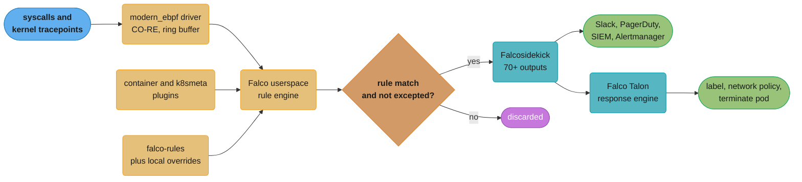
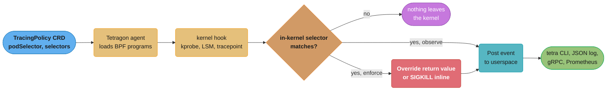
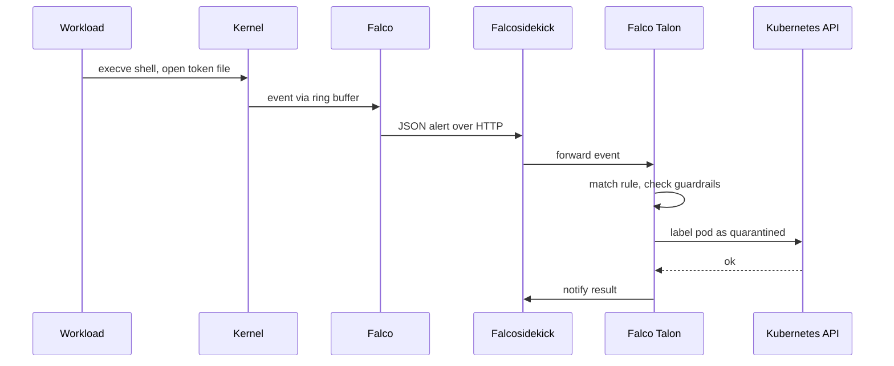
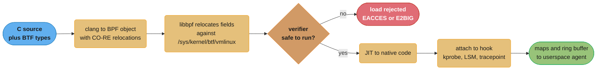
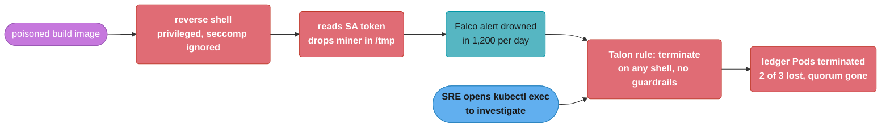
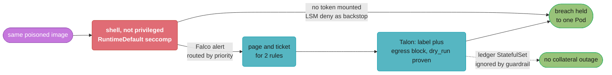

# Runtime Security and eBPF Observability

> Phase 2 - Containers & Kubernetes · Difficulty: Advanced

> **Version anchor (2026-11-25).** **Kubernetes v1.37** is current. The Pod `securityContext.appArmorProfile` field replaced the old annotations in **v1.30** and AppArmor support is **stable since v1.31** (the feature gate is removed). **Seccomp** fields are stable since **v1.19**, and the kubelet `seccompDefault` setting (the `SeccompDefault` gate, GA in **v1.27**) is **off unless you turn it on**. **Falco 0.45.2** (2026-10-29) is current. Falco **graduated from the CNCF on 2024-02-29**. The `modern_ebpf` driver is the default engine, and the default rules are the `falco-rules` **5.2.0** and `falco-sandbox-rules` **6.2.0** artifacts (2026-09-07). Other Falco parts: libs **0.26.1** with driver **11.0.1**, `falcoctl` **v0.14.3**, Falcosidekick **2.35.1** (a **3.0.0-beta.1** pre-release with a new output-file schema exists, so this page wires Sidekick through the Operator and not through its config file), and the **Falco Operator**, now the recommended way to deploy Falco on Kubernetes (it needs Kubernetes 1.29+). **Tetragon v1.8.0** (2026-10-30) is a Cilium sub-project. **KubeArmor v1.7.7** (2026-11-24) and **Pixie** are CNCF **sandbox** projects. The newest Pixie tags (through 2026-07-13) are all pre-releases, so check its release cadence before you depend on it. Every version-tagged claim on this page is checked against these anchors.

[kubernetes_security](../kubernetes_security/kubernetes_security.md) shuts the front doors: RBAC, Pod Security Admission, admission policy, Secrets. This page starts where those controls fail. A container is running, an attacker has code execution in it, and the only shared thing left between that code and the node is the Linux kernel. Everything here is about that boundary: the kernel primitives that shrink it (seccomp, AppArmor, SELinux, capabilities), the eBPF machinery that lets you watch and gate it, and the operating discipline (tuning, noise budgets, safe response automation) that keeps the tooling from becoming its own incident.

---

## 1. Concept Overview

**Runtime security** is the set of controls that act on a workload after it has started: they restrict what its processes may ask the kernel to do, observe what they actually did, and react when the behaviour is wrong.

| Layer | Question it answers | Mechanism | Acts when |
|-------|--------------------|-----------|-----------|
| Prevent (static) | What may this process ever do? | seccomp, AppArmor/SELinux profile, capability drop, user namespace | Before the syscall runs, by default-deny |
| Prevent (dynamic) | Is this specific call allowed right now? | Tetragon `Override`, BPF LSM, KubeArmor `Block` | Inside the kernel, before the call returns |
| Detect | What just happened? | Falco rules, Tetragon events, audit logs | After the event is captured |
| Respond | What do we do about it? | Falcosidekick fan-out, Falco Talon, runbooks, quarantine | After detection, through a chain of hops |
| Observe | Why is the system behaving this way? | Pixie, Hubble, bpftrace, continuous profilers | Continuously, for debugging rather than alerting |

**Ownership boundary (so nothing is taught twice).**

| Topic | Owner |
|-------|-------|
| RBAC, Pod Security Standards, `securityContext` basics, KMS, user namespaces, admission webhooks | [kubernetes_security](../kubernetes_security/kubernetes_security.md) |
| Image signing, SBOM, SLSA, scanning | [devsecops_and_supply_chain_security](../devsecops_and_supply_chain_security/devsecops_and_supply_chain_security.md) |
| gVisor, Kata, runc, containerd, OCI | [container_runtimes_and_oci](../container_runtimes_and_oci/container_runtimes_and_oci.md) |
| Cilium datapath, Hubble flow observability, NetworkPolicy in eBPF | [cilium_and_ebpf_dataplane](../kubernetes_networking/cilium_and_ebpf_dataplane.md) and [Cilium](../../technologies/cilium/cilium.md) |
| eBPF for performance (off-CPU, bpftrace, BCC) | [off_cpu_and_ebpf_analysis](../../backend/off_cpu_and_ebpf_analysis/off_cpu_and_ebpf_analysis.md) |
| **Kernel primitives for containers, eBPF-for-security, Falco, Tetragon, KubeArmor, alert economics, response automation** | **this page** |

Continuous profiling (Parca and similar) is a separate practice with no page in this repo yet, so it is out of scope here.

---

## 2. Intuition

> **One-line analogy**: Prevention is the fireproof wall, detection is the smoke alarm, enforcement is the sprinkler, and response automation is the fire marshal. You cannot build the wall for every room, the alarm rings after the fire starts, the sprinkler can soak the server room, and the marshal may lock a door on someone who is still inside.

**Mental model**: Every container shares one kernel, and everything an attacker wants (read a token, open a socket, exec a miner, mount a host path, load a module) is a system call. The kernel is therefore the one choke point that every attack must cross. Seccomp, AppArmor and SELinux narrow what may cross it. eBPF lets you stand at the choke point and watch (Falco) or hold the gate (Tetragon, KubeArmor).

**Why it matters**: The preventive controls in `kubernetes_security` assume the workload is well behaved once admitted. Real incidents are the opposite: a dependency is poisoned, an RCE lands, a stolen token is replayed. Admission never sees any of that. Runtime tooling is the only layer that does, and it is also the layer that most often pages the wrong person at 3am.

**Key insight**: Where a control sits relative to the syscall decides what it can promise. A seccomp or LSM decision happens before the call completes, so it can prevent. A Falco rule runs in userspace after the event was captured, so it can only report. Tetragon sits in between: its eBPF program runs in the kernel and can override a return value or send `SIGKILL` synchronously, but only if you picked a hook that is safe to enforce on.

---

## 3. Core Principles

1. **The shared kernel is the trust boundary.** A kernel bug or a permissive syscall surface defeats every namespace. Shrink the surface (seccomp, dropped capabilities) before you add watchers.
2. **Default-deny beats a list of known-bad.** `RuntimeDefault` seccomp and `capabilities.drop: ["ALL"]` remove whole classes of attack with no tuning. Detection rules only cover what someone wrote down.
3. **Detect what you cannot prevent.** Some behaviour (a shell, an outbound connection) is legitimate on some workloads. Falco rules express "unusual for this context" where a blanket block would break operations.
4. **Monitor first, enforce later, enforce narrowly.** Run a policy in monitor mode, read the events for a full business cycle, then enforce on one namespace and one label before widening.
5. **Every alert needs an owner, an action and a budget.** An alert that nobody triages is worse than none: it trains the team to ignore the pager. Set a noise budget and delete rules that exceed it.
6. **The security agent is a privileged target.** Falco and Tetragon load kernel programs and see everything. Their sockets, policies and event files need the same care as the secrets they watch.
7. **Overhead and drops are SLOs.** Measure event drop rate, buffer pressure and per-program CPU. A sensor that silently drops events during the attack is false assurance.

---

## 4. Types / Architectures / Strategies

### 4.1 Runtime threat model for containers and Kubernetes

| Threat | Typical path | Prevent | Detect | Enforce in kernel |
|--------|-------------|---------|--------|-------------------|
| Container escape via a kernel bug | Dangerous syscall (`unshare`, `mount`) from a compromised process | seccomp `RuntimeDefault` or `Localhost`, user namespaces, sandboxed runtime | Rules on `unshare`, `mount`, namespace changes | Tetragon `Override` on the syscall or LSM hook |
| Escape via the runtime itself (CVE-2019-5736 class) | Overwrite the host `runc` binary from inside a container | Patched runc, SELinux or AppArmor confinement | Write-to-binary-directory rules | LSM deny on the host path |
| Cryptominer after RCE | Download, drop and `execve` a binary that was not in the image | Read-only rootfs, signed images | `Drop and execute new binary in container` | Block exec of non-image binaries |
| Reverse shell or `kubectl exec` abuse | Shell spawns with a TTY, or an outbound connection from a shell | Distroless images with no shell | `Terminal shell in container`, shell-with-network rules | `Sigkill` on shell exec in a locked-down namespace |
| Credential theft | Read the projected ServiceAccount token, cloud metadata endpoint, `/etc/shadow` | `automountServiceAccountToken: false`, workload identity, NetworkPolicy to metadata | Rules on reads of token paths by unexpected binaries | LSM `file_open` override |
| Privilege escalation | `setuid` binaries, added capabilities, `privileged: true` | `allowPrivilegeEscalation: false`, drop `ALL`, PSA Restricted | Capability-change and setuid events | Tetragon `matchCapabilityChanges` with an enforcement action |
| Lateral movement and exfiltration | Connect to other Pods, internal APIs, the internet | Default-deny NetworkPolicy | Unexpected outbound connect from a workload | Egress enforcement by destination CIDR |
| Tampering with the sensor | Kill the agent, edit its policy CRD, unload its BPF programs | RBAC on policy CRDs, restricted socket and file permissions | Agent-health and heartbeat alerts | Policies pinned in the BPF filesystem (`--keep-sensors-on-exit`) outlive the agent |

Two kernel-level examples appear in the Kubernetes documentation itself. Rejecting the `unshare` syscall with seccomp is the documented example of blocking the path used by **CVE-2022-0185**. SELinux confinement is documented as a mitigation for the **CVE-2019-5736** runc escape, which shows these controls protect the node, not only the container.

### 4.2 Linux primitives at a glance

| Primitive | What it restricts | Granularity | Kubernetes field | Default state |
|-----------|-------------------|-------------|------------------|---------------|
| seccomp | Which syscalls (and their direct register arguments) a process may issue | Per Pod or per container | `securityContext.seccompProfile` (`RuntimeDefault`, `Localhost`, `Unconfined`) | `Unconfined` unless the kubelet runs with `seccompDefault` |
| AppArmor | Files, capabilities, network and mounts by **path** | Per container, profile loaded on the node | `securityContext.appArmorProfile` (`RuntimeDefault`, `Localhost`, `Unconfined`) | Runtime default profile applied on supported hosts |
| SELinux | Access between labelled subjects and objects (identified by **inode**) | Per container, via labels | `securityContext.seLinuxOptions` | Depends on the node OS |
| Capabilities | Splits root's power into separate units | Per container | `securityContext.capabilities.add/drop` | Runtime grants a default set (Docker's is **14**) |
| `no_new_privs` | Blocks gaining privilege through `setuid` or file capabilities | Per container | `allowPrivilegeEscalation: false` | Allowed |
| User namespace | Maps in-container UIDs to unprivileged host UIDs | Per Pod | `hostUsers: false` | Host UID namespace (see [kubernetes_security](../kubernetes_security/kubernetes_security.md)) |
| BPF LSM | Any LSM hook, programmable at runtime | System-wide, filtered by the program | Not a Pod field, configured by a tool such as Tetragon or KubeArmor | Off unless `bpf` is in the kernel `lsm=` list |

The Pod Security Standards tie into these. **Baseline** forbids an explicit `Unconfined` seccomp profile and forbids overriding or disabling the default AppArmor profile. **Restricted** goes further and requires seccomp to be set explicitly to `RuntimeDefault` or `Localhost`, so a missing field is also a violation.

### 4.3 The tool landscape

| Tool | Role | Mechanism | Enforces? | Governance |
|------|------|-----------|-----------|------------|
| Falco | Detection engine with rules, plugins and outputs | `modern_ebpf` driver (default) or kernel module, userspace rule engine | No (detect, forward, trigger responders) | CNCF graduated 2024-02-29 |
| Falcosidekick | Alert fan-out to 70+ integrations | HTTP receiver of Falco events | No | Falco ecosystem |
| Falco Talon | No-code response engine | Receives Falco or Sidekick events, runs Kubernetes, cloud and network actions | Indirectly, by acting on the cluster | Falco ecosystem |
| `falcoctl` | CLI for rules, plugins and drivers | OCI artifact install and follow | n/a | Falco core |
| Tetragon | Observability plus in-kernel enforcement | kprobes, tracepoints, uprobes, fentry, BPF LSM, `TracingPolicy` CRD | **Yes**, `Override` and `Sigkill` in the kernel | Cilium sub-project |
| KubeArmor | Policy-first runtime enforcement | AppArmor, SELinux or BPF LSM to enforce, eBPF for telemetry | **Yes**, `Block` | CNCF sandbox (accepted 2021-11-16) |
| Pixie | Auto-instrumented application observability | eBPF, data stored in the cluster, PxL scripts | n/a | CNCF sandbox (accepted 2021-06-22) |

### 4.4 Detection versus enforcement

| Dimension | Detection only (Falco, Tetragon `Post`) | In-kernel enforcement (Tetragon `Override` and `Sigkill`, KubeArmor, LSM) |
|-----------|-----------------------------------------|---------------------------------------------------------------------------|
| Stops the action | No | Yes, if the hook and action are correct |
| Cost of a false positive | One noisy alert | A killed or failing production process |
| Cost of a false negative | Missed event | Same, plus false confidence that something was blocked |
| Rollout risk | Low | High, needs a staged rollout |
| Evidence trail | Full event with context | Event plus the denied operation |
| Typical use | Wide coverage, behavioural rules, forensic context | Narrow, high-confidence rules: known-bad paths, crown-jewel files, internet egress from a no-egress namespace |

---

## 5. Architecture Diagrams

**Where each control sits relative to one syscall.** A prevention control decides before the kernel does the work. Falco only sees the event after capture. Tetragon's in-kernel actions run inline with the operation, which is why `Override` can stop it and why `Sigkill` alone may not.

```
 process        kernel entry            kernel does the work            userspace
 -------        ------------            --------------------            ---------

 write() ---->  [seccomp filter]  --->  [LSM hook: AppArmor/SELinux] -> VFS write
                 deny = EPERM/kill       deny = EACCES                  |
                      |                       |                         |
                 BPF kprobe/tracepoint  BPF LSM program (Tetragon)      |
                 Tetragon Override /           Override = block         |
                 Sigkill (inline)                                       |
                      |                       |                         v
                      +----------+------------+              ring buffer / perf events
                                 |                                       |
                          event posted                                   v
                                                              Falco rule engine (userspace)
                                                              match -> alert, after capture

 timing:   BEFORE the call ------------------------------------>  AFTER the call is captured
 verdict:  can prevent                                            can only report
```

**Falco pipeline.** Kernel events become Falco alerts, which fan out through Falcosidekick to chat, paging, SIEM and Falco Talon.



Falco matches rules in userspace, so every captured event crosses the ring buffer first. That cost is why `base_syscalls` tuning and drop counters (section 6.7) matter. Falco Talon turns alerts into cluster actions and is where response guardrails live.

**Tetragon pipeline.** The same TracingPolicy that selects events also decides, inside the kernel, whether to enforce or drop them, so only relevant events cross to userspace.



Filtering and acting in the kernel is the design point: the Tetragon documentation presents it as the way to cut observation overhead on high-frequency events (reads, writes, sends) and to avoid the race a userspace enforcer would have.

**Detection to response chain.** A response chain has several hops, each with its own failure mode. Guardrails belong on the last hop, because it is the one that changes production.



Quarantine by label (so a NetworkPolicy isolates the Pod while it stays alive for forensics) is the safest first action. Termination is the last resort, not the default.

---

## 6. How It Works - Detailed Mechanics

### 6.1 Kernel primitives in a Pod spec (seccomp, AppArmor, SELinux, capabilities)

The generic hardening checklist (non-root, read-only rootfs, `allowPrivilegeEscalation: false`) is in [kubernetes_security](../kubernetes_security/kubernetes_security.md). This is the kernel-facing subset, with the one field that page does not cover.

```yaml
apiVersion: v1
kind: Pod
metadata:
  name: checkout
  namespace: payments
spec:
  automountServiceAccountToken: false
  securityContext:
    runAsNonRoot: true
    seccompProfile: {type: RuntimeDefault}              # syscall filter from the runtime
    appArmorProfile:                                    # replaces the pre-1.30 annotations
      type: Localhost
      localhostProfile: k8s-checkout-deny-write         # must already be loaded on the node
  containers:
    - name: app
      image: registry.example.com/payments/checkout@sha256:0123456789abcdef0123456789abcdef0123456789abcdef0123456789abcdef
      securityContext:
        allowPrivilegeEscalation: false                 # sets no_new_privs
        readOnlyRootFilesystem: true
        capabilities: {drop: ["ALL"]}
      volumeMounts: [{name: tmp, mountPath: /tmp}]
  volumes: [{name: tmp, emptyDir: {}}]
```

**AppArmor profile and loading.** Profiles are path-based text files loaded into the kernel with `apparmor_parser`. The profile below denies all file writes (it is the one the Kubernetes tutorial uses):

```
#include <tunables/global>

profile k8s-checkout-deny-write flags=(attach_disconnected) {
  #include <abstractions/base>

  file,

  # Deny all file writes.
  deny /** w,
}
```

```bash
sudo apparmor_parser -q /etc/apparmor.d/k8s-checkout-deny-write      # run on EVERY node
sudo cat /sys/kernel/security/apparmor/profiles | sort                # is it loaded?
cat /sys/module/apparmor/parameters/enabled                           # Y if the module is on
kubectl exec -n payments checkout -- cat /proc/1/attr/current         # k8s-checkout-deny-write (enforce)
```

Three operational facts decide whether AppArmor survives contact with a real cluster. First, Kubernetes has **no built-in mechanism to load profiles onto nodes**: use your own infrastructure (a DaemonSet or node image) or the Kubernetes **Security Profiles Operator** (v1.1.2, 2026-10-29), which also distributes seccomp and SELinux profiles. Second, the **scheduler does not know which profiles a node has**, so either load every profile on every node or label nodes per profile and add a node selector. Third, if a named profile is missing, the kubelet rejects the Pod and it sticks (`apparmor profile not found`). A container-level `appArmorProfile` overrides the Pod-level one.

**SELinux** is the label-based alternative, and the node OS usually ships either AppArmor (Ubuntu, SUSE) or SELinux, not both. AppArmor names resources by path, SELinux by inode and label, so a path-based profile can be sidestepped by another path to the same file, which an inode-labelled policy is not. In Kubernetes you assign the label in the Pod spec and the host policy does the enforcing:

```yaml
securityContext:
  seLinuxOptions:
    level: "s0:c123,c456"      # MCS level: separates this Pod's files from other Pods
```

**Capabilities.** Docker's default set is 14: `AUDIT_WRITE`, `CHOWN`, `DAC_OVERRIDE`, `FOWNER`, `FSETID`, `KILL`, `MKNOD`, `NET_BIND_SERVICE`, `NET_RAW`, `SETFCAP`, `SETGID`, `SETPCAP`, `SETUID`, `SYS_CHROOT`. Dropping `ALL` and adding back only `NET_BIND_SERVICE` (the one the Restricted profile allows) is the policy. `CAP_BPF` and `CAP_PERFMON` exist since Linux 5.8 to carve BPF out of the overloaded `CAP_SYS_ADMIN`, which matters when you grant a security agent only what it needs.

### 6.2 Building a seccomp profile without breaking the app

`RuntimeDefault` is the right default for almost everything. It is an allow-list that the runtime maintains, and Docker documents its default as disabling around **44** of 300+ system calls. Write a custom `Localhost` profile only when you need a tighter set, and build it from observation, not from guessing.

```json
{ "defaultAction": "SCMP_ACT_LOG" }
```

1. **Audit.** Save the profile above to `/var/lib/kubelet/seccomp/profiles/audit.json` on the node and run the workload with `type: Localhost` and `localhostProfile: profiles/audit.json`. `SCMP_ACT_LOG` allows every call and writes each one to the kernel audit log with its syscall number.
2. **Collect.** Gather the syscall numbers over a full business cycle (startup, steady state, the nightly batch, shutdown). A syscall that only the shutdown path uses will not appear in a 10-minute sample.
3. **Allow-list.** Build a profile with `"defaultAction": "SCMP_ACT_ERRNO"` and an `SCMP_ACT_ALLOW` list of the collected names. The Kubernetes tutorial's fine-grained example for a small HTTP server allows 54 names.
4. **Roll out in log mode first.** Keep the audit action on a canary, watch for `SCMP_ACT_ERRNO` side effects (a `CrashLoopBackOff` on a missing call), then switch.

If a `Localhost` profile does not exist on the node, container creation fails with `CreateContainerError`. To make `RuntimeDefault` the cluster default for every Pod that sets nothing, enable it on the kubelet:

```yaml
apiVersion: kubelet.config.k8s.io/v1beta1
kind: KubeletConfiguration
seccompDefault: true
```

Two limits to remember. A **privileged container always runs `Unconfined`**: a seccomp profile on it is ignored. And seccomp filters see only the **register arguments** of a syscall, never the memory behind a pointer, which closes the time-of-check-to-time-of-use hole but means seccomp cannot say "deny `openat` of `/etc/shadow`". That path-aware decision belongs to an LSM, AppArmor, SELinux or a BPF LSM program. The Kubernetes documentation also warns that custom seccomp profiles can break on application updates and are hard to manage at scale, and recommends the runtime default or a sandbox such as gVisor for stronger isolation.

### 6.3 eBPF fundamentals for operators

eBPF runs small, verified programs inside the kernel at defined hook points. For an operator the useful picture is a lifecycle and a hook catalogue, not the instruction set.



The compile-once-run-everywhere trick (CO-RE) is what lets one agent binary run across kernel versions. Kernel structures change between versions, so the program records which fields it touches and **libbpf patches the offsets at load time using the running kernel's BTF file**. The cost is that the kernel must expose BTF: `/sys/kernel/btf/vmlinux`, built with `CONFIG_DEBUG_INFO_BTF=y`. Most mainstream distributions already do.

| Hook | Stable across kernels? | Can enforce? | Notes |
|------|-----------------------|--------------|-------|
| kprobe | No, tied to the kernel's internal function names | Yes, `Override` and `Sigkill` in Tetragon | Hooking a **syscall** entry can race with user memory, see below |
| tracepoint | Yes, a static, versioned interface | Typically used to observe | Raw tracepoints skip the perf layer and are a bit faster |
| fentry / fexit | Needs BTF, Tetragon requires kernel 6.1+ | Not in Tetragon | A faster alternative to kprobes using a trampoline |
| uprobe | Tied to the binary version | `Override` is possible but fragile | Hooks user-space functions, for example bash `readline` |
| LSM (BPF LSM) | Tied to the LSM hook list | Yes, return an error code | Needs `CONFIG_BPF_LSM=y` and `bpf` in the `lsm=` boot list; attribute resolution needs kernel 5.7+ |

**Syscall hooks race, LSM hooks do not.** If the argument is a pointer into user memory (a path string), user space can change it after your hook ran and before the kernel used it. Tetragon documents this time-of-check-to-time-of-use risk and its fix: hook a later kernel function, such as an LSM `security_` hook, which sees kernel-resident state after the copy from user space.

**Verifier limits.** The verifier rejects any program it cannot prove safe: no unbounded loops, bounds-checked memory, no uninitialised reads. Two numbers are worth knowing. The verifier's internal cap on instructions it will explore during analysis is **1 million**, and the maximum program size for an **unprivileged** program is **4,096** instructions (`BPF_MAXINSNS`). Verification happens **on the node, at load time, against the running kernel**, so a kernel upgrade can turn a program that loaded yesterday into one that is rejected today. Test every agent and kernel upgrade pair before rolling a node pool.

**Who may load programs.** Loading needs `CAP_BPF` (plus `CAP_PERFMON` for tracing) or the older `CAP_SYS_ADMIN`. Set `kernel.unprivileged_bpf_disabled=1` (cannot be undone until reboot) or `2` (an admin can change it later) so unprivileged callers get `EPERM`. Any container that holds `CAP_BPF` can load programs, which is why the security agent's own Pod is the most privileged thing on the node.

```bash
ls -l /sys/kernel/btf/vmlinux                                # BTF present?
grep CONFIG_DEBUG_INFO_BTF /boot/config-$(uname -r)          # =y
cat /sys/kernel/security/lsm                                 # contains "bpf"? BPF LSM is on
sudo bpftool prog show | head                                # every loaded BPF program
sudo bpftool feature probe kernel | grep -E "ringbuf|tracing"  # what Falco's modern probe needs
sysctl kernel.unprivileged_bpf_disabled                      # 0 open, 1 locked, 2 locked but changeable
sudo sysctl -w kernel.bpf_stats_enabled=1                    # per-program run count and time (adds overhead)
```

### 6.4 Falco: engine, install and configuration

Falco turns kernel events into a stream that a userspace engine evaluates against rules. The driver gives the **syscall event source**; plugins add others: the Falco docs list Kubernetes audit events, CloudTrail and Okta as plugin event sources.

| Driver | Kernel | Privilege | Notes |
|--------|--------|-----------|-------|
| `modern_ebpf` (default) | Roughly 5.8+, needs BPF ring buffer and BTF | Can run with `CAP_BPF`/`CAP_SYS_BPF`, `CAP_PERFMON`, `CAP_SYS_RESOURCE`, `CAP_SYS_PTRACE` | Embedded in the Falco binary, uses CO-RE, nothing to download or compile. The docs spell the first capability `CAP_SYS_BPF`, the man page `CAP_BPF` |
| Kernel module | 3.10+ on x86_64 and aarch64 | Full privileges, cannot run with capabilities only | Needs a module build or download per kernel |

Since Falco 0.45 the modern probe uses BPF atomic compare-and-swap when the kernel supports it (Linux 5.12+, subject to backports). If not, it falls back to plain stores and logs `no BPF atomics on this kernel`.

**Deploy with the Operator.** The Falco Operator manages instances, rules, plugins and config as custom resources and is the recommended Kubernetes install (Helm remains supported). A Falco instance created with `spec: {}` runs as a DaemonSet with the `modern_ebpf` driver and is **idle until you give it rules**. The container plugin is mandatory for `container.*` fields: without it, rules that mention container metadata silently do not work.

```yaml
apiVersion: instance.falcosecurity.dev/v1alpha1
kind: Falco
metadata: {name: falco}
spec: {}
---
apiVersion: artifact.falcosecurity.dev/v1alpha1
kind: Plugin
metadata: {name: container}
spec:
  ociArtifact:
    image: {repository: falcosecurity/plugins/plugin/container, tag: latest}
    registry: {name: ghcr.io}
---
apiVersion: artifact.falcosecurity.dev/v1alpha1
kind: Rulesfile
metadata: {name: falco-rules}
spec:
  ociArtifact:
    image: {repository: falcosecurity/rules/falco-rules, tag: latest}
    registry: {name: ghcr.io}
  priority: 50
---
apiVersion: instance.falcosecurity.dev/v1alpha1
kind: Component
metadata: {name: sidekick}
spec:
  component: {type: falcosidekick, replicas: 2}
---
apiVersion: artifact.falcosecurity.dev/v1alpha1
kind: Config
metadata: {name: sidekick-output}
spec:
  config:
    json_output: true
    http_output: {enabled: true, url: "http://sidekick:2801"}
  priority: 60
```

Pin `tag` to a reviewed version in production instead of `latest`: a rules update is a behaviour change on every node. `falcoctl` is the CLI behind this (`falcoctl artifact install` and `falcoctl artifact follow` fetch and keep rules and plugins up to date from OCI registries, and `falcoctl driver` handles drivers), so it is also how you pin and promote rules outside the Operator.

The `falco.yaml` keys you will actually touch (defaults from the shipped file):

```yaml
engine:
  kind: modern_ebpf
  modern_ebpf:
    cpus_for_each_buffer: 2      # one ring buffer per 2 CPUs
    buf_size_preset: 4
    drop_failed_exit: false
rules_files:
  - /etc/falco/falco_rules.yaml
  - /etc/falco/falco_rules.local.yaml   # your overrides, loaded AFTER the defaults
  - /etc/falco/rules.d
syscall_event_drops:
  threshold: .1                  # 10% of events in the last second
  actions: [log, alert]
  rate: .03333                   # one message per 30 seconds
  max_burst: 1
metrics:
  enabled: false                 # turn on in production, see 6.7
  interval: 1h
```

### 6.5 Falco rules: write, except, override

A rules file holds **rules** (a condition plus an output), **macros** (reusable condition fragments) and **lists** (named collections). A rule needs `rule`, `desc`, `condition`, `output` and `priority`. Two traps up front. `priority` is the **severity** (`EMERGENCY` down to `DEBUG`), not an ordering: rule order comes only from file load order. And a condition with no `evt.type` clause is evaluated against every syscall, so add the event type for cheapness and for correct alert counts.

```yaml
- list: sa_token_dirs
  items: [/var/run/secrets/kubernetes.io/serviceaccount/]

- rule: ServiceAccount token read by shell or download tool
  desc: >
    A shell or download tool opened the projected ServiceAccount token. Legitimate
    clients read it through an SDK, not through cat, curl or a shell.
  condition: >
    open_read and container.id != host
    and fd.name startswith /var/run/secrets/kubernetes.io/serviceaccount/
    and proc.name in (shell_binaries, cat, curl, wget, base64)
  exceptions:
    - name: known_debug_images
      fields: [container.image.repository, proc.name]
  output: >
    SA token read by tool | user=%user.name proc=%proc.name cmd=%proc.cmdline
    file=%fd.name container=%container.id image=%container.image.repository
    ns=%k8s.ns.name pod=%k8s.pod.name
  priority: WARNING
  tags: [custom, credential_access]
```

`open_read` and `shell_binaries` come from the default rules, so load order matters: the default file first, your file second. Exceptions are defined **in the rule** so the rule's author controls what counts as a valid exception. You then add values from the local file instead of editing the default rule:

```yaml
- rule: ServiceAccount token read by shell or download tool
  exceptions:
    - name: known_debug_images
      values:
        - [registry.example.com/platform/netshoot, curl]
  override:
    exceptions: append
```

Rules that ship in the default file are tuned differently: they expose `user_*` hook macros (for example `user_expected_terminal_shell_in_container_conditions`, default `(never_true)`) that you replace from your local file, as in Pitfall 4 in section 10. Use `exceptions` for rules you author.

For lists, macros and whole rules the `override` key accepts `append` or `replace` (not both at once). `append` adds to `items` or to the end of a `condition`; `replace` swaps the value. Use `enabled: true` with `override: enabled: replace` to turn a shipped disabled rule on, because the bare `enabled: true` form is deprecated.

Rules carry a **maturity** tag, and the Falco project recommends adopting them in that order: start with the `maturity_stable` default rules, tune them against your environment while watching performance, then add `maturity_incubating` and `maturity_sandbox` rules, and write custom rules for what is unique to you (sensitive files, crown-jewel services). The project states plainly that maturity does not predict noise in your environment.

Two default rules show how the project thinks about alerts. `Terminal shell in container` is `NOTICE` and its own description says it is best used as generic auditing context while examining other rules in the same container, not as a standalone page. `Drop and execute new binary in container` flags `proc.is_exe_upper_layer=true`, an executable that is not part of the base image, and explicitly tells adopters to exclude non-production namespaces and known SRE debugging.

Validate before you ship: `falco -c /etc/falco/falco.yaml -r /etc/falco/falco_rules.local.yaml --dry-run`.

### 6.6 Tetragon: TracingPolicy, selectors and enforcement

Install is one Helm chart, and it runs as a DaemonSet:

```bash
helm repo add cilium https://helm.cilium.io && helm repo update
helm install tetragon cilium/tetragon -n kube-system
kubectl rollout status -n kube-system ds/tetragon -w
```

By default Pods in `kube-system` are filtered out. Tetragon needs Linux **4.19 or newer** (the project tests on 4.19, 5.4, 5.10, 5.15 and bpf-next), BTF, and for enforcement `CONFIG_BPF_KPROBE_OVERRIDE`. Run `tetra probe config` and `sudo tetra probe` to see what your kernel really supports. Newer features need newer kernels: `Sigkill` and `Signal` need large-BPF-program support (about 5.3), `Override` on `security_` hooks needs 5.7, and fentry needs 6.1 with BTF.

A `TracingPolicy` is a cluster-wide CRD, `TracingPolicyNamespaced` is the namespaced twin. Each policy has **hook points** (`kprobes`, `tracepoints`, `uprobes`, `fentries`, `lsmhooks`) and per-hook **selectors**. A selector is a set of filters ANDed together (`matchArgs`, `matchBinaries`, `matchNamespaces`, `matchCapabilities`, `matchPIDs`, and more) plus `matchActions`. A hook holds **up to 5 selectors** and the **first matching selector wins**, so put the specific block rule before the catch-all.

```yaml
apiVersion: cilium.io/v1alpha1
kind: TracingPolicyNamespaced
metadata:
  name: deny-shadow-open
  namespace: payments
spec:
  podSelector:
    matchLabels: {app: checkout}
  options:
    - name: policy-mode
      value: monitor                      # observe first, flip to enforce later
  lsmhooks:
    - hook: file_open
      args:
        - index: 0
          type: file
      selectors:
        - matchArgs:
            - index: 0
              operator: Equal
              values: ["/etc/shadow"]
          matchActions:
            - action: Override
              argError: -1                # EPERM, the open fails, the process lives
```

```bash
kubectl exec -n kube-system ds/tetragon -c tetragon -- tetra getevents -o compact --pods checkout
tetra tracingpolicy list                  # shows MODE, NPOST, NENFORCE, NMONITOR and kernel memory per policy
tetra tp set-mode --namespace payments deny-shadow-open enforce
```

**Two enforcement actions, two different guarantees.**

| Action | What it does | Guarantee | Gotcha |
|--------|-------------|-----------|--------|
| `Override` with `argError` | Replaces the hooked function with a return value, the function never runs | The operation is **prevented**; the caller sees the error | Works on kprobe, uprobe and `lsmhooks`; uses the kernel error-injection framework, so only on functions marked injectable, and `security_` hooks from kernel 5.7 |
| `Sigkill` / `Signal` | Terminates the process synchronously from the kernel | The process is **stopped**, any threads too | It does **not** guarantee the operation did not complete: a `SIGKILL` during `write()` may still land the data |

The documented answer is to combine them: `Override` to deny the operation and `Sigkill` to end the process. In a Kubernetes demo the egress-block policy kills the `curl`, and the shell reports **exit code 137** (128 + 9).

**Policy modes.** A policy can be `monitor` or `enforce` (a `monitor_only` policy has no enforcement actions at all). The mode can be set in the policy, at load time (`tetra tracingpolicy add --mode monitor policy.yaml`) or at runtime, with runtime taking priority, which gives you a kill switch without editing manifests.

**Scope enforcement narrowly.** `TracingPolicyNamespaced`, `podSelector` (labels), `containerSelector` (`name`, `repo`) and `hostSelector` filter inside the kernel. `nodeSelector` restricts which nodes load the policy, with one warning that is easy to miss: anyone who can edit node labels can unload an enforcement policy by relabeling the node, so protect those labels.

**Persistence and limits.** With `--keep-sensors-on-exit` the pinned BPF programs under `/sys/fs/bpf/tetragon` keep enforcing after the agent exits, but you lose events during the gap. Other numbers: `char_buf` captures up to 4,096 bytes by default, `matchCmdArgs` sees only the first 256 bytes of arguments (and arguments are user-controlled, so do not enforce on them alone), and `followChildren` is capped at 64 sections and ignores children created before the policy loaded.

### 6.7 Falco tuning, dropped events and measured overhead

Falco's userspace engine is single-threaded on its hot path, so its CPU use cannot exceed one CPU. The load follows the workload: the more syscalls applications make, the more work Falco does. These are the knobs and what the Falco docs say about them.

**Adaptive syscall selection (`base_syscalls`).** By default Falco traces the syscalls its enabled rules need plus a fixed set that keeps its process-state engine correct. Three switches change that.

```yaml
base_syscalls:
  repair: true        # recommended: add only the minimal extra syscalls the state engine needs
  custom_set: []      # or list names explicitly; "!name" excludes one
  all: false          # true monitors everything, including write: expensive
```

**Buffers.** For `modern_ebpf` the docs suggest trying `buf_size_preset` 6 or 7 with `cpus_for_each_buffer` 4 or 6 on busy hosts. A bigger buffer helps less than proportionally and costs preallocated memory. Falco 0.45 also allocates two auxiliary-map segments of 128 KiB per **possible** CPU (including offline CPUs), which is **256 KiB per CPU**, so a 96-CPU host spends 96 x 256 KiB = **24 MiB** there, separate from the ring buffers.

**Reading the numbers.** The Falco docs publish adopter experience, not a benchmark, and flag it as approximate: under about 1,000 kernel events per second per CPU is usually fine, under about 1,500 should not be a problem, above about 3,000 is likely hard to keep up with, and dropping **1 to 2%** of events on a few busy servers is considered acceptable. One host has been observed above 164,000 events per second per CPU on 128 CPUs. Always normalise by CPU count.

A sample metrics snapshot in the docs shows `falco.evts_rate_sec` 93,345 on `falco.host_num_cpus` 96, so 93,345 / 96 = **972 events/s per CPU**, just under the comfort line. The same snapshot gives average kernel-side program times of 194 ns for `sys_enter` and 205 ns for `sys_exit`. Using those as an illustration (kernel-side BPF time only, not userspace rule evaluation):

| Load | Per-event kernel cost | Kernel-side CPU share |
|------|----------------------|----------------------|
| 972 events/s per CPU | 194 + 205 = 399 ns | 972 x 399 ns = 0.39 ms per second = **0.04% of a CPU** |
| 164,000 events/s per CPU | 399 ns | 164,000 x 399 ns = 65 ms per second = **6.5% of a CPU** |

The kernel-side cost is small at normal rates; the real risk is **userspace backpressure**: slow rules or heavy outputs on the single-threaded engine fill the ring buffer and cause drops. That is why the docs list "audit and optimise Falco rules" next to buffer tuning.

**Drops are the SLO.** Falco reads kernel counters every second. When the kernel finds the shared buffer full it counts a drop, and Falco can `ignore`, `log`, `alert` or `exit` (default `log` plus `alert`, throttled to one message per 30 seconds). Enable metrics and watch `scap.n_drops`, `scap.evts_drop_rate_sec` and, for `modern_ebpf` in 0.45, `scap.n_drops_auxmap_reentrancy` and `scap.n_drops_auxmap_pool_full` (drops while building an event, which a bigger ring buffer does not fix). Set `libbpf_stats_enabled: true` and `kernel_event_counters_enabled: true` to get per-tracepoint run counts and times.

**Tetragon overhead** is observed per program, not per host. Enable stats (`sysctl kernel.bpf_stats_enabled=1` or `tetra debug enable-stats`) and `tetra debug progs` prints a `top`-style view with an `Ovh(%)` column, while Prometheus gets `tetragon_overhead_program_runs_total` and `tetragon_overhead_program_seconds_total` labelled by policy and attach point. Stats are off by default because collecting them costs CPU: turn them on for a measurement window. Each loaded policy also reports its kernel memory (the docs' sample `tetra tracingpolicy list` shows 1.88 MB and 2.40 MB for two small policies). Watch `tetragon_observer_ringbuf_events_lost_total` and `tetragon_bpf_missed_events_total` for loss, and use event throttling (a per-cgroup rate limit that emits `THROTTLE_START`) so one noisy workload cannot flood the pipeline or be used to hide an attack in noise.

### 6.8 KubeArmor in one page

KubeArmor enforces behaviour (process execution, file access, network) at the system level for Pods, containers and also nodes and VMs. Where Tetragon exposes raw kernel hooks and asks you to choose them, KubeArmor exposes a high-level policy and **delegates enforcement to the Linux security module already present**: AppArmor, SELinux or BPF LSM, with eBPF for telemetry. That makes it the shortest path to "allow-list the binaries this container may run".

```yaml
apiVersion: security.kubearmor.com/v1
kind: KubeArmorPolicy
metadata:
  name: block-sleep
  namespace: payments
spec:
  selector:
    matchLabels: {app: checkout}
  process:
    matchPaths:
      - path: /bin/sleep
  action: Block
```

The trade-off is the mirror image of Tetragon's. You get readable policies and reuse of LSM enforcement, but you give up the arbitrary kernel hook flexibility, and enforcement coverage depends on which LSM the node actually runs (so the support matrix matters). It is a sandbox project, so weigh its maturity accordingly.

### 6.9 Response automation with Falco Talon

Falco Talon receives events from Falco or Falcosidekick and maps them to actions through rules evaluated **top to bottom**. An `action` block defines a reusable step with an `actionner`; a `rule` block matches events (`rules`, `priority` such as `>=Critical`, `tags`, `output_fields`) and lists the actions to run in order.

```yaml
- action: Label the pod as suspicious
  actionner: kubernetes:label
  parameters:
    level: pod
    labels:
      quarantine: "true"

- action: Block all egress for the pod
  actionner: kubernetes:networkpolicy
  parameters:
    allow_namespaces: [observability]

- action: Terminate the pod, with guardrails
  actionner: kubernetes:terminate
  parameters:
    grace_period_seconds: 5
    ignore_daemonsets: true
    ignore_statefulsets: true
    min_healthy_replicas: "50%"

- rule: Contain a shell opened in payments
  match:
    rules: [Terminal shell in container]
    output_fields:
      - k8s.ns.name=payments
  dry_run: true                            # log what would happen first
  actions:
    - action: Label the pod as suspicious
    - action: Block all egress for the pod
```

Read the guardrails as a ladder. **Label** is reversible and cheap. **NetworkPolicy egress block** isolates the Pod but keeps it alive for forensics (and needs a CNI that enforces NetworkPolicy). **Terminate** destroys evidence and capacity, so it carries `ignore_statefulsets`, `ignore_daemonsets` and a `min_healthy_replicas` floor. Run every new rule with `dry_run: true` until a week of real events shows what it would have done. Every Talon actionner lists the Falco output fields it needs (`k8s.pod.name` and `k8s.ns.name`), so a rule whose output omits them cannot act.

### 6.10 Alert economics: a noise budget

Treat alert volume as capacity. Pick a budget per audience, then compute whether a rule fits.

```
budget per on-call page rule:   <= 10 pages per on-call week, >= 70% actionable
budget per ticket rule:         <= 50 tickets per team per week
cost of one triage:             2 minutes for a known-benign pattern, 20+ for a real one

rule fires 3 times per node per day on 400 nodes  = 1,200 per day = 8,400 per week
  at 98% benign, 2 minutes each                    = 8,400 x 2 min = 280 hours per week
add an exception for the 2 benign processes (-95%) = 420 per week  = 14 hours per week
```

The numbers are illustrative, but the order of magnitude is the lesson: a rule's cost is `volume x triage time`, and exceptions on the rule's own fields (`proc.name`, `container.image.repository`) are the cheapest lever. In order of preference: fix the cause (a service that legitimately does this), add a scoped exception, lower the priority so it routes to a ticket and not a page, scope the rule to the namespaces where it means something, and only then disable it. Review the top five noisiest rules every week, and delete any rule nobody acted on in 90 days.

### 6.11 eBPF observability tools

Detection tools answer "is this bad". Observability tools answer "what is happening". They share the eBPF substrate and the same overhead questions, so evaluate them the same way.

| Tool | What it gives you | Facts worth knowing |
|------|------------------|---------------------|
| Pixie | Auto-collected requests, service maps, network, CPU flame graphs, queried with PxL scripts | Needs Linux 4.14+ and Kubernetes 1.21+. The per-node `vizier-pem` DaemonSet is **privileged**, defaults to a 2 GiB memory limit (1 GiB is the lowest recommended), and the project says it should stay under about 25% of node memory. The project claims under 5% of cluster CPU and mostly under 2%, a vendor claim to verify on your workload. Not supported on EKS Fargate or GKE Autopilot because they do not allow eBPF |
| Hubble | Per-flow, policy-attributed network visibility from the Cilium datapath | Covered in [Cilium](../../technologies/cilium/cilium.md), including Relay and UI |
| bpftrace, BCC | Ad hoc kernel and user tracing for debugging | Taught in [off_cpu_and_ebpf_analysis](../../backend/off_cpu_and_ebpf_analysis/off_cpu_and_ebpf_analysis.md) |
| OpenTelemetry eBPF instrumentation (OBI) | eBPF-based telemetry that feeds the OpenTelemetry pipeline, first stable release v1.0.0 on 2026-10-30 | See [cilium_and_ebpf_dataplane](../kubernetes_networking/cilium_and_ebpf_dataplane.md) and [opentelemetry_deep_dive](../observability_tracing_and_otel/opentelemetry_deep_dive.md) |

The recurring rule: eBPF sees what the **kernel** sees. It captures plaintext only where it hooks above TLS, it sees nothing inside a guest kernel of a microVM sandbox, and on managed platforms that forbid privileged Pods it may not run at all. Check that before you design around it.

---

## 7. Real-World Examples

- **Falco in production (CNCF record).** Falco was accepted into the CNCF on 2018-10-10, moved to incubating on 2020-01-08 and graduated on 2024-02-29. The CNCF lists a Frame.io case study on building a security program around Falco, processing 240 million events per day (published 2020-02-06).
- **Detection pipeline as CRDs.** Teams that run the Falco Operator manage rules, plugins and config as Kubernetes objects: a Rulesfile pinned to a reviewed OCI tag, a local Config for overrides, and Falcosidekick as a Component, so rule changes go through the same review and GitOps flow as any manifest (see [gitops_argocd_flux](../gitops_argocd_flux/gitops_argocd_flux.md)).
- **Tetragon as the enforcement half of a Cilium estate.** Cilium handles network policy and Hubble flows. Tetragon adds the process, file and capability layer with enforcement, using the same Kubernetes identity (namespace, labels), as described in [cilium_and_ebpf_dataplane](../kubernetes_networking/cilium_and_ebpf_dataplane.md). The two are deployed together often but scoped independently: a `CiliumNetworkPolicy` has no effect on what Tetragon enforces.
- **Decoy files as tripwires.** Tetragon's own documentation shows a stateful policy where opening a decoy secret (`/run/secrets/decoy-key`) in a canary Pod sets a state flag, and later `connect(2)` calls from matching Pods fail with `EPERM`. The docs label it "not a production policy" with coverage gaps, but it is a good pattern for a high-signal, low-noise trigger.
- **Kernel hardening that the platform documents.** The Kubernetes docs recommend the runtime's default seccomp profile as the baseline and a sandbox for a stronger boundary, and name AppArmor and SELinux as complements that can protect beyond the container (their CVE-2019-5736 example). That is the order this page follows: runtime default first, then LSM profiles, then eBPF enforcement for the specific gaps.
- **Cross-reference.** For how these controls sit inside a full cluster build, see [kubernetes_production_hardening](../case_studies/cross_cutting/kubernetes_production_hardening.md).

---

## 8. Tradeoffs

| Decision | Option A | Option B | Key factor |
|----------|----------|----------|-----------|
| Detect vs enforce | Falco detection | Tetragon or KubeArmor enforcement | Cost of a false positive on production vs value of stopping the action |
| Hook type for enforcement | Syscall kprobe | LSM hook | Syscall hooks can race with user memory (TOCTOU), LSM hooks see kernel state after the copy |
| Prevention primitive | `RuntimeDefault` seccomp | Custom `Localhost` seccomp | Zero upkeep vs tighter surface that breaks on app updates |
| MAC system | AppArmor (path-based) | SELinux (label-based) | Node OS default, and whether path or inode identity matches your threat |
| Falco driver | `modern_ebpf` | Kernel module | Kernel 5.8+ and no build step vs support for 3.10+ and full privileges |
| Policy authoring | Tetragon TracingPolicy | KubeArmor policy | Maximum flexibility vs readable policy using LSM enforcement |
| Where filtering happens | In the kernel (Tetragon selectors) | In userspace (Falco rules) | Less overhead and no race vs richer correlation and enrichment |
| Response | Observe and page | Automated containment | Mean time to respond vs risk of self-inflicted outage |
| Deployment | Operator | Helm chart or host package | Declarative rules and plugins vs established, widely documented method |
| Observability | Pixie (auto-instrument) | Application OTel SDK | Zero code vs control over what is captured and semantic detail |

---

## 9. When to Use / When NOT to Use

**Invest in runtime security when:** you run multi-tenant clusters, handle regulated data (PCI, HIPAA, SOC 2 evidence often asks for runtime monitoring), run third-party or user-supplied code, or have already seen cryptomining or credential theft. Start with the free layers: `RuntimeDefault` seccomp, dropped capabilities, then Falco in detect-only mode on the default stable rules.

**Add in-kernel enforcement when:** you have a short list of behaviours that are never legitimate on a workload class (a shell in a distroless production image, any write to a sensitive path, any internet egress from a no-egress namespace) and you have run the policy in monitor mode long enough to trust it.

**Do NOT, or not yet:**
- Do not enforce on a hook you have not threat-modelled. A syscall-pointer hook with `Sigkill` alone gives the feeling of protection and not the fact.
- Do not auto-terminate Pods from the first week of a new rule. Quarantine and ticket first.
- Do not deploy a security agent on a node pool you cannot give the kernel features (BTF, BPF LSM) or privileges it needs. A half-working sensor is worse than an honest gap.
- Do not run it on platforms that forbid eBPF or privileged Pods (Pixie documents EKS Fargate and GKE Autopilot as unsupported for this reason), and use that platform's own runtime detection instead.
- Do not use alerts as a substitute for patching or image hygiene. Runtime detection is the safety net, not the plan.

---

## 10. Common Pitfalls

**Pitfall 1 - A seccomp profile on a privileged container.** The profile looks like a control in review and does nothing at runtime.

```yaml
# BROKEN: the security review sees seccompProfile and signs off.
# privileged: true makes the container run Unconfined, so the profile is ignored.
securityContext:
  privileged: true
  seccompProfile: {type: RuntimeDefault}
```

```yaml
# FIX: drop privileged, add back only the one capability the job needs, and let PSA
# Baseline reject privileged Pods so the mistake cannot be re-introduced.
securityContext:
  privileged: false
  allowPrivilegeEscalation: false
  seccompProfile: {type: RuntimeDefault}
  capabilities: {drop: ["ALL"], add: ["NET_ADMIN"]}
```

**Pitfall 2 - An AppArmor profile that exists on some nodes.** A profile loaded by hand over SSH on 3 of 12 nodes passes a canary test and then sticks Pods on the other 9. The scheduler knows nothing about profiles.

```yaml
# BROKEN: Localhost profile, scheduler places the Pod on any node.
securityContext:
  appArmorProfile: {type: Localhost, localhostProfile: k8s-checkout-deny-write}
# Result on nodes without the profile: kubelet rejects it, the Pod sticks, the rollout stalls.
```

```yaml
# FIX: load profiles from a DaemonSet or the Security Profiles Operator, have the loader
# label each node once the profile is loaded, and select on that label.
spec:
  nodeSelector:
    apparmor.example.com/k8s-checkout-deny-write: "loaded"
  securityContext:
    appArmorProfile: {type: Localhost, localhostProfile: k8s-checkout-deny-write}
```

**Pitfall 3 - Enforcing on a syscall hook with only `Sigkill`.** The policy reads as "kill any process that writes `/etc/passwd`" and gives a false sense that the file is safe.

```yaml
# BROKEN: sys_write is a syscall hook and Sigkill alone does not guarantee the write
# did not land. The path is also read from user memory, which can change after the check.
kprobes:
  - call: sys_write
    syscall: true
    args:
      - {index: 0, type: fd}
      - {index: 1, type: char_buf, sizeFromArgIndex: 2}
      - {index: 2, type: size_t}
    selectors:
      - matchArgs:
          - {index: 0, operator: Prefix, values: ["/etc/passwd"]}
        matchActions:
          - action: Sigkill
```

```yaml
# FIX: hook the LSM file_open decision, which sees kernel state after the copy, deny with
# Override so the open never happens, and add Sigkill if you also want the process gone.
lsmhooks:
  - hook: file_open
    args: [{index: 0, type: file}]
    selectors:
      - matchArgs:
          - {index: 0, operator: Equal, values: ["/etc/passwd"]}
        matchActions:
          - action: Override
            argError: -1
          - action: Sigkill
```

**Pitfall 4 - Appending a bare `or` to a default Falco rule.** The intent is "also allow busybox". The effect is the opposite, and it uses a key that is being removed.

```yaml
# BROKEN: the appended "or" is glued onto the whole original condition, so every busybox
# event now matches the rule. `append: true` is deprecated and goes away in Falco 1.0.0.
- rule: Terminal shell in container
  append: true
  condition: or proc.name = busybox
```

```yaml
# FIX: the shipped rule exposes a hook macro that defaults to (never_true). Replace it from
# a local file loaded after the defaults, scoped to the exact image that needs a shell.
- macro: user_expected_terminal_shell_in_container_conditions
  condition: (container.image.repository = registry.example.com/platform/netshoot)
  override:
    condition: replace
```

The default rules ship `user_*` hook macros for exactly this purpose (`user_expected_terminal_shell_in_container_conditions` here, `user_known_*` elsewhere), so you tune a shipped rule by replacing its hook macro and never by editing the rule. Use the `exceptions` mechanism on rules you author yourself, as in 6.5.

**Pitfall 5 - Rules loaded, container plugin missing.** Falco starts, the pod is `Running`, and the dashboard shows green, but `container.id`, `container.image.repository` and the `k8s.*` fields are empty, so every rule that scopes by container silently never fires.

```yaml
# BROKEN: rules without the plugin that provides the container fields.
kind: Rulesfile        # falco-rules only, no Plugin named "container" applied
```

```yaml
# FIX: load the container plugin first, then the rules, and alert on "no alerts at all".
kind: Plugin
metadata: {name: container}
# ...then the Rulesfile. Add a synthetic test (spawn a shell in a canary Pod weekly)
# and page if no alert arrives, so a blind sensor becomes visible.
```

**Pitfall 6 - Dropped events that nobody watches.** Defaults log and alert at 10% drops, throttled to one message per 30 seconds. On a busy database node at more than 3,000 events per second per CPU the sensor can be blind during the exact minutes an attacker works.

```yaml
# BROKEN: defaults, metrics off, drop alerts go to a log nobody reads.
base_syscalls: {repair: false, custom_set: [], all: false}
metrics: {enabled: false}
```

```yaml
# FIX: minimal base syscalls, bigger buffers on large hosts, metrics on, and route the
# "Falco internal: syscall event drop" alert to the same pager as a real detection.
base_syscalls: {repair: true}
engine:
  modern_ebpf: {cpus_for_each_buffer: 4, buf_size_preset: 6}
metrics: {enabled: true, interval: 15m}
```

**Pitfall 7 - Relying on command-line arguments for enforcement.** Arguments are user-controlled and can be reordered or obfuscated, and Tetragon caches only the first 256 bytes of them, so `matchCmdArgs` alone is a speed bump, not a wall. Enforce on the binary, the file or the capability, and keep arguments as a detection signal.

**Pitfall 8 - Sensor access left open.** Exposing Tetragon's gRPC on a TCP port, relaxing event-file permissions from `0600` for convenience, or giving broad RBAC on `TracingPolicy` lets an attacker read your detections, learn what is not monitored and remove the policies. Keep the Unix socket, keep `0600`, and restrict policy CRD write access to a platform group.

---

## 11. Technologies & Tools

| Tool | Purpose |
|------|---------|
| Falco (0.45.2) | Rule-based runtime detection, `modern_ebpf` driver, plugin event sources |
| Falco rules (`falco-rules` 5.2.0, `falco-sandbox-rules` 6.2.0) | Maturity-tiered default detections |
| Falco Operator | Declarative Falco, rules, plugins, config and components on Kubernetes |
| `falcoctl` (v0.14.3) | Install and follow rules, plugins and drivers from OCI registries |
| Falcosidekick (2.35.1) | Fan-out of alerts to 70+ outputs |
| Falco Talon | Response engine: label, network policy, terminate, script actions |
| Tetragon (v1.8.0) | eBPF observability and in-kernel enforcement via `TracingPolicy` |
| `tetra` CLI | Stream events, list and switch policy modes, probe kernel features, per-program stats |
| KubeArmor (v1.7.7) | Policy-first enforcement through AppArmor, SELinux or BPF LSM |
| Security Profiles Operator (v1.1.2) | Distribute seccomp, SELinux and AppArmor profiles to nodes |
| `apparmor_parser` | Load AppArmor profiles into the kernel |
| `bpftool` | Inspect loaded BPF programs, maps and kernel feature support |
| Pixie | Auto-instrumented Kubernetes observability, PxL queries |
| Hubble | Flow-level network visibility (see [Cilium](../../technologies/cilium/cilium.md)) |
| bpftrace, BCC | Ad hoc tracing for debugging (see [off_cpu_and_ebpf_analysis](../../backend/off_cpu_and_ebpf_analysis/off_cpu_and_ebpf_analysis.md)) |
| kube-bench, Kyverno, Gatekeeper | Preventive posture and admission (see [policy_as_code_and_compliance](../policy_as_code_and_compliance/policy_as_code_and_compliance.md)) |

---

## 12. Interview Questions with Answers

**Q: Falco alerted on a reverse shell but the attacker still exfiltrated data. Did Falco fail?**
**Short:** No. Falco is a detection engine that evaluates events in userspace after capture, so it reports but cannot stop the syscall; prevention needs seccomp, an LSM or in-kernel enforcement.
Falco hooks the kernel with an eBPF driver, copies each event through a ring buffer and evaluates rules in userspace, so by the time it alerts the call has already happened. The alert still has value: it starts response and gives forensic context. To stop the action you need a control that decides before the call completes: a seccomp filter, an AppArmor or SELinux profile, or an in-kernel enforcer such as Tetragon `Override` or KubeArmor `Block`. State the split in an interview: detect broadly with Falco, prevent narrowly with kernel-level controls, and respond with guarded automation.

**Q: What does `seccompProfile: RuntimeDefault` do, and why are my Pods not already using it?**
**Short:** It applies the container runtime's default syscall allow-list, but Pods run Unconfined unless the Pod sets it or the kubelet runs with seccompDefault enabled.
The runtime's default profile is a maintained allow-list (Docker documents its default as disabling around 44 of 300+ syscalls) that preserves compatibility while removing rarely needed, dangerous calls. Kubernetes does not apply it unless the Pod sets `seccompProfile`, or the kubelet is configured with `seccompDefault: true` (the gate went GA in v1.27 but the setting is still opt-in per node). The Restricted Pod Security profile makes an explicit `RuntimeDefault` or `Localhost` mandatory, and Baseline forbids an explicit `Unconfined`. The practical move is to enable `seccompDefault` on nodes and enforce it with PSA so a missing field cannot slip through.

**Q: A container is `privileged: true` and has a `seccompProfile`. Is the profile enforced?**
**Short:** No. A privileged container always runs Unconfined, so any seccomp profile on it is ignored, and Baseline Pod Security forbids privileged containers anyway.
This is a classic review miss, because the manifest contains the word seccomp and looks hardened. The kernel-facing fix is to remove `privileged`, drop all capabilities and add back only what is needed (for example `NET_ADMIN`), then rely on `RuntimeDefault`. Enforce it with Pod Security Admission or a policy engine so the combination is rejected at admission, not found in an audit.

**Q: How do you use AppArmor in Kubernetes today, and what usually breaks?**
**Short:** Set securityContext.appArmorProfile (type RuntimeDefault, Localhost or Unconfined), stable since v1.31, and load Localhost profiles on every node yourself because Kubernetes does not distribute them.
The field replaced the old annotations in v1.30 and is stable from v1.31. A container-level setting beats the Pod-level one. What breaks is operations: there is no built-in profile loader, the scheduler does not know which profiles a node has, and a missing profile makes the kubelet reject the Pod so it sticks. The fixes are a DaemonSet or the Security Profiles Operator to load profiles, plus node labels and a node selector so Pods land only where the profile is present. The node must also run the AppArmor module (`cat /sys/module/apparmor/parameters/enabled` returns `Y`), which Ubuntu and SUSE enable by default.

**Q: AppArmor versus SELinux: what is the real difference?**
**Short:** AppArmor confines programs by file path through loadable profiles, while SELinux labels subjects and objects and decides by label and inode; a node usually runs one or the other.
AppArmor is easier to write and read because profiles name paths, and it ships on Ubuntu and SUSE. SELinux is label-based and identifies files by inode, so it is stricter and harder to author, and it is the default on other distributions. Kubernetes sets SELinux labels through `securityContext.seLinuxOptions` and lets the host policy enforce them. Both can protect beyond the container: the Kubernetes docs cite SELinux as a mitigation for the runc escape CVE-2019-5736. Pick the one your node OS already enforces, because running a second MAC system is rarely worth it.

**Q: Why can seccomp not stop a process from opening `/etc/shadow`?**
**Short:** seccomp filters see only syscall register values, not the memory a pointer refers to, so they cannot match a path; path-aware decisions need AppArmor, SELinux or a BPF LSM program.
A seccomp filter is a classic BPF program over the syscall number and its direct arguments. It cannot dereference the pointer to the filename in `openat`, which is also what makes it immune to time-of-check-to-time-of-use races. You can block the whole `openat` syscall (not useful) or not at all. For "this binary may not open that path" use an LSM: AppArmor or SELinux profiles, or a BPF LSM program on the `file_open` hook through Tetragon or KubeArmor.

**Q: Tetragon `Sigkill` versus `Override`: which do you use and why?**
**Short:** Override replaces the hooked function with an error return so the operation never runs, while Sigkill terminates the process synchronously but may not stop the operation already in flight.
`Override` makes the call return a value you choose (such as `-1` for `EPERM`) without executing the function, so the caller sees a failure and keeps running. It works on syscalls and `security_` hooks, relies on the kernel error-injection framework, and needs `CONFIG_BPF_KPROBE_OVERRIDE`. `Sigkill` ends the process and its threads, but the Tetragon docs warn that a `SIGKILL` sent in a `write()` does not guarantee the data was not written. The recommended pattern for hard enforcement is to combine them: `Override` to deny the operation and `Sigkill` to end the compromised process.

**Q: Why is hooking a syscall a risky place to enforce, and what is the safer hook?**
**Short:** A syscall hook sees pointer arguments in user memory that user space can change after the check, so enforcement can be bypassed; an LSM security hook sees kernel state after the copy.
This is a time-of-check-to-time-of-use race. The hook reads the path string, approves it, and the attacker rewrites the buffer before the kernel uses it. Tetragon documents the warning and the remedy: hook a later kernel function such as an LSM `security_` hook, which operates on kernel-resident data. The `lsmhooks` section needs `CONFIG_BPF_LSM=y` and `bpf` in the kernel `lsm=` list (check with `cat /sys/kernel/security/lsm`). Use syscall hooks for observation, LSM hooks for enforcement.

**Q: Falco's `modern_ebpf` driver versus the kernel module: how do you choose?**
**Short:** modern_ebpf is the default, embedded in the binary and portable via CO-RE, but needs the BPF ring buffer and BTF (roughly kernel 5.8+); the module works from 3.10 but needs full privileges.
The modern probe ships inside Falco, so nothing is downloaded or compiled per kernel, it can run with a small set of capabilities (`CAP_BPF` and `CAP_PERFMON` where supported, `CAP_SYS_RESOURCE`, `CAP_SYS_PTRACE`), and it lets you share ring buffers across CPUs. The kernel module supports kernels from 3.10 on x86_64 and aarch64 but requires full privileges and a build or download per kernel. Pick modern eBPF unless a node image is too old to expose BTF and the ring buffer. Check with `bpftool feature probe kernel` or let Falco report a missing feature.

**Q: What are CO-RE and BTF, and why do they matter to someone operating these tools?**
**Short:** CO-RE lets one compiled BPF program run on many kernels because libbpf patches struct field offsets at load time using the running kernel's BTF, exposed at /sys/kernel/btf/vmlinux.
Kernel structures change between versions, so a program compiled against one layout would read wrong offsets on another. With CO-RE the program records which fields it touches, and the loader rewrites the offsets against the target kernel's BTF type data. For operators this turns into a checklist: `CONFIG_DEBUG_INFO_BTF=y` must be set (most distributions do), `/sys/kernel/btf/vmlinux` must exist or the agent fails to start with a BTF error (Tetragon's FAQ shows the symptom and the `--btf` workaround), and a custom kernel build must keep BTF on.

**Q: Falco says it is dropping events. What does that mean and what do you do?**
**Short:** A drop means the kernel found the shared ring buffer full and lost a syscall event; detect it with syscall_event_drops and metrics, then tune base_syscalls, buffer presets and slow rules.
Falco reads kernel counters every second, and the drop percentage against a threshold (default 10%) triggers `log`, `alert`, `ignore` or `exit`. Dropped events also corrupt Falco's process state, which can degrade rules that depend on metadata. Work the list in order: set `base_syscalls.repair: true` to trace only what rules and the state engine need, raise `buf_size_preset` and `cpus_for_each_buffer` on big hosts, remove slow rules because the engine is single-threaded, and on 0.45 separate ring-buffer drops from auxiliary-map drops. Normalise rates per CPU: adopters report problems above roughly 3,000 events per second per CPU, and 1 to 2% drops on a few busy servers are considered acceptable.

**Q: How do you tune a noisy default Falco rule without forking the ruleset?**
**Short:** Replace the rule's user_* hook macro from a local rules file loaded after the defaults, and use override with append or replace; never edit the shipped file or append a bare condition.
The shipped rules expose hook macros such as `user_expected_terminal_shell_in_container_conditions`, which defaults to `(never_true)`, so you override the macro with `override: condition: replace` and scope it to an image or namespace. For rules you write yourself, define `exceptions` (`fields`, `comps`, `values`) so they compile to a `not (...)` clause and add values later with `override: exceptions: append`. Put overrides in `falco_rules.local.yaml` or `rules.d`, loaded after `falco_rules.yaml`, so upgrades replace the default file and keep your changes. Avoid the deprecated `append: true`, and parenthesise anything you append to a condition, because an appended `or` binds to the whole original expression.

**Q: What does a Falco rule's `priority` control?**
**Short:** Priority is a severity label from EMERGENCY to DEBUG, like syslog; it does not control evaluation order, which comes only from the order rules files are loaded.
It tells downstream tools how serious a hit is and is what Falcosidekick and Falco Talon filter on (for example `>=Critical`). The Falco guidelines map write-to-state rules to `ERROR`, unauthorised reads to `WARNING`, unexpected behaviour to `NOTICE` and good-practice violations to `INFO`. Use it to route: high priority to the pager, low priority to a ticket queue or a log index. To change which rule wins you change load order, not priority.

**Q: eBPF programs are verified by the kernel. Does that make a security agent safe to run?**
**Short:** The verifier proves memory safety and termination, not good behaviour: a valid program can still add latency, lose events or block legitimate calls, and verifier bugs have been exploited before.
The verifier explores paths up to a cap of 1 million instructions and rejects unbounded loops and unchecked memory access, which is why an eBPF program cannot crash the kernel the way a buggy kernel module can. It says nothing about policy mistakes: an enforcement program can deny a call your service needs, or a tracing program can slow a hot path. The Tetragon threat model is blunt that an attacker holding `CAP_BPF` can load arbitrary programs and that verifier bypasses have happened historically, so the real safety work is least privilege on the agent, kernel patching and staged rollout.

**Q: How do you protect the security agent itself?**
**Short:** The agent has CAP_BPF-level power, so lock down its gRPC socket, event files and policy CRDs with strict permissions and RBAC, since editing policies can blind or disable detection cluster-wide.
Tetragon's threat model lists the paths. A workload attacker can only flood events, so alert on lost-event metrics and use per-cgroup throttling. A limited-privilege host attacker who reaches the Unix socket (default mode `0660`) or a TCP gRPC port can rewrite policies, and readable event files (keep `0600`) show exactly what is not monitored. An attacker with write access to the `TracingPolicy` CRD can delete enforcement everywhere, and `nodeSelector` labels can be edited to unload a policy. Defence is RBAC on the policy CRDs, Unix sockets only, strict file modes, protected node labels, and an alert when the sensor stops reporting.

**Q: How do you set a noise budget for runtime alerts?**
**Short:** Set an explicit cap on pages and tickets, compute each rule's cost as volume times triage time, and fix, scope, downgrade or delete rules that exceed it instead of tolerating alert fatigue.
For example a rule that fires 3 times per node per day on 400 nodes produces 8,400 alerts a week, and at 2 minutes of triage each that is 280 hours, so even a 95% cut through exceptions still leaves 14 hours of weekly toil. Order the fixes: remove the cause, add a scoped exception on the rule's own fields, downgrade the priority so it routes to a ticket, scope it to namespaces where it matters, then disable it. Follow the Falco adoption path: start with the stable default rules, tune against your environment, then add incubating and sandbox rules. Review the five noisiest rules weekly and delete rules nobody acted on in 90 days.

**Q: How do you automate response to a runtime alert without causing an outage?**
**Short:** Automate reversible containment first (label, egress block), run new rules with dry_run, and put guardrails like ignore_statefulsets and min_healthy_replicas on any terminate action.
Falco Talon maps alerts to actions through rules evaluated top to bottom. The safe ladder is: label the Pod, apply an egress-blocking NetworkPolicy (which needs a CNI that enforces it), snapshot or log context, and only then terminate. A terminate action exposes `ignore_daemonsets`, `ignore_statefulsets`, `ignore_standalone_pods` and `min_healthy_replicas`, which stop a rule from taking down a quorum or the last healthy replica. Scope rules by namespace through `output_fields`, use `dry_run: true` for at least a week, and make sure legitimate `kubectl exec` debugging does not trigger the same rule that terminates the Pod being debugged.

**Q: Falco or Tetragon: which do you pick?**
**Short:** Falco is the broader detection engine with plugins and many rules, Tetragon is policy-driven with in-kernel enforcement; many teams run Falco for coverage and Tetragon for a few enforced policies.
Falco gives you maintained default rules mapped to MITRE ATT&CK, plugins for Kubernetes audit, CloudTrail and Okta, and a mature alert pipeline, but it evaluates in userspace and does not enforce. Tetragon filters and enforces inside the kernel, so only relevant events cross to userspace and a denied call never completes, but you write low-level hook policies and need kernel knowledge to choose safe hooks. If you already run Cilium, Tetragon shares its Kubernetes identity model. A single tool rarely covers both jobs, so the usual answer is Falco for wide detection plus a small number of reviewed Tetragon or KubeArmor policies for crown-jewel enforcement.

**Q: How would you roll out an enforcement policy safely?**
**Short:** Run it in monitor mode for a full business cycle, scope it with namespace and label selectors to one workload, keep a runtime kill switch, then widen; never go cluster-wide first.
Use `TracingPolicyNamespaced` plus `podSelector` or `containerSelector` so filtering happens in the kernel. Set `policy-mode: monitor`, read `tetra getevents` and the `NMONITOR` counters until you can explain every hit, then flip with `tetra tp set-mode ... enforce`, which takes priority over the policy's own setting and works as a kill switch. Canary on a single node pool with a `nodeSelector` and protect those labels. Pair every enforced path with an alert, and decide beforehand what the on-call does when the policy blocks a legitimate deploy.

**Q: What does Tetragon's persistent enforcement do?**
**Short:** With --keep-sensors-on-exit the pinned BPF programs keep enforcing after the Tetragon process exits, so an agent crash does not drop protection, but events are lost during the gap.
The policies are pinned under `/sys/fs/bpf/tetragon`. A new Tetragon process moves the old directory aside, sets up the configured policy and removes the old one. The trade-off is that you are blind while the agent is down, so alert on agent heartbeat separately. It also means a stale policy can keep enforcing something nobody remembers, so the lifecycle of pinned policies needs an owner.

**Q: Which kernel versions and platform limits should you know before choosing a tool?**
**Short:** Tetragon needs Linux 4.19+, Falco's modern probe about 5.8+, Sigkill about 5.3, Override on security hooks 5.7 and fentry 6.1, and managed platforms like EKS Fargate and GKE Autopilot allow no eBPF.
Run `tetra probe config` and `sudo tetra probe` to see what a kernel supports, and `bpftool feature probe kernel` for ring buffer support. Tetragon's project tests cover 4.19, 5.4, 5.10, 5.15 and bpf-next, and arm64 on 4.19 or 5.4 has a kernel bug affecting some features (5.10+ is recommended). Pixie lists Linux 4.14+ and Kubernetes 1.21+ and marks EKS Fargate and GKE Autopilot as unsupported because they do not allow eBPF. As a general rule a host-side agent sees only the host kernel, so a workload inside a microVM sandbox needs its own instrumentation.

**Q: What do you give up with sandboxed runtimes like gVisor or Kata when you add eBPF tools?**
**Short:** Host-side eBPF sees the host kernel, so syscalls handled inside a sandbox's own kernel or guest are largely invisible to a node agent, and you need sandbox-level instrumentation instead.
A sandbox moves the syscall boundary: the application talks to a user-space kernel or a guest kernel, not directly to the host kernel your Falco or Tetragon instruments. That is the point of the isolation, and it also changes what you can observe and enforce from the node. Treat it as a design choice, not a gap to hide: use the sandbox for untrusted code (see [container_runtimes_and_oci](../container_runtimes_and_oci/container_runtimes_and_oci.md)), keep eBPF tools for ordinary workloads and the node itself, and check what telemetry your sandbox exports.

---

## 13. Best Practices

- **Prevent first, cheaply.** `RuntimeDefault` seccomp (turn on `seccompDefault` on nodes), `capabilities.drop: ["ALL"]`, `allowPrivilegeEscalation: false`, and PSA Restricted. These cost nothing at runtime and cut whole attack classes.
- **Use a MAC profile where the node OS supports it.** AppArmor on Ubuntu and SUSE, SELinux where it is the default. Distribute profiles with the Security Profiles Operator or a loader DaemonSet, and select nodes by label.
- **Build seccomp profiles from audit logs**, over a full business cycle, in log mode first.
- **Detect broadly with Falco** on the stable default rules, with the container plugin loaded, rules pinned to a reviewed OCI tag, and local overrides in a file loaded after the defaults.
- **Enforce narrowly.** Hook LSM functions, not syscalls, for enforcement. Combine `Override` and `Sigkill`. Scope by namespace and label. Start in monitor mode and keep a runtime kill switch.
- **Treat drops and overhead as SLOs.** Enable Falco metrics, watch `scap.n_drops`, route "Falco internal: syscall event drop" to the pager, and use `tetra debug progs` or the `tetragon_overhead_*` metrics during measurement windows.
- **Run a weekly canary.** Spawn a shell in a test Pod and page if no alert arrives, so a blind sensor becomes visible.
- **Keep a noise budget.** Cap pages and tickets, review the five noisiest rules weekly, delete rules nobody acted on in 90 days.
- **Automate containment, not destruction.** Label and isolate first, terminate last, with `dry_run`, `ignore_statefulsets` and `min_healthy_replicas`.
- **Secure the sensor.** Unix sockets only, event files at `0600`, RBAC on policy CRDs, protected node labels, and an agent-down alert.
- **Test agent and kernel upgrades as a pair.** The verifier runs on the node at load time against the running kernel.
- **Hand off cleanly.** Feed alerts into the incident process in [incident_management_and_oncall](../incident_management_and_oncall/incident_management_and_oncall.md) and keep the runbook next to the rule.

---

## 14. Case Study

### Scenario: A poisoned build image in `payments`, and the auto-kill rule that did more damage than the attacker

A build-tool image used by a `checkout` Deployment (12 Pods) in the `payments` namespace is poisoned. On startup it opens a reverse shell, reads the projected ServiceAccount token and downloads a cryptominer into `/tmp`. The same namespace holds a `ledger` StatefulSet of 3 Pods that needs 2 of 3 for quorum. The cluster has about 400 nodes. (The numbers in this scenario are illustrative.)

**BROKEN posture.** Falco runs with default rules and no tuning, so about 1,200 alerts a day go to a Slack channel nobody reads. Falco Talon has one rule: terminate the Pod on `Terminal shell in container`. A reviewer assumed `seccompProfile` protected the build container, which was `privileged: true`.



The attacker was never contained, and the response killed the debugging session and then the ledger quorum. Both the missed signal and the self-inflicted outage trace to unreviewed defaults.

```yaml
# BROKEN
# - container: privileged true (seccomp ignored), token auto-mounted, writable /tmp
# - Falco: default rules, no exceptions, no container-plugin check, drops not monitored
# - Talon: one rule, terminate on "Terminal shell in container", no dry_run, no guardrails
- rule: Kill shells
  match: {rules: [Terminal shell in container]}
  actions:
    - action: Terminate the pod
      actionner: kubernetes:terminate
```

```yaml
# FIX 1: prevent. Drop privileged, runtime-default seccomp, no token, no extra capabilities.
securityContext:
  privileged: false
  allowPrivilegeEscalation: false
  readOnlyRootFilesystem: true
  seccompProfile: {type: RuntimeDefault}
  capabilities: {drop: ["ALL"]}
automountServiceAccountToken: false
---
# FIX 2: detect with signal. The custom token-read rule from 6.5, the stable default rules,
# exceptions for the known debug image, and routing by priority (page only on the
# high-confidence rules, ticket for the rest).
# FIX 3: enforce narrowly. Tetragon LSM file_open Override on the token path for any binary
# that is not the app, in TracingPolicyNamespaced for payments, monitor mode for a week first.
# FIX 4: respond reversibly. Label, then egress NetworkPolicy, dry_run first, and a
# terminate action that ignores StatefulSets and keeps a healthy-replica floor.
- rule: Contain a shell opened in payments
  match:
    rules: [Terminal shell in container]
    output_fields: [k8s.ns.name=payments]
  dry_run: true
  actions:
    - action: Label the pod as suspicious
    - action: Block all egress for the pod
```

**Outcome.** With the layered posture the same poisoned image yields: no privileged escape, no readable token (`automountServiceAccountToken: false` and an LSM deny as a second layer), a Falco alert for the shell and the dropped binary, an automatic label plus egress block that isolates the Pod while keeping it for forensics, and no action at all on the `ledger` StatefulSet. After a hook-macro override for the two known debug images and priority routing, what reaches humans falls from about 1,200 alerts a day to a handful of tickets and two paging rules a week, and the rest is indexed for search and not triaged one by one.



Detection, containment and the guardrail are three independent layers, so one failing does not decide the incident.

**Discussion questions:**
1. Which single change would have prevented the most damage, and why is it still not enough on its own?
2. Why is quarantine by label and egress block a better first automated action than termination?
3. How would you prove, before enabling it, that the Tetragon `file_open` policy will not deny the application's own reads of its token?

---

**Cross-references:** [kubernetes_security](../kubernetes_security/kubernetes_security.md) (RBAC, PSA, securityContext, user namespaces), [devsecops_and_supply_chain_security](../devsecops_and_supply_chain_security/devsecops_and_supply_chain_security.md) (signed images, SBOM, admission gating), [container_runtimes_and_oci](../container_runtimes_and_oci/container_runtimes_and_oci.md) (runc, gVisor, Kata), [Cilium](../../technologies/cilium/cilium.md) and [cilium_and_ebpf_dataplane](../kubernetes_networking/cilium_and_ebpf_dataplane.md) (Hubble, Tetragon as a Cilium sibling), [linux_and_os_fundamentals](../linux_and_os_fundamentals/linux_and_os_fundamentals.md) (capabilities, namespaces), [off_cpu_and_ebpf_analysis](../../backend/off_cpu_and_ebpf_analysis/off_cpu_and_ebpf_analysis.md) (eBPF for performance), [incident_management_and_oncall](../incident_management_and_oncall/incident_management_and_oncall.md) (alert handoff), [kubernetes_production_hardening](../case_studies/cross_cutting/kubernetes_production_hardening.md) (cluster hardening checklist).
