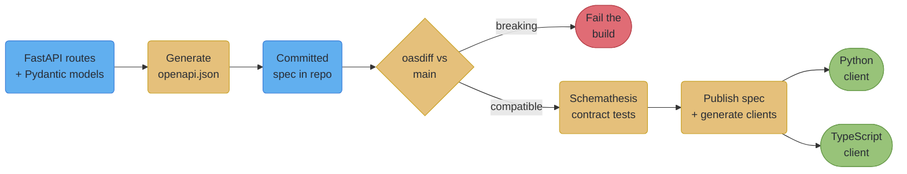
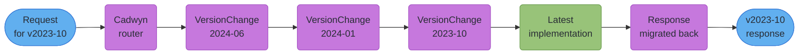
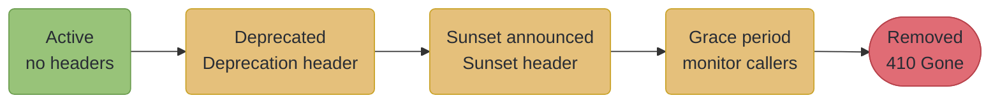

# OpenAPI 3.1 and Client Generation

---

## 1. Concept Overview

FastAPI generates an OpenAPI document for free, and that document is the most under-used artifact in
most FastAPI services. It is treated as documentation — a page at `/docs` that somebody looks at
occasionally — when it is actually the only machine-readable statement of your API's contract, and
therefore the only thing that can mechanically answer three questions you otherwise answer by hand
and get wrong:

*Did this change break a consumer?* A spec diff in CI answers it before merge. Nobody's reading of a
pull request answers it reliably, because a breaking change can be a Pydantic field default moving
from `None` to a value, three files away from any route.

*Does the implementation match the contract?* Property-based contract testing generates requests from
the schema and asserts the responses conform. Hand-written tests assert what the author remembered.

*How do consumers call this?* Generated clients, in each consumer's language, regenerated on every
spec change — rather than four teams hand-writing four HTTP wrappers that drift independently.

And behind all three sits the versioning question, which is where FastAPI services most often end up
with the worst possible arrangement: `if request.headers.get("api-version") == "2023-10"` scattered
through handlers, or a full copy of every schema and route per version, doubling on each release.

This file is about the pipeline that turns the generated document into those four things. The
mechanics of OpenAPI 3.1 versus 3.0 and why the version matters to a consumer are in the parent
module's
[§6.7](api_design_and_versioning.md), and the versioning *strategies* — URL path, header, media type
— are in its §4.1; neither is repeated here. What this file adds is the machinery: **Cadwyn** for
version migrations that do not multiply your codebase, the current client generators for Python and
TypeScript, spec diffing as a merge gate, contract testing, and the deprecation lifecycle that RFC
9745 and RFC 8594 now formally define.

---

## 2. Intuition

**One-line analogy.** Your OpenAPI document is a build artifact, not a README. You would not let a
compiled binary drift from its source and only notice when a customer complained; the spec deserves
the same treatment — generated, diffed, tested against, and shipped to consumers.

**Mental model.** There are two ways to support five API versions. You can keep five implementations,
which costs five times the maintenance and guarantees they diverge. Or you can keep **one
implementation and four transformations**, each describing precisely what changed between adjacent
versions. Cadwyn is the second model — the same shape Stripe uses — and it is the difference between
versioning being a permanent tax and versioning being a stack of small, individually reviewable
diffs.

**Why it matters.** The failures here are all delayed. A breaking change ships and surfaces in a
consumer's build a week later. A generated client silently mis-models a nullable field and the bug
appears as a null-pointer error in someone else's language. A version proliferates until nobody can
delete one because nobody knows who still calls it. None of these are visible on the day they are
introduced, which is exactly why they need mechanical gates rather than review discipline.

**Key insight.** A schema change is an API change even when no route signature moved. Adding a
required field to a request model, narrowing an enum, or changing a default breaks consumers just as
surely as deleting an endpoint — and only a diff of the generated document sees it.

---

## 3. Core Principles

**Principle 1 — The spec is generated, committed, and diffed.** Generate `openapi.json` in CI, commit
it, and fail the build when the diff contains a breaking change that the pull request has not
declared. Without the committed copy there is nothing to diff against.

**Principle 2 — One implementation, N migrations.** Duplicating routes and schemas per version scales
linearly in maintenance and superlinearly in bugs, because a fix must be applied N times and will not
be. Keep the latest version implemented and describe older versions as transformations of it.

**Principle 3 — Generated clients are the default; hand-written wrappers are the exception.** Four
consumers hand-writing HTTP calls is four places for the contract to drift, and drift is discovered
by an outage.

**Principle 4 — Deprecation is a two-phase, machine-readable lifecycle.** RFC 9745 defines the
`Deprecation` header and RFC 8594 the `Sunset` header, and the two together let a consumer's own
tooling notice. A blog post is not a deprecation.

**Principle 5 — Test the contract, not only your idea of it.** Property-based testing generated from
the schema explores inputs you did not think of, which is precisely the set that produces production
incidents.

**Principle 6 — Know what your consumers' tooling supports.** A specification version your generator
cannot parse is a broken build in someone else's repository, and you will hear about it late.

---

## 4. Types / Architectures / Strategies

### 4.1 Ways to implement multiple versions

| Approach | Cost per new version | Divergence risk | Right when |
|---|---|---|---|
| Branch in the handler | low at first, compounding | high — logic tangles | one or two temporary shims |
| Duplicate routers and schemas | linear in code | very high — a fix must land N times | two versions, short overlap |
| Transformation chain (Cadwyn) | one `VersionChange` class | low — one implementation | many versions, long support windows |
| Version the whole service | a deployment | none within a version | genuinely different products |

The transformation chain is the only one that stays cheap past about three concurrent versions, and
its cost profile is the reason: each new version adds a class describing exactly what changed, not a
copy of everything that did not.

### 4.2 Client generators worth knowing

Versions verified 2026-10-19.

| Target | Tool | Version | Notes |
|---|---|---|---|
| Python | `openapi-python-client` | 0.29.1 (2026-08-30) | `requires_python >=3.11`; generates `httpx`-based, typed clients |
| TypeScript | `@hey-api/openapi-ts` | 0.99.0 | the current recommended generator |
| 50+ languages | `openapi-generator-cli` | 7.26.0 (2026-10-06) | supports OpenAPI 3.1 input; the broadest coverage |

**`openapi-typescript-codegen` is deprecated**, with all versions marked deprecated on npm since
2024-05-01 and users directed to `@hey-api/openapi-ts`. If a consumer's repository still uses it, that
is a migration to schedule rather than a preference to respect.

### 4.3 The contract-safety toolchain

| Concern | Tool | What it catches |
|---|---|---|
| Breaking changes between spec revisions | `oasdiff` (plus `oasdiff-action` for pull requests) | a removed field, a narrowed type, a newly required parameter |
| Implementation conforming to the schema | Schemathesis 4.32.1 | responses that violate the declared schema, 500s on valid input |
| Consumers still calling a deprecated route | your own access logs, keyed by version | who is blocking the deletion |

`oasdiff` supports OpenAPI 3.0, 3.1 and 3.2, which matters because your spec version and your
consumer's may differ.

### 4.4 A note on OpenAPI 3.2

**OpenAPI 3.2.0 shipped on 2025-09-23**, a backward-compatible minor release on the 3.x line. It added
structured tags, native support for streaming media types including Server-Sent Events, a `query` HTTP
method with `additionalOperations`, OAuth2 device-flow support, an `in: querystring` parameter
location, and reusable `components/mediaTypes`. OpenAPI 3.2.1, a patch release, followed on
2026-09-10.

**FastAPI still emits OpenAPI 3.1.0**, and its OpenAPI models are built against 3.1.0. That is not a
problem to solve; it is a fact to know, because the SSE support in 3.2 is directly relevant to
services built on FastAPI's native SSE and is not yet expressible in the document FastAPI generates.
Streaming endpoints therefore still need prose in their description rather than a machine-readable
declaration.

---

## 5. Architecture Diagrams

### 5.1 The contract pipeline



*The committed spec is what makes the diff possible. Generating it fresh on both sides of the
comparison only tells you the generator is deterministic.*

### 5.2 One implementation, N versions



*The request is migrated forward through the chain to the latest shape, handled once, and the
response migrated back. Adding a fifth version adds one box, not a fifth copy of the implementation.*

### 5.3 The deprecation lifecycle



*Per RFC 9745, the `Sunset` timestamp must not precede the `Deprecation` timestamp — the two headers
encode a sequence, and a spec that emits them out of order is telling consumers something incoherent.*

---

## 6. How It Works — Detailed Mechanics

### 6.1 What `openapi_version=` actually does, and does not do

This one is worth stating precisely, because the intuitive reading is wrong and it produces a false
sense of safety.

```python
from fastapi import FastAPI
from fastapi.openapi.utils import get_openapi

app = FastAPI(title="MyService API", version="2.1.0")


def custom_openapi() -> dict:
    if app.openapi_schema:
        return app.openapi_schema
    app.openapi_schema = get_openapi(
        title=app.title,
        version=app.version,
        openapi_version="3.0.3",     # changes the STRING, not the schema generation
        routes=app.routes,
    )
    return app.openapi_schema


app.openapi = custom_openapi
```

Per FastAPI's own discussions (#9789, #10748), `openapi_version` **only changes the version string
stamped into the document**. It does not re-generate the schemas in the 3.0 dialect. So the output
declares `"openapi": "3.0.3"` while the schemas underneath are still JSON Schema 2020-12 — `int | None`
still appears as `{"type": ["integer", "null"]}`, which is not valid 3.0.

The consequence is the opposite of what the setting suggests: a 3.0-only consumer that would have
rejected the document outright now accepts it and mis-models the fields. **A loud failure has been
converted into a silent one.**

If a consumer genuinely cannot handle 3.1, the honest options are to upgrade their generator (most
current ones handle 3.1, including `openapi-generator-cli` 7.26.0) or to run a real down-conversion
step in the pipeline and validate the output against the 3.0 schema before publishing it. Setting the
string is neither.

### 6.2 Cadwyn: one implementation, versions as migrations

Cadwyn (7.4.0, 2026-09-20) describes itself as "production-ready Stripe-like API versioning in
FastAPI", and the model it implements is exactly Stripe's: you implement only the latest version, and
each older version is defined by what changed since the next one. It generates the older versions'
schemas and routes from that description.

Two concepts carry it. A **`VersionChange`** is one breaking change, describing the schema difference
and how to migrate a request forward and a response back. A **`VersionBundle`** is the ordered list of
versions and the changes between them.

```python
from cadwyn import VersionBundle, Version, VersionChange, schema, convert_response_to_previous_version_for
from datetime import date


class SplitUserName(VersionChange):
    description = (
        "In 2024-01 the single `name` field was split into `first_name` and `last_name`. "
        "Older versions continue to see one combined `name`."
    )

    instructions_to_migrate_to_previous_version = (
        # Describe the OLD shape in terms of the new one.
        schema(UserResponse).field("first_name").didnt_exist,
        schema(UserResponse).field("last_name").didnt_exist,
        schema(UserResponse).field("name").existed_as(type=str),
    )

    @convert_response_to_previous_version_for(UserResponse)
    def combine_name(response) -> None:
        response.body["name"] = (
            f"{response.body.pop('first_name')} {response.body.pop('last_name')}"
        ).strip()


versions = VersionBundle(
    Version(date(2024, 1, 1), SplitUserName),
    Version(date(2023, 10, 1)),
)
```

Three properties make this worth the learning curve.

**The migration is the documentation.** `description` is a required, human-readable statement of the
change, and it can be rendered into a changelog. A version whose difference is a class with a
docstring is reviewable; a version whose difference is spread across forty handlers is not.

**Deleting an old version deletes one class.** That is the property that makes long support windows
survivable, and it is the exact opposite of the duplicate-router approach, where deleting a version
means finding every copy.

**The business logic is written once, for the current shape.** A bug fix lands in one place and every
version gets it, which is the failure mode duplication guarantees.

The cost, stated honestly: it is a real abstraction with its own model to learn, and a chain of many
migrations has a runtime cost per request and a debugging cost when a response arrives in an
unexpected shape three migrations down. Below roughly three concurrent versions, duplicated routers
are simpler and you should use them.

### 6.3 Generating clients

```bash
# Python -- typed, httpx-based
pip install openapi-python-client
openapi-python-client generate --url https://api.example.com/openapi.json
openapi-python-client generate --path ./openapi.json          # from a committed spec

# TypeScript
npx @hey-api/openapi-ts -i ./openapi.json -o ./src/client

# Anything else
npx @openapitools/openapi-generator-cli generate \
    -i ./openapi.json -g go -o ./clients/go
```

**Generate from the committed spec, not from a running server.** Generating from `--url` against a
live service makes your client build depend on that service being up and on whichever version happens
to be deployed, which is how a client gets generated from a staging deployment mid-migration. The
committed file is a pinned input.

**Generated clients belong in CI, not in a developer's shell.** The regeneration should be a job that
opens a pull request when the spec changes, so the diff to the client is reviewed like any other
change. A client regenerated by hand is a client that is regenerated when someone remembers.

### 6.4 Diffing the spec as a merge gate

This is the single highest-value item in the file, because it converts a class of bug that is
currently found by consumers into one found by CI.

```bash
# Fail the build on a breaking change against the base branch's spec.
oasdiff breaking ./main/openapi.json ./pr/openapi.json --fail-on ERR
```

```yaml
# In CI: generate, compare, gate.
- name: Generate the spec from this branch
  run: python -c "import json,app.main as m; print(json.dumps(m.app.openapi()))" > pr-openapi.json

- name: Check for breaking changes
  run: oasdiff breaking origin-openapi.json pr-openapi.json --fail-on ERR
```

What this catches that review does not: a Pydantic model gaining a required field, an enum losing a
member, a response field becoming nullable, a query parameter's type narrowing, a default changing.
Every one of those is a breaking change to somebody's generated client, and none of them looks like an
API change in a pull request — the diff is in a schema file three directories from any route.

The escape hatch has to exist, and it should be explicit: a deliberate breaking change is accompanied
by a new API version, and the gate is satisfied because the diff is against the new version's spec
rather than the old one's.

### 6.5 Contract testing with Schemathesis

```python
# tests/test_contract.py
import schemathesis

schema = schemathesis.openapi.from_asgi("/openapi.json", app)


@schema.parametrize()
def test_api_conforms_to_its_own_schema(case):
    response = case.call()
    case.validate_response(response)
```

Schemathesis (4.32.1, 2026-10-19) reads the schema, generates requests from it using property-based
testing, and asserts that responses conform to what the schema declares. Driving it through the ASGI
app rather than over the network means no server to start and no port to manage.

What it finds that hand-written tests do not: a 500 on an input nobody thought to write down — an
empty string where the schema allows one, a unicode value in a field constrained only by length, an
integer at the exact boundary — and, just as often, **responses your schema does not actually
describe**, such as a validation error shape you never declared. The second category is the more
useful one, because an undeclared response is exactly what a generated client cannot handle.

Two practical notes. Constrain the generation for slow suites (`--max-examples`) or the property-based
search will happily run for a long time. And when it finds a failure the first question is which side
is wrong: an input your API should reject with 422 but returns 500 for is an implementation bug; an
input your API legitimately rejects that the schema says is valid is a *schema* bug, and the schema is
what your consumers are building against.

### 6.6 Deprecation as a machine-readable lifecycle

Two RFCs define this now, and using them means a consumer's tooling can notice without a human reading
an email.

**RFC 9745** defines the `Deprecation` header — a published RFC, not a draft — carrying a structured
date. **RFC 8594** defines `Sunset`, the date at which the resource is expected to become
unresponsive. Per RFC 9745, **the `Sunset` timestamp must not precede the `Deprecation` timestamp**:
together they encode "deprecated from here, gone from there", and emitting them in the wrong order
describes an impossible lifecycle.

```python
from datetime import UTC, datetime

from fastapi import APIRouter, Response

router = APIRouter()

DEPRECATED_AT = datetime(2026, 6, 1, tzinfo=UTC)
SUNSET_AT = datetime(2026, 12, 1, tzinfo=UTC)


@router.get("/v1/reports", deprecated=True)          # also marks it in the OpenAPI document
async def list_reports_v1(response: Response):
    response.headers["Deprecation"] = f"@{int(DEPRECATED_AT.timestamp())}"
    response.headers["Sunset"] = SUNSET_AT.strftime("%a, %d %b %Y %H:%M:%S GMT")
    response.headers["Link"] = '</v2/reports>; rel="successor-version"'
    return await reports_service.list_v1()
```

`deprecated=True` on the path operation is the OpenAPI half — it marks the operation deprecated in the
generated document, so every generated client emits a deprecation warning at compile or lint time. The
headers are the runtime half, for consumers who are not regenerating clients. The `Link` header with
`rel="successor-version"` tells the consumer where to go, which is the part most deprecations omit and
the part that determines whether anyone actually migrates.

**The measurement is what makes the deletion possible.** Log the version and the caller identity on
every deprecated route, and the question "can we delete this" becomes a query rather than an argument.
Without it, deprecated endpoints live forever because nobody can prove they are unused.

---

## 7. Real-World Examples

**Stripe's date-based versioning is the model Cadwyn implements.** Accounts are pinned to a version
date at signup and breaking changes ship behind a new date, with the request migrated forward through
the accumulated changes to a single current implementation. The transferable insight is not the date
format — it is that the *number of implementations stays one* regardless of how many versions are
supported, which is what makes a decade-long support window affordable. Cadwyn's own description
names the lineage explicitly.

**`openapi-typescript-codegen`'s deprecation is a live migration many repositories still owe.** Every
version was marked deprecated on npm from 2024-05-01, with users directed to `@hey-api/openapi-ts`.
Deprecated npm packages keep installing and keep working, so nothing forces the change — which is the
same dynamic as an unmeasured deprecated endpoint, one ecosystem up.

**`oasdiff` ships a GitHub Action specifically for pull-request breaking-change checks.** That a
purpose-built action exists is a reasonable signal that spec-diffing-as-a-merge-gate is the settled
practice rather than an unusual one, and it removes the "we would have to build tooling" objection.

**OpenAPI 3.2 adding native streaming media-type support** (2025-09-23) is worth tracking precisely
because FastAPI does not emit it yet. Services built on FastAPI's native SSE — `fastapi.sse`, added in
0.135 — currently have no machine-readable way to declare a streaming endpoint's event shape, so it
lives in a description string that no generator reads. That gap will close, and knowing it exists is
the difference between designing around it and being surprised by it.

---

## 8. Tradeoffs

### Cadwyn versus duplicated routers

| Dimension | Cadwyn | Duplicate routers per version |
|---|---|---|
| Cost of a new version | one `VersionChange` class | a copy of routes and schemas |
| Cost of a bug fix | one place | N places, and one gets missed |
| Cost of deleting a version | delete one class | find every copy |
| Runtime cost | migration chain per request | none |
| Debugging a wrong response | trace the chain | read one handler |
| Learning curve | real | none |
| Crossover point | past ~3 concurrent versions | up to ~3 |

### Generated versus hand-written clients

| Dimension | Generated | Hand-written |
|---|---|---|
| Drift from the contract | impossible if regenerated in CI | inevitable |
| Ergonomics | mechanical, sometimes awkward | shaped to the caller |
| Cost per consumer language | a CI job | a maintained library |
| Breaking-change signal | the client's diff | an outage |
| Best for | most consumers | one SDK you publish as a product |

### Spec-diff gate versus review discipline

| Dimension | `oasdiff` in CI | Careful review |
|---|---|---|
| Catches a schema-only breaking change | yes | rarely — the diff is far from any route |
| Consistency | mechanical | varies by reviewer and by day |
| False positives | some; need a declared-version escape hatch | none |
| Setup cost | one CI job | none |

---

## 9. When to Use / When NOT to Use

**Use Cadwyn when** you support more than about three concurrent versions, when support windows are
long, or when you are contractually pinned to versions you cannot delete.

**Use duplicated routers when** you run two versions with a short overlap. The abstraction does not
pay for itself, and the simpler thing is genuinely simpler.

**Use generated clients when** consumers are in other languages or other teams — which is nearly
always. **Hand-write a client when** it is a public SDK that is itself a product, where ergonomics
matter more than mechanical fidelity.

**Add the `oasdiff` gate on day one.** It costs one CI job and it is the only mechanism that catches
schema-only breaking changes.

**Add Schemathesis when** the API is consumed by anyone who is not you, or when the validation surface
is large enough that hand-written tests obviously do not cover it.

**Do NOT set `openapi_version="3.0.3"` and believe you have down-converted** — you have changed a
string and converted a loud failure into a silent one. **Do NOT generate clients from a live URL** in
a build. **Do NOT deprecate without measuring callers**, or you will never be able to delete anything.
**Do NOT deprecate without a `Link` successor-version header** telling consumers where to go. And do
not build any of this for an API with one consumer that you also own — the whole pipeline exists to
manage a boundary you cannot see across, and if you can see across it, the boundary is not there yet.

---

## 10. Common Pitfalls

### Pitfall 1 — Believing `openapi_version` down-converts the document

```python
# BROKEN: looks like a compatibility shim, is not one
app.openapi_schema = get_openapi(..., openapi_version="3.0.3", routes=app.routes)
# Emits: {"openapi": "3.0.3", ... "type": ["integer", "null"] ...}
#         ^ says 3.0                    ^ is JSON Schema 2020-12, invalid in 3.0
```

```python
# FIX: upgrade the consumer's generator, or run a REAL conversion and validate it
#   1. Most current generators handle 3.1 -- openapi-generator-cli 7.26.0 does.
#   2. If a real down-conversion is unavoidable, run it as a pipeline step and
#      validate the output against the 3.0 meta-schema before publishing.
#   3. Never publish a document whose declared version its own content violates.
```

The specific harm: a 3.0-only consumer that would have rejected the document with a clear error now
accepts it and mis-models every nullable field. The failure moves from your pipeline into their
generated code, where it appears as a type error in a language you do not maintain.

### Pitfall 2 — A breaking change that no route signature shows

```python
# BROKEN: the pull request touches one schema file and looks harmless
class CreateOrder(BaseModel):
    items: list[Item]
    currency: str                 # was: currency: str = "USD"
# Every existing client that omitted `currency` now gets a 422.
# No route changed. No handler changed. Review passed.
```

```
# FIX: the gate that sees it
$ oasdiff breaking main/openapi.json pr/openapi.json --fail-on ERR
  ERR  request property became required: currency
```

This is the archetypal case for the diff gate. Removing an enum member, narrowing a type, making a
response field nullable and changing a default are the same shape: a real contract change with no
visible route change.

### Pitfall 3 — Generating clients from a live server

```bash
# BROKEN: the client build depends on a deployment
openapi-python-client generate --url https://staging.example.com/openapi.json
```

```bash
# FIX: generate from the committed, reviewed artifact
openapi-python-client generate --path ./contracts/openapi.json
```

The failure is intermittent and confusing: a client generated during a deployment window picks up a
half-migrated spec, and the resulting mismatch is blamed on the generator. Pin the input.

### Pitfall 4 — Deprecating without measuring

An endpoint marked `deprecated=True` with a `Sunset` date six months out, and no logging of who calls
it. Six months later nobody can approve the deletion, because the honest answer to "will this break
anyone" is "we do not know". The endpoint survives another year, and the version it belongs to cannot
be retired either.

```python
# FIX: make the deletion decision a query
logger.info("deprecated_endpoint_called",
            extra={"path": request.url.path, "api_version": version,
                   "client_id": principal.client_id})
```

Deprecation without measurement is not a lifecycle, it is a label.

### Pitfall 5 — Emitting `Sunset` before `Deprecation`

```python
# BROKEN: the dates describe an impossible sequence
response.headers["Deprecation"] = "@1780272000"     # 2026-06-01
response.headers["Sunset"] = "Wed, 01 Jan 2026 00:00:00 GMT"   # BEFORE deprecation
```

RFC 9745 is explicit that the `Sunset` timestamp must not precede the `Deprecation` timestamp. Getting
it backwards is usually a copy-paste of a past date, and its effect is that automated tooling either
ignores both headers or reports something incoherent to the consumer — which is worse than sending
neither, because it looks like a working signal.

### Pitfall 6 — Treating a Schemathesis failure as a test to silence

The first run against a mature API usually fails on inputs nobody wrote a test for. The instinct is to
narrow the generation until it passes. Ask which side is wrong first: a 500 on an input the schema
permits is an implementation bug, and an input your API legitimately rejects that the schema declares
valid is a *schema* bug — and the schema is what every consumer's generated client is built from. The
second case is the more common and the more damaging, and narrowing the generator hides exactly it.

### Pitfall 7 — Letting versions accumulate because each one is cheap

Cadwyn makes adding a version cheap, which is the point and also the trap. Each version is a migration
class, a row in the compatibility matrix, and a chain segment every older request traverses. Ten
versions means a request for the oldest passes through nine migrations, and a bug in the third is
debugged at the far end. Set a support window when you set up the versioning, not when the matrix
becomes unmanageable — the cheapness is what makes the discipline necessary rather than optional.

---

## 11. Technologies & Tools

Versions verified 2026-10-19.

| Tool | Role | Notes |
|---|---|---|
| FastAPI | emits the spec | 0.141.1; OpenAPI 3.1.0, and `deprecated=True` marks an operation |
| Cadwyn | Stripe-style versioning for FastAPI | 7.4.0; `VersionBundle`, `VersionChange` |
| `openapi-python-client` | typed Python client generation | 0.29.1; `requires_python >=3.11`; httpx-based |
| `@hey-api/openapi-ts` | TypeScript client generation | 0.99.0; replaces the deprecated `openapi-typescript-codegen` |
| `openapi-generator-cli` | 50+ language targets | 7.26.0; supports OpenAPI 3.1 input |
| `oasdiff` | spec diffing and breaking-change detection | supports 3.0, 3.1 and 3.2; `oasdiff-action` for pull requests |
| Schemathesis | property-based contract testing | 4.32.1; drives the ASGI app directly, no server needed |
| RFC 9745 | the `Deprecation` header | a published RFC; structured date |
| RFC 8594 | the `Sunset` header | informational; must not precede `Deprecation` |

---

## 12. Interview Questions with Answers

**Q: Does setting `openapi_version="3.0.3"` on `get_openapi()` produce a valid OpenAPI 3.0 document?**
**Short:** No. It changes only the version string, leaving JSON Schema 2020-12 constructs that are invalid in 3.0.

Per FastAPI's own discussions (#9789, #10748) the parameter stamps a different version into the document and does not re-generate the schemas in the 3.0 dialect. So `int | None` still serialises as `{"type": ["integer", "null"]}` under a document declaring `"openapi": "3.0.3"`. The harm is specific and worse than doing nothing: a 3.0-only consumer that would have rejected the document with a clear error now accepts it and mis-models every nullable field, moving the failure into generated code in a language you do not maintain. If a consumer truly cannot handle 3.1, upgrade their generator — most current ones manage it — or run a real conversion step and validate the output against the 3.0 meta-schema.

**Q: How can an API break its consumers when no route signature changed?**
**Short:** A schema change is an API change — a new required field, a narrowed enum, or a changed default all break generated clients.

Adding `currency: str` where it was `currency: str = "USD"` makes every request that omitted it a 422, and the pull request touches one Pydantic model three directories from any route. Removing an enum member, narrowing a type, and making a response field nullable have the same shape. Code review reliably misses these because the diff does not look like an API change. The mechanical fix is a spec diff as a merge gate — `oasdiff breaking base.json pr.json --fail-on ERR` — with an escape hatch where a deliberate breaking change ships behind a new API version.

**Q: What is the Cadwyn model, and when is it worth the abstraction?**
**Short:** One implementation of the latest version plus a chain of migrations describing each older one — worth it past about three concurrent versions.

Cadwyn implements Stripe's approach: you write only the current version, and each older version is a `VersionChange` class describing what differs and how to migrate a request forward and a response back, collected in a `VersionBundle`. Adding a version adds a class, not a copy of everything; deleting one deletes a class; a bug fix lands once and every version gets it. The cost is a real abstraction with a runtime chain per request and harder debugging when a response arrives wrong three migrations down. Below roughly three versions, duplicated routers are genuinely simpler and you should use them.

**Q: Why generate clients from a committed spec rather than from the running service?**
**Short:** Generating from a URL makes the client build depend on a deployment and on whichever version happens to be live.

`--url https://staging.example.com/openapi.json` looks convenient and produces intermittent, hard-to-attribute failures: a client generated during a deployment window picks up a half-migrated spec, and the mismatch gets blamed on the generator. The committed `openapi.json` is a pinned, reviewed input, the same as any other build dependency. It also makes the diff to the generated client reviewable, because the spec change and the client change appear in the same pull request rather than appearing whenever somebody remembers to regenerate.

**Q: What does property-based contract testing find that your own tests do not?**
**Short:** Responses your schema does not actually describe, and 500s on valid inputs nobody thought to write down.

Schemathesis reads the OpenAPI schema, generates requests from it, and validates responses against what the schema declares. Two categories come out. The first is 500s on inputs a hand-written suite never tried — an empty string where the schema allows one, a boundary integer, a unicode value in a length-constrained field. The second, and more valuable, is undeclared responses: a validation-error shape your schema never mentions. That one matters most because an undeclared response is precisely what a generated client cannot handle, so it becomes a crash in a consumer's code.

**Q: A Schemathesis run fails. How do you decide whether to fix the code or the schema?**
**Short:** Ask which one is lying — a 500 on permitted input is a code bug, and a rejection of schema-valid input is a schema bug.

If the API returns 500 for an input the schema says is valid, the implementation is wrong. If the API correctly rejects an input the schema declares valid, the *schema* is wrong — and that is the more common and more damaging case, because the schema is what every consumer's generated client is built from, so their client will happily construct requests your API refuses. The instinct on a first run against a mature API is to narrow the generator until it passes, which hides exactly the second category. Narrow generation only for runtime, never to make a real finding disappear.

**Q: What is the current state of the Deprecation and Sunset headers?**
**Short:** Deprecation is now RFC 9745, Sunset is RFC 8594, and the Sunset timestamp must not precede the Deprecation timestamp.

`Deprecation` is a published RFC rather than a draft, carrying a structured date, and `Sunset` declares when the resource is expected to become unresponsive. Together they encode a two-phase lifecycle: deprecated from here, gone from there. Emitting them out of order — usually a pasted past date — describes an impossible sequence, and automated tooling either ignores both or reports something incoherent, which is worse than sending neither because it looks like a working signal. Pair them with a `Link` header carrying `rel="successor-version"`, which is the part most deprecations omit and the part that determines whether anyone migrates.

**Q: Why can teams never delete a deprecated endpoint?**
**Short:** Because they marked it deprecated without logging who calls it, so the answer to "will this break anyone" is permanently "we do not know".

Deprecation without measurement is a label, not a lifecycle. Log the API version and the caller identity on every deprecated route from the moment you deprecate it, and the deletion decision becomes a query with a factual answer instead of a debate nobody can win. The knock-on cost is worse than one endpoint: an undeletable endpoint usually blocks retiring the whole version it belongs to, which keeps a migration chain segment alive and a row in the compatibility matrix forever.

**Q: Which TypeScript client generator should a consumer use, and why does it matter to you?**
**Short:** `@hey-api/openapi-ts` — `openapi-typescript-codegen` has been fully deprecated on npm since 2024-05-01.

Every version of the older package is marked deprecated, with users directed to `@hey-api/openapi-ts` (0.99.0). It matters to the API owner because a deprecated npm package keeps installing and keeps working, so nothing forces the migration, and a consumer stuck on an unmaintained generator will eventually fail to parse a document your service legitimately emits — and will report it as your bug. Knowing what your consumers generate with is part of owning the contract, which is the same reason you need to know whether they can parse OpenAPI 3.1.

**Q: OpenAPI 3.2 shipped. Should you be emitting it?**
**Short:** You cannot from FastAPI — it emits 3.1.0 — and the gap worth knowing is 3.2's native streaming media-type support.

OpenAPI 3.2.0 was released 2025-09-23 as a backward-compatible minor version, adding structured tags, native support for streaming media types including Server-Sent Events, a `query` HTTP method with `additionalOperations`, OAuth2 device flow, an `in: querystring` parameter location, and reusable `components/mediaTypes`. FastAPI's OpenAPI models are built against 3.1.0 and it emits 3.1.0. The practical consequence is that a service using FastAPI's native SSE has no machine-readable way to declare a streaming endpoint's event shape, so it lives in a description string no generator reads.

**Q: Where exactly does the spec-diff gate belong, and what does it compare?**
**Short:** In CI on every pull request, comparing the branch's generated spec against the committed spec on the base branch.

Generate `openapi.json` from the branch, fetch the base branch's committed copy, and run `oasdiff breaking` with `--fail-on ERR`. The committed copy is what makes this work — generating fresh on both sides only proves the generator is deterministic. `oasdiff` supports 3.0, 3.1 and 3.2, and ships a purpose-built GitHub Action for pull-request checks. The escape hatch must be explicit: a deliberate breaking change ships behind a new API version, so the comparison is against that version's spec and the gate is satisfied honestly rather than bypassed.

**Q: Cadwyn makes adding a version cheap. What is the trap?**
**Short:** Versions accumulate because each one is cheap, and a request for the oldest then traverses every migration in the chain.

Each version is a migration class, a row in the compatibility matrix, and a segment of a chain that every older request passes through. At ten versions, a request for the oldest is transformed nine times before it reaches the implementation and nine times back, and a bug in the third migration is diagnosed at the far end of that. The runtime cost is real but secondary; the debugging cost is the one that hurts. Set the support window when you set up the versioning, while it is still a policy decision — once the matrix is unmanageable it has become a customer negotiation.

**Q: What does `deprecated=True` on a path operation actually do?**
**Short:** It marks the operation deprecated in the OpenAPI document, so generated clients warn at build or lint time.

That is the design-time half of the deprecation story: consumers who regenerate their clients get a warning in their own toolchain, in their own language, without reading anything you wrote. It does nothing at runtime, which is why it must be paired with the `Deprecation` and `Sunset` response headers for consumers who are not regenerating, and with logging so you can tell who is still calling. Three mechanisms, three audiences — the client-generating consumer, the header-inspecting consumer, and you.

**Q: How would you support a consumer who genuinely cannot parse OpenAPI 3.1?**
**Short:** Upgrade their generator first, and only if that is impossible run a real down-conversion step whose output you validate against the 3.0 meta-schema.

Most current generators handle 3.1 (`openapi-generator-cli` 7.26.0 does), so the first question is which tool they are on and whether it is one of the deprecated ones. If a conversion is genuinely unavoidable, it must be an actual transformation of the schemas, not a version string, and the result must be validated against the 3.0 meta-schema before publishing, because publishing a document whose content violates its own declared version is the failure mode in the first question. Treat it as a compatibility shim with a named owner and an end date.

**Q: You inherit a FastAPI service with five versions implemented as five copies of the routers. What do you do?**
**Short:** Measure who uses each version first, delete what you can, and only migrate to a transformation model for what remains.

The instinct is to introduce Cadwyn immediately, but migrating five duplicated versions into a migration chain is a large change against an unknown requirement. Start by logging version and caller on every route: some of those five are usually unused, and deleting them is free. If two remain, duplication is the right model and you are done. If four remain with long support windows, the transformation model pays for itself, and the migration is far easier having first established which behavioural differences between versions are real and which are accidental drift — because duplicated implementations always contain drift nobody intended.

**Q: What would you set up on day one of a new API, and what would you defer?**
**Short:** The committed spec and the diff gate immediately; contract testing and a versioning framework only when there is a real consumer.

The committed `openapi.json` plus `oasdiff` in CI costs one job and starts catching schema-only breaking changes from the first commit — and it is painful to retrofit, because you need a baseline. Client generation follows as soon as there is a consumer in another language. Defer Schemathesis until the API is consumed by someone who is not you, and defer any versioning framework until you have more than about three concurrent versions; before that, duplicated routers are simpler and a versioning abstraction is machinery serving a requirement that does not exist yet.

---

## 13. Best Practices

1. **Commit the generated `openapi.json`** and regenerate it in CI. Without a committed baseline there
   is nothing to diff against, and the whole pipeline collapses to hoping.

2. **Gate merges on `oasdiff breaking --fail-on ERR`.** It is the only mechanism that catches a
   breaking change whose diff lives in a schema file far from any route.

3. **Make the escape hatch explicit**: a deliberate breaking change ships behind a new API version, so
   the gate is satisfied honestly rather than bypassed.

4. **Generate clients from the committed spec, never from a live URL**, and regenerate in CI so the
   client diff is reviewed like any other change.

5. **Never set `openapi_version` and believe you down-converted.** It changes a string, and turns a
   loud failure into a silent one.

6. **Reach for a transformation model past about three concurrent versions**, and use duplicated
   routers below that. The abstraction has a real cost and a real crossover point.

7. **Write the `VersionChange` description as if it were the changelog**, because it is — a version
   whose difference is one documented class stays reviewable.

8. **Set the support window when you set up versioning**, not when the compatibility matrix becomes
   unmanageable. Cheap versions are exactly why the discipline is needed.

9. **Deprecate in three places at once**: `deprecated=True` for client generators, the `Deprecation`
   and `Sunset` headers for runtime consumers, and a `Link` with `rel="successor-version"` so they
   know where to go.

10. **Never emit `Sunset` before `Deprecation`.** RFC 9745 forbids it, and an incoherent signal is
    worse than none.

11. **Log the version and caller on every deprecated route from day one**, so deletion is a query
    rather than an argument.

12. **When a contract test fails, decide which side is lying** before touching either. A schema bug is
    more damaging than a code bug, because it is what your consumers build against.

13. **Know which generators your consumers run.** A consumer on a deprecated generator is a future
    incident filed against you.

---

## 14. Case Study

### Retiring three API versions nobody could prove were unused

**Scenario.** A payments-adjacent service exposes four API versions — `2023-04`, `2023-11`, `2024-08`
and `2025-06` — implemented as four copies of the routers and schemas, roughly 6,000 lines of
near-duplicate code. A bug fix in cursor pagination had to be applied four times; it was applied
three times, and the fourth was found by a customer on `2023-11` two months later. The team wants to
delete the old versions and cannot get approval, because nobody can say who calls them.

**Step 1 — measure before changing anything.** One middleware, logging the resolved API version and
the authenticated client id on every request, deployed for six weeks.

The result reframed the whole project. `2023-04` had two callers, both internal services nobody had
migrated. `2023-11` had one external customer, who accounted for 0.3% of traffic. `2024-08` and
`2025-06` carried everything else. Three of the four versions were nearly dead, and the expensive
migration the team had been planning was mostly a deletion.

**Step 2 — deprecate properly, once.** `deprecated=True` on the old versions' operations so any
consumer regenerating a client got a build-time warning; `Deprecation` and `Sunset` headers with the
sunset four months out; and a `Link` header pointing at the successor operation. The two internal
callers were migrated in a fortnight — they had simply never been told, which is the usual reason.

**Step 3 — what the diff gate found on the way.** Adding `oasdiff` to CI before starting the deletion
work immediately failed an unrelated in-flight pull request: a Pydantic model had gained a required
field on the current version. It had passed review twice. That single catch paid for the gate before
the versioning project produced anything.

**Step 4 — the versioning decision, made after the measurement rather than before.** With `2023-04`
deleted and `2023-11` sunset, two versions remained. The team did **not** adopt a transformation
framework, because at two versions with a short overlap the duplication is cheaper than the
abstraction — and adopting Cadwyn would have meant migrating four inconsistent implementations into a
migration chain, where the inconsistencies would first have to be reconciled anyway. It went onto the
roadmap as a trigger rather than a task: if a third long-lived version is ever needed, adopt the
transformation model then.

**Step 5 — what stayed.** The version-and-caller logging became permanent, since it is what makes
every future deprecation decidable. Schemathesis was added against the current version and found two
undeclared error-response shapes on the first run, both of which generated clients were mishandling
by falling through to a generic error path.

**The transferable lesson.** The team's initial framing was "we need a versioning framework". The
measurement showed the actual problem was that three of four versions were alive only because nobody
had checked. **Instrument before you abstract**: the cheap mechanical step — logging who calls what —
turned a large migration project into a deletion, and the framework that had looked essential turned
out to be a decision worth deferring. The gate, by contrast, earned its place on the first day, which
is the reverse of how the two were originally prioritised.
