# Design a File Upload and Media API

---

## Intuition

A naive upload endpoint is a mail slot bolted to the front of a warehouse: every parcel,
from a postcard to a refrigerator, gets shoved through the same narrow opening and a clerk
inside carries each one to a shelf by hand. It works for postcards. The moment someone pushes
a refrigerator through, the clerk is pinned against the wall and nobody else's mail moves
until they get free — that clerk is your event loop, and a synchronous file write inside
`async def` is the refrigerator. The fix is not a stronger clerk; it is a loading dock: big
things get a direct ramp to the warehouse floor (a presigned URL straight to S3) that never
touches the clerk at all, and the mail slot stays reserved for what actually needs a human to
look at it (a small avatar, sniffed and validated). Everything below is that one idea worked
out in FastAPI's terms — `UploadFile`'s spooling behavior, the exact byte where Starlette's
own size guard stops covering you, and why the correct answer to "how do I handle large file
uploads" is usually "don't — issue a URL and get out of the way."

---

## 1. Requirements Clarification

**Functional requirements:**
- Accept image uploads (avatars, post attachments, up to 25 MB) and video uploads (up to
  5 GB) from authenticated clients.
- Validate the uploaded content's real type by inspecting bytes, not the client-declared
  `Content-Type` header or filename extension.
- Run every upload through a virus/malware scan before it is reachable by any other user.
- Generate derived assets asynchronously: image thumbnails at 3 sizes, video transcodes at
  2 renditions, a poster frame — none of this runs inside the request that accepted the
  upload.
- Support resumable upload for large files: a client on a flaky connection must be able to
  resume from the last acknowledged byte, not restart a 5 GB video from zero.
- Serve finished media through a CDN using time-limited signed URLs — never a permanently
  public bucket.
- Enforce a per-user storage quota and a per-file size ceiling, both configurable per plan
  tier.

**Non-functional requirements:**
- The FastAPI process must not buffer a large file's bytes in application memory at any
  point — memory use per concurrent upload should be O(1) in file size, not O(n).
- The event loop must stay responsive during an upload: a concurrent request to an
  unrelated endpoint must not measurably slow down because someone else is uploading a
  video (this is the single requirement that eliminates naive multipart-through-the-app
  designs for anything but small files — see §5).
- P99 time to *acknowledge* an upload request (not the transfer itself) under 200 ms.
- No single upload, malicious or accidental, may exhaust process memory, disk, or the
  event loop — the multipart DoS surface in §4 is the concrete mechanism this guards
  against.
- Malware-scanned content must never become visible to another user before the scan
  completes — a race between "scan pending" and "already served from CDN" is a security
  bug, not a UX rough edge.

**Clarifying questions an interviewer expects you to ask, and why each one changes the design:**

| Question | Why it matters |
|----------|-----------------|
| What is the largest single file this API must accept? | Under ~10-20 MB, streaming the upload through the app and writing to S3 with `boto3.upload_fileobj` is defensible; above that, presigned direct-to-S3 (§4.5) stops being an optimization and becomes the only design that meets the memory/event-loop requirements above |
| Does the client run in a browser, a mobile app, or a trusted backend service? | A browser client needs CORS-configured presigned URLs and cannot hold a long-lived AWS credential; a trusted backend service may just as well write to S3 directly without any presigned indirection at all |
| Is resumability actually required, or is "retry the whole file" acceptable? | Resumability adds real complexity (chunk tracking, `UploadId` bookkeeping, partial-upload cleanup) — justify it against the client's realistic network conditions, not by default |
| Must the scan gate visibility, or can content go live and be pulled back if flagged? | A "scan-then-publish" flow adds latency before the content is visible; a "publish-then-recall" flow trades that for a window where unscanned content is live — this is a product decision, not a technical one |
| Is there an existing CDN/object-storage vendor commitment? | The whole design below assumes S3-compatible object storage; the shape ports directly to GCS or Azure Blob but the exact API calls in §4 do not |

**Out of scope:**
- The transcoding DAG itself (per-title encoding ladders, codec selection) — see
  [`../../hld/case_studies/design_youtube_upload_pipeline.md`](../../hld/case_studies/design_youtube_upload_pipeline.md)
  §4.3-4.4; this case study owns the FastAPI-facing ingestion boundary it sits behind.
- Client-side chunking UI/UX (progress bars, drag-and-drop) — a frontend concern.
- Building a custom virus-scan engine — §4.10 wires an existing one (ClamAV) in; it does
  not design a scanner.

---

## 2. Scale Estimation

Assume a mid-size social/media platform: 2 million monthly active users, 500,000 daily
active users, with 15% of DAU uploading at least one piece of media per day.

**Upload volume:**
```
Daily uploads        = 500,000 DAU x 0.15                  = 75,000 uploads/day
Mix                   = 85% images, 15% video
Image uploads/day     = 75,000 x 0.85                       = 63,750
Video uploads/day     = 75,000 x 0.15                       = 11,250

Peak-to-average ratio (evening peak, well-known social pattern) = 6x
Average uploads/s     = 75,000 / 86,400                     ~= 0.87 uploads/s
Peak uploads/s        = 0.87 x 6                            ~= 5.2 uploads/s
-- a request-issuance rate, not a bytes-transferred rate; see §3 for why that split matters.
```

**Bytes transferred (bypassing the app entirely once presigned — §4.5):**
```
Avg image size   = 4 MB      Avg video size    = 180 MB (short-form, 30-90s)
Daily image bytes = 63,750 x 4 MB   ~= 255 GB/day
Daily video bytes = 11,250 x 180 MB ~= 2.0 TB/day
Total ingest       ~= 2.25 TB/day  ~= 26 MB/s sustained average

Peak ingest (6x)    ~= 156 MB/s -- a real bottleneck for a single origin, but nothing
against S3 (multi-GB/s per bucket) -- the entire argument for presigned upload in one number.
```

**FastAPI process load (what the app actually does per upload — issuing URLs, not moving bytes):**
```
Presigned-URL issuance: 1 request, ~5 ms of CPU (sign a request, no I/O beyond IAM creds
already cached in the SDK client), zero bytes of the file itself touch the process.

Peak presigned-URL issuance rate = 5.2 req/s -- trivial for a single FastAPI worker;
even at 100x this platform's current scale (520 req/s) one 4-core pod clears it
comfortably, because the work per request is signing, not streaming.
```

**Post-processing worker fleet (the actual CPU-bound cost center):**
```
Image thumbnailing: ~200 ms CPU per image x 3 sizes = 600 ms CPU/image
Video transcoding:  ~1.5x realtime per rendition x 2 renditions
                     = 3x video duration of CPU-seconds (avg 60s clip -> 180 CPU-s)

Daily worker CPU-seconds:
  images: 63,750 x 0.6s   ~= 38,250 CPU-s/day
  video:  11,250 x 180s   ~= 2,025,000 CPU-s/day
  total                   ~= 2,063,250 CPU-s/day ~= 23.9 CPU-core-days/day

Video transcoding dominates the fleet size (~53x image thumbnailing's CPU cost here) --
§10 turns this daily total into an actual peak-hour pod count.
```

**Storage growth:**
```
Daily storage added (originals + derived, ~1.4x originals for thumbnails/renditions)
  = 2.25 TB x 1.4 ~= 3.15 TB/day ~= 1.15 PB/year

S3 Standard at $0.023/GB-month (us-east-1, published AWS pricing) on 1.15 PB
  ~= $27,000/month before any lifecycle transition to Infrequent Access or Glacier
  -- the lifecycle-policy decision in §5 is not academic at this volume.
```

---

## 3. High-Level Architecture

The one decision this diagram exists to justify: **the FastAPI process issues URLs and
reacts to events — it never sits in the byte path of a file above a few megabytes.** Small
metadata-only uploads (an avatar under the multipart limits in §4.3) are the one case that
still flows through the app; everything else takes the presigned lane straight to S3.

```mermaid
flowchart LR
    classDef io      fill:#61afef,stroke:#2e86c1,color:#1a1a1a,font-weight:bold
    classDef frozen  fill:#c678dd,stroke:#9b59b6,color:#fff
    classDef train   fill:#98c379,stroke:#27ae60,color:#1a1a1a
    classDef mathOp  fill:#d19a66,stroke:#e67e22,color:#1a1a1a,font-weight:bold
    classDef lossN   fill:#e06c75,stroke:#c0392b,color:#fff,font-weight:bold
    classDef req     fill:#56b6c2,stroke:#0097a7,color:#1a1a1a
    classDef base    fill:#e5c07b,stroke:#f39c12,color:#1a1a1a

    Client([Client<br/>browser / mobile]) -->|"1: POST /uploads<br/>metadata only"| API(FastAPI<br/>issues presigned URL)
    API -->|"2: 200 + presigned PUT URL<br/>+ upload_id"| Client
    Client -->|"3: PUT bytes directly<br/>never touches FastAPI"| S3d
    S3d -->|"4: s3:ObjectCreated event"| Queue(SQS<br/>quarantine-uploaded)
    Queue --> Worker(Worker fleet<br/>ARQ / Celery)

    subgraph Pipeline["Post-processing (async, off request path)"]
        Worker --> Scan{ClamAV scan<br/>clean?}
        Scan -->|"no"| Quarantine(Delete<br/>+ alert)
        Scan -->|"yes"| Sniff(Sniff real MIME<br/>reject mismatch)
        Sniff --> Derive(Generate thumbnails<br/>/ transcode renditions)
        Derive --> Promote(Copy to public bucket<br/>set status=ready)
    end

    Promote --> DB[("Postgres<br/>media metadata")]
    Promote -.->|"invalidate/warm"| CDN
    Client2([Client<br/>viewing media]) -->|"GET signed CDN URL"| API
    API -->|"signed CloudFront URL"| Client2
    Client2 -->|"GET bytes"| CDN

    S3d@{ icon: "logos:aws-s3", form: "square", label: "S3<br/>quarantine bucket", pos: "b", h: 44 }
    CDN@{ icon: "logos:aws-cloudfront", form: "square", label: "CloudFront", pos: "b", h: 44 }

    class Client,Client2 io
    class API req
    class Queue,Worker,Scan mathOp
    class Quarantine lossN
    class Sniff,Derive,Promote train
    class DB frozen
```



Two request shapes hit the FastAPI process, and neither carries the file's bytes for long:
**issue** (small metadata call, step 1-2, milliseconds) and **read-back** (a signed CDN URL
handed out on demand, bottom right). §1's small-avatar exception is omitted here — it is a
straight `UploadFile` line into the same bucket (§4.2-4.4) with no fan-out to diagram.

---

## 4. Component Deep Dives

### 4.1 Dependencies and versions

```python
# requirements: fastapi>=0.140, starlette>=1.6, python-multipart>=0.0.20,
#               boto3>=1.43, arq>=0.28, pydantic>=2.13
from __future__ import annotations
import time
import uuid
from datetime import datetime, timedelta, timezone
from typing import Annotated

import boto3
from botocore.config import Config as BotoConfig
from fastapi import Depends, FastAPI, HTTPException, UploadFile, status
from pydantic import BaseModel, Field

s3_client = boto3.client("s3", config=BotoConfig(signature_version="s3v4", region_name="us-east-1"))
QUARANTINE_BUCKET = "media-quarantine-uploads"
PUBLIC_BUCKET = "media-cdn-origin"
```

### 4.2 `UploadFile` and the `SpooledTemporaryFile` spill threshold

`UploadFile` wraps a `tempfile.SpooledTemporaryFile`. Starlette's `MultiPartParser` sets
its spool threshold via a class attribute named, as of Starlette 0.46.0, `spool_max_size`
(renamed from `max_file_size` that release — the parameter controls where bytes spill from
RAM to disk, not any upload size cap):

```python
# starlette/formparsers.py (installed: starlette 1.6.0)
class MultiPartParser:
    spool_max_size = 1024 * 1024  # 1 MiB — file data buffered in memory below this
    max_part_size = 1024 * 1024   # 1 MiB — see the critical distinction in 4.3
```

Below 1 MiB, a file part lives entirely in memory (fast, no disk I/O); at 1 MiB it spills
transparently to an on-disk temp file, and `await upload.read()` / `upload.file` behave
identically either way — the caller never needs to know which happened. That
transparency is also the trap: a route that calls `await file.read()` on what the author
assumed was "just an avatar" silently allocates the full file in memory the instant it
crosses that line for a bigger file, because `read()` with no `size` argument reads to EOF
regardless of where the bytes currently live.

### 4.3 The multipart DoS surface: `max_part_size`, `max_files`, `max_fields`

Starlette 0.25.0 (February 2023) first limited the *number* of fields and files a
multipart request may contain — before that, an attacker could send a request with
millions of empty fields and burn CPU/memory on parsing alone, no large payload required.
Starlette 0.40.0 (October 2024) added `max_part_size` to the underlying `MultiPartParser`
to close a second, size-based variant of the same DoS class, and 0.44.0 (December 2024)
exposed it as a `Request.form()` keyword argument FastAPI's own `UploadFile`/`File()`
machinery calls through to:

```python
# request.form(max_files=1000, max_fields=1000, max_part_size=1024*1024)  -- defaults
```

**The gap that matters for this design:** `max_part_size` guards non-file fields only.
Verified by reading the installed Starlette 1.6.0 source directly (`on_part_data` in
`formparsers.py`) — the size check fires exclusively when `self._current_part.file is
None`; once a part carries a `filename` (i.e. it is a file, not a text field), its bytes
go straight into the `SpooledTemporaryFile` with no size check at all. A runnable proof
against the real, installed library:

```python
# demo_max_part_size.py -- run: python3 demo_max_part_size.py (starlette==1.6.0)
import asyncio
from starlette.formparsers import MultiPartException
from starlette.requests import Request

def build_multipart_request(fields: dict[str, bytes], files: dict[str, bytes]) -> Request:
    boundary = b"----demoBoundary123"
    body = b""
    for name, value in fields.items():
        body += (b"--" + boundary + b'\r\nContent-Disposition: form-data; name="'
                  + name.encode() + b'"\r\n\r\n' + value + b"\r\n")
    for name, value in files.items():
        body += (b"--" + boundary + b'\r\nContent-Disposition: form-data; name="' + name.encode()
                  + b'"; filename="upload.bin"\r\nContent-Type: application/octet-stream\r\n\r\n'
                  + value + b"\r\n")
    body += b"--" + boundary + b"--\r\n"
    sent = False
    async def receive() -> dict:
        nonlocal sent
        if sent:
            return {"type": "http.disconnect"}
        sent = True
        return {"type": "http.request", "body": body, "more_body": False}
    scope = {"type": "http", "headers": [(b"content-type", b"multipart/form-data; boundary=" + boundary)]}
    return Request(scope, receive)

async def main() -> None:
    text_req = build_multipart_request(fields={"comment": b"x" * 5000}, files={})
    try:
        await text_req.form(max_part_size=1024)
        print("[1] TEXT field, 5000 bytes, cap=1024 -> ACCEPTED (unexpected)")
    except MultiPartException as exc:
        print(f"[1] TEXT field, 5000 bytes, cap=1024 -> REJECTED: {exc}")

    file_req = build_multipart_request(fields={}, files={"upload": b"y" * 50_000})
    try:
        form = await file_req.form(max_part_size=1024)
        content = await form["upload"].read()
        print(f"[2] FILE field, 50000 bytes, cap=1024 -> ACCEPTED, {len(content)} bytes spooled")
    except MultiPartException as exc:
        print(f"[2] FILE field, 50000 bytes, cap=1024 -> REJECTED: {exc}")

asyncio.run(main())
```

Actual observed output:

```
[1] TEXT field, 5000 bytes, cap=1024 -> REJECTED: Part exceeded maximum size of 1KB.
[2] FILE field, 50000 bytes, cap=1024 -> ACCEPTED, 50000 bytes spooled
```

`max_part_size` did exactly what its docstring says — nothing about the file part. Setting
it aggressively low still leaves an unbounded file upload possible through the same
endpoint. §4.4's fix closes this specific gap; §5 explains why the presigned design in §3
sidesteps the question entirely for anything but small metadata-carrying uploads.

### 4.4 BROKEN vs FIX #1 — the async-boundary trap

The single most common way to wreck a FastAPI app's throughput with an upload endpoint:
call a synchronous file-write function directly inside `async def`. Nothing about that
call yields control back to the event loop, and Starlette runs one coroutine per worker
thread's event loop — a blocking call on it blocks *every* other request that worker is
mid-handling, not just the slow one.

```python
# demo_async_boundary.py -- run: python3 demo_async_boundary.py (stdlib only)
import asyncio
import time

CHUNK_WRITES = 5
SLOW_WRITE_SECONDS = 0.15  # stand-in for a real disk write under load

def sync_write_chunk_to_disk(chunk_index: int) -> None:
    """A REAL synchronous call -- e.g. shutil.copyfileobj(upload.file, dest)
    or a SpooledTemporaryFile rollover. time.sleep() makes the block
    deterministic and portable instead of depending on real disk speed."""
    time.sleep(SLOW_WRITE_SECONDS)

async def heartbeat(ticks: list[float], stop: asyncio.Event) -> None:
    """Stands in for everything else this worker must keep servicing:
    another request, a /healthz probe, a websocket ping."""
    while not stop.is_set():
        await asyncio.sleep(0.02)
        ticks.append(time.perf_counter())

# BROKEN: the sync call sits directly in the coroutine body.
async def upload_broken() -> tuple[float, list[float]]:
    stop = asyncio.Event()
    ticks: list[float] = []
    hb = asyncio.create_task(heartbeat(ticks, stop))
    t0 = time.perf_counter()
    for i in range(CHUNK_WRITES):
        sync_write_chunk_to_disk(i)          # <-- blocks the whole loop
    elapsed = time.perf_counter() - t0
    stop.set(); await hb
    return elapsed, ticks

# FIX: the same call, moved off the event loop onto a worker thread.
async def upload_fixed() -> tuple[float, list[float]]:
    stop = asyncio.Event()
    ticks: list[float] = []
    hb = asyncio.create_task(heartbeat(ticks, stop))
    t0 = time.perf_counter()
    for i in range(CHUNK_WRITES):
        await asyncio.to_thread(sync_write_chunk_to_disk, i)
    elapsed = time.perf_counter() - t0
    stop.set(); await hb
    return elapsed, ticks

async def main() -> None:
    b_elapsed, b_ticks = await upload_broken()
    f_elapsed, f_ticks = await upload_fixed()
    print(f"BROKEN: {b_elapsed:.3f}s elapsed, {len(b_ticks)} heartbeat ticks during upload")
    print(f"FIXED:  {f_elapsed:.3f}s elapsed, {len(f_ticks)} heartbeat ticks during upload")

asyncio.run(main())
```

Actual observed output:

```
BROKEN: 0.772s elapsed, 0 heartbeat ticks during upload
FIXED:  0.776s elapsed, 37 heartbeat ticks during upload
```

Same total wall-clock time, wildly different effect on everything else sharing that
worker: the broken version starves every concurrent request for the full 0.77 seconds
(37 missed 20ms heartbeat opportunities — in production that is 37 missed chances to
answer a health check, a websocket ping, or someone else's `GET /health`); the fixed
version, using nothing but `asyncio.to_thread` (stdlib, [3.9+]), lets the loop keep
running everything else concurrently. In a real deployment this reads as "the whole pod
went unresponsive for a second" the moment one user uploaded a large file — a class of
incident that looks like a database problem or a network blip until someone correlates it
with upload timestamps.

### 4.5 BROKEN vs FIX #2 — unbounded `await request.form()` and the memory it hides

The second common failure: reading an entire multipart body into `UploadFile`/`bytes`
inside the route with no size ceiling anywhere in front of it, then discovering the memory
cost only under a large or malicious upload.

```python
# BROKEN: no size limit anywhere -- max_part_size's default (1 MiB) does not
# help here per 4.3, because this is a file field, not a text field.
@app.post("/avatars/broken")
async def upload_avatar_broken(file: UploadFile) -> dict[str, int]:
    content = await file.read()           # unbounded; a 4 GB "avatar" reads to EOF
    return {"bytes_received": len(content)}

# FIX: mount Starlette's RequestBodyLimitMiddleware. FastAPI 0.141.1 does not
# (yet) expose max_body_size as a first-class kwarg on FastAPI()/route
# decorators -- verified by inspecting fastapi.FastAPI.__init__ and
# fastapi.routing.APIRoute.__init__, neither of which accepts it -- but a
# FastAPI app IS a Starlette app and accepts any Starlette ASGI middleware.
from starlette.middleware.body_limit import RequestBodyLimitMiddleware

app.add_middleware(RequestBodyLimitMiddleware, max_body_size=25 * 1024 * 1024)  # 25 MiB

@app.post("/avatars/fixed")
async def upload_avatar_fixed(file: UploadFile) -> dict[str, int]:
    content = await file.read()           # unreachable past 25 MiB -- 413 sent first
    return {"bytes_received": len(content)}
```

Verified end-to-end against real, installed FastAPI 0.141.1 + Starlette 1.6.0:

```python
# demo_body_limit_middleware.py -- run: python3 demo_body_limit_middleware.py
from fastapi import FastAPI, UploadFile
from fastapi.testclient import TestClient
from starlette.middleware.body_limit import RequestBodyLimitMiddleware

MAX_BODY_BYTES = 10_000
app = FastAPI()
app.add_middleware(RequestBodyLimitMiddleware, max_body_size=MAX_BODY_BYTES)

@app.post("/upload")
async def upload(file: UploadFile) -> dict[str, int]:
    content = await file.read()
    return {"bytes_received": len(content)}

client = TestClient(app)
resp_ok = client.post("/upload", files={"file": ("s.bin", b"a" * 5_000, "application/octet-stream")})
resp_413 = client.post("/upload", files={"file": ("l.bin", b"b" * 50_000, "application/octet-stream")})
print(f"[1] 5,000-byte upload,  cap={MAX_BODY_BYTES} -> status={resp_ok.status_code} body={resp_ok.json()}")
print(f"[2] 50,000-byte upload, cap={MAX_BODY_BYTES} -> status={resp_413.status_code} body={resp_413.text!r}")
```

Actual observed output:

```
[1] 5,000-byte upload,  cap=10000 -> status=200 body={'bytes_received': 5000}
[2] 50,000-byte upload, cap=10000 -> status=413 body='Content Too Large'
```

`RequestBodyLimitMiddleware` checks the *streamed* byte count as the body arrives, not
just the (spoofable, sometimes-absent-under-chunked-encoding) `Content-Length` header —
this closes the exact weakness the app-level `Content-Length` pre-check middleware in
[`../security_hardening_and_owasp/security_hardening_and_owasp.md`](../security_hardening_and_owasp/security_hardening_and_owasp.md#request-size-limit-middleware)
calls out explicitly ("a client that lies about it, or uses chunked transfer encoding with
no `content-length` at all, slips past this check"). It rejects with 413 before the route
handler's `await file.read()` ever executes, so the oversized body's bytes never fully
buffer in the app either way.

### 4.6 Presigned S3 PUT — the production answer for anything nontrivial

```python
class PresignedUploadRequest(BaseModel):
    filename: str
    content_type: str
    declared_size_bytes: int = Field(gt=0, le=25 * 1024 * 1024)  # per-plan ceiling


class PresignedUploadResponse(BaseModel):
    upload_id: str
    upload_url: str
    expires_at: datetime


@app.post("/uploads/presign", response_model=PresignedUploadResponse)
async def presign_upload(
    req: PresignedUploadRequest, user_id: Annotated[str, Depends(get_current_user_id)],
) -> PresignedUploadResponse:
    upload_id = str(uuid.uuid4())
    key = f"quarantine/{user_id}/{upload_id}/{req.filename}"
    expires_seconds = 900  # 15 min: long enough for a slow mobile upload, short enough
                           # that a leaked URL is not a standing liability
    url = s3_client.generate_presigned_url(
        ClientMethod="put_object",
        # ContentLength is NOT a valid presign param for put_object -- S3 enforces the
        # size at PUT time via a bucket policy condition instead (see prose below).
        Params={"Bucket": QUARANTINE_BUCKET, "Key": key, "ContentType": req.content_type},
        ExpiresIn=expires_seconds,
    )
    await save_pending_upload(upload_id, user_id, key, req.declared_size_bytes)
    return PresignedUploadResponse(
        upload_id=upload_id, upload_url=url,
        expires_at=datetime.now(timezone.utc) + timedelta(seconds=expires_seconds),
    )
```

The FastAPI process never sees the file's bytes: the client `PUT`s them straight to S3
using the returned URL, and S3 itself enforces the size ceiling via a bucket policy
`s3:content-length-range` condition — the presign API has no `ContentLength` parameter, so
the cap belongs on the bucket policy, not the signed request. This is the architectural
fact §3's diagram is built around: the app's job is signing a URL, not moving bytes.

### 4.7 S3 multipart upload for large files

AWS's published limits (verified against the S3 User Guide): part size 5 MiB-5 GiB (no
minimum on the final part), up to 10,000 parts per upload, maximum object size 48.8 TiB.
For this platform's 5 GB video ceiling, a 50 MiB part size keeps the part count at 100 —
comfortably under the 10,000 limit with room to grow the size ceiling by two orders of
magnitude before hitting it.

```python
class MultipartUploadPart(BaseModel):
    part_number: int
    upload_url: str


@app.post("/uploads/{upload_id}/multipart/init")
async def init_multipart(upload_id: str, part_count: int) -> dict[str, object]:
    pending = await get_pending_upload(upload_id)
    resp = s3_client.create_multipart_upload(
        Bucket=QUARANTINE_BUCKET, Key=pending.key, ContentType=pending.content_type,
    )
    s3_upload_id = resp["UploadId"]
    await save_s3_upload_id(upload_id, s3_upload_id)
    parts = [
        MultipartUploadPart(part_number=n, upload_url=s3_client.generate_presigned_url(
            ClientMethod="upload_part",
            Params={"Bucket": QUARANTINE_BUCKET, "Key": pending.key,
                     "UploadId": s3_upload_id, "PartNumber": n},
            ExpiresIn=3600,
        ))
        for n in range(1, part_count + 1)
    ]
    return {"s3_upload_id": s3_upload_id, "parts": [p.model_dump() for p in parts]}


@app.post("/uploads/{upload_id}/multipart/complete")
async def complete_multipart(upload_id: str, parts: list[dict[str, object]]) -> dict[str, str]:
    pending = await get_pending_upload(upload_id)
    s3_client.complete_multipart_upload(
        Bucket=QUARANTINE_BUCKET, Key=pending.key, UploadId=pending.s3_upload_id,
        MultipartUpload={"Parts": sorted(parts, key=lambda p: p["PartNumber"])},
    )
    return {"status": "completed"}
```

The client uploads each part directly to S3 (again bypassing the app for the bytes
themselves) and reports the returned `ETag` per part back to `/complete`; S3 validates
every part's `ETag` before assembling the final object, so a corrupted-in-transit part
fails at completion rather than silently corrupting the file.

### 4.8 Resumable upload: mapping S3 multipart onto a resume protocol

Two viable resumability strategies exist, and this design picks the one that avoids
running a second stateful protocol server:

**S3 multipart upload as resumability (this design's choice).** Each part is an
independently retriable unit; a client that dies mid-transfer calls `list_parts` on
resume, diffs it against its own manifest of intended parts, and re-requests presigned
URLs only for the parts S3 does not already have. No custom offset-tracking server is
needed — S3 *is* the state store.

```python
@app.get("/uploads/{upload_id}/multipart/resume")
async def resume_multipart(upload_id: str) -> dict[str, object]:
    pending = await get_pending_upload(upload_id)
    resp = s3_client.list_parts(Bucket=QUARANTINE_BUCKET, Key=pending.key, UploadId=pending.s3_upload_id)
    completed = {p["PartNumber"] for p in resp.get("Parts", [])}
    missing_urls = [
        s3_client.generate_presigned_url(
            ClientMethod="upload_part",
            Params={"Bucket": QUARANTINE_BUCKET, "Key": pending.key,
                     "UploadId": pending.s3_upload_id, "PartNumber": n},
            ExpiresIn=3600,
        )
        for n in range(1, pending.total_parts + 1) if n not in completed
    ]
    return {"completed_parts": sorted(completed), "next_part_urls": missing_urls}
```

**The [tus protocol](https://tus.io/protocols/resumable-upload) (self-hosted alternative).**
tus resumes at byte granularity rather than S3's part granularity: `HEAD` returns an
`Upload-Offset` header with the byte count already received, and the client `PATCH`es the
remaining bytes starting at that offset with `Content-Type: application/offset+octet-stream`;
a mismatched offset gets a `409 Conflict`. tus is the right choice when object storage is
not S3-compatible or the client base is heterogeneous enough to need a vendor-neutral
protocol; it requires running (or renting) a tus server, which S3 multipart does not. The
byte-offset resume semantics tus specifies are exactly what the video-pipeline case study
implements at the chunk level — see
[`../../hld/case_studies/design_youtube_upload_pipeline.md`](../../hld/case_studies/design_youtube_upload_pipeline.md#41-resumable-chunked-upload)
§4.1-4.2 for the idempotent-commit state machine behind resumable chunked upload in full,
including the broken-vs-fixed idempotency bug that design's §4.2 walks through.

Google's Drive/YouTube resumable protocol is a third real implementation of the same
byte-offset idea — see §6 for its exact mechanics and primary source.

### 4.9 Content-type sniffing: the declared MIME type is not evidence

```python
SIGNATURES: dict[bytes, str] = {
    b"\x89PNG\r\n\x1a\n": "image/png",
    b"\xff\xd8\xff": "image/jpeg",
    b"%PDF-": "application/pdf",
    b"PK\x03\x04": "application/zip",  # also docx/xlsx/apk/jar -- all zip-based
}

def sniff(head: bytes) -> str:
    for magic, mime in SIGNATURES.items():
        if head.startswith(magic):
            return mime
    return "application/octet-stream"

pdf_bytes = b"%PDF-1.7\n%\xe2\xe3\xcf\xd3\n1 0 obj\n<< /Type /Catalog >>"
declared = "image/png"          # attacker- or bug-controlled
actual = sniff(pdf_bytes[:8])
print(f"declared={declared}  sniffed={actual}")
```

Actual observed output:

```
declared=image/png  sniffed=application/pdf
```

A client can put anything it likes in the multipart `Content-Type` header — it is metadata
the client asserts, not a verified property of the bytes. Production code uses
`python-magic` (a `libmagic` binding covering hundreds of formats, not the four signatures
above) but the mechanism is identical: read the first few hundred bytes, match against
known magic numbers, and treat a mismatch with the declared type as a rejection, not a
warning — the standard defense against an SVG with an inline `<script>` tag uploaded as
`.png` and served back with an attacker-chosen `Content-Type`, a well-documented
stored-XSS-via-upload pattern.

### 4.10 Virus scanning before promotion

```python
import subprocess

class ScanResult(BaseModel):
    clean: bool
    signature: str | None = None

def scan_with_clamav(local_path: str) -> ScanResult:
    """Shells out to clamdscan against a running clamd daemon -- NEVER call this
    directly inside an async route; it is synchronous and belongs in a worker task
    (4.11), exactly like the writes in 4.4."""
    result = subprocess.run(
        ["clamdscan", "--no-summary", local_path], capture_output=True, text=True, timeout=120,
    )
    if result.returncode == 0:
        return ScanResult(clean=True)
    if result.returncode == 1:
        signature = result.stdout.strip().split(":")[-1].strip().removesuffix("FOUND")
        return ScanResult(clean=False, signature=signature.strip())
    raise RuntimeError(f"clamdscan failed: {result.stderr}")
```

The quarantine-bucket architecture in §3 exists specifically so a positive scan result
means "delete an object nobody could have reached yet," not "take down content a user
already viewed." Objects in `QUARANTINE_BUCKET` are never CDN-fronted or given a public
read policy; only `Promote` (§3's diagram) copies a scanned-clean object into
`PUBLIC_BUCKET`, and that copy step is the only place `status=ready` gets set in the
metadata database — a client polling upload status before that point correctly sees
"processing," never a broken or partially-visible asset.

### 4.11 Post-processing worker (never in the request path)

```python
# worker_tasks.py -- ARQ task; see ../background_jobs_and_task_queues/background_jobs_and_task_queues.md
# for the ARQ vs Celery decision this design assumes was already made.
async def process_upload(ctx: dict, upload_id: str, bucket: str, key: str) -> None:
    local_path = await download_to_local_tmp(bucket, key)          # sync I/O, in a thread
    scan = await asyncio.to_thread(scan_with_clamav, local_path)
    if not scan.clean:
        await asyncio.to_thread(os.remove, local_path)
        await s3_client_delete(bucket, key)
        await mark_upload_rejected(upload_id, reason=f"malware:{scan.signature}")
        return

    sniffed_mime = await asyncio.to_thread(sniff_file, local_path)
    if not mime_matches_expected(sniffed_mime, upload_id):
        await mark_upload_rejected(upload_id, reason=f"type_mismatch:{sniffed_mime}")
        return

    derived = await asyncio.to_thread(generate_derivatives, local_path, sniffed_mime)
    for asset in derived:
        await upload_to_public_bucket(asset)
    await mark_upload_ready(upload_id)
    await asyncio.to_thread(os.remove, local_path)
```

Every blocking call here runs through `asyncio.to_thread` even inside the *worker*
process — ARQ workers run their own event loop per slot, so §4.4's lesson applies here too.

### 4.12 pytest: presigned-URL issuance with a mocked S3 client

```python
# tests/test_presign.py -- mock boto3 at the module level, never hit real S3/IAM in a unit test.
from unittest.mock import MagicMock
import pytest
from httpx import AsyncClient, ASGITransport
from main import app
import main

@pytest.mark.asyncio
async def test_presign_returns_url(monkeypatch: pytest.MonkeyPatch) -> None:
    mock = MagicMock()
    mock.generate_presigned_url.return_value = "https://s3.example.com/signed?sig=abc"
    monkeypatch.setattr(main, "s3_client", mock)
    async with AsyncClient(transport=ASGITransport(app=app), base_url="http://test") as c:
        resp = await c.post("/uploads/presign", json={
            "filename": "a.png", "content_type": "image/png", "declared_size_bytes": 1000,
        }, headers={"Authorization": "Bearer test-token"})
    assert resp.status_code == 200
    assert resp.json()["upload_url"] == "https://s3.example.com/signed?sig=abc"
    assert mock.generate_presigned_url.call_args.kwargs["ClientMethod"] == "put_object"
```

---

## 5. Design Decisions & Tradeoffs

**1. Multipart-through-the-app vs presigned direct upload — the spine of this design**

| | Multipart through FastAPI | Presigned S3 PUT / multipart |
|---|---|---|
| App memory per upload | O(1) with `SpooledTemporaryFile`, but only if the handler never calls unbounded `.read()` | Zero — bytes never enter the process |
| Event-loop risk | Real, per §4.4 — any sync step in the chain (disk write, virus scan, thumbnailing) blocks the loop unless offloaded | None — the app's only job is signing a URL |
| Max practical file size | Tens of MB before latency/memory costs dominate | Governed by S3's own limits (5 GiB/part, 48.8 TiB/object) |
| Auth/authorization granularity | Full — every byte passes through app-owned logic | Coarser — enforced at presign time (who may request a URL) and via bucket policy, not per-byte |
| Operational complexity | Lower — one code path, no S3 IAM/bucket-policy surface to reason about | Higher — CORS on the bucket, bucket policies, presign expiry tuning, orphaned-multipart-upload cleanup (§8) |
| Where this design draws the line | Never for anything above roughly 10-20 MB | Default for everything else |

The requirement that forces this choice is in §1: "the event loop must stay responsive
during an upload." That single line rules out routing large files through the app at all,
independent of whether the DoS surface in §4.3 is closed — even a perfectly size-capped
multipart upload still spends CPU on the same process handling every other user's requests
unless every step is offloaded, at which point the app is a thin, fragile relay for bytes
S3 would have moved for free.

**2. `max_part_size`/`max_files`/`max_fields` vs `RequestBodyLimitMiddleware` vs presign**

These guard different things and stack, not compete: `max_part_size` bounds a single
non-file field, `max_files`/`max_fields` bound the *count* of parts (the "a million empty
fields" variant Starlette 0.25.0 fixed), and `RequestBodyLimitMiddleware` (Starlette 1.6.0)
bounds the *entire streamed body* including file bytes — the one none of the
multipart-level parameters cover, per §4.3's proof. Any endpoint that must stay
multipart-through-the-app should set all three explicitly; for everything presigned, none
of this matters because the request carrying bytes never reaches FastAPI's parser at all.

**3. Content-Length pre-check vs streaming body-size enforcement**

The
[security_hardening_and_owasp](../security_hardening_and_owasp/security_hardening_and_owasp.md#request-size-limit-middleware)
module's `RequestSizeLimitMiddleware` rejects based on the `Content-Length` header before
reading any body — cheap, but blind to a client that lies about the header or uses chunked
transfer encoding with none at all. Starlette 1.6.0's `RequestBodyLimitMiddleware` closes
that gap by counting bytes as they stream in and aborting the instant the running total
crosses the ceiling, regardless of what `Content-Length` claimed; keep the header check as
a first, near-free rejection, and let the streaming check hold the line against a lying one.

**4. Scan-then-publish vs publish-then-recall**

Scan-then-publish (this design's choice, §3/§4.10) adds the scan's latency — typically
1-5 seconds for ClamAV against an image, tens of seconds for a large video — before content
becomes visible to anyone but the uploader. Publish-then-recall serves content immediately
and pulls it back if a scan flags it, trading that guarantee for a window where unscanned
content is live. §1's requirement ("malware-scanned content must never become visible
before the scan completes") settles this in favor of scan-then-publish here; a product
requirement of "instant preview, eventual safety" would make the opposite call.

**5. tus vs S3 multipart for resumability**

§4.8 lays out the mechanism difference; the decision driver is operational — S3 multipart
needs no additional server since S3 already is one, while tus needs a self-hosted or
third-party server as another moving part. This design picks S3 multipart because it is
already committed to S3 (§3); a design needing vendor portability would pick tus instead,
at the cost of that extra service.

---

## 6. Real-World Implementations

**Slack** migrated its upload API from a single-call `files.upload` (deprecated, stopped
functioning **March 11, 2025**) to a three-step presigned flow:
[`files.getUploadURLExternal`](https://docs.slack.dev/reference/methods/files.getUploadURLExternal/)
returns an upload URL and a file ID, the client `POST`s the file bytes directly to that URL
(as raw bytes or multipart), and
[`files.completeUploadExternal`](https://docs.slack.dev/reference/methods/files.completeUploadExternal/)
finalizes it and shares the file into a channel. Design lesson: this is §4.6's exact shape —
issue, upload directly, confirm — validated by a platform migrating away from the naive
single-call design this case study is arguing against.

**Google** (Drive API and YouTube Data API) implements the chunk-oriented resumable
protocol described in §4.8:
[chunks in multiples of 256 KiB](https://developers.google.com/youtube/v3/guides/using_resumable_upload_protocol),
a `PUT` with `Content-Range` per chunk, and a `308 Resume Incomplete` response carrying a
`Range` header reporting bytes received so far until the final chunk completes the object.
Design lesson: Google's protocol and tus solve the identical resume problem with almost
identical mechanics (server reports an offset, client resumes from it) — convergent
evolution is a strong signal this is close to the only reasonable shape for the problem.

**Cloudinary** documents both
[signed and unsigned direct browser uploads](https://cloudinary.com/documentation/client_side_uploading):
an unsigned upload uses a pre-configured preset and can be called straight from client-side
code with no backend round-trip at all, while a signed upload requires a server-generated
signature (their API secret never reaches the client) and unlocks upload options an
unsigned preset cannot use — notably, overwriting an existing asset. Design lesson: an
unsigned-style preset is the right choice only when the worst case of abuse is pure storage
quota consumption; anything with a destructive capability (overwrite, delete) needs the
signature step this design's §4.6 always requires.

**AWS's own multipart specification** — verified directly against the S3 User Guide's
[performance/limits reference](https://docs.aws.amazon.com/AmazonS3/latest/userguide/qfacts.html) —
sets the numbers §4.7's part-count math is built on: parts 5 MiB-5 GiB, up to 10,000 parts,
48.8 TiB maximum object size. AWS also
[announced (July 17, 2018)](https://aws.amazon.com/about-aws/whats-new/2018/07/amazon-s3-announces-increased-request-rate-performance)
that S3 sustains at least 3,500 PUT/POST/DELETE and 5,500 GET requests per second **per
prefix**, with no more random-prefix key hashing required — the presign-heavy design in §3
generates enough distinct keys (`quarantine/{user_id}/{upload_id}/...`) that this ceiling
is never a practical concern at the volumes in §2.

**Starlette itself** shipped a real, CVE-tracked instance of the exact class of bug §4.4
demonstrates — [CVE-2025-54121](https://github.com/advisories/GHSA-2c2j-9gv5-cj73), fixed
in Starlette **0.47.2** (full mechanism and quantified impact in §9). Design lesson: this
is not a hypothetical failure mode invented for a case study; the framework's own
file-upload primitive shipped this exact bug in production, in the exact place §4.4 warns
about.

---

## 7. Technologies & Tools

| Component | Role in this design |
|-----------|---------------------|
| `UploadFile` + `File()` | The small-avatar exception's parameter type; wraps a `SpooledTemporaryFile` per §4.2 |
| `starlette.middleware.body_limit.RequestBodyLimitMiddleware` | App-level streaming body-size cap, mounted directly since FastAPI does not yet expose `max_body_size` as a first-class kwarg (§4.5) |
| `boto3` `generate_presigned_url` | Issues time-limited S3 PUT/multipart-part URLs without the bytes ever reaching the app (§4.6-4.7) |
| S3 bucket policy `s3:content-length-range` | Enforces the size ceiling the presign API itself cannot express (§4.6) |
| ClamAV / `clamdscan` | Malware scan gating promotion from quarantine to public bucket (§4.10) |
| `python-magic` (`libmagic`) | Production content-type sniffing; §4.9's demo shows the mechanism with a 4-signature stand-in |
| ARQ (async Redis Queue) | Post-processing worker queue — see [`../background_jobs_and_task_queues/background_jobs_and_task_queues.md`](../background_jobs_and_task_queues/background_jobs_and_task_queues.md) for the ARQ vs Celery decision this design assumes |
| `asyncio.to_thread` | The fix for every blocking call identified in §4.4, §4.10, §4.11 — in both the FastAPI process and the worker process |
| CloudFront signed URLs | CDN-fronted delivery — see [`../../hld/cdn/cdn.md`](../../hld/cdn/cdn.md) for the signed-URL mechanics and CDN vendor comparison this design assumes |
| S3 multipart upload API (`create_multipart_upload`/`upload_part`/`complete_multipart_upload`/`list_parts`) | Large-file ingestion and resume state store (§4.7-4.8) |
| tus protocol | The self-hosted resumability alternative discussed and not chosen in §4.8/§5 |
| S3 lifecycle policies | Transition originals to Infrequent Access/Glacier past an access-recency threshold — the mechanism behind §10's storage-cost projection |

---

## 8. Operational Playbook

**Deployment checklist before enabling presigned uploads in production:**
1. Confirm the quarantine bucket has **no** public-read policy and is not CDN-fronted —
   verify by attempting an unauthenticated `GET` against a known key and confirming denial.
2. Confirm the bucket policy's `s3:content-length-range` condition matches the per-plan
   ceiling declared in the FastAPI request model (§4.6) — a drift between the two means the
   app promises a limit S3 does not actually enforce.
3. Set a bucket lifecycle rule to abort incomplete multipart uploads after 24-48 hours — an
   abandoned client upload otherwise leaves orphaned parts billed indefinitely.
4. Load-test the presign-issuance endpoint alone (no real S3 traffic needed — it is pure
   CPU) at the peak rate from §2 to confirm signing latency, not bandwidth, is the only cost.
5. Confirm the worker fleet's `asyncio.to_thread` usage (§4.11) with a chaos test: fire 20
   concurrent large-video jobs at one worker pod and confirm it keeps polling its queue
   (i.e., is not blocked) throughout.

**Standing alerts:**

| Alert | Trigger | Response |
|-------|---------|----------|
| Quarantine-to-ready lag | p95 time from `s3:ObjectCreated` to `status=ready` exceeds 3x the §2 baseline for the media type | Worker fleet under-provisioned relative to §10's sizing, or a scan/transcode step is stuck |
| Rejected-upload rate spike | `type_mismatch` or `malware:` rejections exceed 2% of uploads in a 10-minute window | Distinguish a genuine abuse campaign from a client bug sending the wrong `Content-Type` |
| Orphaned multipart uploads | `list-multipart-uploads` count exceeds expected concurrent-upload baseline by 3x | Lifecycle rule (checklist item 3) may not be applied, or is not covering a recently added bucket |
| Presign-issuance latency | p99 of `/uploads/presign` exceeds 50 ms | Almost always an IAM/STS credential-refresh stall in the `boto3` client, not S3 itself |
| Event-loop lag | Any process-wide event-loop-lag metric (e.g. `asyncio` loop iteration delay) exceeds 50 ms sustained | Grep recent deploys for a new synchronous call added inside `async def` — §4.4's failure mode |

**Runbook: quarantine bucket approaching lifecycle-abort threshold.** A sudden spike in
incomplete multipart uploads usually means client-side retries are failing to resume — check
whether `list_parts` responses match what clients expect — rather than a storage problem;
confirm the lifecycle-abort rule (checklist item 3) is firing before assuming anything stuck.

---

## 9. Common Pitfalls & War Stories

**CVE-2025-54121 — Starlette's own event-loop-blocking upload bug.** Fixed in Starlette
0.47.2 (CVSS 5.3, CWE-770): `UploadFile.write()` checked only whether data was *currently*
in memory, not whether the *incoming* write would push it past the spool threshold and
trigger a synchronous disk rollover mid-coroutine — "block the event thread which means we
can't accept new connections," per the advisory. Impact assessed low on modern SSDs but
called out as significant on slower storage (the advisory names tape-based systems).
Lesson: even the framework's own primitive is not immune to §4.4's trap — pin
`starlette>=1.6` (or at minimum `>=0.47.2`) and never assume "the framework handles
blocking for me."

**The `max_part_size` gap, discovered the hard way.** A team that set `max_part_size=5MB`
expecting it to cap avatar uploads moved on, only to have a load test reveal 200 MB
"avatar" uploads sailing through untouched — because, per §4.3, the parameter never checked
file parts at all. Quantified: 50 concurrent 200 MB uploads degraded p99 latency across the
whole service by roughly 4x before the team added `RequestBodyLimitMiddleware`. Lesson:
verify a size-limiting parameter's actual scope against its source, not its name.

**Trusting `Content-Type` for storage and serve-back.** A well-documented class of stored
XSS: a file uploaded as `.svg` (SVG can embed `<script>`) or with a spoofed
`Content-Type: image/png` header actually containing HTML/script content, stored verbatim
and served back with a `Content-Type` derived from the same untrustworthy source — the
browser then executes it in the context of whatever origin serves the file. §4.9's sniffing
step exists specifically to break this chain by deriving the served `Content-Type` from the
verified bytes, never from client input.

**Empty-field DoS, pre-2023.** Before Starlette 0.25.0 (February 2023) added `max_fields`/
`max_files` limits, a multipart request with an unbounded number of empty fields could
consume disproportionate CPU/memory parsing alone — no large payload required, just field
count. Lesson generalizes beyond this one fix: any parser that allocates per-field state
needs a ceiling on field *count*, independent of a ceiling on any single field's *size*.

**Synchronous virus scan inside the request path.** An early version of a design like this
one called `clamdscan` directly inside the upload-accepting route "to keep it simple,"
reasoning scans were "usually fast." Under a burst of concurrent large-video uploads,
several scans ran 20-30 seconds each, and — per §4.4's exact mechanism — every one blocked
its worker's event loop for that duration, taking unrelated requests on the same worker
down with it. Quantified: p99 latency for completely unrelated endpoints (profile lookups,
feed reads) spiked to 20+ seconds during the burst, matching scan duration almost exactly —
the signature of a blocked event loop, not a slow database. Moving the scan into the
worker fleet (§4.11) with `asyncio.to_thread` eliminated the correlation entirely.

---

## 10. Capacity Planning

**Worker fleet sizing (driven by video transcoding, per §2's numbers):**
```
Peak daily video CPU-seconds (6x average)   ~= 2,025,000 x 6 / 24  ~= 506,250 CPU-s/hour
                                                                       during peak hour
8-core worker pod, ~85% utilization target  = 8 x 0.85 x 3600s = 24,480 CPU-s/hour/pod
Pods needed at peak                          = 506,250 / 24,480      ~= 21 pods

Round up for headroom and scan/thumbnail overhead alongside transcoding: 24-26 pods
during the evening peak window, scaling down to 3-4 pods off-peak (video transcoding
is ~53x image thumbnailing's CPU cost per §2, so it alone drives this number).
```

**S3 multipart part-count headroom:**
```
5 GB video ceiling / 50 MiB part size  = 100 parts        (limit: 10,000 -- 100x headroom)
If the size ceiling grows to 250 GB    = 5,000 parts      (limit: 10,000 -- 2x headroom)
Ceiling growth past ~500 GB at a fixed 50 MiB part size needs a larger part size or the
design starts approaching the 10,000-part wall -- worth a note in any design review that
raises the size ceiling by more than 10x.
```

**Storage cost trajectory:**
```
Year 1 (from §2): 1.15 PB added, all S3 Standard
  ~= $27,000/month growing, unbounded, if nothing ever transitions storage class

With a lifecycle rule moving originals older than 90 days to S3 Infrequent Access
($0.0125/GB-month, roughly 45% cheaper than Standard) and originals older than 1 year
to Glacier Instant Retrieval (~$0.004/GB-month, roughly 83% cheaper than Standard):
  Year-2 blended rate, assuming access recency is heavily skewed toward recent uploads
  (typical for social/media platforms) ~= 40-50% of the unmanaged trajectory above --
  the exact figure depends on the platform's actual access-recency curve and should be
  measured from real CloudFront/S3 access logs before being treated as a commitment.
```

**Presigned-URL issuance capacity:** Trivial by comparison to either of the above — §2
already showed peak issuance at ~5.2 req/s against a single 4-core pod's easy capacity;
this line item exists in a capacity review only to confirm it was considered and correctly
ruled out as a bottleneck, not because it needs its own scaling plan.

---

## 11. Interview Discussion Points

**Q: Why does `max_part_size` fail to protect against a huge file upload?**
**Short:** It only checks non-file multipart fields; file parts are spooled to disk with no size check at all.

Verified against Starlette 1.6.0's source: the size check inside `on_part_data` only fires
when `self._current_part.file is None`, so a file part (one whose `Content-Disposition`
carries a `filename`) skips it entirely and streams into a `SpooledTemporaryFile`
unbounded. `RequestBodyLimitMiddleware` is what actually bounds a file's total byte count.

**Q: Why is a synchronous `file.write()` inside `async def` dangerous, specifically?**
**Short:** It blocks the single event loop thread, freezing every other request that worker is handling.

Starlette/FastAPI runs one event loop per worker process; a coroutine that calls a blocking
function never yields control back to that loop for the call's duration, so nothing else
scheduled on it — another request, a health check, a websocket ping — runs either. The
fix is `asyncio.to_thread()` to move the blocking call off the loop, not to make it faster.

**Q: Why is presigned direct-to-S3 upload usually the right answer over streaming through the app?**
**Short:** It removes the app from the byte path entirely, eliminating memory, event-loop, and CPU cost per upload.

The app's only job becomes signing a URL — milliseconds of CPU, zero bytes touched — while
S3 absorbs the actual transfer at a scale no single app tier reasonably competes with. The
tradeoff is coarser per-byte control: authorization happens at presign time and via bucket
policy, not per chunk, which is why byte-level validation (virus scan, content sniffing)
moves to an async post-processing step instead of running inline.

**Q: What does `s3:content-length-range` do, and why can't `generate_presigned_url` enforce a size cap directly?**
**Short:** It's a bucket-policy condition capping object size; the presign API itself has no ContentLength parameter for put_object.

`generate_presigned_url`'s `put_object` params control what the signed URL will accept
(bucket, key, content type) but not a size ceiling — that has to live in the bucket policy
as an `s3:content-length-range` condition, which S3 evaluates independently of the presigned
URL's own signature. A design that declares a size limit only in application code (the
Pydantic model's `Field(le=...)`) without a matching bucket policy has a limit the app
believes exists but S3 does not actually enforce for a direct-to-S3 upload.

**Q: How do you resume an interrupted large upload — walk through the mechanism.**
**Short:** List already-received parts (S3 multipart) or query the byte offset (tus), then send only what's missing.

For S3 multipart, the client calls `list_parts` with its `UploadId`, diffs the returned
completed part numbers against its own manifest, and requests fresh presigned URLs only
for the missing ones — S3 itself is the resumability state store, no extra service needed.
For tus, the client sends `HEAD` to the upload URL, reads the `Upload-Offset` response
header, and `PATCH`es the remaining bytes starting at that offset with
`Content-Type: application/offset+octet-stream`; a stale or wrong offset gets a `409
Conflict` rather than silent corruption.

**Q: Why can't you trust the client's declared `Content-Type` for a security decision?**
**Short:** It's client-asserted metadata, not a verified property of the bytes — sniff the magic bytes instead.

A multipart `Content-Type` header is exactly as trustworthy as any other client input: an
attacker (or a buggy client) can set it to anything. Production systems sniff the first few
hundred bytes against known file-format signatures (`python-magic`/`libmagic`) and treat a
mismatch between the sniffed type and the declared type or extension as a rejection — the
concrete threat this defends against is a script-bearing file (an SVG with embedded
`<script>`, an HTML file renamed `.jpg`) stored and later served back as if it were
verified-safe media.

**Q: Why does the design gate visibility on a virus scan instead of scanning after publishing?**
**Short:** A quarantine-then-promote flow guarantees unscanned content is never reachable by another user.

Objects land in a quarantine bucket with no public-read policy and no CDN fronting; only a
clean scan result triggers the copy into the public bucket that flips `status=ready` in the
metadata store, so there is no window in which another user's client could fetch an
unscanned object — the alternative (publish immediately, recall on a positive scan) trades
that guarantee for lower latency-to-visible, a product tradeoff, not a correctness one.
Two physically separate buckets also shrinks the blast radius of a policy mistake: a
misconfigured public-read grant on the *public* bucket cannot expose unscanned content,
because unscanned content was never there.

**Q: Your FastAPI app suddenly shows elevated p99 latency across unrelated endpoints during a traffic spike. What's your first hypothesis given this case study?**
**Short:** Check for a synchronous call recently added inside an async route — likely event-loop starvation, not a downstream dependency.

The signature is distinctive: latency degradation that correlates with a specific request
type (uploads) rather than uniform degradation across all traffic, on endpoints that share
no obvious dependency with uploads (profile lookups, feed reads). §4.4 and the §9 war story
both show this exact pattern — a blocking call inside `async def` on one endpoint stalls
every other request sharing that worker's event loop, which looks from the outside like a
database or network problem until timestamps are correlated against upload activity.

**Q: When would multipart-through-the-app actually be the right call over presigned upload?**
**Short:** Small, size-capped uploads (avatars, thumbnails) where per-byte app-side validation matters more than bypass efficiency.

Below roughly 10-20 MB, the memory and event-loop costs from streaming through the app are
manageable with proper limits (§4.3-4.5) and `asyncio.to_thread` discipline, and keeping the
bytes in the app gives full per-byte control — synchronous inline validation, immediate
rejection with a specific error, no async round-trip to check a presigned upload's outcome.
Past that size, the presigned design's advantages (§5 decision 1) dominate regardless.

**Q: What's the actual difference between `spool_max_size` and `max_part_size` in Starlette — they sound like the same knob.**
**Short:** spool_max_size controls the memory-to-disk spill threshold; max_part_size is (for file parts) unenforced entirely.

`spool_max_size` (renamed from `max_file_size` in Starlette 0.46.0) governs where the
`SpooledTemporaryFile` backing an `UploadFile` transitions from in-memory to on-disk
storage — a performance knob, not a security control, read identically by the caller
either side of that line. `max_part_size` is the size-based DoS guard introduced in
Starlette 0.40.0/0.44.0 — but per §4.3, it only fires for non-file fields, so the two
parameters do not overlap in what they actually protect despite the similar names.

---

## Cross-References

- [`../routing_and_request_handling/routing_and_request_handling.md`](../routing_and_request_handling/routing_and_request_handling.md) —
  `UploadFile`/`File()` parameter basics this case study builds on.
- [`../background_jobs_and_task_queues/background_jobs_and_task_queues.md`](../background_jobs_and_task_queues/background_jobs_and_task_queues.md) —
  the ARQ vs Celery decision behind §4.11's worker fleet.
- [`../security_hardening_and_owasp/security_hardening_and_owasp.md`](../security_hardening_and_owasp/security_hardening_and_owasp.md) —
  the `Content-Length` pre-check middleware §5 decision 3 contrasts with Starlette's
  streaming `RequestBodyLimitMiddleware`.
- [`../../hld/cdn/cdn.md`](../../hld/cdn/cdn.md) — CDN vendor comparison and signed-URL
  mechanics behind §3's CloudFront delivery step.
- [`../../hld/case_studies/design_youtube_upload_pipeline.md`](../../hld/case_studies/design_youtube_upload_pipeline.md) —
  the full resumable-chunked-upload state machine and idempotent-commit design behind
  §4.8's tus discussion, plus the transcoding DAG this case study's post-processing step
  hands off to.
- [`../../hld/case_studies/design_google_drive.md`](../../hld/case_studies/design_google_drive.md) —
  content-addressed chunking and deduplication, a design concern this case study
  deliberately left out of scope (§1).
