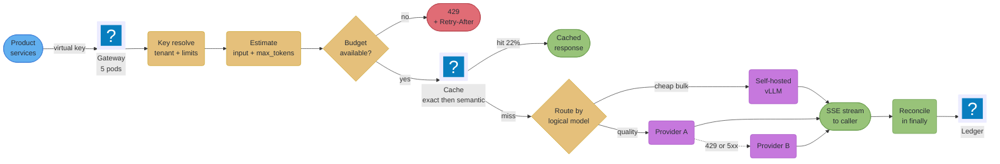
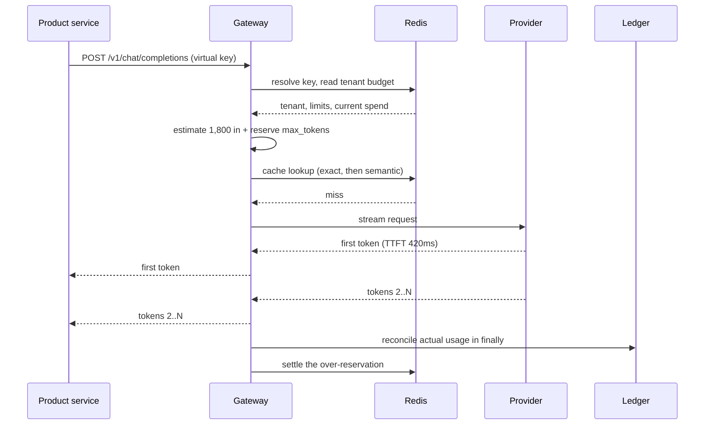

# Design an LLM Gateway with FastAPI

---

## Intuition

An API gateway routes and limits by request. An **AI gateway** cannot, because a request is not the
unit of anything that matters: two calls to the same endpoint can differ by a factor of a hundred in
cost, by two orders of magnitude in duration, and in whether they can safely be retried at all. The
gateway's job is therefore not traffic management in the usual sense — it is **capacity and cost
accounting at line rate**, across tenants who share a provider quota none of them can see.

That reframing produces the whole design. Every tenant gets a virtual key rather than the provider's
real one, so revocation and budgets are yours to enforce rather than the vendor's. Admission happens
against a token budget rather than a request count, because the limit that will actually stop you is
published in tokens per minute. Routing carries a model-equivalence decision so a provider incident
degrades service rather than ending it. A cache sits in front of the whole thing not primarily to
reduce latency but because a cache hit is the only request that costs nothing. And every exit path —
success, error, and the client closing the tab — reconciles what was actually consumed, because the
provider will bill you for all three and only one of them is on the happy path.

Get this layer wrong and nothing pages you. You get a slowly widening gap between your ledger and the
invoice, a 429 storm your own dashboards say is impossible, and one tenant quietly consuming the
quota that four hundred others are sharing.

This file is the multi-tenant, multi-provider design. Its single-tenant, self-hosted sibling is
[`design_ml_inference_api_fastapi.md`](design_ml_inference_api_fastapi.md), which owns the GPU-slot
and micro-batching side of the problem; the concepts here are taught in
[`../serving_llm_and_ai_workloads/serving_llm_and_ai_workloads.md`](../serving_llm_and_ai_workloads/serving_llm_and_ai_workloads.md),
and the SSE wire format in
[`../websockets_sse_and_streaming/websockets_sse_and_streaming.md`](../websockets_sse_and_streaming/websockets_sse_and_streaming.md).

---

## 1. Requirements Clarification

**Scenario handed to the candidate:** "We are a B2B SaaS platform with about 400 customer tenants. We
are adding AI features across the product — summarisation, drafting, extraction, and a chat
assistant. Every team is currently calling providers directly with a shared key. Design the gateway
that sits in the middle."

### Clarifying questions to ask the interviewer

*Are we fronting hosted providers, self-hosted models, or both?* — assume both: three hosted providers
plus one self-hosted model for the cheap high-volume path, since that is what forces the routing and
equivalence design.

*Is cost attributed per tenant, and is it contractual?* — assume yes, contractual. That makes the
ledger a billing system rather than a dashboard, and it changes the correctness bar for every
accounting path.

*Do tenants get hard budgets or soft alerts?* — assume hard budgets with a temporary-increase escape
hatch, since a soft-only design cannot answer "how do we stop a runaway loop".

*Are the callers our own product teams or the customers themselves?* — assume our own teams calling on
behalf of tenants. That means we control the client, so we can require a virtual key, but it also
means a bug in one product team's code becomes a tenant-visible cost event.

*What is the latency requirement?* — assume a human is watching most calls, so time to first token is
the SLO and total duration is not.

### Functional requirements

| Capability | Behaviour |
|---|---|
| `POST /v1/chat/completions` | OpenAI-compatible; streaming (SSE) and non-streaming |
| `POST /v1/batch` | 202 with a job id for work over the streaming threshold |
| Virtual keys | per tenant and per application, revocable, expiring, with their own limits |
| Token + spend budgets | enforced per tenant per period, with a temporary increase path |
| Provider routing | logical model names resolved to a provider and model, with failover |
| Response cache | exact-match, plus semantic for the eligible subset |
| Cost ledger | every request attributed to a tenant, including cancelled ones |
| Usage API | `GET /v1/usage` so a tenant can see its own consumption |

### Non-functional requirements

| Dimension | Target | Why this shape |
|---|---|---|
| Time to first token | p99 < 900 ms | the perceived-responsiveness SLO; total duration is deliberately not an SLO |
| Gateway overhead | p99 < 25 ms excluding upstream time | the gateway must be invisible against a multi-second call |
| Availability | 99.9% (~43 min/month) | degradation via failover is expected; total unavailability is not |
| Cost attribution accuracy | ledger within 2% of the provider invoice | 2% is the estimator's own error; anything larger is lost accounting |
| Tenant isolation | no tenant may consume more than 15% of fleet quota | derived in Section 2 as the noisy-neighbour budget |
| Overload behaviour | 429 with `Retry-After`, never unbounded queueing | queueing an expensive request converts overload into a timeout storm |

### Explicit non-goals

Model training or fine-tuning; prompt engineering and output quality; GPU scheduling for the
self-hosted model (that is the sidecar's job, and
[`design_ml_inference_api_fastapi.md`](design_ml_inference_api_fastapi.md) covers it); agent
orchestration; and a UI. The gateway is an HTTP edge with an accounting system attached.

---

## 2. Scale Estimation

This section is where the design is actually decided, because the binding constraint turns out not to
be the one anybody assumes.

**Traffic.** 400 tenants, 2.5 million LLM requests per day across all product surfaces.

```
  2,500,000 requests/day / 86,400 s/day        =  28.9 req/s   average
  peak factor 3x (business hours, one region)  =  86.7 req/s   peak
  peak in RPM                                  =  5,200 RPM
```

**Token volume.** Measured from the teams' existing direct calls: mean 1,800 input tokens (system
prompt plus retrieved context dominates) and 450 output tokens.

```
  input  = 2,500,000 x 1,800  = 4.50e9 tokens/day  = 3,125,000 ITPM average
  output = 2,500,000 x   450  = 1.125e9 tokens/day =   781,250 OTPM average
  at the 3x peak:                                     9,375,000 ITPM
                                                      2,343,750 OTPM
```

**Now compare against a published provider ceiling.** Anthropic documents its Scale tier for Claude
Opus 5 at 10,000 RPM / 10,000,000 input tokens per minute / 2,000,000 output tokens per minute.
Against our peak:

| Dimension | Our peak | Ceiling | Utilisation |
|---|---|---|---|
| Requests per minute | 5,200 | 10,000 | 52% |
| Input tokens per minute | 9,375,000 | 10,000,000 | 94% |
| **Output tokens per minute** | **2,343,750** | **2,000,000** | **117% — over** |

**This is the finding the whole design turns on.** At peak we are comfortably inside the request
limit, close to the input limit, and *over* the output limit. A request-per-minute limiter — the
default thing to build — would report 52% utilisation and green dashboards while the provider
returned 429s we could not explain. Output tokens are the binding constraint, they are the most
expensive dimension, and they are invisible to every request-counting mechanism.

Three consequences follow immediately, and each becomes a component in Section 4:

*The limiter must count output tokens.* Anything else is measuring the wrong thing.

*The cache is load-bearing, not an optimisation.* We need roughly 15% of requests to never reach a
provider just to get under the ceiling. Measured against the teams' existing traffic, exact-match
hits (identical prompt, identical parameters — common on templated summarisation) run about 14%, and
semantic hits on the eligible subset add about 8%, for a combined ~22%:

```
  upstream requests = 2,500,000 x (1 - 0.22)   = 1,950,000/day
  peak OTPM         = 2,343,750 x 0.78         = 1,828,125   -> 91% of ceiling
```

That clears the ceiling with 9% headroom. It is thin, which is why the failover path in Section 4.4
is a capacity mechanism here and not only an availability one.

*Multi-provider is a capacity requirement.* A single provider's published quota does not fit our peak
without the cache, and depends on it holding. Spreading the cheap high-volume path onto the
self-hosted model is what creates real headroom.

**Noisy-neighbour budget.** If any single tenant may consume at most 15% of fleet capacity:

```
  per-tenant OTPM ceiling = 1,828,125 x 0.15  =  274,218 OTPM
  fair share (400 tenants) = 1,828,125 / 400  =    4,570 OTPM
```

The 60x gap between the fair share and the ceiling is deliberate: tenants are wildly unequal in size,
and a limit set at the fair share would throttle the largest customers constantly. 15% is the point
where one tenant's runaway loop cannot take down the other 399.

**Concurrency and pod count.** Streaming requests are long-lived, so concurrency is driven by
duration, not by rate.

```
  mean streamed duration                       ~  9 s
  concurrent in-flight streams at peak
      = 86.7 req/s x 9 s                       ~  780 concurrent
  safe concurrent streams per pod              ~  300  (async, I/O-bound; CPU is
                                                  the SSE framing + per-chunk accounting)
  pods for peak = 780 / 300                    =  2.6  -> 3
  + headroom for a rolling deploy and one AZ   =  5 pods
```

**Storage.**

```
  ledger row  ~ 200 bytes x 2,500,000/day      =   500 MB/day
  13-month retention (12 + current)            ~   195 GB   -> partition by month
  semantic cache: 500,000 distinct prompts
      x 1,024-dim fp32 embedding (4 KB)        =     2 GB
      + HNSW index overhead ~1.5x              ~     3 GB   -> fits in Redis
```

**Bandwidth** is negligible and worth stating so nobody sizes for it: 450 output tokens is roughly
1.8 KB of text, about 2.5 KB with SSE framing, so 86.7 req/s peak is around 220 KB/s egress.

---

## 3. High-Level Architecture



The order is not arbitrary. Key resolution precedes estimation because the estimate needs the
tenant's model; estimation precedes the budget check because you cannot check a budget without a
quantity; the budget check precedes the cache because a tenant over budget should get a clean 429
rather than an inconsistent mix of served-from-cache and rejected; and reconciliation is downstream
of *every* terminal state, including the ones that are not success.

### Request lifecycle, including the paths that are not success



*The last two steps run on every exit path — completion, upstream error, and client disconnect. That
is the single most important property in the diagram, and Section 9 is largely about what happens
when it is missing.*

---

## 4. Component Deep Dives

### 4.1 Virtual keys

A virtual key is the gateway's own credential, mapped to a tenant, a set of limits, and a set of
permitted models. The provider's real key never leaves the gateway. This is not primarily a security
nicety — it is what makes revocation, budgets, expiry and per-application attribution possible at
all, because none of those exist on a provider key shared by six product teams.

```python
import hashlib
import secrets
from datetime import UTC, datetime, timedelta

from pydantic import BaseModel


class VirtualKey(BaseModel):
    key_id: str
    tenant_id: str
    application: str                 # which product surface, for attribution
    allowed_models: list[str]        # logical names, not provider model ids
    rpm_limit: int
    otpm_limit: int                  # output tokens/minute -- the binding dimension
    max_budget_cents: int
    budget_period_days: int
    expires_at: datetime | None


def mint_key(tenant_id: str, application: str, **limits) -> tuple[str, VirtualKey]:
    raw = f"sk-gw-{secrets.token_urlsafe(32)}"
    record = VirtualKey(
        key_id=hashlib.sha256(raw.encode()).hexdigest(),   # store the HASH, never the key
        tenant_id=tenant_id,
        application=application,
        expires_at=datetime.now(UTC) + timedelta(days=90),
        **limits,
    )
    return raw, record          # the raw value is returned once and never again
```

Store the SHA-256 of the key, never the key itself, exactly as you would a password — a gateway
database that holds usable credentials for four hundred tenants is a much larger incident than a
gateway database that holds hashes. Resolution is on the hot path of every request, so it is cached
in Redis with a short TTL and invalidated explicitly on revocation:

```python
KEY_TTL_S = 60


async def resolve_key(raw: str) -> VirtualKey:
    key_id = hashlib.sha256(raw.encode()).hexdigest()
    if cached := await redis.get(f"vk:{key_id}"):
        return VirtualKey.model_validate_json(cached)
    record = await db.fetch_virtual_key(key_id)
    if record is None:
        raise HTTPException(401, "Invalid key")
    if record.expires_at and record.expires_at < datetime.now(UTC):
        raise HTTPException(401, "Key expired")
    await redis.set(f"vk:{key_id}", record.model_dump_json(), ex=KEY_TTL_S)
    return record
```

The 60-second TTL is the revocation-latency decision, stated explicitly: a revoked key keeps working
for up to a minute unless the revocation path also deletes the cache entry. It does — but the TTL is
the backstop for the case where the delete fails, and one minute is the longest window the design
accepts.

### 4.2 The budget check, and the mistake that makes it useless

Here is the version that looks right and silently is not.

```python
# BROKEN: checks the budget, then does the work, then records
async def chat(req: ChatRequest, key: VirtualKey = Depends(resolve_key)):
    spend = await redis.get(f"spend:{key.tenant_id}")
    if int(spend or 0) >= key.max_budget_cents:
        raise HTTPException(429, "Budget exhausted")

    result = await call_provider(req)                       # 9 seconds

    await redis.incrby(f"spend:{key.tenant_id}", result.cost_cents)
    return result
```

Two defects, and the second is the expensive one.

*It is a check-then-act race.* Between the read and the increment there are nine seconds. At 86 req/s
a tenant can have hundreds of requests in that window, every one of which read the same
under-budget value. The budget is not a limit, it is a suggestion, and it overshoots by however much
traffic fits in one request duration.

*It does not record anything unless the call returns.* An exception, a timeout, or the client closing
the tab skips the `incrby` entirely — while the provider still bills for every token generated before
that moment.

```python
# FIX: reserve atomically before, reconcile in a finally after
RESERVE_LUA = """
local spent = tonumber(redis.call('GET', KEYS[1]) or '0')
local limit = tonumber(ARGV[1])
local want  = tonumber(ARGV[2])
if spent + want > limit then
  return -1
end
return redis.call('INCRBY', KEYS[1], want)
"""


class Lease:
    def __init__(self, tenant_id: str, reserved_cents: int):
        self.tenant_id = tenant_id
        self.reserved_cents = reserved_cents
        self.actual_cents = 0

    async def settle(self) -> None:
        delta = self.actual_cents - self.reserved_cents
        if delta:
            await redis.incrby(f"spend:{self.tenant_id}", delta)
        await ledger.record(self.tenant_id, self.actual_cents)


async def acquire_lease(key: VirtualKey, req: ChatRequest) -> Lease:
    estimated_in = await estimate_input_tokens(req)
    worst_case = price_cents(req.model, estimated_in, req.max_tokens)     # reserve the CEILING
    ok = await redis.eval(RESERVE_LUA, 1, f"spend:{key.tenant_id}",
                          key.max_budget_cents, worst_case)
    if ok == -1:
        raise HTTPException(429, "Budget exhausted",
                            headers={"Retry-After": "60"})
    return Lease(key.tenant_id, worst_case)
```

The Lua script makes check-and-increment a single atomic operation on the Redis server, which is what
removes the race — the same technique the rate limiter in
[`design_rate_limited_api_fastapi.md`](design_rate_limited_api_fastapi.md) uses, applied to money
instead of requests.

Reserving the **worst case** — input tokens plus the full `max_tokens` at the output price — is what
stops a tenant slipping hundreds of concurrent maximum-length generations past a budget that only saw
their small prompts. The reservation is deliberately pessimistic, which is precisely why `settle()`
must return the difference. Without it, a workload of short answers under a large `max_tokens` would
consume its whole budget on requests that barely used it, and the obvious fix — raising the budget —
would remove the protection the moment a genuinely long-answer workload arrived.

### 4.3 Estimating, and the tokenizer trap

```python
ESTIMATE_TTL_S = 3600


async def estimate_input_tokens(req: ChatRequest) -> int:
    """Never characters/4. Token counts are a property of the MODEL, not the text."""
    prompt_hash = hashlib.sha256(
        (req.model + repr(req.messages)).encode()
    ).hexdigest()
    if cached := await redis.get(f"tok:{prompt_hash}"):
        return int(cached)
    count = await PROVIDERS[req.model].count_tokens(req.messages)
    await redis.set(f"tok:{prompt_hash}", count, ex=ESTIMATE_TTL_S)
    return count
```

Two operational facts shape this. Anthropic's token-counting endpoint is free to call but carries its
own rate limits — documented at 2,000 / 4,000 / 8,000 RPM for the Start, Build and Scale tiers,
separate from message-creation limits — so at our 5,200 peak RPM, calling it uncached would exhaust
the counting quota before the generation quota. Hence the cache, keyed on model *and* prompt.

And the count changes when the model does: Anthropic's documentation notes its newest models produce
roughly 30% more tokens than earlier ones for identical text, because the tokenizer changed. The
cache key includes the model for exactly this reason, and the estimate-to-actual ratio is a monitored
metric (Section 8) so drift shows up as a graph rather than as an invoice.

### 4.4 Routing and failover

```python
from dataclasses import dataclass


@dataclass(frozen=True)
class Target:
    provider: str
    model: str
    input_cents_per_mtok: float
    output_cents_per_mtok: float


# The equivalence decision, written down and reviewed like any other config.
ROUTES: dict[str, list[Target]] = {
    "bulk":    [Target("self_hosted", "local-8b", 0.0, 0.0),
                Target("provider_c", "small", 25.0, 125.0)],
    "quality": [Target("provider_a", "large", 300.0, 1500.0),
                Target("provider_b", "large-alt", 300.0, 1500.0)],
}

FAILOVER_STATUS = {408, 429, 500, 502, 503, 504}


async def dispatch(logical: str, payload: dict, lease: Lease):
    last: Exception | None = None
    for target in ROUTES[logical]:
        try:
            return await CLIENTS[target.provider].stream(target.model, payload)
        except httpx.HTTPStatusError as exc:
            if exc.response.status_code not in FAILOVER_STATUS:
                raise                      # a 400 fails identically everywhere
            FAILOVER.labels(logical, target.provider, exc.response.status_code).inc()
            last = exc
        except (httpx.ConnectError, httpx.ConnectTimeout) as exc:
            FAILOVER.labels(logical, target.provider, "connect").inc()
            last = exc
    raise HTTPException(503, "All targets exhausted",
                        headers={"Retry-After": "10"}) from last
```

Three rules, each load-bearing.

**Never fail over on a 4xx that is not 429.** A malformed request fails identically at every provider,
so failing over turns one fast error into three slow ones and triples the load precisely when you are
already stressed.

**Never fail over after the first byte.** Once tokens have reached the client, switching providers
splices two models' output together — worse than an error, and undetectable downstream.

**The equivalence map is config, not control flow.** "When provider A's large model is unavailable,
provider B's large-alt is acceptable *for this workload*" is a quality decision with product
consequences. In a `try/except` nobody reviews it; in a table someone does.

Note the routing split doing capacity work: `bulk` prefers the self-hosted model, which has no
provider quota at all, which is what keeps the hosted output-token ceiling from being the fleet's
hard limit.

### 4.5 The cache, in two tiers

```python
CACHEABLE_TEMPERATURE = 0.3          # above this, output is intentionally varied


def cache_key(req: ChatRequest) -> str:
    """Every parameter that changes the output belongs in the key."""
    material = {
        "model": req.model,
        "messages": req.messages,
        "temperature": req.temperature,
        "top_p": req.top_p,
        "max_tokens": req.max_tokens,
        "tools": req.tools,
        "response_format": req.response_format,
    }
    return hashlib.sha256(json.dumps(material, sort_keys=True).encode()).hexdigest()


async def lookup(req: ChatRequest) -> CachedResponse | None:
    if req.temperature > CACHEABLE_TEMPERATURE or req.tools:
        return None                       # never cache a tool call: see Section 9
    if hit := await redis.get(f"exact:{cache_key(req)}"):
        CACHE_HITS.labels("exact").inc()
        return CachedResponse.model_validate_json(hit)
    if req.allow_semantic:
        emb = await embed(req.messages[-1]["content"])
        if near := await vector_index.search(emb, top_k=1, min_score=SEMANTIC_THRESHOLD):
            CACHE_HITS.labels("semantic").inc()
            return near[0].payload
    CACHE_HITS.labels("miss").inc()
    return None
```

The exact tier is built first because it has no correctness risk, provided the key is complete. A key
on the user's message alone will happily serve a `temperature=0` answer to a `temperature=1.2`
request, which is a subtle correctness bug that looks like a caching win.

The semantic tier is opt-in per request (`allow_semantic`), because its failure mode is real: two
prompts at 0.93 cosine similarity may be paraphrases, or may differ by a negation. It suits
summarisation and classification and is wrong for anything where the exact wording carries intent. Its
threshold is measured against real traffic, not copied — and re-measured whenever the embedding model
changes, because the threshold is a property of the embedder, not of language.

The third tier is the provider's own prompt cache, and it is free. It keys on a stable prompt
*prefix*, so the gateway enforces prompt ordering — long stable system prompt and tool definitions
first, volatile content last — and refuses to interpolate request ids into the prompt. Section 9 has
the story of what happened when someone did.

### 4.6 Streaming, cancellation, and reconciliation

```python
from collections.abc import AsyncIterable

from fastapi.sse import EventSourceResponse, ServerSentEvent


async def stream_chat(req: ChatRequest, lease: Lease,
                      target: Target) -> AsyncIterable[ServerSentEvent]:
    out_tokens = 0
    start = time.monotonic()
    first = True
    try:
        async with CLIENTS[target.provider].stream(target.model, req) as upstream:
            async for chunk in upstream:
                if first:
                    TTFT.labels(target.provider, target.model).observe(
                        time.monotonic() - start)
                    first = False
                out_tokens += chunk.token_count
                yield ServerSentEvent(data=chunk.model_dump())
        yield ServerSentEvent(raw_data="[DONE]")
    finally:
        # Runs on completion, on error, AND on the GeneratorExit Starlette
        # throws in when the client disconnects. This is the whole ballgame.
        lease.actual_cents = price_cents(target, lease.estimated_in, out_tokens)
        await lease.settle()


@app.post("/v1/chat/completions", response_class=EventSourceResponse)
async def chat_completions(req: ChatRequest,
                           key: VirtualKey = Depends(resolve_key)):
    lease = await acquire_lease(key, req)
    target = pick_target(req.model, key)
    return stream_chat(req, lease, target)
```

The upstream call lives **inside** the generator's own scope. That is what makes cancellation work:
unwinding the generator exits `async with ... stream(...)`, which closes the connection, which is the
signal the provider uses to abandon the generation. Move the upstream call into a `BackgroundTasks`
job or a detached `asyncio.create_task` and a closed tab becomes a bill.

`ServerSentEvent(raw_data="[DONE]")` emits the sentinel unencoded, which OpenAI-compatible clients
expect. The gateway speaks one wire format outward regardless of which provider served the request —
leaking a provider's own event names to callers would make that provider permanent.

---

## 5. Design Decisions & Tradeoffs

### Token budget versus request rate limiting

| Dimension | Token/spend budget (chosen) | Requests per minute |
|---|---|---|
| Bounds | actual cost and the binding provider dimension | request count only |
| Blind spot | a single enormous request inside budget | everything that matters |
| Section 2 fit | directly — output tokens were at 117% of ceiling while RPM was at 52% | would have reported 52% and green |
| Cost to run | an estimator, a reservation, and drift monitoring | a counter and a clock |

Both are kept. RPM is a cheap first line against runaway loops and costs nothing; the token budget is
what actually bounds spend. The per-request `max_tokens` ceiling is a third, one-line mechanism that
closes the gap the aggregate budget cannot see.

### Reserve-then-settle versus record-after

| Dimension | Reserve, then settle | Record after the call |
|---|---|---|
| Race window | none — atomic Lua reserve | one full request duration, ~9 s |
| Overshoot at 86 req/s | zero | hundreds of requests past the limit |
| Cancelled requests | recorded, in `finally` | lost entirely |
| Complexity | a lease object and a settle path | one `incrby` |
| Correctness for billing | yes | no |

The simpler design is genuinely simpler and genuinely wrong for a contractual ledger. Section 9
quantifies what it costs.

### Virtual keys versus passing the provider key through

| Dimension | Virtual keys (chosen) | Provider key per team |
|---|---|---|
| Revocation | instant, ours, per application | a provider-side rotation affecting everyone |
| Budgets | per tenant and per application | none below the account |
| Attribution | per request, per application | per provider account |
| Blast radius of a leak | one tenant's key, revoked in ≤60 s | the account |
| Cost | a key store on the hot path | none |

### Self-hosted for bulk versus everything hosted

| Dimension | Mixed (chosen) | All hosted |
|---|---|---|
| Provider quota pressure | bulk traffic consumes none | the ceiling in Section 2 binds |
| Marginal cost of bulk | GPU-hours, fixed | per token, linear |
| Operational burden | a GPU fleet to run | none |
| Quality on bulk paths | lower, and adequate for summarisation | higher |
| Failure independence | two unrelated failure domains | one |

The deciding factor is capacity, not cost: Section 2 showed the hosted output-token ceiling at 117%
of peak before caching. Routing bulk traffic off it is what makes the arithmetic work with margin.

### Semantic cache: opt-in per request

Making it opt-in rather than global is the decision most likely to be challenged, and the answer is
that eligibility is a property of the *call site*, not of the gateway. Summarising a support ticket
tolerates a near-neighbour answer; extracting an invoice total does not, and no threshold
distinguishes them because the difference is in what the caller intends. A global semantic cache is a
correctness decision made by the wrong component.

### What was deliberately not built

*A request queue in front of the providers.* Rejected: a caller who waits 90 seconds for capacity has
already timed out and retried, so the queue manufactures load. Shed with 429 and `Retry-After`.

*Prompt rewriting or compression at the gateway.* Rejected as a layering violation — it changes
outputs, and the gateway must be able to say it did not.

*Per-tenant provider accounts.* Rejected at this scale: 400 provider accounts to provision, monitor
and rotate, to solve an isolation problem the token budget already solves.

---

## 6. Real-World Implementations

**Anthropic's published rate-limit structure is the design input, not an analogy.** The API documents
limits as a triple — requests per minute, input tokens per minute, output tokens per minute — tiered
by account, with Claude Opus 5 on the Scale tier at 10,000 RPM / 10,000,000 ITPM / 2,000,000 OTPM, and
monthly spend caps of $500 (Start), $1,000 (Build) and $200,000 (Scale). Two things transfer directly.
Output tokens are limited roughly five times more tightly than input, which is the vendor encoding the
cost asymmetry into the quota — and it is why Section 2 found the output dimension binding. And the
existence of a *separate* spend cap alongside the rate limits is the vendor making this file's
argument: a rate limit and a spend limit constrain different things, and a serious system needs both.

**LiteLLM implements exactly the virtual-key model in Section 4.1, and its parameter names are worth
knowing.** Keys carry `rpm_limit` and `tpm_limit`, a `max_budget` with an optional `budget_duration`,
a `duration` for expiry, an allowed `models` array, and `aliases` for remapping a logical name onto a
backend model. Spend is tracked per key and read back through `/key/info`, `/user/info` and
`/team/info`, with keys ownable by a user or by a team so a production application's key is not tied
to one person. It also ships `temp_budget_increase` with a `temp_budget_expiry` — the escape hatch
Section 1 asked for — and key rotation with a `grace_period`, plus `auto_rotate` on a
`rotation_interval`. The lesson to take is the *shape*: every one of those fields exists because
somebody ran a gateway without it. If this design's scope matches yours, evaluating LiteLLM before
building Section 4 is the honest recommendation.

**The AI-gateway category exists because this layer is the same everywhere.** Kong's AI Gateway offers
token-based rate limiting as a plugin on an existing API gateway; Cloudflare's AI Gateway provides
caching and analytics in front of provider calls; Envoy AI Gateway brings the same concerns into a
Kubernetes and Envoy-native deployment. The distinction the category draws is the one this file
opened with — an API gateway routes and limits by request, an AI gateway understands tokens, model
equivalence, and prompt semantics. That several independent products converged on the same feature
list is reasonable evidence the list is right.

**Redis offers semantic caching as a product, which tells you how standard the pattern became.**
RedisVL ships a `SemanticCache` (0.18.2, 2026-05-12), and Redis also sells LangCache as a managed
service so teams need not run the vector index themselves. GPTCache (0.1.44, 2026-08-01) remains the
independent implementation. The existence of a managed offering is the signal: this stopped being a
clever trick and became infrastructure.

**vLLM is why the self-hosted leg of the routing table is realistic.** At 0.27.1 (2026-08-11), `vllm
serve` exposes an OpenAI-compatible `/v1/chat/completions` with continuous batching as a core design
property, and Ollama and NVIDIA Triton both ship OpenAI-compatible frontends too. That convergence is
what lets `dispatch()` in Section 4.4 treat a self-hosted target as just another row: the gateway
writes one client against the OpenAI-compatible shape, and a self-hosted model becomes a routing
decision rather than an integration project. Prefix caching is available via
`--enable-prefix-caching` and is on by default — worth setting explicitly rather than assuming.

---

## 7. Technologies & Tools

| Component | Choice | Why this one |
|---|---|---|
| Framework | FastAPI 0.141.1 | native SSE since 0.135, JSONL since 0.134, Pydantic v2 validation |
| Streaming | `fastapi.sse.EventSourceResponse` | keep-alive pings, correct headers, no third-party dependency |
| HTTP client | `httpx` 0.28.1 | `Timeout(10.0, read=20.0)` gives a per-chunk idle gap |
| Async primitives | `anyio` | `fail_after` for the outer budget; ships with FastAPI |
| Budget + key cache | Redis with Lua | atomic check-and-reserve in one server-side operation |
| Semantic index | RedisVL `SemanticCache` | same datastore as the budget; managed LangCache if preferred |
| Ledger | PostgreSQL, partitioned monthly | 195 GB over 13 months; billing needs relational integrity |
| Self-hosted model | vLLM 0.27.1 | OpenAI-compatible, continuous batching |
| Provider SDKs | `anthropic` 1.0.0, `openai` 3.3.1 | normalised behind one internal interface |
| Metrics | `prometheus-client` | TTFT, inter-token latency, tokens, failover, estimate drift |
| Deployment | 5 pods, one uvicorn process each | the orchestrator replicates; see the deployment module |

---

## 8. Operational Playbook

### Onboarding a tenant

```python
async def onboard(tenant_id: str, tier: str) -> str:
    limits = TIER_LIMITS[tier]            # rpm, otpm, budget, allowed models
    raw, record = mint_key(tenant_id, application="default", **limits)
    await db.insert_virtual_key(record)
    return raw                            # shown once, never retrievable
```

No provider-side work, no new account, no key rotation affecting anyone else. That is the operational
payoff of Section 4.1, and it is why virtual keys survive the "is this over-engineering" question.

### Raising a budget under pressure

The escape hatch must exist or someone will raise the permanent budget at 2am and never lower it.

```python
async def temp_increase(tenant_id: str, extra_cents: int, hours: int) -> None:
    await redis.incrby(f"budget_bonus:{tenant_id}", extra_cents)
    await redis.expire(f"budget_bonus:{tenant_id}", hours * 3600)
    await audit.record("temp_budget_increase", tenant_id, extra_cents, hours)
```

The expiry is the point: a temporary increase that does not expire is a permanent increase with a
misleading name.

### Rotating a provider key

1. Add the new provider key alongside the old one; the client pool accepts both.
2. Shift traffic by restarting pods one at a time — no tenant-visible change, because tenants hold
   virtual keys, not this one.
3. Confirm zero requests on the old key in the provider's own dashboard.
4. Revoke the old key.

Step 2 is the whole argument for virtual keys in one line: a provider credential rotation is an
internal operation with no customer communication.

### What to alert on

| Signal | Threshold | Why |
|---|---|---|
| Provider OTPM utilisation | > 85% of ceiling | Section 2's binding constraint; the cache is the only slack |
| Cache hit rate | < 18% (from 22%) | the capacity plan depends on it; a drop is a capacity incident |
| Estimate-to-actual ratio | outside 0.9–1.15 | tokenizer drift, usually after a model change |
| Ledger versus provider invoice | > 2% gap | lost accounting; Section 9 is entirely about this |
| Failover rate per provider | any sustained non-zero | a provider is degrading before it is down |
| TTFT p99 | > 900 ms | the SLO; total duration deliberately is not one |
| Abandonment rate | any sustained rise | users giving up; earliest signal of a TTFT regression |
| Per-tenant OTPM | > 15% of fleet | the noisy-neighbour budget, enforced |

**Tag every log line and ledger row with `tenant_id` and never tag a metric with it.** Prometheus
stores one series per label combination, so a tenant label across several histograms turns 400 tenants
into hundreds of thousands of resident series. Per-tenant analysis belongs where high cardinality is
free.

### The runbook entries that matter

*Provider A is returning 429s.* Confirm the failover counter is rising and that provider B is
absorbing it. If both are saturated, shift `quality` traffic to `bulk` for the tenants whose contracts
permit it — a documented, reversible degradation, not an improvisation.

*The ledger and the invoice have diverged.* Check three things in order: is reconciliation running in
`finally` (Section 9's first story), is any retry path re-running a partially completed generation
(the second), and has the estimate-to-actual ratio drifted (a model change).

*One tenant is at 15% of fleet quota.* Look for a loop before raising anything. A tenant that jumped
from 2% to 15% in an hour has a bug, and raising their ceiling funds it.

---

## 9. Common Pitfalls & War Stories

### The ledger that missed every cancelled stream — a 19% under-count

Reconciliation was written after the `async for` loop rather than in a `finally`. Every user who read
the first paragraph of a summary and navigated away produced a provider charge and no ledger row. In
the chat surface the median response was 340 tokens and the median *read* was under 90, so
abandonment was the normal case, not an edge case.

**Impact: 19% of provider spend was unattributed** — invisible in every dashboard, because requests,
errors and latency were all healthy. It was found only when finance compared the invoice to the
ledger, three months in.

```python
# BROKEN
async for chunk in upstream:
    total += chunk.token_count
    yield chunk
await ledger.record(tenant, total)          # skipped on disconnect

# FIX
try:
    async for chunk in upstream:
        total += chunk.token_count
        yield chunk
finally:
    await ledger.record(tenant, total)      # success, error, and GeneratorExit
```

The perverse detail: **the better the gateway's TTFT got, the worse the under-count became**, because
users got their answer sooner and left sooner. A latency improvement widened an accounting gap.

### The retry decorator that paid twice — 11% of spend

A `tenacity` decorator was added around the provider call during an unrelated incident, retrying on
`httpx.HTTPError`. That includes read timeouts, so any generation that stalled near completion was
regenerated from scratch, up to three times. Only the successful attempt was recorded.

**Impact: 11% of provider spend, and a latency profile that looked fine** because the recorded
duration was the successful attempt's.

```python
# FIX: retry only what provably consumed nothing
emitted = False
try:
    async for chunk in upstream:
        emitted = True
        yield chunk
except (httpx.ConnectError, httpx.ConnectTimeout):
    if emitted:
        raise                    # never restart a partially served generation
    ...retry...
```

An LLM call is not idempotent. A generic retry policy that is correct for a database read is a
double-charge here, and it produces different text on each attempt.

### The request id in the system prompt — 4% of spend

A request id was interpolated into the system prompt's header for log correlation. It sat above a
2,100-token stable instruction block, so the provider's prefix cache missed on every single request.

**Impact: roughly 4% of spend, with literally zero signal** — same latency, same token counts, same
error rate. Nothing in the gateway's own metrics could have shown it, because nothing in the gateway
changed. The fix was to move the id into a response header, and to start scraping the provider's
reported cached-token count so the next occurrence is visible on the day it ships.

### The budget that let a tenant spend 40x their limit in nine minutes

A tenant's retry loop, combined with the check-then-act budget in Section 4.2's BROKEN example. Each
of the nine seconds of a request's duration admitted more traffic that had read the same
under-budget value.

**Impact: a tenant with a $200 daily budget spent roughly $8,000 before the next check caught up** —
40x, in nine minutes. The atomic Lua reserve removed the race; the `max_tokens` ceiling per request
bounded the worst single call; and the alert on per-tenant OTPM crossing 15% of fleet capacity now
fires in under a minute.

### The failover that made an incident worse

The first failover implementation retried the next provider on **any** exception. During an outage a
malformed-request bug in one product team's code began producing 400s at high volume, and every one
was retried against all three providers — tripling the load on two healthy providers and pushing them
toward their own rate limits.

**Impact: a single-team bug became a fleet-wide degradation for 20 minutes.** The fix is the
`FAILOVER_STATUS` set in Section 4.4: a 4xx that is not 429 fails identically everywhere, so failing
over can only multiply the damage.

### The semantic cache that answered the wrong question

Enabled globally at a 0.90 threshold. An extraction endpoint asking "what is the total on invoice
4471" received the cached answer for invoice 4471**8** — the prompts differed by one character and
embedded almost identically.

**Impact: wrong financial data returned to a customer, with a 200 status and no error anywhere.**
The fix was structural rather than numerical: the threshold went to 0.95, but more importantly
semantic caching became opt-in per request, because eligibility is a property of the call site. No
threshold distinguishes "summarise this ticket" from "read this number".

---

## 10. Capacity Planning

**Application tier.** From Section 2: 86.7 req/s peak, ~780 concurrent in-flight streams at a 9-second
mean duration.

```
  concurrent streams per pod (safe)            =   300
  pods for peak = 780 / 300                    =   2.6  -> 3
  + rolling deploy and one-AZ loss headroom    =   5 pods
  upstream connections = 5 pods x 64 max_conns =   320   (well inside provider limits)
```

The pod count is set by **concurrency**, not by request rate — the standard mistake here is sizing
from req/s as you would for a CRUD service, which under-provisions by roughly the mean request
duration in seconds.

**Redis.**

```
  virtual keys      400 tenants x ~4 apps x 1 KB  ~   1.6 MB
  budget counters   400 keys, trivial             ~     negligible
  token estimates   ~200k live x 64 B             ~    13 MB
  exact cache       ~300k entries x 3 KB          ~   900 MB
  semantic index    500k x 4 KB + 1.5x overhead   ~     3 GB
  total working set                               ~     4 GB   -> one 8 GB node,
                                                      replicated, with room to grow
```

**Ledger.**

```
  2.5M rows/day x 200 B                          =   500 MB/day
  monthly partition                              ~    15 GB
  13-month retention                             ~   195 GB
  hot (current month, indexed on tenant + time)  ~    15 GB  -> fits in RAM
```

Partitioning by month is what keeps the billing query fast: a tenant's monthly usage touches one
partition, and dropping a partition is how the 14th month leaves.

**The provider quota headroom, restated as the number to defend.**

```
  peak OTPM before cache                         = 2,343,750    117% of ceiling
  at 22% combined cache hit rate                 = 1,828,125     91% of ceiling
  headroom                                       =   171,875      9%
```

Nine percent is thin, and naming it as thin is the point. Three levers exist and they should be
ordered before they are needed: **route more traffic to the self-hosted model** (largest and
cheapest, bounded by quality requirements per surface), **raise the cache hit rate** (each additional
percentage point returns about 23,000 OTPM), and **add a second hosted provider to the `quality` route
as an active peer rather than a passive standby** (fastest to execute, costs a second contract).

**Cost, parametrically.** Absolute prices move too often to hard-code, so plan in the shape rather
than the number. With `Pin` and `Pout` in cents per million tokens on the hosted `quality` route:

```
  monthly hosted input  = 4.50e9 x 30 x (1 - 0.22) x quality_share
  monthly hosted output = 1.125e9 x 30 x (1 - 0.22) x quality_share
  monthly cost          = (input/1e6) x Pin + (output/1e6) x Pout
                          + self-hosted GPU-hours (fixed)
```

Two properties of that expression are the planning insight. **Output dominates**, because `Pout` is
several times `Pin` on every current provider, which is why the cache and the routing table both
target output-heavy traffic first. And **`quality_share` is the only term you control cheaply** —
moving one surface from `quality` to `bulk` changes the bill more than any negotiation will.

**When this design stops working.** At roughly 4x current volume the single Redis node becomes the
constraint before the application tier does, and the budget counters need sharding by tenant hash. At
that point the semantic index should move to a dedicated vector store rather than sharing the budget
datastore, because their failure domains should not be joined — a vector-search slowdown must not be
able to stall a budget check on the hot path.

---

## 11. Interview Discussion Points

**Q: Why is an AI gateway a different thing from an API gateway?**
An API gateway routes, authenticates and limits by request, because for a conventional API a request is a reasonable proxy for cost and capacity. For an LLM call it is not: two calls to the same endpoint can differ a hundredfold in cost, by two orders of magnitude in duration, and in whether a retry is safe. An AI gateway therefore understands tokens, model equivalence and prompt semantics — it meters in tokens, routes on a declared equivalence between models, caches on prompt content rather than URL, and reconciles actual usage after the fact. Section 2 makes the point concretely: at peak this system sits at 52% of the request limit and 117% of the output-token limit, so a request-based gateway would report healthy while the provider rejected traffic.

**Q: Walk through why output tokens turned out to be the binding constraint.**
The arithmetic in Section 2: 2.5M requests/day at 450 mean output tokens is 1.125 billion output tokens per day, which at a 3x business-hours peak is about 2.34M output tokens per minute — against a documented ceiling of 2M OTPM on the tier in question. Input was at 94% and requests at 52%. The reason it lands this way is structural rather than accidental: providers limit output several times more tightly than input because output is several times more expensive to produce, so any workload with a meaningful generation length hits the output ceiling first. The design consequence is that the cache became a capacity mechanism, not an optimisation, and multi-provider routing became a capacity requirement.

**Q: Why reserve the worst case and settle afterwards, rather than just charging what was used?**
Because you must admit the request before you know what it costs. Charging afterwards means the budget is checked against a value that is nine seconds stale, and at 86 requests per second a tenant can push hundreds of requests through that window — which is exactly how one tenant spent 40x their daily budget in nine minutes. Reserving input tokens plus the full `max_tokens` at the output price closes it, but the reservation is deliberately pessimistic, so it must be settled: without returning the over-reservation, a short-answer workload under a large `max_tokens` throttles itself to a fraction of its real budget, and the obvious fix of raising the budget removes the protection entirely.

**Q: Why does the reservation have to be atomic, and how?**
Because a read-then-increment is a check-then-act race, and its width is one full request duration. A Lua script evaluated on the Redis server performs the read, the limit comparison and the increment as a single indivisible operation, so no two concurrent requests can both observe the same under-budget value. This is the same technique as the token-bucket limiter in `design_rate_limited_api_fastapi.md`, applied to money. Doing it in application code with a `WATCH`/`MULTI` transaction also works but retries under contention, which is precisely when you least want extra round trips.

**Q: What exactly happens when a user closes the tab mid-stream, and what breaks if you get it wrong?**
Starlette throws `GeneratorExit` into the response generator. Because the upstream call sits inside that generator's own scope, unwinding exits the `async with client.stream(...)` block, closing the connection — which is the signal the provider uses to abandon the generation. Two things break if you get it wrong. If the upstream call is in a `BackgroundTasks` job or a detached task, it outlives the client and keeps billing. And if the reconciliation is after the loop rather than in a `finally`, the request is billed by the provider and recorded as zero by you. That second one cost 19% of spend here, and it got worse as TTFT improved, because faster answers meant users left sooner.

**Q: When should you fail over to another provider, and when must you not?**
Fail over on 429, on 5xx, and on connection failures — conditions where the request plausibly consumed nothing at the first target. Do not fail over on any other 4xx: a malformed request fails identically everywhere, so retrying it against three providers triples load during an incident, which is exactly how one team's 400-producing bug became a 20-minute fleet degradation here. And never fail over after the first byte has reached the client, because the caller then receives text spliced from two different models — worse than an error and undetectable downstream. The substitution itself belongs in a reviewed config table, since "provider B's model is an acceptable stand-in for provider A's" is a product decision with quality consequences.

**Q: Why is the semantic cache opt-in per request rather than a gateway-wide setting?**
Because eligibility is a property of the call site, not of the gateway. Summarising a support ticket tolerates a near-neighbour's answer; extracting a number from an invoice does not — and no similarity threshold separates them, because the difference is in what the caller intends rather than in the text. Enabled globally at 0.90, this system returned the cached total for invoice 44718 in answer to a question about invoice 4471: one character apart, embedded almost identically, returned with a 200 and no error anywhere. Raising the threshold to 0.95 helped, but the structural fix was moving the decision to the caller.

**Q: How do you estimate token counts, and what makes estimates go wrong?**
Use the provider's counting endpoint or the model's own tokenizer, never characters divided by four — that heuristic is roughly right for English prose and badly wrong for code, JSON and non-Latin scripts. Two operational constraints follow. The counting endpoint has its own rate limits, documented separately from message creation, so at 5,200 peak RPM it must be cached or it becomes the bottleneck. And a token count is a property of the model: Anthropic documents its newest models producing about 30% more tokens for identical text because the tokenizer changed, so the cache key includes the model and the estimate-to-actual ratio is monitored, with an alert outside 0.9–1.15.

**Q: Why not just run a queue in front of the providers instead of shedding with 429?**
Because a caller who waits ninety seconds for capacity has already timed out and retried, so the queue is manufacturing load rather than absorbing it. Worse, it converts a clear, cheap, attributable failure — a 429 answered in a millisecond, which tells the caller something true and lets them back off — into a latency cliff that looks like an outage and hides the signal from every dashboard. Shedding also preserves the tenant isolation the design exists for: a queue is shared, so one tenant's burst delays everyone, whereas a per-tenant budget rejects the tenant that is over and leaves the other 399 untouched.

**Q: What do you measure, and what does a standard latency dashboard miss?**
Time to first token, inter-token latency, tokens by direction, failover rate per provider, estimate-to-actual drift, cache hit rate, and abandonment. A single duration metric cannot distinguish a stream that delivered its first token in 400 ms and then generated steadily from one that returned nothing for 40 seconds and then dumped everything — same duration, completely different user experience. Abandonment is the metric nobody adds and the most valuable: a rising abandonment rate at a flat error rate means users are giving up, and it moves days before churn does. Label all of these by model and provider, never by tenant, or Prometheus cardinality becomes the next incident.

**Q: How would you scale this to ten times the traffic?**
The application tier scales horizontally without changes, since it is stateless — pods are sized by concurrency, so ten times the traffic is roughly fifty pods rather than five. Three things break before that. Redis becomes the constraint at around four times current volume, so budget counters shard by tenant hash and the semantic index moves to a dedicated vector store — their failure domains should not be joined, because a vector-search slowdown must not stall a budget check. The ledger's write rate needs batching rather than a row per request. And the provider quota itself is the real ceiling: at ten times volume the answer is a larger self-hosted fleet, because no combination of hosted contracts is cheaper than owning the bulk path.

**Q: What would you build first if you only had two weeks?**
Virtual keys, the atomic reservation, and reconciliation in a `finally` — in that order. They are the three things that are painful to retrofit, because each one changes the shape of the request path and the meaning of every historical record. Skip the semantic cache, skip failover, and use a single provider with a single logical model. That gets you correct attribution and enforceable budgets from day one, which is what makes every later decision measurable. The mistake is the reverse order: building routing and caching first is more interesting, and leaves you unable to tell which tenant caused anything.

**Q: When is this whole design overkill?**
When there is one tenant, one provider, one model and no cost ceiling. That is an `httpx` call with a timeout and a log line, and every mechanism here is overhead you will maintain forever. The threshold to watch for is the second tenant whose costs must be told apart, or the first month somebody asks why the invoice is what it is. Even then, evaluate an off-the-shelf gateway first — LiteLLM implements virtual keys with `rpm_limit`, `tpm_limit`, `max_budget` and `budget_duration`, spend read back per key, team ownership, and temporary budget increases with expiry. If your requirements are that list, building it is a choice to maintain it.
