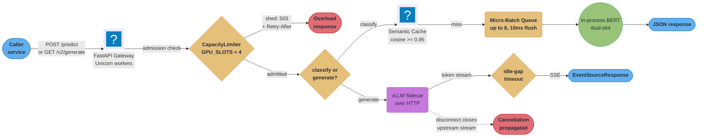
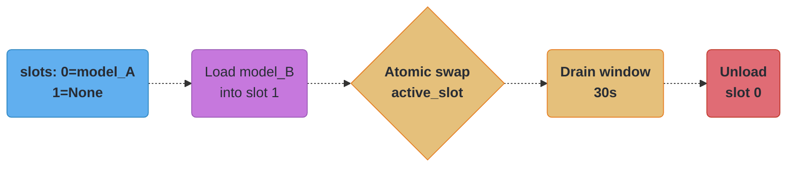
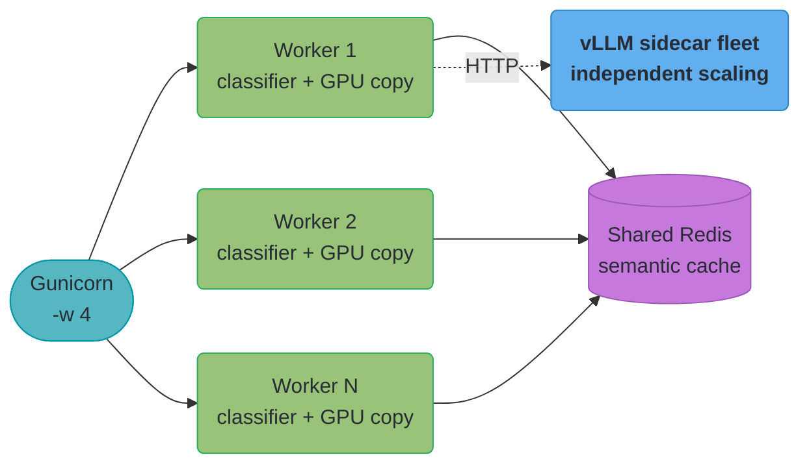

# Design an ML Inference API with FastAPI
---

## Intuition

An ML inference API is not a CRUD service with a slow endpoint bolted on — it is an HTTP
edge in front of a scarce, expensive resource (a GPU) that behaves nothing like a database
connection pool. An idle database connection costs nothing extra; a GPU forward pass nobody
reads still burned watts and occupied a slot a paying request could have used. The FastAPI
layer's job is not to run the model — that is `vLLM`, `Triton`, or a hosted provider's
problem — it is to be the disciplined edge in front of it: admit only as much concurrent
work as the GPU fleet can hold, shed the rest fast and cheaply, batch what can be batched,
stream what must stream, and make sure a client walking away mid-stream stops the app paying
for tokens nobody reads. Get the edge wrong and a healthy model server looks broken from
outside — hung connections, silent cost overruns, a p99 that counts already-abandoned work.

This file owns that edge: admission control, micro-batching, cancellation propagation, the
idle-gap timeout, cost accounting, and the SSE/JSON-Lines transport. It deliberately does
**not** re-teach continuous batching, KV-cache math, or quantization — those live in
[`model_serving_and_inference.md`](../../ml/model_serving_and_inference/model_serving_and_inference.md)
and [`../../llm/`](../../llm/), cross-linked wherever this design leans on them.

---

## 1. Requirements Clarification

**Scenario handed to the candidate:** "Design an inference API that serves two model
families behind one FastAPI gateway — a small BERT-based text classifier for low-latency
synchronous scoring, and a larger generative model (a 7B-parameter instruction-tuned model)
for streaming completions. Both are internal services consumed by other backend teams, not
directly by end users."

### Clarifying questions to ask the interviewer

Is the generative model in-process, behind a sidecar (vLLM/Triton), or a third-party
provider API? — assume a self-hosted vLLM sidecar, the case that most exercises admission
control, cancellation, and cost accounting. Are callers machine clients or human-facing UIs?
— assume both exist. Is there a hard daily cost ceiling, or only a latency SLA? — assume a
cost ceiling, since it motivates token-based quotas over request-based rate limiting. Must
every request see either the fully-old or fully-new classifier with zero blending mid-update?
— assume yes, since it motivates the dual-slot swap over an in-place weight overwrite.

### Functional requirements

| Endpoint / capability | Behavior |
|---|---|
| `POST /predict` | Synchronous classification — top-1 label + confidence, in-process BERT classifier (~400 MB) |
| `POST /predict/batch-jsonl` | Machine-consumer batch classification — results streamed as JSON Lines as each completes |
| `GET /v2/generate` | Streaming generation — tokens as SSE from a vLLM sidecar, for a human-facing UI |
| Zero-downtime model update | Swap the active classifier with no restart and no blended response mid-swap |
| Health / readiness probes | Distinguish "process alive" from "model loaded and admission capacity available" |
| Semantic cache | Redis-backed, cosine similarity >= 0.95, to avoid redundant GPU inference on near-duplicates |

### Non-functional requirements

| Dimension | Target | Why this shape |
|-----------|--------|-----------------|
| Classification throughput | 100 req/s peak sustained | Derived in §2 from daily volume |
| Classification p99 latency | < 200 ms | Human-adjacent caller SLA; drives batch size/flush tuning |
| Generation TTFT (time to first token) | p99 < 800 ms | Perceived responsiveness — the UI shows *something* fast |
| Generation total latency | p99 < 12 s for a 300-token completion | Separate SLO from TTFT — see the war story in §9 for why conflating them hides an idle-gap hang |
| Availability | 99.9% (≈ 43 min/month) | Standard internal-service tier; not payments-grade |
| Cost ceiling | Fixed monthly GPU-hour budget | Motivates token/cost quotas over RPS-only limiting (§4, §5) |
| Overload behavior | Shed with 503 + `Retry-After`, never queue unbounded | An unbounded GPU queue converts overload into a latency cliff, not a controlled error rate |

### Explicit non-goals

Training/fine-tuning pipelines; multi-tenant per-customer quotas (single-tenant, internal
callers only); gRPC transport (REST/HTTP only); and model accuracy, prompt engineering, or
output quality, which are out of scope for an infra design.

---

## 2. Scale Estimation

**Classification traffic.** Assume 2.6 million `/predict` requests/day, sourced from three
internal services polling and scoring user-generated text.

```
2,600,000 requests/day / 86,400 s/day        = 30.1 req/s   average
30.1 req/s x 3.3 (typical diurnal peak ratio) = ~100 req/s  peak   <- matches the NFR target
```

**GPU concurrency this implies (Little's Law).** Concurrency equals arrival rate times
average time-in-system. Per-request GPU service time — queue wait plus inference — is the
10 ms flush window plus ~20 ms batch-of-8 inference on a T4, ≈ 30 ms:

```
concurrency = throughput x avg_service_time
            = 100 req/s x 0.030 s
            = 3.0 requests in flight at peak, on average
```

Round up for burstiness headroom and this is where §4's admission-control constant comes
from: `GPU_SLOTS = 4`, not an arbitrary number. Push sustained load past ~265 req/s (the
drain loop's own retirement rate, derived in §11) and queue depth grows without bound —
the point admission control is designed to shed at, rather than let latency climb silently.

**Payload bandwidth.** Request ≈ 200 bytes, response ≈ 150 bytes: `100 req/s x 350 bytes =
35 KB/s = ~0.28 Mbps` — negligible next to GPU cost; bandwidth is never the bottleneck here.

**Generation traffic.** Assume 150,000 `/v2/generate` requests/day, average completion
length 300 tokens, sidecar decode rate ~40 tokens/s (a 7B model, batched, on an L4).

```
150,000 / 86,400                     = 1.74 req/s   average arrival
avg completion time = 300 / 40       = 7.5 s         connection held open
avg concurrent open streams          = 1.74 x 7.5    = ~13 streams
peak concurrent open streams         = ~13 x 3       = ~40 streams
```

This is the number that sizes the streaming fleet: *held-open connection count*, not
requests/second, determines connection-pool sizing here — 40 concurrent streams is trivial
for one Uvicorn worker's event loop, but caps how many sidecar connections stay pooled.

**GPU memory, classifier.** ~400 MB per loaded model; the dual-slot pattern (§4) holds two
resident during a swap — ~800 MB steady-state, comfortably inside a 16 GB T4 or 24 GB L4
alongside batch activation memory (well under 1 GB for batch-of-8, sequence length 128).

**GPU memory, generative sidecar.** A 7B model in fp16 is ~14 GB of weights alone — already
most of a 24 GB L4 before a single token of KV cache (not re-derived here; see
[`../../llm/`](../../llm/)). Consequence for this file's HTTP edge: the sidecar has far less
concurrency headroom than the classifier, so admission control and token quotas matter more here.

---

## 3. High-Level Architecture



A request is admitted or shed at the `CapacityLimiter` gate before it touches either model
path — sized to the GPU fleet's real concurrency budget from §2, not an arbitrary request
count. Admitted classification traffic short-circuits at the semantic cache or flows through
the micro-batch queue; admitted generation traffic streams from the vLLM sidecar with an
idle-gap timeout on receive and disconnect propagation on send. Model swaps (below) run
out-of-band on an admin call and never block the request path.



Every in-flight request resolved `active_slot` before the flip and keeps running against
the old model until it finishes; every request arriving after the flip sees the new one.
Nothing ever reads a half-loaded model, and nothing ever blends two models' outputs.

---

## 4. Component Deep Dives

### 4.1 Schemas and the stub model

```python
# inference_api/schemas.py
from __future__ import annotations
from pydantic import BaseModel, Field

class PredictRequest(BaseModel):
    text: str = Field(..., min_length=1, max_length=2048)

class PredictResponse(BaseModel):
    label: str
    confidence: float
    cached: bool = False
    latency_ms: float

class ClassificationRecord(BaseModel):
    text: str
    label: str
    confidence: float


# inference_api/model.py
import torch

class BertClassifier:
    """Thin wrapper around a serialised TorchScript BERT classifier."""

    def __init__(self, path: str) -> None:
        device = "cuda" if torch.cuda.is_available() else "cpu"
        self._model = torch.jit.load(path, map_location=device)
        self._model.eval()
        self._labels = ["negative", "neutral", "positive"]

    @torch.inference_mode()
    def predict_batch(self, texts: list[str]) -> list[tuple[str, float]]:
        # Stub: tokenize with transformers.AutoTokenizer and run a real
        # forward pass in production; this fakes a deterministic result so
        # the endpoint shape is testable without a GPU.
        results = []
        for text in texts:
            logits = torch.randn(len(self._labels))
            probs = torch.softmax(logits, dim=0)
            idx = int(probs.argmax())
            results.append((self._labels[idx], float(probs[idx])))
        return results
```

### 4.2 Admission control — `anyio.CapacityLimiter`, not a bare `Semaphore`

A bare `asyncio.Semaphore` has no notion of "give up if the line is too long" — every
waiter queues indefinitely, so under sustained overload the queue simply grows until memory
or the client's own timeout gives out first. The fix sizes the limiter to the GPU fleet's
real concurrency budget (`GPU_SLOTS = 4`, from the Little's-Law calculation in §2) and
bounds only the *wait to get in*, with `asyncio.timeout()`, never the work itself:

```python
# inference_api/admission.py
from __future__ import annotations
import asyncio
from collections.abc import Awaitable, Callable
import anyio
from fastapi import HTTPException

GPU_SLOTS = 4  # concurrent GPU-bound calls the fleet can hold, from Little's Law

class AdmissionControl:
    """Caps concurrent GPU work; sheds the rest instead of queuing it."""

    def __init__(self, total_slots: int = GPU_SLOTS, acquire_timeout_s: float = 1.0) -> None:
        self._limiter = anyio.CapacityLimiter(total_slots)
        self._acquire_timeout = acquire_timeout_s

    async def run[T](self, fn: Callable[[], Awaitable[T]]) -> T:
        try:
            async with asyncio.timeout(self._acquire_timeout):
                await self._limiter.acquire()
        except TimeoutError:
            # Bounds the queue wait ONLY — a request already admitted keeps
            # running even if it takes longer than acquire_timeout_s.
            raise HTTPException(
                status_code=503,
                detail="inference fleet at capacity, retry shortly",
                headers={"Retry-After": "1"},
            )
        try:
            return await fn()
        finally:
            self._limiter.release()
```

```python
# BROKEN — asyncio.Semaphore(4): every waiter queues forever, no way out
# once the line is 500 deep; a 3x traffic spike does not fail fast, it makes
# p99 balloon past any SLA before a single request actually errors.
_sem = asyncio.Semaphore(4)

@app.post("/predict")
async def predict_broken(payload: PredictRequest) -> PredictResponse:
    async with _sem:
        return await run_inference(payload)

# FIX — bounded wait, shed past it, never queue unbounded: the same spike
# becomes a clean, bounded rate of 503s callers can retry elsewhere.
admission = AdmissionControl()

@app.post("/predict")
async def predict(payload: PredictRequest) -> PredictResponse:
    return await admission.run(lambda: run_inference(payload))
```

### 4.3 Micro-batching for GPU throughput

GPUs are throughput devices — a single BERT-base forward pass uses under 5% of a T4's
compute. A background task drains a queue every 10 ms or once 8 items accumulate, so
concurrent single-item requests are coalesced into one batched forward pass:

```python
# inference_api/batcher.py
from __future__ import annotations
import asyncio
from dataclasses import dataclass
from typing import Any

@dataclass
class _BatchItem:
    text: str
    future: asyncio.Future[tuple[str, float]]

class MicroBatcher:
    """Coalesces concurrent single-text requests into GPU batches."""

    def __init__(self, max_batch_size: int = 8, flush_interval_ms: float = 10.0) -> None:
        self._queue: asyncio.Queue[_BatchItem] = asyncio.Queue()
        self._max_batch = max_batch_size
        self._flush_interval = flush_interval_ms / 1000.0
        self._task: asyncio.Task[None] | None = None

    def start(self, model_getter: Any) -> None:
        self._model_getter = model_getter
        self._task = asyncio.create_task(self._drain_loop())

    async def stop(self) -> None:
        if self._task:
            self._task.cancel()
            try:
                await self._task
            except asyncio.CancelledError:
                pass

    async def infer(self, text: str) -> tuple[str, float]:
        future: asyncio.Future[tuple[str, float]] = asyncio.get_running_loop().create_future()
        await self._queue.put(_BatchItem(text=text, future=future))
        return await future

    async def _drain_loop(self) -> None:
        loop = asyncio.get_running_loop()
        while True:
            first = await self._queue.get()
            batch: list[_BatchItem] = [first]
            deadline = loop.time() + self._flush_interval
            while len(batch) < self._max_batch:
                remaining = deadline - loop.time()
                if remaining <= 0:
                    break
                try:
                    batch.append(await asyncio.wait_for(self._queue.get(), timeout=remaining))
                except TimeoutError:
                    break
            texts = [item.text for item in batch]
            model = self._model_getter()
            try:
                results = await loop.run_in_executor(None, model.predict_batch, texts)
                for item, result in zip(batch, results):
                    item.future.set_result(result)
            except Exception as exc:  # noqa: BLE001
                for item in batch:
                    if not item.future.done():
                        item.future.set_exception(exc)
```

Batch size 8 and flush timeout 10 ms are tunable starting points, not universal constants —
see the tradeoffs table in §5 and the T4-vs-current-generation caveat there before carrying
these milliseconds onto different hardware.

### 4.4 Semantic cache — bounded scan, not `KEYS`

```python
# inference_api/cache.py
from __future__ import annotations
import asyncio
import hashlib
import numpy as np
from redis.asyncio import Redis
from sentence_transformers import SentenceTransformer

class SemanticCache:
    """Redis-backed cache using sentence embeddings for near-duplicate detection."""

    CACHE_KEY_PREFIX = "sem_cache:"
    EMBED_KEY_PREFIX = "sem_embed:"

    def __init__(
        self,
        redis: Redis,
        embedder: SentenceTransformer,
        threshold: float = 0.95,
        ttl_seconds: int = 3600,
        max_scan: int = 500,
    ) -> None:
        self._redis = redis
        self._embedder = embedder
        self._threshold = threshold
        self._ttl = ttl_seconds
        self._max_scan = max_scan

    async def embed(self, text: str) -> np.ndarray:
        loop = asyncio.get_running_loop()
        return await loop.run_in_executor(
            None, lambda: self._embedder.encode(text, normalize_embeddings=True)
        )

    async def get(self, query_emb: np.ndarray) -> tuple[str, float] | None:
        # SCAN not KEYS (no server-blocking keyspace walk); ONE MGET not
        # per-key GET (N round-trips = N x RTT). max_scan bounds transfer,
        # not just compute — see the 500-entry ceiling derived in §5.
        keys: list[bytes] = []
        cursor = 0
        while True:
            cursor, batch = await self._redis.scan(
                cursor, match=f"{self.EMBED_KEY_PREFIX}*", count=500
            )
            keys.extend(batch)
            if cursor == 0 or len(keys) >= self._max_scan:
                break
        keys = keys[: self._max_scan]
        if not keys:
            return None
        raws = await self._redis.mget(keys)
        pairs = [(k, r) for k, r in zip(keys, raws) if r is not None]
        if not pairs:
            return None
        matrix = np.stack([np.frombuffer(r, dtype=np.float32) for _, r in pairs])
        sims = matrix @ query_emb
        best = int(sims.argmax())
        if float(sims[best]) < self._threshold:
            return None
        cache_key = pairs[best][0].decode().replace(self.EMBED_KEY_PREFIX, self.CACHE_KEY_PREFIX)
        cached = await self._redis.get(cache_key)
        if cached is None:
            return None
        label, confidence = cached.decode().split("|")
        return label, float(confidence)

    async def set(self, text: str, emb: np.ndarray, label: str, confidence: float) -> None:
        key_id = hashlib.sha256(text.encode()).hexdigest()[:16]
        await self._redis.set(
            f"{self.EMBED_KEY_PREFIX}{key_id}", emb.astype(np.float32).tobytes(), ex=self._ttl
        )
        await self._redis.set(f"{self.CACHE_KEY_PREFIX}{key_id}", f"{label}|{confidence}", ex=self._ttl)

    async def invalidate_all(self) -> None:
        # Called on model swap — cached labels were produced by the model
        # being replaced. Same bounded SCAN shape as get(), applied to DELETE.
        for prefix in (self.EMBED_KEY_PREFIX, self.CACHE_KEY_PREFIX):
            cursor = 0
            while True:
                cursor, batch = await self._redis.scan(cursor, match=f"{prefix}*", count=500)
                if batch:
                    await self._redis.delete(*batch)
                if cursor == 0:
                    break
```

### 4.5 Streaming: cancellation propagation, the idle-gap timeout, and cost accounting

This is the part of the design with no equivalent on the classification path, and where most
production incidents here actually happen (see §9) — three problems solved together, because
fixing one without the others just moves the failure: **a disconnect must reach the upstream
provider**, not just close the local socket, or the sidecar keeps generating billed tokens
nobody reads; **the idle gap between tokens needs its own timeout**, separate from a
total-request timeout that has to stay loose enough to allow a legitimate long completion;
and **token/cost accounting must survive a disconnect**, since tokens generated before the
client vanished were already paid for and must still be billed and logged.

```python
# inference_api/streaming.py
from __future__ import annotations
import asyncio
import logging
from collections.abc import AsyncIterator
from dataclasses import dataclass, field
import httpx
from fastapi import Request
from fastapi.sse import EventSourceResponse, ServerSentEvent

logger = logging.getLogger("inference_api.streaming")

IDLE_GAP_TIMEOUT_S = 20.0  # max silence between tokens before giving up
COST_PER_1K_COMPLETION_TOKENS = 0.0006  # illustrative sidecar rate

@dataclass
class TokenCostAccumulator:
    """Per-request token/cost tally, flushed exactly once in a `finally`
    block regardless of how the stream ends — see flush() below."""

    request_id: str
    completion_tokens: int = 0
    _flushed: bool = field(default=False, repr=False)

    def add_token(self) -> None:
        self.completion_tokens += 1

    async def flush(self) -> None:
        if self._flushed:
            return
        self._flushed = True
        cost_usd = (self.completion_tokens / 1000) * COST_PER_1K_COMPLETION_TOKENS
        # Runs even on a mid-stream disconnect: tokens already generated
        # were already GPU-seconds spent, billed regardless of a listener.
        logger.info(
            "stream.billed",
            extra={
                "request_id": self.request_id,
                "completion_tokens": self.completion_tokens,
                "cost_usd": round(cost_usd, 6),
            },
        )

async def _iter_with_idle_timeout(
    source: AsyncIterator[str], idle_timeout_s: float
) -> AsyncIterator[str]:
    it = source.__aiter__()
    while True:
        try:
            async with asyncio.timeout(idle_timeout_s):
                token = await it.__anext__()
        except StopAsyncIteration:
            return
        except TimeoutError:
            # Resets on every token, so a slow-but-steady completion never
            # trips this — a genuinely stalled upstream does. See §9.
            raise TimeoutError(f"no token received in {idle_timeout_s}s")
        yield token
```

```python
# BROKEN — a closed client tab is only noticed once ASGI sees a write fail
# on a half-open TCP connection (tens of seconds), during which the sidecar
# keeps generating billed tokens nobody reads; no idle-gap check either.
async def generate_broken(prompt: str, upstream: httpx.AsyncClient) -> AsyncIterator[str]:
    async with upstream.stream("POST", "/v1/completions", json={"prompt": prompt, "stream": True}) as resp:
        async for line in resp.aiter_lines():
            yield line

# FIX — disconnect closes the upstream stream, idle-gap timeout bounds
# stalls, cost is flushed exactly once regardless of exit path
@app.get("/v2/generate", response_class=EventSourceResponse)
async def generate_stream(prompt: str, request: Request) -> AsyncIterator[ServerSentEvent]:
    upstream: httpx.AsyncClient = request.app.state.sidecar_client
    accumulator = TokenCostAccumulator(request_id=request.headers.get("x-request-id", "unknown"))

    async def _events() -> AsyncIterator[ServerSentEvent]:
        try:
            async with upstream.stream(
                "POST", "/v1/completions", json={"prompt": prompt, "stream": True}
            ) as resp:
                tokens = _iter_with_idle_timeout(resp.aiter_lines(), IDLE_GAP_TIMEOUT_S)
                async for line in tokens:
                    if await request.is_disconnected():
                        break  # exiting `async with` closes the upstream
                               # connection — vLLM treats that as cancellation
                    accumulator.add_token()
                    yield ServerSentEvent(data=line)
        except TimeoutError:
            yield ServerSentEvent(event="error", data="upstream idle timeout")
        finally:
            # Runs on completion, disconnect, AND the timeout branch above —
            # the bill must not depend on which one happened.
            await accumulator.flush()

    return EventSourceResponse(_events())
```

`EventSourceResponse`/`ServerSentEvent` are FastAPI's own SSE types (native since
FastAPI 0.135.0) — they handle the 15-second keep-alive comment, `Cache-Control: no-cache`,
`X-Accel-Buffering: no`, and `Last-Event-ID` resume automatically, so this design does not
reach for a third-party SSE library.

### 4.6 Machine-consumer streaming: native JSON Lines

Buffering a whole `/predict/batch-jsonl` batch into one JSON array makes the caller wait for
the slowest item before processing the fastest. FastAPI (0.134.0+) streams
`application/jsonl` automatically when a path operation returns `AsyncIterable[Model]` —
FastAPI's own docs name an LLM service as the motivating case, exactly this endpoint's shape:

```python
from collections.abc import AsyncIterable, AsyncIterator
from fastapi import Depends
from .batcher import MicroBatcher
from .schemas import ClassificationRecord, PredictRequest

@app.post("/predict/batch-jsonl")
async def predict_batch_jsonl(
    payload: list[PredictRequest],
    batcher: MicroBatcher = Depends(get_batcher),
) -> AsyncIterable[ClassificationRecord]:
    async def _generate() -> AsyncIterator[ClassificationRecord]:
        for item in payload:
            label, confidence = await admission.run(lambda t=item.text: batcher.infer(t))
            yield ClassificationRecord(text=item.text, label=label, confidence=confidence)
    return _generate()
```

The caller processes record 1 while record 400 is still queued behind admission — no
third-party NDJSON dependency, no manual `media_type` juggling.

### 4.7 Zero-downtime model update and health probes

```python
from contextlib import asynccontextmanager
from collections.abc import AsyncIterator
import torch
from fastapi import FastAPI, HTTPException, Request
from pydantic import BaseModel

@asynccontextmanager
async def lifespan(app: FastAPI) -> AsyncIterator[None]:
    model = await load_model("models/bert-classifier.pt")
    app.state.slots: dict[int, BertClassifier | None] = {0: model, 1: None}
    app.state.active_slot = 0
    # embedder, redis, cache, batcher, sidecar_client wired up the same way — omitted here
    yield
    app.state.slots.clear()
    if torch.cuda.is_available():
        torch.cuda.empty_cache()

app = FastAPI(title="ML Inference API", lifespan=lifespan)

class ModelUpdateRequest(BaseModel):
    model_path: str
    drain_seconds: float = 30.0

_drain_tasks: set[asyncio.Task[None]] = set()  # strong refs — asyncio holds only weak ones

@app.post("/admin/update-model", status_code=202)
async def update_model(body: ModelUpdateRequest, request: Request) -> dict[str, str]:
    current_slot = request.app.state.active_slot
    new_slot = 1 - current_slot
    new_model = await load_model(body.model_path)
    request.app.state.slots[new_slot] = new_model
    request.app.state.active_slot = new_slot  # atomic — single attribute write
    # Every cached entry was produced by the OLD model; leaving it in place
    # would serve stale predictions for a full TTL after the swap.
    await request.app.state.cache.invalidate_all()

    async def _drain_old(old_slot: int, delay: float) -> None:
        await asyncio.sleep(delay)
        request.app.state.slots[old_slot] = None
        if torch.cuda.is_available():
            torch.cuda.empty_cache()

    task = asyncio.create_task(_drain_old(current_slot, body.drain_seconds))
    _drain_tasks.add(task)
    task.add_done_callback(_drain_tasks.discard)
    return {"status": "swapped", "active_slot": str(new_slot)}

@app.get("/health/live")
async def liveness() -> dict[str, str]:
    return {"status": "ok"}

@app.get("/health/ready")
async def readiness(request: Request) -> dict[str, str]:
    model = request.app.state.slots.get(request.app.state.active_slot)
    if model is None:
        raise HTTPException(status_code=503, detail="model not loaded")
    return {"status": "ready"}
```

### 4.8 Testing the streaming endpoint

```python
# tests/test_generate_stream.py — httpx.AsyncClient(app=app) was removed in
# httpx 0.28.0 (2024-11-28) and now raises TypeError; the ASGI transport
# below is the required replacement.
import httpx
import pytest

from inference_api.main import app

@pytest.mark.asyncio
async def test_generate_stream_returns_sse() -> None:
    transport = httpx.ASGITransport(app=app)
    async with httpx.AsyncClient(transport=transport, base_url="http://test") as client:
        async with client.stream("GET", "/v2/generate", params={"prompt": "hi"}) as resp:
            assert resp.status_code == 200
            assert (await resp.aiter_lines().__anext__()).startswith("data:")
```

---

## 5. Design Decisions & Tradeoffs

### `lifespan`-loaded model vs. sidecar (vLLM/Triton) vs. hosted provider

| Dimension | In-process (`lifespan`) | Sidecar over HTTP (vLLM/Triton/Ollama) | Hosted provider API |
|-----------|--------------------------|------------------------------------------|----------------------|
| Latency | Lowest — no network hop | +1 local hop, sub-ms on the same host | Network + provider queue time |
| GPU ownership | This process owns the GPU | A separate process/pod owns it | You own none of it |
| Model size ceiling | Small models only (fits app memory) | Any size the sidecar's GPU fits | Effectively unlimited |
| Scaling model | Scale the FastAPI process itself | Scale gateway and sidecar independently | Scale gateway only |
| Batching / KV cache | Hand-rolled (§4.3) | Sidecar's own continuous batching | Provider's own, opaque |
| Cost accounting | Direct — you meter your own GPU-seconds | Direct — you meter the sidecar | Per-token, provider-billed |
| Best for | The 400 MB classifier in this design | The 7B generative model in this design | Bursty traffic, no ops team for GPUs |

This design uses **both**: the classifier is small enough that in-process loading avoids a
network hop for zero benefit, while the 7B model is large enough — and its batching/KV-cache
management specialized enough — that reimplementing vLLM would be reinventing a solved
problem. The gateway owns the HTTP edge for both; it owns GPU memory for only one.

### Micro-batch vs. per-request inference

| Dimension | Micro-batch (chosen for classifier) | Per-request |
|-----------|--------------------------------------|-------------|
| GPU utilisation | High — up to 8 inputs per kernel launch | Low — single-item batches waste CUDA cores |
| Added latency | Up to 10 ms queuing + flush | 0 ms queuing |
| Code complexity | Medium — async queue and drain task | Low — direct model call |
| Best for | 100+ req/s sharing one GPU | < 10 req/s or CPU-only inference |

Every GPU figure here is quoted against an **NVIDIA T4** (Turing, 2018), behind AWS `g4dn` —
deliberately the slow end of what you'd deploy on, so the numbers are a real floor and the
batching argument only strengthens on a faster card. AWS positions `g6` (L4) at up to 2x the
inference performance of `g4dn`, `g6e` (L40S) higher still — re-measure on the card you run;
what transfers is the *shape*, not the milliseconds.

### Token/cost quotas vs. requests-per-second limiting

| Dimension | Token/cost-based quota (chosen for generation) | Requests-per-second limit |
|-----------|--------------------------------------------------|----------------------------|
| What it bounds | Actual GPU-second and dollar spend | Request count only |
| Blind spot | None — a 50-token and a 2000-token completion cost differently and are billed differently | A caller sending max-length prompts stays "compliant" while consuming 40x the GPU-seconds of another caller at the same RPS |
| Fits this design's NFR | Directly — the cost ceiling in §1 is a dollar figure, not a request count | Only indirectly, via a conservative RPS cap that wastes headroom for short requests |
| Implementation cost | Requires the accumulator in §4.5 and a running per-caller ledger | A counter and a clock |

RPS limiting is still worth keeping as a cheap first line of defense against abuse, but it is
not a substitute for token-based accounting on the generation path — see the pitfall in §9
where an RPS-only limit let one caller's long-completion traffic exhaust the monthly GPU
budget nine days early while staying comfortably under the RPS cap the whole time.

### TTFT vs. total latency as separate SLOs

Conflating these hides exactly the failure the idle-gap timeout (§4.5) exists to catch: a
stream can hit its TTFT target — first token in 400 ms — and still hang indefinitely if the
sidecar stalls on token 40 of 300. A single "total latency" metric shows that request as
still "in progress," with no alarm firing until something else (a load balancer's own idle
timeout) eventually kills the connection, often minutes later. Track both as separate
histograms with separate alerts.

### SSE vs. WebSocket for token streaming

| Dimension | SSE (chosen) | WebSocket |
|-----------|--------------|-----------|
| Direction | Server-to-client only | Bidirectional |
| Proxy/CDN support | Full HTTP — works everywhere | Requires upgrade; some proxies block |
| Reconnect | Built into the `EventSource` spec (`Last-Event-ID`) | Manual |
| FastAPI support | `fastapi.sse.EventSourceResponse` (native, 0.135.0+) | `WebSocket` endpoint |

The client only receives after the initial `GET`/`POST` — it never needs to send mid-stream
— so SSE is the right fit; WebSocket's bidirectional channel would be unused capability.

### Semantic cache: threshold and scan ceiling

A 0.95 cosine-similarity threshold is a deliberately conservative starting point, not a
published constant — measure the false-positive rate against real traffic and re-measure
whenever the embedder changes. The brute-force scan is what does not scale: every lookup
pulls N embeddings across the wire, and at 384 dims fp32 (1,536 bytes each) N = 10,000 is
**15 MB/request** — 1.5 GB/s of Redis egress at the 100 req/s target, more than one node
serves. `max_scan = 500` bounds that to 768 KB/request (~77 MB/s), inside the 200 ms p99
budget; treat 500-1,000 as the honest scan-all ceiling and move to Redis Vector Search
(HNSW, top-k only) before the cache grows past it.

Beyond the sidecar-vs-in-process choice above, a pure model server (TorchServe/Triton) still
loses to hand-rolled FastAPI here because the service needs auth, semantic caching,
admission control, and dual-model routing alongside inference — logic that sits awkwardly
inside a model server's handler-plugin model. A service that is *only* inference is the
case where Triton's built-in versioning and dynamic batching win instead.

---

## 6. Real-World Implementations

**Uber — Michelangelo, 10 million predictions/sec at peak.** Uber's Michelangelo platform
serves predictions across ride pricing, ETAs, and recommendations at "10 million real-time
predictions per second at peak," per Uber's own engineering blog on the platform's
evolution toward GenAI serving. Lesson: at that scale, admission control cannot be a single
global gate — Michelangelo is sharded per model/use-case so one caller's spike sheds
against its own budget rather than starving every other model sharing the fleet. This
file's single `GPU_SLOTS` limiter is right for one model family; multiply it per model
before sharing one limiter across unrelated workloads. Source:
[Uber Engineering — From Predictive to Generative AI](https://www.uber.com/blog/from-predictive-to-generative-ai/).

**Shopify — prompt compression as a latency AND capacity lever.** Shopify's "Gisting"
technique compresses their Sidekick agent's system prompt from ~6,000 to ~1,500 tokens (4:1).
Measured at 350 requests/minute, this dropped median TTFT from 438 ms to 354 ms, end-to-end
latency from 6.8 s to 4.2 s, raised throughput from 20.2 to 23.4 QPS, and let Shopify run the
same workload on 14% fewer GPUs. Lesson: the cheapest capacity win on a generative path is
sometimes shrinking what goes into the model, not more admission slots or bigger batches — a
lever this file's admission control and batching do not reach. Source:
[Shopify Engineering — Gisting](https://shopify.engineering/gisting).

**Cloudflare — packing 13 models onto one GPU, at a measured swap cost.** Cloudflare's
Workers AI ("Omni") reports running 13 models on a single GPU by over-committing ~400% of
GPU memory, "saving up 4 GPUs" versus one-model-per-GPU — and publishes the cost: swapping a
larger model back onto the GPU takes "~156 ms." Lesson: overcommitting capacity is real and
usable, but never free — this design's own 30-second drain window is exactly this kind of
deliberate, budgeted tradeoff, not an afterthought. Source:
[Cloudflare Blog — How Cloudflare runs more AI models on fewer GPUs](https://blog.cloudflare.com/how-cloudflare-runs-more-ai-models-on-fewer-gpus/).

**Roblox — serving-framework choice beat raw hardware.** Roblox's ML platform team, guest-
posting on the Ray/Anyscale blog, reports that moving online model serving onto Ray Serve
improved latency across all models by "10-45%," cut CPU usage by 50%, and let them raise
max input length 4x — without new hardware. Lesson: the serving framework's own overhead is
frequently a bigger lever than GPU generation, which is why "which serving shape"
(in-process, sidecar, hosted — §5) is a first-class decision here, not an afterthought.
Source: [Anyscale — Roblox: Fast and Efficient Online Model Serving](https://www.anyscale.com/blog/roblox-guest-blog-fast-and-efficient-online-model-serving).

**Baseten — cold-start cost is a transfer problem, and it must not bill the caller.**
Baseten's Delivery Network blog describes cold-starting models from ~10 GB (quantized 7B) to
hundreds of gigabytes, achieving "cold starts 2-3x faster" by sustaining over 2 GB/s of
weight transfer to H100 nodes — and notes this happens *before* the caller's container
starts, so "weight transfer doesn't consume billable GPU time." Lesson, tied directly to
this file's cost accumulator (§4.5): the billing boundary must sit at the point the resource
is actually consumed on the caller's behalf, not wherever is convenient to instrument.
Source: [Baseten Blog](https://www.baseten.co/blog/how-the-baseten-delivery-network-bdn-makes-cold-starts-fast/).

---

## 7. Technologies & Tools

| Component | Role |
|-----------|------|
| `lifespan` context manager | Load classifier, embedder, Redis client, batcher, sidecar HTTP client once at startup; clean up on shutdown |
| `app.state` | Process-scoped mutable store for model slots, batcher, cache, sidecar client |
| `anyio.CapacityLimiter` + `asyncio.timeout()` | Admission control sized to GPU concurrency budget; bounds the queue wait, sheds past it |
| `asyncio.Queue` + `create_task` | Back-pressure-safe channel and fire-and-forget task for the drain loop and post-swap model drain |
| `loop.run_in_executor` | Offload blocking CPU/GPU calls (inference, sentence encoding) to a thread pool without blocking the event loop |
| `fastapi.sse.EventSourceResponse` / `ServerSentEvent` | Native SSE (FastAPI 0.135.0+) — keep-alive, `Cache-Control`, `Last-Event-ID` handled automatically |
| `AsyncIterable[Model]` return type | Native JSON Lines streaming (FastAPI 0.134.0+) for machine-consumer batch results |
| `httpx.AsyncClient` + `ASGITransport` | Streaming HTTP client to the vLLM sidecar; also the correct test-client shape post-0.28.0 |
| `request.is_disconnected()` | Detect client disconnect mid-stream so it can close the upstream connection |
| `Depends()` | Inject `MicroBatcher`, `SemanticCache`, `AdmissionControl` into handlers without passing `app` explicitly |
| `BaseModel` (Pydantic v2) | Validate/serialise payloads; ~2.7-2.9x faster than v1 on flat models, up to ~13x on nested container fields — model-shaped, not a universal multiplier |
| `redis.asyncio.Redis` | Non-blocking client for semantic cache reads/writes |
| `sentence_transformers` | 384-dim sentence embeddings for the semantic cache key |
| `torch.inference_mode()` | Disable gradient tracking during the classifier forward pass |
| vLLM (sidecar) | Continuous batching + KV-cache management for the 7B generative model — not reimplemented here |

Cross-references:
- Batching, KV-cache, and quantization internals: [`../../ml/model_serving_and_inference/model_serving_and_inference.md`](../../ml/model_serving_and_inference/model_serving_and_inference.md)
- LLM serving depth (vLLM internals, continuous batching, speculative decoding): [`../../llm/`](../../llm/)
- SSE and streaming at scale: [`../../llm/case_studies/cross_cutting/streaming_at_scale.md`](../../llm/case_studies/cross_cutting/streaming_at_scale.md)

---

## 8. Operational Playbook

### Deployment shape



Each Gunicorn worker (`-w 4 --worker-class uvicorn_worker.UvicornWorker`) is an independent
GPU tenant for the classifier — memory scales linearly with `-w`. The semantic cache is the
one shared piece of state across workers; the vLLM sidecar fleet scales independently, since
its concurrency budget (generation) and the classifier's (batching) are unrelated.

### Rollout

New code deploys behind a readiness gate — `/health/ready` must return 200 before the load
balancer routes traffic to a new pod. Model swaps always go through `/admin/update-model`,
never a restart, since a restart drops every in-flight request while the dual-slot swap
drops none. Replicas roll one at a time behind the existing 503 behavior: callers already
retry on 503, so a rolling restart looks like a brief admission squeeze, not an outage.

### Alerting

| Signal | Threshold | Response |
|--------|-----------|----------|
| `admission_shed_total` rate | > 1% for 5 min | Fleet undersized; scale replicas or raise `GPU_SLOTS` if headroom exists |
| Micro-batch queue depth | > 2x `max_batch_size`, sustained | Drain loop falling behind arrival rate (§11) |
| TTFT p99 | > 800 ms for 5 min | Sidecar cold or overloaded; check admission-shed rate first |
| Idle-gap timeout rate | > 0.1% of streams | Sidecar stalling mid-generation; page on-call, do not wait for total-latency alert (§9) |
| Cost-accumulator daily total | > 1/30th of monthly ceiling by day N | Quota enforcement failing or a caller regression (§9) |

### Runbook: elevated 503 rate

Check `admission_shed_total` against replica count to distinguish genuine overload from a
single stuck replica reporting healthy but not draining its queue. If genuine overload,
scale replicas or sidecar instances before raising `GPU_SLOTS` — raising the limiter past
real GPU concurrency just moves the bottleneck from a clean 503 to internal queuing. If a
single replica, drain it from the load balancer, inspect `/health/ready`, restart.

### Runbook: model swap gone wrong

If `/admin/update-model` returned 202 but `/health/ready` still reports the old
`active_slot`, the new model failed to load — the old slot is still serving, so there is no
outage yet; check the drain task's exception. If the new model loaded but predictions look
wrong, swap back immediately with the previous `model_path` — the dual-slot pattern makes
this a forward operation, exactly as safe as the original swap, not a rollback.

---

## 9. Common Pitfalls & War Stories

**The idle-gap-timeout gap (quantified).** A team shipped generation with one 120-second
total-request timeout, no per-token timeout, sized to cover the worst-case legitimate
completion (~30 s). A sidecar's GPU driver wedged mid-generation after emitting 40 of an
expected 300 tokens — the connection stayed alive, so neither the total timeout (90 s left)
nor any TCP signal fired. Over the next 40 minutes, retrying clients piled onto the wedged
replica: service-wide p99 went from 180 ms to 14 seconds as the balancer kept routing new
streams to the same pod, and ~3% timed out client-side before the server's 120 s ever
elapsed — no idle-gap timeout meant the server could not distinguish "slow" from "stalled."
Fix: `_iter_with_idle_timeout` (§4.5).

**Admission control sized to request count, not GPU concurrency.** An earlier version used
`asyncio.Semaphore(50)` — a number that "felt safe," not one derived from GPU service time.
At 3x normal traffic, 50 was nearly 17x the Little's-Law concurrency of 3, so the batcher's
queue grew continuously instead of draining. `/predict` p99 went from 180 ms to 6.4 seconds
over 20 minutes before anyone paged, because the semaphore reported "healthy" the whole
time — nothing signalled overload until the lagging SLA dashboard caught up. The sized
`CapacityLimiter` (§4.2) converts the same spike into an immediately visible 503 rate.

**RPS-only rate limiting on the generation path.** One caller stayed under the 100 req/s
limit the whole time but shifted to systematically requesting `max_tokens=2048` instead of
the typical ~300 — 7x the completion length and GPU-seconds, while looking identical to
every other caller on the RPS dashboard. The monthly GPU-hour budget, sized against the §2
mix, was exhausted nine days before month-end, forcing an emergency scale-down that degraded
TTFT for everyone. Fix: the token/cost-based quota in §5, a ceiling RPS cannot express.

**Cache invalidation forgotten on a manual model rollback.** An on-call engineer swapped the
classifier back to a known-good model directly via `app.state.slots` to save time —
bypassing `/admin/update-model`, and with it `cache.invalidate_all()`. For the following
hour (until the TTL expired), ~40% of `/predict` traffic hit entries written by the bad
model and returned its already-known-wrong predictions, even though the model was correctly
rolled back. Fix: the admin endpoint is the *only* sanctioned swap path, since it is the
only place invalidation and the slot flip are atomic together.

---

## 10. Capacity Planning

**Classification fleet.** Peak target from §2: 100 req/s, ~4 concurrent GPU slots needed.
One `g6.xlarge` (1x NVIDIA L4, 24 GB, 4 vCPU) comfortably holds two 400 MB model slots plus
batch activation memory and serves the full 4-slot concurrency budget with room to spare —
size the fleet for availability and rolling-deploy headroom, not raw GPU saturation:

```
2 replicas  (steady-state, N+1 for a rolling deploy or single-AZ failure)
+ 1 replica (headroom for a 3x traffic spike beyond the §2 peak estimate)
= 3 x g6.xlarge

g6.xlarge on-demand: $0.8048/hr (us-east-1, published rate)
3 x $0.8048/hr x 730 hr/month = $1,762.51/month
```

**Generative sidecar fleet.** From §2: ~40 concurrent streams at peak, 7B model at ~14 GB
weights leaving limited KV-cache headroom on a single 24 GB L4. Two replicas, each serving
roughly half the peak concurrent-stream load:

```
2 x g6.xlarge (vLLM sidecar, 1 model instance each)
2 x $0.8048/hr x 730 hr/month = $1,175.01/month
```

**Total steady-state GPU spend:** ~$2,937.52/month before reserved/spot discounts — on-demand
list price is the ceiling to plan against; committed-use or spot pricing on the same family
is routinely 40-60% lower once traffic patterns are stable enough to commit to.

**Headroom math against the cost ceiling.** If the monthly GPU budget from §1 is $4,000,
steady-state spend leaves ~$1,060/month (≈27%) of headroom for autoscaling — headroom the
token/cost quota in §5 exists to protect from a handful of high-volume callers consuming it
before the rest of the organization gets to use it.

**Redis for the semantic cache.** At `max_scan = 500` entries x 1,536 bytes/embedding plus
the cached pair, total resident cache size is under 1 MB even at full occupancy — a single
small managed Redis instance is overprovisioned by two orders of magnitude; size it for
availability (a failover replica), not memory.

---

## 11. Interview Discussion Points

**Q: Why is admission control sized with Little's Law instead of picking a "safe-sounding" concurrency number?**
An undated number either wastes capacity (too low) or hides overload until it is already a
latency collapse (too high) — see §9, where `Semaphore(50)` against a true concurrency
budget of 3 let p99 balloon to 6.4 seconds while reporting zero rejections. `concurrency =
throughput x avg_service_time` ties the limiter to measured batch timing, so raising
`GPU_SLOTS` becomes a deliberate decision tied to a hardware or batching change, not a guess.

**Q: Why does the admission-control timeout wrap only the acquire, not the whole inference call?**
The two failure modes need different handling: a slow queue wait means the fleet is at
capacity, so shed it fast with a 503 and `Retry-After`. A slow-but-progressing call that
already acquired a slot is doing real, billable work — killing it on an arbitrary
total-timeout wastes GPU-seconds already spent and still returns nothing useful. Wrapping
both in one timeout conflates "can't get in" with "taking a while once in."

**Q: Why does a client disconnect need to explicitly close the upstream connection rather than just letting the coroutine get cancelled?**
ASGI cancellation on write-failure is not instant — it depends on the server noticing a write
to a dead connection, which on a half-open TCP connection can take tens of seconds, during
which the broken version in §4.5 keeps pulling from the sidecar and billing tokens nobody
reads. Checking `request.is_disconnected()` and exiting the `async with upstream.stream(...)`
block closes the upstream connection immediately, which vLLM treats as cancellation.

**Q: Why does the idle-gap timeout not just duplicate what a total-request timeout already covers?**
They bound different things. A total-request timeout must be sized for the legitimate worst
case — minutes, for a long completion — so it does nothing to catch a stall between tokens
early in a short stream; the clock runs regardless. The idle-gap timeout resets on every
token, so it fires the moment progress genuinely stops — the 40-minute §9 degradation a
total-only timeout failed to catch.

**Q: Why is the cost accumulator flushed in a `finally` block rather than after the streaming loop completes normally?**
"Completes normally" is only one of three exit paths — the loop can also exit via a client
disconnect (`break`) or an idle-gap `TimeoutError`, and in both cases the sidecar already
generated tokens already paid for. A happy-path-only flush would silently under-bill every
disconnected or timed-out stream — a routine loss, not an edge case, since closing a tab
mid-generation is expected UI behavior, not a rare failure.

**Q: How does zero-downtime model update avoid serving inconsistent results mid-swap?**
The swap is a single attribute assignment (`active_slot = new_slot`) with no `await` between
reading the slot and using the model it names. That, not the GIL, is the argument that
holds — a free-threaded (no-GIL) build would invalidate a GIL-based claim, but the
event-loop argument survives it. A coroutine that resolved the old slot keeps running
against it until the drain window expires; the new slot's load completes fully before the
flip, so no request ever sees a partially-loaded model.

**Q: Why is `KEYS` never acceptable for the semantic cache scan, even at low cache sizes?**
`KEYS` blocks Redis's single-threaded server for the entire keyspace walk regardless of match
count — at low cache sizes that window is small enough to hide the problem, which is exactly
what makes it dangerous: the failure only appears once the cache has grown, by which point it
blocks every other client sharing that instance. `SCAN` is non-blocking from the first key.

**Q: What happens when the GPU runs out of memory mid-batch?**
`run_in_executor` propagates `torch.cuda.OutOfMemoryError` to the event loop; the drain loop
catches it, fails every in-flight future in that batch, and the handlers return HTTP 500 for
that batch only — it continues processing the next one rather than crashing. Add a circuit
breaker that shrinks batch size or falls back to CPU after repeated OOMs, since a batch size
tuned for typical input can still OOM on an unusually long one.

**Q: How would you scale the classification path beyond one process?**
Multiple Uvicorn workers behind Gunicorn (`-w 4 --worker-class uvicorn_worker.UvicornWorker`),
each with its own GPU-resident model copy — memory scales linearly with worker count. The
Redis cache is shared, so a hit in one worker benefits requests routed to any other, but the
micro-batcher itself is per-process; batching *across* processes needs an external queue
(Redis Streams or Kafka) — the point at which Triton or vLLM's own layer usually wins.

**Q: Why does the generative sidecar scale independently of the gateway rather than living inside the same worker pool?**
Their concurrency budgets come from unrelated resources — the classifier's is GPU-batch
throughput on a small model; the sidecar's is KV-cache memory on a large one where a single
24 GB card barely fits the weights. Coupling their scaling forces over-provisioning one
fleet for the other's traffic; scaling separately lets each track its own §2 math.

**Q: How do you prevent a cache-poisoning attack via the semantic cache?**
Only the model's own output is ever stored as the cached value — user input is the lookup
key, never the value, and embeddings are computed deterministically server-side. A caller
cannot inject an arbitrary cached answer because `set()` runs only after a successful
inference result. Input length is bounded by the Pydantic validator, which also bounds the
embedding computation cost.

**Q: What observability would you add beyond the alerting table in §8?**
A Prometheus histogram split by TTFT and total-completion latency (never merged — see §5), a
gauge for micro-batch queue depth, a counter for admission-control sheds labeled by model
path, and OpenTelemetry spans wrapping the cache lookup, the `run_in_executor` call, and the
sidecar HTTP call separately, so a trace shows exactly which stage owns the latency — see
[`streaming_at_scale.md`](../../llm/case_studies/cross_cutting/streaming_at_scale.md) for
the SSE-specific tracing patterns this design reuses rather than re-deriving.
