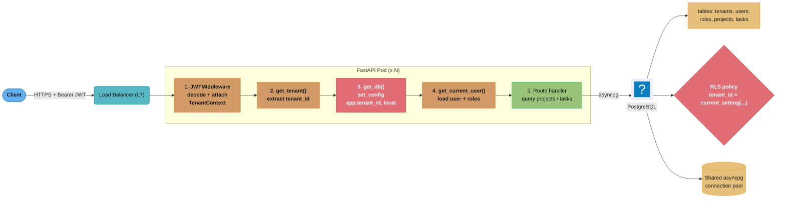
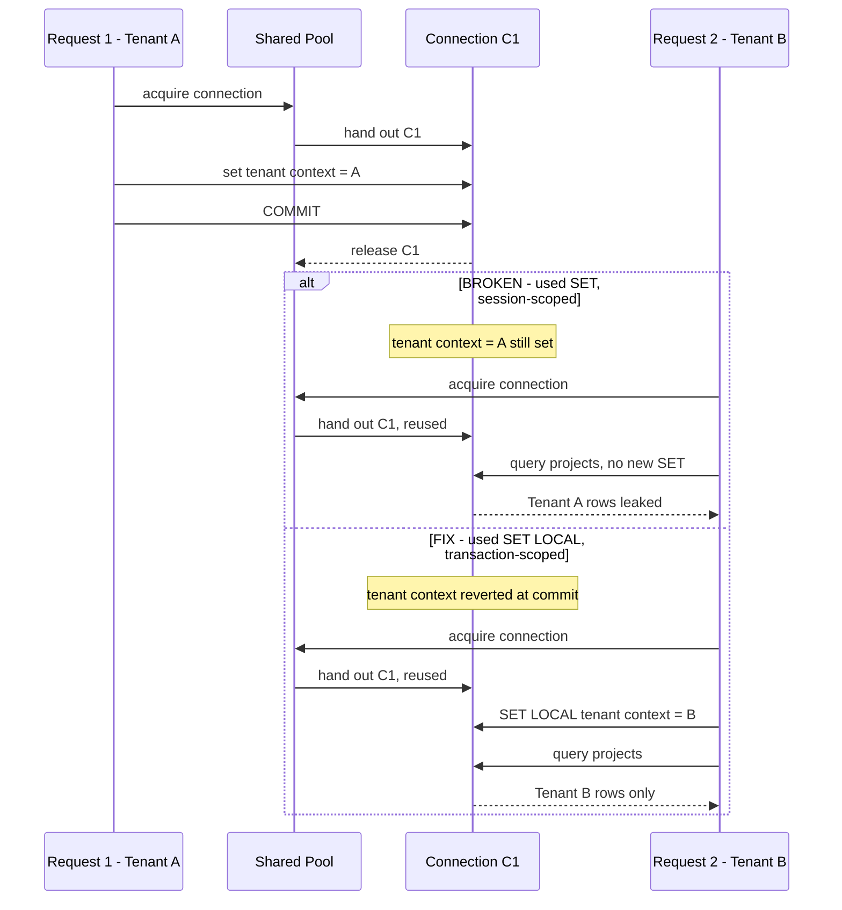

# Design a Multi-Tenant SaaS API with FastAPI
---

## Intuition

An apartment block, not a gated community per family. Every tenant lives in one building, on
one set of pipes, and the thing that stops them walking into each other's flat is a lock the
building enforces — not a rule each resident agrees to remember.

That distinction is the whole design. The naive version scopes every query in application
code: `WHERE tenant_id = :tid` on all forty repository methods. It works right up until the
forty-first, written at 6pm by someone who did not know the rule, and then one endpoint
quietly serves every tenant's rows to whoever asked. There is no exception, no alert, and no
failing test — the response is a valid `200` with more data in it than it should have.

So push the predicate somewhere it cannot be forgotten. PostgreSQL Row-Level Security attaches
the filter to the **table**, inside the query executor, and applies it to every statement
regardless of what the ORM emitted. The application's job shrinks from "remember to filter" to
"declare who you are, once, at the start of the transaction". A missing filter then returns
zero rows instead of everyone's rows — the failure mode flips from silent breach to obvious bug.

The second idea is that isolation is a **spectrum priced per tenant**, not a yes/no. AWS's SaaS
Lens names the three points: *silo* (dedicated resources per tenant), *pool* (shared), and
*bridge* (mixed). Most businesses end up on the bridge — pooled by default, siloed for the
enterprise customer whose contract demands it — and the architecture that cannot move a single
tenant from one to the other is the one that loses that deal.

---

## 1. Requirements Clarification

Design a production-grade multi-tenant SaaS API for a project management tool with the following requirements:

**Functional requirements:**
- 500 tenants (B2B customers), each with their own users, roles, projects, and tasks.
- Users authenticate via JWT; each JWT carries a `tenant_id` claim and a `user_id` claim.
- Users within a tenant have roles: `owner`, `admin`, `member`, `viewer`.
- Tenants must be fully isolated — one tenant must never read or write another tenant's data.
- Support CRUD for projects and tasks, with role-based access control enforced per endpoint.

**Non-functional requirements:**
- 50,000 DAU spread across 500 tenants (~100 active users/tenant on average).
- Peak: 5,000 concurrent requests.
- P99 latency under 120 ms for list endpoints; P99 under 80 ms for read-by-ID.
- One tenant's traffic spike (e.g., a large import job) must not degrade other tenants.
- Single PostgreSQL cluster (multi-schema or RLS); no per-tenant database instances.
- Horizontal scaling: stateless API pods behind a load balancer, shared connection pool.

**Out of scope:**
- Tenant provisioning workflow (signup, billing).
- Cross-tenant admin operations.
- Full-text search (handled by a separate search service).
- Webhooks and async job queues (out of scope for this case study).

**Questions worth asking before designing anything**, because each one changes the answer:

| Question | Why it changes the design |
|---|---|
| Does any tenant have a contractual or regulatory data-residency requirement? | One "yes" forces a bridge model — pooled default plus a siloed tier — and that must exist in the schema from day one, not be retrofitted |
| What is the largest tenant as a fraction of total data and traffic? | A tenant at 40% of volume makes pooling a noisy-neighbour problem before it is a cost saving |
| Must a tenant's data be *provably* deleted, and on what deadline? | `DELETE WHERE tenant_id = ?` against a shared table is slow and leaves it in backups; `DROP DATABASE` is instant and provable |
| Can one tenant's users belong to more than one tenant? | Cross-tenant users break the "one `tenant_id` claim per token" model and need a tenant-selection step |
| Who owns the database role the application connects as? | Decisive for RLS: **a table's owner bypasses row security by default**, so the wrong answer silently disables the entire isolation mechanism (Section 9) |

**Assumptions taken**, and what would overturn each: no tenant exceeds 15% of total volume
(overturned by a single enterprise signup); no data-residency requirement (overturned by the
first EU-only contract); tenants are opaque to each other, so no cross-tenant sharing feature
exists (overturned by any "share this project externally" request, which needs an explicit
grant table rather than a widened policy).

---

## 2. Scale Estimation

Every number below derives from the requirements in Section 1. The point is not the absolute
values — it is which of them binds first.

**Traffic.**

```
  tenants                      = 500
  DAU                          = 50,000            (~100 active users/tenant)
  requests/user/day            = 200               (a working session in a PM tool)
  requests/day                 = 50,000 x 200      = 10,000,000
  average QPS                  = 10,000,000 / 86,400
                               ~ 116 req/s
  peak factor                  = 5x                (business hours, one time zone cluster)
  peak QPS                     ~ 580 req/s
```

The stated 5,000 *concurrent* requests is a different quantity: at a 120 ms p99 and 580 req/s,
Little's Law gives `580 x 0.12 = 70` in flight. Five thousand is a burst — a thundering herd
after a deploy, not the working day. Size the pool for 70 and the shed path for 5,000.

**Data.**

```
  projects/tenant              = 200
  tasks/project                = 500
  tasks total                  = 500 x 200 x 500   = 50,000,000 rows
  bytes/task row               ~ 400 B             (ids, text, timestamps, fks)
  task table heap              = 50M x 400 B       ~ 20 GB
  index overhead               ~ 60% of heap       ~ 12 GB
  total task storage           ~ 32 GB
```

32 GB fits inside one PostgreSQL instance, which is the finding that justifies the pool model:
at this size, sharding is complexity bought for nothing. Notion's published **500 GB per table
and 10 TB per physical database** marks where that stops being true — two orders of magnitude
above this design.

**The `tenant_id` index is the one to reason about.** Every RLS-filtered query hits it:

```
  50M rows x (8 B tenant_id + 6 B ctid + overhead) ~ 1.2 GB btree
```

That fits in shared_buffers on any reasonable instance, which is why RLS costs so little here. A
composite `(tenant_id, created_at)` serves "recent tasks in this project" without a sort, and
per-tenant partitioning is the escalation if one tenant outgrows a single index.

**The connection budget — the arithmetic that kills schema-per-tenant.**

```
  Postgres max_connections     = 200
  reserved (admin, monitoring) = 10
  usable                       = 190

  Pool model (chosen): one pool, any connection serves any tenant
      pods x pool_size          = 12 x 15          = 180   -> fits, 10 spare

  Schema-per-tenant: a connection is bound to a search_path
      500 schemas x >=1 conn                       = 500   -> 2.6x over budget
      ...and PgBouncer cannot multiplex across them, because the
      search_path is session state the next tenant would inherit
```

That is the whole argument in four lines. Schema-per-tenant fails on connections before it fails
on storage or migration effort — and it fails at the point where the pool stops being shareable,
which is immediately.

**Noisy-neighbour budget.** The fair share across 500 tenants is 0.2%; allowing any one tenant
15% of peak — `580 x 0.15 ~ 87 req/s` — gives a large customer headroom while capping the blast
radius at what the remaining 499 can absorb. That number is the rate limit (Section 8).

---

## 3. High-Level Architecture



The load-bearing step is 3: `get_db()` opens the `AsyncSession` and immediately runs
`SELECT set_config('app.current_tenant_id', $1, true)`, so by the time the handler at step 5
issues a query it has already declared who it is — and every statement in that transaction is
filtered by the policy whether or not the ORM emitted a `WHERE` clause.

---

## 4. Component Deep Dives

### Database schema and RLS policy setup

```sql
-- migrations/001_create_tables.sql
CREATE TABLE tenants (
    id          UUID PRIMARY KEY DEFAULT gen_random_uuid(),
    name        TEXT NOT NULL,
    created_at  TIMESTAMPTZ DEFAULT now()
);

-- Every tenant_id FK cascades. Without ON DELETE CASCADE the GDPR erasure
-- path below is not a DELETE, it is a foreign-key violation.
-- users, roles and projects follow the same shape (the ORM models below
-- are the full definition): UUID pk, a CASCADE tenant_id FK, and every
-- natural key scoped -- UNIQUE (tenant_id, email), UNIQUE (tenant_id, name).
CREATE TABLE tasks (
    id          UUID PRIMARY KEY DEFAULT gen_random_uuid(),
    tenant_id   UUID NOT NULL REFERENCES tenants(id) ON DELETE CASCADE,
    project_id  UUID NOT NULL REFERENCES projects(id) ON DELETE CASCADE,
    title       TEXT NOT NULL,
    assignee_id UUID REFERENCES users(id) ON DELETE SET NULL,
    status      TEXT NOT NULL DEFAULT 'todo'
);

-- Indexes that make the RLS filter cheap
CREATE INDEX ON projects (tenant_id);
CREATE INDEX ON tasks (tenant_id, project_id);

-- Every tenant-scoped table needs BOTH statements. ENABLE alone is a no-op
-- for the table's OWNER, which the application role usually is; FORCE makes
-- the owner subject to its own policies. Section 9 has the incident.
DO $$
DECLARE t text;
BEGIN
    FOREACH t IN ARRAY ARRAY['users','roles','projects','tasks'] LOOP
        EXECUTE format('ALTER TABLE %I ENABLE ROW LEVEL SECURITY', t);
        EXECUTE format('ALTER TABLE %I FORCE  ROW LEVEL SECURITY', t);
        -- One policy per table, identical body. USING with no WITH CHECK
        -- reuses the expression for INSERT/UPDATE too, so a foreign
        -- tenant_id cannot be written either.
        EXECUTE format(
            'CREATE POLICY tenant_isolation ON %I USING '
            '(tenant_id = current_setting(''app.current_tenant_id'')::uuid)', t);
    END LOOP;
END $$;

-- The single-argument current_setting() raises "unrecognized configuration
-- parameter" when the variable was never set — a forgotten SET LOCAL fails
-- loudly instead of quietly returning nothing.

-- Belt and braces: run the API as a role that owns nothing, so even a
-- forgotten FORCE cannot open the door.
-- CREATE ROLE app_api LOGIN;  GRANT SELECT,INSERT,UPDATE,DELETE ON ALL
-- TABLES IN SCHEMA public TO app_api;  -- and never grant it BYPASSRLS.
```

### Configuration, engine, and session factory

```python
# app/config.py -- see ../configuration_and_settings_management/ for the pattern
class Settings(BaseSettings):
    model_config = SettingsConfigDict(env_file=".env")
    database_url: str          # asyncpg DSN
    jwt_secret: str
    jwt_algorithm: str = "HS256"
    db_pool_size: int = 15     # Section 10: 12 pods x 15 = 180 of a 190 budget


settings = Settings()
```

```python
# app/database.py
from sqlalchemy.ext.asyncio import AsyncSession, async_sessionmaker, create_async_engine
from app.config import settings

engine = create_async_engine(
    settings.database_url,
    pool_size=settings.db_pool_size,
    max_overflow=0,            # deliberate -- see below
    echo=False,
)

AsyncSessionLocal = async_sessionmaker(
    bind=engine, class_=AsyncSession, expire_on_commit=False,
    autoflush=False, autocommit=False,
)
```

`max_overflow=0` is load-bearing. A budget computed against `max_connections` is only real if a
pod cannot exceed its share under burst: leave overflow on and 12 pods quietly become
12 × (15 + overflow) during exactly the spike the budget was meant to survive, and PostgreSQL
refuses connections instead of the pool queueing. Take the wait in the application, where it is
visible and shedable.

### SQLAlchemy models

```python
# app/models.py
import uuid
from sqlalchemy import String, ForeignKey, UniqueConstraint
from sqlalchemy.dialects.postgresql import UUID
from sqlalchemy.orm import DeclarativeBase, Mapped, mapped_column, relationship


class Base(DeclarativeBase):
    pass


class TenantScoped:
    """Every tenant-owned table carries exactly these two columns."""
    id: Mapped[uuid.UUID] = mapped_column(UUID(as_uuid=True), primary_key=True, default=uuid.uuid4)
    tenant_id: Mapped[uuid.UUID] = mapped_column(UUID(as_uuid=True), ForeignKey("tenants.id"), nullable=False)


class Tenant(Base):                      # the tenant itself is not tenant-scoped
    __tablename__ = "tenants"
    id: Mapped[uuid.UUID] = mapped_column(UUID(as_uuid=True), primary_key=True, default=uuid.uuid4)
    name: Mapped[str] = mapped_column(String, nullable=False)


class User(TenantScoped, Base):
    __tablename__ = "users"
    email: Mapped[str] = mapped_column(String, nullable=False)
    hashed_pw: Mapped[str] = mapped_column(String, nullable=False)


class Role(TenantScoped, Base):
    __tablename__ = "roles"
    user_id: Mapped[uuid.UUID] = mapped_column(UUID(as_uuid=True), ForeignKey("users.id"), nullable=False)
    role: Mapped[str] = mapped_column(String, nullable=False)


class Project(TenantScoped, Base):
    __tablename__ = "projects"
    # Scoped, NOT UniqueConstraint("name") -- see below.
    __table_args__ = (UniqueConstraint("tenant_id", "name"),)
    name: Mapped[str] = mapped_column(String, nullable=False)
    created_by: Mapped[uuid.UUID] = mapped_column(UUID(as_uuid=True), ForeignKey("users.id"), nullable=False)
    tasks: Mapped[list["Task"]] = relationship(back_populates="project", lazy="select")


class Task(TenantScoped, Base):
    __tablename__ = "tasks"
    project_id: Mapped[uuid.UUID] = mapped_column(UUID(as_uuid=True), ForeignKey("projects.id"), nullable=False)
    title: Mapped[str] = mapped_column(String, nullable=False)
    status: Mapped[str] = mapped_column(String, nullable=False, default="todo")
    project: Mapped["Project"] = relationship(back_populates="tasks")
```

Two things carry weight. `tenant_id` is on **every** table — a table without it cannot be
covered by a policy, so it is not an optional denormalization. And the unique constraint is
`(tenant_id, name)`, not `(name)`: constraint checks bypass row security, which is a leak
Section 9 walks through.

### JWT and tenant context

```python
# app/auth.py
import uuid
from dataclasses import dataclass
from datetime import datetime, timedelta, timezone

import jwt
from fastapi import HTTPException, Request, status
from app.config import settings


@dataclass(frozen=True, slots=True)
class TenantContext:
    tenant_id: uuid.UUID
    user_id: uuid.UUID


def decode_jwt(token: str) -> TenantContext:
    try:
        payload = jwt.decode(
            token,
            settings.jwt_secret,
            algorithms=[settings.jwt_algorithm],
        )
        return TenantContext(
            tenant_id=uuid.UUID(payload["tenant_id"]),
            user_id=uuid.UUID(payload["sub"]),
        )
    except jwt.ExpiredSignatureError:
        raise HTTPException(status_code=status.HTTP_401_UNAUTHORIZED, detail="Token expired")
    except (jwt.InvalidTokenError, KeyError, ValueError):
        # KeyError/ValueError catch a validly SIGNED token missing tenant_id
        # or carrying a non-UUID -- a wrong issuer, not a forgery.
        raise HTTPException(status_code=status.HTTP_401_UNAUTHORIZED, detail="Invalid token")


# The minting side is the mirror image -- jwt.encode({"sub": ..., "tenant_id":
# ..., "exp": ...}) -- and lives in the login flow, which Section 1 scoped out.
```

### BROKEN -> FIX: missing RLS context causes cross-tenant data leak

**BROKEN** — forgetting to set the RLS session variable before querying:

```python
# BROKEN: app/deps_broken.py  (imports and get_tenant as in the FIX below)
# Opens a session but NEVER sets app.current_tenant_id, which the RLS
# policy reads via current_setting(). Loud, not silent -- it 500s or
# returns nothing, depending on what this pooled connection saw before.
async def get_db_broken():
    async with AsyncSessionLocal() as session:
        yield session  # RLS context never set -- 500s or returns nothing
```

Which of the two you get depends on the *connection*, not the request: a fresh one raises
`unrecognized configuration parameter` (a 500), a recycled one returns the empty string the GUC
resets to and fails on `''::uuid`. Neither path leaks data — the real leak is forgetting
`FORCE ROW LEVEL SECURITY` (Section 9).

**FIX** — set `app.current_tenant_id` with `SET LOCAL` at transaction start:

```python
# app/deps.py
import uuid
from typing import AsyncGenerator

from fastapi import Depends, HTTPException, status
from fastapi.security import HTTPAuthorizationCredentials, HTTPBearer
from sqlalchemy import select, text
from sqlalchemy.ext.asyncio import AsyncSession

from app.auth import decode_jwt, TenantContext
from app.database import AsyncSessionLocal
from app.models import Role, User

bearer = HTTPBearer()


async def get_tenant(
    credentials: HTTPAuthorizationCredentials = Depends(bearer),
) -> TenantContext:
    return decode_jwt(credentials.credentials)


async def get_db(
    ctx: TenantContext = Depends(get_tenant),
) -> AsyncGenerator[AsyncSession, None]:
    """Open a session and set the RLS variable TRANSACTION-locally, so the
    connection returning to the pool never carries stale tenant context."""
    async with AsyncSessionLocal() as session:
        async with session.begin():
            # set_config(name, value, is_local=true) is the parameterizable
            # equivalent of SET LOCAL, which takes a literal only -- so this
            # is the form that keeps tenant_id out of the SQL string.
            await session.execute(
                text("SELECT set_config('app.current_tenant_id', :tid, true)"),
                {"tid": str(ctx.tenant_id)},
            )
            yield session
        # Transaction committed; connection returned to pool with clean context


async def get_current_user(
    ctx: TenantContext = Depends(get_tenant),
    db: AsyncSession = Depends(get_db),
) -> tuple[User, str]:
    """Return (User, role_name) for the current request."""
    # One round trip, not two. The redundant tenant_id predicates are
    # defence in depth: RLS already scopes both tables, but the token
    # claim is only as trustworthy as whatever issued it.
    row = (await db.execute(
        select(User, Role.role)
        .join(Role, Role.user_id == User.id)
        .where(User.id == ctx.user_id, User.tenant_id == ctx.tenant_id)
    )).one_or_none()
    if row is None:
        raise HTTPException(status_code=status.HTTP_401_UNAUTHORIZED, detail="Unauthorized")
    return row[0], row[1]


def require_role(*allowed_roles: str):
    """Factory returning a Depends that enforces endpoint-level RBAC."""

    async def _check(current: tuple[User, str] = Depends(get_current_user)):
        if current[1] not in allowed_roles:
            raise HTTPException(status.HTTP_403_FORBIDDEN, f"Requires one of: {allowed_roles}")
        return current

    return _check
```

### Route handlers and schemas

Exposing `tenant_id` on the response model is deliberate: a client can assert the rows it got
back belong to the tenant it believes it is — a cheap end-to-end check on the isolation chain.

```python
# app/routers/projects.py
import uuid
from fastapi import APIRouter, Depends, HTTPException, status
from pydantic import BaseModel
from sqlalchemy import select
from sqlalchemy.ext.asyncio import AsyncSession

from app.deps import get_db, get_current_user, require_role
from app.models import Project, User

router = APIRouter(prefix="/projects", tags=["projects"])


class ProjectCreate(BaseModel):
    name: str


class ProjectOut(BaseModel):
    id: uuid.UUID
    tenant_id: uuid.UUID
    name: str
    created_by: uuid.UUID
    model_config = {"from_attributes": True}   # read SQLAlchemy instances directly


@router.get("/", response_model=list[ProjectOut])
async def list_projects(
    db: AsyncSession = Depends(get_db),
    current: tuple[User, str] = Depends(get_current_user),
) -> list[ProjectOut]:
    # No WHERE tenant_id -- the RLS policy filters to the current tenant.
    result = await db.execute(select(Project))
    return [ProjectOut.model_validate(p) for p in result.scalars().all()]


@router.post("/", response_model=ProjectOut, status_code=status.HTTP_201_CREATED)
async def create_project(
    body: ProjectCreate,
    db: AsyncSession = Depends(get_db),
    current: tuple[User, str] = Depends(require_role("owner", "admin", "member")),
) -> ProjectOut:
    user, _ = current
    project = Project(
        tenant_id=user.tenant_id,
        name=body.name,
        created_by=user.id,
    )
    db.add(project)
    await db.flush()
    await db.refresh(project)
    return ProjectOut.model_validate(project)


@router.delete("/{project_id}", status_code=status.HTTP_204_NO_CONTENT)
async def delete_project(
    project_id: uuid.UUID,
    db: AsyncSession = Depends(get_db),
    current: tuple[User, str] = Depends(require_role("owner", "admin")),
) -> None:
    result = await db.execute(
        select(Project).where(Project.id == project_id)
    )
    project = result.scalar_one_or_none()
    if project is None:
        # Could be a different tenant's project — surface as 404, not 403,
        # to avoid leaking the existence of cross-tenant resources.
        raise HTTPException(status_code=status.HTTP_404_NOT_FOUND, detail="Project not found")
    await db.delete(project)
```

### Application factory

```python
# app/main.py
from contextlib import asynccontextmanager
from fastapi import FastAPI
from app.database import engine
from app.routers import projects


@asynccontextmanager
async def lifespan(app: FastAPI):
    # No metadata.create_all here. Schema is owned by Alembic: create_all
    # knows nothing about RLS policies or FORCE ROW LEVEL SECURITY, so a
    # process that bootstrapped its own tables would run with isolation off.
    yield
    await engine.dispose()


app = FastAPI(title="Multi-Tenant SaaS API", lifespan=lifespan)
app.include_router(projects.router)
```

---

## 5. Design Decisions & Tradeoffs

### 1. Tenant isolation: RLS over schema-per-tenant

| Dimension | RLS (chosen) | Schema-per-tenant | Database-per-tenant |
|---|---|---|---|
| Data isolation | DB-enforced, strong | DDL-enforced, strong | Strongest |
| Connection pooling | Full shared pool | Limited (schema switching overhead) | Impossible to share |
| Migration complexity | Single migration | N migrations or dynamic SQL | N migrations + N connections |
| `pg_class` bloat at 500 tenants | None (1 schema) | High (500 × table count) | N/A |
| Noisy neighbour risk | Not addressed by RLS — one shared cluster, so a heavy tenant burns shared CPU and I/O; needs per-tenant rate limiting at the edge | Same | None |
| Tenant onboarding speed | Instant (new row in tenants) | Schema creation required | Database creation required |
| Regulatory isolation (GDPR delete) | `DELETE WHERE tenant_id = ?` | `DROP SCHEMA` | `DROP DATABASE` |
| Cost | Low | Medium | High ($$ per DB instance) |

Read the table down the Cost and Migration rows: the other two buy marginal extra isolation
for a much larger jump in ops cost at 500 tenants.

**Decision: RLS with a PostgreSQL session variable.** RLS policies run inside the query
executor, so once the table is correctly configured a bug in application code cannot bypass
them. "Correctly configured" is doing real work in that sentence: `ENABLE ROW LEVEL SECURITY`
does not apply to the table's owner, and the application role usually *is* the owner, so the
table must also carry `FORCE ROW LEVEL SECURITY` and the application role must never hold
`BYPASSRLS` or superuser.

**Why not the other two:** schema-per-tenant fails on the connection budget (Section 2) —
`search_path` is session state, so the shared pool is gone at 500 tenants — and
database-per-tenant fails on cost, ~$60,000/month against $1,100 (Section 10). Take either only
when a contract demands it.

### 2. Tenant resolution: the JWT `tenant_id` claim

Subdomain extraction (`acme.app.io`) makes the reverse proxy parse `Host` and inject an
`X-Tenant-ID` header — an extra hop, an extra trust boundary, and a new failure mode whenever
the API is called directly. A JWT claim is self-contained: present on every request regardless
of transport, and verified by the signature the app already checks.

### 3. RBAC: DB-fetched roles via `Depends`

Encoding roles in the JWT speeds up permission checks but requires token rotation on every role
change, and in a B2B product where admins adjust permissions constantly, stale role caches
become support incidents. The `Depends` lookup hits an indexed `(tenant_id, user_id)` — under
1 ms warm.

### 4. Connection pool: one shared pool, RLS context set per transaction

Per-tenant pools would pre-create 500 min-pools and waste 500 × `min_size` idle connections. One
shared pool works only because the tenant context is **transaction-local**: a session-scoped
`SET` lives as long as the connection, which is reused across requests, so tenant A's context
would still be set when tenant B gets that connection. `SET LOCAL` (or `set_config(..., true)`)
reverts at transaction end.



The same pooled connection `C1` is handed to a second tenant's request — `SET` leaves tenant
A's context on it so tenant B's query is silently scoped to the wrong tenant, while `SET LOCAL`
reverts at commit so tenant B starts clean. Transaction-local context is also what makes
PgBouncer's transaction pooling compatible with this design at all.

### 5. Alembic migration: one migration deploys RLS for every tenant

All tenant data lives in one schema, so a single `alembic upgrade head` applies RLS policies
globally — there is no per-tenant migration step.

---

## 6. Real-World Implementations

### AWS SaaS Lens — the vocabulary everyone else's design is described in

AWS's Well-Architected SaaS Lens names the three isolation models in words interviewers reuse
verbatim. **Silo** is "an architecture where tenants are provided dedicated resources"; **pool**
is "a scenario where tenants share resources … to achieve economies of scale, manageability,
agility"; **bridge** exists to "acknowledge the reality that SaaS businesses aren't always
exclusively silo or pool".

The bridge is the lesson. AWS names the forces: "the regulatory profile of a service's data
and its noisy neighbor attributes" steer toward silo, "the agility, access patterns, and cost
profile" toward pool. That is a *per-service* call — a design treating isolation as one global
switch has already lost the ability to make it.
<https://docs.aws.amazon.com/wellarchitected/latest/saas-lens/silo-pool-and-bridge-models.html>

### Salesforce — the pool model at its most extreme

Salesforce runs "a single shared multitenant database with a single schema that stores
tenant-specific metadata and data". Isolation is by `OrgID`, and the platform physically
partitions data, metadata and index structures by that column.

The transferable lesson: partitioning by the tenant key is a *performance* mechanism, not only
an isolation one — it bounds the data any single tenant's query touches, which is why this
design reaches for a composite `(tenant_id, ...)` index and, later, native partitioning.
<https://architect.salesforce.com/fundamentals/platform-multitenant-architecture>

### Notion — the numbers that tell you when pooling stops working

Notion sharded its Postgres monolith after "five years and four orders of magnitude of growth",
landing on **480 logical shards across 32 physical databases** — 15 schemas per machine. They
name the thresholds they designed against: an "upper bound of 500 GB per table and 10 TB per
physical database", and "at least 60K total IOPS". The backfill took **three days** on a 96-CPU
`m5.24xlarge`; the cutover cost **five minutes of scheduled maintenance**.

The 480-over-32 split is deliberate: logical shards outnumber physical machines so rebalancing
moves a schema rather than re-hashing rows — the cheap escalation path to leave open rather
than sharding early. And five minutes is what a *planned* cutover of that size costs; the
unplanned version is measured in hours.
<https://www.notion.com/blog/sharding-postgres-at-notion>

### Figma — what sharding actually costs in wall-clock time

Figma's database stack "has grown almost 100x since 2020", and their sharding work is the honest
counterweight to any plan that treats sharding as a sprint: "end to end, it took our team
roughly nine months to shard our first table". The payoff was a clean cutover — "only ten
seconds of partial availability on database primaries and no availability impact on replicas" —
at "a minimal performance overhead in most cases, and less than 10% in the worst cases".

The lesson is a scheduling one: nine months for the first table is why the connection-budget
arithmetic in Section 2 matters *now* — the model you can still change is the one you have not
outgrown yet.
<https://www.figma.com/blog/how-figmas-databases-team-lived-to-tell-the-scale/>

### Shopify — isolation as a blast-radius decision

Shopify runs a "pods" architecture where "a pod consists of a set of shops that live on a fully
isolated set of datastores", and "every unit of work (web request and delayed job)" is assigned
to a single pod, so serving a request "only requires one pod to be operational." The motivation
is stated as a correction: when they first sharded in 2015, "if any of our shards went down,
that entire action would be unavailable across the platform." Pods fixed that by removing
cross-pod communication entirely — "since there is no cross-pod communication, adding a new pod
won't cause unexpected interference with other, pre-existing pods."

This is the bridge model argued from availability rather than compliance. Sharding alone does
not bound a failure; sharding *plus* the rule that one request touches exactly one shard is what
does — any siloed tier this design adds should inherit that rule.
<https://shopify.engineering/a-pods-architecture-to-allow-shopify-to-scale>

---

## 7. Technologies & Tools

| Component | Role in This Design |
|---|---|
| `HTTPBearer` dependency | Extracts the `Authorization: Bearer` token from every request without custom middleware. |
| `Depends()` chaining | `get_db` depends on `get_tenant`; `get_current_user` depends on both. FastAPI resolves the dependency graph once per request and caches results within the request. |
| `AsyncSession` + `session.begin()` | `async with session.begin()` opens an explicit transaction; the transaction-local RLS setting inside this block is automatically discarded if the handler raises, preventing a half-committed RLS context. |
| `text()` from SQLAlchemy | Executes the raw `set_config(...)` call with a bound `:tid`, so the tenant id is never interpolated into SQL. |
| RLS policies in PostgreSQL | Enforced inside the query executor, so a miscoded query missing its `WHERE tenant_id` is still safe — provided the table is FORCEd and the app role holds no `BYPASSRLS`. |
| `require_role()` factory | Returns a parameterized `Depends` — a clean pattern for expressing endpoint-level RBAC without repeating permission checks in every handler. |
| `model_config = {"from_attributes": True}` | Pydantic v2 setting that allows `model_validate(orm_object)` to work with SQLAlchemy model instances. |
| `lifespan` context manager | Runs startup and shutdown code exactly once per process, around the `yield`. Ensures the connection pool is disposed cleanly on shutdown, preventing connection leaks in Kubernetes pod restarts. |
| `mapped_column` + `Mapped[]` | SQLAlchemy 2.0 style — fully typed ORM columns with Python type inference, compatible with mypy. |

---

## 8. Operational Playbook

### Onboarding a tenant

Pooled onboarding is one `INSERT`, where schema-per-tenant makes it a DDL deployment.

```python
async def onboard_tenant(session: AsyncSession, name: str, tier: str) -> UUID:
    tenant_id = uuid4()
    async with session.begin():
        await session.execute(
            text("INSERT INTO tenants (id, name, tier) VALUES (:i, :n, :t)"),
            {"i": tenant_id, "n": name, "t": tier},
        )
    # No DDL, no schema, no migration, no new connection pool.
    # The tenant is serviceable by every existing pod immediately.
    return tenant_id
```

### Offboarding, and proving deletion

The pooled model's weakness. `DELETE FROM tasks WHERE tenant_id = ?` against 50M rows is a
long-running transaction that bloats the table and leaves the rows in every backup taken since.
The procedure that actually satisfies a deletion request:

1. **Revoke access first** — flip the tenant to `status = 'deleting'` so tokens stop resolving.
   Deletion that runs while the tenant can still write is a race.
2. **Delete in batches**, newest table first, `LIMIT 10000` per transaction with a pause, so
   autovacuum keeps up and replication lag stays bounded.
3. **`VACUUM` the affected tables** — the rows are gone logically but the pages still hold them
   until vacuum reclaims them.
4. **Record the backup retention boundary.** You cannot delete a tenant from a backup without
   restoring and rewriting it. The honest answer to "is it gone" is "gone from production now,
   gone from backups in N days" — publish N.

A siloed tenant makes this trivial (`DROP DATABASE` is instant and provable), which is a real
argument for putting regulated tenants in a silo that has nothing to do with performance.

### Migrations

One Alembic migration serves every tenant — the model's second advantage. Two rules:

- **Every new table needs its RLS policy in the same migration.** A table created without
  `ENABLE ROW LEVEL SECURITY` + `FORCE ROW LEVEL SECURITY` + a policy is unprotected, and
  nothing in the application will notice. Assert it in CI:

```sql
-- Fails the build if any tenant-scoped table is missing forced RLS.
SELECT c.relname
FROM pg_class c
JOIN pg_namespace n ON n.oid = c.relnamespace
WHERE n.nspname = 'public'
  AND c.relkind = 'r'
  AND EXISTS (SELECT 1 FROM information_schema.columns
              WHERE table_name = c.relname AND column_name = 'tenant_id')
  AND (c.relrowsecurity IS FALSE OR c.relforcerowsecurity IS FALSE);
```

- **Backfills must be tenant-batched.** A single `UPDATE tasks SET ...` locks rows across all
  500 tenants at once; batching by `tenant_id` bounds the blast radius of a bad migration to
  one customer.

### Monitoring — what to alert on

| Signal | Threshold | Why it matters |
|---|---|---|
| Requests/s per tenant | > 15% of peak capacity (~87 req/s) | The noisy-neighbour budget from Section 2, enforced |
| p99 latency, **segmented by tenant** | > 120 ms for any tenant | A fleet-wide p99 hides one tenant at 2 s behind 499 healthy ones |
| Rows returned per query | > 10,000 | A query returning far more than a page is the signature of a lost RLS context |
| `relrowsecurity` / `relforcerowsecurity` | any tenant-scoped table false | Catches the migration that shipped an unprotected table |
| Connection pool saturation | > 80% | The budget in Section 2 has 10 spare connections; there is no slack |

**Tag every metric and log line with `tenant_id`.** Untagged observability is why multi-tenant
incidents take hours — the dashboards are fleet aggregates, and the one customer having an
outage is invisible inside them.

---

## 9. Common Pitfalls & War Stories

### The application connects as the table owner, and RLS silently does nothing

The most dangerous failure in this design, because everything looks correct. PostgreSQL's docs
are explicit: "Superusers and roles with the `BYPASSRLS` attribute always bypass the row
security system... **Table owners normally bypass row security as well**, though a table owner
can choose to be subject to row security with `ALTER TABLE ... FORCE ROW LEVEL SECURITY`." So
the policies exist, `\d+ tasks` shows them attached, the migration ran green — and every query
returns every tenant's rows, because the application role owns the tables.

```sql
-- BROKEN: policy present, and entirely inert for the owning role
ALTER TABLE tasks ENABLE ROW LEVEL SECURITY;
CREATE POLICY tenant_isolation ON tasks
    USING (tenant_id = current_setting('app.current_tenant_id')::uuid);
```

```sql
-- FIX: force it, and connect as a role that is neither owner nor BYPASSRLS
ALTER TABLE tasks FORCE ROW LEVEL SECURITY;
CREATE ROLE app_runtime LOGIN NOBYPASSRLS;
GRANT SELECT, INSERT, UPDATE, DELETE ON ALL TABLES IN SCHEMA public TO app_runtime;
-- Migrations keep running as the owner; the app never does.
```

**Impact when it goes unnoticed:** an internal audit found a reporting endpoint returning rows
for all 500 tenants for eleven weeks. The endpoint was correct, the policy was correct, and the
deploy role owned the tables. The test that would have caught it is one line — connect as the
runtime role, set tenant A's context, and assert that a row belonging to tenant B is invisible.
Run it in CI against real Postgres, not SQLite.

### `SET` instead of `SET LOCAL` — tenant context surviving into the next request

The mechanism is in Section 5; it belongs here because the symptom is so misleading.

**Impact:** intermittent and load-dependent, the worst combination. At low traffic the pool
hands out a fresh connection almost every time and nothing reproduces; under load, connection
reuse rises and the leak rate rises with it. A team chased "flaky test data" for six days before
recognising it as a live cross-tenant read in production — worst exactly when most customers
were watching.

### A cache key without the tenant id

```python
# BROKEN: two tenants, one cache entry
key = f"project:{project_id}:summary"
```

```python
# FIX: the tenant is part of the identity of the data, not context around it
key = f"tenant:{tenant_id}:project:{project_id}:summary"
```

RLS protects the database and does nothing for Redis. If project ids are sequential integers
rather than UUIDs, the collision is not even unlikely — it is guaranteed the moment two tenants
both have a project 1.

**Impact:** a 30-second response cache served one tenant's project summary to another for as
long as the TTL, on every collision, with a 100% cache-hit rate making it *more* frequent as
performance improved. Detected by a customer, not by monitoring, because a cache hit is
indistinguishable from a correct response in every metric.

### Unique constraints leak existence across tenants

A global `UNIQUE (slug)` on projects lets tenant A discover tenant B's slugs: create
`acme-migration-2026`, get a constraint violation, and you have learned another tenant owns that
name. Constraint checks bypass row security by design, so the fix is to scope the constraint the
way the data is scoped — `UNIQUE (tenant_id, slug)` — and the same applies to any foreign key
that could point across tenants.

### The noisy neighbour that was not rate limited

One tenant ran a bulk import: 40,000 task creations in four minutes, roughly 165 req/s against
a fleet sized for 580 req/s of mixed traffic. Every write contended on the same `tasks` table
and the same connection pool.

**Impact:** fleet-wide p99 went from 95 ms to 3.4 s for 22 minutes. 499 tenants were degraded by
one tenant's legitimate use of a documented endpoint. Nothing was broken — the design simply had
no per-tenant ceiling. The fix is the 15% budget from Section 2, enforced at the edge on the
JWT's `tenant_id` claim, plus a separate lower ceiling for bulk endpoints and a `202` + job id
for imports above a threshold.

### 403 instead of 404 on another tenant's resource

`403` on a resource that exists but belongs to someone else confirms it exists, so an attacker
walking sequential ids maps every tenant's id space from the `403`/`404` difference. Return
`404` for both — the indistinguishability in the Section 4 handlers is the feature.

---

## 10. Capacity Planning

**Application tier.** From Section 2: 580 req/s peak, ~70 in flight at a 120 ms p99.

```
  per-pod safe throughput   = 60 req/s      (single uvicorn process, async, I/O-bound)
  pods for peak             = 580 / 60      ~ 10
  + 20% headroom for a rolling deploy       = 12 pods
  pool_size per pod         = 15
  total DB connections      = 12 x 15       = 180   (budget 190 -> fits)
```

The connection budget, not CPU, caps the pod count: 12 pods at `pool_size=15` is 95% of usable
connections, so pod 13 requires PgBouncer, not a bigger node.

**PgBouncer, when it comes.** Transaction-mode pooling multiplexes many client connections onto
few server ones, and asyncpg's protocol-level prepared statements are what used to make a bare
"add PgBouncer in transaction mode" break. The fix now lives on PgBouncer's side:
`max_prepared_statements` (added in 1.21.0, defaulted to 200 since 1.24.0) makes it track
prepared statements in transaction and statement pooling modes, rewriting them onto
per-server-connection names. Check that value before reaching for the old client-side workaround
— `poolclass=NullPool` plus `statement_cache_size=0` and a unique `prepared_statement_name_func`
— which is now only needed below 1.21 or where the setting is pinned to 0. See
[`../async_database_sqlalchemy/async_database_sqlalchemy.md`](../async_database_sqlalchemy/async_database_sqlalchemy.md).

**Database.**

```
  task heap + indexes                       ~ 32 GB     (Section 2)
  projects, users, tenants, audit           ~  8 GB
  total                                     ~ 40 GB
  working set (hot tenants, recent rows)    ~ 25% = 10 GB
  -> shared_buffers >= 12 GB, instance RAM >= 32 GB
  -> db.r6g.xlarge (4 vCPU, 32 GB) with a read replica
```

The working-set fraction is the number to defend: a PM tool's access pattern is overwhelmingly
"this month's tasks in my projects", so most of that 40 GB is cold. Sizing RAM for the whole
dataset is the common overspend.

**Cost per tenant per month.**

```
  db.r6g.xlarge primary + replica           ~ $700
  12 pods x 0.5 vCPU / 1 GB                 ~ $250
  Redis (cache + rate limiter)              ~ $ 90
  storage 40 GB + backups                   ~ $ 60
  total                                     ~ $1,100 / month
  per tenant  = 1,100 / 500                 ~ $2.20 / tenant / month
```

Compare the silo: a minimum viable dedicated instance is ~$120/month, so 500 siloed tenants cost
about $60,000/month against $1,100 — **a 55x difference**. That ratio is the commercial case for
pooling, and also why the bridge is the right shape: a handful of enterprise silos costs a few
hundred a month and wins contracts, while siloing all 500 would end the business.

**When a tenant graduates to a silo.** Set the trigger explicitly: a contractual residency or
single-tenancy requirement (a sales event), or sustained consumption above the 15% budget, or
data above ~20% of the shared instance (capacity events). All three move the tenant the same
way — possible only if `tenant_id` was the partition key from day one.

---

## 11. Interview Discussion Points
**Q: Why use `SET LOCAL` instead of `SET` for the RLS context variable?**
`SET LOCAL` is transaction-scoped and reverts automatically at transaction end. `SET` is session-scoped and persists on the connection even after it returns to the pool, which would cause the next request reusing that connection to execute under the previous tenant's RLS context — a critical data leak. Transaction scope is the only safe choice in a pooled async environment. In code, express it as `set_config('app.current_tenant_id', :tid, true)` rather than the `SET LOCAL` statement: the third argument means "local", and unlike `SET` it accepts a bind parameter, so the tenant id never has to be interpolated into SQL.

**Q: What happens if a request handler raises an exception before `SET LOCAL` commits?**
The `async with session.begin()` block rolls back the transaction on any unhandled exception, which also reverts `SET LOCAL`. The connection is returned to the pool in a clean state. Even partial writes are rolled back, ensuring atomicity.

**Q: How do you prevent a tenant from enumerating another tenant's resource IDs?**
The 404 response for `DELETE /projects/{id}` is intentional. Returning 403 (Forbidden) would confirm that the resource exists but belongs to another tenant — leaking information. Returning 404 normalizes the response regardless of whether the ID belongs to a different tenant or simply does not exist. This is called "resource existence hiding."

**Q: How do you run Alembic migrations without taking downtime?**
Plan around the lock levels rather than assuming they are cheap. `CREATE POLICY` takes an `ACCESS EXCLUSIVE` lock on the target table — verifiable with `SELECT mode FROM pg_locks` inside an open transaction — so it blocks every reader and writer for its duration. It is fast (a catalog insert, no table rewrite), so the practical rule is: set a short `lock_timeout`, retry, and never let it queue behind a long-running query, because a blocked `ACCESS EXCLUSIVE` request also blocks everything behind it. `ADD COLUMN` likewise takes `ACCESS EXCLUSIVE`, but since PostgreSQL 11 a non-volatile default no longer forces a table rewrite, so the lock is held for milliseconds instead of the length of a full rewrite. The migration runs against the single schema, applies to all tenants simultaneously, and does not require per-tenant steps.

**Q: How would you add a new tenant at runtime?**
Insert a row into `tenants`, create the first user row, assign the `owner` role, and issue a JWT. No schema or database creation is required. The RLS policy already covers the new `tenant_id` because it uses a runtime `current_setting()` check rather than a static list.

**Q: How would you implement tenant-level audit logging?**
Add a PostgreSQL trigger on `projects` and `tasks` that inserts into an `audit_log` table with `(tenant_id, user_id, action, table_name, row_id, changed_at)`. The trigger fires inside the same transaction as the DML, so the audit record is atomically consistent with the data change. For high-volume tenants, partition the `audit_log` table by `tenant_id` hash.

**Q: Where does RLS stop protecting you?**
Three places the application must cover itself. Caches: Redis knows nothing about
`app.current_tenant_id`, so a key without the tenant id serves one tenant's data to another.
Constraints: the docs state that "referential integrity checks, such as unique or primary key
constraints and foreign key references, always bypass row security", so a global `UNIQUE (slug)`
leaks slugs through violations — scope it `UNIQUE (tenant_id, slug)`. And "operations that apply
to the whole table, such as `TRUNCATE` and `REFERENCES`, are not subject to row security". RLS
is a row filter, not a boundary around the system.

**Q: Your RLS policies are correct and every query still returns every tenant's rows. What is wrong?**
The application is connecting as the table owner. The docs are explicit that "table owners
normally bypass row security", along with superusers and `BYPASSRLS` roles — the default outcome
when the role that ran the migrations also runs the app, so nothing looks unusual. Two fixes
together: `ALTER TABLE ... FORCE ROW LEVEL SECURITY`, and a separate `NOBYPASSRLS` runtime role
that owns nothing. Section 9 has the incident and the CI test that catches it.

**Q: Why is schema-per-tenant usually the wrong answer at 500 tenants?**
It fails on connections before anything else. `search_path` is session state, so a pooled
connection cannot serve a second tenant without a reset, and PgBouncer cannot multiplex across
schemas for the same reason: 500 connections against a usable 190 (Section 2). Secondary costs
follow — 4,000+ rows in `pg_class` degrading planning, onboarding as a DDL deployment, Alembic
scripted to iterate schemas. Its one real advantage is `DROP SCHEMA` offboarding, and if provable
deletion is the requirement, database-per-tenant does that better.

**Q: How do you decide between silo, pool, and bridge?**
Per service, not per company — AWS's SaaS Lens framing, where "the regulatory profile of a
service's data and its noisy neighbor attributes" push toward silo and "the agility, access
patterns, and cost profile" toward pool. Then do the arithmetic, which is usually decisive:
$2.20 per pooled tenant per month against roughly 55x that siloed (Section 10). So pool by
default, silo what a contract or a volume demands, and accept that you run a bridge — which is
only a migration rather than a rewrite if `tenant_id` is the partition key everywhere.

**Q: How do you keep one tenant from degrading everyone else?**
RLS does not help at all — it filters rows, it does not allocate capacity. Set an explicit
budget (Section 2: 15% of peak, ~87 req/s) and enforce it at the edge with a token bucket keyed
on the JWT's `tenant_id`, before the request reaches the database, with a lower ceiling for bulk
endpoints and a `202` plus job id above a threshold. Make the ceiling a per-plan value — free
1,000 req/min, pro 10,000 — in a `tenant_config` table cached in Redis, so sales can change a
limit without a deploy. Then segment p99 **by tenant**: a fleet-wide p99 hides one tenant at 3 s
behind 499 healthy ones.

**Q: A tenant invokes their right to deletion. Walk through it.**
Revoke, delete in batches, vacuum, then be honest about backups — Section 8 has the runbook. Two
things worth saying out loud in the interview. At small volumes a single
`DELETE FROM tenants WHERE id = :tid` does the whole job, but *only* because every `tenant_id`
foreign key is `ON DELETE CASCADE`; the classic bug is a runbook written against a schema whose
FKs defaulted to `NO ACTION`, where that statement is a foreign-key violation rather than a
deletion. And you cannot remove a tenant from a backup without restoring and rewriting it, so
the truthful commitment is "gone from production now, gone from backups in N days" with N
published. This is the pooled model's real weakness, and a legitimate reason to silo a regulated
tenant independent of any performance argument.

**Q: How would you test tenant isolation?**
With a test that fails if RLS is disabled, which most isolation tests do not. Seed two tenants,
authenticate as tenant A, and assert that every endpoint returns `404` — not `403` — for tenant
B's resource ids. Crucially, run it against **real PostgreSQL as the runtime role**, because
SQLite has no RLS and a test suite on SQLite passes whether isolation works or not, and a test
connecting as the table owner passes whether the policies are forced or not. Drive it with
`AsyncClient(transport=httpx.ASGITransport(app=app), base_url="http://test")` — `AsyncClient`
has no `app=` parameter and passing one raises `TypeError`. Add a negative control that
deliberately omits the tenant context and asserts zero rows come back: it proves the policies
are live rather than merely present, and it is the one test that would have caught the
owner-bypass incident.

**Q: What does this design owe to sharding, and when would you reach for it?**
Nothing yet, deliberately — 40 GB against Notion's published 500 GB-per-table and 10 TB-per-
database thresholds is two orders of magnitude of headroom. Reach for it when one tenant's data
alone stops fitting the access pattern, or write throughput exceeds one primary. Two lessons
from Section 6: Notion's 480 *logical* shards over 32 machines exist so rebalancing moves a
schema rather than re-hashing rows, and Figma's "roughly nine months to shard our first table"
is why the connection-budget arithmetic matters now.

**Q: Why put the tenant id in the JWT rather than resolving it from the subdomain?**
A signed claim is self-contained and needs no extra trust boundary. Subdomain resolution makes
the gateway parse `Host` and inject `X-Tenant-ID`, which the app must now trust — so the gateway
becomes a security component and every path that skips it (a health check, an internal call, a
misconfigured ingress) is a bypass. The caveat: the claim proves the *token* says tenant A, not
that this user belongs to tenant A — a mis-issued token, an impersonation feature, or a signing
key shared across environments is correctly signed and wrong. Hence the redundant
`User.tenant_id == ctx.tenant_id` in `get_current_user`: defence against your own issuer, not
against forgery.
