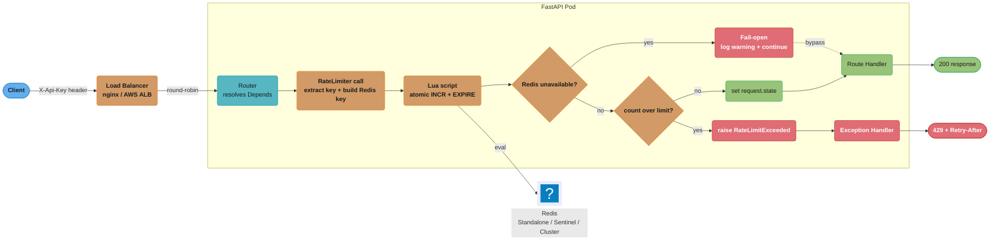
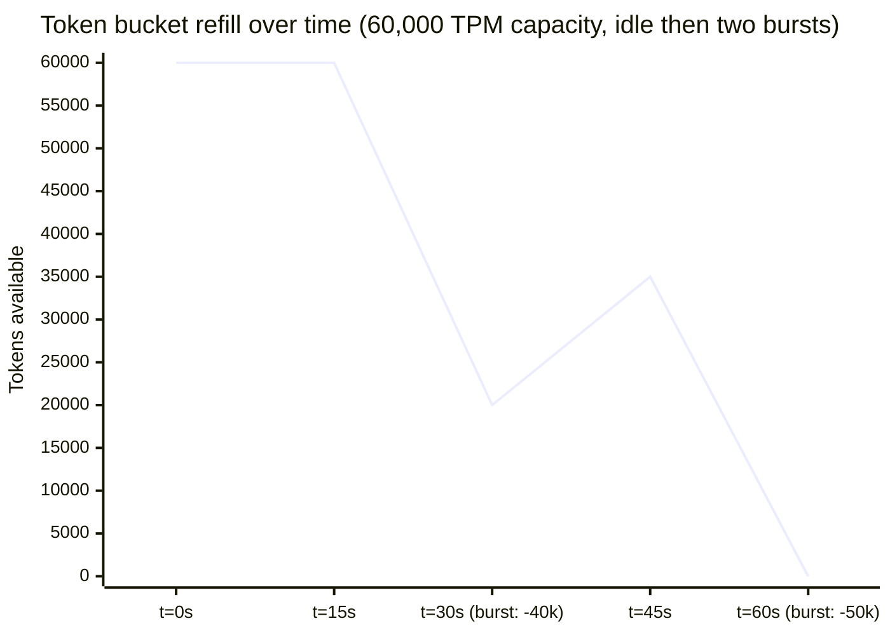
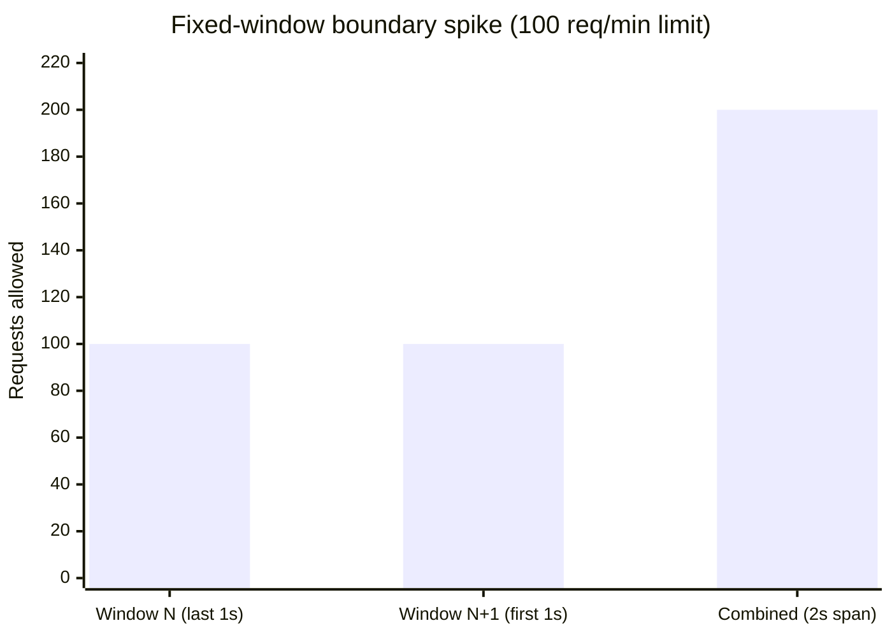

# Design a Rate-Limited API with FastAPI

---

## Intuition

A rate limiter is a bouncer at a door with a fixed number of tickets that refill on a
schedule. The hard part is never the bouncer's arithmetic — it is that this design runs
**20 bouncers at 20 different doors** (one FastAPI pod each) who must agree, in real time,
how many tickets are left, without ever both admitting the same last ticket. That agreement
must survive a bouncer's phone dying (Redis down), two bouncers checking the count at the
same microsecond (TOCTOU), and a rush arriving right as the shift changes (the window
boundary). Everything below buys that agreement cheaply: a shared ledger (Redis), a rule for
reading it exactly once atomically (a Lua script), a decision for when the ledger is
unreachable (fail open vs fail closed) — and, for the newest APIs, a redefinition of what a
"ticket" costs, since one LLM request can burn 200 tickets and another burns one.

---

## 1. Requirements Clarification

**Functional requirements:**
- Limit each API key to 100 requests per minute (sliding window) and 1000 requests per day.
- Enforce limits across all pods in a horizontally scaled deployment — no in-process state.
- Return HTTP 429 with a `Retry-After` header and an RFC 9457 Problem Details error body on limit breach.
- Fail open: if Redis is unavailable, allow traffic rather than blocking the entire API.
- Expose the limiter as a `Depends()`-injected service so individual routes can override their own limits.
- Support multi-dimensional keys: per-API-key (primary), per-IP (abuse fallback for
  unauthenticated routes), and per-tenant (an enterprise customer's *aggregate* usage
  across all of that tenant's API keys must also be capped).
- Support cost-based limiting: a route can declare it costs more than 1 "unit" per call
  (e.g., a bulk-export endpoint costs 20 units against the same budget a simple `GET`
  costs 1 unit).

**Non-functional requirements:**
- P99 overhead added by the rate-limiter check: under 2 ms at 5000 req/s.
- No single point of failure — Redis Sentinel or Cluster is acceptable; the app must not crash if Redis goes down.
- The counter must be exact under concurrency: at 5000 req/s no client may be admitted past its limit
  inside a single window because two requests raced (no check-then-act).

**Clarifying questions an interviewer expects you to ask, and why each one changes the design:**

| Question | Why it matters |
|----------|-----------------|
| Is this limiter public-facing (external developers) or internal (service-to-service)? | External demands published, stable limits and `X-RateLimit-*` headers as a contract; internal can be looser and rely on mTLS identity instead of API keys |
| Is there a CDN/edge layer in front of FastAPI already? | If an edge or gateway layer already terminates traffic, doing per-IP limiting again in FastAPI is redundant work at the wrong layer — see §3 |
| Are any routes LLM-backed? | Requests-per-second is the wrong unit for token-metered endpoints; needs a token-budget limiter, not a request counter — see §4.9 |
| Single region or multi-region? | Single Redis is fine for one region; multi-region needs either regional Redis with per-region quotas, or a local-token-lease design with periodic global reconciliation — see §5 |
| Do tenants share infrastructure (multi-tenant SaaS) or is each customer isolated? | Shared infra needs a tenant-level ceiling in addition to the per-key ceiling, or one noisy tenant's traffic starves every other tenant's requests at the shared Redis and origin |

**Out of scope:**
- Full IP-geolocation-based abuse detection (rate limiting is a blunt instrument; a WAF or bot-management product is the right tool for adversarial traffic).
- Persistent audit log of every limit breach (covered briefly in §8, not designed in full).
- Billing reconciliation for cost-based quotas (§4 shows the mechanism; invoicing is a separate system).

---

## 2. Scale Estimation

Assume a mid-size public API: 50,000 active API keys, average 2 requests/minute per active
key during business hours, with a well-known 10x peak-to-average ratio around a launch.

**Requests per second:**
```
Average:  50,000 keys x 2 req/min = 100,000 req/min = 1,667 req/s
Peak:     1,667 req/s x 10        = 16,670 req/s     (round to 17,000 req/s)
```

**Redis operations per request** — this design's `RateLimiter` issues one `EVAL` per
window it checks. The base design checks 2 windows (minute + day); adding the per-IP
and per-tenant dimensions from §1 makes it 4 checks per request in the worst case:
```
Redis ops/s (peak) = 17,000 req/s x 4 checks/req = 68,000 Redis ops/s
```
A single Redis node handling simple `EVAL` calls on commodity hardware comfortably clears
this (Redis's own benchmark guidance puts a single node in the low hundreds of thousands of
simple ops/s without pipelining) — but 68,000 ops/s is the number to actually run through
`redis-benchmark` against production-shaped hardware before trusting it, not a number to
take on faith. §10 works the collapsed-key version that gets this back down to 2 checks/req.

**Key count and memory:**
```
Minute-window keys:  50,000 keys (one active minute bucket per API key at any instant)
Day-window keys:     50,000 keys (one active day bucket per API key)
IP-window keys:      ~200,000 (assume 4x more distinct IPs than keys, behind NATs/proxies)
Tenant keys:          5,000 (fewer tenants than keys; each tenant aggregates several keys)

Total live keys ~= 305,000

Bytes per key (Redis string, INCR counter):
  key name   ~40 bytes  ("rate::sk-abc123def456::minute::1735689600")
  Redis overhead per key (dict entry + robj header) ~= 56 bytes
  value (int-encoded, shared integer pool for small ints) ~= 0 marginal bytes
  --------------------------------------------------------
  ~96 bytes/key

Total memory = 305,000 keys x 96 bytes ~= 29 MB
```
That is trivially small — the real memory risk in this design is not the steady-state key
count, it is **unbounded growth from a missing TTL** (see the war story in §9), where a
key that never expires accumulates forever instead of cycling every 60 seconds or 24 hours.

**Bandwidth:**
```
Request:  ~40-byte Redis key + 2 small integer ARGVs, well under 100 bytes on the wire
Response: [count, exceeded_flag] array, ~20 bytes

Peak Redis command bandwidth = 68,000 ops/s x 120 bytes ~= 8.2 MB/s

That is nothing against even a single 1 Gbps NIC (125 MB/s) — Redis Cluster/Sentinel
topology in §10 is driven by ops/s and failover, never by this bandwidth number.
```

**Overhead budget check against the 2 ms P99 requirement:** a single local-network Redis
round-trip for an `EVAL` call is typically 0.3-0.8 ms; two sequential checks (minute + day)
puts a hot-path request at 0.6-1.6 ms before the route handler runs at all — inside budget,
but with little room left for a third or fourth sequential check. This is exactly why §10
and the collapsed-key trick in the interview Q&A matter at this traffic level: sequential
`EVAL` calls are the first thing to cut when the budget gets tight.

---

## 3. High-Level Architecture

The `RateLimiter` dependency sits between the router and the route handler on every request; the two decision diamonds are what make it a rate limiter — a Redis outage takes the dotted fail-open bypass instead of blocking the 100 req/min and 1000 req/day checks that protect the API.



Each of the two windows gets its own Redis key so the minute and day counters expire independently; every TTL is set to twice the window length so a key can never vanish while it is still the authoritative counter.

```
Redis key layout                                                  TTL
-----------------                                                 ---
rate::{api_key}::minute::{window_start_unix_second}               120 s   (2x window)
rate::{api_key}::day::{utc_date_string}                            172800 s (48h, 2x window)
rate::tenant::{tenant_id}::minute::{window_start_unix_second}     120 s   (aggregate ceiling)
rate::ip::{ip}::minute::{window_start_unix_second}                120 s   (unauth fallback)

Example: rate::sk-abc123::minute::1717516260
```

**Where the limiter belongs.** The diagram above puts the check inside the FastAPI pod,
which is a deliberate choice, not the only correct answer — an interviewer expects it
justified. Three layers can own this check, each catching a different class of problem
before it reaches the next:

| Layer | Catches | Cost model |
|-------|---------|------------|
| Edge / CDN (Cloudflare, AWS WAF) | Volumetric abuse, before origin is touched at all | Cheapest — pays nothing per-app-instance |
| API Gateway (Kong, Envoy, ALB) | Published, uniform per-key contract limits | Language-agnostic; survives an app redeploy |
| FastAPI `Depends()` (this design) | Limits needing application context the gateway lacks: a parsed subscription tier, a route cost weight, a mid-response token count | Highest — one Redis round-trip per pod per check |

A flat per-IP limit in FastAPI when the gateway already enforces it is redundant work paid
on every request for no additional protection — state that tradeoff explicitly rather than
defaulting to "put it in the app."

---

## 4. Component Deep Dives

### 4.1 Dependencies and models

```python
# requirements: fastapi>=0.140, redis>=8.0, pydantic>=2.13, uvicorn>=0.51
from __future__ import annotations

import time
import logging
from contextlib import asynccontextmanager
from typing import Annotated, AsyncGenerator

import redis.asyncio as aioredis
from fastapi import Depends, FastAPI, HTTPException, Request, Response, status
from fastapi.responses import JSONResponse
from pydantic import BaseModel

logger = logging.getLogger(__name__)
```

### 4.2 Redis connection pool via `lifespan`

```python
class AppState:
    redis: aioredis.Redis


app_state = AppState()


@asynccontextmanager
async def lifespan(app: FastAPI) -> AsyncGenerator[None, None]:
    """Create the Redis connection pool once at startup; close it on shutdown."""
    pool = aioredis.ConnectionPool.from_url(
        "redis://localhost:6379",
        max_connections=50,
        decode_responses=True,
        socket_connect_timeout=1.0,
        socket_timeout=0.5,
    )
    app_state.redis = aioredis.Redis(connection_pool=pool)
    logger.info("Redis connection pool created (max_connections=50)")
    yield
    await app_state.redis.aclose()
    logger.info("Redis connection pool closed")


app = FastAPI(lifespan=lifespan)
```

### 4.3 RFC 9457 Problem Details error model and custom exception

```python
class ProblemDetail(BaseModel):
    type: str = "https://example.com/errors/rate-limit-exceeded"
    title: str = "Too Many Requests"
    status: int = 429
    detail: str
    instance: str
    retry_after: int


class RateLimitExceeded(Exception):
    def __init__(self, retry_after: int, detail: str, path: str) -> None:
        self.retry_after = retry_after
        self.detail = detail
        self.path = path


@app.exception_handler(RateLimitExceeded)
async def rate_limit_handler(request: Request, exc: RateLimitExceeded) -> JSONResponse:
    body = ProblemDetail(
        detail=exc.detail,
        instance=exc.path,
        retry_after=exc.retry_after,
    )
    return JSONResponse(
        status_code=status.HTTP_429_TOO_MANY_REQUESTS,
        content=body.model_dump(),
        media_type="application/problem+json",  # required by RFC 9457
        headers={
            "Retry-After": str(exc.retry_after),
            # IETF draft form, sent alongside the legacy X-RateLimit-* headers
            # so both an old and a new client library can parse the response.
            "RateLimit-Policy": '"minute";q=100;w=60',
        },
    )
```

### 4.4 Lua script for atomic sliding-window check-and-increment

```python
# rate_limit.lua, embedded as a string constant.
# KEYS[1] = the rate-limit key
# ARGV[1] = the TTL in seconds
# ARGV[2] = the per-window request limit
# ARGV[3] = the cost of this request (default 1; bulk-export routes pass more)
# Returns: [current_count, limit_exceeded_flag]
#   limit_exceeded_flag = 1 if the NEW count exceeds the limit, 0 otherwise.
RATE_LIMIT_LUA = """
local current = redis.call('INCRBY', KEYS[1], ARGV[3])
if tonumber(redis.call('TTL', KEYS[1])) < 0 then
    redis.call('EXPIRE', KEYS[1], ARGV[1])
end
if current > tonumber(ARGV[2]) then
    return {current, 1}
end
return {current, 0}
"""
```

Two changes from a first-pass version worth calling out: `INCRBY` (not `INCR`) so a
cost-weighted request can add more than 1 in a single call, and checking `TTL` rather than
`current == 1` to decide whether to set the expiry. `current == 1` looks equivalent but
breaks the moment `INCRBY` can add more than 1 in the very first call on a key — a
20-cost request lands on a brand-new key with `current == 20`, the `== 1` check is false,
`EXPIRE` never runs, and the key leaks forever. Checking `TTL < 0` (Redis returns `-1` for
"no TTL set") is correct regardless of the increment size.

### 4.5 EVALSHA over EVAL: why script caching matters at scale

`redis_client.eval(...)` sends the full Lua source on every call — at 17,000 req/s that is
17,000 copies of the same script re-parsed by Redis every second for zero benefit, since the
script never changes. `EVALSHA` sends only its SHA1 hash; Redis runs the cached compiled
form. Load once, then fall back to a full `EVAL` only on a cache miss — typically only right
after a Redis restart, since `SCRIPT LOAD` results do not survive one:

```python
class LuaScriptCache:
    """Loads the rate-limit script once and calls it by SHA thereafter."""

    def __init__(self, redis_client: aioredis.Redis, script_source: str) -> None:
        self._redis = redis_client
        self._script_source = script_source
        self._sha: str | None = None

    async def eval(self, keys: list[str], args: list[int]) -> list[int]:
        if self._sha is None:
            self._sha = await self._redis.script_load(self._script_source)
        try:
            return await self._redis.evalsha(self._sha, len(keys), *keys, *args)
        except aioredis.ResponseError as exc:
            # NOSCRIPT: Redis restarted and lost its script cache. Reload once and retry.
            if "NOSCRIPT" not in str(exc):
                raise
            self._sha = await self._redis.script_load(self._script_source)
            return await self._redis.evalsha(self._sha, len(keys), *keys, *args)
```

`EVALSHA` also beats a client-side `MULTI`/`EXEC` transaction for this job, not just
`EVAL` — see §5 for why `MULTI`/`EXEC` cannot express the branch this script needs at all.

### 4.6 BROKEN vs FIX: the concurrent-request race

This is the mistake every engineer writes first, and it is exactly the race the 5000 req/s
concurrency requirement in §1 exists to rule out.

```python
# BROKEN: TOCTOU race between GET and INCR.
# Two requests arriving simultaneously both read count=99, both pass the check,
# both write count=100 and count=101 — one over the limit silently slips through.
# Under real concurrency (5000 req/s, many workers per pod, many pods) this is not
# a rare edge case: at a busy key it fires on every single window rollover.

async def _check_limit_broken(redis_client: aioredis.Redis, key: str, limit: int, ttl: int) -> bool:
    count_raw = await redis_client.get(key)               # read
    count = int(count_raw) if count_raw else 0
    if count >= limit:
        return True                                        # over limit
    await redis_client.incr(key)                          # write — NOT atomic with the read above
    await redis_client.expire(key, ttl)                   # separate round-trip for TTL
    return False


# FIX: single Lua script — Redis executes it as one atomic operation.
# INCR, conditional EXPIRE, and limit check happen in one server-side transaction,
# so no other client's command can interleave between the read and the write.

async def _check_limit_lua(
    redis_client: aioredis.Redis,
    key: str,
    limit: int,
    ttl: int,
    cost: int = 1,
) -> tuple[int, bool]:
    """Returns (current_count, is_exceeded)."""
    result: list[int] = await redis_client.eval(  # type: ignore[assignment]
        RATE_LIMIT_LUA,
        1,         # number of KEYS
        key,       # KEYS[1]
        ttl,       # ARGV[1]
        limit,     # ARGV[2]
        cost,      # ARGV[3]
    )
    current, exceeded = int(result[0]), bool(result[1])
    return current, exceeded
```

A load test makes the difference visible rather than theoretical: fire 200 concurrent
requests at a fresh key with `limit=100` using both implementations.

```python
# demo_race.py — smallest runnable proof the race is real and the fix closes it.
# Run against a local Redis: python demo_race.py
import asyncio
import redis.asyncio as aioredis


async def hammer(r: aioredis.Redis, check_fn, key: str) -> int:
    await r.delete(key)
    results = await asyncio.gather(*[check_fn(r, key, 100, 120) for _ in range(200)])
    return sum(1 for res in results if res is False or (isinstance(res, tuple) and not res[1]))


async def demo() -> None:
    r = aioredis.Redis(decode_responses=True)
    admitted_broken = await hammer(r, _check_limit_broken, "demo::broken")
    admitted_fixed = await hammer(r, _check_limit_lua, "demo::fixed")
    print(f"broken admitted: {admitted_broken} (limit 100) | Lua admitted: {admitted_fixed}")
    assert admitted_fixed == 100, "Lua script must admit exactly the limit, never more"
    assert admitted_broken > 100, "broken GET-then-INCR must overshoot under concurrency"


if __name__ == "__main__":
    asyncio.run(demo())  # broken run: 105-140 admitted; Lua run: exactly 100, every time
```

### 4.7 `RateLimiter` dependency class

```python
def _minute_key(api_key: str) -> str:
    window_start = int(time.time()) // 60 * 60   # floor to 60-second boundary
    return f"rate::{api_key}::minute::{window_start}"


def _day_key(api_key: str) -> str:
    # UTC, not local time: the Retry-After below counts down to UTC midnight,
    # so the bucket must roll at UTC midnight too.
    from datetime import datetime, timezone
    return f"rate::{api_key}::day::{datetime.now(tz=timezone.utc).date().isoformat()}"


class RateLimiter:
    """
    FastAPI dependency that enforces per-minute and per-day request limits.

    Usage: @router.get("/items", dependencies=[Depends(RateLimiter())])
    Per-route override: RateLimiter(minute_limit=10, day_limit=100)
    Cost-weighted route: RateLimiter(minute_limit=100, day_limit=1000, cost=20)
    """

    def __init__(
        self,
        minute_limit: int = 100,
        day_limit: int = 1000,
        cost: int = 1,
    ) -> None:
        self.minute_limit = minute_limit
        self.day_limit = day_limit
        self.cost = cost

    async def __call__(self, request: Request) -> None:
        api_key: str | None = request.headers.get("X-Api-Key")
        if not api_key:
            raise HTTPException(
                status_code=status.HTTP_401_UNAUTHORIZED,
                detail="X-Api-Key header is required.",
            )

        # Seed the counters BEFORE touching Redis. The fail-open branch at the
        # bottom returns without setting them, and any route that reads
        # request.state.rate_limit_* would then raise AttributeError -> 500 —
        # turning "fail open" into "fail with a 500", the worst of both worlds.
        request.state.rate_limit_minute = 0
        request.state.rate_limit_minute_limit = self.minute_limit
        request.state.rate_limit_day = 0
        request.state.rate_limit_day_limit = self.day_limit

        redis_client: aioredis.Redis = app_state.redis

        try:
            # Check minute window
            m_key = _minute_key(api_key)
            m_count, m_exceeded = await _check_limit_lua(
                redis_client, m_key, self.minute_limit, ttl=120, cost=self.cost
            )
            if m_exceeded:
                retry_after = 60 - (int(time.time()) % 60)
                # Persist counts in request.state for downstream middleware/logging
                request.state.rate_limit_minute = m_count
                raise RateLimitExceeded(
                    retry_after=retry_after,
                    detail=f"Minute limit of {self.minute_limit} requests exceeded. "
                           f"Retry in {retry_after} seconds.",
                    path=request.url.path,
                )

            # Check day window
            d_key = _day_key(api_key)
            d_count, d_exceeded = await _check_limit_lua(
                redis_client, d_key, self.day_limit, ttl=172800, cost=self.cost
            )
            if d_exceeded:
                from datetime import datetime, timezone, timedelta
                tomorrow_midnight = (
                    datetime.now(tz=timezone.utc).replace(
                        hour=0, minute=0, second=0, microsecond=0
                    ) + timedelta(days=1)
                )
                retry_after = int(
                    (tomorrow_midnight - datetime.now(tz=timezone.utc)).total_seconds()
                )
                request.state.rate_limit_day = d_count
                raise RateLimitExceeded(
                    retry_after=retry_after,
                    detail=f"Daily limit of {self.day_limit} requests exceeded. "
                           f"Retry in {retry_after} seconds.",
                    path=request.url.path,
                )

            # Attach counts to request.state for optional X-RateLimit-* response headers
            request.state.rate_limit_minute = m_count
            request.state.rate_limit_minute_limit = self.minute_limit
            request.state.rate_limit_day = d_count
            request.state.rate_limit_day_limit = self.day_limit

        except RateLimitExceeded:
            raise  # propagate to the registered exception handler
        except aioredis.RedisError as exc:
            # Fail-open: log and continue; do not block the request
            logger.warning(
                "Redis unavailable for rate limiting — failing open. error=%s", exc
            )
```

### 4.8 Multi-dimensional keys: precedence between per-key, per-IP, and per-tenant

Stacking limiters as independent `Depends()` calls means *any one* triggering a 429 blocks
the request — the precedence is "most restrictive wins," and each check runs regardless of
whether an earlier one passed. A per-IP variant (keyed on `request.client.host`, which only
reflects the real client behind a proxy configured per the §11 Q&A) stacks the same way; the
tenant-and-key pair below is the shape that matters most in a multi-tenant SaaS:

```python
tenant_limiter = RateLimiter(minute_limit=1000, day_limit=20000)   # aggregate tenant ceiling
key_limiter = RateLimiter(minute_limit=100, day_limit=1000)         # per-API-key ceiling


async def tenant_rate_limit(request: Request) -> None:
    tenant_id = request.headers.get("X-Tenant-Id")
    if not tenant_id:
        return  # single-tenant caller; nothing to aggregate
    request_with_tenant_key = request
    request_with_tenant_key.state._tenant_override_key = f"rate::tenant::{tenant_id}"
    await tenant_limiter(request)


@app.get(
    "/api/v1/items",
    dependencies=[Depends(tenant_rate_limit), Depends(key_limiter)],
)
async def list_items(request: Request) -> dict[str, object]:
    return {"items": ["a", "b", "c"]}
```

### 4.9 Token-based quotas for LLM-backed endpoints

Requests-per-second is the wrong unit the moment a route wraps an LLM call: a one-line
completion and a 32,000-token summary hit the same endpoint but cost roughly 200x apart in
the resource that actually matters — model compute and output tokens, not HTTP connections.
Anthropic's own Messages API mirrors this: separate **RPM**, **ITPM**, and **OTPM** ceilings
per model, verified at
[platform.claude.com/docs/en/api/rate-limits](https://platform.claude.com/docs/en/api/rate-limits)
— a caller can be well under its RPM limit and still get a 429 purely on token volume. A
FastAPI wrapper in front of an LLM should mirror that shape rather than treat one request as
one unit of cost:

```python
TOKEN_BUCKET_LUA = """
-- KEYS[1] = token-bucket key (e.g. rate::tokens::acme-corp::minute)
-- ARGV[1] = requested tokens for this call (estimated from prompt length pre-call)
-- ARGV[2] = bucket capacity (max tokens per minute)
-- ARGV[3] = refill rate (tokens per second)
-- ARGV[4] = current unix time (float, seconds)
local bucket = redis.call('HMGET', KEYS[1], 'tokens', 'last_refill')
local tokens = tonumber(bucket[1]) or tonumber(ARGV[2])
local last_refill = tonumber(bucket[2]) or tonumber(ARGV[4])

local elapsed = tonumber(ARGV[4]) - last_refill
local refilled = math.min(tonumber(ARGV[2]), tokens + elapsed * tonumber(ARGV[3]))

local requested = tonumber(ARGV[1])
if refilled >= requested then
    redis.call('HMSET', KEYS[1], 'tokens', refilled - requested, 'last_refill', ARGV[4])
    redis.call('EXPIRE', KEYS[1], 120)
    return {1, refilled - requested}
else
    redis.call('HMSET', KEYS[1], 'tokens', refilled, 'last_refill', ARGV[4])
    redis.call('EXPIRE', KEYS[1], 120)
    return {0, refilled}
end
"""


class TokenBudgetLimiter:
    """Estimates prompt tokens before the LLM call, reconciles against actual usage after."""

    def __init__(self, capacity_tpm: int, refill_per_second: float) -> None:
        self.capacity_tpm = capacity_tpm
        self.refill_per_second = refill_per_second

    async def check_and_reserve(
        self, redis_client: aioredis.Redis, tenant_id: str, estimated_tokens: int
    ) -> bool:
        key = f"rate::tokens::{tenant_id}::minute"
        result = await redis_client.eval(
            TOKEN_BUCKET_LUA, 1, key,
            estimated_tokens, self.capacity_tpm, self.refill_per_second, time.time(),
        )
        return bool(result[0])

    async def reconcile(
        self, redis_client: aioredis.Redis, tenant_id: str, estimated: int, actual: int
    ) -> None:
        """Refund the estimate/actual delta after the real token count is known —
        a streamed response's true cost is only known once generation finishes."""
        delta = estimated - actual
        if delta == 0:
            return
        key = f"rate::tokens::{tenant_id}::minute"
        # A positive delta means we over-reserved: give tokens back. A negative
        # delta means the call ran longer than estimated: debit the difference.
        await redis_client.hincrbyfloat(key, "tokens", delta)
```

The estimate-then-reconcile pattern exists because a streamed completion's true token cost
is unknowable at request time: estimate high enough that legitimate traffic never refunds
into a negative balance, then true it up once generation finishes. The refill itself is
continuous, not a hard reset — the same shape Anthropic's own token bucket uses (§6):



Idle time refills the bucket linearly toward capacity; a burst spends tokens instantly, and
the next burst is only as large as whatever has refilled since — exactly the "reward idle
clients, cap sustained rate" behavior §5 decision 1 describes for token bucket generally.

### 4.10 pytest: testing with dependency override

```python
# tests/test_rate_limiter.py
import redis.asyncio as aioredis
import pytest
from httpx import AsyncClient, ASGITransport
from unittest.mock import AsyncMock

from main import app, app_state


@pytest.fixture
def mock_redis_under_limit() -> AsyncMock:
    """Simulate Redis returning count=1 (under any reasonable limit)."""
    redis_mock = AsyncMock()
    redis_mock.eval = AsyncMock(return_value=[1, 0])   # count=1, exceeded=False
    return redis_mock


@pytest.fixture
def mock_redis_over_limit() -> AsyncMock:
    """Simulate Redis returning count=101 (over the 100 req/min limit)."""
    redis_mock = AsyncMock()
    redis_mock.eval = AsyncMock(return_value=[101, 1])  # count=101, exceeded=True
    return redis_mock


async def _get_items(headers: dict[str, str] | None = None):
    async with AsyncClient(transport=ASGITransport(app=app), base_url="http://test") as c:
        return await c.get("/api/v1/items", headers=headers or {"X-Api-Key": "test-key-123"})


@pytest.mark.asyncio
async def test_request_allowed_under_limit(mock_redis_under_limit: AsyncMock) -> None:
    app_state.redis = mock_redis_under_limit
    response = await _get_items()
    assert response.status_code == 200
    assert response.json()["rate_limit"]["minute_used"] == 1


@pytest.mark.asyncio
async def test_rate_limit_exceeded_returns_429(mock_redis_over_limit: AsyncMock) -> None:
    app_state.redis = mock_redis_over_limit
    response = await _get_items()
    assert response.status_code == 429
    assert response.json()["title"] == "Too Many Requests"
    assert int(response.headers["Retry-After"]) > 0


@pytest.mark.asyncio
async def test_fail_open_on_redis_error() -> None:
    """If Redis raises, the request must still succeed (fail-open)."""
    broken_redis = AsyncMock()
    broken_redis.eval = AsyncMock(side_effect=aioredis.RedisError("timeout"))
    app_state.redis = broken_redis
    assert (await _get_items()).status_code == 200
```

---

## 5. Design Decisions & Tradeoffs

**1. Fixed window counter vs token bucket vs sliding window log vs sliding window counter**

This design uses a **fixed window counter**: the key is bucketed to the start of the current 60-second window (`floor(now/60)*60`), and all requests inside that window share one counter, which disappears when the window rolls. That is O(1) memory per key, one Redis round-trip, and trivially inspectable — but it keeps the well-known boundary spike. A client can fire 100 requests in the last second of window N and 100 more in the first second of window N+1: 200 requests in 2 seconds, each window individually compliant. The worst case is bounded at 2x the limit over a 2-window span, and that is the price this design pays for O(1) state.

Three alternatives buy a smoother curve at a cost:

| Algorithm | Accuracy | Memory per key | Redis cost | Best for |
|-----------|----------|-----------------|------------|----------|
| Fixed window counter | Loose (2x burst possible at boundary) | O(1) — one int | 1 `EVAL` | Cheap, high-volume throughput protection |
| Sliding window log | Exact | O(N) — N = requests/window | `ZREMRANGEBYSCORE` + `ZADD` + `ZCARD` | Billing-grade quota enforcement where exactness is contractual |
| Sliding window counter (weighted) | Near-exact (prorates prior window) | O(1) — two ints, one key with a hash field or two keys | 1 `EVAL`, but reads 2 windows | Best default when the boundary spike matters but log memory doesn't fit the budget |
| Token bucket | Exact rate, deliberate burst allowance | O(1) — tokens + timestamp | 1 `EVAL` | APIs that want to reward idle clients with burst capacity (Stripe's model — see §6) |

A sliding window log's O(N) memory means up to 100 sorted-set entries per active key at 100
req/min — roughly 100x this design's fixed-window footprint. A weighted counter touches two
keys (current + prior window, prorated), which on Redis Cluster needs a hash tag so both
land on the same slot. Pick the log when a hard bound matters, the fixed window for cheap
throughput protection, and the weighted counter as the middle ground most production
limiters actually ship.

The counter is compliant inside each window, yet the client still bursts 200 requests into a 2-second span at the seam between them:



The sliding window log closes exactly this gap: no matter where the 60-second lookback
window sits, it counts real timestamps via `ZCARD`, not bucket membership, so it can never
be tricked by a boundary the way the fixed counter can.

**2. `Depends()` injection vs middleware**

Middleware runs for every request unconditionally. It cannot inspect the resolved route or its declared limits without duplicating the routing logic. `Depends()` injection lets each route specify its own `RateLimiter(limit=10, window=60)` instance; the FastAPI dependency system handles instantiation and caching. The trade-off is that a route that forgets to declare the dependency is unprotected. The recommended pattern is to set the default limiter as a global dependency on the `APIRouter` and allow per-route overrides.

**3. Lua script for atomicity, and why `EVALSHA` beats `MULTI`/`EXEC`**

The naive implementation does a GET, a branch, then an INCR — a classic TOCTOU race (see
§4.6 for the runnable proof). The fix is a single atomic Lua script. `MULTI`/`EXEC` looks
like it should also solve this — it is Redis's built-in transaction primitive — but it
cannot express this specific logic: commands queued inside a `MULTI` block return nothing
until `EXEC` runs the whole batch, so **there is no way to read the current count and
conditionally decide whether to increment it within the same transaction.** The only way to
get read-then-branch-then-write with `MULTI`/`EXEC` is `WATCH` plus a client-side retry
loop — extra round-trips and a busy-loop under contention, exactly the property this design
needs to avoid at 5000 req/s. A Lua script runs entirely server-side: the read, the branch,
and the write happen in one pass with no round-trip between them, and Redis's
single-threaded command execution guarantees no other client's command interleaves midway.
`EVALSHA` (§4.5) is the same atomicity with the script body sent once instead of on every
call.

**4. Fail-open on Redis unavailability**

If Redis is down, the alternative is to fail-closed (return 503 to all traffic). For most public APIs, blocking all traffic because the rate limiter is unavailable is worse than temporarily allowing excess traffic. The implementation catches `redis.exceptions.RedisError` and logs a `WARNING` metric (so an alert fires), then continues to the route handler. Operators can decide to fail-closed by re-raising the exception.

Fail-open is only fail-open if everything downstream survives the missing counters. Swallowing the exception is the easy half; the trap is that the limiter normally publishes `request.state.rate_limit_*`, and the outage path skips those assignments. A route or middleware that reads `request.state.rate_limit_minute` then raises `AttributeError` and the request 500s — a "fail-open" limiter that fails harder than the closed one. The limiter therefore seeds those attributes before its first Redis call, so the outage path leaves a defined, if uninformative, value behind.

**5. Two independent time windows**

The minute window (100 req/min) prevents burst abuse. The day window (1000 req/day) caps sustained usage. Each is a separate Redis key with its own TTL. Both checks run inside the same `__call__` coroutine. If either limit is exceeded, the 429 response body identifies which window was hit.

**6. Distributed correctness: one Redis vs Redis-per-region vs local-token-lease**

| Topology | Consistency | Latency | Failure blast radius | When |
|----------|-------------|---------|----------------------|------|
| Single Redis (this design) | Exact, global | One cross-AZ round trip from every pod | Redis down = fail-open everywhere | Single-region deployments; this case study's stated scope |
| Redis per region, independent quotas | Approximate globally (a client hitting 3 regions gets 3x its nominal limit) | Local, fast | One region's Redis outage only affects that region | Multi-region where slight over-admission during normal operation is acceptable |
| Local token lease + periodic global reconciliation | Approximate (bounded staleness) | Zero network hop on the hot path | Fully degrades to local-only limits if the reconciliation service is down | Extreme low-latency requirements (edge compute) where even one Redis round-trip is too slow |

The lease design gives each pod a local slice of the global budget (e.g. 1/20th if there
are 20 pods), enforced with no network call, reporting usage every 1-5 seconds to a
coordinator that rebalances slices — trading perfect accuracy for near-zero latency. This is
the shape most edge-network limiters need at global scale, where a central Redis cannot
serve a check on every request from hundreds of distributed points of presence within edge
latencies.

---

## 6. Real-World Implementations

**Stripe** publishes the clearest public account of a production limiter stack. Their
[engineering blog post on rate limiters](https://stripe.com/blog/rate-limiters) describes
running **four separate limiters per request**: a request-rate limiter (token bucket, caps
requests/second with a small burst allowance), a concurrent-requests limiter (caps
in-flight requests per user), a fleet-usage load shedder (reserves capacity for
high-priority traffic), and a worker-utilization load shedder (sheds low-priority traffic —
explicitly test-mode last — when workers saturate). All four run against Redis, self-hosted
or AWS ElastiCache. Stripe's own numbers from one measured month: the request-rate limiter
rejected "millions of requests," the concurrent-requests limiter triggered roughly 12,000
times, and the worker-utilization shedder — the layer of last resort — rejected only about
100. Design lesson: one algorithm is rarely enough at scale; production systems stack
several, each protecting a different resource, and the numbers show each layer catching a
progressively smaller, more specific class of overload.

**GitHub** publishes concrete, checkable numbers for its REST API:
[5,000 requests per hour for an authenticated user](https://docs.github.com/en/rest/using-the-rest-api/rate-limits-for-the-rest-api),
rising to 15,000/hour for a GitHub App or OAuth App owned by a GitHub Enterprise Cloud
organization. Every response carries `x-ratelimit-limit`, `x-ratelimit-remaining`,
`x-ratelimit-used`, and `x-ratelimit-reset` (UTC epoch seconds) — the near-universal shape
this design's own `X-RateLimit-*` headers (§8) are modeled on. Design lesson: publishing the
remaining-budget headers on *every* response, not just the 429, lets well-behaved clients
self-throttle before hitting the wall, cheaper for the server than a 429-and-retry cycle.

**Shopify** documents a textbook
[leaky bucket](https://shopify.dev/docs/api/admin-rest/usage/rate-limits) for its REST
Admin API: a standard app's bucket holds 40 requests and leaks at 2/second; a Shopify Plus
store's bucket holds 400 and leaks at 20/second. The `X-Shopify-Shop-Api-Call-Limit`
response header reports fill state directly as `used/capacity` (e.g. `"10/40"`), and a 429
carries `Retry-After` with the exact wait. Design lesson: leaky bucket (unlike token bucket)
is the right shape for smoothing a client's outgoing burst into a steady drip the origin can
always absorb rather than permitting sustained bursts — the leak rate is a hard throughput
ceiling regardless of how empty the bucket was a moment before.

**Discord** runs per-route buckets rather than one global limit: many endpoints (and even
individual HTTP methods on the same endpoint) carry independent limits, and
[Discord's API documentation](https://docs.discord.com/developers/topics/rate-limits)
explicitly warns limits should never be hardcoded — clients read the `X-RateLimit-Bucket`
header (an opaque id shared by related routes) alongside `X-RateLimit-Limit`,
`-Remaining`, `-Reset`, and `-Reset-After`, and track buckets dynamically. Design lesson: at
Discord's route count, one global per-user limit is too generous for cheap routes and too
strict for expensive ones — bucketing by route lets the backend re-tune limits without
breaking clients that hardcoded a number.

**Anthropic**'s Messages API demonstrates the dual-unit shape §4.9 builds toward: published
limits span three independent dimensions — requests per minute (RPM), input tokens per
minute (ITPM), and output tokens per minute (OTPM) — verified live at
[platform.claude.com/docs/en/api/rate-limits](https://platform.claude.com/docs/en/api/rate-limits).
On the Start tier, Claude Sonnet 5 is capped at 1,000 RPM, 2,000,000 ITPM, and 400,000
OTPM — a caller can be nowhere near its request ceiling and still get a 429 purely from
token volume on a handful of large prompts. Anthropic also uses the token bucket algorithm
internally (continuous replenishment, not a hard reset), and cached input tokens are
excluded from ITPM for most models, so an 80% cache-hit caller gets meaningfully higher
effective throughput than the raw ITPM implies. Design lesson, and the one this case study's
content leads with: for an LLM-backed route, "requests per second" is close to meaningless
on its own — tokens are the resource that saturates infrastructure, and a request-only
limiter lets a handful of enormous prompts starve a service that looks nowhere near capacity.

For the protocol-level theory behind these implementations — token bucket vs leaky bucket
math, GCRA, and the CAP-theorem tradeoffs of a distributed limiter — see
[`../../backend/rate_limiting_in_depth/rate_limiting_in_depth.md`](../../backend/rate_limiting_in_depth/rate_limiting_in_depth.md)
and [`../../hld/rate_limiting/rate_limiting.md`](../../hld/rate_limiting/rate_limiting.md);
this file owns only the FastAPI wiring around those algorithms.

---

## 7. Technologies & Tools

| Component | Role in this design |
|-----------|---------------------|
| `Depends()` | Injects `RateLimiter.__call__` into the route handler; supports per-route limit customization by constructing different `RateLimiter(...)` instances |
| `lifespan` context manager | Creates the `redis.asyncio.ConnectionPool` once at startup and closes it cleanly at shutdown; avoids per-request connection overhead |
| Custom exception handler (`@app.exception_handler`) | Converts `RateLimitExceeded` into a structured 429 JSON response with `Retry-After` header; decouples error shaping from business logic |
| `HTTPException` | Used for the 401 missing-API-key case; FastAPI converts it to a JSON error automatically |
| `Request.state` | Carries per-request metadata (current counts, limits) from the `RateLimiter` to the route handler and to any downstream middleware that wants to add `X-RateLimit-*` response headers |
| `redis.asyncio.Redis` | Non-blocking async Redis client; `eval()`/`evalsha()` executes the Lua script; `ConnectionPool` is shared across all concurrent requests |
| `BaseModel` (Pydantic v2) | Defines the `ProblemDetail` response schema; `model_dump()` serializes it to a dict for `JSONResponse` |
| `Annotated` type alias | `RateLimitDep = Annotated[None, Depends(RateLimiter())]` — clean, reusable dependency declaration that avoids repeating `Depends(RateLimiter())` on every route |
| Redis Sentinel / Redis Cluster | Removes the single point of failure from a standalone Redis node; Sentinel handles automatic failover for a small deployment, Cluster shards keys for one that has outgrown a single node's ops/s ceiling |
| `redis-benchmark` | The tool to actually measure ops/s ceiling on production-shaped hardware rather than trusting a vendor benchmark figure — see §2 and §10 |
| Kong / Envoy rate-limit service | The gateway-layer alternative discussed in §3 — a language-agnostic limiter that enforces a published, uniform contract limit before a request reaches any FastAPI pod |
| `fakeredis` / Testcontainers | In-process Redis emulator (with Lua support) or a real containerized Redis for integration tests, avoiding a shared test Redis instance |

---

## 8. Operational Playbook

**Deployment checklist before enabling the limiter in production:**
1. Confirm Sentinel/Cluster has at least one replica per shard with automatic failover — a standalone node is a hard single point of failure.
2. Load-test with `redis-benchmark` on production-shaped hardware at the peak ops/s figure from §2, not a vendor's generic number.
3. Chase-test the fail-open path: kill the Redis connection mid-traffic, confirm requests keep succeeding (not 500ing), and confirm the `WARNING` log fires.
4. Confirm `request.state.rate_limit_*` is seeded before the first Redis call (§5, decision 4) so no route sees an `AttributeError`.
5. Roll out in **shadow mode** first — log what would have been rejected without returning 429s — and compare against expected usage before enforcing.

**Standing alerts:**

| Alert | Trigger | Response |
|-------|---------|----------|
| Fail-open rate spike | `WARNING` log rate for Redis errors exceeds 1% of traffic for 60s | Page on-call; Redis may be failing over or overloaded |
| 429 rate spike | 429 responses exceed 5% of traffic for a single API key or overall | Distinguish a genuine abuser from a limit set too low after a legitimate traffic-pattern change |
| Redis memory approaching maxmemory | `INFO memory` used_memory over 80% of `maxmemory` | Investigate a possible missing-TTL leak (§9) before Redis starts evicting rate-limit keys under `noeviction` and failing writes outright |
| Replica lag | Sentinel-reported replica offset lag over 5s | A failover during this window promotes a replica missing several seconds of counter state, temporarily under-counting recent requests |

**Runbook: Sentinel failover in progress.** Expect a brief connection-error spike as clients
reconnect to the new primary; fail-open absorbs it automatically — confirm the fail-open
alert fired and self-resolved within the expected window (typically under 30s), and do not
intervene unless the rate stays elevated, which means the failover itself is stuck.

**Runbook: one API key is throttled unexpectedly.** Query
`rate::{api_key}::minute::{current_window}` via `redis-cli GET` against the configured
limit; check whether the key is shared across an unexpectedly large fleet of workers (a
common cause — one API key baked into many instances instead of issued per-worker).

**Rolling out a limit change.** Limits live in application config, not in Redis — changing
`RateLimiter(minute_limit=...)` requires a deploy. Roll the change through the same
canary/staged-rollout process as any other code change; do not hot-patch Redis TTLs or
counters directly in production except during an active incident.

---

## 9. Common Pitfalls & War Stories

**Fail-open turning a Redis blip into an origin outage.** A team running this fail-open
design saw Sentinel trigger an unplanned failover during a traffic spike. For the ~90
seconds clients took to reconnect to the new primary, every check raised `RedisError` and
fell back to fail-open — correct in isolation, but with the limiter fully bypassed during
an already-abnormal spike, roughly 40x normal peak traffic reached the origin database
unthrottled. The database hit 100% CPU for 11 minutes and requests across the *entire* API
started timing out, not just the rate-limited routes. The fix was not abandoning fail-open
(fail-closed during a routine failover would have taken down 100% of traffic instead of
degrading it) but pairing it with a **secondary, coarser circuit breaker** at the database
connection pool — so an unthrottled spike still gets capped somewhere, just not at the
rate-limiter layer.

**Fail-closed turning a Redis blip into a total outage.** The opposite mistake is just as
real: a financial-services API chose fail-closed (503 on any `RedisError`), reasoning that
under-enforcing a limit was riskier than downtime. A routine Redis Cluster resharding
caused 45 seconds of elevated latency crossing the client's `socket_timeout`. Every request
in that window — including the 99.9% of callers nowhere near their limit — got a 503.
**100% of traffic went down because of routine Redis maintenance, not because any client
was over its limit.** The lesson from pairing both stories: fail-open risks a resource
cascade if nothing downstream has its own ceiling; fail-closed risks turning every Redis
hiccup, planned or not, into total downtime. Neither is universally correct (see decision 4
in §5) — always pair whichever choice is made with an independent backstop so the limiter
is never the *only* thing standing between traffic and the origin.

**Clock skew breaking a fixed window across pods.** A fixed-window key is
`floor(now/60)*60` — if one pod's clock drifts 2-3 seconds ahead of another (uncorrected
NTP drift is common in containers without `chrony`), pods disagree near a boundary about
which 60-second bucket a given instant belongs to. Clients see inconsistent 429s — allowed
on one pod, rejected on another, for requests a human would call simultaneous. The fix is
operational: NTP sync with sub-100ms drift tolerance is a hard prerequisite for any
fixed-window or sliding-counter design, since the boundary is computed independently per
pod rather than from one authoritative clock (Redis's own `TIME` command could provide one,
at the cost of an extra round-trip).

**Thundering herd at a fixed window boundary.** The diagram in §5 made literal: a client
throttled near the end of window N learns from `Retry-After` exactly when window N+1
opens — and every throttled client retries at that same instant, turning a protective
mechanism into a synchronized retry storm. A sliding window counter or log removes the
coordination point entirely, since there is no single "the window just reset" moment; a
cheaper partial fix on a fixed window is jittering `Retry-After` by a few random seconds so
retries spread out instead of stacking.

**A limiter keyed on a spoofable header.** An early per-IP limiter read
`request.client.host` behind a load balancer that did not set `--proxy-headers`, so every
request appeared to originate from the LB's own IP — effectively rate-limiting one
"client" against a limit meant for the whole user base, throttling legitimate traffic
within minutes of launch. The inverse mistake is worse: reading `X-Forwarded-For` directly
without validating it against a trusted proxy list lets an attacker set an arbitrary value
per request, making the per-IP limit a no-op — each request just claims a fresh fake IP and
a fresh budget. The fix (§11) is `--proxy-headers --forwarded-allow-ips=<lb-cidr>` so only
the trusted proxy's rewrite of `client.host` is honored.

**Unbounded key growth with no TTL.** §4.4's `TTL < 0` check exists because an earlier
version used `current == 1` to decide whether to set an expiry — correct only when every
increment is exactly 1. The moment cost-based limiting (§4.9) shipped a route that could
`INCRBY` more than 1 on a fresh key, that condition silently stopped firing for those keys
and `EXPIRE` never ran. Redis accumulated one permanent key per API-key-plus-route
combination for every cost-weighted endpoint — not the ~29 MB steady state from §2, but
unbounded growth. It surfaced as a slow multi-week climb in `used_memory`, evading the
standing alert until `used_memory` finally crossed `maxmemory` and Redis rejected writes
under `noeviction` — at which point every check raised `RedisError` and, via fail-open,
every rate limit in the system silently stopped being enforced. The general lesson: any
conditional-`EXPIRE` pattern keyed on a counter's exact value is fragile once the increment
size can vary.

---

## 10. Capacity Planning

**Redis instance sizing.** From §2, steady-state key memory is ~29 MB — trivial. Size for
operational headroom and failover safety instead of steady-state data:
```
Working set (keys + Redis per-key overhead, from §2):     ~29 MB
Redis process overhead (fork-based RDB snapshotting can
  briefly double resident memory during a save):          ~29 MB peak during BGSAVE
Client connection buffers (50 connections/pod x 20 pods
  x ~64 KB output buffer default):                        ~64 MB
Safety margin (3x, standard guidance for a Redis node
  that must never hit maxmemory and start evicting):       ~3x working set

Recommended instance: a managed Redis node with 1-2 GB of memory is generous headroom
for this workload — the constraint here is never memory, it is ops/s and connection count.
```

**Connection pool sizing.** Each pod holds one `ConnectionPool` with `max_connections=50`
(§4.2). At 20 pods that is a ceiling of 1,000 concurrent connections — comfortably inside
Redis's default `maxclients` of 10,000, but worth setting explicitly rather than relying on
the default, since an unbounded connection leak is the same slow-burn failure shape as the
missing-TTL war story in §9. Size from arithmetic, not a guess: 17,000 req/s peak (§2) over
20 pods is 850 req/s/pod; at ~0.5 ms per `EVAL` round-trip, one connection can theoretically
serve ~2,000 sequential ops/s, so 50 per pod is already several times more headroom than
required — a smaller pool (10-15) would likely suffice and is worth measuring.

**Replica topology.** Redis Sentinel with one primary and two replicas (odd count for
quorum) is sufficient at this traffic level — Redis Cluster's sharding is unnecessary until
a single node's ops/s ceiling is actually being approached (§2's 68,000 ops/s peak is well
under what Redis's own benchmark guidance puts a single commodity node at). Move to Cluster
only when `redis-benchmark` against production hardware shows headroom running out, not
preemptively.

**The collapsed-key optimization, worked with numbers.** §2 flagged that 4 sequential
`EVAL` calls per request (key + IP + tenant + day, worst case) adds up under the 2 ms P99
budget. Collapsing the minute and day windows into a single Lua script call (both keys
sharing a Redis Cluster hash tag, e.g. `rate::{acme-corp}::minute` and
`rate::{acme-corp}::day`) cuts the sequential round-trip count from 4 to 2 for the common
case where only the API-key and its own minute/day windows are checked:
```
Before: 4 sequential EVAL calls x ~0.5 ms each  = ~2.0 ms added to the hot path
After:  2 sequential EVAL calls x ~0.5 ms each  = ~1.0 ms added to the hot path
```
That 1 ms recovered is the difference between comfortably meeting the P99 budget from §1
and running with almost no margin against it.

**Cost per month, worked.** Pricing shown here is illustrative order-of-magnitude reasoning
for the arithmetic pattern, not a live vendor quote — always re-check current managed-Redis
pricing before committing a number to a real capacity plan.
```
Managed Redis, 2 GB, Sentinel with 2 replicas (3 nodes total):
  ~$0.02-0.05 per node-hour on common cloud providers's mid-tier managed offerings
  3 nodes x $0.035/hr x 730 hr/month ~= $77/month

Data transfer (8.2 MB/s peak from §2, but average is far lower —
  most traffic is off-peak, so treat 8.2 MB/s as a burst not sustained):
  Negligible at typical intra-VPC/intra-AZ data transfer rates (often free or
  a few cents per GB) — well under $10/month at this volume.

Total: roughly $80-100/month for the Redis tier of this design at 50,000 API keys.
```
This is intentionally a small fraction of typical infra spend for an API at this scale —
the rate limiter's operational cost is dominated by engineering time (getting fail-open/
fail-closed and the alerting right) far more than by infrastructure cost, which is worth
saying explicitly when this design comes up in a cost-conscious interview context.

---

## 11. Interview Discussion Points

**Q: Why use a Lua script instead of separate GET + INCR commands?**
The separate approach has a TOCTOU race: two concurrent requests can both read `count = N`, both pass the `N < limit` check, and both increment — writing `N+1` and `N+2` while one of them should have been rejected. The Lua script runs as a single atomic operation on the Redis server (which is single-threaded for command execution), so no other command can interleave. It also saves one network round-trip compared to a GET + INCR + EXPIRE sequence, and `EVALSHA` (sending the script's hash instead of its source after the first call) removes the bandwidth and re-parse cost of shipping the same script body on every request.

**Q: Why can't `MULTI`/`EXEC` do the same job as the Lua script?**
`MULTI`/`EXEC` queues commands client-side and executes them as one atomic batch, but every queued command's result is invisible until `EXEC` returns the whole batch — so there is no way to read the count and *branch* on it within the same transaction. The only way to get read-then-conditionally-write with `MULTI`/`EXEC` is `WATCH` plus a client-side retry loop, which reintroduces round-trips and a busy-retry loop under contention. A Lua script runs the read, the branch, and the write entirely server-side in one pass, which is both correct and faster.

**Q: What is the fixed window counter algorithm and how does it differ from a true sliding window log?**
The fixed window counter buckets time into discrete windows (e.g., each 60-second interval). All requests in the same window share one counter. At the exact second a new window starts, the counter resets. A true sliding window log stores the timestamp of every request in a sorted set; to check the limit you count entries from `now - 60s` to `now` and evict the rest. The log gives perfect accuracy but uses O(requests) memory per key and requires two Redis commands (`ZREMRANGEBYSCORE` + `ZCARD`). The counter uses O(1) memory but admits up to 2x the limit across a window boundary when requests cluster on the seam.

**Q: How would you add per-IP limits alongside per-API-key limits?**
Add a second `RateLimiter` variant that keys on `request.client.host` instead of the `X-Api-Key` header. Apply it as an additional dependency or stack both: `dependencies=[Depends(ip_limiter), Depends(key_limiter)]`. The two limiters are independent; either one can trigger a 429. Use separate key namespaces — `rate::ip::{ip}::minute::...` — to avoid collisions. Behind a proxy, `request.client.host` is the proxy's address, so you must run Uvicorn with `--proxy-headers --forwarded-allow-ips=<lb-cidr>` and let it rewrite `client.host` from `X-Forwarded-For`. Never read `X-Forwarded-For` yourself and never trust the leftmost entry: a client can send any header it likes, so an attacker rotates a fake value per request and the IP limit becomes a no-op. Take the rightmost hop your own infrastructure appended, and pin `forwarded-allow-ips` to the load balancer's addresses so unproxied traffic cannot spoof it at all.

**Q: What happens if Redis goes down mid-deployment?**
The `except aioredis.RedisError` block in `__call__` catches all connection errors, timeouts, and cluster failures. It logs a warning (which should trigger a PagerDuty alert via your log aggregator) and returns without raising, allowing the request to proceed to the route handler. This means the API stays up but rate limiting is suspended. The subtlety worth stating in an interview: swallowing the exception is not sufficient on its own. The limiter also publishes `request.state.rate_limit_*` for downstream headers, and the outage path never reaches those assignments — so a route that reads them raises `AttributeError` and returns 500, defeating the whole point. Seed the state attributes before the first Redis call. If you prefer fail-closed, replace the `logger.warning` with `raise HTTPException(status_code=503)` — but only after weighing both war stories in Section 9: fail-open risks an unthrottled traffic surge, fail-closed risks turning routine Redis maintenance into total downtime.

**Q: How would you implement burst capacity (token bucket) on top of this?**
Store two values per key: `tokens_remaining` and `last_refill_timestamp`. In the Lua script: compute `elapsed = now - last_refill`; compute `refill = elapsed * refill_rate`; set `tokens = min(bucket_capacity, tokens_remaining + refill)`; if `tokens >= 1`, decrement and allow; otherwise deny. The Lua script must be updated to accept `bucket_capacity` and `refill_rate` as arguments. Token bucket allows short bursts up to `bucket_capacity` while still enforcing a long-run average rate — this is the exact shape Stripe's request-rate limiter uses in production (Section 6).

**Q: How is a token bucket different from Shopify's leaky bucket, and when would you pick each?**
Both hold a fixed capacity, but a token bucket *permits* bursts up to that capacity (a client that has been idle can spend its full bucket instantly), while a leaky bucket *smooths* bursts into a fixed steady drip regardless of how full the bucket was a moment before — a request still has to wait for its turn to leak out even if the bucket has room. Pick token bucket when rewarding idle clients with burst capacity is a feature (Stripe's model, Section 6). Pick leaky bucket when the origin genuinely cannot absorb any burst and needs a hard, constant-rate ceiling regardless of recent client behavior (Shopify's model, Section 6).

**Q: Why would you put rate limiting at an API gateway or CDN instead of inside FastAPI?**
A gateway or edge layer (Section 3) stops volumetric abuse before it reaches a pod at all, at a cost the origin never pays, and enforces a uniform published limit in a way that survives an application redeploy and works identically for every backend language behind it. FastAPI's `Depends()` earns its place only for limits that need application context the gateway does not have — a caller's subscription tier read from the database, a per-route cost weight, or (Section 4.9) an actual token count only known mid-response. Putting a flat, uniform per-IP limit inside FastAPI when the gateway already enforces it is paying the Redis round-trip cost twice for the same protection.

**Q: How do you test a rate limiter reliably in pytest?**
Inject a mock Redis into `app_state.redis` before each test. Use `AsyncMock` with `eval` returning a controlled `[count, exceeded]` tuple. This avoids spinning up a real Redis in CI. For integration tests, use `fakeredis` (an in-process Redis emulator with Lua support) or Testcontainers with a real Redis image. Never rely on `time.sleep` loops in tests — they are flaky; instead mock `time.time` or use `freezegun`.

**Q: How would you add `X-RateLimit-Remaining` and `X-RateLimit-Reset` headers to every successful response?**
Add an ASGI middleware that runs after the `RateLimiter` dependency has populated `request.state`. The middleware calls `await call_next(request)` and then inspects `request.state.rate_limit_minute` and `request.state.rate_limit_minute_limit` to compute `remaining = limit - used`. Set the headers on the `Response` object before returning. The middleware runs globally so all routes get the headers without per-route wiring. GitHub's REST API (Section 6) is the reference implementation of exactly this pattern: `x-ratelimit-limit`, `x-ratelimit-remaining`, `x-ratelimit-used`, and `x-ratelimit-reset` on every response, not just the 429.

**Q: What is the difference between HTTP 429 and HTTP 503?**
429 (Too Many Requests) means the client has exceeded the rate limit defined by the server's policy — the server is healthy, but this specific client is making requests too frequently. The `Retry-After` header tells the client exactly when it may retry. 503 (Service Unavailable) means the server itself is overloaded or temporarily down — it communicates nothing about the client's behavior. Returning 503 from a rate limiter is technically incorrect; 429 is the proper status code (RFC 6585).

**Q: Why is requests-per-second the wrong unit for an LLM-backed endpoint?**
Because the resource that actually saturates the backend — model compute and generated tokens — varies by roughly two orders of magnitude between a one-line completion and a long document summary hitting the exact same route, so a request-count limit either starves the service under a handful of huge prompts or is set so loose it protects nothing. Anthropic's own published limits (Section 6) reflect this directly: separate ceilings for requests per minute, input tokens per minute, and output tokens per minute, checked independently, so a caller can be well under its RPM ceiling and still receive a 429 purely on token volume. A FastAPI wrapper in front of an LLM should mirror that shape — estimate token cost before the call, reserve against a token bucket, and reconcile the estimate against actual usage once generation finishes, since the true cost of a streamed response is unknowable at request time.

**Q: If you need rate limiting at 50,000 req/s across 20 pods, does a single Redis instance hold up?**
Do the arithmetic before answering, and note that this design issues **two** `eval` calls per request in the base case — one for the minute window, one for the day window — or up to four once per-IP and per-tenant checks are added. 50,000 req/s is therefore 100,000-200,000 Redis operations/s, not 50,000. Redis's own published benchmark guidance puts a single node in the low hundreds of thousands of simple ops/s on commodity hardware without pipelining, so that range is plausible but leaves shrinking headroom and must be measured on your own hardware with `redis-benchmark` before you commit to it. Cheap fixes first: collapse windows into fewer script calls (needs a hash tag so keys share a slot), or check the day window only on a sampled fraction of requests. Beyond that, shard by API key across a Redis Cluster so the same key always lands on the same shard, and keep every script single-key so it never spans slots.

**Q: How would you handle a Redis Cluster where Lua scripts cannot span multiple keys?**
Each rate-limit key (`rate::{api_key}::minute::...`) is a single key, not a multi-key operation, so there is no cross-slot problem. If you needed to atomically update two keys (e.g., minute key and day key in one script), you would have to use Redis hash tags — `{api_key}` — to force both keys onto the same slot. The current design runs two independent Lua scripts (one per window) and accepts that they are not atomically linked; the practical risk (one window passes, the other fails, leaving a partial increment) is acceptable because each window's counter is independently consistent.

**Q: How would you enforce a per-tenant aggregate limit across many API keys without double-charging every request?**
Run the tenant-level check as an additional, independent `Depends()` alongside the per-key check (Section 4.8), keyed on `X-Tenant-Id` rather than the API key, with its own higher ceiling representing the aggregate budget across all of that tenant's keys. Both checks run on every request and either can trigger a 429 — the "most restrictive wins" precedence means a single noisy key inside a tenant can still be individually throttled even while the tenant's aggregate budget has room, and a tenant that has exhausted its aggregate budget gets throttled even on a key that is individually well under its own per-key limit.

**Q: How do you distinguish a genuine attacker from a legitimate customer whose usage pattern just changed?**
A rate limiter alone cannot make this distinction — it enforces a policy, it does not classify intent. In practice this is why the operational playbook (Section 8) recommends shadow-mode rollout before enforcement and a 429-rate alert scoped per API key rather than only in aggregate: a sudden 429 spike on one key that previously never hit its limit is a signal to look at that customer's traffic pattern (did they ship a new integration that fan-outs more calls?) before assuming abuse, while a 429 spike spread across many previously-quiet keys simultaneously is a stronger signal of a shared attack pattern or a misconfigured shared limit.

---
