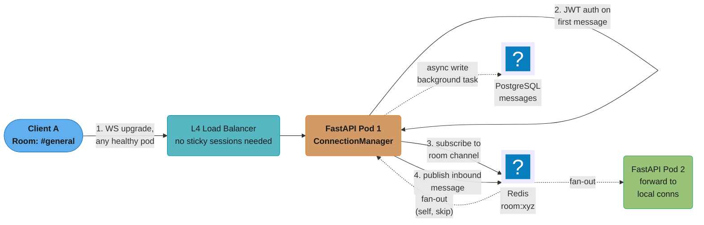
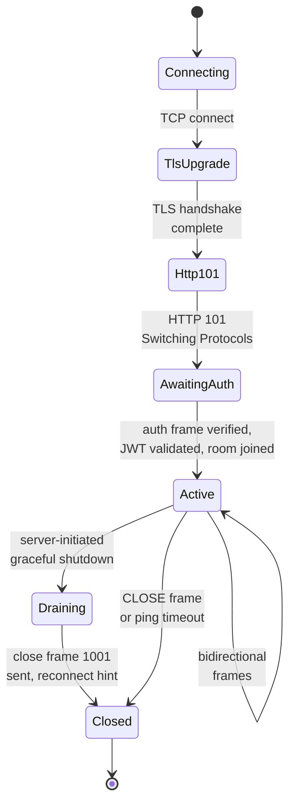
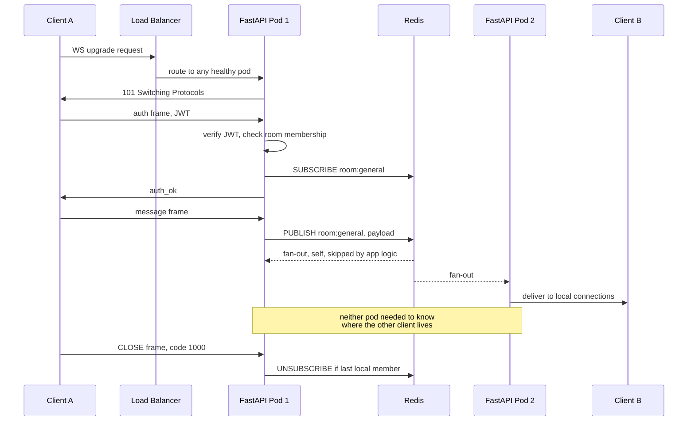
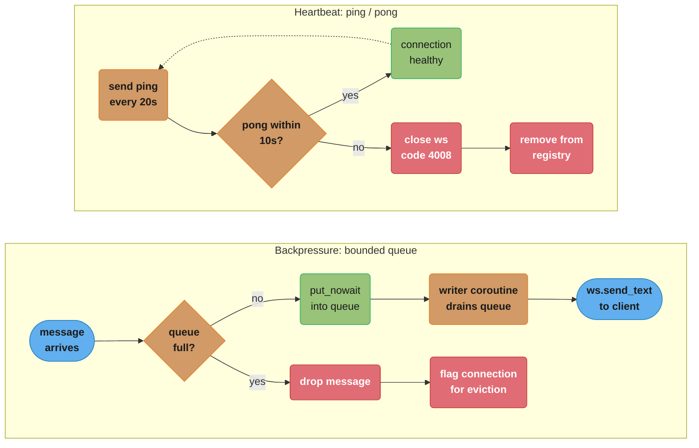
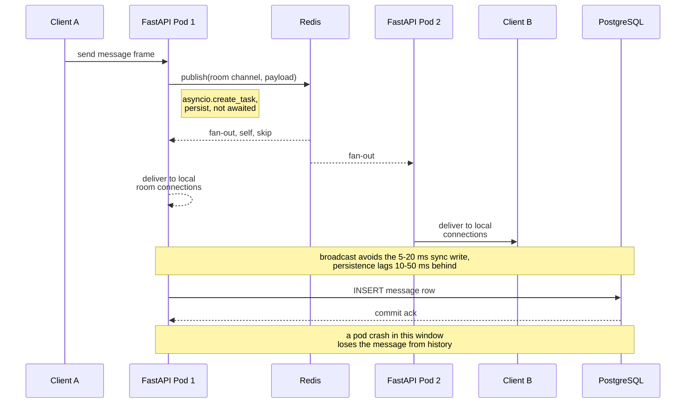

# Design a Real-Time Chat System with FastAPI
---

## Intuition

A chat backend is two systems wearing one trenchcoat. The first is a connection problem: tens of thousands of long-lived TCP sockets, one per client, that a stateless HTTP mental model does not prepare you for — there is no request/response, there is a socket that must stay open, healthy, and drained for hours. The second is a fan-out problem: one message typed by one user has to reach every other socket subscribed to that room, and those sockets are scattered across pods that share nothing but a network. Almost every hard decision in this design falls out of naming which of the two problems you are solving at that moment. A `ConnectionManager` that forgets the second problem exists works perfectly in local dev with one worker and silently drops most of production traffic the day you scale to two. This file owns the FastAPI wiring and the operational reality of running that system; for the WebSocket/SSE protocol mechanics themselves see [`../../backend/websockets_and_sse/websockets_and_sse.md`](../../backend/websockets_and_sse/websockets_and_sse.md), and for load-balancing and pub/sub theory see [`../../hld/load_balancing/load_balancing.md`](../../hld/load_balancing/load_balancing.md) and [`../../hld/message_queues/message_queues.md`](../../hld/message_queues/message_queues.md).

---

## 1. Requirements Clarification

A real interview opens with questions, not a spec dump. The candidate who starts drawing boxes before pinning down scale and delivery guarantees is the candidate who redesigns everything at minute thirty.

**Questions to ask, and the answers this design commits to:**

- *Is this Slack-shaped (rooms/channels) or WhatsApp-shaped (mostly 1:1)?* — Both. Direct messages are modeled as a room with exactly two members, so one connection lifecycle and one fan-out path serve both cases.
- *What is "real-time" in numbers?* — P99 delivery latency (sender's send to a live receiver's socket) under 200 ms under normal load. This rules out polling and most queue-based designs with batching.
- *Does a message need to survive a crash between two live users?* — Yes for the room's history (durable persistence, retrievable after reconnect); no hard requirement for exactly-once delivery to an already-connected peer. This distinction is what licenses broadcast-first, persist-after in §4 — a design that would be wrong if the bar were "never lose a message under any failure."
- *What happens to an offline user?* — Out of scope for this file: no push notifications, no offline delivery queue. A production system pairs this design with a notification service (see [`../../hld/case_studies/design_notification_system.md`](../../hld/case_studies/design_notification_system.md)); here, an offline user simply catches up via history on next connect.
- *Ordering guarantees?* — Per-room, per-sender ordering is expected by users (their own messages never appear out of order to themselves), but cross-sender global ordering is not — two users typing at the same instant may be delivered in either order to a third party, and clients de-duplicate on message id rather than assume a single global sequence.
- *Multi-region?* — Out of scope. Single-region, multi-AZ. Global chat (a Discord-scale, geo-distributed guild) is a different, harder design built on top of this one.

**Functional requirements:**

- Chat rooms (channels) and direct messages between users, unified under one room abstraction.
- Real-time delivery to every participant currently connected to a room.
- Durable persistence to a relational database, retrievable as history after reconnect or for a user who was never connected.
- Authentication before a socket may send or receive anything, and authorization (room membership) before it may see a specific room's traffic.
- Presence (online/offline) and typing indicators, as the highest-volume, lowest-value traffic the system carries (see §4 and §9).

**Non-functional requirements:**

- 100,000 concurrent WebSocket connections at peak, horizontally distributed across stateless pods.
- P99 delivery latency under 200 ms, sender to every currently-connected receiver.
- Horizontal scale-out with no application code change — adding a pod increases capacity, full stop.
- A pod restart or rolling deploy must not lose messages that were already acknowledged to the sender (durable persistence, see §5), and must not create a reconnect thundering herd (see §9).
- A dead or half-open connection (client crashed without a clean close) must be detected and evicted within 30 seconds.

**Explicitly out of scope:**

- End-to-end encryption.
- Message editing and deletion.
- File and media uploads.
- Push notifications for offline users.
- Multi-region active-active.

---

## 2. Scale Estimation

Every number below is derived, not asserted — the goal is to show the arithmetic an interviewer expects, not to memorize a final figure.

**Concurrent users → connections per node → node count**

| Step | Arithmetic | Result |
|------|-----------|--------|
| Registered users | given | 2,000,000 |
| Daily active users (25% of registered) | 2,000,000 × 0.25 | 500,000 DAU |
| Peak concurrent connections (20% of DAU online at once, evening peak) | 500,000 × 0.20 | 100,000 concurrent connections |
| Target connections per pod (§10 justifies this from per-connection memory) | design choice | 10,000 / pod |
| Pods needed at peak | 100,000 / 10,000 | 10 pods |
| Pods with 30% headroom for a burst + rolling-deploy overlap | 10 × 1.3 | 13 pods (round to 14) |

**Messages/sec → fan-out multiplier → egress messages/sec**

| Step | Arithmetic | Result |
|------|-----------|--------|
| Active-session send rate | 3 messages/min per online user (typical chat cadence) | 3/60 = 0.05 msg/s/user |
| Publish rate (inbound to Redis) | 100,000 × 0.05 | 5,000 publishes/sec |
| Average pods holding a live subscriber for a given room | rooms average ~20 members spread roughly evenly across 10-14 pods | ≈10 pods/publish |
| Pod-level delivery events/sec | 5,000 × 10 | 50,000 pod-deliveries/sec |
| Egress client sends/sec (≈1 local connection reached per pod-delivery, on average) | 50,000 × 1 | ≈50,000 messages/sec fanned out to clients |

This is the number that has to clear Redis's `PUBLISH` ceiling (§10) — not the 5,000 publishes/sec, because `PUBLISH` cost is O(subscribers), so it is delivery volume, not call volume, that matters.

**Message size → bandwidth**

| Step | Arithmetic | Result |
|------|-----------|--------|
| Average message payload (JSON: content + room_id + user_id + ts + type) | measured | ≈300 bytes |
| Aggregate egress bandwidth | 50,000 msg/s × 300 B | 15 MB/s ≈ 120 Mbps |
| Per-pod egress bandwidth (14 pods) | 15 MB/s / 14 | ≈1.1 MB/s ≈ 9 Mbps/pod |

Trivial for a modern NIC — bandwidth is never the bottleneck in chat; connection count and per-message CPU (JSON parse/serialize, asyncio task scheduling) are.

**Per-connection memory → RAM per node**

| Step | Arithmetic | Result |
|------|-----------|--------|
| `WebSocket` object + connection state (Starlette/`websockets` buffers) | measured order of magnitude | ≈20-40 KB |
| `asyncio.Queue(maxsize=64)` of `str` message frames, worst case full | 64 × ~300 B avg frame | ≈19 KB |
| Python object/GC overhead for the tuple, task handles, dict entry | measured order of magnitude | ≈10-20 KB |
| Total per connection | sum | ≈50-100 KB |
| RAM for 10,000 connections/pod | 10,000 × 75 KB (midpoint) | ≈750 MB |
| Pod sizing (connections + app baseline + headroom) | 750 MB + ~500 MB-1 GB baseline | 2-4 GB request per pod |

**File-descriptor and ephemeral-port ceilings**

- Each WebSocket connection holds one fd. 10,000 connections/pod plus the Postgres pool (default 20), the Redis client, and health-check sockets means the pod needs `ulimit -n` comfortably above 10,000 — the common Linux container default of 1024 is off by an order of magnitude and fails silently (new `accept()` calls return `EMFILE` and connections are refused, not queued). Set `LimitNOFILE=65536` in the container/pod spec explicitly.
- Ephemeral ports are a load-balancer-side concern, not a server-side one, for a *persistent* protocol like WebSocket: a normal HTTP proxy churns through the ~28,000-64,000 ephemeral port range per NAT'd source IP because each request grabs and releases a port, but a WebSocket connection holds its port for the connection's lifetime — so the constraint becomes "does the LB have enough concurrent flow capacity," not "does it churn through ports fast enough." §10 sizes the load balancer for exactly this.

---

## 3. High-Level Architecture



Redis pub/sub fans a single publish out to every pod, including the sender — no pod ever holds more than its own slice of the 100,000 concurrent connections, and the PostgreSQL write happens off the critical path via a background task. Crucially, the load balancer needs **no sticky sessions**: because any pod can reach any room's traffic via Redis, a client may land on any healthy pod and still see every message for the rooms it joins. This is the single biggest architectural payoff of the pub/sub fan-out — it decouples "which pod holds this connection" from "which room this connection cares about," which is exactly the coupling that makes WebSocket load balancing harder than HTTP load balancing in every design that skips it.

**Why WebSocket changes the load balancer's job.** An HTTP load balancer picks a backend per *request* and is done in milliseconds; a WebSocket load balancer picks a backend per *connection* and lives with that choice for hours. Round-robin or least-connections at connect time is sufficient precisely because rooms are not pinned to pods — a naive design that tries to route "all of room X's traffic to pod Y" needs sticky sessions and a consistent-hashing scheme that gets invalidated every time a pod dies; this design needs neither, at the cost of one extra network hop (pod → Redis → pod) per message that Discord's and Slack's own architectures also pay (§6).

**WebSocket connection lifecycle:**



Every connection passes through the same states before going bidirectional — the JWT travels only inside the encrypted post-handshake frame, never in the TLS/HTTP upgrade path itself. The `Draining` state exists specifically for §8's graceful-shutdown path and is what separates a clean rolling deploy from the thundering-herd war story in §9.

**Connect → auth → subscribe → fan-out → disconnect, end to end:**



**Component inventory:**

| Component | Role |
|-----------|------|
| L4 load balancer (NLB-class) | Distributes WS upgrade requests across pods; no sticky sessions, no room awareness |
| FastAPI WebSocket endpoint | Manages the WS lifecycle per connection |
| `ConnectionManager` | In-process registry of live WebSocket objects per room, one per pod |
| Redis pub/sub | Cross-pod message fan-out; one channel per room |
| `asyncio` background subscriber | Per-pod coroutine that reads from Redis and pushes to local connections |
| PostgreSQL + SQLAlchemy (async) | Durable message persistence and history replay on reconnect |
| JWT (PyJWT) | Stateless auth validated on first WS message |
| Presence service (Redis-backed, TTL keys) | Online/offline state, decoupled from the chat fan-out path (§4, §9) |

---

## 4. Component Deep Dives

### 4.1 Broken Approach: In-Process Manager Does Not Scale

```python
# BROKEN: in-process only — messages not delivered to users on other pods
class ConnectionManager:
    def __init__(self) -> None:
        self.active: dict[str, list[WebSocket]] = {}  # room_id -> connections

    async def connect(self, room_id: str, ws: WebSocket) -> None:
        await ws.accept()
        self.active.setdefault(room_id, []).append(ws)

    async def broadcast(self, room_id: str, message: str) -> None:
        for ws in self.active.get(room_id, []):
            await ws.send_text(message)  # blocks if slow consumer
            # ALSO: only reaches connections on THIS pod
```

This is correct for exactly one worker process and silently wrong the instant a second one exists. `self.active` is a plain Python dict living in one process's heap; it has no way to know that pod 2 exists, let alone what it holds. A message sent by a user on pod 1 reaches every connection pod 1 happens to hold and nothing else — not an error, not a dropped-packet log line, just messages that a subset of the room never sees. With a 10-pod deployment splitting connections roughly evenly, ~90% of a room's members see nothing, and because the code path never raises, this ships clean through code review and unit tests that only ever run one process.

### 4.2 Fixed Approach: Redis Pub/Sub Fan-Out

```python
# FIX: src/chat/connection_manager.py — cross-pod fan-out via Redis pub/sub,
# so a message published on any pod reaches connections held by every pod.
from __future__ import annotations

import asyncio
import json
import logging

import redis.asyncio as redis
from fastapi import WebSocket

logger = logging.getLogger(__name__)

QUEUE_MAX = 64
PING_INTERVAL = 20  # seconds
PONG_TIMEOUT = 10   # seconds


class ConnectionManager:
    """
    In-process registry for WebSocket connections on this pod.
    Cross-pod delivery is handled via Redis pub/sub.
    One ConnectionManager instance per application (singleton via lifespan).
    """

    def __init__(self, redis_client: redis.Redis) -> None:
        self._redis = redis_client
        # room_id -> {ws_id -> (WebSocket, asyncio.Queue)}
        self._rooms: dict[str, dict[int, tuple[WebSocket, asyncio.Queue[str]]]] = {}
        self._subscriber_tasks: dict[str, asyncio.Task[None]] = {}

    # ------------------------------------------------------------------
    # Public API
    # ------------------------------------------------------------------

    def register(self, room_id: str, ws: WebSocket) -> asyncio.Queue[str]:
        """
        Register an ALREADY-accepted, ALREADY-authorised socket for fan-out.
        Returns the per-connection send queue.

        Deliberately does not call ws.accept(): the handshake must complete
        before the client can send its auth frame, but the socket must not
        appear in the fan-out registry until membership is proven. Fusing
        accept and register into one connect() call puts an unauthenticated
        socket into the room's broadcast set for the whole auth window.
        """
        q: asyncio.Queue[str] = asyncio.Queue(maxsize=QUEUE_MAX)
        ws_id = id(ws)
        self._rooms.setdefault(room_id, {})[ws_id] = (ws, q)

        if room_id not in self._subscriber_tasks:
            task = asyncio.create_task(
                self._redis_subscriber(room_id),
                name=f"redis-sub-{room_id}",
            )
            self._subscriber_tasks[room_id] = task

        return q

    def disconnect(self, room_id: str, ws: WebSocket) -> None:
        room = self._rooms.get(room_id, {})
        room.pop(id(ws), None)
        if not room:
            self._rooms.pop(room_id, None)
            task = self._subscriber_tasks.pop(room_id, None)
            if task:
                task.cancel()

    async def publish(self, room_id: str, payload: dict) -> None:
        """Publish a message to Redis so ALL pods receive it."""
        await self._redis.publish(f"room:{room_id}", json.dumps(payload))

    # ------------------------------------------------------------------
    # Internal
    # ------------------------------------------------------------------

    async def _redis_subscriber(self, room_id: str) -> None:
        """
        Long-running coroutine: subscribes to Redis channel for this room
        and enqueues received messages into all local WebSocket queues.
        """
        channel_name = f"room:{room_id}"
        pubsub = self._redis.pubsub()
        await pubsub.subscribe(channel_name)
        logger.info("Subscribed to Redis channel %s", channel_name)
        try:
            async for raw in pubsub.listen():
                if raw["type"] != "message":
                    continue
                text: str = raw["data"]
                room = self._rooms.get(room_id, {})
                dead: list[int] = []
                for ws_id, (_, q) in room.items():
                    try:
                        q.put_nowait(text)
                    except asyncio.QueueFull:
                        logger.warning(
                            "Queue full for ws_id=%s in room=%s, dropping message",
                            ws_id,
                            room_id,
                        )
                        dead.append(ws_id)
                for ws_id in dead:
                    room.pop(ws_id, None)
        except asyncio.CancelledError:
            raise  # never swallow cancellation
        finally:
            await pubsub.unsubscribe(channel_name)
            await pubsub.aclose()
```

### 4.3 WebSocket Endpoint with JWT Auth and Heartbeat

```python
# src/chat/router.py
from __future__ import annotations

import asyncio
import json
import logging
from datetime import datetime, timezone

from fastapi import APIRouter, Depends, WebSocket, WebSocketDisconnect
from pydantic import BaseModel

from .auth import verify_jwt
from .connection_manager import ConnectionManager, PING_INTERVAL, PONG_TIMEOUT
from .membership import is_room_member
from .persistence import persist_message
from .dependencies import get_manager, get_session_factory  # singletons from app.state

logger = logging.getLogger(__name__)
router = APIRouter()

# asyncio only holds a weak reference to a running Task; without a strong
# reference the persistence task can be garbage-collected mid-write.
_persist_tasks: set[asyncio.Task[None]] = set()


class ChatMessage(BaseModel):
    type: str          # "auth" | "message" | "pong"
    token: str | None = None
    content: str | None = None
    client_msg_id: str | None = None  # client-generated UUID for dedup, see 4.6


AUTH_TIMEOUT = 10.0  # seconds to send auth frame after connect


@router.websocket("/ws/{room_id}")
async def websocket_endpoint(
    room_id: str,
    websocket: WebSocket,
    manager: ConnectionManager = Depends(get_manager),
    session_factory=Depends(get_session_factory),
) -> None:
    # NOTE: no BackgroundTasks parameter. FastAPI only drains background tasks
    # after an HTTP response; on a WebSocket route they are never executed.
    await websocket.accept()
    user_id: str | None = None
    pong_event = asyncio.Event()

    # --- Phase 1: authenticate AND authorize, BEFORE registering for fan-out ---
    try:
        raw = await asyncio.wait_for(websocket.receive_text(), timeout=AUTH_TIMEOUT)
    except asyncio.TimeoutError:
        await websocket.close(code=4001, reason="auth timeout")
        return

    try:
        first = ChatMessage.model_validate_json(raw)
        if first.type != "auth" or not first.token:
            raise ValueError("expected auth frame")
        claims = verify_jwt(first.token)
        user_id = claims["sub"]
        # Authentication proves identity; membership proves entitlement to
        # THIS room. Without it any valid token can read any room's feed.
        if not await is_room_member(session_factory, user_id, room_id):
            raise PermissionError("not a member of this room")
    except Exception:
        # Fixed, short reason: a close frame carries at most 123 bytes of
        # reason text, and echoing the exception leaks internals to the client.
        logger.info("Auth rejected for room %s", room_id, exc_info=True)
        await websocket.close(code=4003, reason="auth failed")
        return

    # Only now does the socket enter the room's broadcast set.
    send_queue = manager.register(room_id, websocket)
    await websocket.send_text(json.dumps({"type": "auth_ok", "user_id": user_id}))
    logger.info("User %s joined room %s", user_id, room_id)

    # --- Phase 2: main loop ---
    writer_task = asyncio.create_task(
        _queue_writer(websocket, send_queue),
        name=f"writer-{id(websocket)}",
    )
    ping_task = asyncio.create_task(
        _heartbeat(websocket, pong_event, room_id),
        name=f"ping-{id(websocket)}",
    )

    try:
        while True:
            raw = await websocket.receive_text()
            msg = ChatMessage.model_validate_json(raw)

            if msg.type == "pong":
                # Only ONE coroutine may call receive_text() on a socket. The
                # heartbeat waits on this event instead of reading frames
                # itself, otherwise it steals chat messages from this loop.
                pong_event.set()
                continue

            if msg.type == "message" and msg.content:
                payload = {
                    "type": "message",
                    "room_id": room_id,
                    "user_id": user_id,
                    "content": msg.content,
                    "client_msg_id": msg.client_msg_id,
                    "ts": datetime.now(timezone.utc).isoformat(),
                }
                # broadcast-first via Redis, persist asynchronously
                await manager.publish(room_id, payload)
                task = asyncio.create_task(persist_message(payload, session_factory))
                _persist_tasks.add(task)
                task.add_done_callback(_persist_tasks.discard)

    except WebSocketDisconnect:
        logger.info("User %s disconnected from room %s", user_id, room_id)
    finally:
        writer_task.cancel()
        ping_task.cancel()
        manager.disconnect(room_id, websocket)


async def _queue_writer(ws: WebSocket, q: asyncio.Queue[str]) -> None:
    """Drains the per-connection send queue, decoupling slow consumers."""
    try:
        while True:
            text = await q.get()
            await ws.send_text(text)
    except asyncio.CancelledError:
        raise                      # CancelledError is BaseException: re-raise
    except Exception:
        logger.exception("Writer stopped for ws=%s", id(ws))


async def _heartbeat(
    ws: WebSocket,
    pong_event: asyncio.Event,
    room_id: str,
) -> None:
    """Sends periodic pings; closes connection if no pong within PONG_TIMEOUT."""
    try:
        while True:
            await asyncio.sleep(PING_INTERVAL)
            pong_event.clear()
            await ws.send_text(json.dumps({"type": "ping"}))
            try:
                await asyncio.wait_for(pong_event.wait(), timeout=PONG_TIMEOUT)
            except asyncio.TimeoutError:
                logger.warning("Ping timeout for ws=%s in room=%s", id(ws), room_id)
                # 4008, not 1001. RFC 6455 defines 1001 as "going away" — a server
                # shutting down or a browser navigating away. A peer that stopped
                # answering pings is neither, and reusing 1001 makes a dead client
                # indistinguishable from a rolling deploy in the close-code metrics.
                # 4000-4999 is the private-use range, same as 4001/4003 above.
                await ws.close(code=4008, reason="ping timeout")
                return
    except asyncio.CancelledError:
        raise
    except Exception:
        logger.exception("Heartbeat stopped for ws=%s", id(ws))
```

### 4.4 Why Application-Level Ping/Pong, Not TCP Keepalive

The ping is application-level (a JSON frame) rather than a protocol-level control frame or TCP keepalive, for reasons that matter more than they look:

- Starlette's `WebSocket` exposes no ping API, and Uvicorn's own protocol keepalive defaults to `--ws-ping-interval 20 --ws-ping-timeout 20`, a 40-second worst case that misses the 30-second cleanup requirement.
- TCP keepalive operates below the application entirely and defaults to a 2-hour idle probe on most Linux distributions — orders of magnitude too slow, and it detects a dead *socket*, not a dead *client*. A mobile client that suspended its app but left the OS-level TCP connection technically alive looks perfectly healthy to TCP keepalive while never reading another chat message.
- An application ping also lets the pong flow through the same receive loop as chat traffic, which matters because **only one coroutine may call `receive_text()` on a socket**: a second reader silently steals frames from the first, so chat messages would vanish into a separate heartbeat reader. The heartbeat therefore waits on an `asyncio.Event` that the main loop sets, never reading the socket itself.



Two independent decision trees guard the connection: a full queue drops the message and marks the connection for eviction rather than blocking every other subscriber in the room, while a missed pong closes the socket within 30 seconds total (20 s interval + 10 s timeout), satisfying the zombie-cleanup requirement.

### 4.5 What `await websocket.send_text()` Actually Does to a Slow Peer

`send_text()` writes into the OS socket send buffer, not directly onto the wire. As long as the peer keeps reading, the kernel drains that buffer at network speed and the `await` returns almost instantly. The moment the peer stops reading — a suspended mobile app, a browser tab throttled in the background, a client stuck on a slow cellular link — the send buffer fills, and `send_text()` starts to actually block the coroutine that called it, waiting for buffer space that will not appear until the peer resumes or the connection is torn down. Without the bounded queue in §4.2, that blocked coroutine is the *shared* Redis subscriber for the whole room: one slow phone stalls delivery to every other member. The `asyncio.Queue(maxsize=64)` decouples "receiving from Redis" from "writing to this specific socket" — the slow socket's own dedicated writer coroutine blocks, and only that socket's queue backs up and eventually drops messages, exactly the isolation a shared broadcast loop cannot provide on its own.

### 4.6 Ordering and At-Least-Once Delivery with Client-Side Dedup

Redis pub/sub gives no delivery guarantee and no ordering guarantee across publishers — two pods publishing near-simultaneously can be interleaved in either order at a third pod's subscriber. This design accepts that (per §1) and instead guarantees two weaker, sufficient properties:

- **Per-sender ordering**: a single client's messages are `receive_text()`'d and `publish()`'d in the order it sent them, and Redis preserves publish order within one channel from one publisher, so a sender's own messages never reorder for any receiver.
- **At-least-once, dedup on `client_msg_id`**: the client generates a UUID per outgoing message and includes it as `client_msg_id`. If a `send_text()` times out client-side and the client retries, or a reconnect-and-replay (§4.7) re-delivers a message the client already rendered optimistically, the client (and the persistence layer, via a unique constraint on `client_msg_id`) discards the duplicate rather than double-inserting or double-rendering it. This is the standard trick that turns an at-least-once transport into an effectively-once user experience without needing a distributed transaction.

### 4.7 Reconnect and Catch-Up

```python
# src/chat/router.py (excerpt — extends the auth frame handling in 4.3)
class AuthFrame(BaseModel):
    type: str = "auth"
    token: str
    room_id: str
    last_message_id: int | None = None  # None on first-ever connect


async def _replay_since(
    session_factory, room_id: str, last_message_id: int | None, websocket: WebSocket
) -> None:
    """Send missed messages before resuming live delivery, avoiding a gap."""
    if last_message_id is None:
        return
    async with session_factory() as session:
        rows = await session.execute(
            text(
                "SELECT id, user_id, content, created_at FROM messages "
                "WHERE room_id = :room_id AND id > :last_id ORDER BY id ASC LIMIT 500"
            ),
            {"room_id": room_id, "last_id": last_message_id},
        )
        for row in rows:
            await websocket.send_text(json.dumps({
                "type": "replay",
                "id": row.id,
                "user_id": row.user_id,
                "content": row.content,
                "ts": row.created_at.isoformat(),
            }))
```

The `LIMIT 500` is deliberate: a client offline for a week in a very active room should not receive an unbounded replay burst on the same connection that is also trying to establish live delivery. Past the limit, the client falls back to paginated REST history, which is a normal HTTP request/response and does not compete with the WebSocket's backpressure budget.

### 4.8 Presence and Typing Indicators: Highest Volume, Lowest Value

Presence ("who is online") and typing indicators are the traffic that will dominate `PUBLISH` volume if implemented naively, and they are the traffic users tolerate losing occasionally. Treat them differently from chat messages, not as another message `type` in the same channel:

```python
# src/chat/presence.py
from __future__ import annotations

import redis.asyncio as redis

PRESENCE_TTL = 45  # seconds — must exceed PING_INTERVAL + PONG_TIMEOUT (30s)


async def mark_online(r: redis.Redis, room_id: str, user_id: str) -> None:
    # SETEX, not a persistent SET: presence self-expires if the pod that owns
    # the connection crashes uncleanly and never calls mark_offline (see 9.5).
    await r.setex(f"presence:{room_id}:{user_id}", PRESENCE_TTL, "1")


async def refresh_presence(r: redis.Redis, room_id: str, user_id: str) -> None:
    """Called on every heartbeat pong — refresh, don't republish."""
    await r.expire(f"presence:{room_id}:{user_id}", PRESENCE_TTL)


async def mark_typing(r: redis.Redis, room_id: str, user_id: str) -> None:
    # Typing events are NEVER persisted and NEVER go through the durable
    # chat channel — a dedicated ephemeral channel with no PostgreSQL writer
    # subscribed to it, so a typing storm cannot touch message durability.
    await r.publish(f"typing:{room_id}", user_id)
```

Two design choices do the real work here. First, presence is a TTL key refreshed by the heartbeat's own 20-second cadence rather than a separate publish per state change — a `SETEX`/`EXPIRE` pair costs one Redis round-trip and self-heals on an unclean disconnect (§9.5), where a naive "publish presence on every connect/disconnect" approach requires the disconnect path to run at all. Second, typing indicators use their own pub/sub channel with no persistence subscriber, so a room where three people are typing at once — the single highest-frequency event class in a real chat app, easily 10-50x the message publish rate — cannot back up the message queue's writer or bloat the messages table.

---

## 5. Design Decisions & Tradeoffs

### 5.1 WebSocket vs SSE vs Long-Polling

**Choice: WebSocket for the chat channel; native FastAPI SSE for one-way, server-to-client-only streams elsewhere in the same product (e.g., a live "N users are typing" banner on a read-only public room view, or a moderation event feed).**

FastAPI ships native Server-Sent Events support directly in core (`fastapi.sse`, no third-party dependency), which changes this tradeoff from "SSE needs `sse-starlette` and hand-rolled keep-alives" to "SSE is one decorator away":

```python
# src/chat/public_feed.py — one-way stream, SSE is the right tool here
from __future__ import annotations

from collections.abc import AsyncIterator

from fastapi import APIRouter
from fastapi.sse import EventSourceResponse, ServerSentEvent

router = APIRouter()


@router.get("/rooms/{room_id}/activity", response_class=EventSourceResponse)
async def room_activity_feed(room_id: str) -> AsyncIterator[ServerSentEvent]:
    """
    Read-only activity feed for public room dashboards. One-directional by
    design — viewers cannot post through this endpoint, so WebSocket's
    full-duplex machinery (auth-frame handshake, receive loop, backpressure
    queue) is pure overhead here. FastAPI's SSE response handles the 15-second
    keep-alive ping, Cache-Control: no-cache, X-Accel-Buffering: no, and
    Last-Event-ID resume automatically.
    """
    pubsub = redis_client.pubsub()
    await pubsub.subscribe(f"activity:{room_id}")
    async for raw in pubsub.listen():
        if raw["type"] != "message":
            continue
        yield ServerSentEvent(data=raw["data"], event="activity")
```

Chat itself still needs WebSocket, because the client must *send* — a message, a typing event, a pong — over the same channel it receives on, and SSE is receive-only by protocol design; pairing SSE with a separate HTTP POST per outgoing message doubles the connection count and reintroduces per-message HTTP overhead for the send path. Long-polling is not competitive for either use case at this scale: every poll cycle is a fresh HTTP request/response with TCP and (absent keep-alive reuse) TLS handshake cost, at 50-200 ms latency per round trip against a 200 ms P99 *total* budget.

| Dimension | WebSocket | SSE (native FastAPI) | Long-Polling |
|-----------|-----------|-----|--------------|
| Directionality | Full-duplex | Server-to-client only | Server-to-client (client re-connects each poll) |
| Latency | ~1 ms (single TCP frame) | ~10 ms (HTTP headers per chunk) | 50-200 ms (new TCP + HTTP per poll) |
| Reconnect/resume | Custom protocol (§4.7) | Built in — `Last-Event-ID` handled automatically | N/A, stateless by design |
| Server connection cost | 1 fd + asyncio task | 1 fd + asyncio task | 1 fd per poll cycle |
| Client send path | Same socket | None — needs a separate POST | Separate POST |
| Best for | Chat, collaboration, games | Feeds, dashboards, notifications | Fallback or firewall-constrained environments |

### 5.2 Fan-Out: In-Process Registry vs Redis Pub/Sub

**Choice: Redis pub/sub for cross-pod fan-out.**

The broken approach (§4.1) stores connections only in a per-process Python dict. This works on a single pod but silently drops messages for users connected to a different pod. With 100k concurrent connections spread across N pods, every pod sees only 100k/N connections. Redis pub/sub adds a publish call on message receipt and a subscriber coroutine per room per pod. Any pod that receives a message publishes it to Redis; all pods (including the sender) receive it from Redis and forward to their local connections. This is the same shape Discord, Slack, and every Socket.IO/Centrifugo deployment converge on (§6) — not because it is the only correct answer, but because it is the one that decouples connection placement from room membership without needing sticky routing.

### 5.3 Message Persistence: Synchronous vs Async Write

**Choice: Async background task (broadcast-first, persist-via-task).**

Writing to PostgreSQL synchronously before broadcasting adds 5-20 ms database latency to every message delivery, violating the P99 < 200 ms target under load. Instead, the handler broadcasts via Redis immediately, then spawns a persistence coroutine with `asyncio.create_task`. The tradeoff is a small durability window: if the pod crashes between publish and persist, that message is lost from history (though already-connected receivers already have it). For most chat applications this is acceptable per the §1 requirements gathering. For financial or compliance-critical chat, an outbox pattern is required instead.

**Do not reach for `BackgroundTasks` here.** FastAPI runs background tasks after the *HTTP response* is sent, and a WebSocket route has no response cycle — the parameter still injects, `add_task` still returns cleanly, and the task **never runs**. Every message would be broadcast and silently never persisted, which is the exact opposite of the durability requirement. `BackgroundTasks` is for HTTP routes only.



The sender is acknowledged and every subscriber is fanned out to in low single-digit milliseconds; the PostgreSQL write trails behind as a background task, so the 10-50 ms gap between publish and commit is the only window in which a crash can lose a message from durable history.

### 5.4 Authentication: JWT in First Message vs Query Parameter

**Choice: JWT in first WebSocket message.**

Passing a JWT as a query parameter (`/ws/room?token=xxx`) is a common shortcut but embeds the token in server access logs, proxy logs, and browser history — a significant security risk. The WebSocket HTTP upgrade request does not support the `Authorization` header in most browsers. The correct approach is to complete the WebSocket handshake unauthenticated, then require the client to send a structured `{"type":"auth","token":"<JWT>"}` frame as its very first message. The server sends an error frame and closes the connection if auth fails or the timeout elapses.

Authentication is not authorization: a valid JWT proves *who* the caller is, not that they belong to the room in the URL path. Without a membership check any authenticated user can open `/ws/{room_id}` for any room and receive its entire live feed. The auth phase therefore does both — verify the token, then verify `(user_id, room_id)` against the membership table — before the connection is registered for fan-out.

The ordering is load-bearing and easy to get wrong, because the natural shape of a `ConnectionManager` is a single `connect()` that accepts the handshake *and* inserts into the registry. That shape puts an unauthenticated socket into the room's broadcast set for the full length of the auth window. Split it: the endpoint calls `websocket.accept()` itself (the client cannot send the auth frame before the handshake completes), and only calls `manager.register()` once membership has been proven.

### 5.5 Backpressure and Stale Connection Detection

**Choice: Per-connection `asyncio.Queue` with bounded capacity, drop-oldest-on-full, and periodic application-level ping.** Covered in full mechanical detail in §4.4-§4.5; the tradeoff summary is that a bounded queue trades a small, bounded amount of message loss for a slow consumer against protecting every other connection sharing that room's Redis subscriber, which is the only choice consistent with the P99 latency requirement for everyone else in the room.

### 5.6 Redis Pub/Sub vs Kafka for Fan-Out

| Dimension | Redis Pub/Sub | Kafka |
|-----------|--------------|-------|
| Delivery guarantee | At-most-once (no persistence) | At-least-once with offsets |
| Message retention | None (fire-and-forget) | Configurable (hours to weeks) |
| Throughput | Six figures of ops/s on one node, but a `PUBLISH` costs O(subscribers) | Millions/s with partitioning |
| Latency | Sub-millisecond | 5-15 ms typical |
| Fan-out model | All subscribers in channel | Consumer group per subscriber |
| Operational complexity | Low | High |
| Best fit | Chat fan-out (at-most-once acceptable) | Audit log, replay, multi-consumer pipelines |

For chat, Redis pub/sub dropping a message if no subscriber is listening is acceptable — clients reconnect and fetch history from PostgreSQL (§4.7). For compliance use cases (financial chat, healthcare), Kafka with consumer-group offsets per pod is the correct substitution, at the cost of the operational complexity in the table above.

### 5.7 Synchronous vs Asynchronous vs Outbox Persistence

| Approach | Latency impact | Durability | Complexity |
|----------|---------------|------------|------------|
| Write-through (DB before broadcast) | +5-20 ms per message | Strong (no loss on crash) | Low |
| Background task (broadcast first) | Negligible | Soft (crash window ~10-50 ms) | Low-medium |
| Outbox pattern (DB + event log atomically) | +5-20 ms | Strong + replay capability | High |

The background-task approach is the right default for general chat. The outbox pattern is required if strict ordering or exactly-once delivery to downstream consumers (e.g., search indexers, compliance archival) is needed.

---

## 6. Real-World Implementations

Every number below is quoted from a primary source — the company's own engineering blog — with the URL inline, because "a large chat app does X" is not verifiable and does not belong in a design doc.

**Discord — Cassandra to ScyllaDB, and why the fan-out design has to assume storage latency will spike.** By early 2022 Discord's message store had grown to 177 Cassandra nodes holding trillions of messages, with read p99 latency of 40-125 ms and write p99 of 5-70 ms. Migrating to ScyllaDB (72 nodes) brought read p99 down to a steady 15 ms and write p99 down to a steady 5 ms, migrating the existing trillions of rows at up to 3.2 million messages/second with a custom Rust data migrator, with zero downtime. ([discord.com/blog/how-discord-stores-trillions-of-messages](https://discord.com/blog/how-discord-stores-trillions-of-messages)) The lesson for this design: §5.3's broadcast-first persistence exists precisely because Discord's own *pre-migration* write p99 of up to 70 ms would have blown the 200 ms delivery budget on its own if the write sat on the broadcast's critical path — proof that the design decision generalizes past the toy numbers in §2.

**Discord — Elixir/BEAM connection layer, and the per-node connection ceiling this design's per-pod budget echoes.** Discord scaled its Elixir-based real-time layer to nearly 5 million concurrent users, with a single Erlang VM handling up to 500,000 live WebSocket sessions, and an average user belonging to 5 guilds (rooms). Before optimization, publishing an event to a large guild took 900 ms to 2.1 seconds end-to-end because of per-recipient `send/2` costs of 30-70 microseconds multiplied across every member. ([discord.com/blog/how-discord-scaled-elixir-to-5-000-000-concurrent-users](https://discord.com/blog/how-discord-scaled-elixir-to-5-000-000-concurrent-users)) The lesson: fan-out cost scales with room size, not just connection count — this design's §4.8 decision to keep typing/presence off the durable message channel is the FastAPI-scale analogue of the same problem Discord hit with `send/2` fan-out cost per guild member.

**Phoenix Channels (Elixir/Erlang, the framework underpinning Discord's original 2015-era chat layer) — the raw per-server connection ceiling.** A single 40-core, 128 GB RAM server held 2 million concurrent WebSocket connections in a public benchmark, with broadcast to all 2 million subscribers completing in 1-2 seconds after pub/sub pooling. ([phoenixframework.org/blog/the-road-to-2-million-websocket-connections](https://www.phoenixframework.org/blog/the-road-to-2-million-websocket-connections)) The lesson: this design's target of 10,000 connections/pod (§2, §10) is deliberately far below what a single well-tuned event loop can hold — the ceiling here is memory and blast-radius (how many users a single pod restart affects), not raw socket-handling capacity, which real-world benchmarks put two orders of magnitude higher.

**Slack — channel-server architecture and delivery latency at global scale.** Slack's real-time messaging layer serves about 16 million channels per host at peak and delivers messages to clients around the world in 500 ms; when a channel server is replaced, the new one is ready to serve traffic in under 20 seconds, keeping the user-visible latency blip to under 20 seconds. ([slack.engineering/real-time-messaging](https://slack.engineering/real-time-messaging/)) The lesson: Slack's separation of stateful "Channel Servers" (hold the room's live state) from stateless "Gateway Servers" (hold the client's WebSocket) is architecturally the same split this design makes between the `ConnectionManager` (gateway-like, per-pod, per-connection) and Redis pub/sub (channel-like, shared, room-addressed) — the split is what makes a server replacement a 20-second blip instead of a dropped-connection event for the whole room.

**WhatsApp — the historical proof that a single well-tuned server can hold millions of persistent connections.** In a January 2012 benchmark, one FreeBSD/Erlang server (24-core Xeon X5675, 103 GB RAM) held 2,277,845 simultaneous open TCP connections. ([blog.whatsapp.com/1-million-is-so-2011](https://blog.whatsapp.com/1-million-is-so-2011)) The lesson: this is the oldest and most direct confirmation that connection count is not, by itself, the hard part of this design — it is auth, backpressure, fan-out correctness across pods, and operational recovery (§8, §9) that this file spends most of its length on, because the raw socket-holding problem was solved and published over a decade before FastAPI existed.

---

## 7. Technologies & Tools

| Component | Usage |
|-----------|-------|
| `fastapi.WebSocket` | Manages individual WS connection lifecycle (accept, receive, send, close) |
| `fastapi.WebSocketDisconnect` | Exception raised when client closes the connection |
| `fastapi.sse.EventSourceResponse` / `ServerSentEvent` | Native SSE for one-way streams (§5.1) — keep-alive, headers, and `Last-Event-ID` resume handled by FastAPI core, no third-party dependency |
| `asyncio.create_task` + a task-reference set | Used three times: deferring the PostgreSQL write off the broadcast path, spawning the per-connection writer and heartbeat coroutines, and the replay-since query. `BackgroundTasks` is deliberately NOT used — it only drains after an HTTP response, so on a WebSocket route the task never runs. Every returned Task must stay referenced or it can be garbage-collected mid-flight |
| `asyncio.Queue` | Per-connection bounded buffer that decouples slow consumers from the Redis subscriber |
| `asyncio.wait_for` | Enforces auth timeout (10 s) and pong timeout (10 s) |
| `redis.asyncio` | Async Redis client; `pubsub()` for subscription, `publish()`/`SETEX`/`EXPIRE` for fan-out and presence |
| `sqlalchemy.ext.asyncio` | Async PostgreSQL session for non-blocking persistence and history replay |
| `pydantic.BaseModel` | Validates inbound WebSocket JSON frames (`ChatMessage`, `AuthFrame`) |
| `contextlib.asynccontextmanager` | Lifespan handler for startup/shutdown of Redis and DB connections, and for signaling graceful shutdown (§8) |
| `PyJWT` | JWT decode and validation |
| `httpx.AsyncClient` (test-only) | `AsyncClient(transport=httpx.ASGITransport(app=app), base_url="http://test")` for HTTP-side integration tests; the old `AsyncClient(app=app)` form raises `TypeError` since httpx 0.28.0 |
| `TestClient.websocket_connect` | Context-manager based WebSocket test client for the chat endpoint itself |
| Kubernetes `preStop` hook + `terminationGracePeriodSeconds` | Drives the graceful-drain sequence in §8 |
| Prometheus + `prometheus-fastapi-instrumentator` | Connection count, queue depth, close-code histogram, publish/delivery rate metrics (§8) |

---

## 8. Operational Playbook

### 8.1 Graceful Shutdown (Rolling Deploy)

A pod that simply exits on `SIGTERM` drops every connection it holds simultaneously, and every one of those clients reconnects within the same few seconds — the thundering-herd war story in §9.1. The fix is a drain sequence that trades a slower deploy for a smooth reconnect curve:

```python
# src/chat/main.py — lifespan with graceful drain
from __future__ import annotations

import asyncio
from contextlib import asynccontextmanager
from collections.abc import AsyncIterator

import redis.asyncio as redis
from fastapi import FastAPI
from sqlalchemy.ext.asyncio import create_async_engine, async_sessionmaker

from .connection_manager import ConnectionManager
from .router import router

DRAIN_GRACE_SECONDS = 25  # < terminationGracePeriodSeconds (30s) in the pod spec


@asynccontextmanager
async def lifespan(app: FastAPI) -> AsyncIterator[None]:
    redis_client = redis.from_url("redis://redis:6379", decode_responses=True)
    engine = create_async_engine("postgresql+asyncpg://user:pass@db/chat", pool_size=20)
    session_factory = async_sessionmaker(engine, expire_on_commit=False)

    app.state.manager = ConnectionManager(redis_client)
    app.state.session_factory = session_factory

    yield  # --- application serves traffic ---

    # SIGTERM arrives here (Uvicorn calls this on shutdown). Close every held
    # connection with a proper 1001 and a jittered reconnect hint instead of
    # just tearing down the process and letting the TCP RST do it.
    close_tasks = [
        ws.close(code=1001, reason="server_restart")
        for room in app.state.manager.all_connections()
        for ws in room
    ]
    await asyncio.gather(*close_tasks, return_exceptions=True)
    await redis_client.aclose()
    await engine.dispose()


app = FastAPI(lifespan=lifespan)
app.include_router(router)
```

The Kubernetes side of this: a `preStop` hook sleeps a few seconds so the pod stops receiving *new* connections (removed from the Service endpoints) before the app-level drain above starts closing *existing* ones, and `terminationGracePeriodSeconds` (30s) must exceed `DRAIN_GRACE_SECONDS` (25s) so Kubernetes never SIGKILLs the process mid-drain. On the client, the close code 1001 with reason `server_restart` — distinct from 4008's ping-timeout — drives an **exponential backoff with full jitter** before reconnecting (`sleep = random(0, min(cap, base * 2^attempt))`), which is what actually prevents the thundering herd: closing connections gracefully is necessary but not sufficient if every client reconnects on the same fixed delay.

### 8.2 Rollout Sequencing

- Deploy pods **one at a time or in small batches** (`maxUnavailable: 1` or a percentage capped low), never all at once — each batch's drained connections add to the reconnect load the remaining pods and the auth/membership DB must absorb.
- Watch connection count per pod during rollout; a batch should not start until the previous batch's reconnect storm has visibly settled (a Prometheus dashboard panel on `ws_connections_total` recovering to baseline is the concrete signal, not a fixed sleep).
- Health/readiness probes must check Redis and Postgres connectivity, not just "process is running" — a pod that can accept WebSocket upgrades but cannot reach Redis will accept connections it can never fan out to.

### 8.3 Monitoring and Alerting

| Metric | Why it matters | Alert threshold (starting point) |
|--------|-----------------|-----------------------------------|
| `ws_connections_total` (per pod, gauge) | Detects an imbalanced load balancer or a pod silently leaking connections | Pod > 1.5x fleet average for 5 min |
| `ws_close_code_total{code}` (counter, labeled) | Separates normal closes (1000/1001) from auth failures (4001/4003) and dead-peer evictions (4008) | 4008 rate > 5% of active connections/min |
| `queue_depth` (per-connection, histogram) | Direct signal of §4.5's slow-consumer backpressure kicking in | p99 queue depth > 48 (75% of `QUEUE_MAX`) |
| `redis_publish_latency_seconds` | Redis is the single shared dependency every pod fans out through — its latency is everyone's latency | p99 > 10 ms |
| `redis_pubsub_subscribers{channel}` | A room subscriber count wildly above expected room size signals a `disconnect()` leak (§9.2) | subscriber count not decaying after connections close |
| `persist_task_failures_total` | Silent durability loss — §5.3's crash window becomes a *permanent* gap if this is nonzero and unnoticed | any sustained nonzero rate |
| `auth_rejected_total` | Spike correlates with a credential-stuffing attempt or a client-side token refresh bug | rate 10x above 1-hour rolling baseline |

### 8.4 Redis Failover Runbook

Redis is the fan-out backbone; its failure characteristics need an explicit playbook rather than "it'll page someone." Run Redis Sentinel (or a managed equivalent with automatic failover) with `down-after-milliseconds` lowered from the 30,000 ms default — at stock settings, a master failure is not even *detected* for 30 seconds before an election starts, well past the P99 delivery budget for the entire outage window. On a detected Redis outage: existing WebSocket connections stay open (no TCP dependency on Redis), new messages fail to publish and must return an error frame to the sender rather than silently drop, and `_redis_subscriber` coroutines must retry their `SUBSCRIBE` with backoff on `redis.ConnectionError` rather than let the task die and leave a room permanently un-subscribed on that pod.

---

## 9. Common Pitfalls & War Stories

### 9.1 The Thundering-Herd Reconnect Storm

A rolling deploy without the §8.1 drain sequence closed all 180,000 connections across 14 pods within the same two-second window (SIGKILL after grace period expiry, no jittered close). Every client's reconnect logic used a fixed 2-second retry with no jitter, so the reconnect attempts landed in the same narrow window they were dropped in: the auth service, which validates the JWT and checks room membership on every reconnect, saw a spike to roughly 60,000 connects/second sustained for about 90 seconds, an order of magnitude above its provisioned steady-state rate, and its own database connection pool saturated, causing *unrelated* HTTP endpoints backed by the same auth service to start timing out. The fix was twofold: the graceful-drain-with-1001 sequence in §8.1, and moving every client to exponential backoff with full jitter, which spreads the same 180,000 reconnects over roughly a minute instead of two seconds.

### 9.2 The Slow Consumer That Backs Up the Whole Event Loop

Before the bounded-queue fix in §4.2/§4.5, a single mobile client on a degraded cellular connection caused its pod's *shared* Redis subscriber coroutine to block inside `await ws.send_text()`, because that coroutine was calling `send_text()` directly on every local connection in a loop. Every other connection on that pod — several thousand of them — stopped receiving messages for as long as the slow client's send buffer stayed full, which in the observed incident was upward of 40 seconds during a subway commute. The room-wide symptom looked like "chat is randomly frozen for entire rooms," which took longer to diagnose than the fix did to write, because the reproduction required one genuinely slow client sharing a pod with many healthy ones. The bounded per-connection queue isolates each socket's own writer coroutine, so a stalled `send_text()` blocks only that one socket's dedicated task.

### 9.3 Missing Heartbeat: Half-Open Connections Consuming Memory for Hours

An early version shipped without the application-level ping/pong in §4.4, relying on TCP to eventually notice a dead peer. A dead peer — laptop lid closed mid-session, mobile app killed by the OS without a clean disconnect — leaves a TCP connection the OS considers open on both the client's absent side and the server's side; the server-side socket, `asyncio.Queue`, and registry entry sat fully allocated for as long as the default TCP keepalive interval on the load balancer's NAT path allowed, measured at several hours in production before an idle-connection reaper on the LB itself eventually closed it. At the observed rate of roughly 2% of sessions ending uncleanly per day, the connection count and per-pod memory crept upward over the course of a day with no corresponding real-user growth, until a pod hit its memory limit and was OOM-killed, taking down every genuinely live connection on it along with the zombies. The 20-second-interval, 10-second-timeout application ping bounds this to 30 seconds regardless of what the network path between client and server does to the underlying TCP state.

### 9.4 Head-of-Line Blocking on a Single Receive Loop

A single `while True: await websocket.receive_text()` loop processes one frame at a time by construction — this is correct for ordering (§4.6) but means a slow synchronous operation triggered by one frame (an early version called a blocking `requests.post()` to a moderation webhook inline, before it was rewritten async) stalls every subsequent frame from that same client, including its own pong replies, until that call returns. The fix pattern is the same one used throughout this design: hand off anything that is not "validate and enqueue" to a background task (`asyncio.create_task`, tracked in a strong-reference set exactly like the persistence task in §4.3) so the receive loop's only job per iteration is fast, non-blocking dispatch.

### 9.5 Presence State That Goes Permanently Stale on an Unclean Node Death

An early presence implementation set an online flag on connect and cleared it in the `finally` block on disconnect — correct for every clean disconnect path, and silently wrong for a pod that is SIGKILLed (OOM, node eviction, a crash in unrelated code) before `finally` ever runs. Every user who happened to be connected to that pod stayed "online" in the presence store indefinitely, because nothing else in the system was ever going to clear that flag. The incident that surfaced this: after a single node eviction affected roughly 4,000 users, support tickets reported message notifications being suppressed for those users for over 12 hours, because the client's own "don't notify — they're online and looking at the app" logic trusted the stale presence flag. The fix in §4.8 — a Redis key with a TTL slightly longer than the heartbeat interval, refreshed on every pong rather than set once and cleared on disconnect — makes presence self-healing: an unclean death simply stops the refreshes, and the key expires on its own within `PRESENCE_TTL` seconds with no disconnect-path code needing to run at all.

---

## 10. Capacity Planning

### 10.1 Instance Sizing

| Layer | Instance class (illustrative, us-east-1 on-demand) | Sizing rationale |
|-------|------------------------------------------------------|-------------------|
| FastAPI pods | 4 vCPU / 4-6 GB RAM request each (Kubernetes) | §2's ≈750 MB connection memory at 10,000 conns/pod + ~1-2 GB app/runtime baseline + headroom |
| Worker nodes | `m6i.2xlarge` (8 vCPU, 32 GB RAM) | Hosts ≈4 pods per node at the sizing above (leaving headroom for kubelet/daemonset overhead) → 40,000 connections/node |
| Redis | `cache.m6g.large` (2 vCPU, 6.4 GB) primary + 1 replica (Sentinel/managed failover) | Sized for HA and failover speed, not raw throughput — §10.2 shows one node clears the fan-out load with room to spare |
| PostgreSQL | `db.r6g.xlarge` (4 vCPU, 32 GB), read replica for history queries | Write path is off the critical path (§5.3); replica absorbs `_replay_since` (§4.7) reads |
| Load balancer | Network Load Balancer (L4), cross-zone enabled | No sticky sessions needed (§3); scales connection count near-linearly by adding LB nodes across AZs |

### 10.2 Node Count from §2's Numbers

100,000 concurrent connections at peak, +30% headroom = 130,000 connections to provision for. At 40,000 connections/node (10,000/pod × 4 pods/node): 130,000 / 40,000 ≈ 3.25 → 4 nodes minimum. Spread across 3 availability zones so that a single AZ failure does not remove more than a third of capacity, round up to **6 nodes** (2 per AZ) — the extra 2 nodes over the bare-minimum 4 buy tolerance for one AZ going dark without an immediate capacity breach, and match the rolling-deploy batch size in §8.2 so a deploy batch never removes an entire AZ's worth of capacity at once.

### 10.3 Redis Pub/Sub Throughput Ceiling

§2 computed ≈50,000 client-facing message deliveries/second at peak. `PUBLISH` cost in Redis is O(number of subscribers to that channel), so the number that matters is total delivery volume, not the 5,000 calls/second of `PUBLISH` itself. A single modern Redis node clears low-single-digit-million simple operations/second in `redis-benchmark` terms; 50,000 deliveries/second is comfortably inside that ceiling with headroom for a 5-10x traffic spike, but this is a rule of thumb, not a substitute for measurement — run `redis-benchmark -t publish -n 1000000` against production-shaped payload sizes and connection counts before trusting the number for a real capacity sign-off. The primary from-scratch Redis Sentinel/managed-failover choice is driven by availability (§8.4), not throughput headroom.

### 10.4 Load Balancer Connection Limits and Idle Timeouts

- **Idle timeout**: an Application Load Balancer's default idle timeout (60 s) is shorter than this design's 20-second ping interval would suggest is needed, but the real constraint is the gap between two pings plus the pong wait — comfortably under 60 s — so the default works *if* the heartbeat is active. A Network Load Balancer is L4 and does not enforce an HTTP-semantic idle timeout at all, which is one more reason this design specifies NLB over ALB for the WebSocket path.
- **Connections per target**: an NLB does not impose an artificial cap on concurrent flows the way some L7 balancers do, but very large single-target flow counts (tens of thousands from one client to one target through the same NLB node) can approach per-node flow-table limits — cross-zone load balancing and spreading pods across AZs, already required for the redundancy in §10.2, keeps any single NLB node's flow count well clear of that ceiling.
- **Deregistration delay**: set low (well under the 25-second app-level drain in §8.1) so the LB stops sending new connections to a draining pod promptly, without adding its own extra minutes-long delay on top of the already-tuned drain sequence.

### 10.5 Monthly Cost, Arithmetic Shown

Illustrative us-east-1 on-demand list pricing, orders of magnitude not quotes:

| Item | Unit cost | Quantity | Monthly |
|------|-----------|----------|---------|
| `m6i.2xlarge` worker nodes | ≈$0.384/hr × 730 hr ≈ $280/mo | 6 | $1,680 |
| Redis `cache.m6g.large` (primary + replica) | ≈$0.156/hr × 730 hr ≈ $114/mo | 2 | $228 |
| PostgreSQL `db.r6g.xlarge` + replica | ≈$0.504/hr × 730 hr ≈ $368/mo | 2 | $736 |
| NLB (base + LCU estimate at this connection volume) | ≈$30-60/mo base + usage | 1 | ≈$150 |
| **Total** | | | **≈$2,800/month** |

This covers steady-state 100,000-concurrent-connection capacity with the AZ and headroom margins from §10.2-§10.4; it excludes storage growth for message history, cross-AZ data transfer, and the notification/moderation services this file scoped out in §1.

---

## 11. Interview Discussion Points

**Q: Why must the ConnectionManager use Redis pub/sub instead of an in-process dict in a horizontally scaled deployment?**
Each pod maintains its own in-memory dict of WebSocket connections. A message received by pod 1 is only delivered to connections on pod 1. Users connected to pods 2 through N never see it. Redis pub/sub acts as a shared message bus — any pod publishes to a channel, and all pods receive the broadcast and forward it to their local connections, which is also why the load balancer needs no sticky sessions (§3).

**Q: What happens if Redis goes down?**
New messages cannot be published or delivered. Existing WebSocket connections remain open but messages are silently dropped. On reconnect after Redis recovery, clients should request message history via a REST endpoint backed by PostgreSQL. To reduce the blast radius, use Redis Sentinel or Redis Cluster — but know the real failover budget: Sentinel's `down-after-milliseconds` defaults to 30,000 ms, so with stock configuration a master failure is not even *detected* for 30 seconds before the election starts. Chat can tolerate that only if the client retries; to get single-digit-second failover you must lower `down-after-milliseconds` explicitly and accept the higher false-positive rate on a flaky network. The app should catch `redis.ConnectionError` and either enqueue messages locally for retry or immediately return an error frame to the sender.

**Q: How does the per-connection asyncio.Queue solve the slow consumer problem?**
Without a queue, the Redis subscriber coroutine calls `await ws.send_text()` directly on each connection. A slow client causes this await to block, stalling delivery for all other connections in the room — the exact incident in §9.2. The queue decouples publishing from delivery: the subscriber does a non-blocking `put_nowait()` into each connection's queue. A separate writer coroutine per connection drains the queue. If the queue is full (`maxsize=64`), the message is dropped and the connection is eventually evicted — this is the correct backpressure response.

**Q: Why is JWT passed in the first WebSocket message rather than as a query parameter?**
Query parameters appear in URL form and are logged by every proxy, load balancer, and web server between client and backend — a token in a URL is a credential in a log file. They also appear in browser history. The WebSocket HTTP upgrade request does not support the `Authorization` header in browser clients. Sending the token as the first frame after the handshake keeps it inside the encrypted WebSocket channel and out of logs.

**Q: How do you handle the case where a client reconnects after being disconnected?**
On reconnect, the client re-authenticates and re-joins the room. It includes a `last_message_id` in the auth frame (§4.7). The server queries PostgreSQL for messages newer than that ID, capped at a bounded batch (500 rows) to avoid an unbounded replay burst, and sends them before resuming live delivery. This pattern is called "catch-up on reconnect" and prevents message gaps during brief disconnections; anything past the cap falls back to paginated REST history instead of competing with the live connection's backpressure budget.

**Q: What is the durability gap in the broadcast-first persistence design, and how do you close it?**
Between `await manager.publish()` and the background task writing to PostgreSQL, a pod crash loses that message from durable history permanently — typically a window of 10-50 ms (§5.3, and Discord's own pre-migration write p99 in §6 shows this window can be far larger under real load). For general chat this is acceptable. To close the gap, use an outbox pattern: write the message to a `message_outbox` table in PostgreSQL atomically with the chat record (single transaction), then have a separate process tail the outbox and publish to Redis. On crash, the outbox tails from the last committed row.

**Q: How would you scale to 100k concurrent connections?**
Scale horizontally to roughly 10 pods at 10,000 connections/pod, provisioned with headroom to 13-14 as shown in §2's arithmetic. Each pod runs a single asyncio event loop — there is no GIL contention for I/O-bound WebSocket operations, so a pod's ceiling is memory and fd limits, not CPU. Size Redis from the fan-out, not from the publish rate: §2 derives ≈5,000 publishes/sec but ≈50,000 deliveries/sec once the average room's subscriber-pod spread is accounted for, and `PUBLISH` is O(subscribers), so it is the delivery count, not the publish count, that has to fit inside Redis's throughput ceiling. Re-measure with `redis-benchmark` against production-shaped payloads before trusting any back-of-envelope number for a real sign-off (§10.3). Raise the pod's file-descriptor limit too: 10,000 sockets needs `ulimit -n` well above the common 1024 default.

**Q: How do you detect and clean up zombie connections (client crash without sending a CLOSE frame)?**
The TCP FIN/RST may not arrive if the client's network disappears (mobile, NAT timeout) — §9.3 describes a production incident where this left half-open connections alive for hours. The server-side ping-pong loop sends a JSON `{"type":"ping"}` every 20 seconds. If no `{"type":"pong"}` arrives within 10 seconds, the server closes the WebSocket with private-range code 4008 and calls `manager.disconnect()`. Use a 4xxx code rather than 1001: RFC 6455 reserves 1001 for "going away" (server shutdown, browser navigation), so reusing it for a dead peer makes zombie cleanup indistinguishable from a rolling deploy on a close-code dashboard. This bounds the zombie window to at most 30 seconds (20 s interval + 10 s timeout), which satisfies the 30-second cleanup requirement.

**Q: What changes are needed to support direct messages (DMs) in addition to rooms?**
Model a DM as a room with exactly two participants. Generate a canonical DM room ID from the two user IDs (e.g., `dm:{min(uid_a,uid_b)}:{max(uid_a,uid_b)}`). The WebSocket endpoint, ConnectionManager, and Redis pub/sub channel all remain identical — only the room ID format changes. Access control (verifying the requesting user is one of the two participants) is enforced during the auth phase by checking the JWT `sub` against the room membership in PostgreSQL.

**Q: Why does a rolling deploy need a jittered reconnect delay on the client, not just a graceful close on the server?**
A graceful close (code 1001, §8.1) prevents the server from dropping every connection in the same instant, but if every client's reconnect logic uses the same fixed retry delay, the reconnects still land in the same narrow window they were closed in — §9.1's incident hit 60,000 connects/second against the auth service even with connections closed one pod-batch at a time, because the clients themselves synchronized. Exponential backoff with full jitter (`sleep = random(0, min(cap, base * 2^attempt))`) spreads the same reconnect volume over tens of seconds instead of a handful, which is what actually protects the downstream auth and database dependencies.

**Q: When would you choose SSE over WebSocket for part of this system, given they're both available natively in FastAPI?**
Whenever a stream is genuinely one-way, server-to-client. This design's public room-activity dashboard (§5.1) is a clean fit: viewers never send anything through that endpoint, so WebSocket's full-duplex handshake, auth-frame protocol, and backpressure queue are pure unneeded complexity, while `fastapi.sse.EventSourceResponse` handles keep-alives, caching headers, and resume via `Last-Event-ID` with no extra code. Chat itself keeps WebSocket because the same channel a user receives on is the channel they send messages, typing events, and pongs through — SSE cannot carry that traffic without a second, separate connection for the send path.
