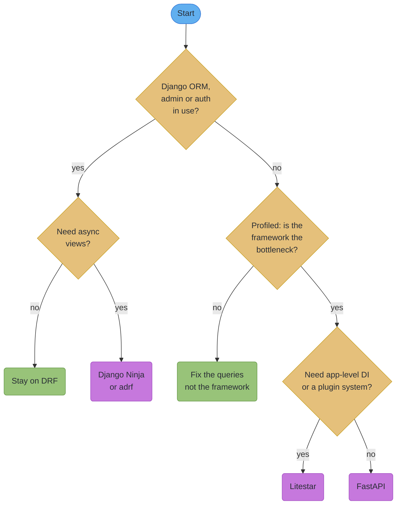
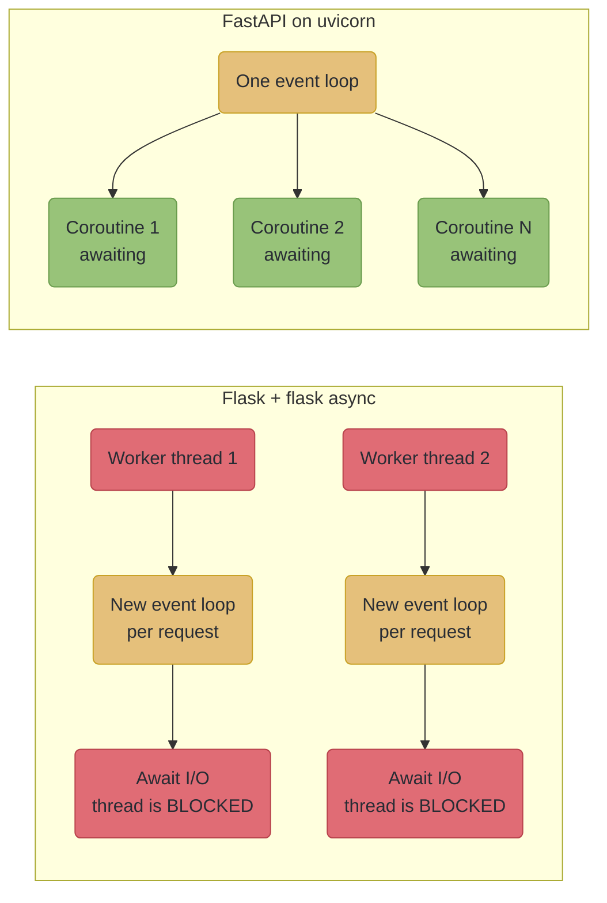
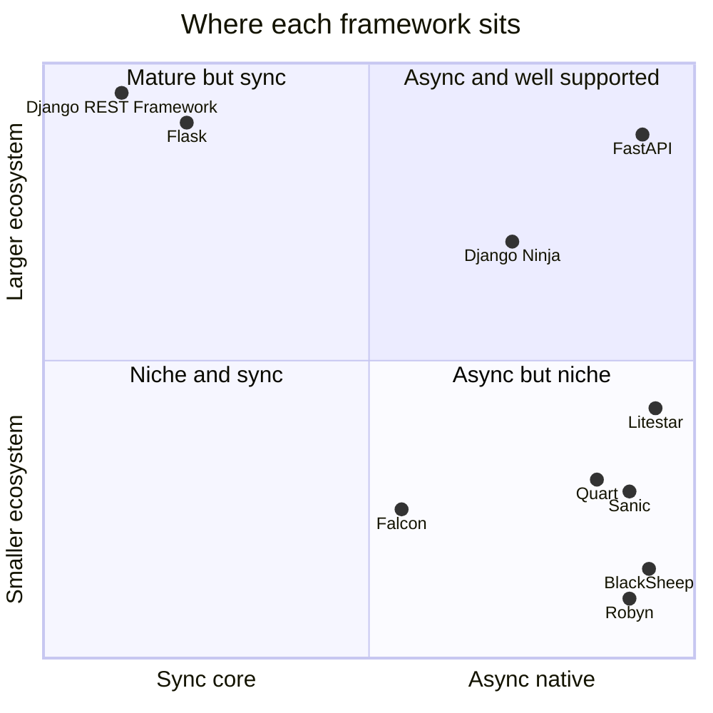
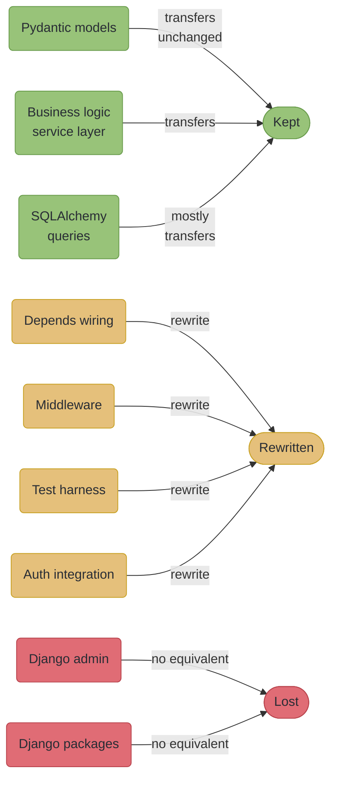

# Python API Framework Landscape

---

## 1. Concept Overview

"Why FastAPI and not Litestar?" is a principal-level interview question, and the answer that gets
marked down is a throughput number. Not because throughput does not matter, but because in 2026
almost nobody asking the question can verify the number, and the candidate quoting it usually
cannot either.

That is not rhetoric. **TechEmpower's FrameworkBenchmarks repository — the neutral harness the whole
web-framework industry cited for a decade — is archived.** The GitHub API reports `archived: true`
with a last push of 2026-03-24, and the last completed round was Round 23, published 2025-03-17. It
will not update again. What remains are vendor benchmarks, blog benchmarks, and small independent
repositories such as `tanrax/python-api-frameworks-benchmark`, which compares FastAPI, Litestar,
Django Ninja, Django Bolt and DRF but is one person's harness rather than a standard. So a framework
choice defended primarily on relative throughput is now defended on a frozen dataset or on somebody's
marketing.

This module is about what you defend it on instead. The real decision axes are unglamorous and
verifiable: does this workload actually need async concurrency, or does it need fewer queries; where
does the team's existing ORM, admin and auth live; how much of the framework must be replaced to get
the one missing piece; what is the project's maintenance velocity; and what does the migration
actually cost against what it actually buys.

The second thing worth saying up front: **you are almost never choosing on a blank page.** You are
choosing between the framework this team already runs and the one that fits this workload, and the
migration cost usually dwarfs every performance difference combined. A module about framework
selection that ignores that is a module about a decision nobody makes.

The ASGI-versus-WSGI protocol argument is not repeated here — it belongs to
[`../fastapi_fundamentals_asgi/fastapi_fundamentals_asgi.md`](../fastapi_fundamentals_asgi/fastapi_fundamentals_asgi.md),
and so does the case for FastAPI's own design. This module is the comparative view: what else exists,
what each one is genuinely better at, and how to reason about switching.

---

## 2. Intuition

**One-line analogy.** Choosing a web framework is like choosing a kitchen, not a knife. You can
always buy a better knife. Replacing the kitchen means moving the plumbing, and the argument for
doing it is never that the new taps are faster.

**Mental model.** A framework is three things bundled: a request/response model, a validation and
serialization story, and an ecosystem of everything else you did not want to write — admin, auth,
migrations, background jobs, testing tools. Frameworks compete loudly on the first two and are
actually chosen on the third. Django's ORM, admin and migrations are why teams stay on Django, and
no ASGI benchmark addresses that at all.

**Why it matters.** The expensive mistake is not picking a slower framework. It is a rewrite
justified by a benchmark that turns out to have measured something your workload does not do,
performed by a team who then spends two quarters reimplementing an admin interface. The second most
expensive is the opposite: staying on a synchronous stack while paying for a hundred servers to hold
open connections that one async process could hold.

**Key insight.** Async is a concurrency model, not a speed feature. It wins where the process would
otherwise sit blocked on I/O — thousands of open connections, many concurrent outbound calls, long
streams. It does nothing at all for CPU-bound work, and it does nothing for a query that returns
10,000 rows because someone forgot a join. Most "we need async" conversations are actually N+1
conversations.

---

## 3. Core Principles

**Principle 1 — Ask what is actually slow before asking what is faster.** The overwhelming majority
of slow Python API endpoints are slow because of database access patterns, not framework overhead.
A framework's per-request cost is measured in microseconds; an N+1 query is measured in hundreds of
milliseconds. Profile before you shop.

**Principle 2 — Async syntax is not async concurrency.** Flask supports `async def` views through the
`flask[async]` extra, which pulls in `asgiref>=3.2`, and runs each async view on a separate thread
with its own event loop. You get the syntax; you do not get the concurrency model. Flask remains WSGI
at its core, so one worker still serves one request at a time and you cannot hold thousands of open
connections. This distinction produces more wrong architectural decisions than any other item in this
module.

**Principle 3 — The ecosystem is the switching cost.** Moving from DRF to anything ASGI-native means
giving up or reimplementing the Django admin, the permissions system, and every third-party Django
package the project depends on. That is the real number in the comparison, and it never appears in a
benchmark table.

**Principle 4 — Maintenance velocity is a first-class selection criterion.** A framework's release
cadence tells you how quickly a CVE gets patched and how long a Python release takes to be supported.
It is checkable in one HTTP request to PyPI, and it is more predictive of your next two years than
any latency figure.

**Principle 5 — Prefer the boundary to the rewrite.** When an existing application needs a capability
its framework cannot give it, adding one new service at the boundary is almost always cheaper and
less risky than migrating the whole application. A Django monolith with one FastAPI streaming service
beside it is a normal, healthy architecture, not a compromise.

**Principle 6 — Treat every published benchmark as its publisher's claim.** State who ran it and
when. A project's own microbenchmark is evidence about that project's microbenchmark; it is not
evidence about your service. This applies to figures that favour the thing you already use as much as
to figures that do not.

---

## 4. Types / Architectures / Strategies

### 4.1 The honest taxonomy

Six categories, and the category usually decides more than the individual choice within it.

| Category | Members | Defining property |
|---|---|---|
| ASGI-native, schema-first | FastAPI, Litestar | async all the way down; types drive validation and OpenAPI |
| Django-embedded | Django Ninja, DRF | you keep the ORM, admin, auth and migrations |
| WSGI with async syntax | Flask | `async def` runs on a thread; concurrency model unchanged |
| ASGI reimplementation of a WSGI API | Quart | Flask's API, genuinely async underneath |
| Performance specialists | BlackSheep, Robyn, Sanic | optimised runtimes; smaller ecosystems |
| Minimalist dual-stack | Falcon | deliberately little; runs on WSGI or ASGI |

### 4.2 What each one actually is

All versions below are from PyPI, measured 2026-10-19.

| Framework | Version | Genuinely differentiating property |
|---|---|---|
| FastAPI | 0.148.0 (2026-10-19) | the default: Pydantic v2 validation, zero-config OpenAPI 3.1, `Depends`, largest ASGI ecosystem |
| Litestar | 2.25.0 (2026-10-18) | msgspec serialization, **DI built in at app/router/controller/handler level**, rich plugin API |
| Django Ninja | 1.7.1 (2026-09-19) | FastAPI-style ergonomics with Pydantic v2, **inside** a Django project |
| Django REST Framework | 3.18.3 (2026-10-06) | the mature default for Django; **no async in core** |
| Flask | 3.1.3 (2026-02-19) | the smallest mental model; enormous ecosystem; WSGI |
| Quart | 0.23.1 (2026-08-29) | Flask's API on ASGI, maintained under Pallets |
| BlackSheep | 2.6.4 (2026-10-11) | Cython-optimised ASGI with built-in DI and OpenAPI |
| Robyn | 0.88.0 (2026-06-25) | a Rust runtime core via PyO3, Python application code |
| Sanic | 25.12.1 (2026-05-31) | one of the original async-native, uvloop-based frameworks |
| Falcon | 4.4.0 (2026-09-30) | minimalist, low-overhead, **both WSGI and ASGI** since 4.0 |

Two corrections to widely repeated claims, both worth carrying into an interview.

**Litestar does not claim to be the fastest ASGI framework.** Its own benchmarks page states that
"a high score in a test does not necessarily translate to high performance of your application", and
says the benchmarks exist mainly for internal regression tracking. Every "fastest ASGI framework"
line you have read is third-party marketing copy, not the project's position. Litestar's real
argument is architectural — application-level dependency injection, a plugin system, msgspec — and it
is a good argument that does not need the borrowed one.

**Django Ninja is not built on FastAPI, and it is not built on DRF.** It is an independent project
inspired by FastAPI's syntax and developer experience. The claim that it "uses FastAPI for request
handling" appears in blog posts and machine-generated summaries and is simply false. What it actually
gives you is FastAPI-shaped ergonomics without leaving Django, which is a different and often more
valuable thing.

### 4.3 Strategies for an existing application

| Strategy | What it means | Cost | Right when |
|---|---|---|---|
| Stay and optimise | fix queries, add caching, add workers | lowest | the bottleneck is not the framework, which is the common case |
| Add async support in place | `adrf` on DRF, `flask[async]` on Flask | low | one or two endpoints need it and you understand the limits |
| Ergonomics migration within the family | DRF to Django Ninja | medium | you want Pydantic v2 and async views but must keep the ORM and admin |
| New service at the boundary | one FastAPI service beside the monolith | medium | one workload has genuinely different requirements |
| Full migration | rewrite on a new framework | highest | the framework is the constraint on nearly every endpoint |

The middle three cover almost every real case. A full migration is justified far less often than it is
attempted, and the strategy that gets skipped most often is the first one.

---

## 5. Architecture Diagrams

### 5.1 The decision, in the order it should be asked



*The first question is about the ecosystem, not about performance, because the ecosystem is the
switching cost. The third question is the one teams skip, and it is the one that most often ends the
conversation.*

### 5.2 Flask's async views versus a true ASGI event loop

This is the diagram worth memorising, because Principle 2 is the most-misunderstood point in the
whole comparison.



*On the left, concurrency is still bounded by the thread count — the `async def` bought syntax, not
capacity, and each request pays the cost of creating an event loop. On the right, one thread holds an
unbounded number of awaiting coroutines. If your problem is "hold 10,000 open connections", only the
right-hand shape solves it.*

### 5.3 Ecosystem maturity against async-nativeness



*Positions are judgements about category, not measurements. The useful reading is the diagonal:
almost every framework trades ecosystem breadth against async-nativeness, and FastAPI's position is
the whole reason it became the default — not its speed.*

### 5.4 What transfers in a migration, and what does not



*The estimate people give is the green column. The schedule is set by the amber and red ones.*

---

## 6. How It Works — Detailed Mechanics

### 6.1 The same endpoint, three ways

Ergonomics arguments are usually asserted. Here they are visible.

```python
# FastAPI 0.148.0
from fastapi import Depends, FastAPI
from pydantic import BaseModel

app = FastAPI()


class ItemIn(BaseModel):
    name: str
    price_cents: int


class ItemOut(ItemIn):
    id: int


@app.post("/items", response_model=ItemOut, status_code=201)
async def create_item(item: ItemIn, repo: Repo = Depends(get_repo)) -> ItemOut:
    return await repo.create(item)
```

```python
# Litestar 2.25.0 -- note where the dependency is declared
from litestar import Litestar, post
from litestar.di import Provide
from pydantic import BaseModel


class ItemIn(BaseModel):
    name: str
    price_cents: int


class ItemOut(ItemIn):
    id: int


@post("/items", status_code=201)
async def create_item(data: ItemIn, repo: Repo) -> ItemOut:
    return await repo.create(data)


# The dependency is registered on the APP, not repeated in every signature.
app = Litestar(route_handlers=[create_item], dependencies={"repo": Provide(get_repo)})
```

```python
# Django Ninja 1.7.1 -- inside a Django project, with the ORM available
from ninja import NinjaAPI, Schema

api = NinjaAPI()


class ItemIn(Schema):
    name: str
    price_cents: int


class ItemOut(ItemIn):
    id: int


@api.post("/items", response={201: ItemOut})
async def create_item(request, payload: ItemIn):
    item = await Item.objects.acreate(**payload.dict())
    return 201, item
```

The differences that matter are not aesthetic. In Litestar the dependency is declared once on the
application and injected by parameter name, so a dependency used by forty handlers appears in one
place; in FastAPI, `Depends(get_repo)` is repeated in each signature, which is more explicit and more
repetitive. In Django Ninja the handler has the Django `request` and the full ORM, including the
async query API (`acreate`, `aget`, `afirst`), which is the entire reason to choose it.

### 6.2 Litestar's dependency injection, concretely

FastAPI has exactly one injection mechanism and one scope: `Depends`, resolved per request, cached
within a request. Litestar has a layered container.

```python
from litestar import Litestar, Router, get
from litestar.di import Provide


async def db_session() -> AsyncSession:
    ...


async def tenant(request) -> Tenant:
    ...


admin = Router(
    path="/admin",
    route_handlers=[...],
    dependencies={"tenant": Provide(tenant)},        # only admin routes get this
)

app = Litestar(
    route_handlers=[admin, public_router],
    dependencies={"db": Provide(db_session)},        # every route gets this
)
```

Whether that is better is a genuine judgement call rather than a settled fact. Application-level
registration removes repetition and gives you a single place to see what is injectable; per-signature
declaration makes each handler's requirements readable without consulting the application object. If
your service has one or two ubiquitous dependencies, the difference is cosmetic. If it has fifteen and
a layered structure, Litestar's model is a real reduction in noise — and this, rather than
serialization speed, is the honest argument for it.

FastAPI's model is covered fully in
[`../dependency_injection_in_fastapi/dependency_injection_in_fastapi.md`](../dependency_injection_in_fastapi/dependency_injection_in_fastapi.md).

### 6.3 What Flask actually executes for an `async def` view

```python
# Flask 3.1.3 with the async extra
# pip install "flask[async]"        -> pulls in asgiref>=3.2

@app.route("/fetch")
async def fetch():
    async with httpx.AsyncClient() as c:
        r = await c.get("https://slow.example.com/data")   # 2 seconds
    return r.json()
```

What happens: Flask hands the coroutine to `asgiref`, which spins up an event loop **on the worker
thread handling this request** and runs the coroutine to completion. During those two seconds, that
worker is unavailable. With 16 Gunicorn worker threads, you can serve 16 concurrent requests — the
same as if the view were synchronous — and you have added the per-request cost of creating an event
loop.

```python
# FastAPI: the same view, different concurrency model
@app.get("/fetch")
async def fetch():
    r = await app.state.client.get("https://slow.example.com/data")   # 2 seconds
    return r.json()
```

Here the `await` yields control back to a single event loop, which picks up the next request. One
process holds thousands of in-flight requests, bounded by memory and file descriptors rather than by
thread count.

**When Flask's async support is nevertheless the right answer:** you have one or two endpoints that
call an async-only library, your concurrency requirements are already met by your worker count, and
migrating the application would cost more than the endpoints are worth. That is a legitimate,
common, and correct use of the feature. What it cannot do is raise your concurrency ceiling — and if
your problem is holding many open connections, Quart (Flask's API on ASGI, maintained under Pallets)
is the migration that actually addresses it, at a fraction of a rewrite's cost.

### 6.4 DRF and async: what "not supported in core" means

Django itself supports async views. **Django REST Framework does not**, as of 3.18.0. Its core is
synchronous — the generic views, viewsets, serializers, permission classes and authentication classes
all assume a synchronous call stack. The gap is discussed in DRF's own GitHub discussions (#9841,
#7774) and has not been closed.

The practical consequence: you cannot make a DRF `ModelViewSet` async by adding `async def`, because
DRF's dispatch will not await it. The available paths are:

```python
# Path 1: adrf, a third-party package providing async view and viewset base classes.
#         Works, and adds a dependency in the middle of your request path.
from adrf.viewsets import ViewSet


class ReportViewSet(ViewSet):
    async def list(self, request):
        ...
```

```python
# Path 2: a plain Django async view alongside DRF, for the endpoints that need it.
#         No new dependency; you give up DRF's serializers and permissions on that route.
from django.http import JsonResponse


async def stream_report(request):
    ...
```

```python
# Path 3: Django Ninja for the new surface, DRF left in place for the old one.
#         Both mounted in the same Django project, sharing models, admin and auth.
```

Path 3 is the one most teams end up at, because it needs no rewrite of the existing API and no new
concept: it is still Django, still the same ORM, still the same admin. Reaching for a full migration
to FastAPI to solve "DRF has no async views" gives up the admin as well, which is rarely the trade
the team intended.

### 6.5 Serialization: msgspec, Pydantic, and what a microbenchmark proves

Litestar builds on **msgspec** (0.21.1, 2026-04-12), which is genuinely fast. The msgspec project's
own published benchmarks put its decode at roughly 10-20x faster than Pydantic v2 and roughly
100-150x faster than Pydantic v1. **Cite that as the msgspec project's own benchmark, because it is.**

What it measures is decoding a payload into a typed structure. What it does not measure is your
endpoint. A useful way to hold it:

```
  A request that takes 40 ms end to end:
    ~1 ms   validation and serialization
    ~35 ms  database round trips
    ~4 ms   everything else

  Make validation 15x faster and you save ~0.93 ms of 40 ms  -> ~2%
  Remove one N+1 query and you save ~20 ms of 40 ms          -> ~50%
```

Those are illustrative numbers, not a measurement — but the *shape* is what almost every real profile
shows, and it is why serialization speed rarely decides a framework. Where it genuinely does decide
one: very large payloads, very high request rates against cheap handlers, or a service whose whole job
is transforming JSON. In those cases msgspec is a real advantage, and you can also use msgspec
directly inside FastAPI for the hot path without changing frameworks.

The cost of switching serializers is the part that gets forgotten: Pydantic's validators, computed
fields, custom types and `model_config` behaviour do not transfer. If you depended on them, you are
not swapping a library, you are reimplementing validation. Pydantic's own performance work is covered
in
[`../pydantic_v2_deep_dive/pydantic_core_and_performance.md`](../pydantic_v2_deep_dive/pydantic_core_and_performance.md).

For completeness: **Pydantic v3 is not released and has no announced timeline.** Pydantic's version
policy states only that breaking changes will be introduced with care, and that in v3 `pydantic-core`
is expected to be merged in as an internal submodule rather than published standalone. Anyone quoting
a v3 date is guessing.

### 6.6 Reading maintenance velocity in one request

This is the most useful and least performed check in framework selection.

```bash
# Latest version and its upload date, for any package.
curl -s https://pypi.org/pypi/litestar/json \
  | python3 -c "import sys,json; d=json.load(sys.stdin); \
      v=d['info']['version']; print(v, d['releases'][v][0]['upload_time'])"
```

What the answer tells you: how quickly a security fix will reach you, how long after a Python release
you will be able to upgrade, and whether the project still has maintainers. Against the versions in
§4.2, one contrast stands out — **Hypercorn's latest release is 0.18.0 from 2025-11-08, while uvicorn
is at 0.54.0 from 2026-09-25 and Granian at 2.8.4 from 2026-09-30.** That is not a judgement about
Hypercorn's quality; it is a fact about cadence that belongs in a decision where you are picking
something to depend on for years. The ASGI server comparison itself belongs to
[`../production_deployment_and_scaling/production_deployment_and_scaling.md`](../production_deployment_and_scaling/production_deployment_and_scaling.md)
§4.4 and is not re-argued here.

Popularity is a weaker signal but not a useless one, because it predicts how many of your problems
someone has already solved and written up. Measured via the GitHub API on 2026-10-19:
fastapi/fastapi 103,228 stars; encode/django-rest-framework 30,210; vitalik/django-ninja 9,214;
litestar-org/litestar 8,521. Always state the measurement date beside a number like that; it is a
snapshot, and quoting it undated is how a stale figure becomes folklore.

### 6.7 What a migration actually costs

Estimate against the categories in §5.4, not against a line count.

| Component | Transfers? | Why |
|---|---|---|
| Pydantic models | yes, unchanged | Litestar and Django Ninja both accept Pydantic v2 models |
| Service-layer functions | yes | they never depended on the framework, if you built them that way |
| SQLAlchemy queries and sessions | mostly | the session-per-request wiring is framework-specific |
| `Depends` wiring | no | rewrite into the target's DI model |
| Middleware | no | different base classes, different ordering semantics |
| Test harness | no | different test client, different fixtures, different override mechanism |
| Auth integration | no | rewrite, and this is where subtle security bugs enter |
| Django admin | no equivalent | the single largest hidden cost of leaving Django |
| Django third-party packages | no equivalent | count them before estimating |

The line that catches teams out is the test harness. It is invisible in a plan and it is often the
largest single chunk of the work, because it must be rewritten *before* the migration can be verified
rather than after. And auth is where the risk sits: a reimplemented permission check that is subtly
more permissive than the original is a security regression that passes every test written against the
new behaviour.

---

## 7. Real-World Examples

**Django Ninja as the incremental path.** A Django project can mount a Django Ninja API alongside its
existing DRF routes in the same `urls.py`, sharing models, migrations, admin and authentication. New
endpoints get Pydantic v2 and async views; old endpoints are untouched. This is the concrete shape of
Principle 5, and it is why "we need to leave Django for async" is usually an incorrect premise rather
than a hard requirement.

**Flask's own documentation on the limits of its async support.** Pallets documents that async views
run on a separate thread with their own event loop and that Flask remains WSGI. The project is
explicit about what the feature is and is not, which is more than can be said for most of the
secondary material written about it — and it is the primary source to cite when someone proposes
`flask[async]` as a scaling strategy.

**Falcon supporting both WSGI and ASGI.** Since 4.0, Falcon runs on either, which makes it the one
mainstream option that lets a team move from WSGI to ASGI without changing frameworks. That is a real
migration strategy and an unusual one; it exists because Falcon's minimalism means there is little
framework surface that has to differ between the two.

**The archived benchmark.** TechEmpower's harness being archived is itself a real-world example worth
carrying, because of what it does to every argument built on it. Round 23 (2025-03-17) is the last
data, the repository has been archived since 2026-03-24, and nothing has replaced it at that scale.
An interview answer that notices this is stronger than one that quotes a number from it.

---

## 8. Tradeoffs

### The main comparison

Versions and star counts measured 2026-10-19; everything else is a property, not a measurement.

| Dimension | FastAPI 0.148.0 | Litestar 2.25.0 | Django Ninja 1.7.1 | DRF 3.18.3 | Flask 3.1.3 |
|---|---|---|---|---|---|
| Concurrency model | ASGI, async-native | ASGI, async-native | ASGI within Django | sync core | WSGI; async on a thread |
| Validation | Pydantic v2 | msgspec (Pydantic supported) | Pydantic v2 | DRF serializers | none built in |
| OpenAPI | 3.1, zero config | zero config | zero config | drf-spectacular | apispec plugin |
| Dependency injection | `Depends`, per handler | layered, app to handler | Django's request | Django's request | none |
| ORM | your choice | your choice | Django ORM | Django ORM | your choice |
| Admin interface | none | none | Django admin | Django admin | none |
| Ecosystem size | largest ASGI | growing | Django's | Django's | very large, WSGI |
| GitHub stars | 101,862 | 8,411 | 9,174 | 30,144 | (not measured) |
| Chosen when | a new API service | you want app-level DI | Django shop needing async | Django shop, sync is fine | small services, existing Flask |

### Async-capability paths for a synchronous application

| Path | Effort | Concurrency gained | Ecosystem kept |
|---|---|---|---|
| `flask[async]` | hours | none — syntax only | all of Flask's |
| `adrf` on DRF | days | real, on those views | all of Django's |
| Django async views beside DRF | days | real, on those views | all of Django's, minus DRF's serializers there |
| Django Ninja beside DRF | weeks | real | all of Django's |
| Quart from Flask | weeks | real | most of Flask's; some extensions differ |
| New FastAPI service at the boundary | weeks | real, for that workload | two stacks to operate |
| Full migration to FastAPI/Litestar | months | real, everywhere | none of Django's |

### Serialization

| Dimension | Pydantic v2 | msgspec |
|---|---|---|
| Raw decode speed | the baseline here | 10-20x faster in msgspec's own published benchmarks |
| Custom validators | rich, mature | far more limited |
| Ecosystem integration | the ASGI default | narrower |
| Share of a typical request | usually a low single-digit percentage | same |
| Switch when | — | very large payloads, very high rates, cheap handlers |

---

## 9. When to Use / When NOT to Use

**Choose FastAPI when** you are building a new API service, you want the largest ASGI ecosystem and
the most hiring-available skill set, and Pydantic v2 validation with zero-config OpenAPI is what you
want. This remains the correct default and this module does not argue otherwise.

**Choose Litestar when** the application is large enough that per-handler dependency declaration has
become genuine noise, when you want a plugin architecture, or when serialization is a measured — not
assumed — bottleneck. Choose it for the architecture; do not choose it on a speed claim the project
itself declines to make.

**Choose Django Ninja when** the team is on Django and wants FastAPI-style ergonomics and async views
without giving up the ORM, admin, auth and migrations. This is the highest-value, lowest-risk move in
the whole table and it is consistently under-considered.

**Stay on DRF when** the workload is not I/O-concurrency-bound, the team is productive, and the
async gap affects a handful of endpoints you can serve another way.

**Stay on Flask when** the service is small and the ecosystem you rely on is Flask's. **Move to Quart**
if you need real async concurrency and want to keep the API shape.

**Consider Falcon when** you want minimal framework surface and explicit control, and specifically
when you want a single codebase that can run WSGI today and ASGI later.

**Do NOT migrate on a benchmark.** The neutral harness is archived; whatever number you are holding
came from a frozen dataset or from an interested party. **Do NOT add `flask[async]` expecting
concurrency** — you will get syntax and an event loop per request. **Do NOT rewrite before profiling**;
the answer is usually queries. **Do NOT leave Django to get async views** — Django Ninja or `adrf`
gets you there without giving up the admin. And **do not pick a framework whose latest release you
have not looked up**; it is one HTTP request and it is more predictive than any latency figure.

---

## 10. Common Pitfalls

### Pitfall 1 — Adding `async def` to Flask and expecting concurrency

```python
# BROKEN: the reasoning, not the syntax
# "We added flask[async] and made the slow views async. Why is throughput identical?"
@app.route("/aggregate")
async def aggregate():
    async with httpx.AsyncClient() as c:
        rs = await asyncio.gather(*[c.get(u) for u in UPSTREAMS])   # 8 calls, 2s each
    return combine(rs)
# The gather DOES run the 8 calls concurrently -- within this request.
# But the worker thread is blocked for the whole 2 seconds, so the SERVICE
# still handles only `worker_count` requests at a time. Nothing scaled.
```

```python
# FIX: name the actual requirement first
# - Need fan-out within one request?  flask[async] already gives you that.
# - Need to hold thousands of concurrent requests?  You need an ASGI core:
#   Quart (same API, ~weeks) or a new FastAPI service at the boundary.
```

The trap is that `flask[async]` genuinely helps with in-request fan-out, so the first experiment
succeeds and the wrong conclusion gets drawn. Measure concurrent *requests* served, not the latency of
one request.

### Pitfall 2 — Migrating on a benchmark that no longer exists

```
# BROKEN: the rewrite proposal
  "Framework X benchmarks 2.3x higher than FastAPI, so we should migrate."

  Where does the number come from?
    TechEmpower  -> archived 2026-03-24, last data Round 23 (2025-03-17)
    A vendor blog -> the vendor's own harness
    A comparison post -> usually re-reporting one of the above
```

```
# FIX: measure your own service
  1. Profile a real endpoint under real traffic. Where do the milliseconds go?
  2. If framework overhead is under ~5% of the request, the migration cannot
     pay for itself no matter what any benchmark says.
  3. If it is genuinely dominant, replicate ONE endpoint on the candidate and
     measure it against yours, on your hardware, with your payloads.
```

A framework's per-request overhead is measured in microseconds. If your endpoint takes 40 ms, no
framework choice available to you changes it by more than a rounding error.

### Pitfall 3 — Rewriting for async when the problem was N+1

```python
# BROKEN: "the endpoint is slow, we need async"
@app.get("/orders")
def list_orders(db: Session):
    orders = db.query(Order).limit(50).all()
    return [
        {"id": o.id, "customer": o.customer.name, "items": len(o.items)}   # 2 queries EACH
        for o in orders
    ]
# 1 + 50 + 50 = 101 queries. Async makes each one non-blocking.
# It does not make there be fewer of them.
```

```python
# FIX: eager-load, and the framework question disappears
@app.get("/orders")
def list_orders(db: Session):
    orders = (
        db.query(Order)
        .options(joinedload(Order.customer), selectinload(Order.items))
        .limit(50)
        .all()
    )                                                    # 3 queries total
    return [...]
```

Async concurrency helps a process hold many requests at once. It does not reduce the work in any one
of them. A rewrite that "fixed performance" by also fixing the queries along the way has attributed
the win to the wrong change, and the team will draw the wrong lesson next time.

### Pitfall 4 — Assuming Django Ninja gives you FastAPI's ecosystem

Django Ninja gives you FastAPI's *ergonomics* and Django's *ecosystem*. Those are different things,
and the difference bites when you reach for a FastAPI-specific library — a `Depends`-based extension,
a FastAPI middleware package, a testing utility built on `TestClient` overrides. None of those apply.
What you get instead is every Django package, the admin, the auth system, and the ORM's async API.
That is usually the better trade; it is only a problem when the expectation was wrong.

### Pitfall 5 — Choosing a framework without checking its release cadence

```bash
# The check nobody runs, on the thing they are about to depend on for three years:
curl -s https://pypi.org/pypi/<package>/json \
  | python3 -c "import sys,json; d=json.load(sys.stdin); v=d['info']['version']; \
      print(v, d['releases'][v][0]['upload_time'])"
```

A project whose last release was a year ago may be finished and stable, or it may be unmaintained,
and the difference matters enormously when a CVE lands or a new Python version ships. One request
tells you. Run it for the framework, the ASGI server, and every dependency in the request path before
you commit, not during the incident.

### Pitfall 6 — Swapping the serializer and losing the validation

```python
# BROKEN: "msgspec is faster, so we moved the models over"
class User(msgspec.Struct):
    email: str
    age: int
# The Pydantic version had: EmailStr, an age range, a normalising validator,
# and a computed field. None of that came across, and nothing failed loudly --
# the API simply stopped rejecting invalid email addresses.
```

```python
# FIX: keep validation where validation lives; use the fast path where it pays
class User(BaseModel):                       # Pydantic at the trust boundary
    email: EmailStr
    age: int = Field(ge=0, le=130)

# msgspec only for the internal hot path, where the data is already trusted:
decoder = msgspec.json.Decoder(InternalEvent)
```

Serialization speed is a property of the boundary you can afford to make dumb. Input validation at a
trust boundary is not that boundary. Losing a validator is a security change, and it is silent — the
tests written against the new model do not know what the old one rejected.

---

## 11. Technologies & Tools

Versions from PyPI, measured 2026-10-19.

| Tool | Role | Notes |
|---|---|---|
| FastAPI | ASGI framework, Pydantic-first | 0.148.0; emits OpenAPI 3.1 |
| Litestar | ASGI framework, msgspec-first | 2.25.0; layered DI, plugin API |
| Django Ninja | FastAPI-style API inside Django | 1.7.1; independent project, not built on FastAPI or DRF |
| Django REST Framework | mature Django API layer | 3.18.3; no async in core |
| `adrf` | async views and viewsets for DRF | the common third-party async path |
| Flask | WSGI microframework | 3.1.3; `flask[async]` pulls `asgiref>=3.2` |
| Quart | Flask's API on ASGI | 0.23.1; maintained under Pallets; requires Python 3.13+ |
| BlackSheep | Cython-optimised ASGI | 2.6.4; built-in DI and OpenAPI |
| Robyn | Rust runtime core via PyO3 | 0.88.0 |
| Sanic | early async-native framework | 25.12.1 |
| Falcon | minimalist, WSGI **and** ASGI | 4.4.0; dual-stack since 4.0 |
| Starlette | the ASGI toolkit under FastAPI | 1.9.0; `requires_python >=3.11` since 1.8.0 |
| Pydantic | validation and serialization | 2.14.1; v3 unreleased, no announced timeline |
| msgspec | fast serialization | 0.22.0; the project's own benchmarks claim 10-20x over Pydantic v2 decode |
| PyPI JSON API | maintenance-velocity check | `https://pypi.org/pypi/<pkg>/json` |

---

## 12. Interview Questions with Answers

**Q: Why should you not justify a framework choice with a throughput benchmark in 2026?**
**Short:** The neutral harness is archived, so every remaining number comes from a frozen dataset or an interested party.

TechEmpower's FrameworkBenchmarks repository is archived — `archived: true`, last push 2026-03-24 — and its last completed round was Round 23, published 2025-03-17. Nothing has replaced it at that scale. What is left is vendor benchmarks, blog benchmarks, and small independent repositories such as `tanrax/python-api-frameworks-benchmark`, none of which is a neutral standard. Beyond the sourcing problem there is a magnitude problem: framework overhead is microseconds against endpoints measured in tens of milliseconds, so it is usually a rounding error in your own profile. Defend the choice on ecosystem, team fit, maintenance velocity and migration cost, which are all verifiable.

**Q: A team adds `flask[async]` and makes their slow views `async def`. Throughput is unchanged. Why?**
**Short:** Flask is WSGI at its core and runs each async view on a worker thread with its own event loop, so concurrency stays bounded by thread count.

The `flask[async]` extra pulls in `asgiref>=3.2`, which spins up an event loop on the thread handling the request and runs the coroutine to completion there. That thread is blocked for the whole duration, so with 16 workers you still serve 16 concurrent requests — plus you now pay to create an event loop per request. What the feature genuinely buys is fan-out *within* one request, which is why the first experiment appears to work and the wrong conclusion gets drawn. If the requirement is holding thousands of concurrent connections, you need an ASGI core: Quart keeps Flask's API, or put one FastAPI service at the boundary.

**Q: Does Django REST Framework support async views?**
**Short:** No — DRF's core is synchronous as of 3.18.0, and async needs a third-party package or a plain Django view.

Django itself supports async views; DRF does not. Its generic views, viewsets, serializers, permission classes and authentication classes all assume a synchronous call stack, so adding `async def` to a `ModelViewSet` method does not work because DRF's dispatch will not await it. The gap is discussed in DRF's own GitHub discussions (#9841, #7774) and remains open. The three practical paths are `adrf` for async view and viewset base classes, a plain Django async view beside DRF for the few endpoints that need it, or Django Ninja for the new surface — all of which keep the ORM, admin and auth.

**Q: Is Django Ninja built on FastAPI?**
**Short:** No. It is an independent project inspired by FastAPI's syntax, and it is not built on DRF either.

The claim that Django Ninja "uses FastAPI for request handling" circulates in blog posts and machine-generated summaries and is simply false. It is a standalone Django-integrated framework that borrowed FastAPI's ergonomics — type-hint-driven validation with Pydantic v2, async-ready handlers, zero-config OpenAPI — and applies them inside a Django project. That distinction matters practically: you get Django's ecosystem, not FastAPI's, so a `Depends`-based extension or a FastAPI middleware package will not work, while every Django package, the admin, and the ORM's async API will.

**Q: What is the strongest honest argument for Litestar over FastAPI?**
**Short:** Application-level layered dependency injection and a plugin system — not speed, which the project itself declines to claim.

Litestar registers dependencies on the app, router, controller or handler and injects them by parameter name, so a dependency used by forty handlers is declared once rather than repeated in forty signatures. On a large layered application that is a real reduction in noise, and it comes with a plugin architecture FastAPI has no equivalent of. Notably, Litestar's own benchmarks page disclaims the performance reading — it says a high score in a test does not necessarily translate to application performance, and that the benchmarks exist mainly for internal regression tracking. Every "fastest ASGI framework" line is third-party marketing, so quoting it back at the project is a weaker argument than the architectural one.

**Q: An endpoint takes 40 ms and someone proposes migrating to a framework with 15x faster serialization. What do you say?**
**Short:** Find out what fraction of the 40 ms is serialization first, because it is usually low single digits.

In a typical profile, validation and serialization are around a millisecond of a 40 ms request while database round trips dominate. Making that millisecond 15x faster saves under a millisecond, roughly 2%; removing one N+1 query saves tens of milliseconds. Profile the real endpoint before shopping. Where serialization genuinely does dominate — very large payloads, very high rates against cheap handlers, a service whose whole job is transforming JSON — msgspec is a real win, and you can use msgspec directly on the hot path inside FastAPI without changing frameworks at all.

**Q: What actually transfers in a framework migration, and what sets the schedule?**
**Short:** Pydantic models and service-layer logic transfer; DI wiring, middleware, auth and the test harness are rewrites, and the admin has no equivalent.

The estimate people give covers the parts that transfer — models, business logic, most SQLAlchemy queries. The schedule is set by the parts that do not: `Depends` wiring rewritten into the target's DI model, middleware with different base classes and ordering semantics, auth reimplemented, and the test harness rebuilt. The test harness is the one that catches teams out, because it is invisible in a plan and must be rewritten *before* the migration can be verified rather than after. Auth is where the risk sits: a reimplemented permission check that is subtly more permissive is a security regression that passes every test written against the new behaviour.

**Q: How do you assess whether a framework is safe to depend on for the next three years?**
**Short:** Check its latest release date on PyPI — one request tells you how fast a CVE will reach you.

`curl https://pypi.org/pypi/<pkg>/json` gives the current version and its upload time. That single number predicts how quickly a security fix arrives and how long after a Python release you can upgrade, and it is more useful than any latency figure. Run it for the framework, the ASGI server, and every dependency in the request path. A concrete contrast measured 2026-10-19: uvicorn 0.54.0 released 2026-09-25 and Granian 2.8.4 released 2026-09-30, against Hypercorn 0.18.0 from 2025-11-08. That is not a quality judgement, it is a cadence fact that belongs in a multi-year decision.

**Q: A Django team says they must leave Django to get async. Are they right?**
**Short:** Usually not — Django Ninja or adrf gets async views without giving up the ORM, admin, auth and migrations.

Django itself supports async views; it is DRF that does not. Django Ninja mounts alongside existing DRF routes in the same project, sharing models, migrations, admin and authentication, so new endpoints get Pydantic v2 and async while old ones are untouched. `adrf` is the smaller step if you want to keep DRF's shape. Migrating to FastAPI to solve "DRF has no async views" also gives up the admin and every Django third-party package, which is rarely the trade the team intended. Leaving Django is justified when the framework constrains nearly every endpoint, not when it constrains a handful.

**Q: When is async genuinely the wrong tool?**
**Short:** For CPU-bound work, where it adds complexity and buys nothing because there is no I/O wait to overlap.

Async concurrency lets one thread hold many requests that are all waiting on I/O. If the work is computation — image processing, model inference in-process, heavy serialization of huge payloads — there is nothing to overlap, and an `async def` handler doing CPU work blocks the entire event loop and every other request on it. The answer there is a thread or process pool, or a different service entirely. The related and more common case: a slow endpoint that is slow because of query count rather than I/O waiting. Async makes each of 101 queries non-blocking; it does not make there be three.

**Q: What does Falcon offer that no other mainstream Python framework does?**
**Short:** It runs on both WSGI and ASGI from one codebase, so you can move protocols without changing frameworks.

Since 4.0, Falcon supports both, which makes it the one mainstream option where "migrate from WSGI to ASGI" is not also "migrate frameworks". That is possible precisely because of its minimalism — there is little framework surface that has to differ between the two models. The trade is what minimalism always costs: no built-in validation, no ORM opinion, no admin, a small ecosystem, and more code you write yourself. Choose it when you want explicit control and low overhead, and specifically when a staged protocol migration is on your roadmap.

**Q: How would you compare FastAPI's and Litestar's dependency injection?**
**Short:** FastAPI has one per-handler mechanism resolved per request; Litestar has a layered container from app down to handler.

FastAPI's `Depends` is declared in each handler's signature, resolved per request and cached within it — explicit, readable in isolation, and repetitive when a dependency is ubiquitous. Litestar registers dependencies at app, router, controller or handler level and injects by parameter name, so one declaration covers everything below it and there is a single place to see what is injectable. Neither is objectively better: per-signature declaration means a handler's requirements are readable without consulting the app object, which is a real benefit. The difference is cosmetic with two dependencies and substantial with fifteen across a layered structure.

**Q: Someone proposes moving models from Pydantic to msgspec for speed. What is the risk?**
**Short:** Validators, constrained types and computed fields do not transfer, so the API silently stops rejecting input it used to reject.

msgspec is a fast serializer, not a validation framework with Pydantic's feature set. Moving a model across loses `EmailStr`, field constraints, normalising validators and computed fields, and nothing fails loudly — the endpoint keeps returning 200 for input that was previously a 422. That is a security change discovered in production, and the tests written against the new model cannot catch it because they do not know what the old one rejected. Keep Pydantic at the trust boundary where validation is the point, and use msgspec on internal hot paths where the data is already trusted.

**Q: What is Quart, and when is it the right answer?**
**Short:** Flask's API reimplemented on ASGI under Pallets, and it is the right answer when an existing Flask app needs real async concurrency.

Quart (0.23.1, 2026-08-29, requires Python 3.13+) keeps Flask's routing, blueprints and request-context idioms while running on ASGI, so an existing Flask codebase migrates far more cheaply than it would to a differently-shaped framework, and the team's mental model carries over. It is the honest recommendation for the Pitfall 1 team: they wanted concurrency, `flask[async]` cannot provide it, and Quart can without a rewrite. The caveats are ecosystem (some Flask extensions have no async equivalent) and that you are choosing a smaller community than FastAPI's, which is a real trade for a long-lived service.

**Q: What is the first question you ask when someone proposes a framework migration?**
**Short:** What did the profile say, because the answer is usually queries rather than the framework.

Framework overhead is microseconds; the endpoints people want to fix are tens or hundreds of milliseconds, and the milliseconds are almost always in database access patterns. Ask for the profile before discussing candidates. If framework overhead is under roughly 5% of the request, no migration can pay for itself regardless of what any benchmark claims. If it genuinely dominates, replicate one endpoint on the candidate and measure it against yours, on your hardware, with your payloads — that is a measurement you can defend, unlike a published number about someone else's workload.

**Q: What is the status of Pydantic v3?**
**Short:** Unreleased with no announced timeline; current stable is 2.14.1.

Pydantic's own version policy states only that breaking changes will be introduced with care and that in v3 `pydantic-core` is expected to be merged in as an internal submodule rather than published standalone. No date has been announced, so anyone quoting one is guessing. The practical implication for a framework decision is that Pydantic v2 is the stable foundation to plan against, and a migration plan that depends on v3 timing depends on something nobody has published. This is also the right shape of answer to any "when will X ship" question: state the current version, state that no timeline exists, and stop.

**Q: You must add a real-time streaming endpoint to a large Django application. What do you propose?**
**Short:** One new service at the boundary rather than a migration, because a monolith with a specialised service beside it is a normal architecture.

The workload has genuinely different requirements — many long-lived connections, an async core — and the rest of the application does not. Migrating everything to get one capability trades a large, risky, low-value project for a small, safe, high-value one. Put a FastAPI service at the boundary, share the database or expose an internal API, and leave the monolith alone. The cost you accept is operating two stacks: two deployment pipelines, two dependency sets, two on-call runbooks. Name that cost explicitly rather than pretending it is free, and check first whether Django Channels or a Django async view already covers the requirement.

---

## 13. Best Practices

1. **Profile before you shop.** If framework overhead is under roughly 5% of the request, no migration
   pays for itself. The milliseconds are almost always in query patterns.

2. **State the source and date of every number you quote.** "TechEmpower Round 23, March 2025, and the
   repository has since been archived" is a defensible sentence; "framework X is 2.3x faster" is not.

3. **Never present a project's own benchmark as neutral.** msgspec's 10-20x decode figure is msgspec's
   figure; say so, and it becomes a stronger point rather than a weaker one.

4. **Distinguish async syntax from async concurrency** every single time it comes up. `flask[async]`
   gives the first and not the second, and the confusion drives more bad architecture than any other
   item here.

5. **Check the ecosystem before the framework.** Where the ORM, admin, auth and migrations live is
   the switching cost, and it never appears in a comparison table.

6. **Check the release cadence with one PyPI request** for the framework, the ASGI server, and every
   dependency in the request path — before committing, not during an incident.

7. **Prefer a boundary service to a migration.** One specialised service beside a monolith is a normal
   architecture, not a compromise.

8. **For a Django shop, evaluate Django Ninja before evaluating FastAPI.** It is the highest-value,
   lowest-risk move available and it is consistently under-considered.

9. **Estimate a migration by category, not by line count** — models and service logic transfer, DI,
   middleware, auth and the test harness are rewrites, and the admin has no equivalent.

10. **Budget the test harness rewrite explicitly.** It must be done before the migration can be
    verified, and it is routinely the largest invisible chunk of the work.

11. **Treat auth as the risk item in any migration.** A subtly more permissive permission check passes
    every test written against the new behaviour.

12. **Keep Pydantic at the trust boundary** whatever else you optimise. Losing a validator to a faster
    serializer is a silent security regression.

13. **Build a service layer the framework does not reach into.** It is the reason "business logic
    transfers unchanged" can be true, and it costs nothing to do from the start.

14. **Choose Litestar for its architecture and FastAPI for its ecosystem**, and be able to say which
    one your application actually needs.

---

## 14. Case Study

### A DRF team hits a concurrency wall

**Scenario.** A logistics company runs a five-year-old Django application: DRF for the API, Django
admin used daily by operations, roughly forty third-party Django packages, and a PostgreSQL database
the ORM has grown up around. A new customer-facing feature needs a live shipment-tracking endpoint
that holds an open connection per active shipment. At peak that is roughly 8,000 concurrent
connections. The current deployment is Gunicorn with 12 sync workers across 6 instances — 72
concurrent requests, total.

The proposal on the table is a full migration to FastAPI, estimated at one quarter.

**What the profile said.** Before evaluating candidates the team profiled the existing API, because of
Principle 1. Two findings shaped everything after.

First, the existing REST endpoints were nowhere near a framework limit. Median request 34 ms, of
which roughly 28 ms was database time; the p99 outliers were three endpoints with N+1 patterns, one
of which issued 240 queries. None of that is a framework problem, and none of it would be fixed by
migrating.

Second, the tracking requirement genuinely could not be met by the current stack at any worker count.
Holding 8,000 open connections on a synchronous WSGI model would need 8,000 workers. This was the one
real constraint, and it applied to exactly one endpoint.

**The three options.**

*Option A — `adrf`.* Add async view and viewset base classes to DRF. Smallest change, keeps DRF's
serializers and permissions. Rejected for this workload: it makes views async but leaves the
deployment on a synchronous WSGI server, so it does not deliver the connection-holding capacity that
was the whole requirement. It remains on the table for other endpoints later.

*Option B — Django Ninja, mounted beside DRF.* Same project, same models, same admin, same auth,
async views on an ASGI server. Genuinely viable, and it would have been the answer if the requirement
had been "some endpoints need async". It was not chosen only because the streaming workload's
operational profile — long-lived connections, a very different scaling curve, deploy timing that must
not drop connections — argued for isolating it rather than co-deploying it with the main application.

*Option C — one FastAPI service at the boundary.* One new service owning only the tracking endpoint,
reading from the same database, deployed and scaled independently. Chosen.

**The decision, and its cost.** The team took Option C for the one endpoint, fixed the three N+1
patterns in place, and left DRF entirely alone. The full migration was not undertaken: it would have
given up the admin that operations use every day and forty Django packages, to solve a problem that
affected one endpoint out of a hundred and forty.

The cost accepted, and named at the time: two stacks to operate — two pipelines, two dependency sets,
two on-call runbooks — plus a shared database that now has two writers' worth of migration discipline
to maintain. That is a real, permanent overhead and it was worth it here only because the workload
genuinely differed.

**The transferable part.** The numbers above belong to this scenario and are not published research.
What transfers is the sequence: profile first, separate the constraint that is real from the
constraints that are query bugs, scope the change to the workload that actually differs, and treat
"migrate everything" as the option that must justify itself against the boundary service — not the
other way around. Notice also what never entered the decision: no benchmark comparison was performed,
because the deciding factor was a concurrency *model* rather than a throughput difference, and that
is a property you can reason about from first principles rather than measure from someone else's
harness.
