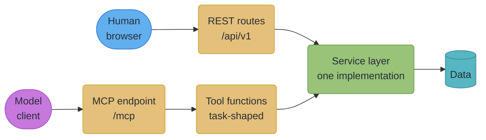
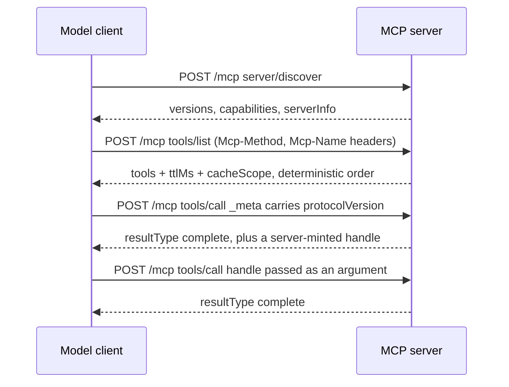
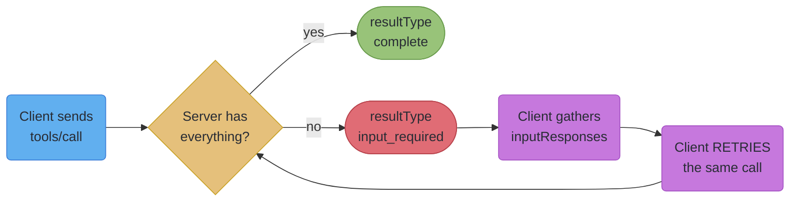

# MCP Servers from FastAPI

---

## 1. Concept Overview

The Model Context Protocol is a JSON-RPC protocol for exposing capabilities to a model: tools it can
call, resources it can read, and prompts it can instantiate. If you already run a FastAPI service,
the obvious move is to point a generator at your OpenAPI document and ship an MCP server in an
afternoon. That works, and it is usually the wrong shape.

The reason is that a REST API and an MCP tool surface have different consumers with different
constraints. A REST API is consumed by a programmer who read the documentation, holds the whole
workflow in their head, can call three endpoints in sequence, and can ask a colleague what
`?expand=` does. An MCP tool surface is consumed by a model that sees only the tool definitions you
sent it, has no memory between turns beyond the conversation, cannot ask you a clarifying question
about your schema, and pays for every byte of that surface out of the same context budget it needs
for the user's actual problem.

So the tool list is a **prompt-budget line item**, re-sent on every turn. Forty CRUD routes become
forty tools with forty schemas, and a model that has to compose four of them in the right order to
answer one question will get the order wrong some of the time. Six task-shaped tools that each
complete a job end to end will not.

The second thing to know before writing any code is that **the protocol changed shape in the
`2026-07-28` revision**, and most material written about MCP describes the older one. Sessions are
gone. The `initialize` handshake is gone. Servers can no longer initiate requests. Stream
resumability is gone. If you build against a tutorial from last year you will build a stateful
server on a protocol that no longer has state, and the failure will surface as intermittent
misbehaviour behind a load balancer rather than as a clean error.

This file covers both: how to shape a tool surface a model can actually use, and how to serve it
correctly from FastAPI under the current specification. The economics of the model calls themselves
— admission, token budgets, cost accounting — belong to the parent module,
[`serving_llm_and_ai_workloads.md`](serving_llm_and_ai_workloads.md).

---

## 2. Intuition

**One-line analogy.** Your REST API is a well-stocked hardware shop with everything in labelled
drawers. An MCP tool surface is the toolbox you hand someone before sending them onto a roof. The
shop is better if you know exactly what you need; the toolbox is better if you have one trip and no
way to ask questions.

**Mental model.** Design tools the way you would design a job description, not the way you would
design a database schema. A tool should correspond to something a person would ask for — "find the
overdue invoices for this customer" — rather than to a row you can select. Every tool that only makes
sense in combination with another tool is a place the model can get the combination wrong.

**Why it matters.** The failure mode of a bad tool surface is not an error. It is a model that
chooses the wrong tool, or the right tool with the wrong arguments, or three tools where one would
have done — and the user sees a wrong answer delivered confidently. That is much harder to debug
than a 500, because nothing in your service did anything incorrect.

**Key insight.** Every token spent on tool definitions is a token not spent on the user's problem,
and the tool list is re-sent every turn. Auto-generation optimises for coverage; what you want is
the smallest surface that covers the jobs people actually ask for.

---

## 3. Core Principles

**Principle 1 — The tool surface is a prompt, so its size is a cost.** Tool definitions occupy
context on every turn of every conversation. Forty tools with rich schemas can consume more context
than the documents the user wants summarised. Curate ruthlessly; a tool that is used in one percent
of conversations is charged for in one hundred percent of them.

**Principle 2 — Tools are tasks, not endpoints.** `GET /invoices`, `GET /customers/{id}`, and
`GET /invoices?status=overdue&customer={id}` are three endpoints and one job. Ship the job.

**Principle 3 — The protocol is stateless as of `2026-07-28`; do not smuggle state into it.** The
`initialize` handshake and the `Mcp-Session-Id` header were removed, and list endpoints no longer
vary per connection. Where you genuinely need continuity across calls, the specification's answer is
explicit: **server-minted handles passed as ordinary tool arguments**. That is a value in your
domain, not a protocol feature.

**Principle 4 — Bound every response.** A tool that returns 5,000 rows has not returned a large JSON
body; it has caused a context-window incident, and possibly evicted the user's original question. A
tool's response size is part of its contract.

**Principle 5 — Servers never initiate requests.** The transport specification states plainly that
servers do not initiate JSON-RPC requests and clients do not send responses. When a server needs
something from the client mid-request, it returns an `InputRequiredResult` and the client retries
with the answer. Any design that assumes a server can call out to the client is describing an older
protocol revision.

**Principle 6 — An MCP server is an authenticated production surface, not a debug endpoint.** It
gets the same authorization, rate limiting, audit logging and input validation as the REST API it
sits beside — and the specification makes OAuth 2.0 Protected Resource Metadata (RFC 9728) a MUST
for HTTP servers, on an OAuth 2.1 foundation.

---

## 4. Types / Architectures / Strategies

### 4.1 How the tool surface is produced

| Approach | Mechanism | Right when | The cost |
|---|---|---|---|
| Auto-generated from the app | `FastMCP.from_fastapi(app=app)` | a spike, an internal tool, a demo | one tool per route, schemas sized for programmers, no task shaping |
| Auto-generated from a spec | `FastMCP.from_openapi(...)` | you do not own the service | same, plus no ability to fix the source |
| Hand-authored | `@mcp.tool` functions calling your own service layer | production, external models, anything with a cost or a blast radius | you write and maintain each tool |
| Hybrid | auto-generate, then prune, rename, and merge | migrating an existing API incrementally | you must keep the pruning list from rotting |

The hybrid path is the pragmatic one and the one worth naming explicitly: generate to discover what
exists, then delete ninety percent of it and hand-write the handful of composed tools that cover the
real jobs. What you must not do is generate into production and leave it, because the surface then
tracks your route table rather than your users' tasks, and every new CRUD endpoint silently enlarges
every conversation.

### 4.2 Where the server runs

| Shape | Transport | Right when |
|---|---|---|
| Mounted sub-app inside the FastAPI process | Streamable HTTP | the tools call the same service layer as your routes; one deployment, one auth stack |
| Separate service | Streamable HTTP | the tool surface has a different scaling profile or a different security boundary |
| Local subprocess | stdio | a desktop client launches it; no network, no auth server |

There are exactly two standard transports in the current specification. **stdio** is newline-delimited
JSON-RPC over the standard streams of a client-launched subprocess. **Streamable HTTP** posts each
message to a single MCP endpoint and returns either a JSON object or a request-scoped SSE stream.
Custom transports over a reliable bidirectional byte stream should reuse the stdio framing rather
than inventing one.

The older **HTTP+SSE transport** — deprecated since protocol version `2025-03-26` — was reclassified
as Deprecated under the specification's new feature-lifecycle policy in `2026-07-28`. It is
deprecated, not removed, and the lifecycle policy guarantees a minimum twelve-month window. Build on
Streamable HTTP.

### 4.3 What changed in `2026-07-28`, at a glance

This table is the single most useful thing in the file, because almost everything written about MCP
predates it.

| Older revisions | `2026-07-28` |
|---|---|
| `initialize` / `notifications/initialized` handshake | removed; every request carries `io.modelcontextprotocol/protocolVersion` and `io.modelcontextprotocol/clientCapabilities` in `_meta` |
| `Mcp-Session-Id` header, connection-scoped session | removed; list endpoints no longer vary per connection |
| Capability discovery via the handshake | `server/discover` RPC, which servers MUST implement |
| Server-initiated requests (`roots/list`, `sampling/createMessage`, `elicitation/create`) | Multi Round-Trip Requests: server returns `InputRequiredResult`, client retries with `inputResponses` |
| SSE resumability via `Last-Event-ID` and event ids | removed; a broken stream loses the request, and the client MUST re-issue it with a new request id |
| HTTP GET endpoint plus `resources/subscribe` | `subscriptions/listen`, one long-lived POST-response stream with explicit opt-in |
| `ping`, `logging/setLevel`, `notifications/roots/list_changed` | removed; log level is per-request via `io.modelcontextprotocol/logLevel` in `_meta` |
| Results were untyped | every result carries `resultType`: `"complete"` or `"input_required"` |
| Roots, Sampling, Logging active | all three **deprecated** (still functional during the window) |

Note the contrast worth carrying: **FastAPI's own native SSE supports `Last-Event-ID` resume, and
MCP's Streamable HTTP deliberately does not.** They are both SSE on the wire and they have opposite
answers on resumability, so the reconnect logic you wrote for one is wrong for the other. See
[`../websockets_sse_and_streaming/websockets_sse_and_streaming.md`](../websockets_sse_and_streaming/websockets_sse_and_streaming.md)
§6.5 for the FastAPI side.

---

## 5. Architecture Diagrams

### 5.1 Mounting an MCP surface beside your REST API



*The service layer is the reuse boundary. Tools call the same functions your routes call, so
business logic, authorization and validation exist once. Tools that reach into the database
directly are how the two surfaces drift apart.*

### 5.2 A stateless call under the current protocol



*There is no handshake and no session id. Continuity across the last two calls is carried by a
handle the server minted and the client passed back as an ordinary argument — a domain value, not a
protocol feature.*

### 5.3 Multi Round-Trip Requests, which replace server-initiated calls



*The loop is driven entirely by the client re-issuing the original request. A server that tries to
call back into the client is describing a protocol revision that no longer exists.*

---

## 6. How It Works — Detailed Mechanics

### 6.1 Mounting an MCP app into FastAPI, and the lifespan trap

The official Python SDK (`mcp` 2.x, whose high-level class is `MCPServer`) exposes an ASGI app via
`mcp.streamable_http_app()`; FastMCP exposes
`mcp.http_app(path="/mcp")`. Either mounts into a FastAPI app. The trap is that **Starlette does not
run a mounted sub-application's lifespan**, so the MCP app's startup never executes and the failure
arrives later as a confusing runtime error rather than as a startup crash.

```python
# BROKEN: mounts cleanly, starts cleanly, fails on the first tool call
from fastapi import FastAPI
from fastmcp import FastMCP

mcp = FastMCP("reporting")
app = FastAPI()
app.mount("/mcp", mcp.http_app(path="/"))
# The sub-app's lifespan never runs. Its session manager is never initialised.
```

```python
# FIX: hand the mounted app's lifespan to the parent
from contextlib import asynccontextmanager

from fastapi import FastAPI
from fastmcp import FastMCP

mcp = FastMCP("reporting")
mcp_app = mcp.http_app(path="/")


@asynccontextmanager
async def lifespan(app: FastAPI):
    async with mcp_app.lifespan(app):        # the sub-app's startup/shutdown runs
        # ...your own startup here (db pool, http client, caches)
        yield


app = FastAPI(lifespan=lifespan)
app.mount("/mcp", mcp_app)
```

This is the single most-hit trap in the whole topic, and it is not specific to MCP — it is Starlette
mount semantics, which the same repo covers under
[`../fastapi_fundamentals_asgi/fastapi_fundamentals_asgi.md`](../fastapi_fundamentals_asgi/fastapi_fundamentals_asgi.md).
If you compose more than one sub-application, chain their lifespans explicitly; nothing will remind
you.

### 6.2 Auto-generating, and then not shipping it

```python
from fastmcp import FastMCP

# From a live FastAPI app...
mcp = FastMCP.from_fastapi(app=app)

# ...or from a spec you do not own.
mcp = FastMCP.from_openapi(openapi_spec=spec, client=httpx_client)
```

Both are current APIs and both are genuinely useful — for *discovery*. Run one, dump `tools/list`,
and read what a model would receive. On a forty-route CRUD service the output is forty tools whose
descriptions are your route summaries and whose schemas are your request models in full, including
every optional filter parameter nobody uses.

Then throw it away and write the six tools that correspond to jobs. Keep the generated output as a
checklist of what the hand-written tools must be able to reach, not as the surface itself.

### 6.3 A tool worth shipping

```python
from typing import Annotated, Literal

from pydantic import BaseModel, Field


class OverdueInvoice(BaseModel):
    """One overdue invoice. Deliberately narrow: five fields, not the ORM row."""
    invoice_id: str
    customer_name: str
    days_overdue: int
    amount_cents: int
    currency: str


class OverdueResult(BaseModel):
    invoices: list[OverdueInvoice]
    total_matching: int = Field(description="Total matches, which may exceed the returned page.")
    next_cursor: str | None = Field(
        default=None,
        description="Pass back as `cursor` to fetch the next page. Null when there are no more.",
    )


@mcp.tool
async def find_overdue_invoices(
    customer: Annotated[str, Field(description="Customer name or id. Partial names are matched.")],
    minimum_days: Annotated[int, Field(ge=1, le=365)] = 30,
    sort: Literal["oldest", "largest"] = "oldest",
    cursor: str | None = None,
) -> OverdueResult:
    """Find invoices past their due date for one customer, oldest or largest first.

    Returns at most 25 invoices per call. Use `next_cursor` to page.
    """
    page = await billing_service.overdue(          # the SAME service layer the REST route calls
        customer=customer, minimum_days=minimum_days, sort=sort, cursor=cursor, limit=25,
    )
    return OverdueResult(
        invoices=[OverdueInvoice.model_validate(i) for i in page.items],
        total_matching=page.total,
        next_cursor=page.next_cursor,
    )
```

Five things make this a tool rather than an endpoint. The name is a task. The docstring says what it
returns *and how much*, because that is what lets the model decide whether to page. The arguments
are constrained (`ge`, `le`, `Literal`) so an invalid call fails in validation rather than in your
database. The response model is narrow — five fields, not the ORM row — because every field is
context spent on every result. And the cursor is opaque and server-minted, which is the stateless
continuity pattern in §6.4.

### 6.4 Continuity without sessions

The `2026-07-28` specification removed protocol-level sessions and directs servers that need
cross-call state to use **explicit, server-minted handles passed as ordinary tool arguments**. That
is more than a workaround; it is a better design, because the state becomes visible, auditable and
expirable.

```python
import json
from datetime import UTC, datetime, timedelta

from itsdangerous import BadSignature, URLSafeTimedSerializer

SIGNER = URLSafeTimedSerializer(settings.handle_secret, salt="mcp-handle")
HANDLE_TTL_S = 900


def mint_handle(payload: dict) -> str:
    """A handle is signed server state the client carries. It is not a session."""
    return SIGNER.dumps(payload)


def read_handle(handle: str) -> dict:
    try:
        return SIGNER.loads(handle, max_age=HANDLE_TTL_S)
    except BadSignature as exc:
        raise ValueError("This cursor has expired or is invalid. Start the query again.") from exc
```

Two properties matter. The handle is **signed**, so a client cannot forge one to page into another
tenant's results — a plain base64 offset is an authorization bug waiting to be found. And it is
**time-limited**, so a model that stores a cursor and returns to it an hour later gets a clear,
actionable error rather than stale or wrong data. Encode the tenant and the query parameters inside
it; never encode a raw SQL offset.

### 6.5 Cacheability, and why tool order matters

The current specification requires `ttlMs` and `cacheScope` on the results of `tools/list`,
`prompts/list`, `resources/list`, `resources/read` and `resources/templates/list`. `ttlMs` is a
freshness hint in milliseconds that lets clients cache instead of polling; `cacheScope` is `"public"`
or `"private"` and controls whether shared intermediaries may cache the response.

```python
# A tool list that rarely changes: a long TTL, and safe for a shared cache.
LIST_TTL_MS = 300_000          # 5 minutes
LIST_SCOPE = "public"          # no tenant-specific content in the tool list itself

# A resource read scoped to one caller: short TTL, never shared.
READ_TTL_MS = 30_000
READ_SCOPE = "private"
```

The rule is simple and easy to get wrong: **`"public"` is only correct when the response contains
nothing that varies by caller.** If your tool list differs per tenant — because a tenant's plan
unlocks extra tools — it is `"private"`, and marking it public lets an intermediary serve one
tenant's surface to another.

Alongside that, the specification says servers **SHOULD return tools from `tools/list` in a
deterministic order**, explicitly to enable client-side caching and to improve LLM prompt-cache hit
rates. This connects directly to the prompt-prefix caching described in
[`serving_llm_and_ai_workloads.md`](serving_llm_and_ai_workloads.md) §6.6: the tool list sits near
the top of the prompt, so a list whose order varies between calls invalidates the provider's prefix
cache on every turn. Sorting a list is one line; forgetting to costs money on every request and shows
up in no latency metric.

```python
def list_tools() -> list[Tool]:
    return sorted(REGISTRY.values(), key=lambda t: t.name)     # stable across processes
```

Sort by name, not by registration order or dictionary order, because those differ across processes
and a load-balanced fleet will then hand different orderings to the same client.

### 6.6 Asking the client for something mid-request

Under Multi Round-Trip Requests, a server that needs more information returns an
`InputRequiredResult` with `resultType: "input_required"` and an `inputRequests` field. The client
gathers the answers and **retries the original request** with `inputResponses`. There is no
server-initiated call, and no completion notification — the server learns the outcome because the
request comes back.

```python
async def delete_report(report_id: str, request_state: dict | None = None,
                        input_responses: dict | None = None):
    if input_responses is None:
        return InputRequiredResult(
            input_requests=[
                {
                    "id": "confirm",
                    "kind": "confirmation",
                    "prompt": f"Permanently delete report {report_id}? This cannot be undone.",
                }
            ],
            # Correlate across the retry with YOUR identifier, in requestState.
            request_state={"report_id": report_id, "asked_at": datetime.now(UTC).isoformat()},
        )
    if input_responses.get("confirm") is not True:
        return {"deleted": False, "reason": "not confirmed"}
    await reports_service.delete(report_id)
    return {"deleted": True}
```

The `requestState` field is where you put your own correlation identifier. The `elicitationId` field
and the `notifications/elicitation/complete` notification that older revisions used were both
removed, precisely because the client's retry already carries the correlation.

### 6.7 Authorization

For HTTP servers the specification is not optional here: MCP servers **MUST** implement OAuth 2.0
Protected Resource Metadata (**RFC 9728**), on an **OAuth 2.1** foundation. That means publishing a
metadata document that tells a client which authorization server to talk to, and validating the
resulting access token on every request — every request, because there is no session in which to
remember that a caller was authenticated.

```python
from fastapi import Depends, FastAPI, HTTPException, Request

RESOURCE_METADATA = {
    "resource": "https://api.example.com/mcp",
    "authorization_servers": ["https://auth.example.com"],
    "scopes_supported": ["reports:read", "reports:write"],
    "bearer_methods_supported": ["header"],
}


@app.get("/.well-known/oauth-protected-resource")
async def protected_resource_metadata() -> dict:
    return RESOURCE_METADATA


async def require_scope(request: Request, scope: str) -> Principal:
    token = (request.headers.get("authorization") or "").removeprefix("Bearer ").strip()
    if not token:
        raise HTTPException(
            401,
            headers={"WWW-Authenticate":
                     'Bearer resource_metadata="https://api.example.com'
                     '/.well-known/oauth-protected-resource"'},
        )
    principal = await verify_access_token(token)          # audience, issuer, expiry, signature
    if scope not in principal.scopes:
        raise HTTPException(403, "Insufficient scope")
    return principal
```

Three requirements added in `2026-07-28` are worth writing into your client if you are building one.
Authorization servers **SHOULD** include the `iss` parameter in authorization responses per
**RFC 9207**, and clients **MUST** validate a present `iss` against the recorded issuer before
redeeming the code. Clients **MUST** specify an appropriate `application_type` during Dynamic Client
Registration, to avoid OpenID Connect redirect-URI conflicts. And client credentials are bound to the
authorization server that issued them: key persisted credentials by issuer, never reuse them across
authorization servers, and re-register when the authorization server changes.

One further change: **RFC 7591 Dynamic Client Registration is now deprecated** as a registration
mechanism in favour of Client ID Metadata Documents. It remains available for backward compatibility
with authorization servers that do not support them.

The token verification itself is ordinary work covered by
[`../authentication_and_security/authentication_and_security.md`](../authentication_and_security/authentication_and_security.md).

### 6.8 Tracing across the boundary

The specification documents OpenTelemetry trace-context propagation conventions for `_meta` keys:
`traceparent`, `tracestate` and `baggage`. That makes a model-initiated call joinable to the trace
that produced it, which is the difference between debugging "a tool returned the wrong thing" and
debugging "something somewhere returned the wrong thing".

```python
from opentelemetry import trace
from opentelemetry.propagate import extract

tracer = trace.get_tracer(__name__)


async def handle_tool_call(name: str, args: dict, meta: dict):
    ctx = extract({k: v for k, v in meta.items() if k in ("traceparent", "tracestate", "baggage")})
    with tracer.start_as_current_span(f"mcp.tool/{name}", context=ctx) as span:
        span.set_attribute("mcp.tool.name", name)
        span.set_attribute("mcp.arg.count", len(args))     # count, never the values
        return await REGISTRY[name](**args)
```

Set the argument *count*, not the arguments. Tool arguments routinely contain customer names, record
ids and free text, and a span attribute is not a place to put them. The same cardinality and
sensitivity rules as everywhere else apply — see
[`../observability_and_monitoring/observability_and_monitoring.md`](../observability_and_monitoring/observability_and_monitoring.md).

### 6.9 Cancellation and errors

On Streamable HTTP a client abandons an in-flight request by **closing the request's response
stream** (on stdio it sends a `notifications/cancelled` notification). Your handler sees the same
`GeneratorExit`/cancellation it would see from any FastAPI client disconnect, and the same rule
applies: release resources and record what was consumed in a `finally` block.

Error codes are now partitioned. `-32000` through `-32019` remain implementation-defined, with
existing SDK usage grandfathered; `-32020` through `-32099` are reserved for the specification
itself. One renumbering to be aware of: resource-not-found moved from `-32002` to `-32602`
(Invalid Params), aligning with JSON-RPC. If you hard-coded `-32002` anywhere, it is now wrong.

### 6.10 Upgrading to `mcp` 2.x and FastMCP 4

`mcp` 2.0.0 (2026-07-28) is a breaking release; 1.x receives only security fixes, so a server that
stays on it should pin `mcp>=1.28,<2`. The changes that hit almost every server:

| v1 | v2 |
|---|---|
| `from mcp.server.fastmcp import FastMCP` | `from mcp.server.mcpserver import MCPServer` (the old import raises `ModuleNotFoundError`) |
| `ctx.fastmcp` | `ctx.mcp_server` |
| `FastMCP("x", port=..., json_response=...)` | transport options go to `run()` or `streamable_http_app(...)` |
| `mcp.types` | the separate `mcp-types` package, imported as `mcp_types` (`mcp.types` stays as an alias) |
| camelCase model fields (`inputSchema`) | snake_case (`input_schema`) |
| `McpError` | `MCPError` |
| `httpx`, `httpx-sse` | `httpx2` |
| client: transport + `ClientSession` + `initialize()` | one `Client(target)` that negotiates the protocol version |

One `MCPServer` serves `2026-07-28` clients and every 2025-era client over Streamable HTTP and
stdio with no configuration. OpenTelemetry tracing is on by default. The mounted-lifespan rule in
§6.1 is unchanged: the host app's lifespan must enter `mcp.session_manager.run()`.

`Resolve(fn)` fills a tool parameter from your own function, the way FastAPI's `Depends` does,
and the parameter never appears in the tool's input schema:

```python
from typing import Annotated

from mcp.server.mcpserver import MCPServer, Resolve
from pydantic import BaseModel

mcp = MCPServer("reporting")


class Owner(BaseModel):
    account_id: str
    plan: str


async def load_owner(report_id: str) -> Owner:      # matched to the tool argument by name
    return await accounts.owner_of(report_id)


@mcp.tool()
async def archive_report(report_id: str, owner: Annotated[Owner, Resolve(load_owner)]) -> str:
    """Archive a report the caller owns."""
    ...
```

A resolver can also put a question to the user, which the SDK turns into the multi-round-trip
exchange in §6.6, so one tool body serves both protocol eras.

FastMCP 4.0.0 (2026-08-31) sits on `mcp` 2.x. Most FastMCP 3 servers upgrade without code
changes; the breaks are server-initiated sampling and roots (removed from the server API,
because a `2026-07-28` request has no live connection to call back on), `ctx.elicit()` (works
only on old-protocol connections), background tasks (`@mcp.tool(task=True)` now needs the
`fastmcp-tasks` package), and snake_case model fields. It adds `Mcp-Method` and `Mcp-Name`
routing headers so a gateway can route without parsing JSON-RPC, and
`Depends(get_account, user_id=CallArgument("owner"))` to bind a dependency to a call argument
while keeping it out of the tool schema.

---

## 7. Real-World Examples

**The official Python SDK.** `modelcontextprotocol/python-sdk` ships a `streamable_http_basic_mounting`
example showing `mcp.streamable_http_app()` mounted into a Starlette application — the canonical
reference for the composition in §6.1, and the place to check when an SDK behaviour and a blog post
disagree.

**FastMCP.** At 4.1.1 (4.0.0 GA 2026-08-31, built on `mcp` 2.x and the `2026-07-28` revision),
FastMCP is the ergonomic layer most teams actually use, and its
`from_fastapi()` / `from_openapi()` constructors are the auto-generation path in §6.2. Its
documentation for HTTP deployment is also where the mounted-lifespan requirement is spelled out,
which is a reasonable indicator of how often people hit it.

**The specification's own deprecation guidance.** When `2026-07-28` deprecated Roots, Sampling and
Logging, it published migrations rather than leaving them implicit: pass directories or files via
tool parameters, resource URIs, or server configuration instead of Roots; integrate directly with an
LLM provider's API instead of Sampling; log to `stderr` on stdio or use OpenTelemetry instead of
Logging. Two of those three tell you to use something you already have — which is a useful signal
about how much protocol surface a server actually needs.

**The twelve-month deprecation window.** The same revision adopted a formal feature lifecycle with
Active, Deprecated and Removed states and a minimum twelve-month deprecation window, plus a registry
of deprecated features. That is worth knowing for planning: a feature marked Deprecated today is not
a fire, and one you adopt today knowing it is deprecated is a dated liability you chose.

---

## 8. Tradeoffs

### Auto-generated versus hand-authored tools

| Dimension | Auto-generated | Hand-authored |
|---|---|---|
| Time to first working server | minutes | days |
| Context cost of the surface | proportional to your route count | proportional to your job count |
| Model success rate on multi-step tasks | low; it must compose correctly | high; one tool completes the job |
| Response size control | none; whatever the route returns | explicit, per tool |
| Drift as the API grows | automatic, and automatically worse | requires maintenance |
| Right for | discovery, spikes, internal-only | anything a customer or an external model touches |

### Mounted sub-app versus separate service

| Dimension | Mounted in the FastAPI app | Separate service |
|---|---|---|
| Code reuse | maximum — same service layer, same DI | needs an internal API or a shared library |
| Deployment | one artifact | independent release cadence |
| Scaling | tied to the API tier | independent |
| Blast radius | a tool bug can take the API down | isolated |
| Auth stack | shared | duplicated |
| Gotcha | the lifespan chaining in §6.1 | keeping two authorization implementations honest |

### stdio versus Streamable HTTP

| Dimension | stdio | Streamable HTTP |
|---|---|---|
| Deployment | the client launches your process | you run a service |
| Auth | inherits the local user | OAuth 2.1 + RFC 9728, mandatory |
| Multi-client | one process per client | one service, many clients |
| Network exposure | none | a production surface to defend |
| Right for | desktop tooling, local development | anything shared or remote |

---

## 9. When to Use / When NOT to Use

**Expose an MCP server when** a model genuinely needs to *act* in your system rather than read about
it; when the actions have a small, stable set of shapes; and when you can afford to authorize and
audit them properly.

**Prefer hand-authored tools when** the surface is customer-facing, when actions are destructive or
billable, or when a task requires composing several of your endpoints — which is most of the
interesting cases.

**Mount the server inside the FastAPI app when** the tools call the same service layer as the routes
and there is no reason to split the deployment. **Split it out when** the tool surface has a
different security boundary or a wildly different scaling profile.

**Do NOT auto-generate a forty-tool surface into production.** **Do NOT build on Roots, Sampling or
Logging** in a new server; all three are deprecated with published migrations. **Do NOT design around
sessions or the `initialize` handshake** — they are gone, and a design that needs them is a design
against an older revision. **Do NOT expose a destructive tool without both an authorization scope and
an MRTR confirmation step.** And do not build an MCP server at all when what your users need is a
better REST API; MCP is a way to reach models, not a way to fix an API's ergonomics.

---

## 10. Common Pitfalls

### Pitfall 1 — The mounted sub-app's lifespan never runs

Covered in §6.1 with the fix, and repeated here because it is the one everybody hits. Starlette does
not propagate a mounted application's lifespan, so `app.mount("/mcp", mcp.http_app())` starts cleanly
and fails on the first tool call with an error about an uninitialised session manager — an error that
points at the MCP library rather than at your composition. Chain the lifespan explicitly. If you
mount more than one sub-application, chain all of them; nothing warns you.

### Pitfall 2 — Forty auto-generated tools eat the context budget

```
# BROKEN: FastMCP.from_fastapi(app) on a 40-route CRUD service
  40 tools x ~350 tokens of schema and description   ~ 14,000 tokens
  re-sent on EVERY turn of EVERY conversation
```

```
# FIX: six task-shaped tools
  6 tools x ~250 tokens                              ~  1,500 tokens
  and the model no longer has to compose four calls correctly
```

The measured cost is the smaller half of the damage. The larger half is accuracy: a model choosing
among forty similarly-named tools picks wrong sometimes, and the user sees a confident wrong answer
rather than an error. Generate to discover what exists; ship what people ask for.

### Pitfall 3 — A tool that returns everything

```python
# BROKEN: "it's just a list endpoint"
@mcp.tool
async def list_invoices(customer: str) -> list[Invoice]:
    return await billing_service.all_invoices(customer)      # 5,000 rows, 40 fields each
```

```python
# FIX: bound the page, narrow the model, and say so in the docstring
@mcp.tool
async def list_invoices(customer: str, cursor: str | None = None) -> InvoicePage:
    """List invoices for a customer, 25 per call. Use `next_cursor` to page."""
    page = await billing_service.invoices(customer, cursor=cursor, limit=25)
    return InvoicePage(
        invoices=[InvoiceSummary.model_validate(i) for i in page.items],   # 5 fields, not 40
        next_cursor=page.next_cursor,
    )
```

A 5,000-row response is not a large body, it is a context-window incident: it can evict the user's
original question from the conversation, and the model's next answer will be confidently unrelated.
Response size is part of a tool's contract, and the docstring must state the bound so the model knows
to page.

### Pitfall 4 — Carrying state the protocol no longer gives you

```python
# BROKEN: written against a pre-2026-07-28 tutorial
SESSIONS: dict[str, QueryState] = {}          # keyed on Mcp-Session-Id


@mcp.tool
async def next_page(session_id: str) -> Page:
    return SESSIONS[session_id].advance()     # KeyError behind a load balancer
```

```python
# FIX: a signed, expiring, server-minted handle passed as an argument
@mcp.tool
async def next_page(cursor: str) -> Page:
    state = read_handle(cursor)               # signed; carries tenant and query
    return await query_service.page(state)
```

The in-memory version works perfectly on one process and fails intermittently the moment there are
two, because there is no session affinity to rely on any more. Worse, an unsigned handle is an
authorization hole: a client that can edit a cursor can page into another tenant's results.

### Pitfall 5 — A client that relies on stream resumability

`2026-07-28` removed SSE resumability and message redelivery from Streamable HTTP — no `Last-Event-ID`
header, no event ids. A broken response stream **loses the in-flight request**, and the client MUST
re-issue it as a new request with a new request id. Client code that reconnects with `Last-Event-ID`
and expects to continue will silently receive nothing and hang.

The confusion is understandable, because FastAPI's own native SSE *does* support `Last-Event-ID`
resume. Two SSE streams, opposite answers. The consequence for tool design: **make tools idempotent
or safely re-runnable**, because a client's only recovery from a dropped stream is to call again.

### Pitfall 6 — Building on a deprecated feature because it still works

Roots, Sampling and Logging remain fully functional during their deprecation window, so nothing
breaks on the day you adopt them and nothing warns you. The specification's own migrations are the
tell: pass paths as tool parameters instead of Roots, call an LLM provider directly instead of
Sampling, use `stderr` or OpenTelemetry instead of Logging. Check the deprecated-features registry
before adopting any protocol feature, not after.

### Pitfall 7 — A destructive tool with no confirmation and no scope

```python
# BROKEN: a model can call this because it exists
@mcp.tool
async def delete_report(report_id: str) -> dict:
    await reports_service.delete(report_id)
    return {"deleted": True}
```

```python
# FIX: an authorization scope, and an MRTR confirmation round
@mcp.tool
async def delete_report(report_id: str, input_responses: dict | None = None,
                        principal: Principal = Depends(lambda r: require_scope(r, "reports:write")),
                        ) -> dict | InputRequiredResult:
    if input_responses is None:
        return InputRequiredResult(
            input_requests=[{"id": "confirm", "kind": "confirmation",
                             "prompt": f"Permanently delete report {report_id}?"}],
            request_state={"report_id": report_id},
        )
    if input_responses.get("confirm") is not True:
        return {"deleted": False, "reason": "not confirmed"}
    await reports_service.delete(report_id, actor=principal.subject)
    return {"deleted": True}
```

Two defences, deliberately. The scope stops a token that should never delete anything from doing so.
The confirmation round stops a model that legitimately holds the scope from deleting the wrong thing
after a misread instruction. Neither substitutes for the other, and the audit trail needs the actor —
a deletion attributed to "the MCP server" is not an audit trail.

---

## 11. Technologies & Tools

| Tool / Library | Role | Notes |
|---|---|---|
| `mcp` (official Python SDK) | protocol implementation, ASGI app | 2.3.0 (2.0.0 on 2026-07-28 renamed `FastMCP` to `MCPServer` and added a first-class `Client`; 1.x is security-fix only); `Resolve(fn)` dependencies; OpenTelemetry on by default; types in `mcp-types`; serves both protocol eras from one server; `mcp.streamable_http_app()` |
| `fastmcp` | ergonomic server framework | 4.1.1; `@mcp.tool`, `http_app(path=...)`, `from_fastapi()`, `from_openapi()`; negotiates old and `2026-07-28` protocol per connection; no server-initiated sampling or roots; tasks in `fastmcp-tasks`; `Mcp-Method`/`Mcp-Name` headers; `Depends(..., CallArgument(...))` |
| `FastMCP.from_fastapi()` | generate tools from a live FastAPI app | use for discovery, not as the shipped surface |
| `FastMCP.from_openapi()` | generate tools from a spec you do not own | same caveat |
| FastAPI `Mount` | composing the MCP app beside your routes | chain the sub-app's lifespan or startup never runs |
| Pydantic | tool argument and result schemas | constraints (`ge`, `le`, `Literal`) are how a bad call fails early |
| `itsdangerous` | signing server-minted handles | already a common dependency; any signed-token library works |
| OpenTelemetry | trace context via `_meta` | the spec documents `traceparent`, `tracestate`, `baggage` |
| An OAuth 2.1 authorization server | token issuance | RFC 9728 protected-resource metadata is a MUST for HTTP servers |

---

## 12. Interview Questions with Answers

**Q: You can auto-generate an MCP server from your FastAPI app in one line. Why is that usually the wrong thing to ship?**
**Short:** It produces one tool per route, so the surface tracks your route table rather than the jobs users actually ask for.

A REST API is designed for a programmer who read the docs and can call three endpoints in sequence; an MCP surface is consumed by a model that sees only what you sent it and pays for it out of the same context budget as the user's problem. Forty routes become forty tools with full request schemas, which can run to many thousands of tokens re-sent on every turn. The accuracy cost is worse than the token cost: a model choosing among forty similar tools sometimes picks wrong, and the user sees a confident wrong answer rather than an error. Generate to discover what exists, then hand-write the handful of task-shaped tools that complete jobs end to end.

**Q: What is the single most common failure when mounting an MCP app into FastAPI?**
**Short:** Starlette does not run a mounted sub-app's lifespan, so the MCP app never starts and fails on the first call.

`app.mount("/mcp", mcp.http_app())` mounts cleanly and the service starts cleanly, so nothing looks wrong until the first tool call fails with an error about an uninitialised session manager — pointing at the library rather than at your composition. The fix is to wrap the parent's lifespan around the mounted app's: `async with mcp_app.lifespan(app): yield` inside your own `@asynccontextmanager`. This is Starlette mount semantics rather than anything MCP-specific, so it applies to any sub-application you compose, and if you mount more than one you must chain all of them.

**Q: The current MCP specification removed sessions. How do you carry state across calls now?**
**Short:** With server-minted handles passed back as ordinary tool arguments — signed and time-limited, not a protocol feature.

The `2026-07-28` revision removed protocol-level sessions and the `Mcp-Session-Id` header, and list endpoints no longer vary per connection. The specification's own answer is explicit: servers needing cross-call state mint handles and clients pass them as normal arguments. Sign them, so a client cannot forge one to page into another tenant's results, and give them a TTL so a stale cursor produces a clear error rather than wrong data. An in-memory session dictionary works on one process and fails intermittently the moment you run two, because there is no affinity left to rely on.

**Q: A tool returns 5,000 rows. What actually goes wrong?**
**Short:** It is not a large response body, it is a context-window incident that can evict the user's original question.

The response lands in the model's context, competing with the conversation itself. A large enough result pushes out the user's question, and the model's next answer is confidently unrelated to what was asked. There is no HTTP error and nothing in your service did anything wrong. Bound the page — 25 is a reasonable default — narrow the response model to the fields that matter rather than returning the ORM row, and state the bound in the docstring so the model knows to page. Response size is part of a tool's contract, not an implementation detail.

**Q: Can an MCP server call back into the client mid-request to ask a question?**
**Short:** No. The server returns an input_required result and the client retries the original request with the answers.

Under the current specification servers do not initiate JSON-RPC requests and clients do not send responses. The Multi Round-Trip Requests pattern replaced the older server-initiated calls: the server returns an `InputRequiredResult` with `resultType: "input_required"` and an `inputRequests` field, the client gathers the answers, and it re-issues the same request with `inputResponses`. Correlation across the retry goes in your own `requestState` — the `elicitationId` field and the completion notification that earlier revisions used were both removed, because the retry already carries the correlation.

**Q: Your client reconnects with Last-Event-ID after a dropped MCP stream and receives nothing. Why?**
**Short:** Streamable HTTP removed SSE resumability entirely, so a broken stream loses the request and must be re-issued.

The `2026-07-28` revision removed stream resumability and message redelivery — no `Last-Event-ID` header, no SSE event ids. A broken response stream loses the in-flight request and the client MUST re-issue it as a new request with a new request id. The confusion is very natural because FastAPI's own native SSE does support `Last-Event-ID` resume, so the same wire protocol has opposite answers in the two places. The design consequence is that tools should be idempotent or safely re-runnable, since a client's only recovery from a dropped stream is to call again.

**Q: What replaced the initialize handshake, and what does that mean for a load-balanced deployment?**
**Short:** Every request now carries its protocol version and capabilities in _meta, plus a server/discover RPC, so any instance can serve any request.

The `initialize` / `notifications/initialized` handshake was removed. Requests carry `io.modelcontextprotocol/protocolVersion` and `io.modelcontextprotocol/clientCapabilities` in `_meta`; clients should identify themselves per request via `clientInfo` and servers in each result's `_meta` via `serverInfo`; a mismatch returns `UnsupportedProtocolVersionError`. Servers MUST implement `server/discover` to advertise versions, capabilities and identity, which clients may call up front. The practical effect is that there is nothing to pin a client to an instance — which is exactly why the in-memory session pattern from older tutorials fails behind a load balancer.

**Q: What authorization does the specification require of an HTTP MCP server?**
**Short:** OAuth 2.0 Protected Resource Metadata (RFC 9728) on an OAuth 2.1 foundation, validated on every request.

Publishing RFC 9728 protected-resource metadata is a MUST, and the authorization spec is built on OAuth 2.1. Because there is no session, the access token is validated on every single request — audience, issuer, expiry and signature. Three additions in `2026-07-28` matter for clients: authorization servers should include the `iss` parameter per RFC 9207 and clients must validate it before redeeming the code; clients must specify an `application_type` during Dynamic Client Registration to avoid OIDC redirect-URI conflicts; and credentials are bound to their issuing authorization server, so key them by issuer, never reuse them elsewhere, and re-register when it changes.

**Q: Which MCP features are deprecated, and what should you use instead?**
**Short:** Roots, Sampling and Logging are deprecated, with published migrations to tool parameters, direct provider APIs, and stderr or OpenTelemetry.

The `2026-07-28` revision deprecated all three, and the HTTP+SSE transport was reclassified as Deprecated under the new lifecycle policy — it had been deprecated since `2025-03-26`. The migrations are the specification's own: pass directories or files via tool parameters, resource URIs, or server configuration instead of Roots; integrate directly with an LLM provider's API instead of Sampling; log to `stderr` on stdio or use OpenTelemetry instead of Logging. All remain fully functional during a minimum twelve-month window, which is precisely why teams adopt them by accident — nothing breaks and nothing warns you. Check the deprecated-features registry before adopting a feature, not after.

**Q: How do you migrate an MCP server written against the v1 Python SDK?**
**Short:** Rename FastMCP to MCPServer and move transport options to run() or streamable_http_app(); keep the host lifespan, then fix snake_case fields, mcp_types imports and httpx2.

Start with the import: `mcp.server.fastmcp.FastMCP` becomes `mcp.server.mcpserver.MCPServer`,
and the old path raises `ModuleNotFoundError`. Transport options (`port`, `json_response`,
`stateless_http`) move off the constructor onto `run()` or `streamable_http_app(...)`. A mounted
server still needs the host app's lifespan to enter `mcp.session_manager.run()`, or every request
fails with "Task group is not initialized". Then fix what the type checker reports: snake_case
model fields, types from `mcp_types`, `McpError` renamed `MCPError`, and `httpx2` in place of
`httpx`. Server-initiated sampling, roots and elicitation cannot reach a `2026-07-28` client, so
move those flows to `Resolve` or the multi-round-trip result. If you cannot migrate yet, pin
`mcp>=1.28,<2`: 1.x only receives security fixes.

**Q: Why does the specification say tools/list should return a deterministic order?**
**Short:** The tool list sits near the top of the prompt, so a varying order invalidates the provider's prompt-prefix cache every turn.

Provider-side prompt caching keys on a stable prefix, and the tool definitions are part of that prefix. If your list comes back in dictionary or registration order, different processes in a load-balanced fleet hand the same client different orderings, and the cache misses on every request. The specification names both reasons explicitly: enabling client-side caching and improving LLM prompt-cache hit rates. Sort by tool name — stable across processes — rather than by insertion order. Nothing in your latency or error metrics will show the regression; only the cost per request moves.

**Q: What are ttlMs and cacheScope, and what is the dangerous mistake?**
**Short:** They are required cache hints on list and read results, and marking a per-tenant response "public" lets an intermediary serve it to another tenant.

The current specification requires `ttlMs` and `cacheScope` on the results of `tools/list`, `prompts/list`, `resources/list`, `resources/read` and `resources/templates/list`. `ttlMs` is a freshness hint in milliseconds that lets clients cache instead of polling; `cacheScope` is `"public"` or `"private"` and controls whether shared intermediaries may cache. `"public"` is only correct when the response contains nothing that varies by caller — and a tool list often does vary, because a tenant's plan can unlock extra tools. That case is `"private"`, and getting it wrong is a cross-tenant disclosure with no error anywhere.

**Q: What are the two standard transports, and how do you choose?**
**Short:** stdio for a client-launched local subprocess, Streamable HTTP for anything shared or remote.

stdio is newline-delimited JSON-RPC over the standard streams of a subprocess the client launches, so it inherits the local user's identity, needs no authorization server, and serves exactly one client. Streamable HTTP posts each message to a single MCP endpoint and returns either a JSON object or a request-scoped SSE stream; it serves many clients and is a production surface requiring OAuth 2.1 and RFC 9728. Choose stdio for desktop tooling and local development, Streamable HTTP for everything else. A custom transport over a reliable bidirectional byte stream should reuse the stdio framing rather than invent one.

**Q: How does a client cancel an in-flight MCP request over HTTP?**
**Short:** By closing the request's response stream, which surfaces in your handler as an ordinary client disconnect.

On Streamable HTTP the client abandons a request by closing its response stream; on stdio it sends a `notifications/cancelled` notification. In FastAPI the HTTP case is the same cancellation you would see from any client disconnect, so the same discipline applies: release the resources the call was holding and record what was consumed in a `finally` block rather than on the success path. If the tool called an expensive upstream, that cancellation must reach it — the accounting argument in the parent module applies unchanged to a model-initiated call.

**Q: How should a destructive tool be protected?**
**Short:** With both an authorization scope and a confirmation round, because each defends against a failure the other cannot.

The scope stops a token that should never delete anything from doing so, and it is the only defence against a compromised or over-broad credential. The MRTR confirmation round stops a model that legitimately holds the scope from deleting the wrong thing after misreading an instruction, which no scope can prevent because the call is authorized. Neither substitutes for the other. Record the authenticated principal as the actor in the audit log too — an entry attributed to "the MCP server" tells you nothing when someone asks who deleted the report.

**Q: You mount the MCP server inside your FastAPI app rather than running it separately. What did you gain and what did you risk?**
**Short:** You gain one service layer, one auth stack and one deployment; you risk a tool bug taking the REST API down with it.

Mounting means tools call the same service functions your routes call, so business logic, authorization and validation exist once and cannot drift — which is the main reason to do it. The costs are coupling: the tool surface scales with the API tier whether or not that suits it, releases are joint, and an unbounded tool can exhaust the process both surfaces share. Split it out when the tool surface has a genuinely different security boundary or scaling profile, and accept that you then maintain two authorization implementations that must stay honest with each other.

**Q: What broke when the resource-not-found error code changed?**
**Short:** It moved from -32002 to -32602 to align with JSON-RPC, so any hard-coded -32002 check is now wrong.

The `2026-07-28` revision also defined an allocation policy for the JSON-RPC server-error range: `-32000` to `-32019` remains implementation-defined with existing SDK usage grandfathered, and `-32020` to `-32099` is reserved for the specification. Resource-not-found became `-32602` (Invalid Params). The practical lesson is broader than the one code: match on the SDK's error types rather than on numeric literals, because a spec revision can renumber them and a hard-coded integer comparison fails silently — the error still arrives, your branch just stops recognising it.

---

## 13. Best Practices

1. **Ship tasks, not endpoints.** A tool should correspond to something a person would ask for. Every
   tool that only makes sense combined with another is a place the model can get the combination
   wrong.

2. **Auto-generate to discover, then delete most of it.** Keep the generated list as a checklist of
   what your hand-written tools must be able to reach, never as the shipped surface.

3. **Chain the mounted app's lifespan into the parent's.** Starlette will not do it for you, and the
   failure appears at first call rather than at startup.

4. **Bound every response and say the bound in the docstring.** Twenty-five items and five fields
   beats five thousand items and forty fields, and the model needs to be told so it knows to page.

5. **Constrain arguments in the schema** with `ge`, `le`, `Literal` and enums, so a bad call fails in
   validation rather than in your database.

6. **Mint handles instead of sessions**, sign them, and expire them. Encode the tenant and the query;
   never encode a raw offset a client could edit.

7. **Sort `tools/list` by name.** Deterministic ordering is what keeps the provider's prompt-prefix
   cache warm across a load-balanced fleet.

8. **Set `cacheScope: "private"` whenever the response varies by caller**, and reserve `"public"` for
   genuinely identical content.

9. **Validate the access token on every request.** There is no session to remember authentication in,
   and RFC 9728 metadata is a MUST for HTTP servers.

10. **Require a scope and a confirmation round for anything destructive or billable**, and record the
    authenticated principal as the actor.

11. **Propagate `traceparent` from `_meta` into your existing spans**, and set argument counts rather
    than argument values — tool arguments routinely carry customer data.

12. **Make tools idempotent or safely re-runnable.** With resumability removed, a client's only
    recovery from a dropped stream is to call again.

13. **Check the deprecated-features registry before adopting a protocol feature.** Deprecated
    features keep working for at least twelve months, which is exactly why they get adopted by
    accident.

14. **Match errors on SDK types, not numeric literals**, so a spec renumbering does not silently
    disable a branch.

---

## 14. Case Study

### Putting an internal reporting API behind MCP

**Scenario.** A finance team's internal reporting service is a FastAPI application with 41 routes:
CRUD over reports, report templates, schedules, exports, and a set of query endpoints over a
warehouse. The team wants an assistant that can answer "which of our customers slipped past 60 days
this quarter, and draft the chase emails" without a human clicking through the UI.

**The first attempt.** `FastMCP.from_fastapi(app=app)`, mounted at `/mcp`, shipped to five internal
users. It worked in the demo. Two problems appeared within a week.

The first was mechanical: the mount was `app.mount("/mcp", mcp.http_app())` with no lifespan chaining,
so the service started cleanly and the first tool call after a deploy failed with an uninitialised
session manager. It was intermittent in staging — where the process was usually warm from a manual
call — and reliable in production, where the first request after a rollout hit it every time.

The second was behavioural. The 41 generated tools carried the service's full request models,
including every optional filter. To answer the motivating question the model had to call
`list_customers`, then `list_invoices` per customer with the right filter combination, then
`get_report_template`, then `create_report`. It got the filter combination right most of the time.
"Most of the time" is a much worse property for a finance report than an error would be, because the
output looks complete either way.

**The second attempt.** The generated surface was kept as a checklist and six tools were written by
hand, each calling the same service-layer functions the REST routes call:

| Tool | The job it completes |
|---|---|
| `find_overdue_accounts` | one call: customers past N days, with totals, 25 per page |
| `summarise_customer_billing` | one customer's position, bounded to a fixed set of fields |
| `list_report_templates` | small, static, cacheable — `ttlMs` 300,000, scope `public` |
| `draft_report` | creates a draft from a template and a query handle; never publishes |
| `publish_report` | destructive; requires `reports:write` and an MRTR confirmation |
| `export_report` | returns a signed URL, never the file contents |

Three design decisions carried most of the benefit. **Paging by signed handle** replaced the session
the protocol no longer offers, and because the handle encodes the tenant and the query, an edited
cursor fails signature validation rather than paging into another team's data. **`draft_report` and
`publish_report` are separate tools**, so the irreversible step is a distinct authorization decision
rather than a flag on a call the model already had permission to make. And **`export_report` returns
a signed URL** rather than file contents, because a spreadsheet in the context window is the §10
Pitfall 3 failure with a larger blast radius.

**Where the numbers landed.** In this deployment the surface went from 41 tools to 6, and the
multi-step task the team cared about became a single call. Those are the scenario's own figures, not
a published benchmark — the transferable part is the shape: the auto-generated surface was the right
way to *find out* what the service could do, and the wrong thing to hand a model.

**What was kept from the generated version.** Nothing, in the end, except the list. That is worth
stating plainly, because the instinct is to keep the generated tools "for completeness" and expose
the curated six alongside them. Doing that would have restored the full context cost and the full
ambiguity, which is the entire problem the curation was solving.
