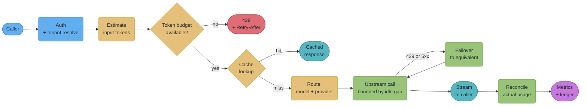
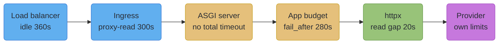
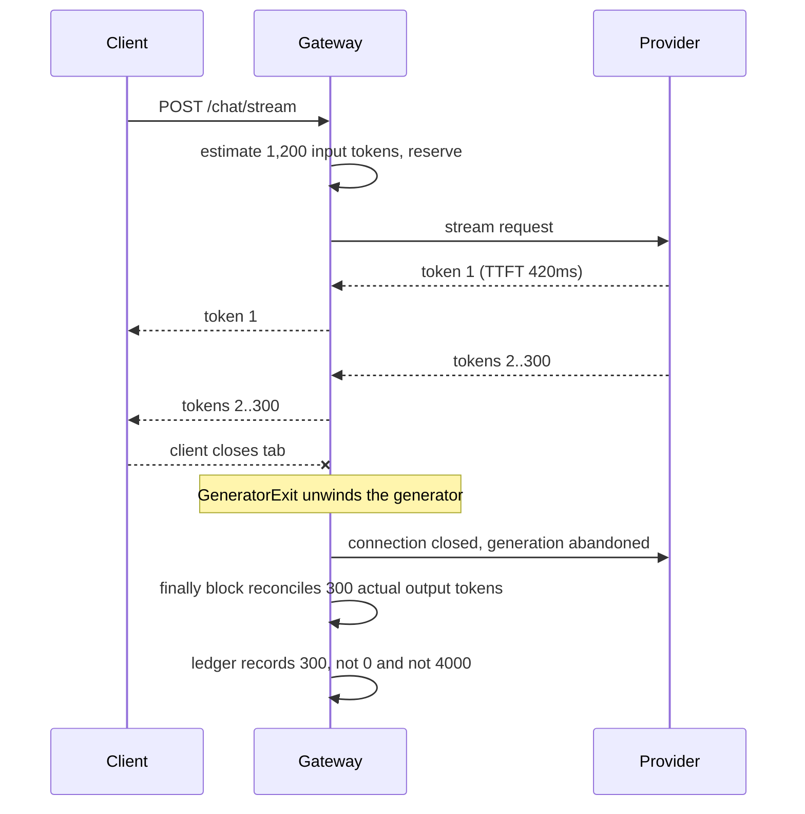

# Serving LLM and AI Workloads

---

## 1. Concept Overview

Every assumption a web framework is built on holds for a CRUD request and fails for a model
call. A CRUD request is short, cheap, idempotent, and its cost is invisible. An LLM request
runs for tens of seconds to minutes, costs real money that varies by a factor of a hundred
between two requests to the same endpoint, cannot be safely retried once it has started
producing output, and holds a scarce resource — a GPU slot or a provider's per-minute token
allowance — for its whole duration.

That difference is not a performance problem. It is a **capacity accounting** problem, and it
changes what the HTTP edge has to do. A rate limiter that counts requests is blind to the fact
that one caller sent 200 tokens and another sent 200,000. A load balancer's 60-second idle
timeout silently kills a legitimate generation. A retry-on-5xx policy that is correct for a
database call double-bills a provider. A `p99 latency` dashboard shows a healthy number while
every user watches a spinner, because the first token arrived in 400 ms and the rest never came.

This module owns the **economics and lifecycle** of an LLM-backed endpoint in FastAPI: where the
model lives relative to your process, how you meter capacity in tokens rather than requests, how
you route and fail over between providers, how long a request is allowed to live at each layer,
how you cache work that costs dollars, and what you measure so that a regression is visible
before the invoice arrives.

### What this module does NOT own

The single most useful thing to know before reading is where the boundary is. This is a dense
area of the repo and the material is deliberately split:

| Topic | Owned by | Why it lives there |
|---|---|---|
| The SSE wire format, `EventSourceResponse`, JSON Lines, `Last-Event-ID` resume | [`../websockets_sse_and_streaming/websockets_sse_and_streaming.md`](../websockets_sse_and_streaming/websockets_sse_and_streaming.md) §6.3–6.7 | it is a transport concern, and non-LLM streams need it identically |
| The single-request admission/cancellation pattern (`CapacityLimiter`, idle-gap timeout, `finally`-flushed accounting) | same file, §6.6 | it is the streaming endpoint's own hygiene; this module builds the fleet-level policy on top |
| Continuous batching, KV cache, quantization, model compression | [`../../ml/model_serving_and_inference/model_serving_and_inference.md`](../../ml/model_serving_and_inference/model_serving_and_inference.md) and [`../../llm/`](../../llm/README.md) | that is the model server's job, not the HTTP edge's |
| Generic retry, backoff, circuit breakers, connection pooling | [`../http_clients_and_external_apis/http_clients_and_external_apis.md`](../http_clients_and_external_apis/http_clients_and_external_apis.md) | this module covers only *why LLM retries are different* |
| Rate-limiter algorithms, `Retry-After` shaping, 429 semantics | [`../api_design_and_versioning/api_design_and_versioning.md`](../api_design_and_versioning/api_design_and_versioning.md) | this module covers only *what unit you count* |
| ASGI runtime selection, worker models, free-threading | [`../production_deployment_and_scaling/production_deployment_and_scaling.md`](../production_deployment_and_scaling/production_deployment_and_scaling.md) §4.4, §6.9–6.10 | the process model is the same whatever the endpoint serves |
| Exposing your API to a model as an MCP server | [`mcp_servers_from_fastapi.md`](mcp_servers_from_fastapi.md) | the sub-file beside this one |

Everything below assumes you have read the streaming file's §6.6, because this module's job is to
take that one well-behaved endpoint and make a fleet of them survivable.

For choosing the deployment target and serving pattern that sits behind these endpoints, see [Deployment Targets and Serving Patterns](../../mlops/deployment_targets_and_serving_patterns/deployment_targets_and_serving_patterns.md) in `mlops/`.

---

## 2. Intuition

**One-line analogy.** A conventional API is a shop with a queue at the till. An LLM API is a taxi
company: the meter runs while the passenger is in the car, a single fare can be a hundred times
another, you have a fixed number of cars, and a passenger who gets out halfway still owes you for
the distance driven — but only if you remembered to read the meter.

**Mental model.** Stop thinking of a request as a *unit of work* and start thinking of it as a
*lease on a budget*. Every request checks out some quantity of tokens from a pool that refills at
a fixed rate, holds it for an unpredictable duration, and returns an amount you only learn at the
end. Every design decision below follows from that: you admit by budget rather than by count, you
bound the lease's duration at every layer, you reconcile the estimate against the actual, and you
never let a lease escape accounting because the client hung up.

**Why it matters.** The failure modes here do not look like outages. They look like a slowly
widening gap between what you billed and what the provider billed, a p99 that stays green while
users abandon, a 429 storm that a request-based limiter cannot explain, and a month-end invoice
that nobody can attribute to a customer. All four are silent, and all four are cheap to prevent
at the HTTP edge and expensive to reconstruct afterwards.

**Key insight.** The provider's rate limits are the real shape of your service's capacity, and
they are published in tokens per minute, not requests per second. If your own limiter counts a
different unit than the limit that will actually stop you, it is not protecting you from
anything — it is just adding a second, uncorrelated failure mode.

---

## 3. Core Principles

**Principle 1 — Capacity is measured in tokens, not requests.** Anthropic publishes its API rate
limits as a triple: requests per minute, *input* tokens per minute, and *output* tokens per minute,
tiered by account. On the Start tier, Claude Opus 5 is documented at 1,000 RPM / 2,000,000 ITPM /
400,000 OTPM; on Scale, 10,000 RPM / 10,000,000 ITPM / 2,000,000 OTPM. Note the shape: output
tokens are limited roughly 5x more tightly than input, because they are roughly 5x more expensive
to produce. A limiter that counts requests cannot see either dimension, so it cannot predict which
of the three you will hit first. Count what the provider counts.

**Principle 2 — Admit or shed; never queue an expensive request indefinitely.** A caller who waits
90 seconds for a slot has already timed out and retried, so the queue is manufacturing load rather
than absorbing it. Bound the wait, and return 503 with `Retry-After` when the budget is spent. The
mechanics live in the streaming module's §6.6; the *policy* — which budget, at what depth, per
tenant or global — is the design decision this module owns.

**Principle 3 — Cancellation must reach whoever is billing.** Closing the client socket is not the
end of the request; it is the beginning of an accounting problem. Unless the disconnect unwinds all
the way into the upstream connection, the provider keeps generating and keeps charging for tokens
no one will read.

**Principle 4 — An LLM call is not idempotent, so a retry is not free.** Retrying a failed database
read costs a few milliseconds. Retrying a generation that failed at token 3,000 of 4,000 costs the
full price of both attempts and produces different text. Retry only what provably did not consume
budget: connection errors, and 429/503 responses that the provider tells you were rejected before
work started. Never blind-retry a stream that had already begun emitting.

**Principle 5 — Every layer needs a timeout, and they must be ordered.** A request that legitimately
runs 300 seconds passes through a load balancer, an ingress, an ASGI server, an HTTP client, and a
provider, each with its own idle and total limits. If any one of them is shorter than the legitimate
case, you get an unexplainable truncation; if the outermost is the shortest, you get a 504 with no
log line anywhere in your application. Set them deliberately, outermost longest.

**Principle 6 — Measure the shape of the stream, not just its duration.** Total latency is one
number that hides three failures. Time to first token, inter-token latency, and total tokens are
three numbers that each catch one. A stream that stalls at token 40 shows as "in progress" on a
duration metric and as a flat line on an inter-token one.

**Principle 7 — Reconcile the estimate against the actual, every time.** You must admit a request
before you know what it costs, so you admit on an estimate. If nothing ever compares that estimate
to the number the provider returns, the estimate drifts and nobody notices until the budget stops
working. Reconciliation is a two-line operation in a `finally` block and it is the difference
between a quota system and a decoration.

---

## 4. Types / Architectures / Strategies

### 4.1 Where the model lives

This is the first decision, and it determines what every other section can assume.

| Shape | Where the weights are | What FastAPI owns | Failure you inherit |
|---|---|---|---|
| In-process | loaded in the worker via `lifespan` | everything, including GPU memory | a model reload restarts the API; worker count is capped by VRAM, not CPU |
| Sidecar | a `vllm serve` / Triton / Ollama process, usually same pod | the HTTP edge only | the sidecar's own queue, which you cannot see from your metrics unless you scrape it |
| Hosted provider | someone else's fleet | the edge, plus all the accounting | published rate limits, provider outages, and a bill you must attribute |
| Mixed | small models in-process, large behind a sidecar or provider | routing between the two | two sets of failure modes and one dashboard |

The in-process shape is only correct for models small enough that the network hop would be a
significant fraction of the inference time — a few hundred megabytes of classifier, not a 7B
generative model. Once the model is large enough to want continuous batching and paged KV cache,
reimplementing that inside a FastAPI worker is rebuilding vLLM badly; run vLLM. The worked example
of the mixed shape is
[`../case_studies/design_ml_inference_api_fastapi.md`](../case_studies/design_ml_inference_api_fastapi.md),
which sizes a small classifier in-process against a 7B model behind a sidecar.

### 4.2 The interaction shape

| Shape | Client sees | Right when | Wrong when |
|---|---|---|---|
| Synchronous JSON | one response after N seconds | sub-5 s work, machine caller, small output | anything a human waits on |
| SSE stream | tokens as produced | a human is watching | the consumer is a pipeline that wants records |
| JSON Lines stream | one JSON object per line | the consumer is a service, CLI, or data pipeline | a browser wanting auto-reconnect |
| Job id + poll | 202 with an id, then `GET /jobs/{id}` | work over ~5 minutes, or work that must survive a client restart | a chat UI |
| Job id + webhook | 202, then a callback | batch work, no client sitting there | a caller behind NAT with no public endpoint |

**The threshold worth committing to: a request that can legitimately exceed roughly five minutes
should not be a synchronous HTTP request at all**, streaming or not. Past that duration you are
fighting every proxy's idle timeout, you cannot deploy without dropping in-flight work, and a
client reconnect has no way to recover the result. Hand back a job id and let the work outlive the
connection. The queue machinery for that is
[`../background_jobs_and_task_queues/background_jobs_and_task_queues.md`](../background_jobs_and_task_queues/background_jobs_and_task_queues.md);
what this module adds is the rule for when to reach for it.

### 4.3 Routing across providers

| Strategy | Mechanism | Buys you | Costs you |
|---|---|---|---|
| Single provider | one client, one key | simplicity, one bill, one wire format | a hard dependency on one vendor's uptime and quota |
| Active/passive failover | try primary, fall back on 429/5xx/timeout | availability across a provider incident | a model-equivalence decision, and two wire formats to normalize |
| Cost-tiered routing | cheap model first, escalate on a quality signal | real cost reduction on easy requests | a quality classifier you now have to maintain and evaluate |
| Capability routing | route by required feature (context length, tool use, vision) | correctness | a capability matrix that goes stale every release |

Failover is the one every service eventually needs and the one most often implemented wrongly,
because it requires a **model-equivalence map** — an explicit statement that "when `provider-a/large`
is unavailable, `provider-b/large` is an acceptable substitute for this workload". That is a product
decision with quality consequences, not an infrastructure detail, and burying it in a `try/except`
means nobody ever reviews it.

### 4.4 What the quota counts

| Model | Enforces | Blind to |
|---|---|---|
| Requests per minute | abuse, runaway loops | cost entirely |
| Concurrency (in-flight requests) | resource exhaustion | duration and size |
| Input tokens per minute | prompt-stuffing | output-heavy workloads |
| Output tokens per minute | the expensive half | huge prompts with tiny answers |
| Spend per period | the thing finance actually cares about | burst shape — a month's budget can burn in an hour |

Production systems need at least two of these simultaneously, and the pairing that covers the most
ground is **RPM plus a token budget**: RPM is the cheap first line against abuse, and the token
budget is what actually bounds cost. Anthropic publishes monthly spend caps alongside its rate
limits — Start $500, Build $1,000, Scale $200,000 — which is the vendor making exactly this point:
a rate limit and a spend limit constrain different things and you want both.

---

## 5. Architecture Diagrams

### 5.1 Anatomy of an LLM-serving edge



*Read it as a budget check that happens twice: once before the work on an estimate, once after on
the actual. Everything between those two points is recoverable; anything that escapes the second
check is unbilled.*

### 5.2 The timeout ladder

The ordering is the whole point — each layer must allow strictly more than the one inside it, and
the innermost bound must be an *idle gap*, not a total duration.



*The 20-second value is an idle gap between tokens, not a total — a healthy 280-second generation
never touches it, while a wedged upstream fails in 20 seconds instead of holding a slot for the
full budget. If the load balancer's number were the smallest, you would get a 504 with no
corresponding error anywhere in the application logs.*

### 5.3 Where the money leaks



*The three wrong answers are: record nothing because the request did not "succeed", record the full
4,000-token reservation because that is what was estimated, or record nothing because the accounting
was on the success path. Only the `finally` block gets the true number.*

---

## 6. How It Works — Detailed Mechanics

### 6.1 Choosing a topology, and wiring it in `lifespan`

The sidecar shape is the common one and the one worth writing out, because the mistake it invites is
subtle: the sidecar is a *scarce* upstream, so its client must be shared and its concurrency must be
bounded, exactly like a database pool.

```python
from contextlib import asynccontextmanager

import httpx
from fastapi import FastAPI

SIDECAR = "http://127.0.0.1:8000/v1"     # vllm serve exposes an OpenAI-compatible API


@asynccontextmanager
async def lifespan(app: FastAPI):
    # One client for the process lifetime. A per-request client exhausts sockets
    # and throws away every warm connection -- see ../http_clients_and_external_apis/.
    app.state.llm = httpx.AsyncClient(
        base_url=SIDECAR,
        timeout=httpx.Timeout(10.0, read=20.0),      # read is the per-chunk idle gap
        limits=httpx.Limits(max_connections=64, max_keepalive_connections=32),
    )
    yield
    await app.state.llm.aclose()


app = FastAPI(lifespan=lifespan)
```

`vllm serve` exposes an OpenAI-compatible `/v1/chat/completions`, Ollama serves both its native
`/api/chat` and an OpenAI-compatible layer at `http://localhost:11434/v1`, and NVIDIA Triton ships an
OpenAI-compatible frontend as well. That convergence is worth exploiting: **write your client against
the OpenAI-compatible shape and the sidecar becomes swappable**, which is what makes the failover in
§6.4 cheap to build. It does not make the models equivalent — only the wire format.

vLLM's continuous batching is core to its design and needs nothing from you. Prefix caching is a
separate feature you is ON by default in v0.27.1 (`enable_prefix_caching: bool = True`); the flag to know is `--no-enable-prefix-caching`
because a benchmark you read had it enabled.

### 6.2 The timeout budget, expressed as code

Set every layer from one place so the ordering is reviewable, rather than discovering it across four
YAML files during an incident.

```python
# BROKEN: one number, applied as a total, that is both too short and too long
async with httpx.AsyncClient(timeout=30.0) as client:      # a 45s generation dies
    resp = await client.post(url, json=payload)            # a wedged upstream holds 30s
```

```python
# FIX: separate the connect, the idle gap, and the app-level total budget
import anyio
import httpx

TIMEOUTS = httpx.Timeout(
    10.0,          # default, used for connect/write/pool
    read=20.0,     # PER-CHUNK idle gap: a healthy stream never touches this
)
APP_BUDGET_S = 280.0     # strictly less than the ingress's 300s


async def call_upstream(client: httpx.AsyncClient, payload: dict):
    with anyio.fail_after(APP_BUDGET_S):
        async with client.stream("POST", "/chat/completions", json=payload) as resp:
            resp.raise_for_status()
            async for line in resp.aiter_lines():
                yield line
```

The two bounds do different jobs and you need both. `read=20.0` catches the upstream that accepted
the connection and then stalled, which a total timeout cannot catch without also killing legitimate
long work. `fail_after(280)` catches the upstream that keeps dribbling one token every 19 seconds
forever — technically alive, practically a leak — which the idle gap alone cannot catch.

**The ordering rule, stated once:** the app budget must be shorter than the ingress read timeout,
which must be shorter than the load balancer's idle timeout. When the outermost layer is the
shortest, the client sees a 504 produced by a proxy that never told your application anything, and
the request appears in your logs as a success that simply stops.

### 6.3 A token-aware limiter, with reconciliation

This is the mechanism that makes Principle 1 real. It has three moving parts: an estimate before the
call, a reservation held during it, and a reconciliation after it.

```python
import time
from dataclasses import dataclass, field

from fastapi import Depends, HTTPException, Request


@dataclass
class TokenBucket:
    """Refills continuously; capacity and rate are in TOKENS, not requests."""
    capacity: int
    refill_per_second: float
    level: float = field(init=False)
    updated: float = field(default_factory=time.monotonic)

    def __post_init__(self) -> None:
        self.level = float(self.capacity)

    def _refill(self) -> None:
        now = time.monotonic()
        self.level = min(self.capacity, self.level + (now - self.updated) * self.refill_per_second)
        self.updated = now

    def try_reserve(self, amount: int) -> bool:
        self._refill()
        if self.level < amount:
            return False
        self.level -= amount
        return True

    def settle(self, reserved: int, actual: int) -> None:
        """Return the over-reservation, or charge the shortfall."""
        self._refill()
        self.level = min(self.capacity, self.level - (actual - reserved))


# Scale-tier-shaped budget: 10M input tokens/minute -> ~166,666 tokens/second.
BUDGETS: dict[str, TokenBucket] = {}


def budget_for(tenant: str) -> TokenBucket:
    return BUDGETS.setdefault(tenant, TokenBucket(capacity=500_000, refill_per_second=166_666))
```

The estimate is the part people get wrong. **Do not count characters and divide by four.** Two
options are defensible: call the provider's own counting endpoint, or run the model's own tokenizer
locally. Anthropic exposes `POST /v1/messages/count_tokens`, which is free to call but carries its
*own* RPM limits (documented at 2,000 / 4,000 / 8,000 RPM for the Start / Build / Scale tiers) —
separate from your message-creation limits, and easy to exhaust if you call it on every request in a
hot path.

The trap that follows: **a token count is per-model, not per-text**. Anthropic's current
documentation flags that its newest models produce roughly 30% more tokens than earlier ones for the
same input, because the tokenizer changed. An estimator calibrated against last year's model
silently under-reserves by a third the day you switch, and the symptom is provider 429s that your
own limiter says should not be happening.

```python
async def admit(request: Request, tenant: str = Depends(current_tenant)) -> "Lease":
    body = await request.json()
    estimated = await estimate_input_tokens(body)          # counting endpoint or local tokenizer
    reserved = estimated + body.get("max_tokens", 1024)    # reserve for the OUTPUT too
    bucket = budget_for(tenant)
    if not bucket.try_reserve(reserved):
        raise HTTPException(429, "Token budget exhausted", headers={"Retry-After": "10"})
    return Lease(bucket=bucket, reserved=reserved)
```

Reserving `max_tokens` for output — not zero, and not the estimate — is what stops a caller from
slipping 200 concurrent 4,000-token generations past a limiter that only saw their small prompts.
The reservation is optimistic and usually too large, which is exactly why `settle()` exists:

```python
lease = ...                       # from the dependency above
actual = 0
try:
    async for chunk in stream_upstream(...):
        actual += chunk.token_count
        yield chunk
finally:
    lease.bucket.settle(lease.reserved, actual)     # runs on success, error, AND disconnect
```

Without `settle`, a workload of short answers under a large `max_tokens` throttles itself to a
fraction of the real budget, and the fix people reach for — raising the capacity — breaks the
protection the moment a long-answer workload arrives.

### 6.4 Failover with an explicit equivalence map

Make the substitution decision data, so it can be read, reviewed and changed without touching
control flow.

```python
from dataclasses import dataclass


@dataclass(frozen=True)
class Target:
    provider: str
    model: str


# The product decision, written down. Each list is ordered by preference.
EQUIVALENCE: dict[str, list[Target]] = {
    "chat-large": [Target("primary", "large-v2"), Target("secondary", "large-alt")],
    "chat-small": [Target("primary", "small-v2"), Target("self_hosted", "local-8b")],
}

# Retry the NEXT target on these; never retry the SAME target on them.
FAILOVER_STATUS = {408, 429, 500, 502, 503, 504}


async def dispatch(logical_model: str, payload: dict):
    last_error: Exception | None = None
    for target in EQUIVALENCE[logical_model]:
        try:
            return await CLIENTS[target.provider].stream_chat(target.model, payload)
        except httpx.HTTPStatusError as exc:
            if exc.response.status_code not in FAILOVER_STATUS:
                raise                                   # a 400 will fail identically everywhere
            last_error = exc
        except (httpx.ConnectError, httpx.ReadTimeout) as exc:
            last_error = exc
    raise HTTPException(503, "All targets exhausted") from last_error
```

Three details carry the design. **A 4xx that is not 429 must not fail over** — a malformed request
fails identically at every provider, so failing over turns one fast error into N slow ones and
multiplies the load during an incident. **Failover happens before the first byte, never after** —
once tokens have been emitted, switching providers means the caller receives text from two different
models spliced together, which is worse than an error. And **the equivalence map is versioned in
your repository, not inferred from model names**, because "large" at one vendor is not "large" at
another, and the only place that judgement can be recorded is a file a human reviews.

### 6.5 Work that outlives the connection

Past the five-minute threshold from §4.2, return an id and stop pretending it is a request.

```python
from uuid import uuid4

from fastapi import BackgroundTasks, status
from fastapi.responses import JSONResponse


@app.post("/v1/batch", status_code=status.HTTP_202_ACCEPTED)
async def submit_batch(req: BatchRequest) -> JSONResponse:
    job_id = str(uuid4())
    await jobs.create(job_id, tenant=req.tenant, state="queued")
    await queue.enqueue("run_batch", job_id=job_id, payload=req.model_dump())
    return JSONResponse(
        {"job_id": job_id, "state": "queued"},
        headers={"Location": f"/v1/batch/{job_id}", "Retry-After": "30"},
    )


@app.get("/v1/batch/{job_id}")
async def get_batch(job_id: str) -> JobView:
    job = await jobs.get(job_id)
    if job is None:
        raise HTTPException(404)
    return JobView.model_validate(job)
```

Note what is *not* here: no `BackgroundTasks`. A FastAPI background task runs inside the same worker
process after the response is sent, so it dies with a deployment, a crash, or a scale-down, and it
has no retry, no visibility and no durable state. That is acceptable for sending an email and
unacceptable for work you charged for. The worker, retry and dead-letter machinery belongs to
[`../background_jobs_and_task_queues/background_jobs_and_task_queues.md`](../background_jobs_and_task_queues/background_jobs_and_task_queues.md).

The webhook variant swaps the poll for a callback, and inherits every webhook problem — signing,
replay protection, retry with backoff, and a caller who cannot receive inbound connections — all of
which are already covered in
[`../http_clients_and_external_apis/http_clients_and_external_apis.md`](../http_clients_and_external_apis/http_clients_and_external_apis.md).
Offer polling as well; some callers can never take a webhook.

### 6.6 Three caches, and the one that is not yours

Caching is where LLM serving differs most sharply from ordinary API caching, because the thing you
are avoiding costs money rather than milliseconds.

| Tier | Key | Hit rate shape | Risk |
|---|---|---|---|
| Exact response cache | hash of (model, full prompt, all parameters) | low for chat, high for templated/system-driven traffic | none, if the key is complete |
| Semantic cache | embedding of the prompt, nearest neighbour above a threshold | much higher | returns a *different question's* answer when the threshold is loose |
| Provider prompt cache | the provider's own, keyed on a stable prompt prefix | high for a long shared system prompt | none, but you must not perturb the prefix |

The exact cache is the one to build first and the one people skip. Its key must include every
parameter that changes the output — model, temperature, `top_p`, `max_tokens`, tools, response
format, and the system prompt — because a cache keyed on the user's message alone will happily serve
a `temperature=0` answer to a `temperature=1.2` request.

The semantic cache is genuinely valuable and genuinely dangerous, and its threshold is not a
constant you can copy from a blog post. Two prompts at 0.93 cosine similarity may be paraphrases or
may differ by a negation. The worked treatment — including why a brute-force scan over stored
embeddings stops scaling and what the egress arithmetic looks like — is in
[`../case_studies/design_ml_inference_api_fastapi.md`](../case_studies/design_ml_inference_api_fastapi.md)
§5. Current implementations worth knowing: **GPTCache** (Zilliz, v0.1.44, 2024-08-01), **RedisVL**'s
`SemanticCache` (v0.28.0, 2026-10-09), and Redis's managed **LangCache** service for teams that would
rather not run the index.

The third tier is the free one. Providers cache a stable prompt *prefix* on their side and charge
less for the cached portion, so **the ordering of your prompt is a cost decision**: put the long,
stable system prompt and tool definitions first and the volatile user content last. Reordering them
for readability can silently drop your cache hit rate to zero, and nothing in your own metrics will
show it — only the invoice moves. The MCP specification's guidance that servers should return tools
from `tools/list` in a deterministic order exists for exactly this reason; see
[`mcp_servers_from_fastapi.md`](mcp_servers_from_fastapi.md).

Ordinary cache mechanics — stampede protection, TTL strategy, Redis client configuration — are in
[`../caching_and_performance/caching_and_performance.md`](../caching_and_performance/caching_and_performance.md)
and are not re-taught here.

### 6.7 The four metrics that matter

Standard RED metrics (rate, errors, duration) are necessary and insufficient. Duration alone cannot
distinguish "fast first token, then a long healthy generation" from "nothing happened for 40 seconds
and then everything arrived at once", and users experience those very differently.

```python
from prometheus_client import Counter, Histogram

TTFT = Histogram(
    "llm_time_to_first_token_seconds",
    "Seconds from request start to the first token reaching the client",
    ["model"],                       # NOT tenant -- see the cardinality note below
    buckets=(0.1, 0.25, 0.5, 1.0, 2.0, 5.0, 10.0),
)
ITL = Histogram(
    "llm_inter_token_latency_seconds",
    "Gap between consecutive tokens",
    ["model"],
    buckets=(0.005, 0.01, 0.025, 0.05, 0.1, 0.5, 2.0),
)
TOKENS = Counter("llm_tokens_total", "Tokens processed", ["model", "direction"])
ABANDONED = Counter("llm_abandoned_total", "Streams the client closed early", ["model"])


async def instrumented(stream, model: str):
    start = time.monotonic()
    first = True
    last = start
    completed = False
    try:
        async for chunk in stream:
            now = time.monotonic()
            if first:
                TTFT.labels(model).observe(now - start)
                first = False
            else:
                ITL.labels(model).observe(now - last)
            last = now
            TOKENS.labels(model, "output").inc(chunk.token_count)
            yield chunk
        completed = True
    finally:
        if not completed:
            ABANDONED.labels(model).inc()
```

**Label with `model`, never with `tenant` or `user_id`.** Prometheus stores one series per distinct
label combination, so a tenant label on three histograms with seven buckets each turns 500 tenants
into hundreds of thousands of series. Per-tenant cost belongs in a ledger — a database row or a log
line — not in a metric. The general cardinality argument is in
[`../observability_and_monitoring/observability_and_monitoring.md`](../observability_and_monitoring/observability_and_monitoring.md)
§6.4.

The abandonment counter is the one nobody adds and everybody needs. A rising abandonment rate at a
flat error rate means users are giving up, and it is the earliest signal that a TTFT regression has
shipped — visible days before it shows up as churn and weeks before anyone correlates it with a
deployment.

### 6.8 Structured output and tool calls at the edge

Two features change what your endpoint must do with the response, and both are easy to break with a
naive proxy.

**Structured output.** When you constrain a model to a JSON schema, the schema you send is derived
from a Pydantic model and the response should be validated back into it, not trusted:

```python
from pydantic import BaseModel, ValidationError


class Extraction(BaseModel):
    invoice_number: str
    total_cents: int
    currency: str


@app.post("/v1/extract", response_model=Extraction)
async def extract(doc: Document) -> Extraction:
    raw = await call_model(
        doc.text,
        response_format={"type": "json_schema", "json_schema": Extraction.model_json_schema()},
    )
    try:
        return Extraction.model_validate_json(raw)
    except ValidationError as exc:
        # A constrained model can still return schema-valid nonsense or truncate at
        # max_tokens mid-object. Both arrive here; neither is a 500.
        raise HTTPException(422, detail=exc.errors()) from exc
```

The trap is truncation: hitting `max_tokens` mid-object produces invalid JSON, and a handler that
maps every exception to 500 reports an outage when the real problem is a token budget. Distinguish
them — a truncated response is a 422 with a fixable cause.

**Tool calls.** A tool-calling exchange is a multi-turn loop: the model returns a request to call a
function, your service executes it, and the result goes back for another turn. Two consequences for
the HTTP edge. First, **one client request can become N upstream requests**, so your token
accounting must sum the loop rather than the first call, and your budget must bound the loop's
iterations or a model that loops on a failing tool will spend a tenant's daily budget in a minute.
Second, **a tool-call response must never be served from a cache** keyed on the prompt alone: the
tool's result is a function of the world at execution time, so a cached answer is a stale
observation presented as a fresh one. Exclude any response containing a tool call from the cache
entirely; it is the cheapest correct rule.

---

## 7. Real-World Examples

**vLLM as the sidecar standard.** vLLM (v0.32.0, 2026-10-18) exposes an OpenAI-compatible server via
`vllm serve`, with continuous batching as a core design property rather than an option. Its adoption
is why "OpenAI-compatible" has become the de-facto interface for self-hosted serving — Ollama and
NVIDIA Triton both ship compatible frontends too — and why the failover code in §6.4 can treat a
self-hosted target as just another entry in the list.

**The provider SDKs' streaming shapes.** The `anthropic` Python SDK (v1.15.0, 2026-10-15) streams via
`client.messages.stream(...)`, and its SSE events are typed: `message_start`, `content_block_start`,
`content_block_delta`, `content_block_stop`, `message_delta`, `message_stop`, plus `ping` keep-alives.
The `openai` SDK (v3.35.1, 2026-10-18) streams via `client.chat.completions.create(stream=True)`, and
its chat-completions wire format still terminates with the `data: [DONE]` sentinel. **The two are not
interchangeable at the byte level**, which is precisely why the normalization layer in §6.4 exists —
and why a gateway that leaks one provider's event names to its own clients has quietly made that
provider a permanent dependency. FastAPI's `ServerSentEvent(raw_data="[DONE]")` is how you emit a
sentinel without JSON-encoding it.

**Published limits as a design input.** Anthropic documents context windows of 1,000,000 tokens for
Claude Opus 5 and Sonnet 5, 200,000 for Sonnet 4.5 and Haiku 4.5, and single-request output up to
128,000 tokens. Those are not trivia: a 1M-token context means your request-body size limit, your
estimator's cost, and your reservation arithmetic all operate on a range two orders of magnitude
wider than a conventional API, and a 128,000-token output ceiling is the actual upper bound your
`max_tokens` reservation must be sized against.

**The AI gateway as a product category.** LiteLLM (open-source proxy across many providers, with
virtual keys and per-key budgets), Kong AI Gateway (token-based rate limiting as a plugin),
Cloudflare AI Gateway, and Envoy AI Gateway all exist because the accounting layer in this module is
the same for everyone, and several teams decided it should be infrastructure rather than application
code. The distinction the category draws is worth internalising: an API gateway routes and limits by
request, an AI gateway understands tokens, model equivalence, and prompt semantics. If you find
yourself building all of §6.3 through §6.6, evaluate one of these before writing the fifth version
of it.

---

## 8. Tradeoffs

### Where the model runs

| Dimension | In-process | Sidecar | Hosted provider |
|---|---|---|---|
| Latency floor | lowest, no hop | one local hop | network plus provider queue |
| Model size ceiling | app memory | the sidecar's GPU | effectively none |
| Deploy coupling | model reload restarts the API | independent | none |
| Cost shape | GPU-hours you pay whether idle or not | same | per token, zero when idle |
| Bursty traffic | worst — you pay for peak capacity always | worst | best |
| Data residency | fully yours | fully yours | the vendor's problem and yours |
| Who you page at 3am | you | you | them, eventually |

### How you bound the work

| Mechanism | Catches | Misses | Cost to run |
|---|---|---|---|
| Requests per minute | runaway loops, crude abuse | all cost variation | trivial |
| Concurrency limiter | resource exhaustion | duration, size | trivial |
| Token budget with reconciliation | actual cost | a single enormous request that fits the budget | an estimator, and drift |
| Per-request `max_tokens` cap | the single enormous request | aggregate spend | trivial |
| Spend cap per period | the invoice | burst shape within the period | a ledger |

The honest reading of this table is that **no single mechanism is sufficient and the cheap ones are
not the useless ones**. A `max_tokens` ceiling is one line of code and closes the gap the expensive
token budget leaves open.

### Streaming versus a job id

| Dimension | Stream (SSE/JSONL) | Job id + poll |
|---|---|---|
| Perceived latency | first token in under a second | nothing until done |
| Survives a client reconnect | no — the result is lost | yes |
| Survives a deployment | no | yes |
| Proxy hostility | high; every idle timeout is a threat | none |
| Complexity | one endpoint | queue, worker, state store, expiry policy |
| Right for | anything a human watches | anything over ~5 minutes |

---

## 9. When to Use / When NOT to Use

**Build this edge yourself when:** you serve more than one model or provider; cost must be
attributed per tenant; you have a self-hosted GPU fleet whose utilisation you must defend; or the
compliance story requires the request never leaving your infrastructure.

**Use a sidecar rather than in-process when:** the model is large enough to want continuous batching
and paged KV cache, you want to redeploy the API without reloading weights, or you want to scale the
API tier and the GPU tier on different curves.

**Use a hosted provider when:** traffic is bursty enough that reserved GPU capacity would sit idle,
your team has no GPU operations experience, or you need frontier capability you cannot self-host.

**Do NOT build a synchronous endpoint when** the work can legitimately exceed roughly five minutes —
hand back a job id instead. **Do NOT put a rate limiter in front of an LLM endpoint that counts only
requests** — it will pass your worst caller. **Do NOT add a semantic cache before an exact cache** —
the exact cache is free of correctness risk and you have not yet earned the semantic one's failure
mode. **Do NOT reach for a gateway product** before you can state which of the mechanisms in §8 your
service actually needs; the category exists, but adopting it without that answer just relocates the
question.

And do not build any of this for a single model behind a single provider with one internal caller
and no cost ceiling. That is a `httpx` call with a timeout, and everything above is overhead.

---

## 10. Common Pitfalls

### Pitfall 1 — Retrying a stream that had already produced output

```python
# BROKEN: a generic retry decorator wrapped around a generation
@retry(stop=stop_after_attempt(3), retry=retry_if_exception_type(httpx.HTTPError))
async def generate(payload: dict) -> str:
    async with client.stream("POST", "/chat/completions", json=payload) as r:
        return "".join([c async for c in r.aiter_text()])
# Fails at token 3,000 of 4,000 -> retries the WHOLE generation, twice.
# You pay for 3,000 + 4,000 + 4,000 tokens and the caller gets one answer.
```

```python
# FIX: retry only what provably consumed nothing
RETRYABLE_BEFORE_FIRST_BYTE = (httpx.ConnectError, httpx.ConnectTimeout, httpx.PoolTimeout)


async def generate(payload: dict):
    for attempt in range(3):
        emitted = False
        try:
            async with client.stream("POST", "/chat/completions", json=payload) as r:
                r.raise_for_status()
                async for chunk in r.aiter_text():
                    emitted = True
                    yield chunk
                return
        except RETRYABLE_BEFORE_FIRST_BYTE:
            if emitted:
                raise                       # never restart a partially-served stream
            await anyio.sleep(2 ** attempt)
```

The impact is invisible in every dashboard: no errors, no latency change, a cost line 2-3x higher
than the token counts in your own logs. The discrepancy between your ledger and the provider's
invoice is often the first symptom, which means it is discovered a month late.

### Pitfall 2 — Estimating tokens by dividing character count by four

The heuristic is roughly right for English prose and badly wrong everywhere else. Code, JSON, and
non-Latin scripts tokenize very differently, and the ratio changes when the provider changes
tokenizer — Anthropic's own documentation notes that its newest models produce about 30% more tokens
than earlier ones for the same text. An estimator calibrated on last year's model under-reserves by
a third, and the symptom is provider 429s while your own limiter reports plenty of headroom. Use the
provider's counting endpoint or the model's real tokenizer, cache the result per prompt hash, and
**alert on the ratio of estimated to actual** so drift is visible as a metric rather than as an
invoice.

### Pitfall 3 — The load balancer's idle timeout is shorter than the app's

```
# BROKEN: nobody set these together
  ALB idle_timeout            = 60s      <-- the smallest number wins
  ingress proxy-read-timeout  = 300s
  app anyio.fail_after        = 280s
  httpx read (idle gap)       = 20s
```

Every generation over 60 seconds dies with a 504 the client sees and your application never logs,
because from the app's point of view the socket simply closed. Teams chase this for days in the
wrong service. The fix is ordering, not bigger numbers: **outermost longest**, and put the four
values in one reviewed place.

```
# FIX
  ALB idle_timeout            = 360s
  ingress proxy-read-timeout  = 300s
  app anyio.fail_after        = 280s
  httpx read (idle gap)       =  20s
```

Note that a streaming response is *not* idle while it is emitting, so SSE with a keep-alive ping
survives a shorter idle timeout than a non-streaming request of the same duration. The
non-streaming call is the one that dies first, which is why this bites hardest on the "just return
JSON" endpoint nobody thought was risky.

### Pitfall 4 — Cost accounting only on the success path

```python
# BROKEN
async def stream(...):
    total = 0
    async for chunk in upstream:
        total += chunk.token_count
        yield chunk
    await ledger.record(tenant, total)      # never runs if the client disconnects
```

```python
# FIX
async def stream(...):
    total = 0
    try:
        async for chunk in upstream:
            total += chunk.token_count
            yield chunk
    finally:
        await ledger.record(tenant, total)  # runs on success, error, and GeneratorExit
```

Abandoned streams are not rare — in a chat UI, a user who reads the first sentence and closes the
tab is normal behaviour, not an edge case. Every one of those is a request your provider billed and
your ledger did not, and the gap grows in proportion to how good your TTFT is: the faster users get
their answer, the earlier they leave, the more you under-bill.

### Pitfall 5 — Caching a response that contains a tool call

A tool call's result is a function of the world at execution time. Serving it from a cache keyed on
the prompt returns a stale observation with a fresh timestamp — "your order shipped yesterday" for
an order placed this morning. There is no threshold that makes this safe, because the input is
identical and only the world changed. Exclude any response containing a tool call from the cache
outright, and treat the resulting hit-rate drop as correct rather than as something to tune away.

### Pitfall 6 — One request quietly becoming twenty

A tool-calling loop runs until the model stops asking for tools. A tool that returns an error the
model does not understand produces a loop that calls it again, and again. Without a bound, a single
client request consumes a tenant's daily budget in a minute, and the request looks like *one* entry
in every request-based metric you have.

```python
# FIX: bound the loop, count the whole loop, and make the ceiling an error you can see
MAX_TOOL_ROUNDS = 8

rounds = 0
while True:
    rounds += 1
    if rounds > MAX_TOOL_ROUNDS:
        TOOL_LOOP_EXCEEDED.labels(model).inc()
        raise HTTPException(422, "Tool-call loop exceeded its round limit")
    result = await call_model(messages)
    lease_total += result.usage.total_tokens          # the LOOP's cost, not the call's
    if not result.tool_calls:
        break
    messages += await execute_tools(result.tool_calls)
```

### Pitfall 7 — Reordering the prompt for readability and losing the provider's prompt cache

Provider-side prompt caching keys on a stable *prefix*. Moving the system prompt below the user's
message, or interpolating a timestamp or a request id near the top, invalidates the prefix on every
request. Nothing in your metrics changes — same latency, same token counts, same error rate — and
the cost per request rises silently. Keep the stable prefix stable, put volatile content last, and
watch the provider's reported cached-token count as a metric so a regression is visible the day it
ships rather than at month end.

---

## 11. Technologies & Tools

| Tool / Library | Role | Notes |
|---|---|---|
| `fastapi.sse` | `EventSourceResponse`, `ServerSentEvent` | built in [FastAPI 0.135+]; `raw_data=` emits an unencoded `data:` payload such as `[DONE]` |
| `AsyncIterable[Model]` return | JSON Lines streaming as `application/jsonl` | built in [FastAPI 0.134+]; the right shape for machine consumers |
| `httpx2` | streaming upstream client | 2.14.0; Pydantic-maintained successor to `httpx` (last release 0.28.1, 2024-12-06), same API; `Timeout(default, read=...)` makes `read` a per-chunk idle gap |
| `anyio` | `fail_after`, `CapacityLimiter` | already a FastAPI dependency; `CapacityLimiter` is resizable at runtime |
| vLLM | self-hosted OpenAI-compatible server | 0.32.0 (2026-10-18); continuous batching by design, prefix caching on by default (`--no-enable-prefix-caching` disables it) |
| Ollama | local/dev model server | native `/api/chat` plus an OpenAI-compatible layer at `:11434/v1` |
| NVIDIA Triton | multi-framework model server | ships an OpenAI-compatible frontend; see [`../../technologies/nvidia_triton_inference_server/nvidia_triton_inference_server.md`](../../technologies/nvidia_triton_inference_server/nvidia_triton_inference_server.md) |
| `anthropic` / `openai` SDKs | provider clients | 1.15.0 / 3.35.1; different streaming event shapes, so normalize at your boundary |
| GPTCache | semantic cache | v0.1.44 (2024-08-01), no release since |
| RedisVL `SemanticCache` | semantic cache over Redis | v0.28.0 (2026-10-09); Redis also offers LangCache as a managed service |
| `prometheus-client` | TTFT / inter-token / token counters | label by model, never by tenant |
| LiteLLM, Kong AI Gateway, Envoy AI Gateway | off-the-shelf AI gateways | evaluate before writing §6.3-§6.6 a fifth time |

---

## 12. Interview Questions with Answers

**Q: Why is a requests-per-minute rate limit inadequate in front of an LLM endpoint?**
**Short:** It counts requests while cost varies by orders of magnitude per request, so the worst caller passes the limit cleanly.

RPM treats a 20-token completion and a 4,000-token one identically, so a caller sending maximum-length prompts and requesting maximum-length outputs stays perfectly compliant while consuming a hundred times another caller's budget. Worse, it counts a different unit than the limit that will actually stop you: providers publish limits in requests *and* input tokens *and* output tokens per minute — Anthropic documents Claude Opus 5 at 1,000 RPM / 2,000,000 ITPM / 400,000 OTPM on its Start tier — so an RPM-only limiter cannot predict which one you hit first. Keep RPM as a cheap defence against runaway loops, and add a token budget with a per-request `max_tokens` ceiling as the mechanism that actually bounds cost.

**Q: A client closes the tab mid-stream. What must happen, and what usually does not?**
**Short:** The disconnect must close the upstream connection and still record the tokens already consumed.

Starlette throws `GeneratorExit` into the response generator on disconnect. If the upstream call is inside that generator's own scope, unwinding exits the `async with client.stream(...)` block, closes the connection, and the provider abandons the generation. What usually does not happen is the accounting: teams record usage after the loop, on the success path, so an abandoned stream is billed by the provider and recorded as zero by you. Put the reconciliation in a `finally` block. This matters more than it sounds, because abandonment is normal user behaviour in a chat UI, and the better your time to first token, the earlier users leave and the larger the gap grows.

**Q: Why can you not simply retry a failed LLM request the way you retry a failed database call?**
**Short:** A generation that failed partway already consumed budget, so a retry pays twice and returns different text.

A database read is idempotent and costs microseconds, so a blind retry is nearly free. A generation that fails at token 3,000 of 4,000 has already been charged for 3,000 tokens, and the retry produces a different completion rather than the same one. The rule is to retry only what provably consumed nothing: connection and pool errors before the first byte, and 429/503 responses the provider rejected before starting work. Track whether any byte was emitted and refuse to restart once it was. The failure is silent — no errors, no latency change, just a cost line two or three times your own token counts, usually discovered when the invoice arrives.

**Q: What is the correct timeout to put on a streaming LLM call?**
**Short:** Bound the idle gap between tokens, not the total duration, and keep an outer total budget as well.

A total timeout cannot work alone: any value large enough for a legitimate 300-second generation is far too large to catch an upstream that accepted the connection and then wedged. Set `httpx.Timeout(10.0, read=20.0)`, where `read` is a per-chunk timeout — a healthy stream that keeps producing never touches it, while a stalled one fails in 20 seconds instead of holding a GPU slot for the whole budget. Keep an outer `anyio.fail_after` too, because an upstream dribbling one token every 19 seconds never trips the idle gap and is still a leak. You need both bounds, and they catch different failures.

**Q: Your p99 latency dashboard is green and users are complaining the app feels broken. What are you not measuring?**
**Short:** Time to first token and inter-token latency, which a single duration metric averages away completely.

Total duration cannot distinguish a stream that delivered its first token in 400 ms and then generated steadily from one that returned nothing for 40 seconds and then dumped everything at once. Both have the same duration and users experience them completely differently. Instrument three separate histograms — time to first token, inter-token latency, total tokens — plus a counter for abandoned streams. The abandonment counter is the one nobody adds and the earliest honest signal: a rising abandonment rate at a flat error rate means users are giving up, and it moves days before churn does.

**Q: How do you estimate a request's token cost before you have made the request?**
**Short:** Use the provider's counting endpoint or the model's real tokenizer, never characters divided by four.

The divide-by-four heuristic is roughly right for English prose and badly wrong for code, JSON, and non-Latin scripts. Worse, the ratio is a property of the model's tokenizer, not of the text: Anthropic's documentation notes its newest models produce about 30% more tokens than earlier ones for identical input, so an estimator calibrated last year under-reserves by a third the day you upgrade. Call `POST /v1/messages/count_tokens` or run the tokenizer locally, cache per prompt hash, and remember the counting endpoint has its own rate limits — documented at 2,000/4,000/8,000 RPM by tier — so calling it on every hot-path request creates a new bottleneck.

**Q: You reserve tokens before the call and the actual usage is always lower. What breaks if you never reconcile?**
**Short:** The budget silently throttles to a fraction of its real capacity, and raising the capacity removes the protection.

You must admit on an estimate, and the honest estimate reserves the input tokens plus the full `max_tokens` for output, because otherwise a caller slips 200 concurrent maximum-length generations past a limiter that only saw small prompts. That reservation is deliberately pessimistic. Without a `settle()` step returning the over-reservation, a workload of short answers under a large `max_tokens` consumes its whole budget on requests that barely used it. The fix people reach for is raising the capacity, which restores throughput and destroys the protection the moment a genuinely long-answer workload arrives.

**Q: When should an LLM endpoint stop being a synchronous HTTP request?**
**Short:** Past roughly five minutes of legitimate work, return a job id instead of holding the connection.

Beyond that duration you are fighting every proxy's idle timeout, you cannot deploy without dropping in-flight work, and a client reconnect has no way to recover a result that lived only in a socket. Return 202 with a `Location` header and a job id, run the work in a durable queue, and offer both polling and a webhook — some callers cannot receive inbound connections. Do not use `BackgroundTasks` for this: it runs in the same worker process after the response, so it dies with a deployment or a scale-down and has no retry, no visibility, and no durable state. Fine for an email, unacceptable for work you charged for.

**Q: A provider returns 429. Should you fail over to a different provider?**
**Short:** Yes, but only to a pre-declared equivalent model, and only before the first byte has been sent.

Failover needs an explicit model-equivalence map checked into your repository — a statement that this vendor's large model is an acceptable substitute for that one *for this workload*. That is a product decision with quality consequences, and burying it in a `try/except` means nobody ever reviews it. Two hard rules follow. Never fail over on a 4xx that is not 429: a malformed request fails identically everywhere, so failing over turns one fast error into several slow ones exactly when you are already under stress. And never fail over after streaming has begun, because the caller then receives text from two different models spliced together, which is worse than an error.

**Q: Why is a semantic cache more dangerous than an exact-match cache, and what do you build first?**
**Short:** Exact caching has no correctness risk; semantic caching can serve a different question's answer.

Build the exact cache first. Its only requirement is a complete key — model, temperature, top_p, max_tokens, tools, response format, and system prompt — because a key on the user message alone will serve a temperature-zero answer to a temperature-1.2 request. A semantic cache keyed on embedding similarity has far better hit rates and a real failure mode: two prompts at 0.93 cosine similarity may be paraphrases or may differ by a negation, and the threshold is not a constant you can copy from a blog post. Measure the false-positive rate against real traffic, and re-measure whenever the embedding model changes.

**Q: Where does the third cache tier live, and how do you accidentally turn it off?**
**Short:** Providers cache a stable prompt prefix on their side, and reordering your prompt silently invalidates it.

Provider-side prompt caching keys on a stable prefix, so the ordering of your prompt is a cost decision: long stable system prompt and tool definitions first, volatile user content last. Interpolating a timestamp or request id near the top, or moving the system prompt below the user message for readability, invalidates the prefix on every single request. Nothing in your own metrics changes — same latency, same token counts, same error rate — only the cost per request rises. Track the provider's reported cached-token count as a metric so the regression is visible on the day it ships rather than at month end.

**Q: What are the three places a model can live relative to your FastAPI process, and how do you choose?**
**Short:** In-process, sidecar, or hosted provider, chosen by model size, traffic burstiness, and deploy coupling.

In-process via `lifespan` is correct only when the model is small enough that a network hop would be a significant fraction of inference time — a few hundred megabytes of classifier, not a 7B generative model — and it couples model reloads to API restarts. A sidecar such as vLLM or Triton wins once the model is large enough to want continuous batching and paged KV cache, because reimplementing that inside a worker is rebuilding vLLM badly. A hosted provider wins on bursty traffic, where reserved GPU capacity would sit idle, and on frontier capability you cannot self-host. Many real systems use two of the three, which is fine as long as one dashboard covers both sets of failure modes.

**Q: Why does the ordering of timeouts across layers matter more than their values?**
**Short:** The smallest timeout in the chain wins, and when it is the outermost one your application never logs the failure.

A request passes through a load balancer, an ingress, the ASGI server, an HTTP client and the provider, each with its own limits. If the load balancer's idle timeout is 60 seconds and your application's budget is 280, every longer generation dies with a 504 the client sees and your application never records, because from the app's point of view the socket simply closed. Teams chase that in the wrong service for days. Set them outermost-longest in one reviewed place. Note that a streaming response is not idle while it emits, so keep-alive-pinged SSE survives a short idle timeout that kills an identical-duration non-streaming call — which is why this bites hardest on the endpoint nobody thought was risky.

**Q: What happens to your accounting when a tool-calling loop runs away?**
**Short:** One client request becomes many upstream calls, and every request-based metric still shows exactly one.

A tool-calling exchange is multi-turn: the model asks for a function, you execute it, the result goes back for another round. A tool returning an error the model does not understand produces a loop that calls it again and again, and a single client request can consume a tenant's daily budget in a minute while appearing as one entry in every request-counting metric you own. Bound the rounds explicitly, sum the token usage across the whole loop rather than the first call, and increment a dedicated counter when the ceiling is hit so the failure is visible rather than merely expensive.

**Q: Why should you not label LLM metrics by tenant, and where does per-tenant cost go instead?**
**Short:** Prometheus stores one series per label combination, so a tenant label multiplies three histograms into hundreds of thousands of series.

Cardinality is multiplication. Three histograms with seven buckets each, labelled by 500 tenants, is hundreds of thousands of resident series, and Prometheus keeps each one in memory for hours after it stops receiving data. That is a classic way to end a Prometheus server. Label by model and by outcome, which are bounded sets. Per-tenant cost belongs in a ledger — a database row or a structured log line — where high cardinality is free and where you can actually run the aggregation finance needs. The same argument applies to user id, request id, and prompt hash.

**Q: Your `/v1/extract` endpoint constrains the model to a JSON schema and it sometimes returns invalid JSON. Is that a 500?**
**Short:** Usually not — a response truncated at max_tokens mid-object is a 422 with a fixable cause, not an outage.

A constrained model can still hit its `max_tokens` ceiling mid-object, producing syntactically invalid JSON, and it can produce schema-valid nonsense. Validate the response back into the Pydantic model rather than trusting it, and distinguish the two failures: a truncated response means the token budget was too small and is a 422 the caller can act on, while a genuine upstream error is a 502. A handler that maps every exception to 500 reports an outage when the real problem is a parameter, and the on-call engineer spends the incident looking at the wrong service.

---

## 13. Best Practices

1. **Meter in tokens, and reconcile the estimate against the actual on every request.** Reserve
   input tokens plus `max_tokens` before the call; return the over-reservation in a `finally`.
   Without reconciliation the budget throttles to a fraction of its capacity and the obvious fix
   removes the protection.

2. **Keep a `max_tokens` ceiling even when you have a token budget.** It is one line and it closes
   the single-enormous-request gap that an aggregate budget cannot see.

3. **Set the four timeouts together, outermost longest.** Load balancer idle > ingress read > app
   budget > client idle gap. Put them in one reviewed place; discovering the ordering during an
   incident costs days.

4. **Bound the gap between tokens, never only the total duration.** `httpx.Timeout(10.0, read=20.0)`
   makes `read` per-chunk. Keep an outer total budget as well for the slow-dribble case.

5. **Put usage accounting in a `finally` block.** Abandoned streams are normal behaviour, not an
   edge case, and they are the largest source of unbilled cost in a chat product.

6. **Never restart a stream that has already emitted a byte.** Retry connection failures before the
   first byte; anything after it is a double charge and a different answer.

7. **Write the model-equivalence map down as data.** Failover without an explicit, reviewable
   substitution decision is a quality change nobody approved.

8. **Normalize provider wire formats at your boundary.** Anthropic's typed SSE events and OpenAI's
   `[DONE]`-terminated chat stream are not interchangeable; leaking either to your own clients makes
   that provider permanent.

9. **Build the exact cache before the semantic one**, and key it on everything that changes the
   output — model, temperature, `top_p`, `max_tokens`, tools, response format, system prompt.

10. **Never cache a response containing a tool call.** Its result is a function of the world at
    execution time; there is no similarity threshold that makes it safe.

11. **Keep the stable prompt prefix stable.** Provider-side prompt caching keys on it, and
    reordering for readability costs money that no latency or error metric will show you.

12. **Measure TTFT, inter-token latency, total tokens, and abandonment separately**, labelled by
    model and never by tenant. Per-tenant cost belongs in a ledger, not in a metric.

13. **Hand back a job id past roughly five minutes**, and use a durable queue rather than
    `BackgroundTasks` for anything you charged for.

14. **Bound tool-call loops explicitly** and count the whole loop's tokens, not the first call's.

15. **Evaluate an off-the-shelf AI gateway before writing this layer a fifth time** — but only once
    you can state which of these mechanisms you actually need.

---

## 14. Case Study

### The month the invoice and the ledger disagreed by 34%

**Scenario.** An internal document-assistant service fronts a hosted provider through FastAPI. It
streams answers over SSE to a web UI, meters callers with a 600 requests-per-minute limit, and
records usage after each stream completes. It has run for four months without an incident: error
rate under 0.1%, p99 latency 8.2 seconds, no pages. Finance flags that the provider invoice is 34%
above the internal ledger, and has been drifting upward for three months.

**What the dashboards said.** Nothing. Requests, errors and duration were all flat and healthy. That
was the first clue: a 34% cost gap with no operational signal means the cost is being incurred on a
path that is not instrumented, not that something is failing.

**The three causes, in order of size.**

*Abandoned streams, ~19%.* The ledger write sat after the `async for` loop. Every user who read the
first paragraph and closed the tab produced a provider charge and no ledger row. The UI's median
answer was 340 tokens and its median *read* was under 90, so abandonment was the normal case rather
than the exception. Moving the write into a `finally` block closed it, and the accumulator's value at
that point is the true consumed count — not zero, and not the reservation.

*Retried generations, ~11%.* A `tenacity` decorator added during an unrelated provider incident
wrapped the generation call. It retried on `httpx.HTTPError`, which includes read timeouts, so any
generation that stalled near the end was regenerated from scratch — twice, on the default three
attempts. The successful third attempt was the only one recorded. Restricting retries to connection
errors *before the first emitted byte* closed it.

*Prompt-cache invalidation, ~4%.* A request id had been interpolated into the system prompt's header
for log correlation. It sat above the 2,100-token stable instruction block, so the provider's prefix
cache missed on every request. Moving the id into a response header restored the hit rate. Nothing
in the service's own metrics had changed when it was introduced, and nothing changed when it was
removed — only the provider's reported cached-token count, which was not being scraped.

**What was changed.** Accounting moved into `finally`; retries narrowed to pre-first-byte connection
errors; the request id moved out of the prompt; the RPM limit was kept and a token budget with
reconciliation added beside it; and four metrics were added — TTFT, inter-token latency, tokens by
direction, and an abandonment counter — plus the provider's cached-token count.

**The outcome.** The next month's invoice matched the ledger within 2%, which is the reconciliation
error of the estimator itself rather than lost accounting. No latency or error metric moved in
either direction, which is the point worth taking away: **every one of these three defects was
invisible to a conventional service dashboard, and all three were introduced by changes that a code
review would pass.** The abandonment counter is now the service's earliest quality signal — it moved
before anything else did when a later TTFT regression shipped.

The multi-tenant, multi-provider version of this design, with per-tenant budgets, virtual keys and
provider failover worked end to end, is
[`../case_studies/design_llm_gateway_fastapi.md`](../case_studies/design_llm_gateway_fastapi.md).
