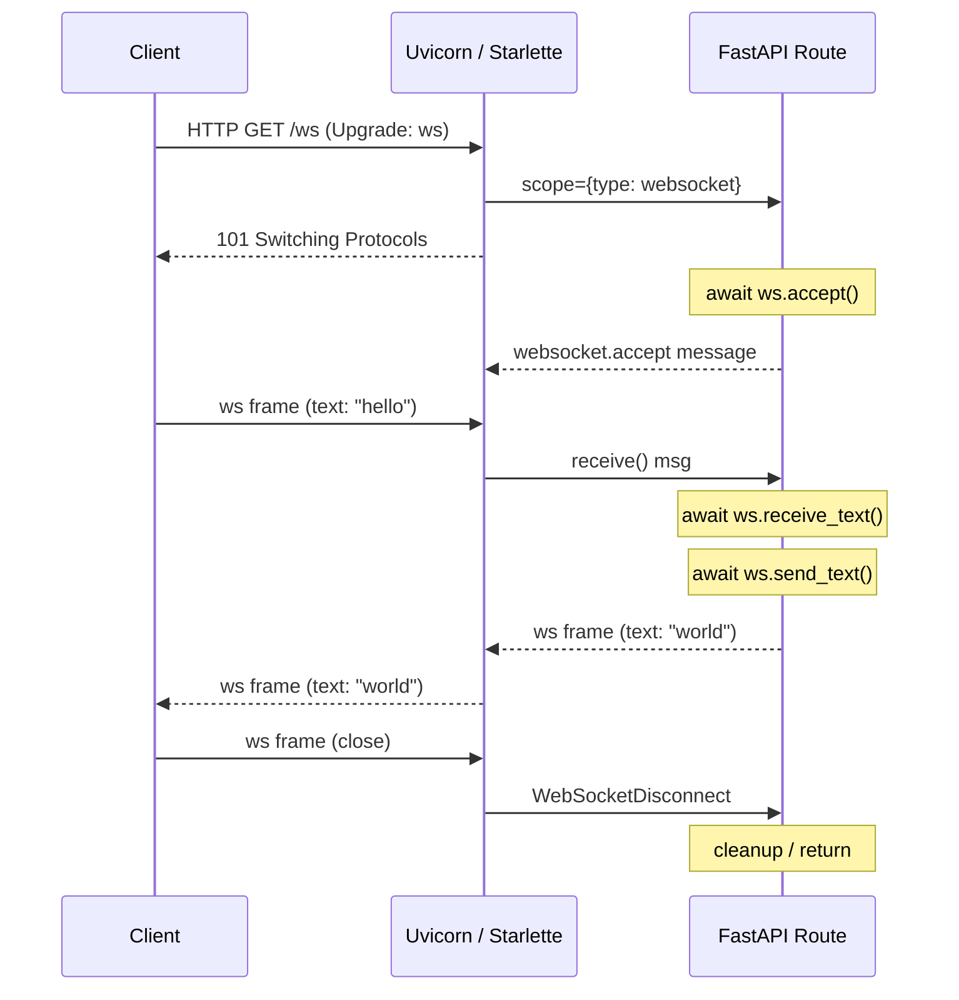
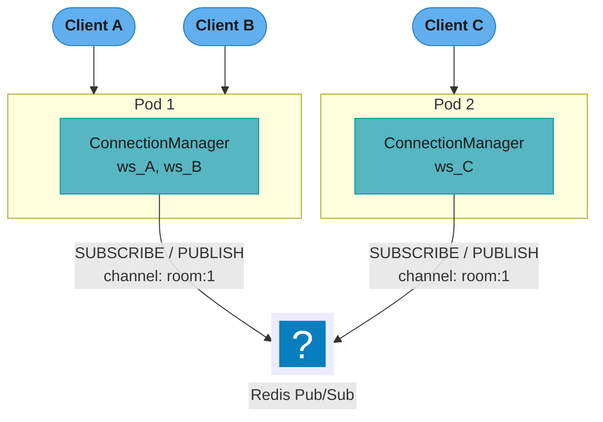
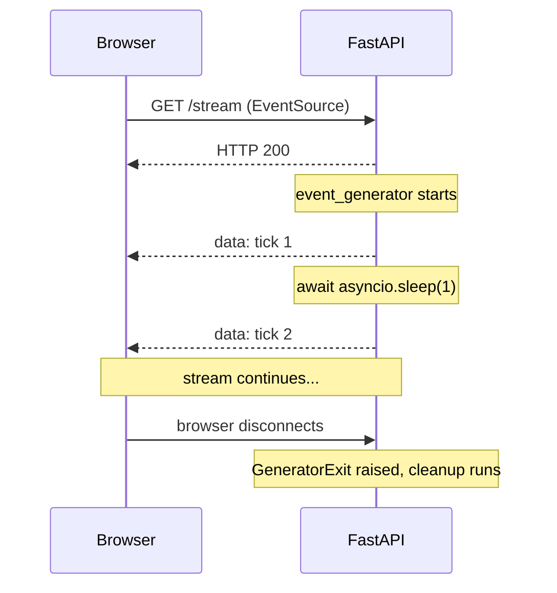
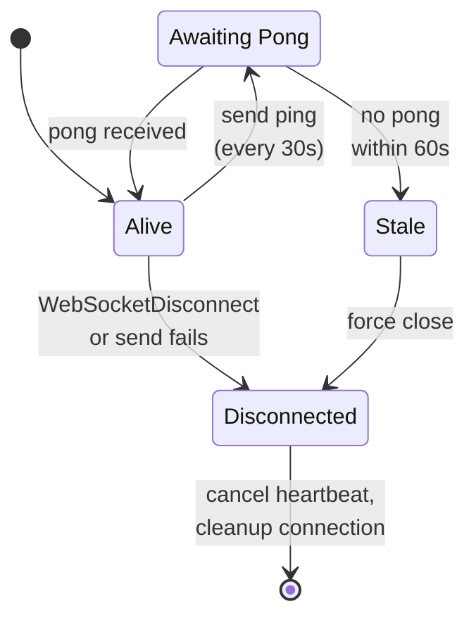
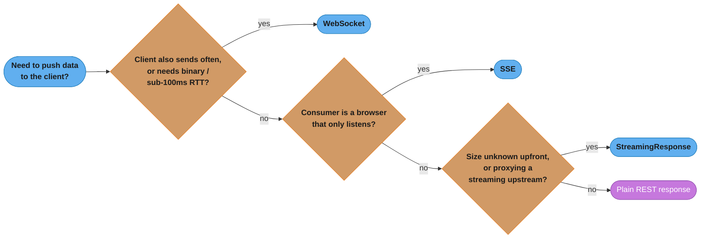
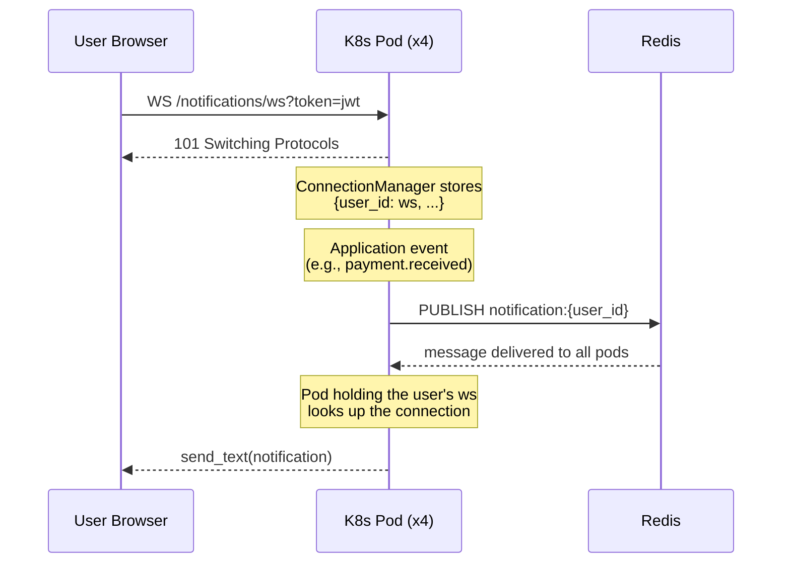

# WebSockets, SSE, and Streaming

---

## 1. Concept Overview

FastAPI supports three push-communication primitives on top of the ASGI protocol:

1. **WebSockets** — full-duplex, persistent TCP connections. Either side can send at any time.
   FastAPI exposes them through the `WebSocket` object; Starlette handles the HTTP Upgrade
   handshake and framing.

2. **Server-Sent Events (SSE)** — unidirectional HTTP streams where the server pushes a series
   of `data:` frames over a single long-lived `Content-Type: text/event-stream` response. The
   browser `EventSource` API handles reconnection automatically.

3. **StreamingResponse** — an ASGI streaming body where an async generator yields chunks as
   they become available. Used for large file downloads, LLM token streaming, and any response
   where the total size is not known at the start.

Key concepts covered in this module:

- WebSocket lifecycle: `accept`, `receive_*`, `send_*`, `close`
- `WebSocketDisconnect` exception and graceful teardown
- `ConnectionManager` class for in-process broadcasting
- Redis pub/sub for multi-pod fan-out
- Native SSE with `fastapi.sse` — `EventSourceResponse` and `ServerSentEvent` [FastAPI 0.135+]
- `Last-Event-ID` resume after a dropped SSE stream
- Native JSON Lines streaming — `AsyncIterable[Model]` to `application/jsonl` [FastAPI 0.134+]
- `StreamingResponse` with async generators, and the raw SSE wire format underneath
- Admission control, cancellation propagation, and idle-gap timeouts for GPU-backed streams
- Backpressure and `asyncio.Queue` buffering
- Heartbeat / ping-pong for stale-connection detection
- JWT authentication in WebSocket connections

Cross-references:
- Async generators and backpressure fundamentals: `../../python/async_patterns_and_pitfalls/async_patterns_and_pitfalls.md`
- ASGI protocol and Starlette internals: `../fastapi_fundamentals_asgi/fastapi_fundamentals_asgi.md`
- Production multi-pod streaming architecture: `../../llm/case_studies/cross_cutting/streaming_at_scale.md`

---

## 2. Intuition

> A REST endpoint is a vending machine — you put in a coin, get a product, the transaction ends.
> A WebSocket is a telephone call — both parties stay on the line and talk whenever they want.
> SSE is a radio broadcast — the station transmits continuously, listeners tune in and receive.

**Mental model:** HTTP is inherently request-response. Every new message from the server requires
a new HTTP request from the client — polling. WebSockets replace that with a single TCP connection
that stays open indefinitely; either side sends a framed message and the other receives it
immediately. SSE is a middle ground: the client sends one HTTP GET, the server never closes the
response body, and it writes `data:` lines whenever it has something to say.

**Why it matters:** Real-time features — live chat, collaborative editing, notification feeds,
LLM token streaming, stock tickers — are either impossible or extremely inefficient over plain
HTTP polling. WebSockets and SSE eliminate the polling overhead and reduce latency from
`poll_interval / 2` (on average) to single-digit milliseconds.

**Key insight:** WebSockets and SSE are both ASGI-native. Because FastAPI runs on ASGI, neither
requires a separate server or a thread-per-connection model. A single Uvicorn worker can hold
tens of thousands of concurrent WebSocket connections because maintaining an idle connection costs
only one coroutine and a file descriptor — no thread stack.

---

## 3. Core Principles

**1. Protocol upgrade for WebSockets.**
A WebSocket connection starts as an HTTP/1.1 GET with `Upgrade: websocket` and
`Connection: Upgrade` headers. The server responds `101 Switching Protocols`. After that,
the TCP connection speaks the WebSocket framing protocol, not HTTP. FastAPI's `WebSocket`
class encapsulates this entirely.

**2. ASGI message loop.**
Under the hood, Starlette's `WebSocket` wraps the ASGI `receive` and `send` callables.
`websocket.receive_text()` calls `await receive()` and extracts the `bytes` or `text` field.
`websocket.send_text()` calls `await send({"type": "websocket.send", "text": ...})`.

**3. SSE is just a long HTTP response.**
`Content-Type: text/event-stream`, `Cache-Control: no-cache`, and the response body is a
stream of lines in the format:

```
data: <payload>\n\n
event: <event-name>\n
data: <payload>\n\n
id: <last-event-id>\n
retry: <ms>\n\n
```

The browser `EventSource` API parses these lines and fires `message` or named events.

**4. StreamingResponse defers body creation.**
`StreamingResponse(content=async_generator(), media_type="...")` tells Starlette to call
`async for chunk in content` and write each chunk to the socket without buffering the entire
body in memory.

**5. Fan-out requires a shared message bus.**
A `ConnectionManager` that stores `WebSocket` objects in a Python list only knows about
connections on its own process. In a multi-pod deployment, connections are spread across pods.
A shared message bus (Redis pub/sub, Kafka, or a dedicated broker) is required for fan-out.

---

## 4. Types / Architectures / Strategies

### 4.1 WebSocket Communication Patterns

| Pattern | Description | Use Cases |
|---------|-------------|-----------|
| Point-to-point | Server ↔ single client | Private chat, user notifications |
| Room broadcast | Server → all clients in a room | Group chat, multiplayer game |
| Global broadcast | Server → all connected clients | System alerts, ticker |
| Client-to-client relay | Client → server → other client | Signaling for WebRTC |

### 4.2 SSE vs WebSocket Decision Matrix

| Dimension | SSE | WebSocket |
|-----------|-----|-----------|
| Direction | Server → Client only | Bidirectional |
| Protocol | HTTP/1.1 (or HTTP/2) | ws:// / wss:// (custom framing) |
| Browser support | `EventSource` built-in | `WebSocket` built-in |
| Auto-reconnect | Yes (EventSource handles it) | No (must implement manually) |
| Binary support | No (text only) | Yes (text + binary frames) |
| Proxy/CDN support | Easy (plain HTTP) | Needs WS-aware proxy |
| Server complexity | Lower | Higher |
| Use cases | LLM streaming, feeds, notifications | Chat, gaming, collab editing |

### 4.3 StreamingResponse Patterns

| Pattern | Generator yields | Use Case |
|---------|-----------------|----------|
| File streaming | `bytes` chunks (e.g., 64 KB) | Large file downloads |
| LLM token streaming | `ServerSentEvent` objects | ChatGPT-style responses to a browser |
| JSON Lines | Pydantic models, one per line | Machine consumers — LLM output, telemetry, logs |
| CSV export | Row strings | Large dataset export |
| Log tailing | Log line strings | Live log viewer |

### 4.4 Multi-Pod Scaling Strategies

| Strategy | How it works | Tradeoffs |
|----------|-------------|-----------|
| Sticky sessions | Load balancer pins client to pod | Simple; single-pod SPOF |
| Redis pub/sub | Pods subscribe; any pod can publish | Strong; adds Redis dependency |
| Kafka fan-out | Topic per room/user | Durable; higher latency |
| In-memory grid (Hazelcast) | Distributed topic across JVM pods | Not idiomatic Python |

---

## 5. Architecture Diagrams

### 5.1 WebSocket Connection Lifecycle



The HTTP `Upgrade` handshake happens exactly once; after `101 Switching Protocols`, the
same TCP connection carries WebSocket frames in both directions until the client closes
it and Starlette raises `WebSocketDisconnect` inside the handler.

### 5.2 Multi-Pod Fan-Out with Redis Pub/Sub



When any pod calls `PUBLISH`, Redis delivers to all subscribers. Each pod then sends the
message to its locally held WebSocket connections.

### 5.3 SSE Flow



The server keeps the HTTP response open and pushes `data:` lines on its own schedule;
when the browser drops the connection, Starlette raises `GeneratorExit` inside the
generator so cleanup code runs.

---

## 6. How It Works — Detailed Mechanics

### 6.1 WebSocket Endpoint

```python
from fastapi import FastAPI, WebSocket, WebSocketDisconnect
import asyncio

app = FastAPI()


@app.websocket("/ws/{client_id}")
async def websocket_endpoint(websocket: WebSocket, client_id: str) -> None:
    await websocket.accept()                      # completes HTTP upgrade
    try:
        while True:
            data = await websocket.receive_text() # blocks until frame arrives
            await websocket.send_text(f"echo: {data}")
    except WebSocketDisconnect:
        # Client closed the connection — clean up resources here
        pass
```

`receive_text()` suspends the coroutine (yields to the event loop) until a text frame
arrives. `send_text()` serializes the string to a UTF-8 WebSocket frame and writes it.
Both are non-blocking from the event loop's perspective.

### 6.2 ConnectionManager for Room Broadcasting

```python
from collections import defaultdict

from starlette.websockets import WebSocketDisconnect, WebSocketDisconnected

class ConnectionManager:
    def __init__(self) -> None:
        self._rooms: dict[str, set[WebSocket]] = defaultdict(set)

    async def connect(self, room: str, websocket: WebSocket) -> None:
        await websocket.accept()
        self._rooms[room].add(websocket)

    def disconnect(self, room: str, websocket: WebSocket) -> None:
        self._rooms[room].discard(websocket)
        if not self._rooms[room]:
            del self._rooms[room]

    async def broadcast(self, room: str, message: str) -> None:
        dead: list[WebSocket] = []
        for ws in list(self._rooms[room]):
            try:
                await ws.send_text(message)
            except (WebSocketDisconnect, WebSocketDisconnected):
                dead.append(ws)
        for ws in dead:
            self.disconnect(room, ws)


manager = ConnectionManager()


@app.websocket("/rooms/{room_id}/ws")
async def room_endpoint(websocket: WebSocket, room_id: str) -> None:
    await manager.connect(room_id, websocket)
    try:
        while True:
            text = await websocket.receive_text()
            await manager.broadcast(room_id, text)
    except WebSocketDisconnect:
        manager.disconnect(room_id, websocket)
```

### 6.3 The SSE wire format, by hand

FastAPI emits SSE natively (Section 6.4) and that is what you should ship. Write it once by
hand anyway: every field the native API sets for you is visible here, and when a stream
misbehaves in production you are reading this wire format in `curl`, not a Python object.


```python
from fastapi import Request
from fastapi.responses import StreamingResponse
import asyncio


async def event_generator(request: Request):
    counter = 0
    while True:
        # Stop if client disconnects
        if await request.is_disconnected():
            break
        counter += 1
        yield f"data: tick {counter}\n\n"        # SSE format: data: ... \n\n
        await asyncio.sleep(1)


@app.get("/stream/ticks")
async def stream_ticks(request: Request) -> StreamingResponse:
    return StreamingResponse(
        event_generator(request),
        media_type="text/event-stream",
        headers={
            "Cache-Control": "no-cache",
            "X-Accel-Buffering": "no",             # disable nginx buffering
        },
    )
```

Every event is a block of `field: value` lines terminated by a blank line. The five fields a
browser understands are `data`, `event`, `id`, `retry`, and a bare `:` comment line that
clients ignore — which is how keep-alive pings work. Named events with IDs let a browser
resume from where it left off:

```python
async def sse_generator(request: Request, last_id: int = 0):
    event_id = last_id
    while not await request.is_disconnected():
        event_id += 1
        payload = f"id: {event_id}\nevent: update\ndata: {{\"seq\": {event_id}}}\n\n"
        yield payload
        await asyncio.sleep(0.5)
```

Getting all of that right by hand — the three headers, the `retry` field, the per-event
framing, the periodic comment ping so an idle stream is not killed by a proxy — is the
boilerplate the next section deletes.

### 6.4 Native SSE with `fastapi.sse` [FastAPI 0.135+]

SSE is part of FastAPI core. Declare `response_class=EventSourceResponse` on a path
operation that `yield`s, and the framework does the framing:

```python
from collections.abc import AsyncIterable

from fastapi import FastAPI
from fastapi.sse import EventSourceResponse, ServerSentEvent
from pydantic import BaseModel

app = FastAPI()


class Tick(BaseModel):
    seq: int
    value: float


@app.get("/sse/ticks", response_class=EventSourceResponse)
async def sse_ticks() -> AsyncIterable[Tick]:
    for i in range(100):
        yield Tick(seq=i, value=i * 1.5)
        await asyncio.sleep(0.1)
```

Yield a Pydantic model and FastAPI serializes it into the `data:` field. Yield a
`ServerSentEvent` when you need the other fields:

```python
@app.get("/sse/updates", response_class=EventSourceResponse)
async def sse_updates() -> AsyncIterable[ServerSentEvent]:
    for i in range(100):
        yield ServerSentEvent(
            data={"seq": i},        # JSON-encoded into the data: field
            event="update",         # client-side addEventListener("update", ...)
            id=str(i),              # echoed back as Last-Event-ID on reconnect
            retry=3000,             # client reconnect delay, milliseconds
        )
        await asyncio.sleep(0.1)
```

`ServerSentEvent` carries `data`, `raw_data`, `event`, `id`, `retry`, and `comment`. `data`
is JSON-encoded; `raw_data` is written through untouched and the two are mutually exclusive
— `raw_data` is how you emit a bare sentinel such as OpenAI's `[DONE]`, which is not JSON:

```python
yield ServerSentEvent(raw_data="[DONE]")
```

What the framework handles that hand-rolled `StreamingResponse` does not:

| Concern | Handled by `EventSourceResponse` |
|---|---|
| `Content-Type: text/event-stream` | set automatically |
| `Cache-Control: no-cache` | set automatically |
| `X-Accel-Buffering: no` | set automatically — the nginx buffering bug in Section 10 |
| Keep-alive | a `:` comment ping every 15 s while the generator is idle |
| Per-event framing | `data:` / `event:` / `id:` / `retry:` lines and the blank terminator |
| `Last-Event-ID` | readable from the request header for resume (Section 6.5) |
| Multi-line `data` | split across repeated `data:` lines per the spec |

Pin FastAPI 0.140.13+ if the endpoint declares a non-200 `status_code` (or a dependency sets
one on `Response`): before that release SSE and JSONL streams always returned 200 while OpenAPI
documented the declared code. 0.143.3 writes `NaN` and `Infinity` in non-model stream items as
`null`; earlier versions emitted bare `NaN` tokens that `JSON.parse` rejects.

Third-party `sse-starlette` predates this and is still the only option on a pin older than
0.135.0; its `EventSourceResponse` takes a generator argument rather than a response class
and yields dicts. On a current FastAPI there is no reason to add the dependency.

### 6.5 Resuming a dropped stream with `Last-Event-ID`

A browser `EventSource` reconnects on its own after a drop and sends the `id` of the last
event it saw in the `Last-Event-ID` request header. The server's job is to honour it —
otherwise every reconnect replays from zero or, worse, silently loses the gap.

```python
from typing import Annotated

from fastapi import Header


@app.get("/sse/feed", response_class=EventSourceResponse)
async def feed(
    last_event_id: Annotated[str | None, Header()] = None,
) -> AsyncIterable[ServerSentEvent]:
    # Header() maps Last-Event-ID -> last_event_id automatically.
    cursor = int(last_event_id) if last_event_id else 0
    async for row in read_events_after(cursor):     # your durable log
        yield ServerSentEvent(data=row.payload, id=str(row.seq))
```

This only works if event ids are monotonic and the backing store can seek to one. An id
derived from `uuid4()` is unusable for resume — it identifies an event but does not order
it. Use the sequence number of a durable log (a Postgres `bigserial`, a Redis Stream id, a
Kafka offset); if there is no such log, say so and let the client re-fetch a snapshot on
reconnect instead of pretending resume works.

### 6.6 Streaming an LLM: admission, cancellation, and the idle gap

Proxying a model's tokens is the most common streaming endpoint written today, and it is
where the naive version is most expensive. Three things separate it from a tick feed: the
work behind it is a scarce GPU slot rather than a cheap read, it costs money per token, and
it can stall for minutes without the connection ever closing.

**Admission control, not concurrency.** An ASGI server will happily accept ten thousand
concurrent requests; your four GPU slots will not. Bound the work with an
`anyio.CapacityLimiter` sized to the slots, and shed the overflow immediately rather than
queueing it forever — a caller who waits 90 seconds for a slot has already timed out and
retried, so the queue is manufacturing load, not absorbing it.

```python
import anyio
from fastapi import HTTPException

GPU_SLOTS = anyio.CapacityLimiter(4)          # not a bare Semaphore: see below
ADMISSION_WAIT_S = 2.0


async def acquire_slot() -> None:
    try:
        with anyio.fail_after(ADMISSION_WAIT_S):
            await GPU_SLOTS.acquire()
    except TimeoutError:
        raise HTTPException(
            status_code=503,
            detail="No capacity",
            headers={"Retry-After": "5"},
        )
```

`CapacityLimiter` over `asyncio.Semaphore` for two reasons: its bound is mutable at runtime
(`GPU_SLOTS.total_tokens = 8` when you scale the pool), and it is the same primitive
Starlette already uses for the sync-route thread pool, so it works under either anyio
backend. A `Semaphore` created at import time also binds to whichever event loop is running
then, which is a classic source of `got Future attached to a different loop`.

**The idle gap is the timeout that matters.** A total-request timeout is useless here — a
legitimate generation runs 300 seconds. What you must bound is the gap *between* tokens: an
upstream that accepts the connection and then stalls holds a GPU slot, a socket, and a
coroutine forever, and no total-duration alarm you would be willing to set will fire.

```python
from collections.abc import AsyncIterable

from fastapi.sse import EventSourceResponse, ServerSentEvent

IDLE_GAP_S = 20.0


async def llm_tokens(prompt: str, budget: "CostBudget") -> AsyncIterable[ServerSentEvent]:
    await acquire_slot()
    try:
        async with httpx.AsyncClient(timeout=httpx.Timeout(10.0, read=IDLE_GAP_S)) as client:
            async with client.stream(
                "POST",
                UPSTREAM_URL,
                json={"model": MODEL, "stream": True,
                      "messages": [{"role": "user", "content": prompt}]},
                headers={"Authorization": f"Bearer {UPSTREAM_KEY}"},
            ) as resp:
                resp.raise_for_status()
                async for line in resp.aiter_lines():
                    if not line.startswith("data:"):
                        continue
                    chunk = line[5:].strip()
                    if chunk == "[DONE]":
                        yield ServerSentEvent(raw_data="[DONE]")
                        break
                    budget.add(chunk)                  # count tokens as they pass
                    if budget.exceeded:
                        yield ServerSentEvent(event="error", data={"reason": "budget"})
                        break
                    yield ServerSentEvent(data=chunk)
    except httpx.ReadTimeout:
        # No byte for IDLE_GAP_S. The upstream is wedged; do not wait out the
        # total budget holding a GPU slot.
        yield ServerSentEvent(event="error", data={"reason": "upstream_stalled"})
    finally:
        # Runs on normal completion, on error, AND on the GeneratorExit that
        # Starlette throws in when the client disconnects.
        GPU_SLOTS.release()
        await budget.flush()


@app.get("/chat/stream", response_class=EventSourceResponse)
async def chat_stream(prompt: str) -> AsyncIterable[ServerSentEvent]:
    return llm_tokens(prompt, CostBudget(max_tokens=4096))
```

`httpx.Timeout(10.0, read=IDLE_GAP_S)` is the load-bearing line: `read` is a per-chunk
timeout, not a whole-response one, so a stream that keeps producing runs as long as it likes
while a stalled one fails in 20 seconds.

**Cancellation must reach the provider.** When a user closes the tab, Starlette throws
`GeneratorExit` into the generator. If you swallow it, or if the upstream request is not
inside the generator's own scope, the provider keeps generating and keeps billing for tokens
nobody will ever read. The `async with client.stream(...)` block above is what saves you:
unwinding the generator exits that context manager, which closes the connection, which is
the signal the provider uses to abandon the generation. Never move the upstream call into a
`BackgroundTasks` job or a detached `asyncio.create_task` — both outlive the client and both
turn a closed tab into a bill.

**Bill what you served, not what you promised.** The `finally` block flushes the accumulator
on every exit path, so a request cancelled at token 300 of 4000 is still logged and charged
for 300. The common bug is accounting only on the success path, which makes cancelled
requests free in your ledger and expensive on the provider's invoice — a discrepancy that
shows up as an unexplained margin gap, not as an error.

**Tokens are the rate limit, not requests.** A requests-per-minute cap treats a 20-token
completion and a 4000-token one identically, so one caller can consume 200x another's budget
inside the same limit. Meter the token counter above against a per-tenant budget and reject
with 429 when it is spent. See
[`../api_design_and_versioning/api_design_and_versioning.md`](../api_design_and_versioning/api_design_and_versioning.md)
for the limiter mechanics and
[`../case_studies/design_ml_inference_api_fastapi.md`](../case_studies/design_ml_inference_api_fastapi.md)
for the whole shape end to end. Batching strategy, KV cache and model compression are
[`../../ml/model_serving_and_inference/model_serving_and_inference.md`](../../ml/model_serving_and_inference/model_serving_and_inference.md)
and [`../../llm/`](../../llm/README.md) — this module owns only the HTTP edge.

### 6.7 JSON Lines for machine consumers [FastAPI 0.134+]

SSE is a browser protocol. When the consumer is another service, a CLI, or a data pipeline,
the client does not want `EventSource` framing — it wants one JSON object per line. Return
an `AsyncIterable[Model]` with no response class and FastAPI streams `application/jsonl`:

```python
from collections.abc import AsyncIterable


class LogLine(BaseModel):
    ts: float
    level: str
    message: str


@app.get("/logs/stream")
async def stream_logs() -> AsyncIterable[LogLine]:
    async for line in tail_log():
        yield LogLine(ts=line.ts, level=line.level, message=line.text)
```

The body is `{"ts":...}\n{"ts":...}\n`, not a `[...]` array — so a consumer parses and acts
on each record as it arrives instead of buffering to the closing bracket. FastAPI's own docs
name an AI LLM service, logs and telemetry as the motivating cases. It is typed, so the model
appears in the OpenAPI schema like any other response, and a sync `def` returning
`Iterable[Model]` works the same way.

Pick between the three by consumer, not by taste:

| Consumer | Shape | Why |
|---|---|---|
| Browser, one-way | SSE (`EventSourceResponse`) | free auto-reconnect, `Last-Event-ID` resume |
| Service, CLI, pipeline | JSONL (`AsyncIterable[Model]`) | no framing to strip, typed, trivially `jq`-able |
| Browser, two-way | WebSocket | the client also sends |

### 6.8 Backpressure with asyncio.Queue

When a slow consumer can't keep up, unbounded sends pile up in Starlette's internal send
buffer. For WebSockets, `send_text` will block if the kernel TCP send buffer is full (the
event loop awaits the write). To decouple production from consumption and add a circuit
breaker:

```python
from asyncio import Queue, QueueFull


class BufferedWebSocket:
    """Wraps a WebSocket with a bounded outbound queue."""

    MAX_QUEUE = 100  # drop or disconnect if queue full

    def __init__(self, ws: WebSocket) -> None:
        self._ws = ws
        self._queue: Queue[str] = Queue(maxsize=self.MAX_QUEUE)
        self._sender_task: asyncio.Task | None = None

    async def start(self) -> None:
        self._sender_task = asyncio.create_task(self._sender())

    async def _sender(self) -> None:
        while True:
            msg = await self._queue.get()
            if msg is None:   # sentinel — shut down
                break
            await self._ws.send_text(msg)

    def enqueue(self, msg: str) -> bool:
        """Returns False if queue is full (apply backpressure to producer)."""
        try:
            self._queue.put_nowait(msg)
            return True
        except QueueFull:
            return False

    async def close(self) -> None:
        await self._queue.put(None)  # sentinel
        if self._sender_task:
            await self._sender_task
```

`MAX_QUEUE = 100` is a deliberately chosen number, and what it buys is measured in seconds:

```
  time_to_full = MAX_QUEUE / (produce_rate - drain_rate)
  bytes_held   = MAX_QUEUE x message_size x connections
```

**Read it like this.** "The bound is a stopwatch, not a memory limit: it decides how long a
client is allowed to fall behind before you are forced to make a decision about it."

An unbounded queue never forces that decision, which is precisely the failure — it converts a
slow client into an out-of-memory event for every other client on the pod.

| Symbol | What it is |
|--------|------------|
| `MAX_QUEUE` | Bound on outbound messages held per connection. The `Queue(maxsize=...)` |
| `produce_rate` | Messages/s the application generates for this connection |
| `drain_rate` | Messages/s the client's socket actually absorbs — set by its bandwidth, not yours |
| `time_to_full` | Grace period. How long the client may lag before `QueueFull` fires |
| `QueueFull` | The signal. Drop, disconnect, or throttle upstream — silence is not an option |

**Walk one example.** A client on a degraded mobile link during a burst:

```
  produce_rate = 50 msg/s   (a busy room)
  drain_rate   = 10 msg/s   (client is 5x too slow)

  time_to_full = 100 / (50 - 10)          =  2.5 s   <- grace period before QueueFull
  catch-up if the burst ends now: 100 / 10 = 10.0 s  <- how stale the client already is

  memory, at ~2 KB per queued message:
    per connection  = 100 x 2 KB                     =  200 KB
    worst case, 5,000 connections on one pod full    =  1.0 GB
```

Two things fall out. First, 2.5 seconds is short — `MAX_QUEUE=100` is tuned to detect a slow
consumer quickly, not to buffer through one. Second, the bound is what makes the pod's worst case
*finite*: 200 KB x 5,000 connections = 1 GB is survivable and provisionable, while the same
scenario with an unbounded queue has no upper number at all. Size `MAX_QUEUE` from
`time_to_full`, then multiply out `bytes_held` to confirm the pod can survive every connection
hitting the bound simultaneously.

### 6.9 Heartbeat / Ping-Pong

The browser silently drops WebSocket connections through idle firewalls after ~30–90 seconds.
The WebSocket protocol has built-in ping/pong frames; Starlette/ASGI does not expose them
directly, so application-level heartbeats are the pragmatic solution:



The heartbeat task and the receive loop race independently: a missed pong for 60 seconds
(twice the 30-second interval) marks the connection stale and forces the same cleanup
path as an explicit `WebSocketDisconnect`.

```python
@app.websocket("/ws/heartbeat/{client_id}")
async def ws_with_heartbeat(websocket: WebSocket, client_id: str) -> None:
    await websocket.accept()

    async def send_heartbeat() -> None:
        while True:
            await asyncio.sleep(30)
            try:
                await websocket.send_json({"type": "ping"})
            except Exception:
                return  # connection gone

    heartbeat = asyncio.create_task(send_heartbeat())
    try:
        while True:
            msg = await websocket.receive_json()
            if msg.get("type") == "pong":
                continue  # client is alive
            # handle real message
    except WebSocketDisconnect:
        pass
    finally:
        heartbeat.cancel()
```

### 6.10 JWT Authentication in WebSockets

Since FastAPI 0.144.0 the security dependencies (`OAuth2PasswordBearer`, `HTTPBearer`,
`APIKeyHeader`, `APIKeyQuery`, `APIKeyCookie`, `OpenIdConnect`) work on `@app.websocket`
routes: their `__call__` takes Starlette's `HTTPConnection`, the base class of both `Request`
and `WebSocket`. Dependencies resolve before the handler body runs, so a missing credential
raises `HTTPException(401)` before `accept()`. Starlette sends that error as a WebSocket denial
response (the ASGI `websocket.http.response` extension, which uvicorn supports), and the client
gets an HTTP 401 instead of `101 Switching Protocols`.

The browser `WebSocket` API cannot set headers, so `OAuth2PasswordBearer` and `HTTPBearer`
only serve non-browser clients (mobile apps, services). A browser can send a cookie, which the
browser attaches to the upgrade request, or a query parameter:

```python
from typing import Annotated

import jwt
from fastapi import Depends, HTTPException, WebSocket, status
from fastapi.security import APIKeyCookie, OAuth2PasswordBearer

SECRET = "change-me"
ALGORITHM = "HS256"


def decode_token(token: str) -> dict:
    try:
        return jwt.decode(token, SECRET, algorithms=[ALGORITHM])
    except jwt.InvalidTokenError as exc:
        raise HTTPException(status_code=403, detail="Invalid token") from exc


oauth2_scheme = OAuth2PasswordBearer(tokenUrl="token")       # Authorization: Bearer (non-browser)
session_cookie = APIKeyCookie(name="access_token")           # browser: cookie rides the upgrade


@app.websocket("/ws/service")
async def service_ws(
    websocket: WebSocket, token: Annotated[str, Depends(oauth2_scheme)]
) -> None:
    ...


@app.websocket("/ws/secure")
async def secure_ws(
    websocket: WebSocket, token: Annotated[str, Depends(session_cookie)]
) -> None:
    try:
        payload = decode_token(token)
    except HTTPException:
        await websocket.close(code=status.WS_1008_POLICY_VIOLATION)
        return
    await websocket.accept()
    user_id = payload["sub"]
    # ...
```

The dependency only extracts the credential; validating it is still your code. A cookie-authed
socket is open to cross-site WebSocket hijacking, because browsers send cookies on cross-origin
upgrades and WebSockets have no CORS check, so compare `websocket.headers["origin"]` with an
allowlist before `accept()`. `APIKeyQuery` puts the token in the URL, where access logs record
it: use it only with a short-lived single-use ticket minted by an authenticated REST call, or
accept first and read the token as the first message (Pitfall 7).

---

## 7. Real-World Examples

**Slack** uses WebSockets for its real-time messaging API (RTM). Each connection subscribes
to a user-scoped channel. Slack's backend uses a fan-out service (internally called the
Connection Layer) that maintains Redis pub/sub subscriptions per workspace. Connections are
spread across hundreds of pods; a message posted in a workspace triggers a publish to a Redis
channel keyed by `workspace:{id}`, and all pods with active subscribers for that workspace
deliver the event to their local WebSocket connections.

**Vercel's v0 and OpenAI ChatGPT** use SSE (`text/event-stream`) for LLM token streaming.
The frontend uses `EventSource` or the Fetch API with `ReadableStream`. Each token generated
by the model is flushed immediately rather than waiting for the full response, reducing
perceived latency from several seconds to near-instant first-token display.

**GitHub Copilot** streams code completions as SSE responses over ordinary HTTP requests. The streaming keeps the IDE's UI responsive for longer completions.

**Figma** uses WebSockets for its live collaborative editing engine. Each client holds an
open WebSocket to a regional gateway. Operational transforms (or CRDTs) are broadcast over
those connections. Figma's gateway layer uses Redis pub/sub to route messages between
users editing the same file from different pods.

**Stripe's dashboard** uses SSE for live webhook delivery status and payment event feeds
inside the dashboard — unidirectional server push over HTTP, no custom WebSocket server needed.

---

## 8. Tradeoffs

### WebSocket vs SSE vs Polling

| Criterion | Long Polling | SSE | WebSocket |
|-----------|-------------|-----|-----------|
| Latency | High (poll interval / 2) | Low (~ms) | Lowest (~ms) |
| Server connections | Many short | Few long-lived | Few long-lived |
| Client→Server messages | Every poll request | New HTTP POST | In-band frame |
| Binary data | No | No | Yes |
| Proxy/firewall compatibility | Excellent | Good (HTTP) | Moderate (needs upgrade) |
| Implementation complexity | Low | Low | Medium |
| CDN caching | Possible | No | No |
| Auto-reconnect | Manual | Built-in | Manual |

The first row's "poll interval / 2" is half a formula. The full cost of polling is two numbers
that move in opposite directions:

```
  mean_latency = poll_interval / 2
  request_rate = users / poll_interval
```

**What it means.** "Latency and load are the same dial turned in opposite directions — every
halving of the delay a user sees doubles the number of requests your servers answer, and almost
all of those answers are empty."

Push notification cannot be tuned into existence from polling, because the limit of this trade as
latency goes to zero is infinite request rate. That is the structural argument for SSE and
WebSockets, independent of any benchmark.

| Symbol | What it is |
|--------|------------|
| `poll_interval` | Seconds a client waits between requests |
| `mean_latency` | Average staleness — an event landing uniformly in the window waits half of it |
| `users / poll_interval` | Sustained request rate the fleet must serve, event or no event |
| hit rate | Fraction of polls that actually return data. `events_per_s / request_rate` |

**Walk one example.** Use the Section 14 deployment — 20,000 concurrent users, ~500 notification
events/s across all of them — and assume ~800 bytes of request+response headers per poll:

```
  poll every 5 s:
    mean_latency = 5 / 2                            =    2.5 s
    request_rate = 20,000 / 5                       =  4,000 req/s
    egress       = 4,000 x 800 B                    =   25.6 Mbps of pure overhead
    hit rate     = 500 / 4,000                      =   12.5%   (87.5% empty responses)

  want 1 s mean latency? poll every 2 s:
    request_rate = 20,000 / 2                       = 10,000 req/s   (2.5x the load)
    mean_latency = 2 / 2                            =    1.0 s       (2.5x better)

  the WebSocket deployment, same 500 events/s at ~500 B each:
    egress       = 500 x 500 B                      =    2.0 Mbps
    latency      = single-digit ms
```

Polling burns 12.8x the bandwidth for 2,500x the latency, and 87.5% of that bandwidth carries
nothing. The 20,000 idle connections that replace it cost coroutines and file descriptors —
priced in the Section 14 capacity estimate — not request-per-second capacity.

### StreamingResponse vs Chunked Transfer

Both use HTTP chunked transfer encoding. `StreamingResponse` is the high-level FastAPI
primitive; raw chunked transfer encoding is what the ASGI server sends on the wire.
`StreamingResponse` adds correct headers and an async iteration loop; there is no lower-level
alternative to use in FastAPI.

### Redis Pub/Sub vs Kafka for WebSocket Fan-Out

| Dimension | Redis Pub/Sub | Kafka |
|-----------|--------------|-------|
| Latency | Sub-millisecond | 5–20 ms |
| Message persistence | None (fire and forget) | Configurable (days) |
| Replay on reconnect | Not supported | Yes (offset seek) |
| Throughput | ~1M msg/s per node | Millions/s per cluster |
| Operational complexity | Low | High |
| Best for | Chat, gaming, notifications | Durable event log, audit, replay |

---

## 9. When to Use / When NOT to Use

The three primitives resolve to a single decision path: bidirectionality and low-RTT
needs point to WebSocket, browser-only listening points to SSE, and an unknown-size or
proxied-upstream body points to StreamingResponse.



### Use WebSockets when:

- The client sends messages to the server frequently (chat, gaming input, collaborative editing)
- You need sub-100ms round-trip latency
- You need binary payloads (audio, video signaling, file transfer)
- The connection duration is measured in minutes to hours

### Use SSE when:

- The server pushes updates and the client only listens (notification feeds, live dashboards)
- You want browser auto-reconnect for free
- Your infrastructure includes HTTP-only proxies or CDNs that don't understand WebSocket upgrades
- You need to stream LLM tokens, log lines, or progress events

### Use JSON Lines when:

- The consumer is a service, CLI, or data pipeline rather than a browser — no framing to strip
- You want the streamed item typed and visible in the OpenAPI schema
- Records must be actionable as they arrive (LLM output to another service, telemetry, log tailing)

### Use StreamingResponse when:

- You are generating large responses lazily (CSV exports, PDF pages, file chunks)
- The payload is bytes rather than modelled records
- You need a media type FastAPI does not frame for you

### Do NOT use WebSockets when:

- Communication is strictly one-way (use SSE instead — simpler and proxy-friendly)
- Your clients are behind strict corporate firewalls that block non-HTTP protocols
- You are building a REST API where stateless request-response is sufficient
- You have no shared message bus for multi-pod deployments — you will get split-brain fans

### Do NOT use SSE when:

- Clients need to send data back frequently — each send is a new HTTP request
- The consumer is not a browser: you are paying `event:`/`data:` framing for a client that
  has to strip it again. Use JSON Lines
- You need binary payloads
- You are on HTTP/1.1 with many users — each SSE connection holds a TCP connection, and
  browsers cap concurrent connections per domain at 6 (HTTP/1.1); HTTP/2 removes this limit

---

## 10. Common Pitfalls

### Pitfall 1 — In-process ConnectionManager does not scale horizontally

```python
# BROKEN: in-process ConnectionManager doesn't scale horizontally
class ConnectionManager:
    def __init__(self) -> None:
        self.active_connections: list[WebSocket] = []  # local memory only

    async def broadcast(self, message: str) -> None:
        for conn in self.active_connections:
            await conn.send_text(message)
# Pod A's manager has no knowledge of connections on Pod B.
# With 4 pods each holding 25% of connections, only 25% of users
# receive a broadcast from any single pod.
```

```python
# FIX: use Redis pub/sub as the message bus between pods
from redis.asyncio import Redis


async def broadcast_via_redis(channel: str, message: str, redis: Redis) -> None:
    await redis.publish(channel, message)


async def redis_listener(websocket: WebSocket, channel: str, redis: Redis) -> None:
    async with redis.pubsub() as pubsub:
        await pubsub.subscribe(channel)
        async for msg in pubsub.listen():
            if msg["type"] == "message":
                await websocket.send_text(msg["data"])


@app.websocket("/ws/global")
async def global_ws(websocket: WebSocket, redis: Redis = Depends(get_redis)) -> None:
    await websocket.accept()
    listener = asyncio.create_task(redis_listener(websocket, "global", redis))
    try:
        while True:
            data = await websocket.receive_text()
            await broadcast_via_redis("global", data, redis)
    except WebSocketDisconnect:
        listener.cancel()
```

### Pitfall 2 — Not handling WebSocketDisconnect causes resource leaks

```python
# BROKEN: no disconnect handling; connection set grows forever
manager = ConnectionManager()

@app.websocket("/ws/leak")
async def leaky_ws(websocket: WebSocket) -> None:
    await manager.connect("default", websocket)
    while True:
        data = await websocket.receive_text()   # raises WebSocketDisconnect on close
        await manager.broadcast("default", data)
# If the client drops, WebSocketDisconnect is raised, propagates uncaught,
# but the WebSocket object stays in manager._rooms["default"] forever.
# 1000 disconnected clients = 1000 dead WebSocket references.
```

```python
# FIX: always disconnect in a finally block
@app.websocket("/ws/clean")
async def clean_ws(websocket: WebSocket) -> None:
    await manager.connect("default", websocket)
    try:
        while True:
            data = await websocket.receive_text()
            await manager.broadcast("default", data)
    except WebSocketDisconnect:
        pass
    finally:
        manager.disconnect("default", websocket)   # always runs
```

Two exceptions mean "this socket is gone", and they are unrelated types. `WebSocketDisconnect`
(an `Exception`) is raised when a receive gets the peer's close frame, or when the first send
to a dropped peer fails at the socket. `WebSocketDisconnected` (a `RuntimeError` subclass,
Starlette 1.7.0+, import from `starlette.websockets`) is raised by any send or receive on a
socket Starlette already marked closed, for example a broadcast to a client whose handler has
already called `close()`. An `except WebSocketDisconnect` in a fan-out loop misses the second
one; it escapes, aborts the loop for every remaining client, and the dead entry stays in the
registry. Catch both where you evict.

### Pitfall 3 — Blocking code inside a WebSocket handler freezes all connections

```python
# BROKEN: synchronous CPU work inside async WebSocket handler
@app.websocket("/ws/compute")
async def compute_ws(websocket: WebSocket) -> None:
    await websocket.accept()
    while True:
        payload = await websocket.receive_json()
        result = heavy_cpu_computation(payload["data"])   # blocks event loop
        await websocket.send_json({"result": result})
# heavy_cpu_computation runs on the event loop thread.
# While it runs (say, 200 ms), zero other WebSocket handlers can execute.
```

```python
# FIX: offload CPU work to a thread pool
import asyncio

@app.websocket("/ws/compute")
async def compute_ws(websocket: WebSocket) -> None:
    await websocket.accept()
    while True:
        payload = await websocket.receive_json()
        result = await asyncio.to_thread(heavy_cpu_computation, payload["data"])
        await websocket.send_json({"result": result})
```

### Pitfall 4 — SSE not flushing through nginx

By default, nginx buffers proxy responses. An SSE stream appears to the browser as if nothing
is happening, then all events arrive at once when the response ends.

Fix: set `X-Accel-Buffering: no` in the response headers (nginx respects this header) and
add `proxy_buffering off` in nginx config for the SSE route:

```nginx
location /stream/ {
    proxy_buffering off;
    proxy_pass http://backend;
}
```

```python
return StreamingResponse(
    generator(),
    media_type="text/event-stream",
    headers={"X-Accel-Buffering": "no", "Cache-Control": "no-cache"},
)
```

### Pitfall 5 — A streaming endpoint with no idle-gap timeout hangs forever

```python
# BROKEN: bounded by nothing that ever fires
async def tokens(prompt: str):
    async with httpx.AsyncClient(timeout=600) as client:      # 10 minutes
        async with client.stream("POST", UPSTREAM, json=...) as resp:
            async for line in resp.aiter_lines():
                yield ServerSentEvent(data=line)

# The upstream accepts the connection, emits three tokens, and stalls.
# No exception is raised: the socket is open and the total timeout is 600 s.
# The coroutine, the GPU slot and the client's browser tab all wait ten minutes
# for a stream that died in second four. At 4 slots and a 600 s ceiling, eight
# stalled requests take the whole service down for twenty minutes.
```

```python
# FIX: bound the gap between chunks, not the whole response
async def tokens(prompt: str):
    # connect=10 s, read=20 s — read is PER CHUNK, so a healthy 5-minute
    # generation runs to completion while a stalled one fails in 20 s.
    timeout = httpx.Timeout(10.0, read=20.0)
    async with httpx.AsyncClient(timeout=timeout) as client:
        async with client.stream("POST", UPSTREAM, json=...) as resp:
            async for line in resp.aiter_lines():
                yield ServerSentEvent(data=line)
```

The instinct to raise the total timeout is exactly backwards. A long stream is normal; a
silent one is not. Bound silence.

### Pitfall 6 — A disconnected client keeps the upstream generating, and billing

```python
# BROKEN: the upstream call outlives the client
@app.get("/chat")
async def chat(prompt: str, background: BackgroundTasks):
    queue = asyncio.Queue()
    background.add_task(pump_upstream, prompt, queue)   # detached
    return EventSourceResponse(drain(queue))

# The user closes the tab. Starlette tears down the response generator, but
# pump_upstream is a separate task with no link to it: the provider keeps
# generating all 4,000 tokens and invoices for every one. At 30% abandonment
# on a chat UI, roughly a third of the token spend buys output nobody reads.
```

```python
# FIX: keep the upstream call inside the response generator's own scope
@app.get("/chat", response_class=EventSourceResponse)
async def chat(prompt: str) -> AsyncIterable[ServerSentEvent]:
    async with httpx.AsyncClient(timeout=httpx.Timeout(10.0, read=20.0)) as client:
        async with client.stream("POST", UPSTREAM, json=...) as resp:
            async for line in resp.aiter_lines():
                yield ServerSentEvent(data=line)
    # Disconnect -> GeneratorExit -> both context managers unwind ->
    # connection closed -> provider abandons the generation.
```

The rule generalizes past LLMs: anything expensive that a stream drives must live inside the
generator, so that cancelling the generator cancels the work. `BackgroundTasks` and a bare
`asyncio.create_task` both deliberately outlive the request, which is the opposite of what a
stream wants.

### Pitfall 7 — JWT in query param leaks into access logs

```python
# BROKEN: token visible in URL and server access logs
@app.websocket("/ws/secure")
async def secure_ws(websocket: WebSocket, token: str = Query(...)) -> None:
    payload = decode_token(token)   # token is in the URL
    await websocket.accept()
    # Nginx/Uvicorn logs: GET /ws/secure?token=eyJhbGc... 101
```

```python
# FIX: accept first, receive token as first message, close if invalid
@app.websocket("/ws/secure")
async def secure_ws(websocket: WebSocket) -> None:
    await websocket.accept()                      # accept before auth
    try:
        auth_msg = await asyncio.wait_for(
            websocket.receive_json(), timeout=5.0  # must authenticate within 5 s
        )
        payload = decode_token(auth_msg.get("token", ""))
    except (asyncio.TimeoutError, HTTPException):
        await websocket.close(code=4001)
        return
    # proceed with authenticated session
    user_id = payload["sub"]
    ...
```

---

## 11. Technologies & Tools

| Tool / Library | Role | Notes |
|---------------|------|-------|
| FastAPI / Starlette | WebSocket, StreamingResponse, and JSON Lines primitives | Built-in; JSONL is an `AsyncIterable[Model]` return type served as `application/jsonl` [FastAPI 0.134+] |
| `fastapi.sse` | `EventSourceResponse` and `ServerSentEvent`: SSE in core | Built-in [FastAPI 0.135+]; handles keep-alive, headers, `Last-Event-ID`; custom `status_code` honored from 0.140.13, non-finite floats serialized as `null` from 0.143.3 |
| `sse-starlette` | SSE for pins older than FastAPI 0.135 | `pip install sse-starlette`; unnecessary on a current FastAPI |
| `anyio.CapacityLimiter` | Admission control for GPU-backed or otherwise scarce work | Built-in via anyio; resizable at runtime, unlike `asyncio.Semaphore` |
| `redis.asyncio` (redis-py v4+) | Async Redis client for pub/sub | Replaces `aioredis` (merged in v4.2) |
| `websockets` | Low-level WebSocket library (Starlette uses it) | Usually indirect dependency |
| `httpx` | Async HTTP client with streaming support | Use for upstream SSE proxy |
| `anyio` | Async primitives; `anyio.create_task_group` | Cleaner task lifecycle than raw asyncio |
| Nginx / Caddy | Reverse proxy — must disable buffering for SSE | Config required |
| Uvicorn | ASGI server; handles WS upgrade | `--ws websockets` flag for WS support |

---

## 12. Interview Questions with Answers

**Q1: What happens at the protocol level when a browser opens a WebSocket connection?**
**Short:** A WebSocket handshake is an HTTP GET with an Upgrade header answered by a 101 Switching Protocols response.

The browser sends an HTTP/1.1 GET with `Upgrade: websocket`, `Connection: Upgrade`,
`Sec-WebSocket-Key: <base64-nonce>`, and `Sec-WebSocket-Version: 13`. The server replies
`101 Switching Protocols` with `Sec-WebSocket-Accept: <SHA1 of key + GUID>`. After the
101, the TCP socket speaks the WebSocket framing protocol exclusively. Practical implication:
WebSockets cannot be initiated from a plain HTTP/2 stream (though HTTP/2 WebSockets via RFC
8441 exist but are rarely deployed in Python stacks as of 2024).

**Q2: Why does an in-process ConnectionManager fail in a horizontally scaled deployment?**
**Short:** An in-process ConnectionManager only reaches connections on its own pod, missing clients on other pods.

Each pod holds its own list of WebSocket objects in local heap memory. When a message is
published — say, a chat message — the pod that receives it broadcasts only to connections on
that pod. Connections on other pods receive nothing. Fix: use a shared message bus (Redis
pub/sub is the canonical choice). Every pod subscribes to relevant channels; any pod can
publish; Redis delivers to all subscribers; each pod then pushes to its local connections.

**Q3: How do you authenticate a WebSocket connection in FastAPI?**
**Short:** Declare a security dependency on the route (FastAPI 0.144+); browsers cannot set headers, so they send a cookie, a short-lived query ticket, or a first-message token.

Since FastAPI 0.144.0 the security classes (`OAuth2PasswordBearer`, `HTTPBearer`,
`APIKeyCookie`, `APIKeyQuery`, and the rest) accept an `HTTPConnection`, so
`token: Annotated[str, Depends(scheme)]` works on an `@app.websocket` route. A missing
credential raises 401 before `accept()`, and the client gets an HTTP 401 denial instead of a
101. The browser `WebSocket` API cannot set an `Authorization` header, so bearer schemes only
serve non-browser clients. Browsers have three options: (a) a cookie (`APIKeyCookie`), which
rides the upgrade request but needs an `Origin` allowlist against cross-site WebSocket
hijacking; (b) a query parameter (`APIKeyQuery`), which leaks into access logs, so make it a
short-lived single-use ticket; (c) accept first, read the token from the first message with a
5 s timeout, and close with 1008 if it is invalid. Validate the token yourself in every case;
the dependency only extracts it.

**Q4: What is the difference between SSE and WebSocket, and when would you choose SSE?**
**Short:** SSE is unidirectional and auto-reconnecting over plain HTTP; WebSocket is bidirectional and needs Upgrade support.

SSE is unidirectional (server→client only) over HTTP, auto-reconnects, and works through any
HTTP proxy. WebSocket is bidirectional, binary-capable, uses a custom framing protocol, and
requires proxy support for the Upgrade handshake. Choose SSE for notification feeds, LLM
token streaming, and live dashboards where the client only needs to receive. Choose WebSocket
for chat, gaming, and collaborative editing where the client sends messages frequently.

**Q5: What is the StreamingResponse and how does it differ from a normal JSON response?**
**Short:** StreamingResponse writes each chunk as it is yielded instead of buffering the entire response body first.

A normal FastAPI JSON response serializes the entire Pydantic model to bytes and sends it in
one HTTP response body. `StreamingResponse` accepts an async generator; it writes each chunk
to the socket as it is yielded, without buffering the full body. This is essential when the
total size is unknown at the start (LLM completion, file export) or when reducing time-to-first-
byte matters (streaming the first token of an LLM reply in ~100 ms instead of waiting ~5 s
for the full completion).

**Q6: How would you implement backpressure for a slow WebSocket consumer?**
**Short:** A bounded asyncio.Queue between producer and sender applies backpressure instead of blocking the event loop.

Wrap the WebSocket in a `BufferedWebSocket` with a bounded `asyncio.Queue(maxsize=N)`. A
dedicated sender task reads from the queue and calls `ws.send_text()`. The producer calls
`queue.put_nowait()`; if `QueueFull` is raised, the producer applies backpressure —
either drops the message, pauses the upstream source, or disconnects the slow client.
Without this, `send_text()` will internally block waiting for the kernel TCP send buffer to
drain, which stalls the event loop task for that connection.

**Q7: How do you detect and handle stale/zombie WebSocket connections?**
**Short:** An application-level ping/pong heartbeat is the most reliable way to detect a dead WebSocket connection.

Three approaches: (a) Application-level heartbeat — server sends `{"type": "ping"}` every
30 seconds; client replies `{"type": "pong"}`; no pong in 60 seconds → disconnect.
(b) WebSocket protocol ping/pong frames — Starlette does not expose these directly; requires
monkey-patching or a lower-level library. (c) Try/except on `send_text` — catch the
exception, remove connection from the manager, cancel the handler task. The heartbeat approach
is the most reliable and portable.

**Q8: What nginx configuration is required for SSE to work through a reverse proxy?**
**Short:** Disable nginx's proxy_buffering, or a buffered SSE stream appears frozen until the response ends.

Nginx buffers proxy responses by default. An SSE stream will appear frozen to the client
until the response ends, at which point all events arrive simultaneously. Fix: `proxy_buffering
off` in the nginx location block, and set `X-Accel-Buffering: no` in the response headers.
Similarly, Cloudflare's default buffering must be disabled (set `Buffering: no` on the origin
response). Not setting this is the most common SSE production bug.

**Q9: How do you serve Server-Sent Events from FastAPI, and what does the framework handle for you?**
**Short:** Declare response_class=EventSourceResponse from fastapi.sse on a yielding path operation; FastAPI frames events and sets the headers.

Import `EventSourceResponse` and `ServerSentEvent` from `fastapi.sse` and declare
`response_class=EventSourceResponse` on an `async def` that `yield`s. Yield a Pydantic model
and it becomes the `data:` field; yield a `ServerSentEvent` to also set `event`, `id`,
`retry`, `comment`, or `raw_data` (which writes through unencoded — that is how you emit a
bare `[DONE]` sentinel). FastAPI sets `Content-Type: text/event-stream`,
`Cache-Control: no-cache` and `X-Accel-Buffering: no`, emits a `:` comment keep-alive every
15 seconds so an idle stream survives a proxy's idle timeout, splits multi-line `data`
across repeated `data:` lines, and exposes `Last-Event-ID` for resume. Hand-rolling this on
`StreamingResponse` means getting all of it right yourself, and the header that is missed
most often is `X-Accel-Buffering: no` — which is why "my SSE stream arrives all at once at
the end" is the single most common SSE production bug.

**Q10: A client disconnects halfway through an LLM stream. What actually stops the upstream generation?**
**Short:** Nothing, unless the upstream call lives inside the response generator — cancelling the generator is what closes the connection.

Starlette throws `GeneratorExit` into the response generator when the client goes away. That
cancels the upstream request only if the upstream request is inside that generator's scope —
typically an `async with client.stream(...)` block, whose unwind closes the HTTP connection,
which is the signal the provider uses to abandon the generation. If you instead pumped the
upstream from a `BackgroundTasks` job or a bare `asyncio.create_task` and fed the response
through a queue, the disconnect tears down the response and the generation keeps running to
completion and keeps billing. On a chat UI with typical abandonment rates that is a large
fraction of token spend buying output nobody reads. Put the expensive call inside the
generator, and put your token accounting in a `finally` so a cancelled request is still
logged and charged for what it actually consumed.

**Q11: What timeout protects a streaming endpoint, given that a legitimate response can take five minutes?**
**Short:** A per-chunk read timeout on the idle gap between tokens, never a total-response timeout.

Bound the silence, not the duration. A total timeout large enough for a legitimate 300-second
generation is far too large to catch an upstream that stalls after three tokens, and that
stalled request holds a connection, a coroutine and whatever scarce slot it acquired for the
whole ceiling. `httpx.Timeout(10.0, read=20.0)` sets `read` as a *per-chunk* timeout, so a
healthy stream that keeps producing runs indefinitely while a silent one raises
`ReadTimeout` in 20 seconds. Pair it with a `finally` that releases the slot, because the
failure mode you are preventing is capacity exhaustion, not a slow response.

**Q12: How do you cap concurrency on an endpoint backed by a fixed number of GPU slots?**
**Short:** An anyio.CapacityLimiter sized to the slots, with a short acquire timeout that sheds overflow as 503 plus Retry-After.

Use `anyio.CapacityLimiter(n)` and acquire it under `anyio.fail_after(~2s)`; on timeout
return 503 with a `Retry-After` header rather than queueing. Shedding beats queueing here
because a caller who waits 90 seconds for a slot has already timed out client-side and
retried, so the queue amplifies load instead of absorbing it — and a 503 is a signal an
autoscaler and a client can both act on. `CapacityLimiter` over `asyncio.Semaphore` because
its bound is mutable at runtime (`limiter.total_tokens = 8` when the pool scales), it is the
same primitive Starlette uses for its own sync-route thread pool so it works under either
anyio backend, and a module-level `Semaphore` binds to whichever event loop is alive at
import time — the usual source of `got Future attached to a different loop`.

**Q13: When would you stream JSON Lines instead of SSE?**
**Short:** When the consumer is a service, CLI, or pipeline rather than a browser — JSONL is typed, unframed, and needs no EventSource.

Return `AsyncIterable[Model]` from a path operation and FastAPI streams `application/jsonl`
— one JSON object per line, no `data:` framing, and the model still appears in the OpenAPI
schema. SSE exists to make a browser's `EventSource` work: free auto-reconnect and
`Last-Event-ID` resume. A service, CLI, or data pipeline gets none of that value and pays to
strip the framing anyway, so JSONL is the better fit; FastAPI's own docs name an AI LLM
service, logs and telemetry as the motivating cases. The rule of thumb: browser one-way is
SSE, machine one-way is JSONL, and anything where the client also sends is a WebSocket.

**Q14: What happens when a WebSocket client disconnects unexpectedly (network drop, browser close)?**
**Short:** An unexpected disconnect raises WebSocketDisconnect on the next receive call, so wrap it in try/except.

Starlette detects the broken connection when it tries to read the next frame from the socket.
The next call to `receive_text()` / `receive_json()` raises `WebSocketDisconnect`. If the
handler is currently awaiting, it raises immediately. If the handler is executing synchronous
code (e.g., processing a message), the exception is raised at the next `await` point after
the disconnect is detected. Always wrap the receive loop in a `try/except WebSocketDisconnect`
and clean up in a `finally` block. A send or receive on a socket Starlette already marked
closed raises a different type, `WebSocketDisconnected` (a `RuntimeError` subclass, Starlette
1.7.0+), so a broadcast loop must catch both to evict the dead client.

**Q15: How would you implement a chat room where messages sent to a room are received by all
members, even if they are connected to different pods?**
**Short:** Redis pub/sub with one channel per room lets every pod broadcast to its own local connections for that room.

Use Redis pub/sub with one channel per room (e.g., `chat:room:{room_id}`). When a user sends
a message, the receiving pod publishes it to that channel with `redis.publish(channel, msg)`.
All pods (including the one that published) subscribe to the channel via a long-running
`redis_listener` coroutine. When a message arrives on the subscription, each pod iterates
its local `ConnectionManager` for that room and calls `send_text()` on each WebSocket.
This scales horizontally without sticky sessions.

**Q16: What are the HTTP/2 implications for SSE scalability?**
**Short:** HTTP/2 multiplexes many SSE streams over one connection, removing the browser's 6-connections-per-domain cap.

HTTP/1.1 browsers cap concurrent connections per domain at 6. Since each SSE stream holds
one connection, a single user opening 7 SSE streams on the same domain will queue the 7th.
HTTP/2 multiplexes all streams over one TCP connection, removing this limit entirely.
Uvicorn supports HTTP/2 via the `h2` library (`uvicorn --http h2`). When SSE runs over
HTTP/2, hundreds of SSE streams share a single TCP connection with no browser-side throttling.

**Q17: When would you choose Kafka over Redis pub/sub for WebSocket fan-out, given Redis is faster?**
**Short:** Choose Kafka over Redis pub/sub only when reconnecting clients must replay messages missed while disconnected.

Choose Kafka when a reconnecting client must receive messages it missed while disconnected. Redis
pub/sub is fire-and-forget with no persistence and simply drops any message published while no
subscriber was listening, whereas it delivers in sub-millisecond latency versus Kafka's 5-20ms
and is operationally far simpler — the right default for chat and live notifications where a
missed message during a brief reconnect is acceptable. Reach for Kafka only when the fan-out also
needs a durable, replayable event log, such as an audit trail or a client that must seek back to
an offset after reconnecting.

**Q18: Why does 200ms of synchronous CPU work inside one WebSocket handler stall every other WebSocket connection on that worker?**
**Short:** Blocking CPU work on the event loop freezes every other WebSocket connection sharing that worker process.

A FastAPI worker runs a single `asyncio` event loop, and a blocking call like
`heavy_cpu_computation()` occupies that loop's one thread for its entire duration with no
opportunity for other coroutines to run. Every other WebSocket connection assigned to that same
worker process — potentially hundreds of concurrent chat or notification sessions — freezes for
the same 200ms window because none of their `receive_json()`/`send_json()` calls can be
scheduled. Offload CPU-bound work with `await asyncio.to_thread(heavy_cpu_computation, data)` so
the event loop stays free to service every other connection concurrently.

**Q19: Why does SSE support automatic client-side reconnection while WebSocket does not?**
**Short:** The browser's EventSource API auto-reconnects using the retry field, while WebSocket has no built-in retry.

The browser's native `EventSource` API is specified to reconnect automatically after a dropped
connection, waiting the milliseconds given by the stream's `retry:` field before retrying, with
no application code required. The browser `WebSocket` API has no equivalent built-in retry logic;
a dropped socket simply fires a `close` event and the application must detect it and call
`new WebSocket(url)` again itself, typically with its own backoff loop. This is one reason to
prefer SSE for one-way feeds where the extra reconnect-handling code WebSocket requires adds no
benefit.

**Q20: Why does streaming LLM tokens reduce perceived latency even though total generation time is unchanged?**
**Short:** Streaming cuts time-to-first-byte, not total generation time, which is what makes a UI feel more responsive.

`StreamingResponse` writes each yielded chunk to the socket immediately instead of buffering the
full body, so the client sees the first token roughly 100ms after the request rather than
waiting for the entire completion. Total wall-clock time to the last token is the same
either way — streaming does not make the model faster — but time-to-first-byte is what a user
perceives as responsiveness, and a UI rendering tokens as they arrive feels instantaneous next to
one frozen for 5 seconds. Stream whenever the perceived responsiveness of partial output matters
more than delivering the complete response in one shot.

---

## 13. Best Practices

1. **Always disconnect in a finally block.** WebSocket handlers should wrap the receive loop
   in `try/except WebSocketDisconnect` and call `manager.disconnect()` in `finally`.
   Otherwise, dead connections accumulate in your manager indefinitely.

2. **Use a shared message bus for multi-pod deployments.** Redis pub/sub is the pragmatic
   choice for most systems. Kafka when you need message replay on reconnect or an audit log.

3. **Set `X-Accel-Buffering: no` on all SSE responses.** Nginx buffering is the most common
   SSE production bug. Make it a default in your SSE response headers.

4. **Bound your connection manager's send queue.** Use `asyncio.Queue(maxsize=100)` per
   connection. Drop or disconnect slow consumers rather than allowing unbounded memory growth.

5. **Authenticate before accepting for JWT-in-query-param, or after accepting for JWT-in-message.**
   For the second approach, always enforce a timeout (5 seconds) on the auth message.

6. **Use application-level heartbeats every 25–30 seconds.** Most firewalls and load balancers
   drop idle TCP connections after 30–90 seconds. A heartbeat keeps the connection alive and
   detects genuinely stale clients.

7. **Use `fastapi.sse` for SSE and an `AsyncIterable[Model]` return for JSONL.** Both are core
   [FastAPI 0.135+ / 0.134+]. `EventSourceResponse` sets the three headers, frames every
   event, and pings every 15 s so an idle stream survives a proxy timeout; JSONL gives a
   machine consumer typed records with no framing to strip. Reach for raw `StreamingResponse`
   only for bytes.

8. **Bound the idle gap, not the total duration, on any long stream.**
   `httpx.Timeout(10.0, read=20.0)` makes `read` per-chunk: a healthy five-minute generation
   runs to completion while a stalled upstream fails in 20 seconds. A total timeout big
   enough for the legitimate case can never catch the stall.

9. **Keep expensive upstream work inside the response generator.** A client disconnect throws
   `GeneratorExit` into the generator, which unwinds `async with client.stream(...)` and
   closes the connection the provider is watching. Pump it from `BackgroundTasks` or a
   detached `asyncio.create_task` instead and a closed tab keeps generating and keeps
   billing. Put usage accounting in a `finally` so a cancelled request is still metered for
   what it consumed.

10. **Give a scarce-resource endpoint an `anyio.CapacityLimiter` and a shed path.** Size it to
    the real slots, acquire under a ~2 s `fail_after`, and return 503 with `Retry-After`
    rather than queueing — a caller who waits 90 seconds has already retried, so the queue
    manufactures load. And meter LLM-backed endpoints in tokens: a request-per-minute cap
    lets one caller consume 200x another's budget inside the same limit.

11. **Give SSE events monotonic ids from a durable log so `Last-Event-ID` resume works.** A
    `uuid4()` id identifies an event but cannot order it, so the reconnect either replays
    from zero or silently drops the gap. If there is no seekable log, have the client
    re-fetch a snapshot on reconnect instead of pretending resume works.

12. **Offload CPU-heavy work to `asyncio.to_thread()`.** Any computation taking more than
   ~5 ms inside a WebSocket handler can starve other connections.

13. **Use `asyncio.wait_for()` with a timeout on the first receive.** Clients that connect
   but never send (or never authenticate) hold a file descriptor and a coroutine. Enforce a
   5-second authentication timeout to shed ghost connections.

14. **Test with `websockets` and `httpx` in pytest.** For SSE, drive the app with
    `AsyncClient(transport=ASGITransport(app=app), base_url="http://test")` under
    `pytest-asyncio` and assert on chunk boundaries, not just the concatenated body —
    `AsyncClient` has no `app=` parameter. For WebSocket tests, Starlette's `TestClient`
    exposes `with client.websocket_connect("/ws")` for synchronous test code.

---

## 14. Case Study

### Live Notification Feed with Multi-Pod Fan-Out

**Scenario:** A SaaS product needs a real-time notification feed. Users see alerts (payment
received, task assigned, mention) the moment they occur. The deployment runs 4 Kubernetes pods
behind a round-robin load balancer. Each pod may hold up to 5,000 concurrent WebSocket
connections. Total target: 20,000 concurrent users.

**Architecture:**



A pod accepts the WebSocket after the JWT handshake, but the event that triggers a
notification can originate on any pod; publishing to Redis lets whichever pod is
actually holding that user's connection deliver it.

**Implementation:**

```python
# notifications/manager.py
from __future__ import annotations
import asyncio
import json
from collections import defaultdict
from fastapi import WebSocket
from redis.asyncio import Redis


class NotificationManager:
    """Per-pod connection store. Uses Redis pub/sub for cross-pod delivery."""

    CHANNEL_PREFIX = "notification"

    def __init__(self) -> None:
        self._conns: dict[str, set[WebSocket]] = defaultdict(set)

    def register(self, user_id: str, ws: WebSocket) -> None:
        self._conns[user_id].add(ws)

    def unregister(self, user_id: str, ws: WebSocket) -> None:
        self._conns[user_id].discard(ws)
        if not self._conns[user_id]:
            del self._conns[user_id]

    async def deliver_local(self, user_id: str, payload: str) -> None:
        """Send payload to all websockets for user_id on this pod."""
        dead: list[WebSocket] = []
        for ws in list(self._conns.get(user_id, [])):
            try:
                await ws.send_text(payload)
            except Exception:
                dead.append(ws)
        for ws in dead:
            self.unregister(user_id, ws)

    @staticmethod
    def channel(user_id: str) -> str:
        return f"{NotificationManager.CHANNEL_PREFIX}:{user_id}"


notification_manager = NotificationManager()
```

```python
# notifications/router.py
from __future__ import annotations
import asyncio
import json
from fastapi import APIRouter, WebSocket, WebSocketDisconnect, Depends, Query
from redis.asyncio import Redis
from .manager import notification_manager
from ..deps import get_redis, decode_token

router = APIRouter()

HEARTBEAT_INTERVAL = 30  # seconds
AUTH_TIMEOUT = 5          # seconds


async def _redis_subscriber(user_id: str, redis: Redis) -> None:
    """Listens on Redis and delivers messages to local websockets for user_id."""
    channel = NotificationManager.channel(user_id)
    async with redis.pubsub() as pubsub:
        await pubsub.subscribe(channel)
        async for msg in pubsub.listen():
            if msg["type"] == "message":
                payload = msg["data"]
                if isinstance(payload, bytes):
                    payload = payload.decode()
                await notification_manager.deliver_local(user_id, payload)


async def _heartbeat(websocket: WebSocket) -> None:
    while True:
        await asyncio.sleep(HEARTBEAT_INTERVAL)
        try:
            await websocket.send_json({"type": "ping"})
        except Exception:
            return


@router.websocket("/notifications/ws")
async def notification_ws(
    websocket: WebSocket,
    redis: Redis = Depends(get_redis),
) -> None:
    # Step 1: accept before auth (keeps token out of logs)
    await websocket.accept()

    # Step 2: authenticate via first message
    try:
        auth_msg = await asyncio.wait_for(
            websocket.receive_json(), timeout=AUTH_TIMEOUT
        )
        payload = decode_token(auth_msg.get("token", ""))
        user_id: str = payload["sub"]
    except (asyncio.TimeoutError, Exception):
        await websocket.close(code=4001)
        return

    # Step 3: register and start background tasks
    notification_manager.register(user_id, websocket)
    subscriber_task = asyncio.create_task(
        _redis_subscriber(user_id, redis)
    )
    heartbeat_task = asyncio.create_task(_heartbeat(websocket))

    try:
        while True:
            msg = await websocket.receive_json()
            if msg.get("type") == "pong":
                continue   # respond to heartbeat
            # clients can send read-receipts, etc.
    except WebSocketDisconnect:
        pass
    finally:
        subscriber_task.cancel()
        heartbeat_task.cancel()
        notification_manager.unregister(user_id, websocket)
```

```python
# notifications/publisher.py
import json
from redis.asyncio import Redis
from .manager import NotificationManager


async def publish_notification(
    user_id: str,
    notification: dict,
    redis: Redis,
) -> None:
    """Called by the application when an event should be sent to a user."""
    payload = json.dumps(notification)
    channel = NotificationManager.channel(user_id)
    await redis.publish(channel, payload)
```

**BROKEN: missed disconnect in concurrent listener**

```python
# BROKEN: subscriber task holds Redis connection open after websocket closes
@router.websocket("/notifications/ws_broken")
async def notification_ws_broken(
    websocket: WebSocket,
    redis: Redis = Depends(get_redis),
) -> None:
    await websocket.accept()
    user_id = "demo"
    notification_manager.register(user_id, websocket)
    subscriber_task = asyncio.create_task(
        _redis_subscriber(user_id, redis)
    )
    # No finally block — if WebSocketDisconnect raises, subscriber_task runs forever.
    while True:
        await websocket.receive_json()
# Redis pubsub connection leaks. After 10,000 disconnects, the Redis
# connection pool is exhausted and new WebSocket connections hang.
```

```python
# FIX: cancel all background tasks in finally block (shown in the full router above)
# subscriber_task.cancel() in finally ensures Redis subscription is released
# on every disconnect, clean or abrupt.
```

**Capacity estimation:**

- 20,000 concurrent users, each holding 1 WebSocket and 1 Redis subscriber coroutine
- Each coroutine stack: ~50 KB → 20,000 × 2 × 50 KB = 2 GB RAM across 4 pods = 500 MB per pod
- Redis pub/sub: 20,000 SUBSCRIBE commands at startup; steady-state messages = notification event rate (e.g., 500 events/s across all users) → 500 PUBLISH/s on Redis, well within Redis's 1M ops/s single-node capacity
- Heartbeat: 20,000 connections × 1 ping/30 s = 667 sends/s — negligible

Those four bullets are three formulas. Fan-out capacity is always the same product:

```
  memory  = connections x coroutines_per_conn x stack_size
  egress  = fan_out x messages_per_s x bytes_per_message x 8      (bits/s)
  fds     = connections x sockets_per_conn
```

**Stated plainly.** "Idle connections cost memory and file descriptors; only *messages* cost
bandwidth — so the number that scares people (20,000 connections) and the number that actually
saturates a NIC (how many of them each message must reach) are different numbers."

Conflating them is the classic sizing error in both directions: teams panic about connection
counts that cost almost nothing, and under-provision the fan-out that costs everything.

| Symbol | What it is |
|--------|------------|
| `connections` | Concurrent WebSockets. Costs memory and descriptors, not bandwidth |
| `coroutines_per_conn` | 2 here — the receive loop plus the per-user `_redis_subscriber` task |
| `stack_size` | ~50 KB per coroutine. Compare a thread-per-connection model at ~1 MB each |
| `fan_out` | How many sockets one logical event must be written to. The bandwidth multiplier |
| `sockets_per_conn` | 2 here — the client WebSocket plus this connection's Redis pub/sub socket |

**Walk one example.** Same 20,000 users across 4 pods, for both the per-user feed and a global
broadcast:

```
  memory, per pod
    5,000 conns x 2 coroutines x 50 KB              =   500 MB    (matches the bullet above)
    the same 10,000 coroutines as OS threads at 1 MB =    10 GB    <- why async wins here

  egress, per-user notifications (fan_out = 1, ~500 B payload)
    500 events/s x 1 x 500 B x 8                    =   2.0 Mbps  across the whole fleet
  egress, heartbeat (~30 B ping)
    667 sends/s x 30 B x 8                          =  0.16 Mbps  -- negligible, as stated

  egress, one global broadcast per second (fan_out = 20,000)
    20,000 x 1/s x 500 B x 8                        =    80 Mbps  fleet
                                                    =    20 Mbps  per pod

  file descriptors, per pod
    5,000 WebSockets + 5,000 Redis pub/sub sockets  = 10,000 fds
```

The last two lines are where this design breaks first. One message per second addressed to
everyone costs 40x the entire per-user notification stream, because `fan_out` went from 1 to
20,000 — Discussion Question 1's room-broadcast feature changes the bandwidth model, not just the
routing. And 10,000 descriptors per pod is roughly 10x the default `ulimit -n` of 1024: the pod
stops accepting connections around 512 users unless the limit is raised, long before the 500 MB
of memory is anywhere near exhausted.

**Why `sockets_per_conn` is 2 and not 1.** `_redis_subscriber` opens a pub/sub connection per
user rather than sharing one subscription per pod. That doubles descriptor pressure and is the
same design choice the BROKEN block punishes — a leaked subscriber task holds its Redis socket
open forever, so 10,000 unclean disconnects exhaust the pool. A single per-pod subscriber
multiplexing all users would make `sockets_per_conn` 1 and remove the leak's blast radius
entirely.

**Discussion Questions:**

1. How would you add room-level broadcasting (e.g., a Slack channel) in addition to per-user
   notifications? Would you use separate Redis channels per room, or a single channel with
   server-side filtering?

2. A user has the same account open in 3 browser tabs. Each tab has a separate WebSocket
   connection. All three are on the same pod. How does `deliver_local` handle this? What if
   they are on different pods?

3. How would you implement read-receipts — the client sends `{"type": "ack", "id": "notif-123"}`
   and the server marks the notification as read in the database? Where does that logic live
   in the handler?

4. The Redis instance fails. What happens to active WebSocket connections and to new
   notifications published during the outage? How would you add a fallback?

5. A deployment rolls out. New pods start before old pods terminate. A user's WebSocket
   reconnects to a new pod but the old pod's Redis subscriber is still running. For
   30 seconds, the user receives duplicate notifications. How do you prevent this?
