# Fintech: Payments, Ledgers and Trading Systems

A reference for **the systems that move, record, police and trade money**: money types and rounding, double-entry ledgers, card and bank rails, idempotent money movement, SCA and PCI scope, fraud, KYC and AML, disputes, reconciliation, payouts, billing, treasury, market microstructure, matching engines, exchange architecture, FIX, market data, low-latency engineering, clearing, margin and liquidation, crypto custody, and regulatory reporting. The repo already has payment, wallet, ledger and exchange case studies in `hld/`, `database/`, `backend/`, `lld/`, `spring/`, `react/` and `llm/`. Those pages design one system end to end. This section teaches the domain they all assume, and owns the dated rule facts.

> **No runnable application.** All content is Markdown. Code blocks target Java 25 and PostgreSQL 18. Java fences are compiled on JDK 25 and SQL fences run on PostgreSQL 18; fragments are skipped, and a fence marked as a deliberate compile error or SQL error must fail.

---

## 1. Section Overview

This section covers:

- **Money and the ledger:** how software holds amounts and currencies, the double-entry accounting model and its invariants, and exactly-once effects across systems you do not own.
- **Payment rails and the ecosystem:** the PSP, acquirer, issuer and network roles, the card lifecycle from authorization to funding, ACH, SEPA and wires, and instant rails and open banking.
- **Risk, security and compliance:** SCA and 3DS, PCI DSS scope and tokenization, fraud decisions, KYC, AML and sanctions screening, and disputes.
- **Money operations:** reconciliation, wallets and payouts, subscription billing, tax touchpoints, and treasury and FX.
- **Markets and trading systems:** market microstructure, order books and matching, exchange architecture and determinism, market data feeds, FIX, and low-latency engineering.
- **Post-trade, digital assets and regulation:** CCP clearing and settlement, margin and liquidation, crypto custody, regulatory reporting and audit trails, and build vs buy.

**Out of scope:**

- Lending and credit underwriting. [ml/design_credit_risk_scoring](../ml/case_studies/design_credit_risk_scoring.md) owns it.
- Insurance.
- Accounting close and GAAP past what a ledger needs.
- Quant strategy, alpha and option pricing math.
- Blockchain protocol and consensus design, and smart-contract security.
- Legal advice. Each rule is an engineering view as of the fact-pin date, for the US, the EU, the UK, India and Brazil only.

**Fact pins fetched 2026-11-06.** Every date, threshold and fee in a module comes from the fact pins in `fintech/CLAUDE.md`. See [Rules and Dates Notes](#4-rules-and-dates-notes).

---

## 2. Module Table

| # | Module Directory | Phase | Difficulty | Key Topics |
|---|-----------------|-------|-----------|-----------|
| 1 | [money_representation_and_currency](money_representation_and_currency/money_representation_and_currency.md) | 1. Money and the Ledger | Intermediate | int64 minor units vs `DECIMAL(p,s)` vs `BigDecimal`, ISO 4217 exponents, rounding modes, largest-remainder allocation, FX rate precision and per-leg rounding, integer width from max notional and scale |
| 2 | [double_entry_ledger_design](double_entry_ledger_design/double_entry_ledger_design.md) | 1. Money and the Ledger | Advanced | Normal balances, a platform chart of accounts, journal entries and postings, zero sum per currency, append-only reversals, pending, posted and available balances, holds, FX clearing accounts, the TigerBeetle transfer model |
| 3 | [idempotency_and_exactly_once_money_movement](idempotency_and_exactly_once_money_movement/idempotency_and_exactly_once_money_movement.md) | 1. Money and the Ledger | Advanced | The key chain from client key to rail reference (`EndToEndId`, UETR, ACH trace number, ARN), unknown outcome after a timeout, per-rail retry and reversal rules, terminal-state guards, webhooks as evidence |
| 4 | [psps_acquirers_issuers_and_networks](psps_acquirers_issuers_and_networks/psps_acquirers_issuers_and_networks.md) | 2. Payment Rails and the Ecosystem | Intermediate | Four-party vs three-party schemes, money flow vs message flow, gateway, PSP, PayFac and sub-merchants, acquirer, processor, issuer, BIN sponsor, merchant of record, MCC, MID and TID, liability by role |
| 5 | [card_payments_lifecycle](card_payments_lifecycle/card_payments_lifecycle.md) | 2. Payment Rails and the Ecosystem | Intermediate | authorization messages, AVS and CVV, holds and incremental auth, capture, void vs refund, clearing vs settlement vs funding, CIT vs MIT, network tokens, soft vs hard declines, stand-in |
| 6 | [bank_rails_ach_sepa_and_wires](bank_rails_ach_sepa_and_wires/bank_rails_ach_sepa_and_wires.md) | 2. Payment Rails and the Ecosystem | Intermediate | NACHA batches and Same Day ACH, SEC codes, returns and reversals, SEPA SCT and SDD mandates, Fedwire as RTGS, CHIPS continuous intraday settlement, SWIFT gpi and UETR, ISO 20022 messages, the rail-selection matrix |
| 7 | [real_time_payments_and_open_banking](real_time_payments_and_open_banking/real_time_payments_and_open_banking.md) | 2. Payment Rails and the Ecosystem | Intermediate | RTP, FedNow, SEPA Instant, UPI, Pix and UK FPS, finality for the sender and return requests, APP fraud reimbursement, Confirmation of Payee, 24x7 liquidity, PSD2 AIS and PIS, the CFPB 1033 status |
| 8 | [strong_customer_authentication_and_3ds](strong_customer_authentication_and_3ds/strong_customer_authentication_and_3ds.md) | 3. Risk, Security and Compliance | Intermediate | EMV 3DS roles (3DS Server, DS, ACS), frictionless vs challenge, liability shift, exemptions and who may apply them (the issuer always decides), MIT out of scope, soft declines, delegated authentication |
| 9 | [pci_dss_scope_and_tokenization](pci_dss_scope_and_tokenization/pci_dss_scope_and_tokenization.md) | 3. Risk, Security and Compliance | Advanced | The CDE and scope, segmentation, SAQ A, A-EP and D eligibility, hosted page vs iframe vs direct API, vault tokens vs network tokens vs P2PE, HSMs and DUKPT, what you may log, the customized approach |
| 10 | [fraud_and_risk_scoring](fraud_and_risk_scoring/fraud_and_risk_scoring.md) | 3. Risk, Security and Compliance | Advanced | Rules, lists and velocity counters, ML scores and network signals, approve, decline, review or step up, the latency budget inside authorization, chargeback label delay, card testing, ATO, friendly fraud, threshold economics |
| 11 | [kyc_aml_and_sanctions_screening](kyc_aml_and_sanctions_screening/kyc_aml_and_sanctions_screening.md) | 3. Risk, Security and Compliance | Advanced | CIP, KYC and KYB, CDD and EDD, beneficial ownership, sanctions lists and the 50 percent rule, fuzzy name matching, screening points, monitoring scenarios to SAR, CTR, the travel rule, EU AMLR and AMLA |
| 12 | [disputes_chargebacks_and_refunds](disputes_chargebacks_and_refunds/disputes_chargebacks_and_refunds.md) | 3. Risk, Security and Compliance | Intermediate | Refund vs reversal vs chargeback, inquiry to arbitration, Visa allocation vs collaboration, reason-code families, compelling evidence for friendly fraud, monitoring programs, ledger entries for disputes, Reg E and Reg Z |
| 13 | [reconciliation_and_settlement_files](reconciliation_and_settlement_files/reconciliation_and_settlement_files.md) | 4. Money Operations | Advanced | Three-way match of ledger, PSP reports and bank statements, BAI2, camt.053 and camt.054, MT940, exact vs tolerance vs many-to-one matching, fee netting, break taxonomy, suspense and aging, control totals |
| 14 | [wallets_stored_value_and_payouts](wallets_stored_value_and_payouts/wallets_stored_value_and_payouts.md) | 4. Money Operations | Intermediate | Closed-loop and open-loop stored value, e-money, FBO accounts and safeguarding, rolling reserves, payout schedules and batching, push-to-card, bank-account validation, payout returns, escheatment |
| 15 | [subscriptions_billing_and_invoicing](subscriptions_billing_and_invoicing/subscriptions_billing_and_invoicing.md) | 4. Money Operations | Intermediate | Flat, seat, metered, tiered and volume pricing, prepaid credits, the invoice state machine, credit notes, proration, billing anchors and trials, dunning, usage metering and rating, revenue schedules |
| 16 | [tax_for_payment_engineers](tax_for_payment_engineers/tax_for_payment_engineers.md) | 4. Money Operations | Intermediate | The tax call at quote, invoice and refund, inclusive vs exclusive pricing, line vs invoice rounding, product tax codes, economic nexus as a variable, VAT place of supply, OSS and IOSS, e-invoicing, 1099-K and DAC7 hooks |
| 17 | [treasury_liquidity_and_fx_operations](treasury_liquidity_and_fx_operations/treasury_liquidity_and_fx_operations.md) | 4. Money Operations | Advanced | Cash positioning, liquidity forecasts, prefunding for payouts and instant rails, sweeps, FX quotes with lock and expiry, hedging vs pass-through, netting, Herstatt risk and CLS, bank connectivity |
| 18 | [market_microstructure_and_order_types](market_microstructure_and_order_types/market_microstructure_and_order_types.md) | 5. Markets and Trading Systems | Intermediate | Exchanges, ATSs and wholesalers, spread, depth, tick and lot size, order types and time in force, call and volatility auctions, NBBO and the SIP, Reg NMS, best execution, maker-taker, PFOF |
| 19 | [order_books_and_matching_engines](order_books_and_matching_engines/order_books_and_matching_engines.md) | 5. Markets and Trading Systems | Advanced | Array price ladder vs tree, intrusive lists, O(1) cancel, FIFO vs pro-rata vs LMM priority, self-trade prevention modes, auction uncrossing, MBO vs MBP, implied orders, property-based tests of a matcher |
| 20 | [exchange_architecture_and_determinism](exchange_architecture_and_determinism/exchange_architecture_and_determinism.md) | 5. Markets and Trading Systems | Advanced | Gateways and throttles, pre-trade risk and kill switches, the sequencer as total order, journals, snapshots and replay, hot standby vs active-active vs Raft log, deterministic code rules, PTP time, deterministic simulation |
| 21 | [market_data_feeds_and_multicast](market_data_feeds_and_multicast/market_data_feeds_and_multicast.md) | 5. Markets and Trading Systems | Advanced | L1, L2 and L3 feeds, ITCH over MoldUDP64, A/B line arbitration, gap detection and snapshot recovery, SBE and CME MDP 3.0, SIP vs direct feeds, normalization, conflation, WebSocket feeds |
| 22 | [fix_protocol_and_order_entry](fix_protocol_and_order_entry/fix_protocol_and_order_entry.md) | 5. Markets and Trading Systems | Intermediate | Logon, Heartbeat, TestRequest, ResendRequest and SequenceReset, PossDup, NewOrderSingle and ExecutionReport, the ClOrdID chain, OrdStatus and ExecType, FIXT 1.1 vs FIX Latest, OUCH and iLink 3, drop copy |
| 23 | [low_latency_trading_systems](low_latency_trading_systems/low_latency_trading_systems.md) | 5. Markets and Trading Systems | Advanced | The tick-to-trade budget, kernel bypass (Onload, DPDK), NIC timestamps, `isolcpus` and `nohz_full`, busy-spin vs park, NUMA pinning, huge pages, allocation-free hot paths, FPGA, HDR histograms |
| 24 | [ccp_clearing_and_settlement](ccp_clearing_and_settlement/ccp_clearing_and_settlement.md) | 6. Post-Trade, Digital Assets and Regulation | Advanced | Trade capture and affirmation, CCP novation and multilateral netting, NSCC, CNS and DTC, DvP, T+1 and its scope, fails and buy-ins, the default waterfall, CCP margin, the Treasury clearing mandate |
| 25 | [margin_liquidation_and_derivatives_risk](margin_liquidation_and_derivatives_risk/margin_liquidation_and_derivatives_risk.md) | 6. Post-Trade, Digital Assets and Regulation | Advanced | Initial vs maintenance margin, SPAN-style vs portfolio margin, index, mark and last price, the funding-rate mechanism, isolated vs cross margin, liquidation-price math, the insurance fund, ADL, pre-trade margin checks |
| 26 | [crypto_custody_and_onchain_operations](crypto_custody_and_onchain_operations/crypto_custody_and_onchain_operations.md) | 6. Post-Trade, Digital Assets and Regulation | Advanced | Hot, warm and cold wallets, MPC vs multisig vs HSM, key ceremonies, HD addresses, finality and reorgs, UTXO vs account model, withdrawal controls, nonces and fees, proof of reserves and liabilities, stablecoins, MiCA |
| 27 | [regulatory_reporting_and_audit_trails](regulatory_reporting_and_audit_trails/regulatory_reporting_and_audit_trails.md) | 6. Post-Trade, Digital Assets and Regulation | Advanced | What an audit trail must prove, WORM storage and hash chains, SEC 17a-4, retention clocks, CAT, MiFID II RTS 22 and RTS 25, EMIR, DORA incident reports, SOX ITGCs, evidence as code, data lineage |
| 28 | [build_vs_buy_and_licensing_strategy](build_vs_buy_and_licensing_strategy/build_vs_buy_and_licensing_strategy.md) | 6. Post-Trade, Digital Assets and Regulation | Advanced | PSP vs PayFac vs direct acquiring, multi-PSP orchestration, build or buy for ledger, billing, tax, KYC and fraud, partner bank vs own license, sponsor-bank concentration risk, matcher build vs license, self-clearing |

### Deep-Dive Sub-Files

Each sub-file exists because it needs a different study tier from its parent page.

| File | Parent | Why separate |
|------|--------|--------------|
| [hot_accounts_and_ledger_scaling](double_entry_ledger_design/hot_accounts_and_ledger_scaling.md) | Double-Entry Ledger Design | Hot-account contention, batching and netting, sharded sub-accounts, async posting behind a reservation, ledger sharding keys and the choice of ledger store. Holds the hot-account decision model. Principal only |
| [interchange_and_payment_economics](card_payments_lifecycle/interchange_and_payment_economics.md) | Card Payments Lifecycle | MDR as interchange plus scheme fees plus acquirer markup, blended vs IC++ pricing, interchange caps, debit routing, least-cost routing and surcharging. Holds the routing and pricing decision model. Principal only |

---

## 3. 6-Phase Learning Path

```mermaid
flowchart LR
  classDef io      fill:#61afef,stroke:#2e86c1,color:#1a1a1a,font-weight:bold
  classDef frozen  fill:#c678dd,stroke:#9b59b6,color:#fff
  classDef train   fill:#98c379,stroke:#27ae60,color:#1a1a1a
  classDef mathOp  fill:#d19a66,stroke:#e67e22,color:#1a1a1a,font-weight:bold
  classDef lossN   fill:#e06c75,stroke:#c0392b,color:#fff,font-weight:bold
  classDef req     fill:#56b6c2,stroke:#0097a7,color:#1a1a1a
  classDef base    fill:#e5c07b,stroke:#f39c12,color:#1a1a1a
  p1(["Phase 1<br/>Money and<br/>the Ledger<br/>3 modules"]) --> p2(["Phase 2<br/>Payment Rails<br/>and Ecosystem<br/>4 modules"])
  p2 --> p3(["Phase 3<br/>Risk, Security<br/>and Compliance<br/>5 modules"])
  p3 --> p4(["Phase 4<br/>Money<br/>Operations<br/>5 modules"])
  p4 --> p5(["Phase 5<br/>Markets and<br/>Trading Systems<br/>6 modules"])
  p5 --> p6(["Phase 6<br/>Post-Trade, Assets<br/>and Regulation<br/>5 modules"])
  p6 --> cs(["6 Case Studies<br/>plus 2 cross-cutting"])
  class p1 base
  class p2 io
  class p3 lossN
  class p4 train
  class p5 frozen
  class p6 mathOp
  class cs req
```

The six phases run in study order. Phase 1 is the base for every later phase. Phases 2 to 4 are the payments track and phases 5 and 6 are the trading track. A reader who needs only one track can read Phase 1 and then go to that track.

### Phase 1: Money and the Ledger

| # | Module | Key Topics |
|---|--------|-----------|
| 1 | [Money Representation and Currency](money_representation_and_currency/money_representation_and_currency.md) | int64 minor units vs `DECIMAL(p,s)` vs `BigDecimal`, ISO 4217 exponents, rounding modes (half-even, half-up, down), largest-remainder allocation, FX rate precision, presentment vs settlement vs ledger currency, integer width (satoshi fits in int64, wei needs 128 bits or more) |
| 2 | [Double-Entry Ledger Design](double_entry_ledger_design/double_entry_ledger_design.md) | Accounts and normal balances, a platform chart of accounts, journal entries and postings, zero sum per currency per transaction, reversal instead of edit, pending, posted and available balances, holds as entries, point-in-time balances, the TigerBeetle two-phase transfer |
| 3 | [Idempotency and Exactly-Once Money Movement](idempotency_and_exactly_once_money_movement/idempotency_and_exactly_once_money_movement.md) | The key chain from client to rail, unknown outcome after a timeout, query before retry, per-rail retry and reversal rules, terminal-state guards, webhook dedupe vs network re-presentment, scoped authority of each record, the IETF `Idempotency-Key` draft |

### Phase 2: Payment Rails and the Ecosystem

| # | Module | Key Topics |
|---|--------|-----------|
| 4 | [PSPs, Acquirers, Issuers and Networks](psps_acquirers_issuers_and_networks/psps_acquirers_issuers_and_networks.md) | Four-party and three-party schemes, money flow vs message flow, merchant, gateway, PSP, PayFac, ISO, acquirer, processor, network, issuer, BIN sponsor, merchant of record, marketplace models, who holds which liability |
| 5 | [Card Payments Lifecycle](card_payments_lifecycle/card_payments_lifecycle.md) | authorization, AVS and CVV, holds and their expiry, estimated and incremental auth, capture and partial capture, clearing and presentment, settlement and funding, the stored-credential framework, network tokens, decline codes |
| 6 | [Bank Rails: ACH, SEPA and Wires](bank_rails_ach_sepa_and_wires/bank_rails_ach_sepa_and_wires.md) | NACHA batches, settlement windows, SEC codes, return codes and reversals, prenotes, SEPA SCT and SDD, RTGS vs netting, Fedwire and CHIPS, SWIFT as messaging, nostro and vostro, ISO 20022 pain, pacs and camt, UK BACS and FPS |
| 7 | [Real-Time Payments and Open Banking](real_time_payments_and_open_banking/real_time_payments_and_open_banking.md) | RTP, FedNow, SEPA Instant and Verification of Payee, UPI, Pix, UK FPS, finality and return requests, APP fraud reimbursement, Confirmation of Payee, prefunding, request-to-pay, pay-by-bank through PSD2 and UK open banking |

### Phase 3: Risk, Security and Compliance

| # | Module | Key Topics |
|---|--------|-----------|
| 8 | [Strong Customer Authentication and 3DS](strong_customer_authentication_and_3ds/strong_customer_authentication_and_3ds.md) | EMV 3DS2 roles, frictionless vs challenge, liability shift, PSD2 RTS exemptions and who may apply them (the issuer has the final decision), MIT out of scope by classification, soft declines, delegated authentication, Secure Payment Confirmation and passkeys |
| 9 | [PCI DSS Scope and Tokenization](pci_dss_scope_and_tokenization/pci_dss_scope_and_tokenization.md) | CDE, scope and segmentation, the published SAQ eligibility criteria, hosted page vs iframe vs direct API, vault tokens vs network tokens vs P2PE, HSMs, PIN and key management, what you may log, the customized approach, payment-data localization |
| 10 | [Fraud and Risk Scoring](fraud_and_risk_scoring/fraud_and_risk_scoring.md) | The payment risk decision system, rules, lists and velocity counters, model scores, network signals, outcomes, the latency budget inside authorization, label delay and review queues, card testing, ATO, APP scams, friendly fraud, false-decline cost |
| 11 | [KYC, AML and Sanctions Screening](kyc_aml_and_sanctions_screening/kyc_aml_and_sanctions_screening.md) | CIP, KYC and KYB, CDD and EDD, beneficial ownership, the risk-based approach, sanctions lists, fuzzy name matching and its false-positive cost, screening points, alerts to cases to SAR, tipping off, CTR, the travel rule, retention |
| 12 | [Disputes, Chargebacks and Refunds](disputes_chargebacks_and_refunds/disputes_chargebacks_and_refunds.md) | Refund vs reversal vs chargeback, the dispute lifecycle, Visa allocation vs collaboration, Mastercom, reason-code families, compelling evidence for friendly fraud, monitoring programs, ledger entries for disputes, ACH and SDD returns, Reg E and Reg Z |

### Phase 4: Money Operations

| # | Module | Key Topics |
|---|--------|-----------|
| 13 | [Reconciliation and Settlement Files](reconciliation_and_settlement_files/reconciliation_and_settlement_files.md) | Three-way recon, PSP settlement reports, BAI2, camt.053 and camt.054, MT940 and MT942, matching strategies, fee netting, timing differences, the break taxonomy, suspense accounts, aging and escalation, control totals, batch vs streaming |
| 14 | [Wallets, Stored Value and Payouts](wallets_stored_value_and_payouts/wallets_stored_value_and_payouts.md) | Closed-loop and open-loop stored value, e-money, FBO accounts and safeguarding, money transmitter licenses, balance states, rolling reserves, payout engines, push-to-card, bank-account validation, marketplace splits, escheatment |
| 15 | [Subscriptions, Billing and Invoicing](subscriptions_billing_and_invoicing/subscriptions_billing_and_invoicing.md) | Pricing models, the invoice state machine, immutability and credit notes, proration by day or second, billing anchors, trials and plan changes, dunning and smart retries, the usage metering pipeline, rating, ASC 606 revenue schedules, entitlements |
| 16 | [Tax for Payment Engineers](tax_for_payment_engineers/tax_for_payment_engineers.md) | The tax call at quote, invoice and refund, inclusive vs exclusive pricing, rounding per line or per invoice, product tax codes, address to jurisdiction, exemption certificates, VAT and GST place of supply, reverse charge, tax API caching and failure modes |
| 17 | [Treasury, Liquidity and FX Operations](treasury_liquidity_and_fx_operations/treasury_liquidity_and_fx_operations.md) | Cash positioning across bank accounts, liquidity forecasting, prefunding, sweeps and intraday liquidity, spot and forward FX, customer FX quotes with lock and expiry, hedging vs pass-through, netting, Herstatt risk and CLS, host-to-host and API bank links |

### Phase 5: Markets and Trading Systems

| # | Module | Key Topics |
|---|--------|-----------|
| 18 | [Market Microstructure and Order Types](market_microstructure_and_order_types/market_microstructure_and_order_types.md) | Exchanges, ATSs, dark pools and wholesalers, quotes, spread and depth, tick and lot size, post-only, iceberg, pegged, MOO and MOC, call and volatility auctions, NBBO and the SIP, Reg NMS order protection, maker-taker, PFOF, the EU consolidated tape |
| 19 | [Order Books and Matching Engines](order_books_and_matching_engines/order_books_and_matching_engines.md) | Array price ladder vs tree vs hybrid, intrusive lists, an order-id map for O(1) cancel, FIFO, pro-rata, LMM priority and time-pro-rata, self-trade prevention, auction uncrossing, MBO vs MBP, implied orders, matcher invariants |
| 20 | [Exchange Architecture and Determinism](exchange_architecture_and_determinism/exchange_architecture_and_determinism.md) | Gateways and sessions, throttles, pre-trade risk, kill switches, the sequencer, replicated state machines, journals and snapshots, failover models, no wall clock, no hash iteration order and no floats, market-data and drop-copy outputs, PTP |
| 21 | [Market Data Feeds and Multicast](market_data_feeds_and_multicast/market_data_feeds_and_multicast.md) | L1, L2 and L3 feeds, MBO vs MBP, ITCH framing over MoldUDP64, A/B line arbitration, gap detection, retransmit and snapshot recovery, SBE, CME MDP 3.0, SIP vs direct feeds, book building in the handler, conflation, WebSocket feeds |
| 22 | [FIX Protocol and Order Entry](fix_protocol_and_order_entry/fix_protocol_and_order_entry.md) | The FIX session layer and sequence-number recovery, gap fill, PossDup and PossResend, NewOrderSingle, cancel and replace, the ClOrdID and OrigClOrdID chain, the OrdStatus and ExecType state machine, tag=value and checksum, binary order entry |
| 23 | [Low-Latency Trading Systems](low_latency_trading_systems/low_latency_trading_systems.md) | The tick-to-trade budget in nanoseconds, kernel bypass, NIC timestamps, core isolation, busy-spin vs park, NUMA pinning, huge pages, allocation-free Java and C++ hot paths, SPSC queues, FPGA, co-location, HDR histograms and wire captures |

### Phase 6: Post-Trade, Digital Assets and Regulation

| # | Module | Key Topics |
|---|--------|-----------|
| 24 | [CCP Clearing and Settlement](ccp_clearing_and_settlement/ccp_clearing_and_settlement.md) | Trade capture, allocation and affirmation, novation and multilateral netting, NSCC, CNS and DTC, CSDs and custodians, DvP, settlement cycles, fails and buy-ins, the CCP default waterfall, CCP margin, the Treasury clearing mandate |
| 25 | [Margin, Liquidation and Derivatives Risk](margin_liquidation_and_derivatives_risk/margin_liquidation_and_derivatives_risk.md) | Futures and perpetuals, initial vs maintenance margin, SPAN-style vs portfolio margin, index, mark and last price, funding between longs and shorts, isolated vs cross margin, the liquidation engine, the insurance fund, ADL, real-time PnL |
| 26 | [Crypto Custody and On-Chain Operations](crypto_custody_and_onchain_operations/crypto_custody_and_onchain_operations.md) | Hot, warm and cold split, MPC vs multisig vs HSM, key ceremonies, BIP32 and BIP44 addresses, confirmations vs finality, reorgs, memo and tag deposits, withdrawal controls, EVM nonces, RBF and CPFP, omnibus ledgers, proof of reserves and liabilities |
| 27 | [Regulatory Reporting and Audit Trails](regulatory_reporting_and_audit_trails/regulatory_reporting_and_audit_trails.md) | What an audit trail must prove, WORM object lock and hash chains, the 17a-4 audit-trail alternative, retention clocks, CAT, MiFID II RTS 22 and RTS 25 clock sync, EMIR, DORA, SOX ITGCs for engineers, evidence as code, data lineage |
| 28 | [Build vs Buy and Licensing Strategy](build_vs_buy_and_licensing_strategy/build_vs_buy_and_licensing_strategy.md) | PSP vs PayFac vs direct acquiring, single vs multi-PSP, build or buy for ledger, billing, tax, KYC and fraud, partner bank vs own license (MTL, EMI, charter), sponsor-bank and concentration risk, matcher build vs license, self-clearing vs clearing firm |

---

## Learning Paths

This section has 28 modules in 6 phases, from minor units to licensing strategy. That depth suits a reference and does not suit someone two weeks from an interview. So there are three ways through it. The browser learning game's **Study** view shows them as a Full / Senior / Principal toggle (Full is the default).

### Full Path (28 modules)

The complete curriculum in the order above. See [6-Phase Learning Path](#3-6-phase-learning-path). Use it for mastery: both tracks, every rail and rule, the tax touchpoints, and the post-trade and custody material.

<!-- study-path-table senior -->
### Senior Path (21 modules)

| # | Module | Files |
|---|--------|-------|
| 1 | [money_representation_and_currency](money_representation_and_currency/money_representation_and_currency.md) | module page only |
| 2 | [double_entry_ledger_design](double_entry_ledger_design/double_entry_ledger_design.md) | module page only |
| 3 | [idempotency_and_exactly_once_money_movement](idempotency_and_exactly_once_money_movement/idempotency_and_exactly_once_money_movement.md) | module page only |
| 4 | [psps_acquirers_issuers_and_networks](psps_acquirers_issuers_and_networks/psps_acquirers_issuers_and_networks.md) | module page only |
| 5 | [card_payments_lifecycle](card_payments_lifecycle/card_payments_lifecycle.md) | module page only |
| 6 | [bank_rails_ach_sepa_and_wires](bank_rails_ach_sepa_and_wires/bank_rails_ach_sepa_and_wires.md) | module page only |
| 7 | [real_time_payments_and_open_banking](real_time_payments_and_open_banking/real_time_payments_and_open_banking.md) | module page only |
| 8 | [strong_customer_authentication_and_3ds](strong_customer_authentication_and_3ds/strong_customer_authentication_and_3ds.md) | module page only |
| 9 | [pci_dss_scope_and_tokenization](pci_dss_scope_and_tokenization/pci_dss_scope_and_tokenization.md) | module page only |
| 10 | [fraud_and_risk_scoring](fraud_and_risk_scoring/fraud_and_risk_scoring.md) | module page only |
| 12 | [disputes_chargebacks_and_refunds](disputes_chargebacks_and_refunds/disputes_chargebacks_and_refunds.md) | module page only |
| 13 | [reconciliation_and_settlement_files](reconciliation_and_settlement_files/reconciliation_and_settlement_files.md) | module page only |
| 14 | [wallets_stored_value_and_payouts](wallets_stored_value_and_payouts/wallets_stored_value_and_payouts.md) | module page only |
| 15 | [subscriptions_billing_and_invoicing](subscriptions_billing_and_invoicing/subscriptions_billing_and_invoicing.md) | module page only |
| 18 | [market_microstructure_and_order_types](market_microstructure_and_order_types/market_microstructure_and_order_types.md) | module page only |
| 19 | [order_books_and_matching_engines](order_books_and_matching_engines/order_books_and_matching_engines.md) | module page only |
| 20 | [exchange_architecture_and_determinism](exchange_architecture_and_determinism/exchange_architecture_and_determinism.md) | module page only |
| 21 | [market_data_feeds_and_multicast](market_data_feeds_and_multicast/market_data_feeds_and_multicast.md) | module page only |
| 22 | [fix_protocol_and_order_entry](fix_protocol_and_order_entry/fix_protocol_and_order_entry.md) | module page only |
| 23 | [low_latency_trading_systems](low_latency_trading_systems/low_latency_trading_systems.md) | module page only |
| 25 | [margin_liquidation_and_derivatives_risk](margin_liquidation_and_derivatives_risk/margin_liquidation_and_derivatives_risk.md) | module page only |

**Not in this path** (7 of 28, Full Path only): `kyc_aml_and_sanctions_screening`, `tax_for_payment_engineers`, `treasury_liquidity_and_fx_operations`, `ccp_clearing_and_settlement`, `crypto_custody_and_onchain_operations`, `regulatory_reporting_and_audit_trails`, `build_vs_buy_and_licensing_strategy`
<!-- /study-path-table -->

The Senior Path is the craft cut: what a senior payments or trading interview probes and what breaks in production. Same learning order, a strict subset of the Full Path.

| Group | Why it is tested |
|-------|-----------------|
| Money and ledger | Float totals, unbalanced postings and double charges |
| Rails and cards | Auth vs capture vs settlement, ACH returns days after the credit, and irrevocable instant payments |
| Risk | PCI scope, 3DS soft declines, fraud thresholds and the chargeback lifecycle |
| Operations | Recon breaks, payout returns and proration bugs |
| Trading | Order types, matching rules, feed gaps, FIX resend storms and latency budgets |

<!-- study-path-table principal -->
### Principal Path (13 modules)

| # | Module | Files |
|---|--------|-------|
| 2 | [double_entry_ledger_design](double_entry_ledger_design/double_entry_ledger_design.md) | 2 files |
| 3 | [idempotency_and_exactly_once_money_movement](idempotency_and_exactly_once_money_movement/idempotency_and_exactly_once_money_movement.md) | module page only |
| 5 | [card_payments_lifecycle](card_payments_lifecycle/card_payments_lifecycle.md) | 2 files |
| 9 | [pci_dss_scope_and_tokenization](pci_dss_scope_and_tokenization/pci_dss_scope_and_tokenization.md) | module page only |
| 11 | [kyc_aml_and_sanctions_screening](kyc_aml_and_sanctions_screening/kyc_aml_and_sanctions_screening.md) | module page only |
| 13 | [reconciliation_and_settlement_files](reconciliation_and_settlement_files/reconciliation_and_settlement_files.md) | module page only |
| 17 | [treasury_liquidity_and_fx_operations](treasury_liquidity_and_fx_operations/treasury_liquidity_and_fx_operations.md) | module page only |
| 20 | [exchange_architecture_and_determinism](exchange_architecture_and_determinism/exchange_architecture_and_determinism.md) | module page only |
| 24 | [ccp_clearing_and_settlement](ccp_clearing_and_settlement/ccp_clearing_and_settlement.md) | module page only |
| 25 | [margin_liquidation_and_derivatives_risk](margin_liquidation_and_derivatives_risk/margin_liquidation_and_derivatives_risk.md) | module page only |
| 26 | [crypto_custody_and_onchain_operations](crypto_custody_and_onchain_operations/crypto_custody_and_onchain_operations.md) | module page only |
| 27 | [regulatory_reporting_and_audit_trails](regulatory_reporting_and_audit_trails/regulatory_reporting_and_audit_trails.md) | module page only |
| 28 | [build_vs_buy_and_licensing_strategy](build_vs_buy_and_licensing_strategy/build_vs_buy_and_licensing_strategy.md) | module page only |

**Not in this path** (15 of 28, Full Path only): `money_representation_and_currency`, `psps_acquirers_issuers_and_networks`, `bank_rails_ach_sepa_and_wires`, `real_time_payments_and_open_banking`, `strong_customer_authentication_and_3ds`, `fraud_and_risk_scoring`, `disputes_chargebacks_and_refunds`, `wallets_stored_value_and_payouts`, `subscriptions_billing_and_invoicing`, `tax_for_payment_engineers`, `market_microstructure_and_order_types`, `order_books_and_matching_engines`, `market_data_feeds_and_multicast`, `fix_protocol_and_order_entry`, `low_latency_trading_systems`
<!-- /study-path-table -->

The Principal Path is a different cut, not senior plus extras. It probes judgment: what interchange and routing cost, how much PCI scope to accept, what risk appetite a screening threshold encodes, how to fund instant payouts, which failover model keeps an exchange deterministic, who absorbs losses after liquidation, how to split custody keys, what an audit trail must prove, and whether to become a PayFac or hold a license at all. Six of its modules and both sub-files are material the Senior Path never covers, and it is the smaller list.

---

## Knowledge-Question Map

| If you can't answer this | Read |
|--------------------------|------|
| "Why can't money live in a `double`?" | [money_representation_and_currency](money_representation_and_currency/money_representation_and_currency.md) |
| "Why did a retry double-post?" | [idempotency_and_exactly_once_money_movement](idempotency_and_exactly_once_money_movement/idempotency_and_exactly_once_money_movement.md) |
| "What is the difference between clearing and settlement?" | [card_payments_lifecycle](card_payments_lifecycle/card_payments_lifecycle.md) |
| "Why did ACH payments bounce days later?" | [bank_rails_ach_sepa_and_wires](bank_rails_ach_sepa_and_wires/bank_rails_ach_sepa_and_wires.md) |
| "Why does the customer see two pending charges?" | [card_payments_lifecycle](card_payments_lifecycle/card_payments_lifecycle.md) |
| "Why did the issuer decline with 'authentication required'?" | [strong_customer_authentication_and_3ds](strong_customer_authentication_and_3ds/strong_customer_authentication_and_3ds.md) |
| "Which SAQ are we?" | [pci_dss_scope_and_tokenization](pci_dss_scope_and_tokenization/pci_dss_scope_and_tokenization.md) |
| "Why did FIX resend 10,000 messages?" | [fix_protocol_and_order_entry](fix_protocol_and_order_entry/fix_protocol_and_order_entry.md) |
| "Why did the book diverge after failover?" | [exchange_architecture_and_determinism](exchange_architecture_and_determinism/exchange_architecture_and_determinism.md) |
| "Why were profitable traders closed out?" | [margin_liquidation_and_derivatives_risk](margin_liquidation_and_derivatives_risk/margin_liquidation_and_derivatives_risk.md) |
| "Is the exchange solvent?" | [crypto_custody_and_onchain_operations](crypto_custody_and_onchain_operations/crypto_custody_and_onchain_operations.md) |
| "Why does recon break at month end?" | [business_days_cutoffs_and_value_dates](case_studies/cross_cutting/business_days_cutoffs_and_value_dates.md) |

---

## Decision Map

Each decision has one owner page. Other pages link to it.

| Decision | Owner page | Form |
|----------|-----------|------|
| Money type and storage; rounding mode per context (FX, tax, interest, allocation) | [money_representation_and_currency](money_representation_and_currency/money_representation_and_currency.md) | table plus worked examples |
| Balance model: derived vs materialized in the same transaction vs snapshot plus delta | [double_entry_ledger_design](double_entry_ledger_design/double_entry_ledger_design.md) | table |
| Hot-account strategy and ledger store | [hot_accounts_and_ledger_scaling](double_entry_ledger_design/hot_accounts_and_ledger_scaling.md) | flowchart plus numbers table |
| Unknown outcome: retry with the same key, query, wait for evidence, reverse, or never retry | [idempotency_and_exactly_once_money_movement](idempotency_and_exactly_once_money_movement/idempotency_and_exactly_once_money_movement.md) | flowchart plus per-rail table |
| Sale vs auth and capture vs incremental auth; decline retry policy | [card_payments_lifecycle](card_payments_lifecycle/card_payments_lifecycle.md) | table |
| Blended vs IC++ pricing; least-cost vs approval-rate routing | [interchange_and_payment_economics](card_payments_lifecycle/interchange_and_payment_economics.md) | table plus cost example |
| Rail selection by amount, speed, cost, finality, reversibility and cut-off | [bank_rails_ach_sepa_and_wires](bank_rails_ach_sepa_and_wires/bank_rails_ach_sepa_and_wires.md) | matrix |
| Exemption vs challenge vs out of scope | [strong_customer_authentication_and_3ds](strong_customer_authentication_and_3ds/strong_customer_authentication_and_3ds.md) | flowchart |
| Integration shape vs PCI scope | [pci_dss_scope_and_tokenization](pci_dss_scope_and_tokenization/pci_dss_scope_and_tokenization.md) | quadrant plus SAQ table |
| Rules vs model vs vendor vs network tools; threshold economics | [fraud_and_risk_scoring](fraud_and_risk_scoring/fraud_and_risk_scoring.md) | table plus expected-cost formula |
| Screening points and match threshold by risk tier; block vs hold vs alert | [kyc_aml_and_sanctions_screening](kyc_aml_and_sanctions_screening/kyc_aml_and_sanctions_screening.md) | table |
| Fight vs accept a dispute | [disputes_chargebacks_and_refunds](disputes_chargebacks_and_refunds/disputes_chargebacks_and_refunds.md) | table |
| Matching strategy; auto-resolve vs manual; batch vs streaming recon | [reconciliation_and_settlement_files](reconciliation_and_settlement_files/reconciliation_and_settlement_files.md) | table |
| Instant vs standard payout; prefund vs post-fund | [wallets_stored_value_and_payouts](wallets_stored_value_and_payouts/wallets_stored_value_and_payouts.md) | table |
| Proration policy; rating timing | [subscriptions_billing_and_invoicing](subscriptions_billing_and_invoicing/subscriptions_billing_and_invoicing.md) | table |
| Prefund vs credit line; quote-and-lock vs hedge | [treasury_liquidity_and_fx_operations](treasury_liquidity_and_fx_operations/treasury_liquidity_and_fx_operations.md) | table |
| Matching algorithm per product; book structure | [order_books_and_matching_engines](order_books_and_matching_engines/order_books_and_matching_engines.md) | table |
| Hot standby with replay vs active-active vs Raft log | [exchange_architecture_and_determinism](exchange_architecture_and_determinism/exchange_architecture_and_determinism.md) | table plus flowchart |
| Multicast vs TCP vs WebSocket; MBO vs MBP; conflation | [market_data_feeds_and_multicast](market_data_feeds_and_multicast/market_data_feeds_and_multicast.md) | table |
| tag=value vs binary order entry | [fix_protocol_and_order_entry](fix_protocol_and_order_entry/fix_protocol_and_order_entry.md) | table |
| Tuned kernel vs kernel bypass vs FPGA; language | [low_latency_trading_systems](low_latency_trading_systems/low_latency_trading_systems.md) | table with ns budgets |
| Self-clear vs clearing broker | [ccp_clearing_and_settlement](ccp_clearing_and_settlement/ccp_clearing_and_settlement.md) | table |
| Isolated vs cross vs portfolio margin; the loss waterfall | [margin_liquidation_and_derivatives_risk](margin_liquidation_and_derivatives_risk/margin_liquidation_and_derivatives_risk.md) | table plus waterfall diagram |
| Hot, warm and cold split; MPC vs multisig vs HSM | [crypto_custody_and_onchain_operations](crypto_custody_and_onchain_operations/crypto_custody_and_onchain_operations.md) | table |
| Audit-trail store | [regulatory_reporting_and_audit_trails](regulatory_reporting_and_audit_trails/regulatory_reporting_and_audit_trails.md) | table |
| PSP vs PayFac vs direct; multi-PSP; vendor vs build; partner bank vs own license | [build_vs_buy_and_licensing_strategy](build_vs_buy_and_licensing_strategy/build_vs_buy_and_licensing_strategy.md) | scorecard plus flowchart |

---

## Study Plan

| Window | Cover |
|--------|-------|
| **Weekend, payments** | Modules 1, 2, 3, 5 and 13: money types, the ledger, idempotency, the card lifecycle and reconciliation |
| **Weekend, trading** | Modules 18, 19, 20 and 21: microstructure, matching, exchange architecture and market data |
| **Two weeks** | The Senior Path in order, plus the reconciliation platform, payment orchestration layer and broker OMS case studies |
| **One month** | The Full Path, all six case studies and both cross-cutting files |
| **Staff prep** | The Principal Path, then `build_vs_buy_and_licensing_strategy` and `idempotency_and_exactly_once_money_movement` twice |

---

## 4. Rules and Dates Notes

**Fact pins fetched 2026-11-06.** The pin table lives in `fintech/CLAUDE.md` ("Fact pins"). Each row has a verdict: confirmed with its source and date, or unconfirmed and not stated. A module states a date, threshold, fee or company figure only from a confirmed pin row or a primary source fetched before the fact is written. Prices and fees carry their check date. Company figures are attributed to the company that reported them.

Some rules change often. Fetch these pin rows again before any audit pass:

| Volatile topic | Owner module |
|----------------|--------------|
| Auth-hold windows, incremental auth, decline retry limits, merchant advice codes | `card_payments_lifecycle` |
| Interchange caps and the Reg II status; network-token programs | `interchange_and_payment_economics` |
| PCI DSS version, future-dated requirements, SAQ eligibility | `pci_dss_scope_and_tokenization` |
| PSD3 and PSR status | `strong_customer_authentication_and_3ds` |
| Dispute timeframes and card-network monitoring programs | `disputes_chargebacks_and_refunds` |
| Same Day ACH windows and limits, Nacha rule phases | `bank_rails_ach_sepa_and_wires` |
| FedNow and RTP limits, UPI rules, UK APP reimbursement, CFPB 1033 | `real_time_payments_and_open_banking` |
| Sanctions-list sources, FinCEN BOI reporting | `kyc_aml_and_sanctions_screening` |
| Money transmitter law adoption, 1099-K threshold | `wallets_stored_value_and_payouts`, `tax_for_payment_engineers` |
| Treasury clearing dates | `ccp_clearing_and_settlement` |
| Reg NMS amendments, CAT relief, the EU consolidated tape | `market_microstructure_and_order_types`, `regulatory_reporting_and_audit_trails` |
| CME SPAN 2 status | `margin_liquidation_and_derivatives_risk` |
| Stablecoin law and rulemaking | `crypto_custody_and_onchain_operations` |
| TigerBeetle version; the IETF `Idempotency-Key` draft | `double_entry_ledger_design`, `idempotency_and_exactly_once_money_movement` |

---

## 5. Case Studies

All six use the 11-section principal template. Each `## Intuition` names the study elsewhere in the repo that it must not repeat. The scale figures are design assumptions for the exercise, not facts about a company.

| Case Study | Focus |
|-----------|-------|
| [Design a Payment Reconciliation Platform](case_studies/design_a_payment_reconciliation_platform.md) | Three-way match across PSPs, acquirers and bank accounts, fee netting, break taxonomy and aging, suspense accounts, provisional vs final match, the ops case UI. Assumed scale: 40M ledger transfers a day, 6 PSPs and acquirers, 14 bank accounts in 5 currencies |
| [Design a Payment Orchestration Layer](case_studies/design_a_payment_orchestration_layer.md) | Routing on BIN, cost, approval rate and PSP health, soft-decline cascades with idempotency across PSPs, a PCI vault with network tokens, 3DS orchestration, failover, per-PSP recon hand-off. Assumed scale: $20B a year across 4 PSPs and acquirers in 30 countries |
| [Design a Subscription Billing Engine](case_studies/design_a_subscription_billing_engine.md) | Idempotent metering, rating, anchor-date invoicing, proration, credits, the tax call, dunning, revenue-schedule export, immutable invoices and credit notes. Assumed scale: 3M subscriptions and 2B usage events a day |
| [Design a Card Issuing Platform](case_studies/design_a_card_issuing_platform.md) | The issuer-side authorization decision inside the network time budget, JIT funding, spend controls, holds and incremental auths, clearing-to-auth matching, issuer-side disputes, stand-in. Assumed scale: 5M cards through a BIN sponsor |
| [Design a Broker Order Management System](case_studies/design_a_broker_order_management_system.md) | The order state machine, buying-power checks, smart order routing to venues and wholesalers over FIX, fractional shares, drop-copy recon, T+1 through a clearing firm, best-execution reports. Assumed scale: 5M accounts and 20k orders/s at the open |
| [Design a Perpetual Futures Risk Engine](case_studies/design_a_perpetual_futures_risk_engine.md) | Mark price, funding each interval, the liquidation engine, the insurance fund, ADL ranking, deterministic replay beside the sequencer. Assumed scale: 500 markets and 2M open positions |

**Cross-cutting** (referenced by the case studies, excluded from the tier paths by `CS_EXCLUDE_DIRS`):

| File | Focus |
|------|-------|
| [money_movement_invariants](case_studies/cross_cutting/money_movement_invariants.md) | Conservation per currency, no negative available balance without an overdraft product, idempotent effect, append-only with reversals, one internal transfer per external movement, an end-to-end trace id. Each invariant maps to a DB constraint, a runtime assertion and a property test |
| [business_days_cutoffs_and_value_dates](case_studies/cross_cutting/business_days_cutoffs_and_value_dates.md) | Rail and market calendars, cut-off times, value vs booking vs settlement date, time zones and DST, month end, T+n arithmetic across holidays, and their effect on recon, payouts and billing anchors |

See [case_studies/case_studies.md](case_studies/case_studies.md) for the full learning path, dependency map and interview-prep shortcuts.

### Related studies in other sections

These pages design one payment or trading system end to end. They stay in their sections. Fintech modules link to them and do not retell them.

| Page | What it owns | Fintech modules that build on it |
|------|--------------|----------------------------------|
| [hld/design_payment_system](../hld/case_studies/design_payment_system.md) | A payment system end to end: idempotency key, double entry, saga, outbox, the recon job | `double_entry_ledger_design`, `idempotency_and_exactly_once_money_movement`, `reconciliation_and_settlement_files` |
| [hld/design_digital_wallet](../hld/case_studies/design_digital_wallet.md) | Wallet P2P transfers, optimistic locking, a KYC tier table, SCA exemptions, an instant-rail table | `wallets_stored_value_and_payouts`, `real_time_payments_and_open_banking`, `strong_customer_authentication_and_3ds` |
| [hld/design_stock_exchange](../hld/case_studies/design_stock_exchange.md) | An exchange end to end: single writer per symbol, sequencer, snapshot plus delta, pre-trade risk, halts | `exchange_architecture_and_determinism`, `order_books_and_matching_engines`, `market_microstructure_and_order_types` |
| [database/design_banking_ledger](../database/case_studies/design_banking_ledger/design_banking_ledger.md) | A Postgres ledger schema, SERIALIZABLE, RLS, a CQRS balance read model, RPO 0, partitioning | `double_entry_ledger_design`, `hot_accounts_and_ledger_scaling` |
| [backend/design_payment_processor](../backend/case_studies/design_payment_processor/design_payment_processor.md) | A saga-orchestrated charge, PSP timeout handling, a ledger with DB constraints, chargeback ingestion | `card_payments_lifecycle`, `reconciliation_and_settlement_files` |
| [lld/OrderMatchingEngine](../lld/system_design_problems/OrderMatchingEngine.md) | A price-time `TreeMap` book, FOK dry run, ticks as `long`, trade at the resting price | `order_books_and_matching_engines` |
| [spring/design_idempotent_payment_api](../spring/case_studies/design_idempotent_payment_api.md) | Advisory-lock idempotency and an outbox poller in Spring | `idempotency_and_exactly_once_money_movement` |
| [react/design_a_checkout_and_payment_flow](../react/case_studies/design_a_checkout_and_payment_flow.md) | The client side of checkout: minor units in the UI, the card-field iframe, the client 3DS round trip | `pci_dss_scope_and_tokenization`, `strong_customer_authentication_and_3ds` |
| [llm/agentic_commerce_and_payments](../llm/multi_agent_systems/agentic_commerce_and_payments.md) | Agentic payments: AP2, x402, ACP and mandates | `psps_acquirers_issuers_and_networks`, `crypto_custody_and_onchain_operations` |
| [ml/design_fraud_detection](../ml/case_studies/design_fraud_detection.md) | Fraud model internals: features, class imbalance, drift, streaming scores | `fraud_and_risk_scoring` |
| [java/design_low_latency_market_data_handler](../java/case_studies/design_low_latency_market_data_handler.md) | An off-heap ring buffer, padded cursors and a GC-free feed handler | `market_data_feeds_and_multicast`, `low_latency_trading_systems` |
| [SDI Vol 2, ch. 11: Payment System](../book/system_design_interview_vol_2/11_payment_system/11_payment_system.md) | The book chapter summary | `double_entry_ledger_design`, `reconciliation_and_settlement_files` |
| [SDI Vol 2, ch. 12: Digital Wallet](../book/system_design_interview_vol_2/12_digital_wallet/12_digital_wallet.md) | The book chapter summary | `double_entry_ledger_design`, `wallets_stored_value_and_payouts` |
| [SDI Vol 2, ch. 13: Stock Exchange](../book/system_design_interview_vol_2/13_stock_exchange/13_stock_exchange.md) | The book chapter summary | `exchange_architecture_and_determinism`, `order_books_and_matching_engines` |

---

## 6. Cross-Section Links

| For | Fintech module | See also |
|-----|----------------|----------|
| Floating point and number representation | `money_representation_and_currency` | [cs_fundamentals/number_systems_and_bit_manipulation](../cs_fundamentals/number_systems_and_bit_manipulation/number_systems_and_bit_manipulation.md), [java/core_language](../java/core_language/core_language.md) |
| ACID, isolation, locking and deadlock order | `double_entry_ledger_design` | [database/concurrency_control_and_locking](../database/concurrency_control_and_locking/concurrency_control_and_locking.md), [database/database_fundamentals](../database/database_fundamentals/database_fundamentals.md), [spring/spring_transactions](../spring/spring_transactions/spring_transactions.md) |
| Event sourcing and CQRS | `double_entry_ledger_design` | [hld/event_sourcing_cqrs](../hld/event_sourcing_cqrs/event_sourcing_cqrs.md), [backend/event_sourcing_and_cqrs](../backend/event_sourcing_and_cqrs/event_sourcing_and_cqrs.md) |
| Idempotency keys, 2PC, TCC, sagas and outbox | `idempotency_and_exactly_once_money_movement` | [hld/distributed_transactions](../hld/distributed_transactions/distributed_transactions.md), [backend/distributed_transactions_and_consistency](../backend/distributed_transactions_and_consistency/distributed_transactions_and_consistency.md), [database/distributed_transactions](../database/distributed_transactions/distributed_transactions.md), [backend/messaging_patterns](../backend/messaging_patterns/messaging_patterns.md) |
| Webhook signing, retries and receiver dedupe | `idempotency_and_exactly_once_money_movement` | [backend/webhooks_and_event_delivery](../backend/webhooks_and_event_delivery/webhooks_and_event_delivery.md), [backend/design_webhook_delivery_service](../backend/case_studies/design_webhook_delivery_service/design_webhook_delivery_service.md) |
| Durable workflows for payouts and dunning | `wallets_stored_value_and_payouts`, `subscriptions_billing_and_invoicing` | [backend/durable_execution_and_workflows](../backend/durable_execution_and_workflows/durable_execution_and_workflows.md), [technologies/temporal_durable_execution](../technologies/temporal_durable_execution/temporal_durable_execution.md) |
| PAN at rest, payment-page scripts and the SBOM | `pci_dss_scope_and_tokenization` | [database/database_security_and_compliance](../database/database_security_and_compliance/database_security_and_compliance.md), [frontend_platform/browser_security_and_the_client_threat_model](../frontend_platform/browser_security_and_the_client_threat_model/browser_security_and_the_client_threat_model.md), [devops/regulated_supply_chain](../devops/devsecops_and_supply_chain_security/regulated_supply_chain.md) |
| Envelope encryption, KMS and Vault | `pci_dss_scope_and_tokenization` | [hld/security_and_auth](../hld/security_and_auth/security_and_auth.md), [technologies/hashicorp_vault](../technologies/hashicorp_vault/hashicorp_vault.md), [cs_fundamentals/cryptography_fundamentals](../cs_fundamentals/cryptography_fundamentals/cryptography_fundamentals.md) |
| Data residency | `pci_dss_scope_and_tokenization` | [hld/multi_region_and_data_residency](../hld/multi_region_and_data_residency/multi_region_and_data_residency.md) |
| Passkeys and WebAuthn | `strong_customer_authentication_and_3ds` | [hld/security_and_auth](../hld/security_and_auth/security_and_auth.md), [backend/auth_and_authorization_systems](../backend/auth_and_authorization_systems/auth_and_authorization_systems.md) |
| Fraud and anomaly models, champion/challenger | `fraud_and_risk_scoring` | [ml/design_fraud_detection](../ml/case_studies/design_fraud_detection.md), [ml/design_anomaly_detection](../ml/case_studies/design_anomaly_detection.md), [mlops/decision_models](../mlops/decision_models/decision_models.md), [mlops/design_a_continuous_training_and_champion_challenger_system](../mlops/case_studies/design_a_continuous_training_and_champion_challenger_system.md) |
| Model risk management | `fraud_and_risk_scoring` | [mlops/ai_governance_and_model_risk_operations](../mlops/ai_governance_and_model_risk_operations/ai_governance_and_model_risk_operations.md) |
| Revenue-recognition vocabulary | `subscriptions_billing_and_invoicing` | [soft_skills/business_and_finance_vocabulary](../soft_skills/business_and_finance_vocabulary/business_and_finance_vocabulary.md) |
| Consensus, Raft and replicated logs | `exchange_architecture_and_determinism` | [hld/consensus_algorithms](../hld/consensus_algorithms/consensus_algorithms.md), [database/consistency_models_and_consensus](../database/consistency_models_and_consensus/consistency_models_and_consensus.md), [hld/design_distributed_message_queue](../hld/case_studies/design_distributed_message_queue.md), [backend/kafka_deep_dive](../backend/kafka_deep_dive/kafka_deep_dive.md) |
| Gateway throttles | `exchange_architecture_and_determinism` | [hld/rate_limiting](../hld/rate_limiting/rate_limiting.md) |
| Tick storage | `market_data_feeds_and_multicast` | [database/time_series_databases](../database/time_series_databases/time_series_databases.md) |
| Cache lines, NUMA, syscalls and tail latency | `low_latency_trading_systems` | [cs_fundamentals/computer_architecture_and_memory_hierarchy](../cs_fundamentals/computer_architecture_and_memory_hierarchy/computer_architecture_and_memory_hierarchy.md), [backend/os_and_io_performance](../backend/os_and_io_performance/os_and_io_performance.md), [backend/tail_latency_and_fan_out](../backend/tail_latency_and_fan_out/tail_latency_and_fan_out.md), [rust/performance_and_zero_cost_abstractions](../rust/performance_and_zero_cost_abstractions/performance_and_zero_cost_abstractions.md) |
| Compliance automation and audit logs | `regulatory_reporting_and_audit_trails` | [devops/policy_as_code_and_compliance](../devops/policy_as_code_and_compliance/policy_as_code_and_compliance.md), [backend/observability_and_monitoring](../backend/observability_and_monitoring/observability_and_monitoring.md) |

---

## 7. Build Manifest

| # | File | Status |
|---|------|--------|
| 1 | `money_representation_and_currency/money_representation_and_currency.md` | done |
| 2 | `double_entry_ledger_design/double_entry_ledger_design.md` | done |
| 3 | `double_entry_ledger_design/hot_accounts_and_ledger_scaling.md` | done |
| 4 | `idempotency_and_exactly_once_money_movement/idempotency_and_exactly_once_money_movement.md` | done |
| 5 | `psps_acquirers_issuers_and_networks/psps_acquirers_issuers_and_networks.md` | done |
| 6 | `card_payments_lifecycle/card_payments_lifecycle.md` | done |
| 7 | `card_payments_lifecycle/interchange_and_payment_economics.md` | done |
| 8 | `bank_rails_ach_sepa_and_wires/bank_rails_ach_sepa_and_wires.md` | done |
| 9 | `real_time_payments_and_open_banking/real_time_payments_and_open_banking.md` | done |
| 10 | `strong_customer_authentication_and_3ds/strong_customer_authentication_and_3ds.md` | done |
| 11 | `pci_dss_scope_and_tokenization/pci_dss_scope_and_tokenization.md` | done |
| 12 | `fraud_and_risk_scoring/fraud_and_risk_scoring.md` | done |
| 13 | `kyc_aml_and_sanctions_screening/kyc_aml_and_sanctions_screening.md` | done |
| 14 | `disputes_chargebacks_and_refunds/disputes_chargebacks_and_refunds.md` | done |
| 15 | `reconciliation_and_settlement_files/reconciliation_and_settlement_files.md` | done |
| 16 | `wallets_stored_value_and_payouts/wallets_stored_value_and_payouts.md` | done |
| 17 | `subscriptions_billing_and_invoicing/subscriptions_billing_and_invoicing.md` | done |
| 18 | `tax_for_payment_engineers/tax_for_payment_engineers.md` | done |
| 19 | `treasury_liquidity_and_fx_operations/treasury_liquidity_and_fx_operations.md` | done |
| 20 | `market_microstructure_and_order_types/market_microstructure_and_order_types.md` | done |
| 21 | `order_books_and_matching_engines/order_books_and_matching_engines.md` | done |
| 22 | `exchange_architecture_and_determinism/exchange_architecture_and_determinism.md` | done |
| 23 | `market_data_feeds_and_multicast/market_data_feeds_and_multicast.md` | done |
| 24 | `fix_protocol_and_order_entry/fix_protocol_and_order_entry.md` | done |
| 25 | `low_latency_trading_systems/low_latency_trading_systems.md` | done |
| 26 | `ccp_clearing_and_settlement/ccp_clearing_and_settlement.md` | done |
| 27 | `margin_liquidation_and_derivatives_risk/margin_liquidation_and_derivatives_risk.md` | done |
| 28 | `crypto_custody_and_onchain_operations/crypto_custody_and_onchain_operations.md` | done |
| 29 | `regulatory_reporting_and_audit_trails/regulatory_reporting_and_audit_trails.md` | done |
| 30 | `build_vs_buy_and_licensing_strategy/build_vs_buy_and_licensing_strategy.md` | done |
| 31 | `case_studies/design_a_payment_reconciliation_platform.md` | done |
| 32 | `case_studies/design_a_payment_orchestration_layer.md` | done |
| 33 | `case_studies/design_a_subscription_billing_engine.md` | done |
| 34 | `case_studies/design_a_card_issuing_platform.md` | done |
| 35 | `case_studies/design_a_broker_order_management_system.md` | done |
| 36 | `case_studies/design_a_perpetual_futures_risk_engine.md` | done |
| 37 | `case_studies/cross_cutting/money_movement_invariants.md` | done |
| 38 | `case_studies/cross_cutting/business_days_cutoffs_and_value_dates.md` | done |
| 39 | `case_studies/case_studies.md` | done |

---

<!-- study-paths
     THE source of truth for this section's file inventory and study-tier membership.
     Every module, every file it owns (module page AND deep-dive sub-files), and every
     case study is listed here with the tiers it belongs to; `-` means Full path only.
     Content files carry NO structural metadata -- a deep dive holds its topic, nothing
     else. Order is never declared here: it comes from STUDY_ORDER in game/app.js.
     The tier TABLES higher in this file are generated from this block by
     `python3 game/extract.py --write-paths`. A file on disk that is missing from this
     block, or listed here and absent from disk, FAILS `extract.py --strict`.
money_representation_and_currency
  money_representation_and_currency.md  senior
double_entry_ledger_design
  double_entry_ledger_design.md       senior, principal
  hot_accounts_and_ledger_scaling.md  principal
idempotency_and_exactly_once_money_movement
  idempotency_and_exactly_once_money_movement.md  senior, principal
psps_acquirers_issuers_and_networks
  psps_acquirers_issuers_and_networks.md  senior
card_payments_lifecycle
  card_payments_lifecycle.md            senior, principal
  interchange_and_payment_economics.md  principal
bank_rails_ach_sepa_and_wires
  bank_rails_ach_sepa_and_wires.md  senior
real_time_payments_and_open_banking
  real_time_payments_and_open_banking.md  senior
strong_customer_authentication_and_3ds
  strong_customer_authentication_and_3ds.md  senior
pci_dss_scope_and_tokenization
  pci_dss_scope_and_tokenization.md  senior, principal
fraud_and_risk_scoring
  fraud_and_risk_scoring.md  senior
kyc_aml_and_sanctions_screening
  kyc_aml_and_sanctions_screening.md  principal
disputes_chargebacks_and_refunds
  disputes_chargebacks_and_refunds.md  senior
reconciliation_and_settlement_files
  reconciliation_and_settlement_files.md  senior, principal
wallets_stored_value_and_payouts
  wallets_stored_value_and_payouts.md  senior
subscriptions_billing_and_invoicing
  subscriptions_billing_and_invoicing.md  senior
tax_for_payment_engineers
  tax_for_payment_engineers.md  -
treasury_liquidity_and_fx_operations
  treasury_liquidity_and_fx_operations.md  principal
market_microstructure_and_order_types
  market_microstructure_and_order_types.md  senior
order_books_and_matching_engines
  order_books_and_matching_engines.md  senior
exchange_architecture_and_determinism
  exchange_architecture_and_determinism.md  senior, principal
market_data_feeds_and_multicast
  market_data_feeds_and_multicast.md  senior
fix_protocol_and_order_entry
  fix_protocol_and_order_entry.md  senior
low_latency_trading_systems
  low_latency_trading_systems.md  senior
ccp_clearing_and_settlement
  ccp_clearing_and_settlement.md  principal
margin_liquidation_and_derivatives_risk
  margin_liquidation_and_derivatives_risk.md  senior, principal
crypto_custody_and_onchain_operations
  crypto_custody_and_onchain_operations.md  principal
regulatory_reporting_and_audit_trails
  regulatory_reporting_and_audit_trails.md  principal
build_vs_buy_and_licensing_strategy
  build_vs_buy_and_licensing_strategy.md  principal
case_studies
  design_a_payment_reconciliation_platform.md       senior, principal
  design_a_payment_orchestration_layer.md           senior, principal
  design_a_subscription_billing_engine.md           senior
  design_a_card_issuing_platform.md                 senior
  design_a_broker_order_management_system.md        senior
  design_a_perpetual_futures_risk_engine.md         senior, principal
-->
