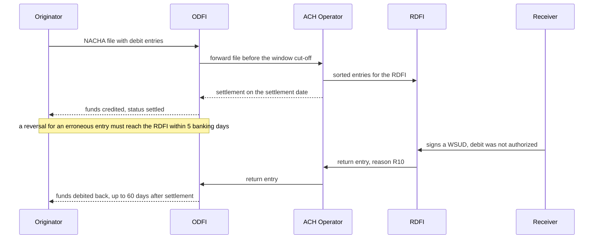
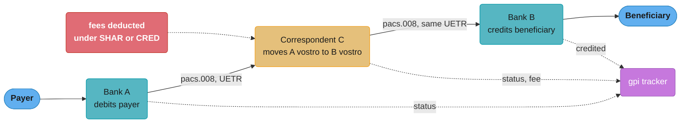

# Bank Rails: ACH, SEPA and Wires

> Rules and figures checked 2026-11-06. Every date, threshold and fee on this page comes from
> the fact pins in fintech/CLAUDE.md, or from a primary source fetched on 2026-11-06 and named
> where it is used (the Nacha ACH file layout). The SEPA rulebook timings and refund rights are
> named on this page but not stated: read them from the current EPC rulebook.

---

## 1. Concept Overview

A bank rail moves money from one bank account to another. Card rails move money too, but a
card network sits between a cardholder's bank and a merchant's bank. A bank rail connects the
two account-holding banks directly, or through one operator in the middle.

Three families of bank rails matter to a payments engineer:

1. **Batch rails.** The sender's bank collects instructions into files, an operator sorts them,
   and settlement happens at set times. ACH in the US, SEPA Credit Transfer (SCT) and SEPA
   Direct Debit (SDD) in the euro area, and Bacs in the UK are batch rails. They are cheap and
   slow, and a debit can come back days or weeks after it settled.
2. **Wire systems.** Each payment settles one at a time, as a large-value transfer between
   banks. Fedwire Funds is a real-time gross settlement (RTGS) system. CHIPS settles payments
   continuously through the day with finality. A wire is fast and final, so a wrong wire is
   very hard to get back.
3. **Correspondent banking over SWIFT.** For a cross-border payment, banks that have no direct
   relationship use a chain of correspondent banks that hold accounts with each other. SWIFT
   carries the instructions between them. SWIFT moves messages, not money: each hop settles
   by debiting and crediting accounts at the banks in the chain.

Instant rails (RTP, FedNow, SEPA Instant, Pix, UPI, UK Faster Payments) are also bank rails.
[Real-Time Payments and Open Banking](../real_time_payments_and_open_banking/real_time_payments_and_open_banking.md)
teaches them. This page holds the section's only rail-selection matrix (§8), and that matrix
includes the instant rails so that one table answers "which rail?".

The questions this page answers: what each rail provides for speed, finality and undo;
which message carries which fact (ISO 20022 `pain`, `pacs` and `camt`); how long the ledger
must treat money from each rail as at risk; and which rail to pick for a given payment.

The wallet top-up and withdrawal flows that run on these rails, with their optimistic credit
and reversal entries, are in
[Design a Digital Wallet §4.4](../../hld/case_studies/design_digital_wallet.md); this page
teaches the rail rules those flows assume and does not repeat the flows.

---

## 2. Intuition

> **One-line analogy:** ACH is the postal sorting run, a wire is an armored car, and SWIFT is
> the phone line between armored-car depots in different countries. The post is cheap and an
> envelope can come back weeks later. The armored car arrives now and does not come back. The
> phone line carries instructions, never cash.

**Mental model.** Every rail answers four questions differently: who starts the payment (the
payer pushes, or the payee pulls), when the banks settle (in a batch at set times, or one
payment at a time), when the payment is final (at settlement, or only after a return window
closes), and what "undo" looks like (a return, a reversal, a recall request, or a new payment
in the other direction). Learn the four answers per rail and the system design follows.

**Why it matters.** A ledger that treats a settled ACH debit as final money can let a customer
spend funds that come back 60 days later as an unauthorized return. A treasury team that
thinks a wire can be recalled learns otherwise, as Citibank did with Revlon's lenders in 2020
(§7). An integration that reads a SWIFT acknowledgement as "the beneficiary has the money"
answers a customer with the wrong fact.

**Key insight.** The settlement time of a rail decides when you can see the money. The return
window decides when you can trust it. Size the hold on incoming funds, and the risk limits on
outgoing debits, from the return window.

---

## 3. Core Principles

1. **A message is not money.** SWIFT and ISO 20022 carry instructions and statuses. Money
   moves only when a settlement agent debits one account and credits another. ISO 20022 is a
   message standard, not a rail.
2. **Settlement model sets liquidity cost.** RTGS settles each payment in full when it is
   processed, so a bank needs liquidity for every payment. Deferred net settlement (DNS) nets
   many payments and settles the net amounts at set times. CHIPS uses a liquidity-saving
   algorithm that matches and offsets payments continuously during the day.
3. **Push and pull carry different risks.** In a credit push, the payer's bank sends money the
   payer has, so the risk is a wrong beneficiary. In a debit pull, the payee's bank takes money
   from the payer, so the risk is an unauthorized or unfunded debit that comes back.
4. **Settled is not final.** An ACH debit settles on its settlement date, but the receiver can
   return an unauthorized consumer debit for 60 days. A wire is final when it settles.
5. **Time is banking days and cut-offs.** A rail runs on its operator's calendar. A missed
   cut-off moves the payment to the next processing date, and a holiday moves every deadline.
6. **Undo is a new entry.** A return, a reversal and a refund each post new ledger entries
   that point at the original. Nothing edits the original entry.
7. **Every hop has a reference.** The ACH trace number, the ISO 20022 `EndToEndId` and the
   UETR let you find one payment across banks. Store each one you receive, and index it.
8. **Rail rules are dated.** Nacha, the Federal Reserve, The Clearing House, SWIFT and the
   EPC change their rules on announced dates. Every limit on this page has a date.

---

## 4. Types / Architectures / Strategies

### 4.1 ACH under the Nacha Rules

The parties in an ACH entry:

| Role | What it does |
|---|---|
| Originator | The company that starts the entry, for example a payroll provider or a biller |
| ODFI | Originating Depository Financial Institution, the Originator's bank. It sends files to an operator and warrants the entries |
| ACH Operator | The central clearing facility. The Federal Reserve runs FedACH and The Clearing House runs EPN |
| RDFI | Receiving Depository Financial Institution, the receiver's bank |
| Receiver | The person or company whose account is credited or debited |

An ACH entry is a credit (push money to the receiver) or a debit (pull money from the
receiver). The Standard Entry Class (SEC) code says what kind of authorization stands behind
the entry. PPD is a consumer entry under a prearranged authorization, CCD is a corporate entry,
and IAT is an international entry. Entries in one batch share one SEC code.

**Same Day ACH.** Same Day ACH settles entries on the day they are submitted, in set windows.
The third window takes files until 4:45 p.m. ET and settles at 6:00 p.m. ET, a schedule in
place since 2021-03-19. The ACH Operators publish the exact schedules, not the Nacha Rules. The
per-entry limit is $1 million since 2022-03-18 and rises to $10 million on 2027-09-17. IAT
entries cannot go Same Day. Same Day ACH is faster batch processing. It is not real time.

**Returns.** An RDFI returns an entry it cannot or must not post, with a return reason code.
For an unauthorized consumer debit, the receiver signs a Written Statement of Unauthorized
Debit (WSUD), and the RDFI can return the entry for 60 days. R10 says the receiver does not
know or did not authorize the Originator. R11 says the entry did not match the authorization
the receiver gave. Each other return reason has its own deadline in the Nacha Rules. This page does
not state them.

**Reversals.** An Originator or ODFI can reverse an erroneous entry. The reversal must reach
the RDFI within 5 banking days after the settlement date of the original entry. An erroneous
entry is a duplicate, a payment to the wrong receiver, the wrong amount, certain PPD credits
after the receiver's employment ends, and, since 2021-06-30, the wrong date. So "ACH has no
recall" is wrong, but a reversal is limited to those errors. It is not a general undo.

**Account checks before the first debit.** A prenote is a zero-dollar entry that tests the
routing and account number. Micro-deposits are two small credits that the receiver confirms.
An open-banking account check reads the account details from the bank with the user's
consent. Each one reduces the number of entries that come back as wrong account.

**Fraud monitoring.** Nacha's fraud monitoring rules took effect in two phases. Phase 1 on
2026-03-20 covered all ODFIs, Originators, Third-Party Service Providers and Third-Party
Senders with 6 million or more entries in 2023, and RDFIs with 10 million or more receipts.
Phase 2 on 2026-06-19 (in practice 2026-06-22) covered all other parties.

### 4.2 SEPA Credit Transfer and SEPA Direct Debit

SEPA is the euro-area set of payment schemes that the European Payments Council (EPC) defines
in rulebooks. SCT is a credit push. SDD is a debit pull with two schemes: SDD Core for
consumers and SDD B2B for businesses. SCT Inst is the instant credit transfer, taught in the
[instant payments module](../real_time_payments_and_open_banking/real_time_payments_and_open_banking.md).

An SDD collection rests on a **mandate**: the debtor's authorization for the creditor to
collect. The creditor stores the mandate, its unique mandate reference, the creditor
identifier, the date of signature and the sequence type (first, recurring, final or one-off),
and sends them with each collection.

The rulebooks set the presentation timings, the debtor's refund rights and the amount rules
for SCT Inst. Those are three topics an interviewer may ask about. This page states no value
for them, because the EPC rulebook is the only source and it changes by rulebook version. A
design must read them from the current rulebook and keep them as configuration with a
version and an effective date.

### 4.3 Wire systems: Fedwire Funds and CHIPS

**Fedwire Funds Service.** The Federal Reserve operates Fedwire Funds as an RTGS system. Its
transfers are "immediate, final, and irrevocable" in the Federal Reserve's words. Fedwire
Funds moved to ISO 20022 in a single-day cutover on 2025-07-14 and retired its older FAIM
format.

**CHIPS.** The Clearing House operates CHIPS, a large-value system with more than $2 trillion
a day. CHIPS gives continuous intraday settlement with finality: a liquidity-saving algorithm
matches and offsets payments during the day, and a payment is final and irrevocable once it is
released and settled. CHIPS has a 21-hour processing window and moved to ISO 20022 on the
2024-04-08 banking day.

The difference matters for liquidity. On Fedwire, each payment settles at its full amount, so
a bank funds it from its Federal Reserve account balance or from Federal Reserve intraday
credit (daylight overdrafts). On CHIPS, the algorithm releases
payments that offset each other, so a bank needs much less liquidity for the same flow.

### 4.4 Correspondent banking and SWIFT

A bank that sends USD to a bank in another country usually has no account with that bank. It
sends the payment through correspondents: banks that hold accounts for each other. The same
account has two names. Your bank calls its account at the correspondent its **nostro** ("ours
with you"). The correspondent calls it a **vostro** ("yours with us").

```text
Payer -> Bank A (Mumbai) -> Correspondent C (New York) -> Bank B (London) -> Beneficiary
          debits payer      debits A's vostro,           credits
                            credits B's vostro           beneficiary
```

SWIFT carries the instruction from each bank to the next. For cross-border payment
instructions between banks (CBPR+), SWIFT ended the coexistence of MT and ISO 20022 on
2025-11-22. The MT 199 and MT 299 free-format messages stay, with no end date.

**SWIFT gpi** adds tracking and a shared reference. Every bank in the chain carries the same
UETR (unique end-to-end transaction reference), so the tracker can show where a payment is
and what each bank deducted. The UETR is the cross-border equivalent of the ACH trace
number: store it on your payment row the moment you create the instruction.

**Charges.** A cross-border payment says who pays the fees: the debtor (`DEBT`), the
creditor (`CRED`), or both shared (`SHAR`). Under shared or creditor charges, intermediaries
can deduct fees on the way, and the beneficiary receives less than was sent. Reconciliation
must expect a short amount on these payments.

**The Travel Rule.** In the US, a funds transfer of $3,000 or more must carry originator and
transmittal information from the transmittor's or intermediary financial institution
(31 CFR 1010.410(f)). The [KYC, AML and sanctions module](../kyc_aml_and_sanctions_screening/kyc_aml_and_sanctions_screening.md)
owns that rule. For a rail integration it means: do not drop or truncate the originator
fields when you map between formats.

### 4.5 ISO 20022 message families

ISO 20022 names messages by business area. A payments engineer meets three areas.

| Message | Name | Who sends it to whom | What it carries |
|---|---|---|---|
| `pain.001` | Customer Credit Transfer Initiation | Company to its bank | One or more payment instructions |
| `pain.002` | Customer Payment Status Report | Bank to company | Accepted or rejected, per instruction |
| `pain.008` | Customer Direct Debit Initiation | Creditor to its bank | Direct debit collections with mandate data |
| `pacs.008` | FI to FI Customer Credit Transfer | Bank to bank | The interbank payment for a customer |
| `pacs.009` | Financial Institution Credit Transfer | Bank to bank | A bank's own transfer, for example cover funding |
| `pacs.002` | FI to FI Payment Status Report | Bank to bank | Accepted, rejected or pending |
| `pacs.004` | Payment Return | Bank to bank | Money sent back, as a new value message |
| `camt.056` | FI to FI Payment Cancellation Request | Bank to bank | A request to cancel or recall, with no value |
| `camt.053` | Bank to Customer Statement | Bank to company | The end-of-day statement |
| `camt.054` | Bank to Customer Debit Credit Notification | Bank to company | One debit or credit as it posts |

A company integrates with `pain` and `camt`. Banks exchange `pacs`. A `camt.056` asks the
receiving bank to send money back. A `pacs.004` is the money coming back.

### 4.6 UK: Bacs and Faster Payments

Bacs is the UK batch rail for payroll and Direct Debit. Faster Payments (FPS) is the UK instant
rail. Since 2024-10-07, PSPs must reimburse authorized push payment (APP) scam victims on
Faster Payments, up to GBP 85,000 per claim, and the Bank of England set the same for CHAPS,
the UK RTGS system. The instant payments module owns the details.

---

## 5. Architecture Diagrams

### 5.1 ACH debit lifecycle and its risk windows



The Originator sees "settled" long before the debit is safe. The return arrives through the
same operator, as a new entry that debits the Originator's account.

### 5.2 The time a debit stays at risk

```
ACH consumer debit, settlement on day 0 (banking days B, calendar days C)

day 0          B+5                                              C+60
  |-------------|------------------------------------------------|------->
  settled       reversal window for the       R10 / R11 return     debit
  (visible)     Originator's own errors       window for the       no longer
                closes                        receiver             returnable
                                                                   for those
  <---- hold or limit sized from here to here, not from day 0 ---->

Fedwire, settlement at time t:  t is final. Nothing after t is a rail undo.
```

The left edge is when the ledger can see the money. The right edge is when the ledger can
trust it. For a wire the two edges are the same instant.

### 5.3 A cross-border payment through correspondents



The solid arrows carry instructions. Money moves inside each bank's books. The dotted arrows
are status updates that share one UETR, which is how a support agent answers "where is my
payment?".

---

## 6. How It Works - Detailed Mechanics

### 6.1 A NACHA file

A NACHA file is fixed-width text. Each line is exactly 94 characters. The record types are 1
(file header), 5 (batch header), 6 (entry detail), 7 (addenda), 8 (batch control) and 9 (file
control). Files have a blocking factor of 10: the line count must be a multiple of 10, and
lines of `9` fill the last block. The transaction code on each entry says the direction and
account type: 22 is a checking credit, 27 a checking debit, 32 a savings credit and 37 a
savings debit. (Source: Nacha ACH Developer Guide, file overview page, fetched 2026-11-06.)

```text
1  file header           one per file
5    batch header        one per batch: company, SEC code, effective entry date
6      entry detail      one per payment: transaction code, routing, account, amount, trace
7        addenda         optional, remittance or return detail
6      entry detail
8    batch control       entry count, hash, debit and credit totals for the batch
9  file control          batch count, block count, entry count, totals for the file
9999...9999              padding lines to fill the last block of 10
```

The program below builds the padding and the block count. A file whose line count is not a
multiple of 10, or whose control totals do not match its entries, is rejected by the operator.

```java
import java.util.ArrayList;
import java.util.List;

public class NachaBlocking {
    static final int RECORD_LENGTH = 94;
    static final int BLOCKING_FACTOR = 10;

    record Padded(List<String> lines, int blockCount) {}

    static Padded pad(List<String> records) {
        for (String r : records) {
            if (r.length() != RECORD_LENGTH) {
                throw new IllegalArgumentException("record is " + r.length() + " chars: " + r.charAt(0));
            }
        }
        List<String> out = new ArrayList<>(records);
        String filler = "9".repeat(RECORD_LENGTH);
        while (out.size() % BLOCKING_FACTOR != 0) out.add(filler);
        return new Padded(out, out.size() / BLOCKING_FACTOR);
    }

    static String record(char type) {
        return type + " ".repeat(RECORD_LENGTH - 1);
    }

    public static void main(String[] args) {
        List<String> recs = List.of(record('1'), record('5'), record('6'), record('6'),
                record('6'), record('8'), record('9'));
        Padded p = pad(recs);
        System.out.println("records=" + recs.size() + " lines=" + p.lines().size()
                + " blocks=" + p.blockCount());
        assert p.lines().size() == 10 && p.blockCount() == 1;
    }
}
```

Output: `records=7 lines=10 blocks=1`. The file control record must carry the same block count.

### 6.2 Same Day ACH eligibility

An entry can go in the third Same Day ACH window only if it is not IAT, its amount is within
the per-entry limit on the processing date, and the file reaches the operator by 4:45 p.m. ET.
The limit changes on 2027-09-17, so the check reads the date, not a constant. The first and
second window times are on the operators' schedules and are not used here.

```java
import java.time.LocalDate;
import java.time.LocalTime;
import java.time.ZoneId;
import java.time.ZonedDateTime;

public class SameDayAch {
    static final ZoneId ET = ZoneId.of("America/New_York");
    static final LocalTime THIRD_WINDOW_CUTOFF = LocalTime.of(16, 45);
    static final LocalDate TEN_MILLION_FROM = LocalDate.of(2027, 9, 17);

    record Entry(String secCode, long amountCents) {}

    static long perEntryLimitCents(LocalDate processingDate) {
        return processingDate.isBefore(TEN_MILLION_FROM) ? 1_000_000_00L : 10_000_000_00L;
    }

    static boolean fitsThirdWindow(Entry e, ZonedDateTime submittedAt) {
        ZonedDateTime et = submittedAt.withZoneSameInstant(ET);
        return !e.secCode().equals("IAT")
                && e.amountCents() <= perEntryLimitCents(et.toLocalDate())
                && !et.toLocalTime().isAfter(THIRD_WINDOW_CUTOFF);
    }

    public static void main(String[] args) {
        ZonedDateTime utc2130 = ZonedDateTime.of(2026, 11, 6, 21, 30, 0, 0, ZoneId.of("UTC"));
        ZonedDateTime utc2200 = utc2130.plusMinutes(30);
        Entry payroll = new Entry("PPD", 2_500_00L);
        Entry big = new Entry("CCD", 1_500_000_00L);

        assert fitsThirdWindow(payroll, utc2130);          // 4:30 p.m. ET
        assert !fitsThirdWindow(payroll, utc2200);         // 5:00 p.m. ET, too late
        assert !fitsThirdWindow(big, utc2130);             // $1.5M over the 2026 limit
        assert !fitsThirdWindow(new Entry("IAT", 100_00L), utc2130);

        ZonedDateTime after = ZonedDateTime.of(2027, 9, 17, 14, 0, 0, 0, ET);
        assert fitsThirdWindow(big, after);                // $10M limit applies
        System.out.println("same day checks pass");
    }
}
```

The time zone conversion matters: 21:30 UTC on 2026-11-06 is 4:30 p.m. ET because US daylight
time ended on 2026-11-01. A check written against a fixed UTC offset is wrong for half the year.

### 6.3 Storing entries, returns and the open risk

The table keeps one row per entry with its trace number. A return is a separate row that
points at the entry, and the ledger posts it as a new journal entry.

```sql
CREATE TABLE ach_entry (
    trace_number  text PRIMARY KEY,
    direction     text   NOT NULL CHECK (direction IN ('debit', 'credit')),
    sec_code      text   NOT NULL,
    amount_cents  bigint NOT NULL CHECK (amount_cents > 0),
    settled_on    date,
    status        text   NOT NULL CHECK (status IN ('submitted', 'settled', 'returned', 'reversed'))
);

CREATE TABLE ach_return (
    trace_number  text PRIMARY KEY REFERENCES ach_entry (trace_number),
    reason_code   text NOT NULL CHECK (reason_code ~ '^R[0-9]{2}$'),
    received_on   date NOT NULL
);

INSERT INTO ach_entry VALUES
    ('091000010000001', 'debit',  'PPD', 120000, '2026-09-15', 'settled'),
    ('091000010000002', 'debit',  'PPD',  45000, '2026-10-20', 'settled'),
    ('091000010000003', 'credit', 'CCD', 900000, '2026-10-30', 'settled'),
    ('091000010000004', 'debit',  'PPD',  30000, '2026-08-15', 'settled');

-- consumer debits that a receiver can still return as unauthorized on 2026-11-06
SELECT trace_number, amount_cents, settled_on,
       settled_on + 60 AS r10_window_closes
FROM   ach_entry
WHERE  direction = 'debit'
  AND  sec_code = 'PPD'
  AND  status = 'settled'
  AND  DATE '2026-11-06' <= settled_on + 60
ORDER  BY settled_on;
```

The query returns the two debits that settled on 2026-09-15 and 2026-10-20. Their total,
$1,650.00, is money the Originator has received and can still lose. The 2026-08-15 debit is
past its 60-day window.

### 6.4 A pacs.008 with its references

The fields a payments engineer reads first in an interbank credit transfer: the references,
the amount and settlement date, the charge bearer, and the parties. This is an illustrative,
shortened message.

```xml
<FIToFICstmrCdtTrf>
  <GrpHdr>
    <MsgId>BANKUS33-20261106-000417</MsgId>
    <CreDtTm>2026-11-06T14:02:11-05:00</CreDtTm>
    <NbOfTxs>1</NbOfTxs>
    <SttlmInf><SttlmMtd>INDA</SttlmMtd></SttlmInf>
  </GrpHdr>
  <CdtTrfTxInf>
    <PmtId>
      <InstrId>A-417</InstrId>
      <EndToEndId>INV-2026-1142</EndToEndId>
      <UETR>8a562c67-ca16-48ba-b074-65581be6f001</UETR>
    </PmtId>
    <IntrBkSttlmAmt Ccy="USD">250000.00</IntrBkSttlmAmt>
    <IntrBkSttlmDt>2026-11-06</IntrBkSttlmDt>
    <ChrgBr>SHAR</ChrgBr>
    <Dbtr><Nm>Example Importer Ltd</Nm></Dbtr>
    <DbtrAgt><FinInstnId><BICFI>BANKUS33XXX</BICFI></FinInstnId></DbtrAgt>
    <CdtrAgt><FinInstnId><BICFI>BANKGB2LXXX</BICFI></FinInstnId></CdtrAgt>
    <Cdtr><Nm>Example Supplier plc</Nm></Cdtr>
    <RmtInf><Ustrd>Invoice 1142</Ustrd></RmtInf>
  </CdtTrfTxInf>
</FIToFICstmrCdtTrf>
```

`EndToEndId` is the payer's own reference and travels unchanged to the beneficiary. `UETR`
identifies the payment across every bank. `MsgId` and `InstrId` change at each hop. Match
your ledger on `EndToEndId` and the UETR, never on `MsgId`.

### 6.5 Value date, booking date and the cut-off

A payment instruction that misses a cut-off still gets booked by the bank, but its value date
moves to the next processing date. Three dates then differ: the date your ledger recorded the
instruction, the bank's booking date and the value date from which the money counts. The
[business days and cut-offs file](../case_studies/cross_cutting/business_days_cutoffs_and_value_dates.md)
owns the calendar arithmetic. For rail code, two rules are enough: keep all three dates on the
payment row, and compute deadlines with the operator's banking-day calendar (§10.2).

---

## 7. Real-World Examples

**Citibank and Revlon's lenders (2020).** Citibank meant to send Revlon's lenders about $7.8
million of interest. On 2020-08-11 it sent $894 million of principal plus the $7.8 million.
About $385 million came back. Lenders holding about $500 million refused, and the defendants
in the case had received $558,558,375.74. The district court first let the lenders keep the
money. The Second Circuit decided on 2022-09-08 to vacate and remand, holding that the
discharge-for-value defense did not apply. The rail did what it promised: the transfers were
final. Recovery needed a lawsuit, and the appeal took two years.

**Fedwire's single-day ISO 20022 cutover.** Fedwire Funds moved every participant to ISO 20022
on 2025-07-14 in one day and retired the FAIM format. A bank or vendor that could not send
the new format could not send wires.

**SWIFT CBPR+ end of coexistence.** On 2025-11-22 SWIFT ended MT and ISO 20022 coexistence for
cross-border payment instructions. Integrations that had kept MT 103 output behind a
translation layer had to send ISO 20022. The MT 199 and MT 299 free-format messages stay.

**CHIPS on ISO 20022.** CHIPS moved to ISO 20022 on the 2024-04-08 banking day, more than a
year before Fedwire. A US bank that sends both had two cutover projects.

**Nacha fraud monitoring.** The 2026 phases put fraud monitoring duties on every ODFI, large
Originators and processors, and large RDFIs, with the second phase reaching all other
parties on 2026-06-19. A platform that originates ACH debits for its customers is in scope
in one of the two phases.

**Wallet top-up and withdrawal.** The
[digital wallet study](../../hld/case_studies/design_digital_wallet.md) runs top-up on ACH
debits and withdrawal on ACH credits, with an optimistic credit and a reversal entry when the
return arrives. The risk window it designs for is the 60-day R10 and R11 window in §4.1.

---

## 8. Tradeoffs

### 8.1 Rail selection matrix

This is the section's only rail matrix. Other pages link here. Costs are relative and
illustrative, because fees are set by each bank's price list, not by the rail rules.

| Rail | Max per payment | When it settles | Final for the payer | Undo path | Cut-off | Relative cost (illustrative) |
|---|---|---|---|---|---|---|
| ACH (standard) | Not stated here. The ODFI sets exposure limits | A later banking day, on the operator's schedule | Credit: yes, apart from reversals of erroneous entries. Debit: the receiver can return it for 60 days if unauthorized | Return, or a reversal within 5 banking days | Operator schedule | Lowest |
| Same Day ACH | $1M per entry, $10M from 2027-09-17 | Same banking day. Third window settles 6:00 p.m. ET | As ACH | As ACH | Third window 4:45 p.m. ET | Low |
| Fedwire Funds | Not stated here | Real time, gross, one payment at a time | Immediate, final and irrevocable | A new payment from the receiver, only if it agrees | Fedwire operating schedule | High |
| CHIPS | Not stated here | Continuous intraday, through the liquidity-saving algorithm | Final once released and settled | A new payment from the receiver | 21-hour processing window | High |
| SWIFT cross-border | Each bank's own limits | Each hop settles in its own books | Per hop, final at each correspondent | `camt.056` recall request, then a `pacs.004` if the receiver agrees | Each correspondent's cut-off | Highest, fees deducted on route |
| SEPA SCT and SDD | Set by the EPC rulebook (not stated here) | Rulebook timings (not stated here) | SCT: credit push. SDD: the debtor has refund rights under the rulebook | Rulebook R-transactions | Rulebook and bank cut-offs | Low |
| RTP | $10M since 2025-02-09. Participants may set lower | Seconds, 24x7 | Final and irrevocable | Request for return, then a new payment | None, 24x7 | Low to medium |
| FedNow | $10M since 2025-11-12. Participants may set lower | Seconds, 24x7x365 | Final | Request for return (no value), then a return (`pacs.004`) | None, 24x7x365 | Low to medium |
| UK Faster Payments | Not stated here | Instant | Final | No rail undo. APP scam reimbursement up to GBP 85,000 per claim | None | Low |

How to read it for a decision, in order:

1. Filter by amount: a $1.5M payment cannot use Same Day ACH before 2027-09-17.
2. Filter by deadline: Same Day ACH settles only in its windows (the third settles at
   6:00 p.m. ET), so money needed earlier or later than a window needs a wire or an
   instant rail.
3. Filter by reach: an instant rail works only if the receiver's bank participates and its
   own limit allows the amount.
4. Pick by undo: for a debit pull, size the hold from the return window. For a high-value
   credit push, add a second approver, because no rail undo exists.
5. Pick by cost among what is left.

### 8.2 Push vs pull

| | Credit push (ACH credit, SCT, wire) | Debit pull (ACH debit, SDD) |
|---|---|---|
| Who starts it | The payer's bank, on the payer's instruction | The payee's bank, on the payee's instruction |
| Main risk | Wrong beneficiary, fraud by social engineering | Unauthorized or unfunded debit that comes back |
| Who carries the return risk | The payer, through a recall request | The payee and its bank |
| Good for | Payouts, payroll, supplier payments | Subscriptions, bills, account funding |

### 8.3 Batch vs RTGS vs continuous offset

| | Batch with DNS (ACH, Bacs) | RTGS (Fedwire Funds) | Continuous offset (CHIPS) |
|---|---|---|---|
| Liquidity per payment | Net position only, at settlement times | Full amount at send time, from balance or intraday credit | Much less than gross, because offsets release payments |
| Finality | At settlement, subject to returns for debits | At settlement | Once released and settled |
| Typical size | Small and many | Large | Large |
| Failure mode | A late file waits for the next window | A bank without liquidity queues its payments | A payment waits for an offset or for funding |

---

## 9. When to Use / When NOT to Use

**Use ACH or SEPA batch rails when:**
- The payment is recurring and small, and a day or two is fine: payroll, bills, subscriptions.
- You can hold incoming debit funds for the return window, or you accept that loss.
- Cost per payment matters more than speed.

**Do not use ACH debits when:**
- You will release goods or cash at settlement and cannot recover them later. A settled
  consumer debit can come back for 60 days.
- The amount is above the Same Day ACH per-entry limit and the money must arrive today.

**Use a wire when:**
- The amount is large, the deadline is today, and the receiver must have final funds, for
  example a property closing or a securities settlement.
- Finality is the point and you have controls before release (dual approval, a call-back to a
  known number).

**Do not use a wire when:**
- The payment is small and frequent. Fees and the cost of each manual approval add up.
- The beneficiary details came from an email you cannot confirm. A wire to a fraudster is
  final.

**Use SWIFT correspondent payments when:**
- The currency or the country has no domestic rail you can reach, and no local payout partner.

**Do not use SWIFT correspondent payments when:**
- A local rail is available through a payout partner. Each hop adds a fee and a day of
  uncertainty, and fees deducted on route break exact-amount reconciliation.

---

## 10. Common Pitfalls

### 10.1 Releasing funds when an ACH debit settles

An illustrative case: a brokerage app credits a user's buying power when the ACH debit from the
user's bank settles. A fraud ring opens accounts with stolen bank credentials, buys and
withdraws, and the real account holders sign WSUDs. The R10 returns arrive weeks later. The
app treated settlement as finality.

```java
// BROKEN
import java.time.LocalDate;

public class AchHoldBroken {
    record Debit(long amountCents, LocalDate settledOn) {}

    static long spendableCents(Debit d, LocalDate today) {
        return today.isBefore(d.settledOn()) ? 0 : d.amountCents();   // settled means spendable
    }

    public static void main(String[] args) {
        Debit d = new Debit(500_000L, LocalDate.of(2026, 11, 2));
        System.out.println(spendableCents(d, LocalDate.of(2026, 11, 3)));
        // prints 500000: all $5,000 is spendable one day after settlement
    }
}
```

The fix keeps a risk-based share of the debit unavailable until the return window closes. The
share is a product and risk decision (here an illustrative 80% held for a new user), not a
rail rule. The 60-day window is the rail rule.

```java
// FIX
import java.time.LocalDate;

public class AchHoldFixed {
    static final int RETURN_WINDOW_DAYS = 60;

    record Debit(long amountCents, LocalDate settledOn) {}

    static long spendableCents(Debit d, LocalDate today, int heldPercent) {
        if (today.isBefore(d.settledOn())) return 0;
        if (!today.isBefore(d.settledOn().plusDays(RETURN_WINDOW_DAYS))) return d.amountCents();
        long held = Math.multiplyExact(d.amountCents(), heldPercent) / 100;
        return d.amountCents() - held;
    }

    public static void main(String[] args) {
        Debit d = new Debit(500_000L, LocalDate.of(2026, 11, 2));
        long early = spendableCents(d, LocalDate.of(2026, 11, 3), 80);
        long late = spendableCents(d, LocalDate.of(2027, 1, 1), 80);
        System.out.println(early + " " + late);
        assert early == 100_000L && late == 500_000L;
    }
}
```

### 10.2 Counting reversal days on the calendar

An illustrative case: an operations tool computes the Nacha reversal deadline as settlement
date plus 5 calendar days. A duplicate payroll file settles on Wednesday 2026-11-25, the day
before Thanksgiving. The tool says the window closed on Monday 2026-11-30 and blocks the
reversal on Tuesday. The real deadline is 5 banking days later, Thursday 2026-12-03. The
company pays the duplicate and chases 400 employees for the money.

```java
// BROKEN
import java.time.LocalDate;

public class ReversalDeadlineBroken {
    static LocalDate deadline(LocalDate settledOn) {
        return settledOn.plusDays(5);
    }

    public static void main(String[] args) {
        System.out.println(deadline(LocalDate.of(2026, 11, 25)));
        // prints 2026-11-30: three banking days too early
    }
}
```

The fix walks the operator calendar. The holiday set here is an input for the example; a real
system loads the operator's published holiday calendar each year.

```java
// FIX
import java.time.DayOfWeek;
import java.time.LocalDate;
import java.util.Set;

public class ReversalDeadline {
    static final Set<LocalDate> HOLIDAYS = Set.of(LocalDate.of(2026, 11, 26), LocalDate.of(2026, 12, 25));

    static boolean isBankingDay(LocalDate d) {
        return d.getDayOfWeek() != DayOfWeek.SATURDAY
                && d.getDayOfWeek() != DayOfWeek.SUNDAY
                && !HOLIDAYS.contains(d);
    }

    static LocalDate addBankingDays(LocalDate from, int n) {
        LocalDate d = from;
        while (n > 0) {
            d = d.plusDays(1);
            if (isBankingDay(d)) n--;
        }
        return d;
    }

    public static void main(String[] args) {
        LocalDate deadline = addBankingDays(LocalDate.of(2026, 11, 25), 5);
        System.out.println(deadline);
        assert deadline.equals(LocalDate.of(2026, 12, 3));
    }
}
```

### 10.3 Reading a SWIFT acknowledgement as "paid"

A SWIFT network acknowledgement says the message reached SWIFT. A `pacs.002` with status
accepted says the next bank accepted the instruction. Neither says the beneficiary has the
funds. Only the last bank's credit, shown in the gpi tracker or in the beneficiary's
statement, says that. Map each status to a distinct ledger and UI state.

### 10.4 Losing remittance and originator data in format mapping

A team translates ISO 20022 into an older internal format with a 140-character remittance
field and a 35-character name field. Invoice numbers get cut, so receivables cannot match
payments, and the originator address is dropped, which breaks the Travel Rule duty for
transfers of $3,000 or more. Store the full ISO 20022 message next to the parsed row, and
widen the internal fields before the cutover, not after.

### 10.5 Treating a reversal as a general undo

A support agent reverses an ACH credit because the customer "changed their mind". Nacha
permits reversals only for erroneous entries: duplicate, wrong receiver, wrong amount, certain
PPD credits after termination, and wrong date. A reversal for another reason breaks the rules
and the RDFI can return it. Put the allowed reasons in an enum, and make the reversal API
reject everything else.

### 10.6 Wiring to changed bank details

An illustrative case: a supplier's "new bank details" arrive by email from a look-alike domain.
Accounts payable updates the vendor record and sends a $240,000 wire. The wire is final.
Treat any change of beneficiary account as a high-risk event: confirm it through a known
channel, hold the first payment to the new account, and require a second approver.

---

## 11. Technologies & Tools

| Tool | What it does for bank-rail work |
|---|---|
| FedACH | The Federal Reserve's ACH Operator. Publishes the Same Day ACH processing schedules |
| EPN | The Clearing House's ACH Operator, the second US ACH clearing facility |
| Fedwire Funds Service | The Federal Reserve's RTGS wire system, on ISO 20022 since 2025-07-14 |
| SWIFT gpi | Cross-border tracking with a shared UETR, and fee and status updates from each bank |
| Moov ACH | Open-source library that reads, writes and validates NACHA files |
| Modern Treasury | Payment operations API over bank connections: ACH, wires, ledgers and reconciliation |
| Plaid Auth | Returns account and routing numbers from a user's bank login, an alternative to micro-deposits |

---

## 12. Interview Questions with Answers

**Q: Does SWIFT move money between banks?**
**Short:** No. SWIFT carries payment instructions and statuses, and money moves only when banks debit and credit accounts they hold for each other.

SWIFT is a messaging network. A cross-border payment settles hop by hop: each bank in the chain
debits the account of the bank before it and credits the account of the bank after it, as
nostro and vostro entries. ISO 20022 is the message format. Neither is a rail by itself. In
an interview, separate the message path from the settlement path in your diagram.

**Q: Is Same Day ACH a real-time payment?**
**Short:** No. Same Day ACH settles entries in set windows on the day they are submitted, so it is faster batch processing, not real time.

The third window takes files until 4:45 p.m. ET and settles at 6:00 p.m. ET. A payment
submitted after the last cut-off waits for the next banking day. Same Day ACH also keeps the
ACH return rules, so a same-day debit can still come back as unauthorized for 60 days. For
seconds-level settlement, use RTP or FedNow.

**Q: Can an Originator undo an ACH entry after it settles?**
**Short:** Yes, but only for an erroneous entry, and the reversal must reach the RDFI within 5 banking days after the original settlement date.

Nacha defines an erroneous entry as a duplicate, a payment to the wrong receiver, the wrong
amount, certain PPD credits after the receiver's employment ends, and, since 2021-06-30, the
wrong date. A reversal is a new entry in the opposite direction. "ACH has no recall" is wrong,
and "ACH can undo anything" is also wrong. Encode the allowed reasons, and compute the
deadline with the operator's banking-day calendar.

**Q: When can a company treat money from an ACH debit it originated as safe?**
**Short:** Only after the return window for the entry closes, which is 60 days for an unauthorized consumer debit returned with a signed WSUD.

Settlement makes the money visible, not final. The receiver can sign a Written Statement of
Unauthorized Debit, and the RDFI returns the entry with R10 or R11 for up to 60 days. Many
platforms hold a share of each debit, or limit spending for new users, until that window
passes. Size the hold from the window, and post the return as a new ledger entry when it
arrives.

**Q: How do Fedwire Funds and CHIPS differ in how they settle?**
**Short:** Fedwire settles each payment gross and in real time, while CHIPS offsets payments continuously during the day and settles each with finality once released.

Fedwire Funds is an RTGS system, and its transfers are immediate, final and irrevocable. Each
payment settles at its full amount, funded from the sender's Federal Reserve account balance
or intraday credit. CHIPS uses a
liquidity-saving algorithm that matches and offsets payments, so a bank needs less liquidity
for the same flow. CHIPS has a 21-hour processing window and handles more than $2 trillion a
day. Do not call CHIPS end-of-day netting.

**Q: Why is a wrong wire so hard to get back?**
**Short:** A wire is final and irrevocable when it settles, so the only path back is a new payment from the receiver, who may refuse to send it.

Citibank sent $894 million of Revlon loan principal by mistake on 2020-08-11 when it meant to
send about $7.8 million of interest. About $385 million came back. Lenders holding about $500
million refused, and recovery needed litigation that ran to a Second Circuit decision on
2022-09-08. Put the controls before release: a second approver, a maker-checker screen that
shows the amount in words, and limits per operator.

**Q: What is the difference between a return, a reversal and a refund?**
**Short:** A return is the receiving bank sending an entry back, a reversal undoes an erroneous entry through the rail, and a refund is a new payment from the merchant.

The receiving bank starts a return because it cannot or must not post the entry (closed
account, unauthorized debit). The sender starts a reversal for its own error, inside the
rail's rules. A refund is a business decision outside the rail. All three post new ledger
entries that point at the original. The ledger must keep the three apart, because each has
different fees, deadlines and dispute paths.

**Q: Which party carries the risk in a credit push and in a debit pull?**
**Short:** In a push the payer carries the risk of a wrong or fraudulent beneficiary. In a pull the payee carries the risk that the debit comes back.

A credit push only sends money the payer has, so it cannot bounce for lack of funds, but a
payer tricked into paying a fraudster has no rail undo. A debit pull lets the payee start the
payment, so the payer's bank can return it for insufficient funds or no authorization. Pick
push for payouts and pull for collections, and design the risk controls for the side that
carries the loss.

**Q: Is ISO 20022 a payment rail?**
**Short:** No. ISO 20022 is a message standard that many rails use, including Fedwire Funds, CHIPS and cross-border payments between banks over SWIFT.

The standard defines message families: `pain` between a customer and its bank, `pacs` between
banks, and `camt` for statements, notifications and cancellation requests. Two rails can both
send a `pacs.008` and still have different settlement models, limits and cut-offs. Say "the
rail" for the settlement system and "the message" for the format.

**Q: Which ISO 20022 messages does a company integrate with, and which stay between banks?**
**Short:** A company sends pain.001 and receives pain.002, camt.053 and camt.054. Banks exchange pacs.008, pacs.002, pacs.004 and camt.056 among themselves.

`pain.001` carries the company's payment instructions and `pain.002` the bank's accept or
reject per instruction. `camt.054` reports each debit or credit as it posts, and `camt.053` is
the end-of-day statement. Interbank messages show up in the company's world only as
references, such as the UETR and the `EndToEndId` that the bank copies into the statement.
Reconcile on those references.

**Q: What does the UETR give a payments team?**
**Short:** One reference that every bank in a cross-border chain carries, so you can track the payment and match statuses and fees from each hop.

Without it, each bank uses its own message id, and support has to phone each correspondent.
With SWIFT gpi, the tracker reports each hop's status and deductions against the UETR. Store
the UETR on the payment row when you create the instruction, index it, and put it in every
customer support view.

**Q: Why does a cross-border payment arrive short?**
**Short:** Under shared or creditor charges, intermediary banks deduct their fees from the amount on the way, so the beneficiary receives less than was sent.

The charge bearer field says who pays: `DEBT` for the debtor, `CRED` for the creditor, `SHAR`
for shared. Under `SHAR` or `CRED`, each correspondent can take a fee. A receivables system
that matches on exact amount marks these payments as breaks. Match on the reference first,
then book the difference to a bank-fee account within a tolerance.

**Q: What are nostro and vostro accounts?**
**Short:** They are the same correspondent account seen from each side: your bank calls it "ours with you", and the bank that holds it calls it "yours with us".

A bank holds nostro balances in each currency it pays in, at a correspondent in that
currency's country. Those balances must be funded before payments go out, which ties up cash.
That is why treasury forecasts nostro needs per currency and per day, as
[Treasury, Liquidity and FX Operations](../treasury_liquidity_and_fx_operations/treasury_liquidity_and_fx_operations.md)
explains.

**Q: What does a NACHA file look like?**
**Short:** It is fixed-width text with 94-character records: a file header, batches with entry details and addenda, batch controls and a file control, padded to blocks of 10.

The record types are 1, 5, 6, 7, 8 and 9. Each batch shares one SEC code. Control records hold
counts and totals that must match the entries, and the line count must be a multiple of 10.
Transaction codes say the direction and account type, for example 22 for a checking credit
and 27 for a checking debit. Generate files with a library and test the control totals.

**Q: How do you check a bank account before the first debit or payout?**
**Short:** Use a prenote, micro-deposits that the user confirms, or an open-banking account check, before money moves to or from a new account.

A prenote is a zero-dollar entry that tests the routing and account numbers. Micro-deposits
also prove the user can see the account. An open-banking check reads the account details from
the bank with the user's consent while the user waits. Each check cuts wrong-account returns, and
the open-banking and micro-deposit checks also show control of the account.

**Q: What must a creditor store for a SEPA Direct Debit mandate?**
**Short:** The mandate reference, the creditor identifier, the debtor's account, the signature date and the sequence type, sent with every collection.

The mandate is the debtor's authorization. Without it, the creditor cannot prove that the
debtor authorized the collection. The EPC rulebook sets the presentation timings and the debtor's refund rights. This
page states no value for them because they come from the rulebook version in force. Keep them
as versioned configuration, not constants in code.

**Q: Which entries can go in the third Same Day ACH window?**
**Short:** Non-IAT entries within the per-entry limit, in a file that reaches the operator by 4:45 p.m. ET. The limit is $1 million and rises to $10 million on 2027-09-17.

The third window settles at 6:00 p.m. ET and has done so since 2021-03-19. IAT entries cannot
go Same Day. The ACH Operators publish the exact schedules. Code the limit as a dated rule
and convert submission times to America/New_York, not to a fixed offset.

**Q: What happens when a payment misses a cut-off?**
**Short:** The bank books it, but its value date moves to the next processing date, so the instruction, booking and value dates all differ.

Downstream, the receiver sees the money a day later, an interest calculation uses the later
date, and a reconciliation that expects same-day value marks a break. Keep all three dates on
the payment, show the expected value date to the user before they confirm, and alert
operations when a high-value payment is close to a cut-off.

**Q: Who did Nacha's 2026 fraud monitoring rules cover, and when?**
**Short:** Phase 1 on 2026-03-20 covered all ODFIs plus large Originators, processors and RDFIs. Phase 2 on 2026-06-19 covered all other parties.

The phase 1 threshold for Originators, Third-Party Service Providers and Third-Party Senders
was 6 million or more entries in 2023, and for RDFIs 10 million or more receipts. The
practical phase 2 date was 2026-06-22. A platform that originates debits for its customers
needs fraud monitoring on what it sends, with records that its ODFI can audit.

**Q: Which rail would you use for a $2 million supplier payment that must arrive today at 5:30 p.m. ET?**
**Short:** A wire, or RTP or FedNow if the supplier's bank participates and allows the amount, because Same Day ACH caps an entry at $1 million and its third window settles at 6:00 p.m. ET.

Walk the matrix in §8: the amount removes Same Day ACH before 2027-09-17, and a 6:00 p.m. ET
settlement misses the 5:30 p.m. deadline anyway. RTP and FedNow allow up to $10 million, but each participant can set a lower limit,
and the receiving bank must be on the network. Fedwire Funds settles gross and final. Add
dual approval, because none of these rails has an undo.

**Q: What changed for banks when SWIFT ended MT coexistence for CBPR+?**
**Short:** Since 2025-11-22, cross-border payment instructions between banks go as ISO 20022 messages, not MT. MT 199 and MT 299 free-format messages stay.

A bank or fintech that produced MT 103 messages behind a converter had to send `pacs.008`
natively, with structured addresses and longer remittance fields. The richer data helps
sanctions screening and matching, but only if internal systems keep it. Plan field widths
and storage for the full ISO 20022 content.

---

## 13. Best Practices

1. Store every rail reference (trace number, `EndToEndId`, UETR) on the payment row and index
   it.
2. Size holds and debit limits from the return window, not from the settlement date.
3. Compute rail deadlines with the operator's banking-day calendar, loaded per year.
4. Keep rail rules (limits, windows, cut-offs) as dated configuration with an effective date.
5. Post returns, reversals and refunds as new ledger entries that point at the original.
6. Check a new bank account before the first debit or payout.
7. Put dual approval and a call-back check in front of every wire and every change of
   beneficiary details.
8. Keep the full ISO 20022 message next to the parsed fields.
9. Map each status (network ack, `pacs.002` accepted, credited) to its own state.
10. Pick the rail with the matrix in §8.1, and record the reason on the payment.

---

## 14. Case Study

**Scenario.** A US marketplace pays sellers and collects fees from them (assumptions: 40,000
sellers, 60,000 payouts a day, a median payout of $310, and some payouts above $1 million a
month for large sellers). Payouts run as ACH credits from one ODFI. Large sellers ask for
same-day funds. Seller fee collection runs as ACH debits.

**Rail choice per payout.** The team uses the matrix:

| Payout | Rail | Why |
|---|---|---|
| Up to $1M, submitted by 4:45 p.m. ET | Same Day ACH credit | Low cost, same-day settlement |
| Up to $1M, after the cut-off, urgent | RTP or FedNow if the seller's bank participates | 24x7 settlement, up to each participant's limit |
| Above $1M, today | Fedwire | Same Day ACH limit until 2027-09-17 |
| Everything else | Standard ACH credit | Lowest cost |

**Fee collection.** The fee debits are CCD entries. The 60-day WSUD window covers consumer
debits. Corporate entries have their own return rules, which this page does not state, so the
ledger keeps a fee receivable open until the return deadline for each entry passes.

**The incident.** The file transfer to the ODFI timed out. The scheduler did not know if the
bank had received the file, so it rebuilt the file from the payout table and sent it again.
Both files settled. 11,800 sellers were paid twice (illustrative). The team reversed the
duplicates as erroneous entries inside the 5-banking-day window, but 140 reversals came back
because the sellers had already moved the money.

The root cause was that the payout table did not hold one row per rail instruction with a
key that a rebuilt file would reuse.

```sql
-- BROKEN
CREATE TABLE payout_instruction_broken (
    payout_id    bigint NOT NULL,
    file_id      text   NOT NULL,
    amount_cents bigint NOT NULL
);

-- first file, then a rebuilt file after the timeout
INSERT INTO payout_instruction_broken VALUES (9001, 'F-0612-A', 31000), (9002, 'F-0612-A', 54000);
INSERT INTO payout_instruction_broken VALUES (9001, 'F-0612-B', 31000), (9002, 'F-0612-B', 54000);

SELECT payout_id, count(*) AS instructions
FROM   payout_instruction_broken
GROUP  BY payout_id
ORDER  BY payout_id;
-- 9001 | 2
-- 9002 | 2   both payouts go out twice
```

The fix gives each payout one rail instruction, keyed by the payout, with the trace number
assigned once. A rebuilt file reads the existing instructions and gets the same trace
numbers, and the ODFI's duplicate check can see them. The file-level question "did the bank
get it?" is answered by querying the bank's file status before any resend, as
[Idempotency and Exactly-Once Money Movement](../idempotency_and_exactly_once_money_movement/idempotency_and_exactly_once_money_movement.md)
teaches.

```sql
CREATE TABLE payout_instruction (
    payout_id     bigint PRIMARY KEY,
    trace_number  text   NOT NULL UNIQUE,
    first_file_id text   NOT NULL,
    amount_cents  bigint NOT NULL CHECK (amount_cents > 0)
);

INSERT INTO payout_instruction VALUES
    (9001, '091000010000101', 'F-0612-A', 31000),
    (9002, '091000010000102', 'F-0612-A', 54000);

-- the rebuilt file tries to create instructions again: nothing new is created
INSERT INTO payout_instruction VALUES
    (9001, '091000010000201', 'F-0612-B', 31000),
    (9002, '091000010000202', 'F-0612-B', 54000)
ON CONFLICT (payout_id) DO NOTHING;

DO $$
BEGIN
    ASSERT (SELECT count(*) FROM payout_instruction) = 2, 'one instruction per payout';
    ASSERT (SELECT trace_number FROM payout_instruction WHERE payout_id = 9001) = '091000010000101',
           'the rebuilt file reuses the first trace number';
END $$;
```

**Outcome (illustrative).** After the change, a resend reuses trace numbers, the ODFI rejects
the second file as a duplicate, and the payout table never has two instructions for one
payout. The team also moved payouts above $1 million to Fedwire with dual approval, and
added the open return exposure from §6.3 to the daily risk report.
